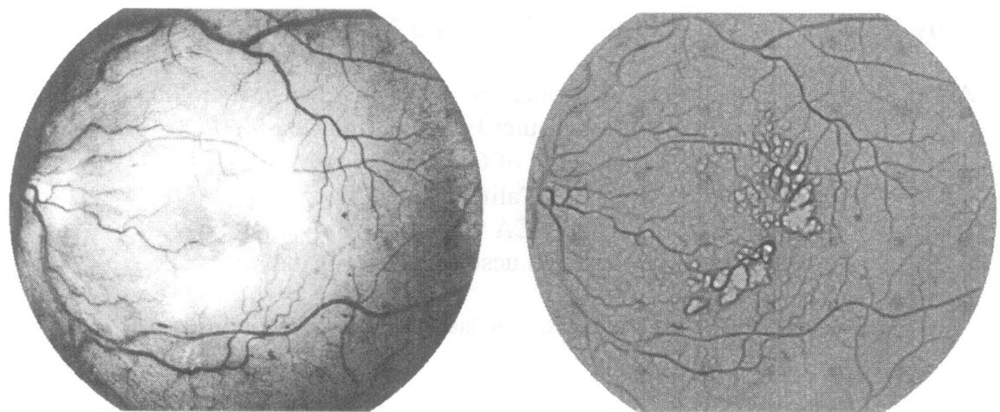
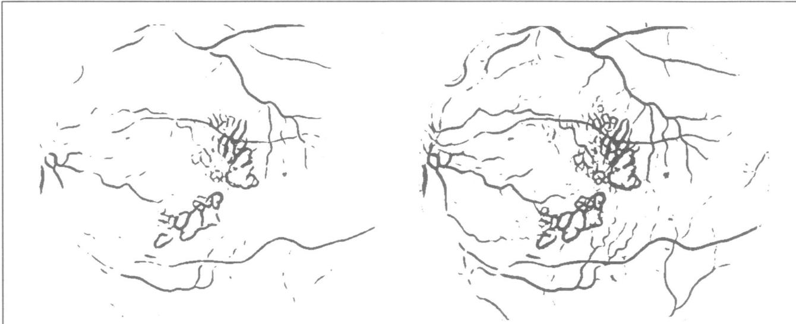
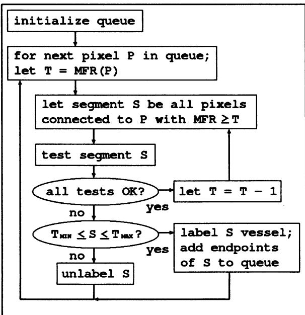
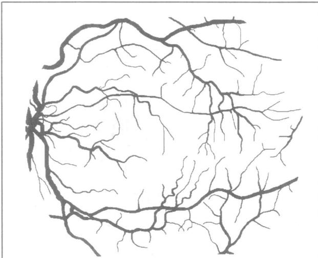
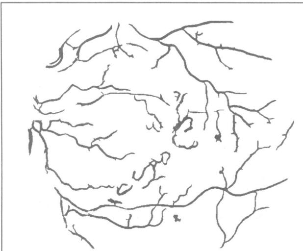

# Locating Blood Vessels in Retinal Images by Piece-wise Threshold Probing of a Matched Filter Response

Adam Hoover, Ph.D.\*, Valentina Kouznetsova, Ph.D.\*, Michael Goldbaum, M.D.

+Electrical and Computer Engineering Department

Department of Ophthalmology

University of California, San Diego

La Jolla, CA 92093-0407

hoover or vkouznet@vision.ucsd.edu, mgoldbaum@ucsd.edu

Key words: medical image processing, retinal imaging, blood vessel segmentation

## ABSTRACT

We describe an automated method to locate and outline blood vessels in images of the ocular fundus. Such a tool should prove useful to eyecare specialists for purposes of patient screening, treatment evaluation, and clinical study. Our method differs from previously known methods in that it uses local and global vessel features cooperatively to segment the vessel network. A comparison of our method against hand-labeled ground truth segmentations of five images yielded 65% sensitivity and 81% specificity. A previously known technique yielded 69% sensitivity and 63% specificity. For a baseline, we also compared the ground truth against a second hand labeling, yielding 80% sensitivity and 90% specificity. These numbers indicate our method improves upon the previously known technique, but that further improvement is still possible.

## INTRODUCTION

Blood vessel appearance is an important indicator for many diagnoses, including diabetes, hypertension, and arteriosclerosis. Vessels and arteries have many observable features, including diameter, color, tortuosity (relative curvature), and opacity (reflectivity). Artery-vein crossings and patterns of small vessels can also serve as diagnostic indicators. An accurate delineation of the boundaries of blood vessels makes precise measurements of these features possible. These measurements may then be applied to a variety of tasks, including diagnosis, treatment evaluation, and clinical study.

We describe an automated method to locate and outline blood vessels in images of the ocular fundus. With this tool, eyecare specialists can potentially screen larger populations for vessel abnormalities. Precise measurements may be more easily recorded, for instance for evaluation of treatment or for clinical study. Observations based upon such a tool would also be more systematically reproduceable.

Previous methods to segment blood vessels automatically have concentrated primarily on their local attributes. Vessels may be characterized by the expected color (reddish), shape (curvilinear), gradient (strength of boundary), and contrast (with background). Unfortunately, this description is not exclusive. For suitable ranges of these attributes, other image manifestations, such as the boundaries of the optic nerve and some hemorrhages and lesions, can exhibit the same local attributes as vessels.

Figure 1 shows an example retinal image, along with an image showing the result of the matched filter convolution described in [1]. The strength of the matched filter response (MFR) is coded in greyscale: the darker a pixel, the stronger the response. Notice that the strong responses in the center of the MFR image, which are obviously not vessel, are unfortunately much stronger than the responses on the left side of the MFR image, which are vessel. Therefore, applying a single global threshold does not provide adequate classification, as shown in Figure 2.

We propose a novel method to segment blood vessels that compliments local vessel attributes with region-based attributes of the network structure. A piece of the blood vessel network is hypothesized by probing an area of the MFR image, iteratively decreasing the threshold. At each iteration, regionbased attributes of the piece are tested to consider probe continuation, and ultimately to decide if the piece is vessel. Pixels from probes that are not classified as vessel are recycled for further probing. The strength of this approach is that individual pixel labels are decided using local and region-based properties.

## RELATED WORK

Previous methods to segment blood vessels generally fall into three categories: window-based [1,2,3], classifier-based [4,5], and tracking-based [6,7]. Window-based methods, such as edge detection, estimate a match at each pixel for a given model against the pixel's surrounding window. In [1], the cross section of a vessel in a retinal image was modeled by a Gaussian shaped curve, and then detected using rotated matched filters. In [2], a similar method was used for artery detection in angiograms. In [3], a window surrounding a vessel was modeled by a neural network trained on user-selected examples. The drawback of these methods is that the large-scale properties of vessels (i.e., their network structure) must be ignored to insure computational feasibility.

  
Figure 1: An example retinal image with obscured vessels (left) and matched filter response (right). The response is coded such that a darker value represents a stronger response.

Classifier-based methods proceed in two steps. First, a low-level algorithm produces a segmentation of spatially-connected regions. These candidate regions are then classified as being vessel or not vessel. In [4], regions segmented by user-assisted thresholding were classified as blood vessel or leakage according to their length to width ratio. In [5], regions segmented by the method in [1] were classified as vessel or not vessel according to many properties, including their response to a classic operator designed to detect roads in aerial imagery [8]. The drawback of these methods is that the large-scale properties of vessels cannot be applied to the problem until after the low-level segmentation has already finished. Therefore, these properties cannot be used to drive the segmentation, merely to evaluate it.

Tracking-based methods utilize a profile model to step along and segment a vessel incrementally. In [6], a Hough transform is used to locate the papilla in a retinal image. Vessel tracing proceeds iteratively from the papilla, halting when the response to a onedimensional (cross-section) matched filter falls below a given threshold. In [7], a similar method was employed to detect vessels in coronary arteriograms, from user-given starting points. One drawback to these approaches is their proclivity for termination at branch points, which are not well-modeled by onedimensional filters. Another drawback is their reliance upon unsophisticated methods for locating starting points.

In [9], a method for tracking edge paths is used to segment arteries in cineangiograms. Edge paths are modeled as Markov chains. A sequential edge linking (SEL) algorithm is introduced to search the possible set of paths for the best fit to the Markov model. The probabilities of the model are adjusted to reflect the properties of the desired path, such as the tolerance to local curvature. A strength of this approach is that the grouping operation works upon actual gradient values, as opposed to a thresholded response. Therefore, a segmentation decision is not reached until an arbitrary number of pixels is available for classification. A drawback to the approach is that branches are not modeled, so that each branch must be traced and classified independently.

In this work, we propose a new method for segmenting blood vessels in a retinal image. The MFR image, computed as described in [1], is thresholded using a novel probing technique. The probe examines the image in pieces, testing a number of region-based properties. If the probe decides a piece is vessel, then the constituent pixels are simultaneously segmented and classified. Contrasted against classifier-based methods, our probing method allows a pixel to be tested in multiple region configurations before final classification.Contrasted against tracking-based methods, our probing method is driven by a twodimensional matched filter response. Contrasted against [9], our probing method is region-based, and so naturally allows for multiple branches.

  
Figure 2: Matched filter response thresholded at two different values. There is a strong overlap between true positive and false positive responses.

## ALGORITHM

The basic operation of the algorithm is to probe regions in a matched filter response (MFR) image. During each probe, a set of criteria is tested to determine the threshold of the probe, and ultimately to decide if the area being probed (termed a piece) is blood vessel. A flowchart for the algorithm is shown in Figure 3. A queue of points is initialized, each of which will be used for a probe. Upon a probe's completion, if the piece is determined to be vessel, then the endpoints of the piece are added to the queue. In this way, different probes (and thusdifferent thresholds) can be applied throughout the image.

  
Figure 3: Flowchart of algorithm.

The following steps initialize a queue of pixels that are to be used as starting points for probing:

Convolve the matched filter described in [1] with the image, producing a matched filter response (MFR) image.

Using a histogram of the MFR image, threshold the image such that > TrhREs pixels are above the threshold.

Thin the thresholded image (for instance, using the algorithm given in [10], pg. 59).

In the thinned image, erase (relabel as background) all branchpoints, breaking up the entire foreground into segments that contain two endpoints each. Endpoints may be discovered as any pixel for which a traverse of the eight bordering pixels in clockwise order yields only one foreground-to-backgroundtransition. Similarly, branchpoints may be discovered as any pixel for which the same traverse yields more than two transitions.

• Discard segments with less than $T _ { M N }$ pixels.

All remaining endpoints are placed in the probe queue.

Each pixel in the probe queue is used as a starting point for threshold probing. The probing is iterative; the iterations are used to determine an appropriate threshold for the area being probed. The initial threshold is the MFR image value at the starting pixel. In each iteration, a region is grown from the start pixel, using a conditional paint-fill technique. The paint-fill spreads across all connecting pixels that are not already labeled and that are above the current threshold. Once the paint-fill is complete, the desired attributes of the grown region are tested. If the region passes the tests, then the threshold is decreased by one, and a new iteration begins. Each probe iteration conducts the following tests:

If the piece size (in pixels) exceeds $T _ { M A X } ,$ then the probe halts. This requires multiple pieces (and thus potentially multiple thresholds) to segment the entire image. The effect is that the probe adapts to the local strength of the MFR image.

If the threshold reaches zero, then the probe halts. This happens when probing a small area (even one pixel) interior to an area already classified as vessel.

If the piece touches (on its border) more than one previously vessel-classified piece, then the probe halts. This is particularly useful for bridging gaps along vessels exhibiting weak MFR values.

If the ratio border-pixels-touching-another-piece : total-pixels-in-piece $> T _ { F R I N G E } ,$ then the piece is fringing, and the probe halts. This prevents a probe from searching along the borders of vessel pieces already segmented.

If the piece grows a loop, then the probe halts. Loops are detected by thinning the piece, and counting the endpoints and branchpoints. If the number of endpoints exceeds the number of branchpoints by more than two, there is a loop. This test prevents a probe from searching along circular MFRs, such as those caused by some lesions and hemorrhages.

If the ratio total-pixels-in-piece : branches-in-$p i e c e < T _ { T R E E } ,$ then the probe halts. This requires a piece to have a minimum span of vessel(s) per branch, and thus prevents over-branching down false paths.

Once the probe is complete, if the resulting region has at least $T _ { M N }$ pixels, but less than $T _ { M A X }$ pixels, then the region is labeled as vessel. The endpoints of the vessel piece are added to the queue. If the region is not determined to be vessel, then its pixels are left unlabeled. In either case, the next point in the queue is selected for probing. When the queue is empty, the algorithm is complete.

## EXPERIMENTS

Five retinal fundus slides were selected for testing the described method. Each slide was digitized to produce a $6 0 5 ~ \times ~ 7 0 0$ pixel image, 24-bits per pixel (standard RGB). All five images contain abnormalities that obscure or confuse the blood vessel appearance. This selection was made for two reasons. First, most of the referenced methods have only been demonstrated upon normal vessel appearances, which are easier to discern. Second, some level of success with nonnormal vessel appearances must be established to recommend clinical usage.

  
Figure 4: A hand-labeled segmentation of the vessels in the example image.

Each of these five images was carefully labeled by hand, to produce a ground truth segmentation of vessels. An example is shown in Figure 4. Each of the five images was processed by the described algorithm, using the parameters $T _ { T H R E S H } = 3 0 8 0 0 , \ T _ { M I N } = 1 5 0 ,$ $T _ { M A X } = 3 5 0 0 , T _ { F R I N G E } = 0 . 3$ , and $T _ { T R E E } = 2 0 0$ . These values were selected after exploratory experiments, except for $T _ { T H R E S H } ,$ which was selected as the average number of pixels labeled as vessel in the ground truth images. An example result is shown in Figure 5. For comparison, each of the five images was globally thresholded using the same value of $T _ { T H R E S H } .$ Figure 2 (right) shows this result for the example.

Each global-segmented result and probingsegmented result was compared against the ground truth, as follows. The percentage of pixels correctly segmented as vessel (true positive) was calculated as the number of pixels segmented as vessel that were within one pixel's distance of a pixel hand labeled as vessel, divided by the total number of pixels hand labeled as vessel. The percentage of pixels incorrectly segmented as vessel (false positive) was calculated as the number of pixels segmented as vessel that were not within one pixel's distance of a pixel hand labeled as vessel, divided by the total number of pixels hand labeled as vessel. The tolerance of one pixel in distance was used to help minimize measurement error. For all five images, the global-segmented result had 69% sensitivity (true positive rate) and 63% specificity (37% false positive rate). The probingsegmented result had 65% sensitivity and 81% specificity.

  
Figure 5: The result of threshold probing on the example image.

## CONCLUSIONS

The described method segments roughly twothirds of the vessels in a retinal fundus image. Compared to a previously reported method [1], which uses only a global threshold, the proposed method produces roughly half the false positive responses, and a slightly decreased true positive response. The latter is mainly attributable to the restriction upon the approach to produce connected vessel segmentations. A global threshold is likely to segment small groups of isolated pixels, as in Figure 2. Although such pixels may actually be correctly labeled, their utility for measurement is probably limited.

In order to explore our method of evaluation further, a second person produced an additional set of hand-labeled ground truth for the five test images. This second set of ground truth was compared to the first set of ground truth exactly as described above, yielding 80% sensitivity and 90% specificity. This suggests some interesting conclusions. First, the vessels in the images selected for testing may in fact be too difficult to discern with 100% accuracy, so that our results must be viewed accordingly. In contrast, our method of evaluation may need to be changed so that competing hand-labeled ground truths score near perfect, thus more accurately reflecting the strength of automated approaches. Finally, we note that in either case there is still measurable room for improvement.

## ACKNOWLEDGMENTS

This work was supported by NIH Library of Medicine grant LM 05759-09.

## REFERENCES

[1] S. Chaudhuri, S. Chatterjee, N. Katz, M. Nelson and M. Goldbaum, \`Detection of Blood Vessels in Retinal Images Using Two-Dimensional Matched Filters", in IEEE Trans. on Medical Imaging, vol. 8, no. 3, Sep. 1989, pp. 263-269.

[2] T. Pappas and J. Lim, \`A New Method for Estimation of Coronary Artery Dimensions in Angiograms", in IEEE Trans. On Acoustics, Speech, and Signal Processing, vol. 36, no. 9, Sep. 1988, pp. 1501-1513.

[3] R. Nekovei, Y. Sun, \`Back-Propagation Network and its Configuration for Blood Vessel Detection in Angiograms", in IEEE Trans. on Neural Networks, vol. 6, no. 1, Jan. 1995, pp. 64-72.

[4] S. Tamura, K. Tanaka, S. Ohmori, K. Okazaki, A. Okada and M. Hoshi, \`Semiautomatic Leakage Analyzing System for Time Series Fluorescein Ocular Fundus Angiography", in Pattern Recognition, vol. 16, no. 2, 1983, pp. 149-162.

[5] B. Cote, W. Hart, M. Goldbaum, P. Kube and M. Nelson, \`Classification of Blood Vessels in Ocular Fundus Images", technical report, Computer Science and Engineering Dept., University of California, San Diego, 1994.

[6] S. Tamura, Y. Okamoto and K. Yanashima, \`Zero-Crossing Interval Correction in Tracing Eye-Fundus Blood Vessels", in Pattern Recognition, vol. 21, no. 3, 1988, pp. 227-233.

[7] Y. Sun, \`Automated Identification of Vessel Contours in Coronary Arteriograms by an Adaptive Tracking Algorithm", in IEEE Trans. on Medical Imaging, vol. 8, no. 1, March 1989, pp. 78-88.

[8] M. Fischer, J. Tenenbaum and H. Wolf, \`Detection of roads and linear structures in low resolution aerial imagery using a multisource knowledge integration technique", in Computer Graphics and Image Processing, vol. 15, no. 3, 1981, pp. 201-223.

[9] P. Eichel, E. Delp, K. Koral and A. Buda, \`A Method for a Fully Automatic Definition of Coronary Arterial Edges from Cineangiograms", in IEEE Trans. on Medical Imaging, vol. 7, no. 4, Dec. 1988, pp. 313-320.

[10]R. Jain, R. Kasturi and B. G. Schunck, Machine Vision, McGraw-Hill, 1995.