# An Ensemble Classification-Based Approach Applied to Retinal Blood Vessel Segmentation

Muhammad Moazam Fraz\*, Paolo Remagnino, Andreas Hoppe, Bunyarit Uyyanonvara, Alicja R. Rudnicka, Christopher G. Owen, and Sarah A. Barman

Abstract—This paper presents a new supervised method for segmentation of blood vessels in retinal photographs. This method uses an ensemble system of bagged and boosted decision trees and utilizes a feature vector based on the orientation analysis of gradient vector field, morphological transformation, line strength measures, and Gabor filter responses. The feature vector encodes information to handle the healthy as well as the pathological retinal image. The method is evaluated on the publicly available DRIVE and STARE databases, frequently used for this purpose and also on a new public retinal vessel reference dataset CHASE\_DB1 which is a subset of retinal images of multiethnic children from the Child Heart and Health Study in England (CHASE) dataset. The performance of the ensemble system is evaluated in detail and the incurred accuracy, speed, robustness, and simplicity make the algorithm a suitable tool for automated retinal image analysis.

Index Terms—Ensemble classification, medical image analysis, retinal blood vessels, segmentation.

## I. INTRODUCTION

UNDUS imaging is being increasingly used to establish mality. A number of retinal blood vessel features (e.g., arteriolar microaneurysms, nicking, narrowing) have been linked to systemic disease, and the morphological characteristics of retinal blood vessels themselves have been associated with cardiovascular and coronary disease in adult life [1] and with retinopathy of prematurity in infancy [2]. The morphology of retinal vessels (particularly arterioles) has also been linked to cardiovascular risk factors both in early and adult life [3]. The detection and analysis of the retinal vasculature is useful in the implementation of screening programs for diabetic retinopathy, the evaluation of retinopathy of prematurity, foveal avascular region detection, arteriolar narrowing detection, the determination of the relationship between vessel tortuosity and hypertensive retinopathy, measurement of vessel diameter to diagnose cardiovascular diseases and hypertension, and computer-assisted laser surgery [4]. The retinal map generation and branch point detection have been used for temporal or multimodal image registration, retinal image mosaic synthesis, optic disc identification, and fovea localization and for biometric identification [4]. Retinal vessels are composed of arteriolars and venules, which appear as elongated branched features emanating from the optic disc within a retinal image. Retinal vessels often have strong light reflexes along their centerline, which is more apparent on arteriolars than venules, and in younger compared to older patients, especially those with hypertension. The vessel cross-sectional intensity profiles approximate to a Gaussian shape, or a mixture of Gaussians in the case where a central vessel reflex is present. The nonvessel region in the retina is not smooth due to the presence of the bright and dark lesions which includes hemorrhages, exudates, drusen, and the optic disc boundary. Most of the existing retinal segmentation methodologies are evaluated on the healthy retinal images free from the pathologies; therefore, their performance can be considerably degraded in the presence of lesions.

This paper presents a new supervised method for segmentation of blood vessels by using an ensemble classifier of boosted and bagged decision trees. The feature vector is based on gradient orientation analysis (GOA), morphological transformation with linear structuring element; line strength measures and the Gabor filter response which encodes information to successfully handle both normal and pathological retinas with bright and dark lesions simultaneously. The classifier based on the boot strapped and boosted decision trees is a classic ensemble classifier which has been widely used in many application areas of image analysis, but has not been applied within the framework of retinal vessel segmentation for automated retinal image analysis. The obtained performance metrics illustrate that this method outperforms most of the state-of-the-art methodologies of retinal vessel segmentation. The method is training set robust as it offers a better performance even when it is trained on the DRIVE database [5] and tested on the STARE database [6], thus making it suitable for images taken under different conditions without retraining. This attribute is particularly useful when implementing the screening programs over a large multiethnic population where there is a large variability in the background pigmentation level of the acquired retinal images. Moreover, the algorithm is computationally fast in training and classification and needs fewer samples for training. The classification accuracy of the ensemble can be estimated during the training phase without supplying the test data. A new public database CHASE\_DB1 [7] is also introduced for the evaluation of the algorithm. This image database includes retinal images of 9- and 10-year-old children of different ethnic origin, along with the ground truths for annotated blood vessels. The database includes images with stark differences in background levels of retinal pigmentation (being more pigmented in South Asians compared to white Europeans).

The organization of this paper is as follows. In Section II, the retinal vessel segmentation methodologies available in the literature are reviewed. The methodology and implementation details are presented in Section III. In Section IV, the performance metrics, the accuracy, and the robustness of the algorithm are assessed by experiments. Finally, a discussion and conclusion are given in Section V.

## II. RELATED WORK

There is a substantial amount of work reported in the literature for detecting blood vessels in retinal images. A recent detailed review of these methods can be found in [4]. The vessel segmentation algorithms can be classified into two broad categories: the unsupervised and supervised methods.

## A. Unsupervised Methods

The unsupervised methods can be further classified into techniques based on matched filtering, morphological processing, vessel tracking, multiscale analysis, and model-based algorithms. The matched filtering methodology exploits the piecewise linear approximation, the decrease in vessel diameter along vascular length, and the Gaussian-like intensity profile of retinal blood vessels and uses a kernel based on a Gaussian or its derivatives to enhance the vessel features in the retinal image [6], [8] Mathematical morphology in combination with curvature evaluation [9] and matched filtering for centreline detection [10], [11] is also exploited for retinal vessel segmentation. The algorithms based on the vessel tracking [12] segment a vessel between two points using local information and work at the level of a single vessel rather than the entire vasculature. The multiscale approaches are based on scale-space analysis. The multiscale second-order local structure of an image (Hessian) is examined and a vesselness measure is obtained on the basis of eigenvalue analysis of the Hessian [13]. The model-based approaches include the vessel profile models [14]–[17], active contour models [18], and geometric models based on level sets [19].

## B. Supervised Methods

The supervised segmentation methods utilize ground truth data for the classification of vessels based on given features. Niemeijer et al. [20] extracted a feature vector for each pixel that consists of the Gaussian and its derivatives at multiple scales, augmented with the green plane of the RGB image, and then uses a K-nearest neighbor algorithm to estimate the probability of the pixel belonging to a vessel. Staal et al. [5] used ridge profiles to compute 27 features for each pixel and applied a feature selection scheme to pick those which result in better class separability by a kNN classifier. In [21], six features are computed by employing a multiscale analysis using a Gabor wavelet transform and Gaussian mixture model (GMM) Bayesian classifier. Ricci and Perfetti [22] used line operators and support vector machine (SVM) classification with three features per pixel. Lupascu et al. [23] introduced a feature-based Ada-Boost classifier for vessel segmentation which utilizes a 41-D feature vector at different spatial scales for each pixel. In [24], a 7-D feature vector is computed by combination of moment-invariant and gray-level features and a five-layer feed-forward neural network is used for classification. You et al. [25] computed the feature vector by using the steerable complex wavelet followed by calculating the line strength [22]; the SVM is used for semisupervised classification. In this study, we have presented a decision treebased ensemble classifier which requires fewer features and is computationally simpler than other methods and also training set robust.

## III. METHODOLOGY

## A. Feature Vector

The feature vector contains the quantifiable measurement for each pixel in such a way that the classifier successfully differentiates the blood vessels and the bright and dark lesions. We have used a 9-D feature vector which includes the orientation analysis of gradient vector field (one feature) for removal of bright and dark lesions with vessel enhancement, morphological transformation (one feature) for eradicating bright lesions, line strength measures (two features), and a Gabor filter response at multiple scales (four features) for eliminating the dark lesions. The intensity of each pixel in the inverted green channel is taken as one of the features. All the features are extracted from the green plane of the RGB colored image without any preprocessing.

1) Orientation Analysis of a Gradient Vector Field: The blood vessels are localized by analyzing the orientation of the gradient vector field. The unit gradient vectors of the image are highly discontinuous along the bilaterally symmetrical regions, i.e., the linear structures which represent the blood vessels. Therefore, the blood vessels are localized by finding the discontinuities in the gradient orientation. The feature extraction depends on the orientation of the gradient vector field not its magnitude; therefore, it is robust against low contrast and nonuniform illumination [26].

The gradient vectors for the image $I ( x , y )$ are approximated by the first-order derivative operators in the horizontal $( k _ { x } )$ and vertical $( k _ { y } )$ directions

$$
\begin{array} { l } { g _ { x } ( x , y ) = I ( x , y ) \ast k _ { x } } \\ { g _ { y } ( x , y ) = I ( x , y ) \ast k _ { y } . } \end{array}\tag{1}
$$

The gradient vectors $g _ { x } \left( x , y \right)$ and $g _ { y } \left( x , y \right)$ are normalized by dividing with their magnitude to compute the unit gradient vectors $u _ { x } ( x , y )$ and $u _ { y } \left( x , y \right)$ ..

$$
\begin{array} { r } { u _ { x } ( x , y ) = g _ { x } ( x , y ) / \sqrt { g _ { x } ^ { 2 } ( x , y ) + g _ { y } ^ { 2 } ( x , y ) } } \\ { u _ { y } ( x , y ) = g _ { y } ( x , y ) / \sqrt { g _ { x } ^ { 2 } ( x , y ) + g _ { y } ^ { 2 } ( x , y ) } . } \end{array}\tag{2}
$$

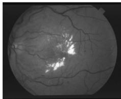

(a)  
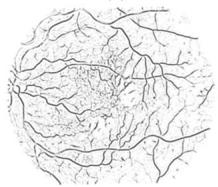

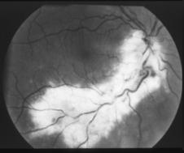  
(b)

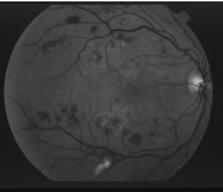

(d)  
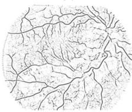  
(e)

(c)  
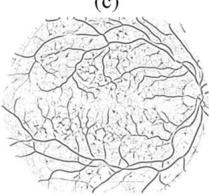  
(f)  
Fig. 1. GOA map of blood vessels (shown inverted). (a) and (b) Retinal images with bright lesions; (c) retina with dark lesions; (d)–(f) GOA map of retinal images in a, b, and c, respectively.

The unit vectors are assigned to zero if the gradient magnitude is too small (<3 out of 255). The first derivatives of unit vectors are computed to find the discontinuities in gradient orientation, as

$$
\begin{array} { l } { d _ { x x } ( x , y ) = u _ { x } ( x , y ) * k _ { x } } \\ { d _ { x y } ( x , y ) = u _ { x } ( x , y ) * k _ { y } } \\ { d _ { y x } ( x , y ) = u _ { y } ( x , y ) * k _ { x } } \\ { d _ { y y } ( x , y ) = u _ { y } ( x , y ) * k _ { y } . } \end{array}\tag{3}
$$

The discontinuity magnitude in the gradient orientation $D ( x , y )$ is expressed in terms of the first derivatives of unit vectors as

$$
D ( x , y ) = d _ { x x } ^ { 2 } ( x , y ) + d _ { x y } ^ { 2 } ( x , y ) + d _ { y x } ^ { 2 } ( x , y ) + d _ { y y } ^ { 2 } ( x , y ) .\tag{4}
$$

$D ( x , y )$ contains the GOA map of enhanced blood vessels. There is a variance in vessel width as it travels radially from the optic disk. Therefore, the first-order derivative operator is employed at multiple scales $( \sigma = \{ \sqrt { 2 } , 2 \sqrt { 2 } , 4 \} )$ to generate the multiple GOA maps of blood vessels of different widths. The final GOA map which also serves as one of the chosen feature vectors is obtained by summing up the individual maps produced at multiple scales. The GOA maps containing the enhanced blood vessels are shown in Fig. 1. It is observed that only the curvilinear shaped blood vessels are enhanced despite the presence of irregular shaped bright lesions in the first two images and the dark lesions in the third image.

2) Morphological Transformation: The morphological opening using a linear structuring element oriented at a particular angle will eradicate a vessel or part of it when the structuring element cannot be contained within the vessel. This happens when the vessel and the structuring element have orthogonal directions and the structuring element is longer than the vessel width

$$
I _ { \mathrm { t h } } ^ { \theta } = I - ( I o S _ { e } ^ { \theta } )\tag{5a}
$$

$$
I s _ { \mathrm { t h } } = \sum _ { \theta \in A } I _ { \mathrm { t h } } ^ { \theta } .\tag{5b}
$$

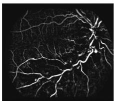  
(a)

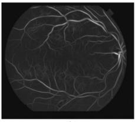  
(b)

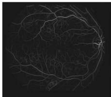  
(c)  
Fig. 2. (a) Morphological transformation on retinal image with bright lesion shown in Fig. 1(b). (b) Gabor filter response (scale $\sigma = 3 )$ on image with dark lesions shown in Fig. 1 (c). (c) Line strength image on image with dark lesions shown in Fig. 1(c).

The morphological top-hat transformation is shown in (5a) where $^ { \mathrm { \left. \right.} } I _ { \mathrm { t h } } ^ { \theta \ { \mathrm {  } } }$ is the top-hat transformed image, $" T "$ is the image to be processed, “Se" is structuring elements for morphological opening, $" o , "$ and “θ"is the angular rotation of the structuring element. If the opening along a class of linear structuring elements is considered, a sum of top-hat along each direction will brighten the vessels regardless of their direction, provided that the length of the structuring elements is large enough to extract the vessel with the largest diameter. Therefore, the chosen structuring element is 21 pixels long 1 pixel wide and is rotated at an angle spanning [0, π] in steps of π/8. Its size is approximately in the range of the diameter of the largest vessels in the retinal image. The sum of top-hat “Isth" is depicted in (5b), which is the summation of the top-hat transformation described in (5a). The set “A" consists of the angular orientations of structuring element and can be defined as $\{ x | 0 \leq x \leq \pi$ &x mod $( \pi / 8 ) = 0 \}$ . The sum of the top-hat on the retinal image will enhance all vessels whatever their direction, including small or tortuous vessels eliminating the bright zones as depicted in Fig. 2(a).

3) Multiscale Gabor Filter: A Gabor filter is a linear filter and has been broadly used for multiscale and multidirectional edge detection. The Gabor filter can be fine-tuned to particular frequencies, scales, and directions, and therefore acts as a low-level feature extractor and background noise suppressor. The impulse response of a Gabor filter kernel is defined by the product of a Gaussian kernel and a complex sinusoid. It can be expressed as

$$
g ( x , y ) = \exp \left\{ - 0 . 5 \left( \frac { x ^ { \prime 2 } + \gamma y ^ { \prime 2 } } { 2 \sigma ^ { 2 } } \right) \right\} \exp \left\{ i \left( 2 \pi \frac { x ^ { \prime } } { \lambda } + \psi \right) \right\}\tag{6}
$$

where λ is the wavelength of the sinusoidal factor, θ is the orientation, ψ is the phase offset, σ is the scale of the Gaussian envelope, γ is the spatial aspect ratio, $x ^ { \prime } = x \cos \theta + y$ sin θ, and $y ^ { \prime } = - x \sin \theta + y \cos \theta$

The Gabor filter response to the inverted green channel of the colored retinal image is obtained by a 2-D convolution operator and is computed in the frequency domain. The detailed procedure can be seen in [21] and [27]. The maximum filter response over the angle θ, spanning [0, π] in steps of π/18, is computed for each pixel in the image at different scales $( \sigma = \{ 2 , 3 , 4 , 5 \} )$ 1 The maximum response across the orientation at a scale is taken as the pixel feature vector. The feature space is normalized to zero mean and unit standard deviation by applying the normal transformation. The filter response of the image containing dark lesions is shown in Fig. 2(b), illustrating the removal of dark lesions while enhancing the blood vessels.

4) Line Strength Features: The retinal vasculature appears as piecewise linear features, with variation in width and their tributaries visible within the retinal image. The concept of employing line operators for the detection of linear structures in medical images is introduced in [28] which is modified and extended in [22] to incorporate the morphological attributes of retinal blood vessels. The average gray level is measured along lines of a particular length passing through the pixel under consideration at 12 different orientations spaced by $1 5 ^ { \circ }$ each. The line with the highest average gray value is marked. The line strength of a pixel is calculated by computing the difference in the average gray values of a square subwindow centered at the target pixel with the average gray value of the marked line. The calculated line strength for each pixel is taken as the pixel feature vector. The line strength image can be observed in Fig. 2(c), where the elimination of dark lesions can be observed with the enhanced blood vessels map.

5) Ensemble Classifier: Ensemble classification [29] is the process by which multiple classifiers are strategically generated and combined to solve a particular machine learning problem. Ensemble learning is primarily used to improve the classification or prediction performance of a model, or reduce the likelihood of a poor or unfortunate selection. This approach is intuitively used in our daily lives where we seek the guidance of multiple experts, weigh, and combine their views in order to make a more informed and optimized decision. In the same way, the ensemble methods use multiple models or classifiers to obtain better predictive performance by combining the results from many weak learners into one high-quality ensemble predictor. In this approach, we have used the decision trees as the classification model and the results of these weak learners are combined using bootstrap aggregation also known as bagging [30] and the boosting [31] algorithms.

In bagging, the decision trees are grown on the bootstrap replicas of the training dataset which are generated by randomly selecting M observations out of N with replacement, where N is the training set size. The predicted responses of the individual classifiers are then combined by taking a majority vote of their decisions. For any given instance, the class chosen by most classifiers is the ensemble decision. Picking up the M out of N observations with replacement omits on average 37% of observations for each decision tree. These are “out-of-bag" observations and can be used to estimate the predictive power of the classifier as well as the importance of each individual feature from the feature vector in the decision-making process. The average out-of-bag error is estimated by comparing the out-ofbag predicted responses against the observed responses for all observations used for training, which is an unbiased estimator of the true ensemble error. The out-of-bag estimated feature of importance can be obtained by randomly permuting out-of-bag data across one variable or column at a time and estimating the increase in the out-of-bag error due to this permutation. The larger the increase, the more important the feature in classification. Thus, an attractive feature of bagging is that the reliable estimates of predictive power and feature importance can be obtained during the training process without supplying the test data.

Boosting also creates an ensemble of classifiers by resampling the data, which are then combined by majority voting but it takes a different resampling approach than bagging, which maintains a constant probability of 1/N for selecting each individual example. Given training dataset D of N instances for a binary classification problem, the first classifier C1 is trained on a training subset D1 obtained using a bootstrap sample of $m <$ N instances. The training data subset S2 for the second classifier C2 is chosen such that exactly half of D2 is correctly classified by C1 and the other half is misclassified. The third classifier C3 is then trained with instances on which C1 and C2 disagree. The three classifiers are combined through a three-way majority vote. The altered distribution ensures that more informative instances are drawn into the next dataset. This iterative distribution update makes the boosting algorithm a strong learner with arbitrarily high accuracy that is obtained by combining weak learners.

A number of variants of boosting are available in the literature. We have used AdaBoostM1 and its variation Logit-Boost [32] which are popular algorithms for binary classification. AdaboostM1 trains the learners in a sequential manner such that for every learner $^ { * * } k ,$ ' the weighted classification error is computed as

$$
\varepsilon _ { k } = \sum _ { n = 1 } ^ { N } d _ { n } ^ { k } I ( y _ { n } = h _ { k } ( x _ { n } ) )\tag{7}
$$

where $x _ { n }$ is the predictor value vector for n observations, $y _ { n }$ is the class label, $h _ { k }$ is the hypothesis, I is the indicator function, and $d _ { n } ^ { k }$ is the weight of observation at step k. The algorithm then increases weights for observations misclassified by learner k and reduces weights for observations correctly classified by learner k. The next learner $k + 1$ is then trained on the data with updated weights $d _ { n } ^ { k + 1 }$

The trained classifier then computes the prediction for new data using

$$
f ( x ) = \sum _ { k = 1 } ^ { K } \alpha _ { k } h _ { k } ( x )\tag{8}
$$

such that $\begin{array} { r } { \alpha _ { k } = 0 . 5 \log \frac { 1 - \varepsilon _ { k } } { \varepsilon _ { k } } } \end{array}$ are the weights for weak hypotheses in the ensemble.

LogitBoost works similarly to AdaBoostM1, except that AdaboostM1 iteratively minimizes the exponential loss as

$$
\sum _ { n = 1 } ^ { N } w _ { n } \exp ( - y _ { n } f ( x _ { n } ) )\tag{9}
$$

whereas LogitBoost minimizes the binomial deviance which can be expressed as

$$
\sum _ { n = 1 } ^ { N } w _ { n } \log ( 1 + \exp ( - 2 y _ { n } f ( x _ { n } ) ) )\tag{10}
$$

where $y _ { n } \in \{ - 1 , + 1 \}$ is the true class label, $w _ { n }$ are observation weights normalized to add up to 1, and $f ( x _ { n } ) \in ( - \infty , + \infty )$

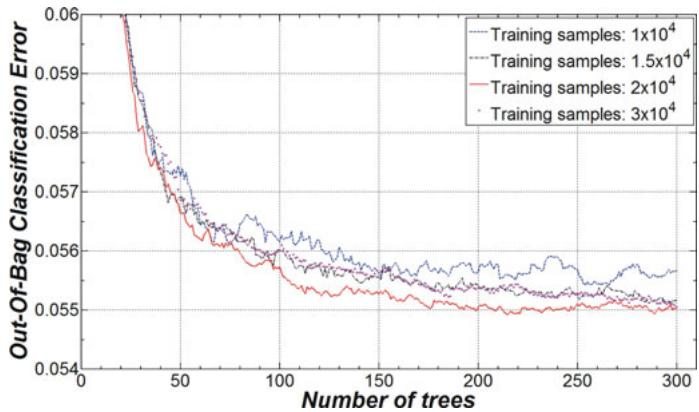  
Fig. 3. OOB classification error as a function of number of training samples and the weak learners.

is the predicted classification score. Binomial deviance assigns less weight to badly misclassified observations which have large negative values of $y _ { n } f ( x _ { n } ) )$ 1

6) Classification: Each pixel in the retinal image is characterized by a vector in 9-D feature space

$$
F v ( x , y ) = [ f _ { 1 } ( x , y ) , f _ { 2 } ( x , y ) , \ldots , f _ { 9 } ( x , y ) ] .\tag{11}
$$

A classification procedure assigns one of the classes $C _ { v } ( \mathrm { v e s s e l } )$ or $C _ { \mathrm { n v } }$ (nonvessels) to each candidate pixel when its representation in feature space $F _ { v ( x , y ) }$ is known. One of the key advantages of ensemble based on bootstrap aggregation is that the predictive power can be evaluated by using out-of-bag observations and without employing the test data. More than one ensemble of 300 bagged trees are created and trained with the samples in the range of $1 * 1 0 ^ { 4 }$ and $3 * 1 0 ^ { 4 }$ , in order to find the optimal number of training samples and the number of decision trees. The out-of-bag classification error is then computed for each of the ensemble classifiers. The relationship among the number of decision trees is used to construct the ensemble; the number of training samples and the respective out-of-bag classification error for the DRIVE database is illustrated in Fig. 3.

There is a negligible difference in the out-of-bag classification error of ensembles trained with a range of samples between 1 \* $1 0 ^ { 4 }$ and $3 * 1 0 ^ { 4 }$ but the predictive power of the ensemble trained with $2 * 1 0 ^ { 4 }$ samples is best. The almost straight line in the graph for the out-of-bag classification error after 150 weak learners suggests that there is a negligible increase in ensemble performance if the number of trees used to construct the ensemble is greater than 150, but at the cost of processing time. Therefore, we choose 200 decision trees for creating the ensemble classifiers.

## IV. EXPERIMENTAL EVALUATION

## A. Materials

The methodology has been evaluated using two established publicly available databases (DRIVE and STARE) and a new public database (CHASE\_DB1).

The DRIVE database [5] contains 40 color images of the retina. The image set is divided into test and training sets and each one contains 20 images. The performance of the vessel segmentation algorithms is measured on the test set. The training of the classifier is performed on 20 training images using $2 * 1 0 ^ { 4 }$ samples such that 10 000 pixels at random are chosen from each image. The STARE database [6] contains 20 colored retinal images, out of which 10 images contain pathologies. The STARE database does not have separate test and training sets available. The classifier training for STARE is performed using 75 000 manually segmented pixels randomly extracted from the 20 images (3750 pixels per image). Due to the small size of the training set (0.8% of the entire database), the performance is evaluated on the whole set of 20 images. The CHASE\_DB1 [7] is a new retinal vessel reference dataset acquired from multiethnic school children. This database is a part of the Child Heart and Health Study in England (CHASE), a cardiovascular health survey in 200 primary schools in London, Birmingham, and Leicester [1]. The ocular imaging was carried out in 46 schools and demonstrated associations between retinal vessel tortuosity and early risk factors for cardiovascular disease in over 1000 British primary school children of different ethnic origin [3]. The retinal images of both of the eyes of each child were recorded with a hand-held Nidek NM-200-D fundus camera. The images were captured at 30° FOV with a resolution of $1 2 8 0 \times 9 6 0$ pixels. The dataset of images are characterized by having nonuniform background illumination, poor contrast of blood vessels as compared with the background and wider arteriolars that have a bright strip running down the centre known as the central vessel reflex. This work is based on 14 children recruited from one of the 46 primary schools. The 28 images are divided such that 20 images are included in the test set and 8 images comprise the training set. The training of the classifier is performed on eight training images using $2 * 1 0 ^ { 5 }$ samples such that 25 000 pixels are randomly selected from each of the images. For CHASE\_DB1, the Gabor features are calculated at scales $( \sigma = \{ 3 , 4 , 5 , 6 \} )$ ); the structuring element for morphological transformation is 25 pixels in length.

TABLE I  
VESSEL CLASSIFICATION
<table><tr><td rowspan=1 colspan=1></td><td rowspan=1 colspan=1>Vessel Present</td><td rowspan=1 colspan=1>Vessel Absent</td></tr><tr><td rowspan=1 colspan=1>Vessel detected</td><td rowspan=1 colspan=1>True Positive (TP)</td><td rowspan=1 colspan=1>False Positive (FP)</td></tr><tr><td rowspan=1 colspan=1>Vessel not detected</td><td rowspan=1 colspan=1>False Negative (FN)</td><td rowspan=1 colspan=1>True Negative (TN)</td></tr></table>

For each of the three databases, there are two manual segmentations available made by two independent human observers for each of the images. The manually segmented images in set A by the first human observer are used as a ground truth. The human observer performance is measured using the manual segmentations by the second human observer. The binary mask for the FOV for each of the DRIVE database images is available with the database. We have created the FOV binary mask for each of the images in the STARE and CHASE\_DB1 databases as explained in [21].

## B. Performance Measures

In the retinal vessel segmentation process, any pixel is classified either as vessel or surrounding tissue. Consequently, there are four events: two classifications and two misclassifications which are defined in Table I.

TABLE II  
PERFORMANCE MEASURES FOR RETINAL VESSEL SEGMENTATION
<table><tr><td rowspan=1 colspan=1>Measure</td><td rowspan=1 colspan=1>Description</td></tr><tr><td rowspan=1 colspan=1>SN</td><td rowspan=1 colspan=1>TP/(TP+FN)</td></tr><tr><td rowspan=1 colspan=1>SP</td><td rowspan=1 colspan=1>TN/(TN+FP)</td></tr><tr><td rowspan=1 colspan=1>Acc</td><td rowspan=1 colspan=1>(TP+TN)/(TP+FP+TN+FN)</td></tr><tr><td rowspan=1 colspan=1>PPV</td><td rowspan=1 colspan=1>TP/(TP+FP)</td></tr><tr><td rowspan=1 colspan=1>FDR</td><td rowspan=1 colspan=1>FP / (FP+TP)</td></tr></table>

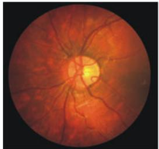  
(a)

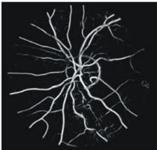  
(b)  
Fig. 4. (a) CHASE\_DB1 colour image. (b) Probability map image.

The accuracy (Acc) is measured by the ratio of the total number of correctly classified pixels to the number of pixels in the image FOV. Sensitivity (SN) reflects the ability of an algorithm to detect the vessel pixels. Specificity (SP) is the ability to detect nonvessel pixels. The positive predictive value (PPV) or precision rate is the probability that an identified vessel pixel is a true positive. These metrics are defined in Table II based on the terms in Table I. In our experiments, these metrics are calculated over all test images, considering only pixels inside the FOV.

In addition, the performance of the algorithm is also measured with the area under receiver operating characteristic (ROC) curve (AUC). An ROC curve is a plot of true positive fractions (SN) versus false positive fractions (1-SP) by varying the threshold on the probability map image.

## C. Method Evaluation

The outcome the ensemble classifier is a vessel probability map, where each value corresponds to the confidence measure of each pixel to be a part of the vessel or not. The probability map is often considered as a grayscale image such that the bright pixels in this image indicate a higher probability of being vessel pixel. The probability map for a CHASE\_DB1 image is shown in Fig. 4(b).

In order to evaluate the ensemble algorithms, we have created three ensemble classifiers: one using the bootstrap aggregation (bagging) and the other two are created by using two boosting algorithms, the AdaBoostM1 and its variation LogitBoost. These classifiers are then employed for vessel segmentation on DRIVE, STARE, and CHASE\_DB1. A vector of true positive fractions (SN) and false positive fractions (1-SP) is obtained for each of the images in the respective image databases by varying the threshold on the probability map image. The ROC is plotted (Fig. 5) for each of the image database and the aggregated area under the curve (AUC) is computed using these vectors and is summarized in Table III.

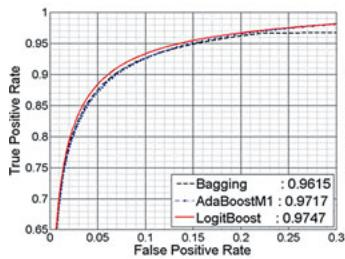  
(a)

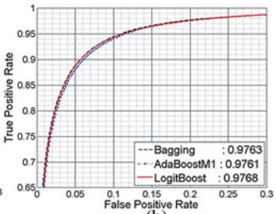  
(b)

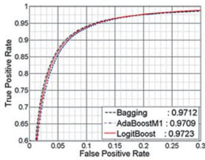  
(c)

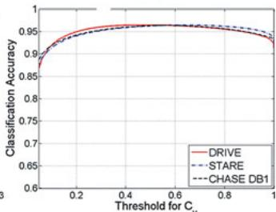  
(d)  
Fig. 5. ROC plots and area under ROC with bagging and boosting for (a) DRIVE, (b) STARE, and (c) CHASE\_DB1. (d) Accuracy as a function of threshold parameter for $C _ { v }$

TABLE III  
AREA UNDER ROC WITH DIFFERENT ENSEMBLES
<table><tr><td rowspan=1 colspan=1>Database</td><td rowspan=1 colspan=1>Bootstrap Aggregation</td><td rowspan=1 colspan=1>AdaBoostM1</td><td rowspan=1 colspan=1>LogitBoost</td></tr><tr><td rowspan=1 colspan=1>DRIVE</td><td rowspan=1 colspan=1>0.9615</td><td rowspan=1 colspan=1>0.9717</td><td rowspan=1 colspan=1>0.9747</td></tr><tr><td rowspan=1 colspan=1>STARE</td><td rowspan=1 colspan=1>0.9763</td><td rowspan=1 colspan=1>0.9761</td><td rowspan=1 colspan=1>0.9768</td></tr><tr><td rowspan=1 colspan=1>CHASE DB1</td><td rowspan=1 colspan=1>0.9712</td><td rowspan=1 colspan=1>0.9709</td><td rowspan=1 colspan=1>0.9723</td></tr></table>

There is fractional difference in the values but results of the LogitBoost algorithm are the best for all of the three retinal image sets. Therefore, we have chosen the probability map image resulting from the LogitBoost ensemble to get the binary vessel segmentation image. In order to obtain a vessel binary segmentation, a thresholding scheme on the probability map is used to decide whether a particular pixel is part of a vessel or not. This procedure assigns one of the classes $C _ { v }$ or $C _ { \mathrm { n v } }$ to each candidate pixel, depending on that whether its associated probability is greater than a threshold $T _ { h }$ . A resultant binary vessel image (Fig. 7) is obtained by associating classes $C _ { v }$ and $C _ { \mathrm { n v } }$ to the values 1 and 0, respectively. Mathematically,

$$
I _ { \mathrm { r e s } } ( x , y ) = \left\{ \begin{array} { l c c } { 1 ( \equiv C _ { v } ) , } & { \rho ( C _ { v } | F v ( x , y ) ) \geq T _ { h } } \\ { 0 ( \equiv C _ { \mathrm { n v } } ) , } & { \mathrm { o t h e r w i s e } } \end{array} \right.\tag{12}
$$

where $\rho ( C v | F v ( x , y ) )$ is the probability that a pixel $( x , y )$ longs to class $C _ { v }$ given the feature vector $F v ( x , y )$

Several threshold values $T _ { h }$ are selected to produce the binary vessel image and the accuracy is computed for each of the particular threshold values. The final threshold value selected for a given database is the one which produced the binary vessel image with maximum accuracy. Fig. 5(d) shows the plot of accuracy versus threshold $T _ { h }$ used for producing $I _ { \mathrm { r e s } }$ as defined in (12). The optimal threshold value for the DRIVE database is 0.55 and 0.64 for STARE and CHASE\_DB1.

1) Vessel Segmentation Results: The binary vessel segmentation image is obtained from the probability map image and the performance metrics are calculated by taking the first human observer as the ground truth. The average of the selected measures of performance for the DRIVE, STARE, and CHASE\_DB1 databases is tabulated in Table IV.

TABLE IV  
PERFORMANCE MEASURES ON DRIVE, STARE, AND CHASE\_DB1
<table><tr><td rowspan=1 colspan=1>Database</td><td rowspan=1 colspan=1>Segmentation</td><td rowspan=1 colspan=1>AUC</td><td rowspan=1 colspan=1>Acc</td><td rowspan=1 colspan=1>SN</td><td rowspan=1 colspan=1>SP</td><td rowspan=1 colspan=1>PPV</td><td rowspan=1 colspan=1>FDR</td></tr><tr><td rowspan=2 colspan=1>DRIVE</td><td rowspan=1 colspan=1>2nd HumanObserver</td><td rowspan=1 colspan=1>-</td><td rowspan=1 colspan=1>0.9464</td><td rowspan=1 colspan=1>0.7796</td><td rowspan=1 colspan=1>0.9717</td><td rowspan=1 colspan=1>0.8072</td><td rowspan=1 colspan=1>0.1927</td></tr><tr><td rowspan=1 colspan=1>ProposedMethod</td><td rowspan=1 colspan=1>0.9747</td><td rowspan=1 colspan=1>0.9480</td><td rowspan=1 colspan=1>0.7406</td><td rowspan=1 colspan=1>0.9807</td><td rowspan=1 colspan=1>0.8532</td><td rowspan=1 colspan=1>0.1467</td></tr><tr><td rowspan=2 colspan=1>STARE</td><td rowspan=1 colspan=1>2nd HumanObserver</td><td rowspan=1 colspan=1>-</td><td rowspan=1 colspan=1>0.9347</td><td rowspan=1 colspan=1>0.8955</td><td rowspan=1 colspan=1>0.9382</td><td rowspan=1 colspan=1>0.6432</td><td rowspan=1 colspan=1>0.3567</td></tr><tr><td rowspan=1 colspan=1>ProposedMethod</td><td rowspan=1 colspan=1>0.9768</td><td rowspan=1 colspan=1>0.9534</td><td rowspan=1 colspan=1>0.7548</td><td rowspan=1 colspan=1>0.9763</td><td rowspan=1 colspan=1>0.7956</td><td rowspan=1 colspan=1>0.2043</td></tr><tr><td rowspan=2 colspan=1>CHASE_DB1</td><td rowspan=1 colspan=1>2nd HumanObserver</td><td rowspan=1 colspan=1>-</td><td rowspan=1 colspan=1>0.9538</td><td rowspan=1 colspan=1>0.8092</td><td rowspan=1 colspan=1>0.9699</td><td rowspan=1 colspan=1>0.7492</td><td rowspan=1 colspan=1>0.2507</td></tr><tr><td rowspan=1 colspan=1>ProposedMethod</td><td rowspan=1 colspan=1>0.9712</td><td rowspan=1 colspan=1>0.9469</td><td rowspan=1 colspan=1>0.7224</td><td rowspan=1 colspan=1>0.9711</td><td rowspan=1 colspan=1>0.7415</td><td rowspan=1 colspan=1>0.2585</td></tr></table>

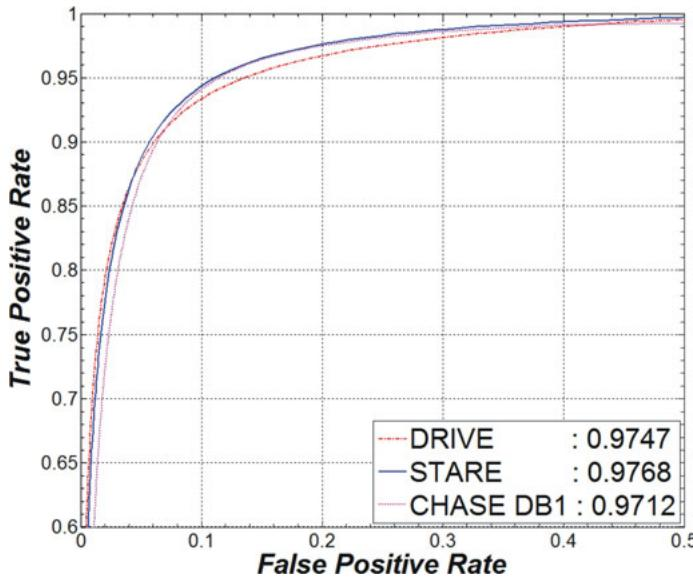  
Fig. 6. ROC plot for DRIVE, STARE, and CHASE\_DB1.

The average accuracy values and precision rates incurred by the algorithm are more than the second human observers for the DRIVE and STARE databases. The specificity values for the algorithm are also higher than the second human observer for each of the three image databases that indicates the low false positive rate of the methodology as compared with the second human observer. This, in turn, indicates that the algorithm has identified less numbers of background pixels or pathological area pixels as part of a vessel than the second human observer. The AUC values produced by the method are more than 0.97 for each of the retinal image sets, as illustrated in Fig. 6.

The segmented images with best case and worst case accuracies from the DRIVE, STARE, and CHASE\_DB1 databases are illustrated in Figs. 7–9, respectively.

The best case accuracy, sensitivity, specificity, and PPV for the DRIVE database are 0.9637, 0.8615, 0.9780, and 0.8471, respectively, and the worst case measures are 0.9360, 0.7475, 0.9688, and 0.8071, respectively. For the STARE database, the best case accuracy is 0.968; sensitivity, specificity, and PPV are 0.8628, 0.9801, and 0.8322, respectively. The worst case accuracy is 0.9353; sensitivity and specificity are

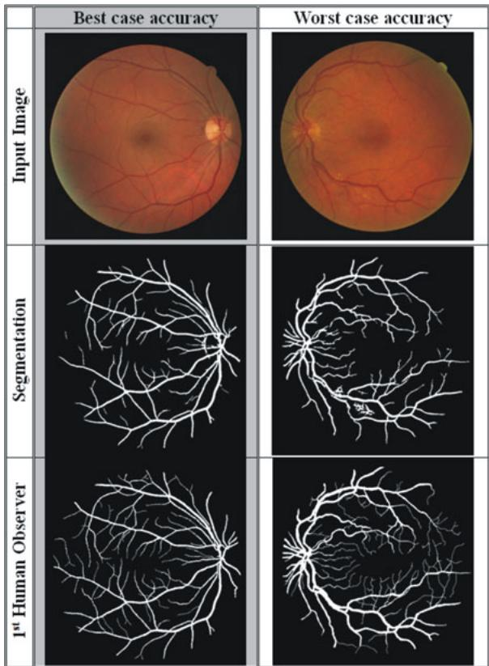  
Fig. 7. Segmentation results for the DRIVE database.

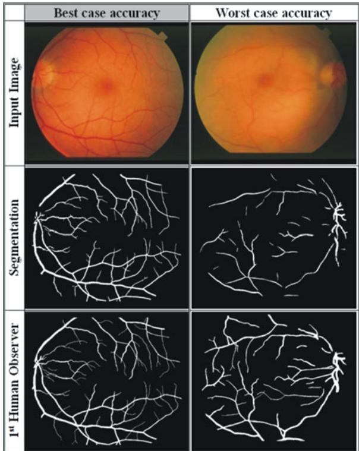  
Fig. 8. Segmentation results for the STARE database.

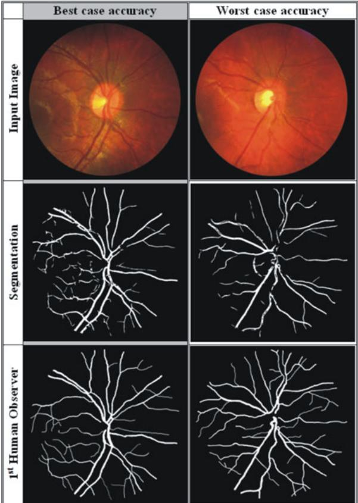  
Fig. 9. Segmentation results for the CHASE\_DB1 database.

0.4360 and 0.9924, respectively. The best case vessel segmentation result for the CHASE\_DB1 database has an accuracy of 0.9524; sensitivity, specificity, and PPV are 0.7803, 0.9720, and 0.7600, respectively. The worst case accuracy is 0.9398; sensitivity and specificity are 0.5983 and 0.8011, respectively.

2) Cross Training of Classifier: The methodology is also tested for its dependence on training data and its suitability to be applied to any retinal image in a more realistic way, such that the classifier is trained on DRIVE and evaluated on STARE and vice versa. We have also evaluated the classifier trained on STARE for classification of CHASE\_DB1 images. The performance metrics for cross training are shown in Table V. There is a slight decrease in performance as the AUC falls to 0.9697 from 0.9759 for DRIVE and to 0.9660 from 0.9797 for the STARE database. There is a fractional decrease in accuracy observed of 0.0008 for DRIVE and 0.0039 for the STARE database. The same pattern is observed in the specificity, sensitivity, and precession rate of vessel segmentation. A slight decrease in performance is observed for CHASE\_DB1 (compared to Table IV) despite the fact that these images are very different from STARE images as they are characterized by nonuniform background illumination, poor contrast of blood vessels, and the presence of central vessel reflexes.

3) Feature Importance: A graph to illustrate the importance of each feature in the feature vector in decision making for the LogitBoost-based ensemble classifier is shown in Fig. 10(a). It indicates that a set of four features for DRIVE which includes one feature from the line strength measure, one feature from the

TABLE V  
AVERAGE PERFORMANCE MEASURES ON DRIVE AND STARE WITH CROSS TRAINING
<table><tr><td rowspan=1 colspan=1>Database</td><td rowspan=1 colspan=1>AUC</td><td rowspan=1 colspan=1>Acc</td><td rowspan=1 colspan=1>SN</td><td rowspan=1 colspan=1>SP</td><td rowspan=1 colspan=1>PPV</td><td rowspan=1 colspan=1>FDR</td></tr><tr><td rowspan=1 colspan=1>DRIVE    (trained on STARE)</td><td rowspan=1 colspan=1>0.9697</td><td rowspan=1 colspan=1>0.9456</td><td rowspan=1 colspan=1>0.7242</td><td rowspan=1 colspan=1>0.9792</td><td rowspan=1 colspan=1>0.8478</td><td rowspan=1 colspan=1>0.1522</td></tr><tr><td rowspan=1 colspan=1>STARE     (trained on DRIVE)</td><td rowspan=1 colspan=1>0.9660</td><td rowspan=1 colspan=1>0.9495</td><td rowspan=1 colspan=1>0.7010</td><td rowspan=1 colspan=1>0.9770</td><td rowspan=1 colspan=1>0.8123</td><td rowspan=1 colspan=1>0.1876</td></tr><tr><td rowspan=1 colspan=1>CHASE DB1 (trained on STARE)</td><td rowspan=1 colspan=1>0.9565</td><td rowspan=1 colspan=1>0.9415</td><td rowspan=1 colspan=1>0.7103</td><td rowspan=1 colspan=1>0.9665</td><td rowspan=1 colspan=1>0.7000</td><td rowspan=1 colspan=1>0.3002</td></tr></table>

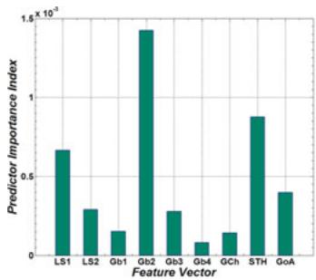  
(a)

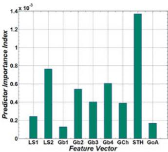  
(b)  
Fig. 10. Predictor importance in classification; (a) for DRIVE; (b) for STARE (LS1-2 are line strength features, Gb1-4 are Gabor filter responses at four scales, GCh is green channel pixel values, STH is the morphological transformation, and GOA is the GOA feature).

TABLE VI  
AVERAGE PERFORMANCE MEASURES ON DRIVE AND STARE WITH REDUCED FEATURE SET
<table><tr><td rowspan=1 colspan=1>Database</td><td rowspan=1 colspan=1>AUC</td><td rowspan=1 colspan=1>Acc</td><td rowspan=1 colspan=1>SN</td><td rowspan=1 colspan=1>SP</td><td rowspan=1 colspan=1>PPV</td><td rowspan=1 colspan=1>FDR</td></tr><tr><td rowspan=1 colspan=1>DRIVE (Reduced Feature Set)</td><td rowspan=1 colspan=1>0.9716</td><td rowspan=1 colspan=1>0.9468</td><td rowspan=1 colspan=1>0.7336</td><td rowspan=1 colspan=1>0.9789</td><td rowspan=1 colspan=1>0.8440</td><td rowspan=1 colspan=1>0.1560</td></tr><tr><td rowspan=1 colspan=1>STARE(Reduced Feature Set)</td><td rowspan=1 colspan=1>0.9755</td><td rowspan=1 colspan=1>0.9509</td><td rowspan=1 colspan=1>0.7528</td><td rowspan=1 colspan=1>0.9735</td><td rowspan=1 colspan=1>0.7810</td><td rowspan=1 colspan=1>0.2190</td></tr></table>

TABLE VII

PERFORMANCE COMPARISON OF VESSEL SEGMENTATION METHODS(DRIVE IMAGES)
<table><tr><td rowspan=1 colspan=1>No</td><td rowspan=1 colspan=2>Type</td><td rowspan=1 colspan=1>Methods</td><td rowspan=1 colspan=1>Year</td><td rowspan=1 colspan=1>SN</td><td rowspan=1 colspan=1>SP</td><td rowspan=1 colspan=1>Acc</td><td rowspan=1 colspan=1>AUC</td></tr><tr><td rowspan=1 colspan=1>1.</td><td rowspan=1 colspan=2></td><td rowspan=1 colspan=1>2nd Human Observer</td><td rowspan=1 colspan=1>一</td><td rowspan=1 colspan=1>0.7796</td><td rowspan=1 colspan=1>0.9717</td><td rowspan=1 colspan=1>0.9470</td><td rowspan=1 colspan=1>N.A</td></tr><tr><td rowspan=1 colspan=1>2.</td><td rowspan=1 colspan=2></td><td rowspan=1 colspan=1>Zana [9]</td><td rowspan=1 colspan=1>2001</td><td rowspan=1 colspan=1>0.6971</td><td rowspan=1 colspan=1>N.A</td><td rowspan=1 colspan=1>0.9377</td><td rowspan=1 colspan=1>0.8984</td></tr><tr><td rowspan=1 colspan=1>3.</td><td></td><td></td><td rowspan=1 colspan=1>Jiang[33]</td><td rowspan=1 colspan=1>2003</td><td rowspan=1 colspan=1>N.A</td><td rowspan=1 colspan=1>N.A</td><td rowspan=1 colspan=1>0.9212</td><td rowspan=1 colspan=1>0.9114</td></tr><tr><td rowspan=1 colspan=1>4.</td><td></td><td></td><td rowspan=1 colspan=1>Mendonca [10]</td><td rowspan=1 colspan=1>2006</td><td rowspan=1 colspan=1>0.7344</td><td rowspan=1 colspan=1>0.9764</td><td rowspan=1 colspan=1>0.9452</td><td rowspan=1 colspan=1>N.A</td></tr><tr><td rowspan=1 colspan=1>5.</td><td></td><td></td><td rowspan=1 colspan=1>Al-Diri [18]</td><td rowspan=1 colspan=1>2009</td><td rowspan=1 colspan=1>0.7282</td><td rowspan=1 colspan=1>0.9551</td><td rowspan=1 colspan=1>N.A</td><td rowspan=1 colspan=1>N.A</td></tr><tr><td rowspan=1 colspan=1>6.</td><td></td><td></td><td rowspan=1 colspan=1>Lam[16]</td><td rowspan=1 colspan=1>2010</td><td rowspan=1 colspan=1>N.A</td><td rowspan=1 colspan=1>N.A</td><td rowspan=1 colspan=1>0.9472</td><td rowspan=1 colspan=1>0.9614</td></tr><tr><td rowspan=1 colspan=1>7.</td><td></td><td></td><td rowspan=1 colspan=1>Miri [34]</td><td rowspan=1 colspan=1>2011</td><td rowspan=1 colspan=1>0.7352</td><td rowspan=1 colspan=1>0.9795</td><td rowspan=1 colspan=1>0.9458</td><td rowspan=1 colspan=1>N.A</td></tr><tr><td rowspan=1 colspan=1>8.</td><td></td><td></td><td rowspan=1 colspan=1>Fraz [11]</td><td rowspan=1 colspan=1>2011</td><td rowspan=1 colspan=1>0.7152</td><td rowspan=1 colspan=1>0.9759</td><td rowspan=1 colspan=1>0.9430</td><td rowspan=1 colspan=1>N.A</td></tr><tr><td rowspan=1 colspan=1>9.</td><td></td><td rowspan=1 colspan=1></td><td rowspan=1 colspan=1>You [25]</td><td rowspan=1 colspan=1>2011</td><td rowspan=1 colspan=1>0.7410</td><td rowspan=1 colspan=1>0.9751</td><td rowspan=1 colspan=1>0.9434</td><td rowspan=1 colspan=1>N.A</td></tr><tr><td rowspan=1 colspan=1>10.</td><td></td><td></td><td rowspan=1 colspan=1>Niemeijer</td><td rowspan=1 colspan=1>2004</td><td rowspan=1 colspan=1>NA</td><td rowspan=1 colspan=1>N.A</td><td rowspan=1 colspan=1>0.9416</td><td rowspan=1 colspan=1>0.9294</td></tr><tr><td rowspan=1 colspan=1>11.</td><td></td><td></td><td rowspan=1 colspan=1>Soares [21]</td><td rowspan=1 colspan=1>2006</td><td rowspan=1 colspan=1>0.7332</td><td rowspan=1 colspan=1>0.9782</td><td rowspan=1 colspan=1>0.9461</td><td rowspan=1 colspan=1>0.9614</td></tr><tr><td rowspan=1 colspan=1>12.</td><td></td><td></td><td rowspan=1 colspan=1>Staal [5]</td><td rowspan=1 colspan=1>2004</td><td rowspan=1 colspan=1>NA</td><td rowspan=1 colspan=1>N.A</td><td rowspan=1 colspan=1>0.9441</td><td rowspan=1 colspan=1>0.9520</td></tr><tr><td rowspan=1 colspan=1>13.</td><td></td><td></td><td rowspan=1 colspan=1>Ricci[22]</td><td rowspan=1 colspan=1>2007</td><td rowspan=1 colspan=1>N.A</td><td rowspan=1 colspan=1>N.A</td><td rowspan=1 colspan=1>0.9595</td><td rowspan=1 colspan=1>0.9558</td></tr><tr><td rowspan=1 colspan=1>14.</td><td></td><td></td><td rowspan=1 colspan=1>Lupascu [23]</td><td rowspan=1 colspan=1>2010</td><td rowspan=1 colspan=1>0.7200</td><td rowspan=1 colspan=1>N.A</td><td rowspan=1 colspan=1>0.9597</td><td rowspan=1 colspan=1>0.9561</td></tr><tr><td rowspan=1 colspan=1>15.</td><td></td><td></td><td rowspan=1 colspan=1>Marin [24]</td><td rowspan=1 colspan=1>2011</td><td rowspan=1 colspan=1>0.7067</td><td rowspan=1 colspan=1>0.9801</td><td rowspan=1 colspan=1>0.9452</td><td rowspan=1 colspan=1>0.9588</td></tr><tr><td rowspan=1 colspan=1>16.</td><td rowspan=1 colspan=2></td><td rowspan=1 colspan=1>Proposed Method</td><td rowspan=1 colspan=1>2011</td><td rowspan=1 colspan=1>0.7406</td><td rowspan=1 colspan=1>0.9807</td><td rowspan=1 colspan=1>0.9480</td><td rowspan=1 colspan=1>0.9747</td></tr></table>

N.A = Not Available.

Gabor filter response at scale 2, the GOA, and morphological transformation are most highly ranked in decision making. The most important features for the STARE database are shown in Fig. 10(b) which includes one feature from the line strength measure, two features from the Gabor filter responses at scales 2 and 4, and the morphological transformation.

Table VI shows the performance metrics when a reduced feature vector is used. This illustrates that even with dimensionality reduction, the AUC achieved by the algorithm outperforms other segmentation algorithms mentioned in Tables VII and VIII.

4) Comparison to Other Methods: The performance of the proposed methodology is compared with state-of-the-art algorithms published in the past decade in Tables VII and VIII for DRIVE and STARE, respectively. The SN, SP, Acc, and area under ROC of the proposed method are compared with the results of published methodologies reported in their respective publications. The performance measures of Hoover et al. [6] and Soares et al. [21] were calculated using the segmented images from their websites.1,2 The results of Zana [9] and Jiang [33] are taken from the DRIVE database website.3

TABLE VIII  
PERFORMANCE COMPARISON OF VESSEL SEGMENTATION METHODS(STARE IMAGES)
<table><tr><td rowspan=1 colspan=1>No</td><td rowspan=1 colspan=4>Type</td><td rowspan=1 colspan=1>Methods</td><td rowspan=1 colspan=1>Year</td><td rowspan=1 colspan=1>SN</td><td rowspan=1 colspan=1>SP</td><td rowspan=1 colspan=1>Acc</td><td rowspan=1 colspan=1>AUC</td></tr><tr><td rowspan=1 colspan=1>1.</td><td rowspan=1 colspan=4></td><td rowspan=1 colspan=1>2nd HumanObserver</td><td rowspan=1 colspan=1></td><td rowspan=1 colspan=1>0.8951</td><td rowspan=1 colspan=1>0.9384</td><td rowspan=1 colspan=1>0.9348</td><td rowspan=1 colspan=1></td></tr><tr><td rowspan=1 colspan=1>2.</td><td rowspan=1 colspan=4></td><td rowspan=1 colspan=1>Hoover [6]</td><td rowspan=1 colspan=1>2000</td><td rowspan=1 colspan=1>0.6747</td><td rowspan=1 colspan=1>0.9565</td><td rowspan=1 colspan=1>0.9264</td><td rowspan=1 colspan=1>N.A</td></tr><tr><td rowspan=1 colspan=1>3.</td><td rowspan=1 colspan=2></td><td></td><td rowspan=1 colspan=1></td><td rowspan=1 colspan=1>Jiang[33]</td><td rowspan=1 colspan=1>2003</td><td rowspan=1 colspan=1>N.A</td><td rowspan=1 colspan=1>N.A</td><td rowspan=1 colspan=1>0.9009</td><td rowspan=1 colspan=1>N.A</td></tr><tr><td rowspan=1 colspan=1>4.</td><td></td><td></td><td></td><td></td><td rowspan=1 colspan=1>Mendonca [10]</td><td rowspan=1 colspan=1>2006</td><td rowspan=1 colspan=1>0.6996</td><td rowspan=1 colspan=1>0.9730</td><td rowspan=1 colspan=1>0.9440</td><td rowspan=1 colspan=1>N.A</td></tr><tr><td rowspan=1 colspan=1>5.</td><td></td><td></td><td></td><td></td><td rowspan=1 colspan=1>Lam[15]</td><td rowspan=1 colspan=1>2008</td><td rowspan=1 colspan=1>N.A</td><td rowspan=1 colspan=1>N.A</td><td rowspan=1 colspan=1>0.9474</td><td rowspan=1 colspan=1>0.9392</td></tr><tr><td rowspan=1 colspan=1>6.</td><td></td><td></td><td></td><td></td><td rowspan=1 colspan=1>Al-Diri [18]</td><td rowspan=1 colspan=1>2009</td><td rowspan=1 colspan=1>0.7521</td><td rowspan=1 colspan=1>0.9681</td><td rowspan=1 colspan=1>N.A</td><td rowspan=1 colspan=1>N.A</td></tr><tr><td rowspan=1 colspan=1>7.</td><td></td><td></td><td></td><td></td><td rowspan=1 colspan=1>Lam[16]</td><td rowspan=1 colspan=1>2010</td><td rowspan=1 colspan=1>N.A</td><td rowspan=1 colspan=1>N.A</td><td rowspan=1 colspan=1>0.9567</td><td rowspan=1 colspan=1>0.9739</td></tr><tr><td rowspan=1 colspan=1>8.</td><td rowspan=1 colspan=2></td><td></td><td rowspan=1 colspan=1></td><td rowspan=1 colspan=1>Fraz [11]</td><td rowspan=1 colspan=1>2011</td><td rowspan=1 colspan=1>0.7311</td><td rowspan=1 colspan=1>0.9680</td><td rowspan=1 colspan=1>0.9442</td><td rowspan=1 colspan=1>N.A</td></tr><tr><td rowspan=1 colspan=1>9.</td><td rowspan=1 colspan=2></td><td rowspan=1 colspan=2></td><td rowspan=1 colspan=1></td><td rowspan=1 colspan=2>You [25]</td><td rowspan=1 colspan=1>2011</td><td rowspan=1 colspan=1>0.7260</td><td rowspan=1 colspan=1>0.9756</td></tr><tr><td rowspan=1 colspan=1>10.</td><td rowspan=1 colspan=2></td><td rowspan=1 colspan=2></td><td rowspan=1 colspan=1></td><td rowspan=1 colspan=2>Staal [5]</td><td rowspan=1 colspan=1>2004</td><td rowspan=1 colspan=1>N.A</td><td rowspan=1 colspan=1>N.A</td></tr><tr><td rowspan=1 colspan=1>11.</td><td rowspan=1 colspan=2></td><td></td><td rowspan=1 colspan=1></td><td rowspan=1 colspan=1>Soares [21]</td><td rowspan=1 colspan=1>2006</td><td rowspan=1 colspan=1>0.7207</td><td rowspan=1 colspan=1>0.9747</td><td rowspan=1 colspan=1>0.9479</td><td rowspan=1 colspan=1>0.9671</td></tr><tr><td rowspan=1 colspan=1>12.</td><td></td><td></td><td></td><td></td><td rowspan=1 colspan=1>Ricci[22]</td><td rowspan=1 colspan=1>2007</td><td rowspan=1 colspan=1>N.A</td><td rowspan=1 colspan=1>N.A</td><td rowspan=1 colspan=1>0.9584</td><td rowspan=1 colspan=1>0.9602</td></tr><tr><td rowspan=1 colspan=1>13.</td><td rowspan=1 colspan=2></td><td></td><td rowspan=1 colspan=1></td><td rowspan=1 colspan=1>Marin [24]</td><td rowspan=1 colspan=1>2011</td><td rowspan=1 colspan=1>0.6944</td><td rowspan=1 colspan=1>0.9819</td><td rowspan=1 colspan=1>0.9526</td><td rowspan=1 colspan=1>0.9769</td></tr><tr><td rowspan=1 colspan=1>14.</td><td rowspan=1 colspan=4></td><td rowspan=1 colspan=1>Proposed Method</td><td rowspan=1 colspan=1>2011</td><td rowspan=1 colspan=1>0.7548</td><td rowspan=1 colspan=1>0.9763</td><td rowspan=1 colspan=1>0.9534</td><td rowspan=1 colspan=1>0.9768</td></tr></table>

N.A = Nor Available

TABLE IX  
PERFORMANCE COMPARISON OF RESULTS WITH CROSS TRAINING IN TERMS OF AVERAGE ACCURACY
<table><tr><td rowspan=1 colspan=1>Method</td><td rowspan=1 colspan=1>DRIVE (trained onSTARE)</td><td rowspan=1 colspan=1>STARE (trained onDRIVE)</td></tr><tr><td rowspan=1 colspan=1>Soares [21]</td><td rowspan=1 colspan=1>0.9397</td><td rowspan=1 colspan=1>0.9327</td></tr><tr><td rowspan=1 colspan=1>Ricci[22]</td><td rowspan=1 colspan=1>0.9266</td><td rowspan=1 colspan=1>0.9464</td></tr><tr><td rowspan=1 colspan=1>Marin [24]</td><td rowspan=1 colspan=1>0.9448</td><td rowspan=1 colspan=1>0.9528</td></tr><tr><td rowspan=1 colspan=1>Proposed Method</td><td rowspan=1 colspan=1>0.9456</td><td rowspan=1 colspan=1>0.9493</td></tr></table>

A comparative analysis shows that the proposed method achieved better performance metrics than most of the other methods. The area under ROC and the true positive rate achieved by the algorithm appear better than all the published methods for both the DRIVE and STARE databases.

The methodologies presented by Ricci and Perfetti [22] and Marin et al. [24] also reported the average accuracy in the case of cross training of classifier. The segmented images with the cross-trained classifier for the Soares [21] method are also available on their website. We have downloaded and computed the average accuracy of these images. The results are summarized in Table IX where we can observe that the proposed method performs better than Ricci and Soares for both DRIVE and STARE images, and better than Marin for DRIVE images.

The STARE database contains ten pathological images. In order to compare the performance of our method in pathological cases, the performance measures are computed on ten downloaded pathological segmented images of Hoover et al. [6] and Soares et al. [21], and compared them with our results in Table X.

TABLE X  
PERFORMANCE COMPARISON OF RESULTS ON ABNORMAL RETINAS (STARE DATABASE)
<table><tr><td rowspan=1 colspan=1>Method</td><td rowspan=1 colspan=1>SN</td><td rowspan=1 colspan=1>SP</td><td rowspan=1 colspan=1>Acc</td></tr><tr><td rowspan=1 colspan=1>2nd Human Observer</td><td rowspan=1 colspan=1>0.8719</td><td rowspan=1 colspan=1>0.9384</td><td rowspan=1 colspan=1>0.9324</td></tr><tr><td rowspan=1 colspan=1>Hoover [6]</td><td rowspan=1 colspan=1>0.6587</td><td rowspan=1 colspan=1>0.9565</td><td rowspan=1 colspan=1>0.9258</td></tr><tr><td rowspan=1 colspan=1>Soares [21]</td><td rowspan=1 colspan=1>0.7181</td><td rowspan=1 colspan=1>0.9765</td><td rowspan=1 colspan=1>0.9500</td></tr><tr><td rowspan=1 colspan=1>Proposed Method</td><td rowspan=1 colspan=1>0.7262</td><td rowspan=1 colspan=1>0.9764</td><td rowspan=1 colspan=1>0.9511</td></tr></table>

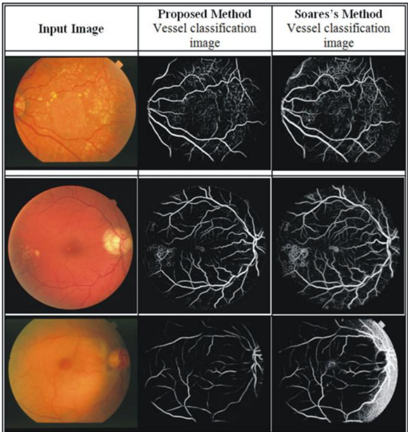  
Fig. 11. Comparison of segmentation results on pathological and uneven illumination images (first row: STARE pathological image, second row: DRIVE pathological image, third row: STARE image with uneven illumination).

Fig. 11 shows the visual comparison between the vessel classification images of pathological and nonuniform illumination images resulting from our method and those downloaded from Soares' website. It is observed that the proposed method performs better in removal of pathological artifacts and uneven illumination areas.

## V. DISCUSSION AND CONCLUSION

In this paper, we have presented an effective retinal vessel segmentation technique based on supervised classification using an ensemble classifier of boosted and bagged decision trees. We have used a 9-D feature vector which consists of the vessel map obtained from the orientation analysis of the gradient vector field, the morphological transformation; line strength measures and the Gabor filter response which encodes information to successfully handle both normal and pathological retinas.

The important feature of bagged ensemble is that the reliable estimates of the classification accuracy and feature importance are obtained during the training process without supplying the test data. The ensemble classifier was constructed by using 200 weak learners and is trained on 20 0000 training samples randomly extracted from the training set of the DRIVE and 7 5000 samples from STARE databases. These parameters are chosen by empirically analyzing the out-of-bag classification for a given number of training samples and the decision trees. The out-of-bag classification error as a function of the number of decision trees was used to construct the ensemble and the number of training samples used in ensemble training is illustrated in Fig. 3. The number of training samples used is much less than other classification-based methods proposed by Lupascu et al. [23] and Soares et al. [21] where 789 914 and 106 samples are used, respectively.

Our algorithm renders better AUC accuracy, sensitivity, and specificity measures than other state-of-the-art algorithms for both of the DRIVE and STARE databases, being fractionally outperformed in terms of accuracy only by Ricci and Perfetti [22] and Lupascu et al. [23] (for DRIVE only). This observation gains more importance by the fact that Lupascu's technique [23] used 41-D feature vector as compared to a 9-D feature vector (4-D in the case of reduced feature set, Table VI) used by our algorithm and approximately four times more training samples than this work. The Ricci method is proved to be very dependent on the training set, as with cross training, the accuracy dropped from 0.9595 to 0.9266 whereas the drop in accuracy in this study is from 0.9480 to 0.9456; thus, the technique appears to be more robust to the training set used. This training set robustness allows our algorithm to be used on multiple datasets without retraining, which is very useful for large-scale screening programs. The algorithm achieves best accuracy in the case of the cross-trained classifier for DRIVE and STARE; the cross-trained accuracy of Marin [24] is slightly better. However as reported this is in part due to the preprocessing performed for contrast, illumination and back ground normalization. The proposed method does not include any preprocessing of retinal images before feature extraction with the goal of improving computational performance and avoiding the risk of thin vessel removal.

In addition, the simplicity of the method should also be highlighted. The method computes only nine features for pixel classification and only four features in the case of the reduced feature set, thus utilizing less computational time. The time required to train the classifier for the DRIVE database with 2 \* 10⁴ training samples and 200 decision trees is 100 s and the ensemble for STARE with 75 000 training samples and 200 decision trees takes 49 s. In comparison, the GMM classifier used by Soares [21] is trained in approximately 8 h. The total time required to process a single image is \~100 s, running on a PC with an Intel Core2Duo CPU at 2.27 GHz and 4 GB of RAM. Since this method is experimentally implemented in MATLAB 7.13, this performance might still be improved.

The performance metrics of most of the vessel segmentation algorithms in the literature are calculated on a small number of images of adults with particular morphological characteristics. The morphological characteristics of retinal images of premature infants and children are very different from those of the adult retina. Choroidal vessels are more visible alongside the retinal vessels in retinal images taken from premature infants [3]. A bright central reflex on the vessels and illumination artifacts contribute to challenges in image processing when retinal images from school children are considered [3]. The limited range of images in the DRIVE and STARE databases does not cater for a variable range of image-related characteristics such as interimage and intraimage variabilities in luminance, drift in contrast, and uneven background gray level values. The resolutions of images from the STARE and DRIVE datasets are limited to 0.4 and 0.3 megapixels, respectively. While this lower resolution is acceptable for certain analyses such as fractal dimension or tortuosity, calculating the vessel diameter normally requires higher resolution images to achieve higher precision. Therefore, a new dataset of retinal images acquired from multiethnic school children along with vessel segmentation ground truths has been made publicly available. The new dataset is a subset of images from CHASE, which aims to study the cardiovascular risk factors in children of different ethnic origin; images can be downloaded from the database website. This dataset is intended to facilitate the development and comparison of vessel segmentation and vessel measurement algorithms.

The demonstrated performance, effectiveness, and robustness, along with its simplicity and speed in training as well as in classification, make this ensemble-based method for blood vessel segmentation a suitable tool to be integrated into a complete retinal image analysis system for clinical purposes and in particular for large population studies. In future, we aim to incorporate the vessel width and tortousity measures into the algorithm and to develop an interactive vessel analysis software tool for ophthalmologists.

## REFERENCES

[1] C. G. Owen, A. R. Rudnicka, C. M. Nightingale, R. Mullen, S. A. Barman, N. Sattar, D. G. Cook, and P. H. Whincup, "Retinal arteriolar tortuosity and cardiovascular risk factors in a multi-ethnic population study of 10- year-old children; The child heart and health study in England (CHASE)," Arterioscl., Throm., Vasc. Biol., Jun. 2011.

[2] R. Gelman, M. E. Martinez-Perez, D. K. Vanderveen, A. Moskowitz, and A. B. Fulton, "Diagnosis of plus disease in retinopathy of prematurity using retinal image multiscale analysis," Invest. Ophthalmol. Visual Sci., vol. 46, pp. 4734–4738, Dec. 2005.

[3] C. G. Owen, A. R. Rudnicka, R. Mullen, S. A. Barman, D. Monekosso, P. H. Whincup, J. Ng, and C. Paterson, "Measuring retinal vessel tortuosity in 10-year-old children: Validation of the computer-assisted image analysis of the retina (CAIAR) program," Invest. Ophthalmol. Visual Sci., vol. 50, pp. 2004–2010, 2009.

[4] M. M. Fraz, P. Remagnino, A. Hoppe, B. Uyyanonvara, A. R. Rudnicka, C. G. Owen, and S. A. Barman, “"Blood vessel segmentation methodologies in retinal images—A survey," Comput. Methods Programs Biomed., Apr. 2012.

[5] J. Staal, M. D. Abramoff, M. Niemeijer, M. A. Viergever, and B. van Ginneken, “Ridge-based vessel segmentation in color images of the retina," IEEE Trans. Med. Imaging, vol. 23, no. 4, pp. 501–509, Apr. 2004.

[6] A. D. Hoover, V. Kouznetsova, and M. Goldbaum, "Locating blood vessels in retinal images by piecewise threshold probing of a matched filter response," IEEE Trans. Med. Imaging, vol. 19, no. 3, pp. 203–210, Mar. 2000.

[7] CHASE\_DB1 (Jan. 2011). [Online]. Available: http://sec.kingston.ac.uk/ retinal

[8] L. Gang, O. Chutatape, and S. M. Krishnan, "Detection and measurement of retinal vessels in fundus images using amplitude modified second-order Gaussian filter," IEEE Trans. Biomed. Eng., vol. 49, no. 2, pp. 168–172, Feb. 2002.

[9] F. Zana and J. C. Klein, “Segmentation of vessel-like patterns using mathematical morphology and curvature evaluation," IEEE Trans. Image Process., vol. 10, no. 7, pp. 1010–1019, Jul. 2001.

[10] A. M. Mendonca and A. Campilho, "Segmentation of retinal blood vessels by combining the detection of centerlines and morphological reconstruction," IEEE Trans. Med. Imaging, vol. 25, no. 9, pp. 1200– 1213, Sep. 2006.

meta-analyses.

[11] M. M. Fraz, S. A. Barman, P. Remagnino, A. Hoppe, A. Basit, B. Uyyanonvara, A. R. Rudnicka, and C. G. Owen, "An approach to localize the retinal blood vessels using bit planes and centerline detection," Comput. Methods Programs Biomed., Sep. 2011.

[12] F. K. H. Quek and C. Kirbas, "Vessel extraction in medical images by wave-propagation and traceback," IEEE Trans. Med. Imaging, vol. 20, no. 2, pp. 117–131, Feb. 2001.

[13] A. F. Frangi, W. J. Niessen, K. L. Vincken, and M. A. Viergever, "Multiscale vessel enhancement filtering," in Medical Image Computing and Computer-Assisted Intervention—MICCAI'98. vol. 1496. Berlin/Heidelberg: Springer, 1998, p. 130.

[14] W. Li, A. Bhalerao, and R. Wilson, "Analysis of retinal vasculature using a multiresolution hermite model," IEEE Trans. Med. Imaging, vol. 26, no. 2, pp. 137–152, Feb. 2007.

[15] B. S. Y. Lam and Y. Hong, "A novel vessel segmentation algorithm for pathological retina images based on the divergence of vector fields,"IEEE Trans. Med. Imaging, vol. 27, no. 2, pp. 237–246, Feb. 2008.

[16] B. S. Y. Lam, G. Yongsheng, and A. W. C. Liew, "General retinal vessel segmentation using regularization-based multiconcavity modeling,"IEEE Trans. Med. Imaging, vol. 29, no. 7, pp. 1369–1381, Jul. 2010.

[17] H. Narasimha-Iyer, J. M. Beach, B. Khoobehi, and B. Roysam, "Automatic identification of retinal arteries and veins from dual-wavelength images using structural and functional features," IEEE Trans. Biomed. Eng., vol. 54, no. 8, pp. 1427–1435, Aug. 2007.

[18] B. Al-Diri, A. Hunter, and D. Steel, “An active contour model for segmenting and measuring retinal vessels," IEEE Trans. Med. Imaging, vol. 28, no. 9, pp. 1488–1497, Sep. 2009.

[19] K. W. Sum and P. Y. S. Cheung, "Vessel extraction under non-uniform illumination: A level set approach," IEEE Trans. Biomed. Eng., vol. 55, no. 1, pp. 358–360, Jan. 2008.

[20] M. Niemeijer, J. Staal, B. van Ginneken, M. Loog, and M. D. Abramoff, "Comparative study of retinal vessel segmentation methods on a new publicly available database," Proc. SPIE, 2004, vol. 5370, pp. 648–665.

[21] J. V. B. Soares, J. J. G. Leandro, R. M. Cesar, H. F. Jelinek, and M. J. Cree, “Retinal vessel segmentation using the 2-D Gabor wavelet and supervised classification," IEEE Trans. Med. Imaging, vol. 25, no. 9, pp. 1214–1222, Sep. 2006.

[22] E. Ricci and R. Perfetti, "Retinal blood vessel segmentation using line operators and support vector classification," IEEE Trans. Med. Imaging, vol. 26, no. 10, pp. 1357–1365, Oct. 2007.

[23] C. A. Lupascu, D. Tegolo, and E. Trucco, "FABC: Retinal vessel segmentation using adaboost," IEEE Trans. Inf. Technol. Biomed., vol. 14, no. 5, pp. 1267–1274, Sep. 2010.

[24] D. Marín, A. Aquino, M. E. Gegúndez-Arias, and J. M. Bravo,, “A new supervised method for blood vessel segmentation in retinal images by using gray-level and moment invariants-based features," IEEE Trans. Med. Imaging, vol. 30, no. 1, pp. 146–158, Jan. 2011.

[25] X. You, Q. Peng, Y. Yuan, Y. Cheung, and J. Lei, "Segmentation of retinal blood vessels using the radial projection and semi-supervised approach," Pattern Recogn., vol. 44, pp. 2314–2324, 2011.

[26] D. Onkaew, R. Turior, B. Uyyanonvara, and T. Kondo, "Automatic extraction of retinal vessels based on gradient orientation analysis," in Proc. 8th Int. Joint Conf. Comput. Sci. Software Eng., 2011, pp. 102–107.

[27] J. R. Movellan, "Tutorial on gabor filters," Tutorial paper. (2008). [Online]. Available: http://mplab.ucsd.edu/tutorials/pdfs/gabor.pdf.

[28] R. Zwiggelaar, S. M. Astley, C. R. M. Boggis, and C. J. Taylor, "Linear structures in mammographic images: Detection and classification," IEEE Trans. Med. Imaging, vol. 23, no. 9, pp. 1077–1086, Sep. 2004.

[29] R. Polikar, “Ensemble based systems in decision making,"IEEE Circuits Syst. Magaz., vol. 6, no. 3, pp. 21–45, Sep. 2006.

[30] L. Breiman, "Bagging predictors," Mach. Learn., vol. 24, no. 2, pp. 123–140, Aug. 1996.

[31] R. Schapire, “The boosting approach to machine learning an overview," in Proc. MSRI Workshop Nonlinear Estimation and Classification, 2002.

[32] J. Friedman, T. Hastie, and R. Tibshirani, “Additive logistic regression: A statistical view of boosting," Annal. Stat., vol. 28, pp. 337–374, 2000.

[33] J. Xiaoyi and D. Mojon, "Adaptive local thresholding by verificationbased multithreshold probing with application to vessel detection in retinal images," IEEE Trans. Pattern Anal. Mach. Intell., vol. 25, no. 1, pp. 131– 137, Jan. 2003.

[34] M. S. Miri and A. Mahloojifar, "Retinal image analysis using curvelet transform and multistructure elements morphology by reconstruction,' IEEE Trans. Biomed. Eng., vol. 58, no. 5, pp. 1183–1192, May 2011.

Muhammad Moazam Fraz received the B.S. degree in software engineering from Foundation University, Islamabad, Pakistan, in 2003, and the M.S. degree in software engineering from National University of Sciences and Technology, Islamabad, Pakistan, in 2008. He is currently working toward the Ph.D. degree at Kingston University, London, U.K.

During 2003–2010, he worked as a software development engineer for Elixir Technologies Corporation; a California based Software Company. His

research interests include medical image analysis, computer vision and pattern recognition.

Paolo Remagnino, photograph and biography not available at the time of publication.

Andreas Hoppe received the Ph.D. degree in biomedical image processing from the University of Glamorgan in collaboration with the University of Wales College of Medicine, Cardiff, in 2001.

He is currently a Lecturer in the Faculty of Science, Engineering and Computing at Kingston University and he is Fellow of the Royal Microscopical Society. His current research focuses on developing novel methods for quantitative imaging in microscopy.

Bunyarit Uyyanonvara recieved the B.Sc. degree (1st Class Honours) from Prince of Songkhla University, Thailand, in 1995. and the Ph.D. degree in medical image analysis from King's College, London, U.K., in 2000.

He is now an Associate Professor at Sirindhorn International Institute of Technology, Thammasat University, Thailand and active in a field of medical image processing.

Alicja Rudnicka qualified as an optometrist in 1987 and received the M.Sc. degree in medical statistics at the London School of Hygiene and Tropical Medicine, and the Ph.D. degree in 1994 from City University, London, U.K., and Moorfields Eye Hospital, London.

She is currently Senior Lecturer in Medical Statistics at St George's, University of London. Her research focuses on cardiovascular epidemiology, objective measures of physical activity and ophthalmic epidemiology as well as systematic reviews and

Christopher Owen received the M.Sc. degree in epidemiology at the London School of Hygiene and Tropical Medicine, and the Ph.D. degree in quantitative analysis of conjunctival vessels from City University, where he trained as an optometrist.

He is currently Senior Lecturer in epidemiology at St George's, University of London. His research interests include life course, cardiovascular and ophthalmic epidemiology.

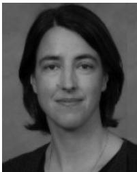

Sarah Barman received the Ph.D. degree in optical physics from King's College, London, U.K., in 1996.

She is currently a Reader in the Faculty of Science, Engineering and Computing at Kingston University. Her main area of interest in research is in the field of medical image analysis. Her work is currently focused on research into novel image analysis techniques to enable the recognition and quantification of features in ophthalmic images.