# CrackTree: Automatic crack detection from pavement images

Qin Zoua,b,c,\*, Yu Cao, Qingquan Li b,d, Qingzhou Mao b,d, Song Wangc

a School of Remote Sensing and Information Engineering, Wuhan University, Wuhan 430079, PR China

bEngineering Research Center for Spatio-Temporal Data Smart Acquisition and Application, Ministry of Education of China, Wuhan 430079, PR China

Department of Computer Science and Engineering, University of South Carolina, Columbia, SC 29208, USA

d State Key Laboratory of Information Engineering in Surveying, Mapping, and Remote Sensing, Wuhan University, Wuhan 430079, PR China

## ARTICLE INFO

Article history:   
Received 21 July 2011   
Available online 12 November 2011   
Communicated by N. Sladoje

Keywords: Crack detection Edge detection Edge grouping Tensor voting Shadow removal

## A BSTRACT

Pavement cracks are important information for evaluating the road condition and conducting the necessary road maintenance. In this paper, we develop CrackTree, a fully-automatic method to detect cracks from pavement images. In practice, crack detection is a very challenging problem because of (1) low contrast between cracks and the surrounding pavement, (2) intensity inhomogeneity along the cracks, and (3) possible shadows with similar intensity to the cracks. To address these problems, the proposed method consists of three steps. First, we develop a geodesic shadow-removal algorithm to remove the pavement shadows while preserving the cracks. Second, we build a crack probability map using tensor voting, which enhances the connection of the crack fragments with good proximity and curve continuity. Finally, we sample a set of crack seeds from the crack probability map, represent these seeds by a graph model, derive minimum spanning trees from this graph, and conduct recursive tree-edge pruning to identify desirable cracks. We evaluate the proposed method on a collection of 206 real pavement images and the experimental results show that the proposed method achieves a better performance than several existing methods.

© 2011 Elsevier B.V. All rights reserved.

## 1. Introduction

Cracks are common pavement distress that may potentially threaten the road and highway safety. Fixing a crack before its deterioration can greatly reduce the cost of pavement maintenance. Since image-based technology provides a safe, efficient and economical way for pavement crack detection, various image-processing approaches have been proposed for pavement crack detection in the past two decades. Based on assumption that the intensity along the cracks are usually lower than that of the background, i.e., the surrounding pavement, intensity thresholding methods (Kirschke and Velinsky, 1992; Oh et al., 1997; Li and Liu, 2008; Oliveira and Correia, 2009; Tsai et al., 2010) have been widely used for detecting cracks. However, these thresholding methods can only produce disjoint crack fragments because the intensity along a crack may not be consistently lower than the background. Additionally, pavement shadows often incur an uneven illuminance in the pavement images, which may further decrease the performance of the thresholding methods. Edgedetection based methods have also been used for crack detection (Yan et al., 2007; Liu et al., 2008; Ayenu-Prah and Attoh-Okine, 2008). However, the possible low contrast between the cracks and the background may misidentify many speckle noises in the background as crack fragments. Recently, wavelet-transform based methods (Zhou et al., 2006; Subirats et al., 2006) have been used for crack detection. However, they may not handle well the cracks with high curvature or bad continuity due to the anisotropic characteristics of wavelets.

Automatic detection of cracks from pavement images is a very challenging problem. As shown in the original image in Fig. 1, with many particle textures, the intensity of pavement is usually inhomogeneous. While in general cracks bear intensities that are lower than the surrounding pavement, the contrast of cracks may be seriously weakened by possible cast shadows on the pavement and possible crack degradations. As a result, local image-processing methods, such as the intensity thresholding, edge detection, and sub-window based feature extraction methods (Cheng et al., 2001; Nguyen et al., 2009; Oliveira and Correia, 2008a,b) may have difficulty in detecting the full crack curves: they usually detect a set of disjoint crack fragments with many false positives.

In this paper, we develop a new global method, called “Crack-Tree", for automatic crack detection. As shown by the flow chart in Fig. 1, we first propose a new geodesic shadow-removal algorithm to remove the pavement shadows. Compared to many classical shadow-removal algorithms (Finlayson et al., 2006, 2009; Arbel and Hel-Or, 2007), the geodesic shadow-removal algorithm can automatically identify and more accurately model the large penumbra areas with strong particle textures. After removing the shadows, we construct a crack probability map using tensor voting (Medioni et al., 2000) on detected noisy crack pixels and crack fragments. We then construct a graph model by sampling crack seeds from the crack probability map, construct the minimum spanning tree (MST) of the graph, and conduct recursive edge pruning in the MST to identify the final crack curves. In practice, different cracks or crack fragments may show different widths. In this paper, we focus on detecting the location and shape of the crack curves, but not the crack width.

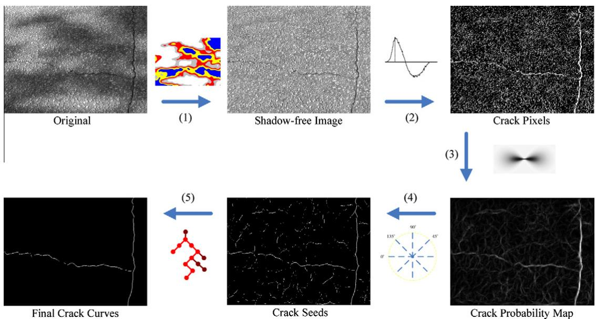  
Fig. 1. Flow chart of the proposed CrackTree method. (1) Geodesic shadow removal, (2) local intensity-difference analysis, (3) tensor voting, (4) crack seed sampling, and (5) minimum spanning tree construction and edge pruning.

The remainder of this paper is organized as follows. Section 2 overviews the related work on pavement crack detection. Section 3 introduces the proposed geodesic shadow-removal algorithm. Section 4 introduces the algorithm to construct the crack probability map. Section 5 describes the MST construction and the edge pruning algorithms. Section 6 reports experimental results on 206 real pavement images and Section 7 concludes the paper.

## 2. Related work

Over the past decades, the advance of the high-speed camera technology and the large-storage hardware has made it easy to collect pavement images of a long road in real time. As a result, automatic crack detection through pavement image processing has attracted more and more attention from both the academia and the industry.

For its simplicity and efficiency, intensity-thresholding methods have been widely used for crack detection. For example, the histogram-based method (Kirschke and Velinsky, 1992) and the iterated clipping method (Oh et al., 1997) have been successfully used for processing images taken from the same pavement environment. However, they can not handle well the images from frequently changed pavement environments. Li and Liu (2008) proposed a neighboring difference histogram method (NDHM), which outperforms the classical thresholding methods, such as Otsu (1979) and Kapur et al. (1985), on crack detection. However, by using a single threshold for the entire image, NDHM may fail when the images contain uneven illuminance such as shadows. Tsai et al. (2010) recently suggested the use of a dynamic optimization based method for segmenting low signal-to-noise ratio (SNR) pavement images. This method, however, suffers from a high computation cost. In (Oliveira and Correia, 2009), entropy is embedded into a two-level thresholding framework for pavement crack detection.

Edge detection is another widely used technique for pavement crack detection. In (Ayenu-Prah and Attoh-Okine, 2008), the Sobel edge detector is applied to detect cracks after image smoothing and speckle-noise removal using a bidimensional empirical mode decomposition algorithm. In (Yan et al., 2007), morphological filters are introduced to detect crack edges with assistance of a modified median filter to remove noise. The major problem of using edge-detection based methods is their incapability of detecting complete crack curves, and in most cases, they can only detect a set of disjoint crack fragments.

Wavelet transforms have also been exploited in pavement crack detection. In (Zhou et al., 2006), road distresses, including cracks, are separated from noise and background using several statistical criteria based on wavelet coefficients. In (Subirats et al., 2006), a 2D continuous wavelet transform is applied to create multiscale complex coefficient maps, on which the modulus and phase maps are constructed and a maxima location map is obtained for crack detection. However, due to the anisotropic characteristic of wavelets, wavelet-based approaches may not handle well the cracks with high curvature or low continuity.

Texture-analysis techniques have drawn extensive attention in pavement crack detection since pavement images are highly textured. Song et al. (1995) and Petrou et al. (1996) inspect cracks from a textured background using a Wigner model which can achieve the best co-joint resolution in both spatial and frequency domains. Hu and Zhao (2010) detect the pavement cracks through texture classification, which uses a local binary pattern operator (Ojala et al., 2002) to distinguish the cracks and the background.

Many machine-learning techniques have been used in detecting pavement cracks (Chou et al., 1995; Cheng et al., 2001; Nguyen et al., 2009; Oliveira and Correia, 2008a,b). In these methods, a pavement image is divided into a number of sub-images, each of which is represented by a vector of features extracted from this sub-image. These sub-images are then used for the training and classification for crack detection. In (Chou et al., 1995), a set of moment invariants are computed as features, which are used to distinguish different types of road distresses using a backpropagation (BP) neural network. The BP model is also used in (Nguyen et al., 2009), where an anisotropy measure is adopted as the feature. In (Cheng et al., 2001), statistical values, such as mean and standard deviation, are calculated as features for crack detection, which is refined by a curve detector. Similar features are used in (Oliveira and Correia, 2008a,b), where a Bayesian classifier is used for crack detection. For all these methods, the training and classification are conducted on each sub-image and as local methods, they may have difficulty in finding complete crack curves over the whole image.

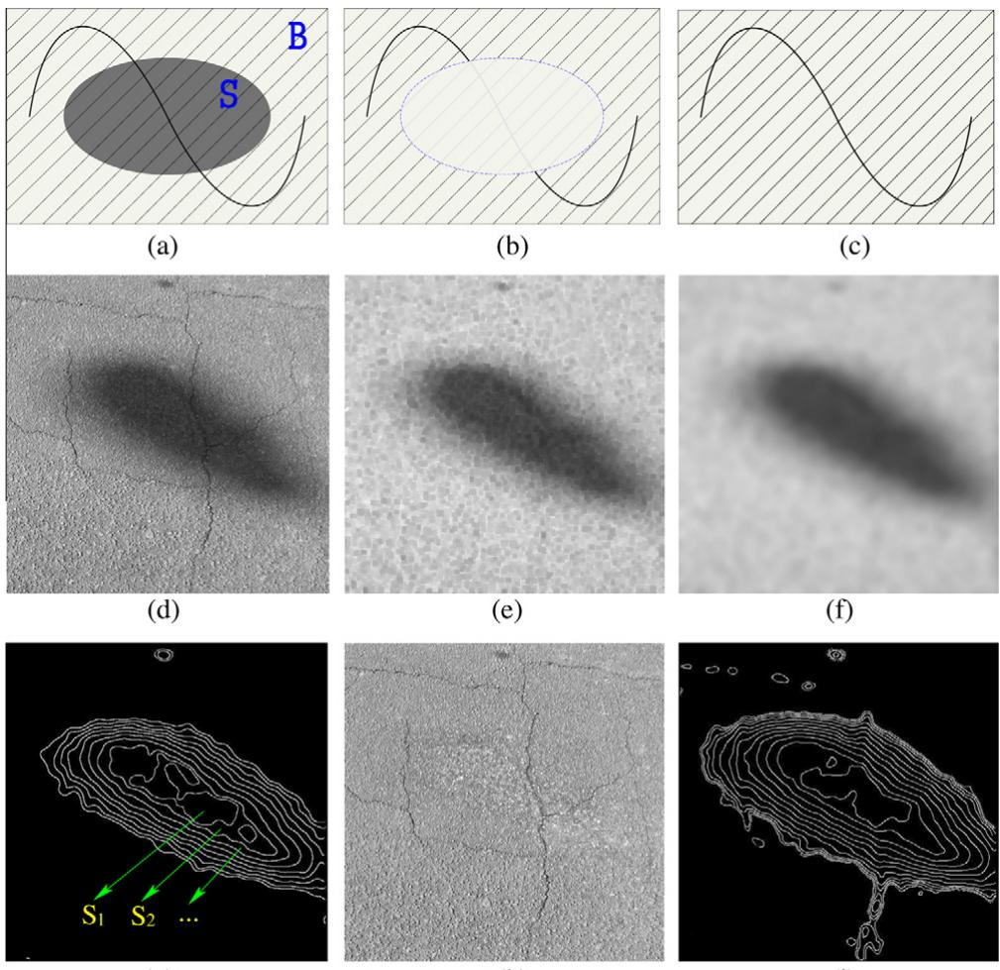  
(g)  
(h)  
(i)  
Fig. 2. An illustration for the proposed geodesic shadow-removal algorithm. (a) A simulated image with shadow and texture, the straight lines denote the texture and the winding curve denotes the crack, (b) illuminance compensation on (a) using Eq. (1), and (c) illuminance compensation on (a) using Eq. (2). (d–h) demonstrate each step of the proposed shadow-removal algorithm, where (d) is the original pavement image, (e) is the result after Step 1: mmClose, (f) is the result after Step 2: gauSmooth, (g) is the result after Step 3: geoLevel with N = 240, and (h) is the result after Step 4: illumCompensate. (i) is another result after Step 3: geoLevel with N = 240, without applying Step 1 of mmClose.

In addition, based on the assumption that crack pixels have lower intensity than the surrounding pavement background, fuzzy set theory is exploited in (Cheng et al., 1999) to detect cracks. An extended method for crack detection based on fuzzy theory is described in (Hassani and Tehrani, 2008). In (Huang and Xu, 2006), crack analysis is performed on grid crack cells. Neighboring crack cells are then combined into crack strings. Finally, neighboring crack strings with similar orientations are combined into potential crack curves. In (Liu et al., 2008), crack detection is achieved by filtering and combining the crack fragments according to a set of perceptual rules, such as proximity, continuity, and length.

## 3. Geodesic shadow removal

Pavement images often suffer from cast shadows of trees, light poles, etc., along the road. In this section, we propose an algorithm to remove such shadows for more accurate crack detection. Most pavement images are gray without much color information. Therefore, in this paper, we focus our algorithm development on monochromatic pavement images. In the following, we first present a texture-balanced illuminance compensation model to achieve even illumination in shadowed pavement images and then introduce the proposed geodesic shadow-removal algorithm.

## 3.1. Texture-balanced illuminance compensation

Shadow removal is usually achieved by illuminance compensation. As illustrated in Fig. 2(a), S is the shadow region and B is the non-shadowed region. Let $I _ { i , j }$ be the intensity at location $( i , j )$ and $\widehat { I } _ { S }$ and $\widehat { I } _ { B }$ be the average intensity of regions S and B, respectively. We can remove the shadow by balancing the illuminance in S and B:

$$
\begin{array} { r } { I _ { i , j } ^ { \prime } = \left\{ \begin{array} { l l } { I _ { i , j } + \lambda } & { \mathrm { i f ~ } ( i , j ) \in S , } \\ { I _ { i , j } } & { \mathrm { i f ~ } ( i , j ) \in B , } \end{array} \right. } \end{array}\tag{1}
$$

where $\begin{array} { r } { \lambda = \widehat { I } _ { B } - \widehat { I } _ { S } . } \end{array}$

However, it is well known that shadows decrease the image contrast: both cracks and particle textons on the pavements usually show a lower contrast in the shadow regions than in the non-shadowed regions, as shown in Fig. 2(a). This low-contrast problem cannot be addressed by the illuminance compensation in Eq. (1), as shown in Fig. 2(b), and may affect the performance of the later crack detection.

To address this problem, we propose a new illuminance compensation model:

$$
\begin{array} { r } { I _ { i , j } ^ { \prime } = \left\{ \begin{array} { l l } { \alpha \cdot I _ { i , j } + \lambda } & { \mathrm { i f ~ } ( i , j ) \in S , } \\ { I _ { i , j } } & { \mathrm { i f ~ } ( i , j ) \in B , } \end{array} \right. } \end{array}\tag{2}
$$

where $\begin{array} { r } { \alpha = \frac { D _ { B } } { D _ { \varsigma } } , } \end{array}$ with $D _ { S }$ and $D _ { B }$ being the standard deviations of the intensity in the shadow region S and the non-shadowed region B, respectively, and $\lambda = \widehat { I } _ { B } - \alpha \cdot \widehat { I } _ { S }$ . By using α in Eq. (2), we enforce the standard deviation of the intensity in the shadow region to be the same as that in the non-shadowed region. Since the standard deviation of the intensity in a region reflects the contrast in this region well, this new illuminance compensation model can not only balance the illuminance in the shadow region and the non-shadowed region, but also increase the contrast in the shadow region by enhancing both the cracks and the textons, as illustrated in Fig. 2(c).

## 3.2. Geodesic shadow-removal algorithm

In the above illuminance compensation model, we assume a hard shadow model. However, in practice, most shadows in the pavement images have large penumbra areas, as shown in Fig. 2(d). This incurs problems in defining the exact shadow regions and removing the shadows to achieve a balanced illuminance. As shown in Fig. 2(d), since the shadow strength monotonically decreases from the shadow center to the shadow boundary, we can apply a geodesic model to partition a shadow region into different levels so that the shadow strength within a same level is largely consistent. And then, we can conduct the texture-balanced illuminance compensation to each leveled shadow region to remove the shadow. More specifically, we propose a geodesic shadow-removal algorithm (GSR), which contains the following four major steps.

Step 1: mmClose. This is a gray-scale morphological close operation (with radius $\displaystyle r _ { c } ) _ { \ast }$ which we first apply to the input pavement image to remove the thin cracks. The goal of this step is to facilitate the accurate shadow region identification and shadow level partitioning without the influence of the cracks. In our study, we set $r _ { c } = 2$ pixels and find that it is adequate to erase all the cracks, as shown in Fig. 2(e).

Step 2: gauSmooth. This is a 2D Gaussian filter we apply to the image after Step 1. The goal of this step is to smooth out the texture in the pavement image for facilitating the shadow region identification and shadow level partitioning.¹ In our study, the size of all test image is $8 0 0 \times 6 0 0$ as discussed in more detail in Section 6, and we set the radius $r _ { g } = 3 0$ pixels and a standard deviation of 3 for this Gaussian filter and an example result is shown in Fig. 2(f).

Step 3: geoLevel. This step first identifies N – 1 intensity thresholds $0 \leqslant k _ { 1 } \leqslant k _ { 2 } \leqslant \cdots \leqslant k _ { N - 1 } \leqslant 2 5 5$ to partition the smoothed image from Step 2 into a set of geodesic levels $\{ G _ { i } | i = 1 , . . . ,$ $L , \ldots , N \}$ , where each geodesic level $G _ { i }$ consists all the pixels with intensity in the range $( k _ { i - 1 } , k _ { i } ]$ , with $k _ { 0 } = - 1$ and $k _ { N } = 2 5 5$ . As detailed in Algorithm 1, we try to make a uniform partitioning such that all the geodesic levels contain similar number of pixels. We then identify the L low-intensity levels $S _ { i } = G _ { i } \vert i = 1 ,$ $2 , \ldots , L$ as leveled shadow regions and the union of the remaining high intensity levels $G _ { i } | i = L + 1 , L + 2 , . . . , N$ as the non-shadowed region B. In our study, we empirically set $\begin{array} { r } { L = \frac { 7 } { 8 } N . } \end{array}$ An example result is shown in Fig. 2(g)

Step 4: illumCompensate. For each leveled shadow region $S _ { i }$ in the original image, we independently conduct the texture-balanced illuminance compensation against the non-shadowed region B using Eq. (2) and an example result is shown in Fig. 2(h).

The following algorithm details the operation in Step 3 for partitioning an image into a set of N geodesic levels. In this algorithm, N is an important parameter that controls the number of pixels in each geodesic level. In the experiment, we will discuss further its impact to the performance of crack detection. Fig. 2(i) shows the necessity of the step of mmClose before shadow removal. We can see that, without the operation of morphological closing to remove the cracks, the estimated shadow region undesirably includes part of the cracks outside the shadow, as shown in Fig. 2(i). With the morphological close operator, the estimated shadow region is more accurate, as shown in Fig. 2(g).

Algorithm 1. Geodesic leveling   
1: procedure GEOLEVEL   
2: input: imgs: a smoothed image from Step 2 with   
intensity in range [0,255]   
3: N: the number of geodesic levels   
4: output: $\{ G _ { i } | i = 1 , 2 , \ldots . N \} ;$ geodesic levels   
5: $\ln { \mathfrak { n } } .$ the number of pixels in one geodesic level   
6: ng 二 Width(imgs)×Height(img);   
7: $i = 1 , s u m = 0 ;$   
8: for k ← 0 to 255 do   
9: $P _ { k } \gets \mathsf { G e t }$ all the pixels with intensity $k ;$   
10: $G _ { i }$ ← Add $P _ { k }$ to $G _ { i } ;$   
11: sum = sum + number of pixels in $P _ { k } ;$   
12: if sum $\geqslant n _ { g }$ then $i = i + 1 ,$ sum = 0;   
13: end if   
14: end for   
15: $N = i ;$   
16: end procedure

## 4. Crack map generation

From a global perspective, cracks are perceptually salient long continuous curves in pavement images. However, the intensity along a crack may not always be lower than the surrounding pavement background because the depth and severity of a crack varies along the crack curve. Therefore, a local intensity based method can usually identify incomplete, disjoint crack fragments. In this section, we first develop a local intensity-difference measure and thresholding algorithm to identify crack pixels and then employ tensor voting to enhance cracks in the pavement images by generating a crack probability map.

## 4.1. Detecting crack pixels

We analyze the intensity difference in each local region to detect the possible crack pixels. Let $\widehat { \cal I } ( x , y )$ be the intensity at pixel $\left( x , y \right)$ (after the shadow removal introduced in Section 3) and $\mathcal { N } ( x , y )$ be the 8-connected neighborhood centered at (x,y). We define a local intensity-difference measure at (x,y) as

$$
\psi ( x , y ) = \sum _ { ( u , \nu ) \in \mathcal { N } ( x , y ) } [ \widehat { I } ( u , \upsilon ) - \widehat { I } ( x , y ) ] .\tag{3}
$$

Since the intensity along cracks is usually consistent and lower than the background, ideally there are four cases:

1. $\psi ( x , y )$ takes a value close to zero when (x,y) is a pixel in the center area of the crack (not neighboring the background). An example is shown by the pixel A in Fig. 3(a).

2. ψ(x,y) takes a positive value when (x,y) is a crack pixel neighboring to the background. An example is shown by the pixel B in Fig. 3(a).

3. ψ(x,y) takes a negative value when (x,y) is a background pixel neighboring the crack. An example is shown by the pixel C in Fig. 3(a).

4. ψ(x,y) takes a value close to zero when (x,y) is a background pixel not neighboring the crack. An example is shown by the pixel D in Fig. 3(a).

In addition, we expect the pixel intensity to increase from Case 1 to Case 4. Our basic idea is to identify the center crack pixels in Case 1 and exclude all the background pixels in Cases 3 and 4. To achieve this goal, for each possible intensity k ∈ [0,255], we define a function

$$
H ( k ) = \sum _ { ( x , y ) \mid I ( x , y ) = k } \psi ( x , y ) ,\tag{4}
$$

to reflect the total intensity-difference measures over all the pixels with intensity k. We then pick the threshold T that corresponds to the maximum of the function, i.e.,

$$
T = \arg \operatorname* { m a x } _ { k } H ( k ) .\tag{5}
$$

Based on the above four cases, we can see that the pixels with intensity T fall in Case 2. We can safely identify the pixels with an intensity that is lower than T as possible crack pixels. Four different examples are shown in Fig. 3(b), where the first three contain cracks and the last one contains no cracks. We can see that many false-positives and false negatives are produced in this local detection.

## 4.2. Tensor voting for crack enhancement

In this section, we incorporate perceptual cues of proximity and continuity to enhance the crack curves in the pavement images by using tensor voting (Guy and Medioni, 1997; Tang et al., 1999; Medioni et al., 2000). It produces a crack probability map in which the probability of the pixels that are likely to be located along long crack curves is enhanced while the probability of the pixels that are unlikely to be connected to other crack fragments is suppressed.

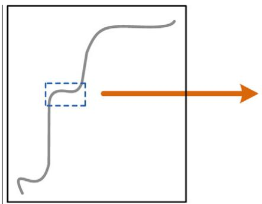

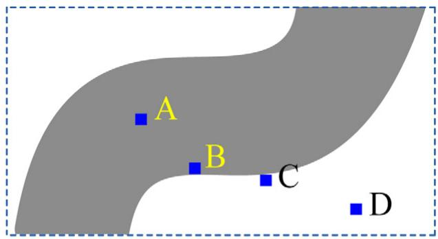  
(a)

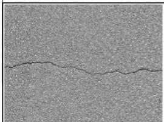

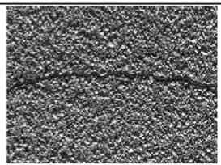

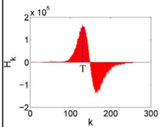

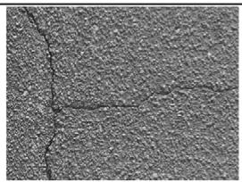

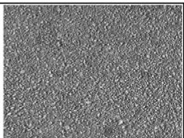

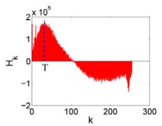

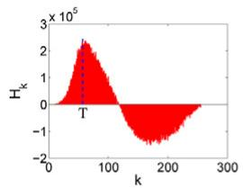

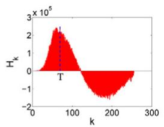

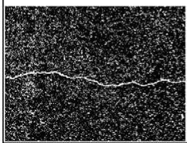

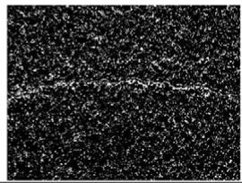

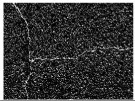  
(b)

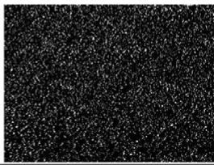  
Fig. 3. Intensity-difference measures and crack pixel detection. (a) Four possible cases for the intensity-difference measure ψ(x,y). (b) Crack pixel detection in different pavement conditions. Top row of (b): input images (after the shadow removal as described in Section 3). Middle row of (b): the corresponding function H(·), where the dash lines indicate the intensity-threshold value T. Bottom row of (b): detected crack pixels (white pixels).

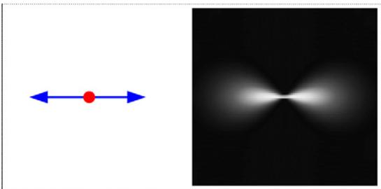  
(a)

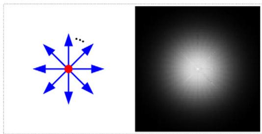  
(b)

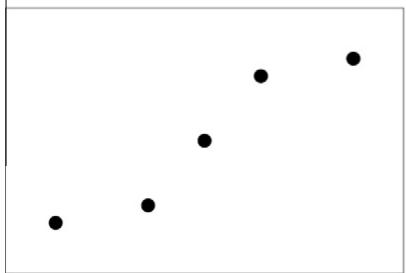  
(c)

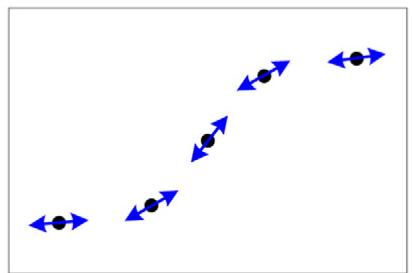

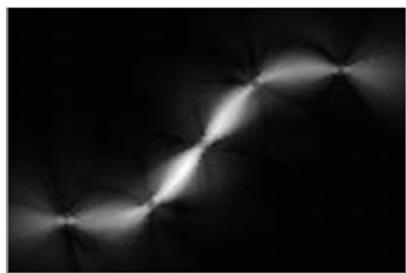  
(d)  
(e)

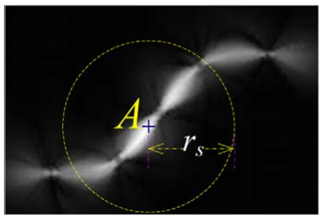  
(f)

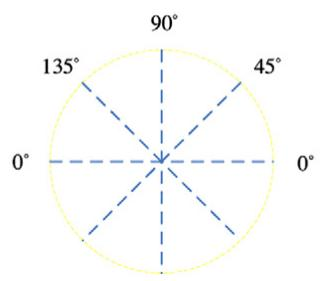  
(g)

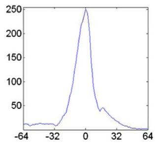  
(h)  
Fig. 4. An illustration for crack probability-map generation and crack seed sampling. (a) and (b) illustrate the voting field in 2-D, with orientation and strength, where (a) shows a stick token and its voting field and (b) shows a ball token approximated by a set of stick tokens and its voting field. (c-e) illustrate the crack probability-map generation with tensor voting, where (c) shows the crack pixels without orientation, (d) shows the orientations gained through ball voting, and (e) is the crack probability map constructed by stick voting. In the crack probability map, the brighter a pixel, the higher its crack probability. (f-h) illustrate the crack-seed sampling, where (f) shows a candidate point A in the crack probability map, (g) shows the four scanning direction 0°, 45°, 90°, and 135°, and (h) shows the crack probability scanned along the direction of 0° through point A.

In a standard stick voting (Mordohai and Medioni, 2006), the grouping tokens are a set of short sticks (e.g., pixels with an orientation). As shown in Fig. 4(a), for such a token, we can define a voting field to encode proximity and curve continuity by using a decay function

$$
D F ( s , \kappa , \sigma ) = e ^ { - \left( \frac { s ^ { 2 } + c \kappa ^ { 2 } } { \sigma ^ { 2 } } \right) } ,\tag{6}
$$

where s is the arc length from this token to a target location in the voting field, κ is the curvature, $\begin{array} { r } { c = \frac { - 1 6 \log { 0 . 1 \cdot ( \sigma - 1 ) } } { \pi ^ { 2 } } } \end{array}$ controls the degree of decay with curvature, and σ is the scale of voting (Mordohai and Medioni, 2006). Finally, the voting fields from different tokens will be added up to achieve the enhanced results (e.g., crack probability) at each target location.

We use the crack pixels detected in Section 4.1 as the initial tensors. However, these crack pixels have no orientation. Therefore, we first apply a ball voting (Mordohai and Medioni, 2006) to estimate the crack-curve orientation at each crack pixel. More specifically, each detected crack pixel is initialized as a ball tensor with equal saliency, and casts its votes to other crack pixels, i.e., noncrack pixels do not join this voting. As shown in Fig. 4(b), the ball voting field can be approximated by adding the fields generated by stick tokens spanning 360 degrees at regular intervals.

After summing up the ball-voting fields from all the crack pixels, we find the principal direction at each crack pixel and set it as the orientation of the stick token at this crack pixel, as shown in Fig. 4(d), because curve representation is in terms of tangents and not normals. We then apply a stick voting by casting the votes from each stick token to all the pixels, including crack pixels and non-crack pixels. This dense stick voting will fill the gaps between the detected crack pixels to form longer crack curves. The summed votes at a pixel can be represented by a covariance matrix

$$
( \lambda _ { 1 } - \lambda _ { 2 } ) \hat { e } _ { 1 } \hat { e } _ { 1 } ^ { T } + \lambda _ { 2 } \left( \hat { e } _ { 1 } \hat { e } _ { 1 } ^ { T } + \hat { e } _ { 2 } \hat { e } _ { 2 } ^ { T } \right)\tag{7}
$$

where $\lambda _ { 1 }$ and $\lambda _ { 2 }$ are the eigenvalues sorted in the descending order and $\hat { \boldsymbol e } _ { 1 }$ and ê2 are the corresponding eigenvectors. Following Mordohai and Medioni (2006), $\lambda _ { 1 } - \lambda _ { 2 }$ well reflects the saliency of a curved structure. In this paper, we simply take $\lambda _ { 1 } - \lambda _ { 2 }$ at a pixel as the crack probability, with which we construct a crack probability map, as shown in Fig. 4(e).

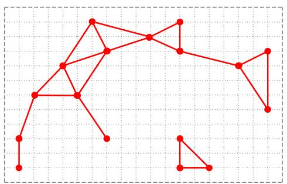  
(a)

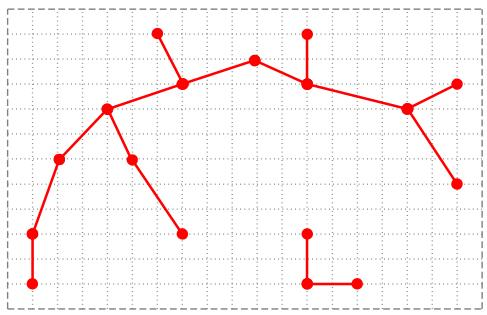  
(c)

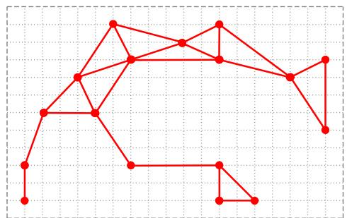  
(b)

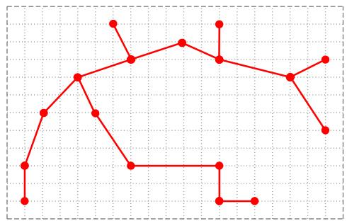

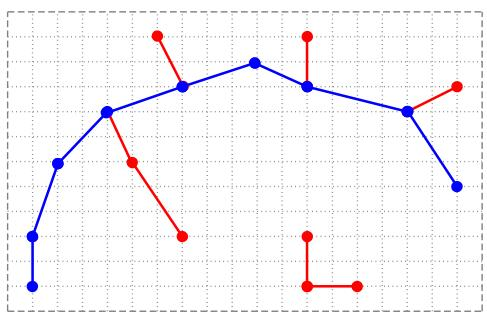  
(e)

(d)  
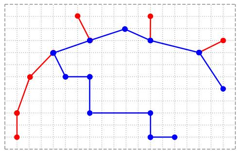

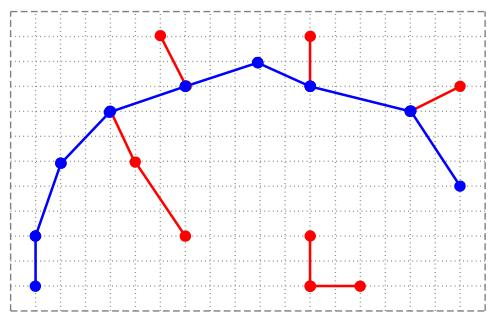  
(g)

(f)  
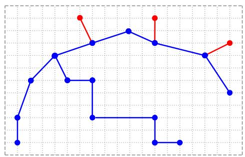  
(h)  
Fig. 5. An illustration of the MST construction and edge pruning. (a) and (b) display the crack seeds (in dots) and the constructed graph with $L _ { e } = 4 . 9 5$ and $L _ { e } = 5 . 0 5 ,$ respectively. (c) and (d) are the MSTs derived from (a) and (b), respectively. (e-h) illustrate the results of edge pruning (with $L _ { p } = 7 ) ,$ where the blue lines are the remaining edges after the pruning. Specifically, (e) and (f) are results after the first iteration of pruning on (c) and (d), respectively, (g) and (h) are results after the second iteration of pruning on (c) and (d), respectively. (For interpretation of the references to color in this figure legend, the reader is referred to the web version of this article.)

## 5. MST construction and edge pruning

By using tensor voting, we expect that most pixels along the desired crack curves can receive more votes and stand out as local maxima in the crack probability map. In this section, we develop a tree representation and pruning algorithm to further remove the image noise and other false positives.

## 5.1. Crack seed sampling

Crack seed sampling aims to reliably identify a set of crack seeds, which will be later connected into crack curves. On the crack probability map constructed in Section 4.2, we identify the local maxima as crack seeds. As illustrated in Fig. 4(f), if a pixel A shows a locally maximal crack probability in any of the four directions defined in Fig. 4(g), we take A as a crack seed. Along each direction, we search a range of ±rs pixels for determining the local maxima, as illustrated in Fig. 4(f). In this paper, we pick $r _ { s } = 6 4$ pixels.

## 5.2. MST construction and edge pruning

In this section, we develop an algorithm to connect crack seeds to longer crack curves. Given that the cracks in a pavement image may not always be connected, we usually do not want to connect crack seeds that are far from each other. In connecting crack seeds that are close to each other, we simply use a straight line. In Section 6, we conduct an experiment to show that the use of other free-shape curve for crack-seed connection does not improve much the performance.

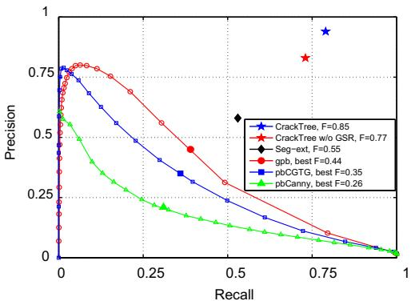  
(a)

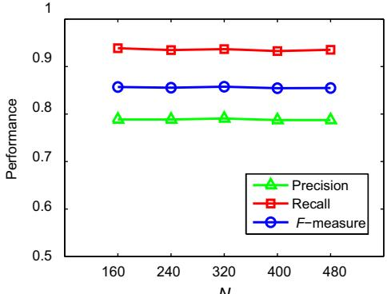  
(b)

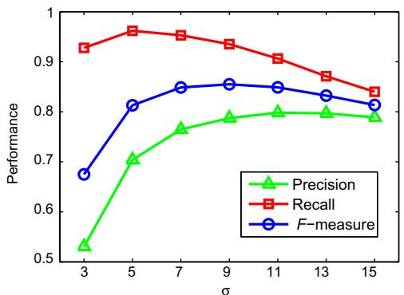  
(c)

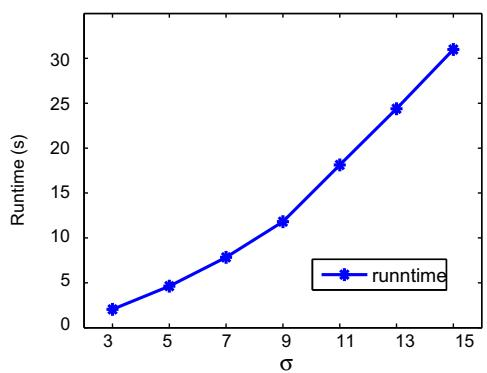  
(d)

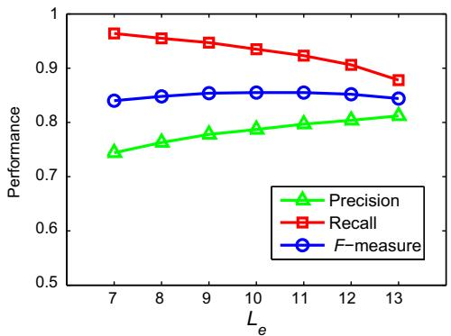  
(e)

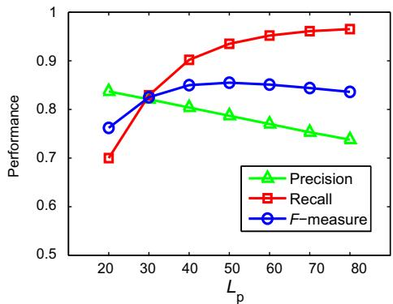  
(f)  
Fig. 6. Performance evaluation. (a) Precision-recall curves of different algorithms over all 206 images, (b) performance by selecting different N, (c) performance by selecting different σ, (d) average running time at different σ, (e) and (f) performance by selecting different $L _ { e }$ and $L _ { p } ,$ respectively.

Based on the crack seeds, we construct an (undirected) graph $G = ( V , E )$ to model the possible connections among these crack seeds. Specifically, for each crack seed, we construct a vertex $\nu \in V$ and for each pair of vertices v and $\nu _ { j } ,$ we check the Euclidean distance between their corresponding crack seeds: if this distance is less than a pre-given threshold $L _ { e } ,$ we construct an edge $\begin{array} { r } { e _ { i j } = \left( - \begin{array} { r l r l } \end{array} \right. } \end{array}$ $\nu _ { i } , \nu _ { j } )$ to connect them and set its edge weight $w _ { i j }$ to be the Euclidean distance between these two crack seeds. Note that, G may not be a connected graph and it may consist of several connected subgraphs, as illustrated in $\mathrm { F i g . } 5 ( \mathsf { a } )$

To identify the desired edge connections among crack seeds, we find the minimum spanning tree (MST) from the constructed graph G. If G is not connected, we find the MST independently for each connected subgraph and put them together into a forest of trees. MST is a spanning tree with the minimum total edge weight and therefore, the edges that remain in an MST connect the crack seeds with the best proximity. Two examples of the MST construction are shown in Fig. 5(c) and (d).

In practice, we find that the derived MSTs may still include undesirable edge connections. To address this problem, we further conduct an edge pruning algorithm to remove the edges that show very poor proximity and continuity. In this algorithm, crack curves are recursively identified by searching for the longest path (the path with the largest total edge weights) among each possible pair of leaves in an MST. This algorithm is summarized in Algorithm 2 and an example is shown in Fig. 5(e)-(h).

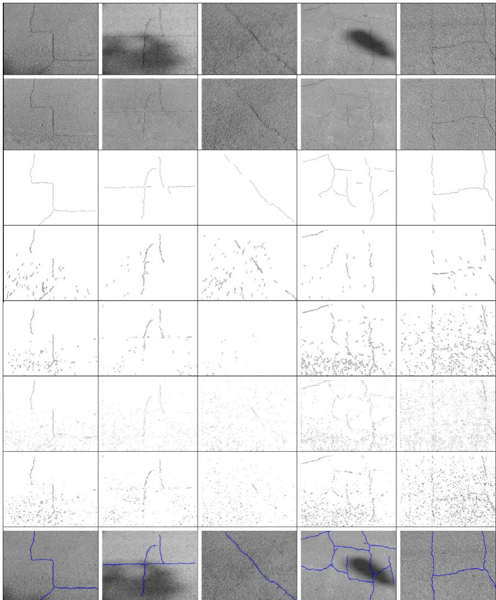  
Fig. 7. Crack detection on five images (column 1 through 5). Row 1: original images. Row 2: shadow-removal results. Row 3: cracks detected by the proposed CrackTree. Row 4: cracks detected by the Seg-ext method. Row 5: cracks detected by pbCanny (with best F-measure). Row 6: cracks detected by gpb (with best F-measure). Row 7: cracks detected by pbCGTG (with best F-measure). Row 8: ground-truth cracks.

<table><tr><td colspan="2">Algorithm 2. Edge pruning algorithm</td></tr><tr><td>1:</td><td>procedure EDGEPRUNING</td></tr><tr><td>2:</td><td>input: T: an MST</td></tr><tr><td>3:</td><td> $L _ { p } \colon$  path-length threshold</td></tr><tr><td>4:</td><td>output: R: final crack curves</td></tr><tr><td>5:</td><td>// get all leaf nodes from V</td></tr><tr><td>6:</td><td> $V _ { l e a f } \longleftarrow G e t L e a f n o d e s ( V ) ;$ </td></tr><tr><td>7:</td><td> $/ /$  search a longest path  $P _ { m a x }$  between tree leaves</td></tr><tr><td>8: 9:</td><td> $W _ { m a x }  0 ;$ </td></tr><tr><td>10:</td><td>for each  $\upsilon _ { i } \in V _ { l e a f }$  do P ← LongestPathFrom(vi);</td></tr><tr><td>11:</td><td>W ← PathLengthOf(P);</td></tr><tr><td>12:</td><td>if  $W > W _ { m a x }$  then  $W _ { m a x }  W , P _ { m a x }  P ;$ </td></tr><tr><td>13:</td><td>end if</td></tr><tr><td>14:</td><td>end for</td></tr><tr><td>15:</td><td>if</td></tr><tr><td>17:</td><td> $W _ { m a x } < L _ { p }$  then go to Line 20; end if</td></tr><tr><td>18:</td><td> $R \gets \mathsf { A d d ~ } P _ { m a x } \mathrm { ~ t o ~ } R ;$ </td></tr><tr><td>19:</td><td>// recursive pruning</td></tr><tr><td>20:</td><td> $T \gets ( T - P _ { m a x } ) ,$  go to Line 6;</td></tr><tr><td></td><td>end procedure</td></tr><tr><td>21:</td><td></td></tr></table>

## 6. Experiments

For performance evaluation, we collect a set of 206 pavement images with various kinds of cracks. All these images have a size of 800 × 600, and many of them suffer from the problems of shadows, occlusions, low contrast, noise, etc. We manually annotate the ground-truth crack curves on these images for objective performance evaluation. We implement the proposed method in C++ and test it on a Windows PC equipped with 2.4 GHz CPU and 2 M RAM.

## 6.1. Performance evaluation

To evaluate a crack detection result, we compute three mea-Precision+Recall by compar  
ing the detected crack curves against the human annotated   
ground-truth crack curves. Because the cracks in a pavement image   
have a certain width, we allow a certain tolerance margin in mea  
suring the coincidence between the detected crack curves and the   
ground-truth crack curves. More specifically, the average crack   
width in our collected images is around 2 pixels. Therefore, a

Crack detection performance on 34 images with shadows.
<table><tr><td>Method</td><td colspan="2">pbCGTG</td><td colspan="2">gpb</td><td colspan="2">pbCanny</td><td colspan="2">Seg-ext</td><td colspan="2">CrackTree</td></tr><tr><td>With GSR?</td><td>No</td><td> $\tt Y e s$ </td><td>No</td><td> $\tt Y e s$ </td><td>No</td><td> $\tt Y e s$ </td><td>No</td><td> $\tt Y e s$ </td><td> $\mathsf { N o }$ </td><td> $\tt Y e s$ </td></tr><tr><td>Precision</td><td>0.32</td><td>0.34</td><td>0.34</td><td>0.36</td><td>0.30</td><td>0.30</td><td>0.35</td><td>0.57</td><td>0.60</td><td>0.79</td></tr><tr><td>Recall</td><td>0.36</td><td>0.36</td><td>0.34</td><td>0.49</td><td>0.19</td><td>0.21</td><td>0.45</td><td>0.63</td><td>0.59</td><td>0.92</td></tr><tr><td>F-measure</td><td>0.34</td><td>0.35</td><td>0.34</td><td>0.41</td><td>0.23</td><td>0.25</td><td>0.39</td><td>0.59</td><td>0.59</td><td>0.85</td></tr></table>

detected crack pixel is still considered to be a true positive if it is located no more than 2 pixels away from human annotated crack curves. For the parameters, we set $\sigma = 9 , L _ { e } = 1 0 , L _ { p } = 5 0$ and N = 240 for the proposed method.

We compare the performance of the proposed CrackTree method with the Seg-ext method (Liu et al., 2008) and three other stateof-the-art edge detection algorithms: global pb (gpb), pbCanny, and pbCGTG (Martin et al., 2001). Given that the pb-based algorithms produce soft edges, we choose the threshold that leads to the best F-measures. For a fairer comparison, in this experiment we also preprocess the input images using the proposed geodesic shadow-removal algorithm (GSR) before applying these four comparison methods. Fig. 6(a) shows average precision-recall curves over all 206 images. Fig. 7 shows the sample crack-detection results on five images. We can see that the proposed CrackTree method achieves an average F-measure of 0.85, which is much higher than Seg-ext (F-measure 0.55) and gpb (best F-measure 0.44), pbCGTG (best F-measure 0.35) and pbCanny (best F-measure

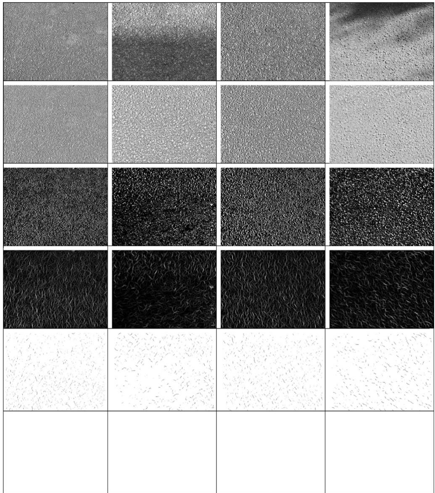  
Fig. 8. Crack detection on four non-cracked images (column 1 through 4). Row 1: original images. Row 2: shadow-removal results. Row 3: detected crack pixels. Row 4: crack probability map. Row 5: sampled crack seeds. Row 6: results after the MST construction and edge pruning. Note that, no crack curves are detected on these four images as desired.

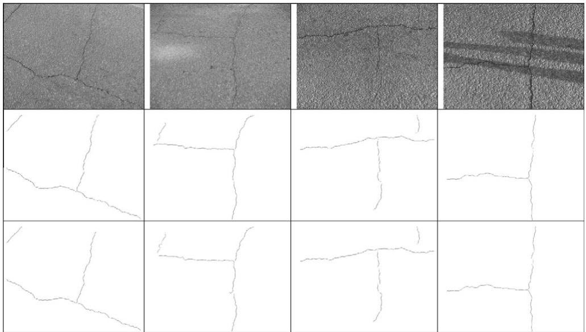  
Fig. 9. Crack detection by using different approaches for crack-seed connection. Top row: original images. Middle row: resulting crack curves by using straight lines for crack seed connection. Bottom row: resulting crack curves by using minimum-total-intensity paths for crack seed connection.

0.26). We can also find that, without the shadow removal, the proposed method (CrackTree w/o GSR) produces a lower performance (F measure 0.77). We also visually checked these 206 images and found that about one-sixth of them contains shadows.

For the runtime, the proposed CrackTree method takes an average of 12 s to process one pavement image in our collection, while Seg-ext, pbCanny, gpb, and pbCGTG take an average of 2 s, 60 s, 8 min, and 25 min, respectively.

To check the effectiveness of the proposed shadow-removal algorithm (GSR), out of 206 test images, we take the 34 images with shadows and run the proposed method and the four comparison methods, with and without the proposed GSR component. From Table 1 we can see that proposed GSR substantially improves the performance of the proposed method and the Seg-ext method. For pbCGTG, gpb and pbCanny, the shadow removal only marginally improves the crack-detection performance, because these three edge detection are not much affected by the contrast changes introduced by shadows.

In addition, we test the proposed CrackTree method on pavement images without any cracks. Using exactly the same parameters as above, we find that the proposed method does not detect any false-positive cracks. Results on four such images are shown in Fig. 8.

We also conduct an experiment to justify the effectiveness of using straight lines for crack seed connection and MST construction. As an alternate approach, between each pair of crack seeds, we find a path with the minimum total pixel intensity (because cracks usually show lower intensities than the background) and then use this path length as the edge weight for MST construction. This alternate approach allows for connecting crack seeds using non-straight curves. As expected, since the detected seeds are usually densely distributed along the crack curves (but with many false positives), the crack detection performance is not improved (F-measure is still 0.85 over all the test images) compared to the above-mentioned simple straight line connection approach. Results on several sample images are shown in Fig. 9.

## 6.2. Parameter selection

There are four main parameters in the proposed CrackTree method: the voting scale σ in tensor voting, the edge-length threshold $L _ { e }$ for MST construction, the path-length threshold $L _ { p }$ for edge pruning, and the number of geodesic levels N for pavement shadow removal. In this section, we conduct experiments to show the algorithm sensitivity to the selection of these parameters.

First, we keep $L _ { e } = 1 0 , L _ { p } = 5 0 , N = 2 4 0$ and vary σ in the range of [3,15]. Fig. 6(c) shows the best performance of crack detection is achieved when σ = 9. We can also see that the F-measure of the proposed method is consistently above 0.80 when σ takes a value in [5,15]. Note that a selection of a larger σ increases the runtime of tensor voting, which dominates the runtime of the proposed method. Fig. 6(d) shows the average CPU time on each image for different σ.

Fig. 6(e) shows the performance by only varying $L _ { e }$ and Fig. 6(f) shows the performance by only varying $L _ { p } .$ Clearly, a larger $L _ { e }$ leads to a higher Precision, but a lower Recall. In contrary, a larger $L _ { p }$ leads to a lower Precision, but a higher Recall. In general, the performance of the proposed method does not drop much for a wide range of $L _ { e }$ and $L _ { p }$ values.

Finally, we evaluate the sensitivity of the parameter N to the performance of CrackTree. We keep $\sigma = 9 , L _ { e } = 1 0 , L _ { p } = 5 0$ , and vary N in the range of [160,480] at an interval of 80. Fig. 6(b) shows that the Precision, Recall and F-measure of CrackTree do not change much by selecting different values of N in this range.

## 7. Conclusion

In this paper, we developed CrackTree, a fully-automatic method for detecting the crack curves from a pavement image. We first introduced a new a geodesic shadow-removal algorithm to remove pavement shadow and enhance the contrast of cracks. We then applied the tensor voting technique to construct a crack probability map by incorporating the perceptual cues of proximity and continuity. We finally constructed minimum spanning trees (MSTs) to describe the possible connections of sampled crack seeds and pruned undesired edges in this tree to achieve the final crack curves. We collected 206 pavement images with different kinds of cracks to test the proposed method. Both the qualitative and quantitative comparison results show that the proposed CrackTree method outperforms several existing crack detection and edge detection algorithms.

## Acknowledgments

This research was supported, in part, by the National Natural Science Foundation of China (NSFC) on Innovation Team Program under Grant No. 40721001, the Doctoral Foundation Program under Grant No. 20070486001, the Fundamental Research Funds for the Central Universities under Grant Nos. 20102130101000130 and 6082031, and the US National Science Foundation under Grants NSF-1017199 and NSF-0951754.

## References

Arbel, E., Hel-Or, H., 2007. Texture-preserving shadow removal in color images containing curved surfaces. In: Proc. IEEE Conf. on Computer Vision and Pattern Recognition (CVPR'07), pp. 1–8.

Ayenu-Prah, A., Attoh-Okine, N., 2008. Evaluating pavement cracks with bidimensional empirical mode decomposition. EURASIP J. Adv. Signal Process. 1-7.

Cheng, H.D., Wang, J.L., Hu, Y.G., Glazier, C., Shi, X.J., Chen, X.W., 2001. Novel approach to pavement cracking detection based on neural network. Transport Res. Rec. 1764, 119–127.

Cheng, H.D., Chen, J.R., Glazier, C., Hu, Y.G., 1999. Novel approach to pavement cracking detection based on fuzzy set theory. J. Comput. Civ. Eng. 13 (4), 270–280.

Chou, J., O'iNeill, W.A., Cheng, H.D., 1995. Pavement distress evaluation using fuzzy logic and moments invariants. Transport Res. Rec. 1505, 39–46.

Finlayson, G., Hordley, S., Lu, C., Drew, M., 2006. On the removal of shadows from images. IEEE Trans. Pattern Anal. Machine Intell. 28 (1), 59–68.

Finlayson, G., Drew, M., Lu, C., 2009. Entropy minimization for shadow removal. Internat. J. Comput. Vision 85, 35–57.

Guy, G., Medioni, G., 1997. Inferring of surfaces, 3D curves, and junctions from sparse, noisy, 3D data. IEEE Trans. Pattern Anal. Machine Intell. 19 (11), 1265–1277.

Hassani, A., Tehrani, H.G., 2008. Crack detection and classification in asphalt pavement using image processing. In: Proc. Internat. Conf. on Cracking in Pavements, RILEM, pp. 891–896.

Hu, Y., Zhao, C., 2010. A local bineray pattern based methods for pavement crack detection. J. Pattern Recognition Res. 1, 140–147.

Huang, Y.X., Xu, B.G., 2006. Automatic inspection of pavement cracking distress. J. Electron. Imaging 15 (1), 013017.1–013017.6.

Kapur, J.N., Sahoo, P.K., Wong, A.K.C., 1985. A new method for gray-level picture thresholding using entropy of the histogram. Comput. Vision Graph. Image Process. 29, 273–285.

Kirschke, K.R., Velinsky, S.A., 1992. Histogram-based approach for automated pavement-crack sensing. J. Transport. Eng. 118 (5), 700–710.

Li, Q.Q., Liu, X.L., 2008. Novel approach to pavement image segmentation based on neighboring difference histogram method. In: Proc. Internat. Cong. on Image Signal Processing, pp. 792–796.

Liu, F.F., Xu, G.A., Yang, Y.X., Niu, X.X., Pan, Y.L., 2008. Novel approach to pavement cracking automatic detection based on segment extending. In: Proc. Internat. Symp. on Knowledge Acquisition and Modeling, pp. 610–614.

Martin, D., Fowlkes, C., Tal, D., Malik, J., 2001. A database of human segmented natural images and its application to evaluating segmentation algorithms and measuring ecological statistics. In: Proc. Internat. Conf. on Computer Vision (ICCV'01), pp. 416–423.

Medioni, G., Lee, M., Tang, C., 2000. A Computational Framework for Segmentation and Grouping. Elsevier Science.

Mordohai, P., Medioni, G., 2006. Tensor voting: A perceptual organization approach to computer vision and machine learning. Springer.

Nguyen, T.S., Avila, M., Begot, S., 2009. Automatic detection and classification of defect on road pavement using anisotropy measure. In: Proc. European Signal Processing Conf. (EUSIPCO'09), pp. 617–621.

Oh, H., Garrick, N.W., Achenie, L.E.K., 1997. Segmentation algorithm using iterated clipping for processing noisy pavement images. In: Proc. Internat. Conf. on Imaging Technologies: Techniques and Applications in Civil Engineering, ASCE, pp. 138–147.

Ojala, T., Pietikainen, M., Maenpaa, T., 2002. Multiresolution gray-scale and rotation invariant texture classification with local binary patterns. IEEE Trans. Pattern Anal. Machine Intell. 24 (7), 971–987.

Oliveira, H., Correia, P.L., 2008a. Identifying and retrieving distress images from road pavement surveys. In: Proc. Internat. Conf. on Image Processing (ICIP'08), pp. 57-60.

Oliveira, H., Correia, P.L., 2008b. Supervised strategies for crack detection in images of road pavement flexible surfaces. In: Proc. European Signal Processing Conf. (EUSIPCO'08), pp. 25–29.

Oliveira, H., Correia, P.L., 2009. Automatic road crack segmentation using entropy and image dynamic thresholding. In: Proc. European Signal Processing Conf. (EUSIPCO'09), pp. 622–626.

Otsu, N., 1979. A threshold selection method from gray-level histogram. IEEE Trans. Systems Man Cybernet., SMC 9 (1), 62–66.

Petrou, M., Kittler, J., Song, K.Y., 1996. Automatic surface crack detection on textured materials. J. Mater. Process. Technol. 56, 158–167.

Song, K.Y., Petrou, M., Kittler, J., 1995. Texture crack detection. Machine Vision Appl. 8, 63–76.

Subirats, P., Dumoulin, J., Legeay, V., Barba, D., 2006. Automation of pavement surface crack detection using the continuous wavelet transform. In: Proc. Internat. Conf. on Image Processing (ICIP'06), pp. 3037–3040.

Tang, C.K., Medioni, G., Lee, M.S., 1999. Epipolar geometry estimation by tensor voting in 8d. In: Proc. Internat. Conf. on Computer Vision (ICCV'99), pp. 502– 509.

Tsai, Y., Kaul, V., Mersereau, R.M., 2010. Critical assessment of pavement distress segmentation methods. J. Transport. Eng. 136 (1), 11–19.

Yan, M.D., Bo, S.B., Xu, K., He, Y.Y., 2007. Pavement crack detection and analysis for high-grade highway. In: Proc. Internat. Conf. on Electronic Measurement and Instruments (ICEMI'07), pp. 548–552.

Zhou, J., Huang, P.S., Chiang, F.P., 2006. Wavelet-based pavement distress detection and evaluation. Opt. Eng. 45 (2), 027007.1–027007.10.