MACHINE LEARNING FOR AERIAL IMAGE LABELING

by

Volodymyr Mnih

A thesis submitted in conformity with the requirements for the degree of Doctor of Philosophy Graduate Department of Computer Science University of Toronto

© Copyright 2013 by Volodymyr Mnih

## Abstract

# Machine Learning for Aerial Image Labeling

Volodymyr Mnih

Doctor of Philosophy

Graduate Department of Computer Science

University of Toronto

2013

Information extracted from aerial photographs has found applications in a wide range of areas including urban planning, crop and forest management, disaster relief, and climate modeling. At present, much of the extraction is still performed by human experts, making the process slow, costly, and error prone. The goal of this thesis is to develop methods for automatically extracting the locations of objects such as roads, buildings, and trees directly from aerial images.

We investigate the use of machine learning methods trained on aligned aerial images and possibly outdated maps for labeling the pixels of an aerial image with semantic labels. We show how deep neural networks implemented on modern GPUs can be used to efficiently learn highly discriminative image features. We then introduce new loss functions for training neural networks that are partially robust to incomplete and poorly registered target maps. Finally, we propose two ways of improving the predictions of our system by introducing structure into the outputs of the neural networks.

We evaluate our system on the largest and most-challenging road and building detection datasets considered in the literature and show that it works reliably under a wide variety of conditions. Furthermore, we are releasing the first large-scale road and building detection datasets to the public in order to facilitate future comparisons with other methods.

## Acknowledgements

First, I want to thank Geoffrey Hinton for being an amazing advisor. I benefited not only from his deep insights and knowledge but also from his patience, encouragement, and sense of humour. I am also grateful to Allan Jepson and Rich Zemel for serving on my supervisory committee and for providing valuable feedback throughout.

I also want to thank all the current and former members of the Toronto Machine Learning group for contributing to a truly great and fun research environment and for many interesting discussions. I especially learned a great deal from working with former post-docs Marc'Aurelio Ranzato and Hugo Larochelle, as well as my office mates George Dahl, Navdeep Jaitly, and Nitish Srivastava. My brother, Andriy, also probably deserves a co-supervision credit for the many hours he spent listening to my research ideas.

I would also like to thank my parents for their never-ending support, and for giving me the amazing opportunities I have had by moving to Canada. Finally, I would like to thank my wife and best friend, Anita, for her constant support and for putting up with me over the years.

## Contents

1 Introduction 1   
2 An Overview of Aerial Image Labeling 6   
2.1 Early Work - Simple Classifiers and Local Features 7   
2.2 Move to High-Resolution Data 8   
2.2.1 Better classifiers 9   
2.2.2 Better features 11   
2.2.3 Larger datasets 13   
2.3 Structured Prediction 14   
2.3.1 Segmentation 14   
2.3.2 Post-classification 15   
2.3.3 Probabilistic Approaches 15   
2.3.4 Discussion of Structured Prediction . 17   
2.4 Source of Supervision 18   
3 Learning to Label Aerial Images 20   
3.1 Patch-Based Labeling Framework 20   
3.1.1 Learning 23   
3.1.2 Generating Labels 25   
3.1.3 Evaluating Predictions 26   
3.2 Datasets 27   
3.3 Architecture Evaluation 29   
3.3.1 One Layer Architectures 29   
3.3.2 Two Layer Architectures 33   
3.3.3 Deeper Architectures 35   
3.3.4 Sensitivity to Hyper Parameters 36   
3.3.5 A Word on Overfitting 37   
3.4 Qualitative Evaluation 38   
3.4.1 Peering into the Mind of the Network . 40   
3.5 Conclusions and Discussion 41   
4 Learning to Label from Noisy Data 43   
4.1 Dealing With Omission Noise 44   
4.2 Dealing With Registration Noise 46   
4.2.1 Translational Noise Model 47   
4.2.2 Learning 48   
4.2.3 Understanding the Noise Model 51   
4.3 Results . 51   
4.3.1 Omission Noise 51   
4.3.2 Registration Noise 55   
4.4 Conclusions and Discussion 56   
Structured Prediction 59   
5.1 Post-processing Neural Networks 60   
5.1.1 Results . 62   
5.2 Conditional Random Fields 64   
5.2.1 Model Description 64   
5.2.2 Predictions and Inference . 66   
5.2.3 Learning 69   
5.2.4 Results 74   
5.3 Combining Structure and Noise Models . 75   
5.3.1 The model 76   
5.3.2 Inference 76   
5.3.3 Learning 77   
5.3.4 Results . 82   
5.3.5 Discussion 82   
6 Large-Scale Evaluation 84   
6.1 Massachusetts Buildings Dataset 85   
6.2 Massachusetts Roads Dataset 85   
6.3 Buffalo Roads Dataset 86   
6.4 Results . 88   
6.4.1 Massachusetts Datasets 88   
6.4.2 Buffalo Roads Dataset 90   
7 Conclusions and Future Work 93   
Bibliography 97

## Chapter 1

## Introduction

Aerial image interpretation is the process of examining aerial imagery for the purposes of identifying objects and determining various properties of the identified objects. The process originated during the First World War when photos taken from airplanes were examined for the purpose of reconnaissance. In its near one hundred year history, aerial image interpretation has found applications in many diverse areas including urban planning, crop and forest management, disaster relief, and climate modeling. Much of the work, however, is still performed by human experts.

Examining large amounts of aerial imagery by hand is an expensive and time consuming process. First attempts at automation using computers date back to the late 1960s and early 1970s [Idelsohn, 1970, Bajcsy and Tavakoli, 1976]. While significant progress has been made in the past thirty years, only a few semi-automated systems that work in limited domains are in use today and no fully automated systems currently exist [Baltsavias, 2004, Mayer, 2008].

The recent explosion in the availability of high resolution imagery underscores the need for automated aerial image interpretation methods. Such imagery, having resolution as high as 100 pixels per square meter, has greatly increased the number of possible applications but at the cost of an increase in the amount of required manual processing. Recent applications of large-scale machine learning to such high-resolution imagery have produced object detectors with impressive levels of accuracy [Kluckner and Bischof, 2009, Kluckner et al., 2009, Mnih and Hinton, 2010, 2012], suggesting that automated aerial image interpretation systems may be within reach.

In machine learning applications, aerial image interpretation is usually formulated as a pixel labeling task. Given an aerial image like the one shown in Figure 1.1, the goal is to produce either a complete semantic segmentation of the image into classes such as building, road, tree, grass, and water [Kluckner and Bischof, 2009, Kluckner et al., 2009] or a binary classification of the image for a single object class [Dollar et al., 2006, Mnih and Hinton, 2010, 2012].

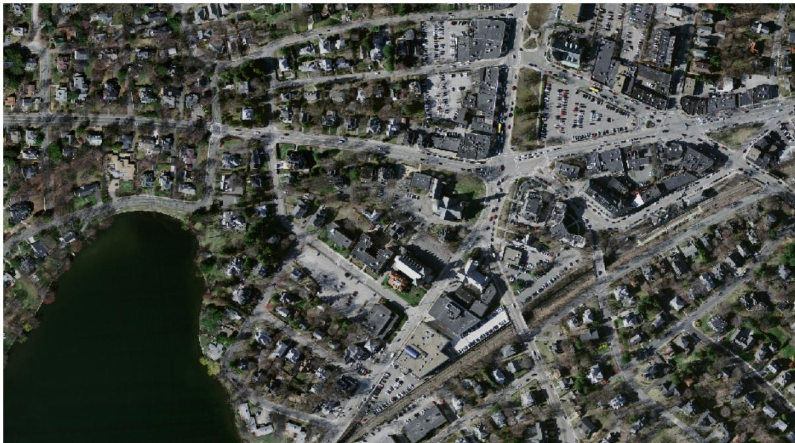  
Figure 1.1: An aerial image of the city of Boston.

While image labeling or parsing of general scenes has been extensively studied [He et al., 2004, Shotton et al., 2008, Farabet et al., 2012], aerial images have a few distinct characteristics that make aerial image labeling an easier task. First, by restricting ourselves to overhead imagery with known ground resolution both the viewpoint and the scale of objects can be assumed to be fixed. Having a fixed viewpoint and scale reduces the possible variations in object appearance and makes the priors on object shape less broad than in general image labeling. This suggests that it should be possible to incorporate strong shape dependencies into an aerial image labeling systems. Finally, the amount of both unlabeled and labeled aerial imagery is massive compared to the datasets available for general image labeling tasks. Methods that are able to effectively learn from massive amounts of labeled data should have a distinct advantage on aerial image labeling tasks over methods that can't.

The goal of this thesis is to develop new machine learning methods that are particularly well suited to the task of aerial image labeling. Namely, this thesis focuses on what we see as the three main issues in applying image labeling techniques to aerial imagery:

• Context and Features: The use of context is important for successfully labeling aerial images because local colour cues are not sufficient for discriminating between pairs of object classes like trees and grass, and roads and buildings Additionally, occlusions and shadows caused by trees and tall buildings often make it impossible to classify a pixel without using any context information. Since the number of input features grows quadratically with the width of an input image patch, the number of parameters and the amount of computation required for a naive approach also increases quadratically. For these reasons, efficient ways of extracting discriminative features from a large image context are necessary for aerial image labeling.

• Noisy Labels: When training a system to label images, the amount of labeled training data tends to be a limiting factor. The most successful applications of machine learning to aerial imagery have relied on existing maps. These provide abundant labels, but the labels are often incomplete and sometimes poorly registered, which hurts the performance of object detectors trained on them. In order to successfully apply image labeling to buildings and other object types for which the amount of label noise is high, new learning methods that are robust to noise in the labels are required.

• Structured Outputs: Labels of nearby pixels in an image exhibit strong correlations, and exploiting this structure can significantly improve labeling accuracy. Due to the restricted viewpoint and fixed scale of aerial imagery, the structure present in the labels is generally more rigid than that in general image labeling, with shape playing an important role. In addition to being able to handle shape constraints, a structured prediction method suited to aerial imagery should also be able to deal with large datasets and noisy labels.

The main contribution of this thesis is a coherent framework for learning to label aerial imagery. The proposed framework consists of a patch-based formulation of aerial image labeling, new deep neural network architectures implemented on GPUs, and new loss functions for training these architectures, resulting in a single model that can be trained end-to-end while dealing with the issues of context, noisy labels, and structured outputs.

Fully embracing the view of aerial image labeling as a large scale machine learning task, we assemble a number of road and building detection datasets that far surpass all previous work in terms of both size and difficulty. In addition to releasing the first publicly available datasets for aerial image labeling we perform the first truly large-scale evaluation of an aerial image labeling system on real-world data. When trained on these road and building detection datasets our models surpass all published models in terms of accuracy.

The rest of the thesis is organized as follows:

• Chapter 2 presents a brief overview of existing work on applying machine learning to aerial image data. Some related work on general image labeling that has not been applied to aerial imagery is also covered.

• Chapter 3 presents our formulation of aerial image labeling as a patch-based pixel labeling task as well as an evaluation of several different proposed architectures. The main contribution is a GPU-based, deep convolutional architecture that is capable of exploiting a large image context as well as learning discriminative features. This chapter includes work previously published in Mnih and Hinton [2010] and Mnih and Hinton [2012].

• Chapter 4 addresses the problem of learning from incomplete or poorly registered maps. The main contributions are loss functions that provide robustness to both types of label noise and are suitable for training the architectures proposed in Chapter 3. This work has been previously published in [Mnih and Hinton, 2012].

• Chapter 5 explores ways of taking advantage of the structure present in the labels. We investigate two complementary ways of performing structured prediction – post-processing neural networks and Conditional Random Fields (CRFs). We argue that neural networks are good at learning high-level structure while CRFs are good at capturing low-level dependencies, with the combination of the two approaches being particularly effective. We also show how to combine a noise model from Chapter 4 with the proposed structured prediction models. This chapter includes work previously published in Mnih et al. [2011] and Mnih and Hinton [2012].

• Chapter 6 introduces the first large-scale publicly available datasets for road and building detection which are both much larger and more challenging than any datasets previously used in the literature. We evaluate our most promising models on the new datasets giving an indication of how well the proposed algorithms work in the wild.

• Chapter 7 summarizes our most important findings and offers a discussion of the most promising directions for improving our system.

Chapter 2

# An Overview of Aerial Image Labeling

This chapter aims to present a general overview of aerial image labeling methods. In particular, we focus on approaches that make use of machine learning as opposed to ad-hoc and knowledge-based approaches [Idelsohn, 1970, Bajcsy and Tavakoli, 1976, Kettig and Landgrebe, 1976, Jr. et al., 1985] which account for much of the early work on automating aerial image interpretation. While knowledge-based approaches have led to some operational systems in limited domains, machine learning has led to much of the recent progress in aerial image interpretation as well as progress on related computer vision problems such as semantic image labeling [Shotton et al., 2008].

We will use the term aerial imagery to refer to any type of two dimensional and possibly multi-band data collected by an airborne sensor. In addition to imagery taken by sensors that measure visible light, this includes sensors that measure other kinds of electromagnetic radiation, such as infrared and hyperspectral sensors, as well as sensors that do not measure electromagnetic radiation, such as airborne LIDAR, which measures the distance to objects from the sensor.

## 2.1 Early Work - Simple Classifiers and Local Features

Some of the first applications of machine learning to aerial imagery considered the task of classifying land cover, or terrain, into different classes, such as forest, water, agricultural land, and built-up land. Early approaches tried to predict the discrete class label $\mathbf { c } _ { i }$ at a pixel i from a vector $\mathbf { x } _ { i }$ of features at i [Decatur, 1989, Benediktsson et al., 1990, Bischof et al., 1993, Paola and Schowengerdt, 1995], with the features typically just taken to be the values at the different spectral bands at pixel i.

The Bayes' classifier is one of simplest and most popular approaches to terrain classification. The Bayes' classifier makes explicit assumptions about the class conditional distributions $p ( \mathbf { x } _ { i } | \mathbf { c } _ { i } = k )$ and the prior class probabilities $P ( \mathbf { c } _ { i } = k )$ and uses Bayes' rule to obtain the posterior class probabilities $P ( \mathbf { c } _ { i } = k | \mathbf { x } _ { i } )$ . Typically, the class conditional distribution $p ( \mathbf { x } _ { i } | \mathbf { c } _ { i } = k )$ is assumed to have a multivariate normal distribution with mean $\mu _ { k }$ and covariance $\Sigma _ { k }$ . Various simplifying assumptions lead to other popular classifiers. For example, assuming that $\Sigma _ { k }$ is diagonal leads to the Naive Bayes classifier for continuous inputs while assuming that $P ( \mathbf { c } _ { i } = k ) = 1 / K$ leads to what is known in the remote sensing literature as the maximum likelihood classifier [Paola and Schowengerdt, 1995].

The main drawback of the Bayes' classifier is the need to explicitly specify the class-conditional distribution $p ( \mathbf { x } _ { i } | \mathbf { c } _ { i } = k )$ . Since the multivariate normal distribution is typically used for the class-conditional distributions, only linear or quadratic decision boundaries can be learned by such a model. Neural networks became a popular alternative to the Bayes' classifier because they directly model $p ( \mathbf { c } _ { i } | \mathbf { x } _ { i } = k )$ as a differentiable function whose parameters are learned [Decatur, 1989, Lee et al., 1990, Bischof et al., 1993]. This both sidesteps the need to specify $p ( \mathbf { x } _ { i } | \mathbf { c } _ { i } = k )$ , and allows for richer, non-linear decision boundaries to be learned when at least one hidden layer of units with a non-linear activation function is used. Due to the ability to learn nonlinear decision boundaries neural networks tend to give higher classification accuracies than various forms of the Bayes' classifier [Decatur, 1989, Benediktsson et al., 1990].

Bischof et al. [Bischof et al., 1993] and Boggess [Boggess, 1993] explored adding contextual information by using spectral values from a small patch centered at the pixel of interest as the input to a neural network, allowing it to learn some contextual features. However, such features were still very local since they used at most a 7 by 7 window for context. Others aimed to improve classification accuracy by using hand-designed features that encode local textural information [Haralick et al., 1973, Haralick, 1976, Lee et al., 1990]. Haralick et al. [Haralick, 1976] introduced a popular set of features derived from gray level spatial dependence matrices $H _ { d , \theta ; }$ where $H ( i , j ) _ { d , \theta }$ specifies the frequency at which gray level values i and $j$ co-occur at distance d and angle θ. Statistical quantities derived from $H _ { d , \theta }$ were shown to be good for discriminating between different types of textures. For example, the sum of squares of the entries of $H _ { d , \theta }$ can be used to discriminate coarse textures from fine textures because the sum of squares should be higher for coarse textures than for fine textures when d is small.

Since such systems were generally applied to low resolution imagery, with a single pixel representing as much as 30x30 meters, local spectral cues were sufficient for discriminating between broad classes of interest, such as forest and farmland, with reasonably high accuracy. For example Bischof et al. [Bischof et al., 1993] report accuracies in the range of 85% on a four class classification task using only the values of seven spectral bands as input.

However, with increasing availability of higher resolution data, the focus shifted to classifying aerial imagery into finer object classes, such as roads, cars, and trees. At resolutions higher than one pixel per square meter, differences in object type, shape and material as well as variations in weather and lighting conditions make it impossible to accurately classify objects based on local cues alone.

## 2.2 Move to High-Resolution Data

The Ikonos and Quickbird satellites, launched in 1999 and 2001 respectively, began acquiring panchromatic images of the surface of the Earth at resolutions of roughly one square meter per pixel, significantly increasing the number of possible applications of aerial image interpretation systems. Since at this resolution the classes of interest are man-made objects such as buildings, roads, and cars, the approach of training simple classifiers on very local spectral and textural features that was moderately successful on low resolution images no longer leads to acceptable accuracy levels. The approaches discussed in the previous section no longer work because they were generally designed to do local texture classification, but the problem of classifying high-resolution imagery is much more complex, requiring knowledge of shape and

context in addition to texture.

During the move from low-resolution to high-resolution image labeling the most notable trends were:

1. The switch to more powerful or sophisticated classifiers such as AdaBoost, SVMs, and random forests.

2. The use of more spatial context and richer input features.

3. The use of much more data for training and testing.

4. The use of structured prediction methods such as Conditional Random Fields.

We will discuss the first three trends in some detail in the following subsections and delay the discussion of structured prediction methods to a later, separate section.

## 2.2.1 Better classifiers

Discriminating between object classes with similar texture, such as roads and buildings, requires some knowledge of shape and context, which in turn leads to much more complex decision boundaries than the ones required for discriminating between wooded and built up areas in low-resolution imagery. Due to the need to learn such highly nonlinear decision boundaries, applications of machine learning to high resolution imagery have relied on more sophisticated classifiers such as SVMs, random forests and various types of boosting.

While neural networks are able to learn nonlinear decision boundaries and have been widely used in remote sensing applications, many researchers found them difficult to train due to the presence of local optima [Benediktsson et al., 1990]. Support Vector Machines presented an attractive alternative to neural networks because, like neural networks, they are able to learn nonlinear decision boundaries, but, unlike neural networks, SVMs optimize a convex loss function and do not suffer from the problem of local optima. Since SVMs are essentially sophisticated template matchers and have been shown to work poorly when applied as classifiers to raw image patches [LeCun et al., 2004], they are generally used in combination with higher level features in the computer vision community [Lazebnik et al., 2006]. Applications of SVMs to aerial image interpretation have been much more primitive than in the computer vision community, with most papers using SVMs to classify pixels using only lowlevel features [Huang et al., 2002, Song et al., 2005].

Some of the more successful approaches to labeling high resolution aerial imagery have relied on various ensemble methods, with boosting and random forests being particularly popular. Porway et al. [2008] developed a hierarchical model for aerial image parsing that relied on bottom up detectors for cars, roads, parking lots and buildings that were trained using different types of boosting. Other notable applications of boosting include the work of Dollar et al. [Dollar et al., 2006], who developed a general framework for learning to detect image boundaries using a boosted pixel classifier and presented some qualitative results on road detection, and the work of Nguyen et al. [Nguyen et al., 2007] who used online boosting to learn a car detector. A common reason for using boosting in these applications is its ability to perform feature selection from a very large pool of features when the set of weak learners is restricted to learners that look at a single feature. Dollar et al. [2006] were able to use a pool of 50,000 filter responses as features for their edge classifier.

A random forest is another tree-based ensemble method that has been widely used in image labeling applications. A random forest classifier consists of a number of decision trees whose predictions are typically combined using majority voting. The goal of the training procedure is to reduce the variance of the ensemble by trying to produce decorrelated trees. This is achieved by learning each tree on a random subset of the dataset and using a random subset of the input variables. A number of papers by Kluckner et al. [Kluckner et al., 2009, Kluckner and Bischof, 2009] use random forests for performing semantic classification of aerial images with impressive results.

While random forests and boosting of tree classifiers both construct ensembles of trees, they do so in completely different ways, leading to clear advantages and disadvantages that may make one more suitable to aerial imagery applications. While boosting has been found to perform better than random forests in several bake offs, algorithms such as AdaBoost are known to perform poorly in the presence of outliers or mislabeled training cases because they tend to emphasize the difficult cases during training. This may be a serious limitation in the context of aerial image interpretation because perfectly registered and up-to-date label information is rarely available. Random forests, on the other hand, are much less affected by mislabeled data because each tree is built on a random subset of the training data using a random subset of the input features and no special emphasis is placed on the difficult training cases.

Additionally, random forests are embarrassingly parallelizable while boosting is much more difficult to parallelize due to its sequential nature. Given these reasons random forests seem to be somewhat better suited to aerial image classification.

## 2.2.2 Better features

The approach of using the values of multiple bands at a single pixel, or even a window of a small size such as 5x5, as input to a classifier is hopeless on high resolution imagery because the input simply does not contain enough information to discriminate between object classes. The simplest way of addressing this problem is to use a larger input window as input. Mnih and Hinton [Mnih and Hinton, 2010] showed that increasing the size of the input patch from 24 by 24, which is already a large context size compared to other work, to 64 by 64 significantly improves precision and recall on a road detection task.

Simply using a large image patch for input can be slow even on modern computers because the computational cost of applying a linear filter to a square patch scales quadratically with the width of the patch. For this reason recent work has relied on efficiently computable features in order to scale up to large context sizes [Kluckner and Bischof, 2009, Nguyen et al., 2007, Dollar et al., 2006]. The most widely used class of efficiently computable image features is the set of features that can be expressed as a linear combination of sums of rectangular regions of the image [Viola and Jones, 2001]. To compute such filters efficiently, let $I ( x , y )$ be the value of the image intensity of a single channel at location $( x , y )$ and define

$$
S ( x , y ) = \sum _ { x ^ { \prime } \leq x } \sum _ { y ^ { \prime } \leq y } I ( x ^ { \prime } , y ^ { \prime } ) .\tag{2.1}
$$

S is known as the integral image of I and can be computed in time linear in the number of pixels in the image. Once S is computed, the sum of any sub-rectangle of I can be computed in constant time. For example, the sum of I over the rectangle $[ a , b ] \times [ c , d ]$ can be computed as $S ( b , d ) - S ( b , c ) - S ( a , d ) + S ( a , c )$ . Features that can be computed efficiently using the integral image trick include special cases of Haar wavelets [Viola and Jones, 2001] and histograms of oriented gradients.

Typically, people rely on filters from one or more popular filter banks for obtaining input representations. Filters in the Haar basis, shown in Figure 3.10 (top), consist of axis aligned rectangles and produce the largest outputs when strong edges in the image align with the edges in the filter. In order to detect non-axis aligned edges more easily, filters based on oriented derivatives of Gaussians have been used. The popular filter bank proposed by Leung and Malik uses oriented first and second derivatives of a Gaussian at three scales and six orientations, shown in Figure 3.10 (middle). Filters based on oriented Gabor wavelets, shown in Figure 3.10 (bottom), are good at detecting parallel oriented edges and are commonly used for exploiting textural information. Since computing a large number of such features for each image patch can be expensive, either a small number of filters tend to be used, such as in the Leung and Malik filter bank, or a feature selection approach, such as boosting, is used to select a few of the filters from a large pool of candidate filters. Dollar et al. [2006] replicated a filter bank similar to the one pictured in Figure 3.10 over multiple locations of a 50x50 patch for a total of over 50000 filters and used boosting to select a small subset of them. When no feature selection is performed, specialized hardware, such as GPUs, can be used for learning with a large number of features [Mnih and Hinton, 2010] because such hardware tends to be much faster than modern CPUs at performing dense linear algebra operations.

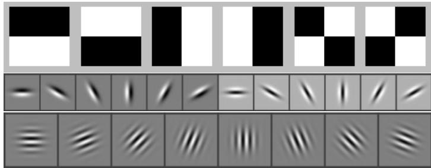  
Figure 2.1: Filters from widely used filter banks. Top) Haar. Middle) Oriented Gaussian derivatives. Bottom) Oriented Gabors.

A more recent trend in aerial image labeling is the use of unsupervised feature learning methods such as sparse coding and Restricted Boltzmann Machines [Mnih and Hinton, 2010]. Using features learned by a Restricted Boltzmann Machine to initialize a neural network trained on a road detection task has been shown to significantly improve both precision and recall over training a neural network from random initialization [Mnih and Hinton, 2010]. Rigamonti et al. [2011] used a variant of sparse coding to learn features for several linear structure segmentation tasks. While their qualitative results on road detection are not very good, their system obtains state-ofthe-art performance on a retinal blood vessel segmentation task. Such unsupervised feature learning approaches tend to learn filters that resemble oriented edge detectors and Gabor wavelets [Mnih and Hinton, 2010, Rigamonti et al., 2011] and have the advantage of potentially being able to learn the best filters for the task at hand as opposed to just selecting the best ones from a pool of features that appear at only a few scales and orientations.

A different type of feature that has been shown to be immensely useful for aerial image interpretation is height information. Kluckner et al. [Kluckner et al., 2009] showed that using height in addition to rich appearance-only features boosts classification accuracies by 10 to 20%. The result should not be surprising because height information can help discriminate between very confusable pairs of objects such as roads/buildings and grass/trees. Height information can either be derived directly from LIDAR data or from overlapping image pairs using stereo techniques. While extremely helpful, height information may be difficult to obtain because LIDAR data is less widely available and more expensive than aerial imagery, and most aerial imagery comes in the form of non-overlapping orthorectified image tiles which do not contain stereo information.

## 2.2.3 Larger datasets

In early work on aerial image labeling it was common to use a single image for both training and testing [Bischof et al., 1993, Bruzzone and Prieto, 2000]. Such a small amount of data cannot possibly cover a large range of variations in the appearance of various objects leading to classifiers that are unlikely to work well on unseen data. The limited size of the test set as well as its similarity to the training data means that the accuracy levels reported in earlier work are unlikely to translate to larger datasets. Recent applications of machine learning to high-resolution aerial imagery have used much more training data. For example, Porway et al. [2008] used 120 images ranging in size from 640x480 to 1000x1000 for training their hierarchical probabilistic grammar model of aerial image annotations. Kluckner et al. [Kluckner et al., 2009, Kluckner and Bischof, 2009] used three datasets of roughly 100 images with each dataset covering between 5 and 8 square kilometers to train a random forest classifier, while Mnih and Hinton [Mnih and Hinton, 2010] trained a large neural network on 130 large images that cover an area of roughly 500 square kilometers at a resolution of

0.7 pixels per square meter. Datasets of this size are more likely to contain significant variations in the appearance of objects and, when used for training, these datasets make it much harder for powerful classifiers to overfit.

## 2.3 Structured Prediction

The labels of nearby image pixels tend to be highly dependent due to the spatial coherence of images and incorporating such knowledge into a predictor should improve its accuracy. This idea of exploiting structure in the output labels was used in some of the earliest work on aerial image labeling [Kettig and Landgrebe, 1976] and continues to be important. This section provides an overview of the three main approaches to structured prediction, namely segmentation, post-classification, and probabilistic approaches.

## 2.3.1 Segmentation

Segmentation-based approaches work by first segmenting an image and then classifying entire regions instead of individual pixels. Such approaches were among the first to be proposed and are still in use today, usually in combination with a probabilistic approach. In early work, Kettig and Landgrebe [Kettig and Landgrebe, 1976] proposed a procedure that first classified non-overlapping aerial image patches of size 4 by 4 into homogeneous and non-homogeneous regions. The non-homogeneous regions were then classified pixel-by-pixel, while homogeneous regions were merged into larger regions and then classified using a region classifier. The standard approach is to oversegment the image into what are known as superpixels and then classify the superpixels individually [He et al., 2006, Huang and Zhang, 2009]. A statistical approach such as a Conditional Random Field can then be used to exploit dependencies in neighbouring superpixel labels, as was done by He at al. [He et al., 2006].

While initially used as a structured prediction method, more recently segmentationbased methods have been used for reducing the complexity of image labeling problems [He et al., 2006]. Labeling a few hundred superpixels per image can be a lot less computationally demanding than labeling thousands of pixels, allowing for more complex models to be used. The main drawback of segmentation-based approaches to structured prediction is that they are usually unable to recover from incorrect segmentations, which can be particularly problematic in the aerial image setting where occlusion of objects by trees or buildings is common. Some extensions of this approach can reduce such failures by generating multiple oversegmentations using different parameter settings and combining classifications of the different segmentations into a single classification of the pixels [Kohli et al., 2009].

## 2.3.2 Post-classification

Post-classification approaches aim to let predictions at one pixel indirectly influence predictions at nearby pixels. For example, salt and pepper noise can be reduced without any learning by applying a majority vote filter to the outputs of a local classifier. Alternatively, some classifier is used to obtain preliminary labels for all the pixels and a second classifier is then trained to predict a new label for each pixel based on the preliminary labels of nearby pixels. The hope is that this second classifier will be able to clean up the output of the first classifier. Bischof et al. [Bischof et al., 1993] trained a neural network that looks at a 5x5 window of predictions to predict a new label for the middle pixel, improving classification accuracy by several percent. Mnih and Hinton [Mnih and Hinton, 2010] used a neural network with a 64x64 input window to clean up predictions of another neural network on a road detection task, significantly improving both precision and recall

## 2.3.3 Probabilistic Approaches

Probabilistic approaches directly model the conditional probability $P ( \mathbf { y } | \mathbf { x } )$ of the labels y given the image x. By far the most widely used probabilistic model for structured prediction is the conditional random field, which models $P ( \mathbf { y } | \mathbf { x } )$ as a Markov random field over the labels y that is globally-conditioned on the image x. More precisely

$$
P ( \mathbf { y } | \mathbf { x } ) = \exp \left( - \sum _ { c \in C } f _ { c } ( \mathbf { y } _ { c } , \mathbf { x } ) \right) / Z ( \mathbf { x } ) ,\tag{2.2}
$$

where C is a set of cliques over y, $f _ { c } { } ^ { \mathrm { ' } } \mathrm { s }$ are potential functions, and $Z ( \mathbf { x } )$ is the partition function.

The most widely used form of CRFs in both aerial imaging applications and the field of computer vision in general is the pairwise CRF, for which the model

distribution takes the form

$$
P ( \mathbf { y } | \mathbf { x } ) = \exp \left( - \sum _ { i } U ( y _ { i } , \mathbf { x } ) - \sum _ { i } \sum _ { j \in N ( i ) } I _ { i j } ( y _ { i } , y _ { j } , \mathbf { x } ) \right) / Z ( \mathbf { x } ) ,\tag{2.3}
$$

where i indexes the label sites and $N ( i )$ gives the neighbouring sites for site i. The model has two types of potentials. $U _ { i }$ is the unary potential which determines how well label $\mathbf { y } _ { i }$ agrees with the image x, while $I _ { i j }$ is an interaction potential which determines how well the labels at sites i and $j$ agree with each other and, possibly, the image x.

In image labeling applications of CRFs the graphical structure of the model is almost always either a lattice or a tree. In a typical lattice the sites are laid out on a grid with each site connected to either its 4 or 8 neighbours, depending on whether the diagonal neighbours are connected. The lattice structure is generally used when the pixels themselves or rectangular sets of pixels are used as the labeling sites. Such CRFs have been applied to urban area detection [Zhong and Wang, 2007] and LIDAR point classification [Niemeyer et al., 2008]. Tree structured CRFs are typically used when the labeling sites are regions obtained by first segmenting the image. This technique is often used for significantly reducing the number of random variables over which the CRF is defined in order to speed up inference and learning [Modestino and Zhang, 1989].

Pairwise CRFs are appealing for their simplicity, but since they use only pairwise interaction potentials they seem to restrict one to only being able to encourage label smoothness constraints. While smoothness is probably the most important constraint for aerial image labeling applications, being able to include other types of constraints is desirable. For example, the fact that roads tend to have different shape than buildings is a very strong cue for distinguishing between roads and buildings. In order to incorporate such knowledge into a model one would need to be able to encode constraints on shape. Similarly, constraints based on layout could be useful for detecting buildings because buildings tend to be next to roads. The multiscale CRF model proposed by He et al. [2004] is an alternative to pairwise CRFs that is able to learn the shape and layout of objects. For the case of binary labels y, the CRF of He et al. [2004] is a conditional Restricted Boltzmann Machine with the

model distribution given by

$$
P ( \mathbf { y } | \mathbf { x } ) = \sum _ { \mathbf { h } } \exp \left( \mathbf { y } ^ { T } \mathbf { W } \mathbf { h } + \mathbf { h } ^ { T } \mathbf { b } ^ { h } + \mathbf { y } ^ { T } \left[ \mathbf { b } ^ { v } + f ( \mathbf { x } ) \right] \right) / Z ( \mathbf { x } ) ,\tag{2.4}
$$

where h is a vector of stochastic latent variables, $f ( \mathbf { x } )$ is the vector of features extracted from the image $\mathbf { x } ,$ and the model parameters are $\mathbf { W } , \mathbf { b } ^ { h }$ , and $\mathbf { b } ^ { v }$ . Each latent variable $h _ { j }$ corresponds to a single feature of the labels y and can encode possible shapes of objects as well as different arrangements of objects.

Probabilistic approaches to structured prediction are the most principled since they can directly enforce smoothness and other constraints on the labels. The ability to model complex distributions, however, often makes exact or efficient inference intractable. In the case of CRFs, the models for which exact inference is tractable tend to be simple models such as tree-structured CRFs, or lattice-structured CRFs with sub-modular potentials. When working with more expressive classes of CRFs one generally has to resort to approximate inference and learning procedures, making the application of such models difficult.

## 2.3.4 Discussion of Structured Prediction

Out of the approaches to structured prediction we have discussed, methods based on segmentation are the weakest because of their rigidity. Due to this weakness, segmentation-based methods are now rarely used without being combined with a probabilistic model. Nevertheless, segmentations of an image can provide useful contextual information and have been used to construct new high-level image features [Shotton et al., 2008] for use in CRFs. Post-classification approaches can work well when a large training set is available [Mnih and Hinton, 2010], but such methods only incorporate indirect dependencies between the labels through the cleanup process and are not as principled as probabilistic approaches. The combination of a post-classification approach with a probabilistic model, such as a CRF, offers an interesting possibility. Since incorporating rich dependencies among the labels y generally leads to intractable inference, applying a CRF in which exact inference is tractable to the outputs of a classifier would allow for incorporating complex dependencies over the outputs without having to resort to inefficient or approximate inference.

## 2.4 Source of Supervision

One important, yet rarely discussed, aspect of using machine learning for aerial image interpretation is the source of the data. The vast majority of papers rely on hand-labeled data for both training and testing [Bischof et al., 1993, Nguyen et al., 2007, Porway et al., 2008, Kluckner et al., 2009, Kluckner and Bischof, 2009, Nguyen et al., 2010] and since labeling images is a very time consuming process, the datasets have been small in both aerial image applications and general image labeling work. A typical aerial image dataset covers a relatively small area of a single city, ranging anywhere between one square kilometer and ten square kilometers [Kluckner et al., 2009, Kluckner and Bischof, 2009], which seriously limits the variability due to architectural styles, weather conditions, and seasonal variations. Good results obtained by training and testing an image labeling approach on such a small amount of data will not necessarily translate to good performance on an entire city, especially if the city is different from the one seen during training. Hence, obtaining good sources of accurately labeled data is important for both evaluating existing approaches and training systems that are likely to work under varying conditions.

In some domains hand-labeling data in order to train a classifier is not necessary because the label information is often readily available. For example, in the case of road detection the locations of existing roads are typically known because they are useful for navigation and not just as target labels in a machine learning task. The abundance of accurately labeled data for road detection makes it a very good candidate for evaluating existing aerial image interpretation systems as well as the application of machine learning techniques. While recent work on road detection has largely switched to using large, freely-available sources of data, such as Google Maps [Dollar et al., 2006, Huang and Zhang, 2009, Rigamonti et al., 2011], these papers still do not use very much data for training and testing.

For buildings, Google Maps can provide the locations of a substantial portion of the buildings in almost any major city. This type of data can act as a source of noisy labels, which are correct with very high probability when they indicate the presence of an object and with lower, but still high, probability when they indicate the absence of an object. Training a classifier on large amounts of this type of noisy data with a robust loss function can potentially produce a much better detector than by using a much smaller set of accurate labels. At present, there seem to be no applications of robust estimators to aerial image data with noisy labels.

For object classes such as cars or areas for which Google Maps possesses neither accurate nor complete map information, hand-labeling data seems to be the only option. While the use of crowdsourcing tools like Amazon Mechanical Turk can make it easier to collect label information, the process can still be expensive and time consuming to set up. When only a limited amount of labeled data is available it is often possible to generate new labeled data by transforming existing data. In a classification task, small translations or rotations can be applied to the input images, but in order to apply the same idea to image labeling one must be able to realistically transform both the image and the labels. On a road detection task, applying rotations to each training case before it is processed has been shown to help prevent overfitting and drastically improve performance on cities not seen during training [Mnih and Hinton, 2010]. Applying affine photometric transformations to training images has been shown to improve performance in a general image labeling task [Shotton et al., 2008], and can be potentially even more useful for aerial imagery, where this process could simulate things like varying levels of sunlight.

## Chapter 3

## Learning to Label Aerial Images

This chapter presents our patch-based framework for learning to label aerial images and is divided into three parts. The first part describes the general framework, how we use neural networks within the framework, as well as issues relating to generating data and training and evaluating the models. In the second part of the chapter we attempt to answer the question of what is a good neural network architecture for aerial image labeling tasks by performing an extensive experimental comparison of different architectures. In the last part, we present a qualitative evaluation of the best neural network architecture on road and building detection tasks and attempt to shed some light on what the neural networks are actually learning.

## 3.1 Patch-Based Labeling Framework

The input to our aerial image labeling system is a list of aerial images $\mathcal { S } = ( \mathbf { S } ^ { ( 1 ) } , \ldots , \mathbf { S } ^ { ( N ) } )$ and a list of corresponding map images $\mathcal { M } = ( \tilde { \mathbf { M } } ^ { ( 1 ) } , \dots , \tilde { \mathbf { M } } ^ { ( N ) } )$ . The aerial images $\mathbf { S } ^ { ( n ) }$ are assumed to be rectangular images with c channels and can be anything from gray scale $\mathrm { o r }$ RGB aerial images to elevation maps and hyperspectral images. For each $n ,$ the map or label image $\tilde { \mathbf { M } } ^ { ( n ) }$ is an image of the same size as $\mathbf { S } ^ { ( n ) }$ with $\tilde { \mathbf { M } } _ { i } ^ { ( n ) }$ denoting the label for the ith pixel of $\mathbf { S } ^ { ( n ) }$ . For binary image labeling tasks, $\tilde { \mathbf { M } } ^ { ( n ) }$ will be either 1 or 0, typically representing the presence or absence of an object of some class of interest. For multi-class problems, $\tilde { \mathbf { M } } ^ { ( n ) }$ will take on values from a set of possible labels $\{ 1 , \ldots , L \}$ . Figure 3.1 shows an example of an aerial image on the left and the corresponding map image denoting the locations of roads on the right. The goal of this thesis is to develop methods that use the training data S and M to

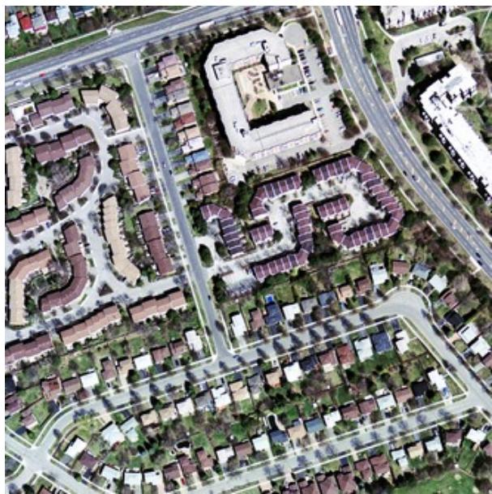

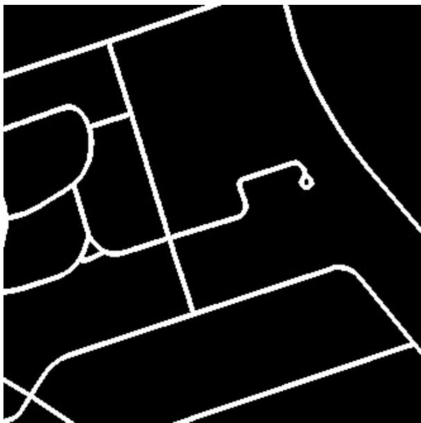  
Figure 3.1: Sample aerial image (left) and a binary map (right) denoting the location of roads.

learn to predict the label map for new unseen aerial images.

We propose a patch-based learning framework where the aim is to predict patches of $\tilde { \mathbf { M } } ^ { ( n ) }$ from patches of $\mathbf { S } ^ { ( n ) }$ . Before precisely defining the learning setup, we simplify notation by dropping the indices (n) from $\mathbf { S } ^ { ( n ) }$ and $\tilde { \mathbf { M } } ^ { ( n ) }$ and instead refer to an aerial image S and the corresponding map image M. Taking a probabilistic approach we define the central problem of this thesis as one of learning a model of the distribution

$$
P ( n ( \tilde { \mathbf { M } } , i , w _ { m } ) | n ( \mathbf { S } , i , w _ { s } ) ) ,\tag{3.1}
$$

where $n ( \mathbf { I } , i , w )$ denotes the $w \times w$ patch of image I centered at pixel i. Hence, we model the distribution of a $w _ { m } \times w _ { m }$ patch of labels conditioned on a larger, $w _ { s } \times w _ { s }$ aerial image patch centered at the same pixel. Typically $w _ { m }$ should be smaller than $w _ { s }$ because some context is required for predicting the labels. While $w _ { m }$ can be set to 1 to predict one label at a time, it is generally more efficient to predict a small patch of labels from the same context. This approach of predicting patches of labels is in contrast to the approaches of Dollar et al. [2006], Kluckner et al. [2009], which make separate predictions for each pixel.

To further simplify notation, we will use vectors s and ñ to denote an aerial image patch $n ( \mathbf { S } , i , w _ { s } )$ and the corresponding map patch $n ( \tilde { \mathbf { M } } , i , w _ { m } )$ respectively. For now we will ignore the dependencies among nearby labels and assume conditional independence of the map labels given the aerial image patch s. Using this assumption and the simplified notation, Equation 3.1 can be rewritten as

$$
P ( \tilde { \mathbf { m } } | \mathbf { s } ) = \prod _ { i = 1 } ^ { w _ { m } ^ { 2 } } P ( \tilde { m } _ { i } | \mathbf { s } ) .\tag{3.2}
$$

We will refer to $P ( \tilde { \mathbf { m } } | \mathbf { s } )$ as the observed map distribution. While the probabilistic formulation may seem unnecessary at first, its benefits will become apparent when we consider the problem of dealing with noisy labels in Chapter 4.

We propose modeling the observed map distribution using neural networks. Neural networks are particularly well suited to aerial image labeling tasks because of several distinct advantages. Most importantly, neural networks have been shown to work particularly well on perceptual tasks with large amounts of labeled data, outperforming expert-designed systems in multiple domains [Dahl et al., 2010, Sermanet et al., 2012]. The large amounts of existing maps suggests that this success could apply to tasks such as road and building detection, for which large labeled training sets can be constructed. Another important benefit is the ease with which neural networks can be parallelized on modern GPUs, which will make it possible to efficiently scale up our models to large input contexts and train them on large datasets.

We will use f to denote the functional form of our neural network model, which maps an input aerial patch s to a distribution over the label patch m. $f$ will always have one input for each entry of s, but the number of outputs is determined by the number of possible labels.

For binary labeling tasks, we use neural networks that have one output unit for each pixel of the map patch m with the output of unit i representing the predicted probability that the ith label is 1. Since they encode probabilities, these output units use the logistic activation function defined as $\sigma ( x ) = 1 / ( 1 + \exp ( - x ) )$ . More formally,

$$
f _ { i } ( \mathbf { s } ) = \sigma ( a _ { i } ( \mathbf { s } ) ) = P ( \tilde { \mathbf { m } } _ { i } = 1 | \mathbf { s } )
$$

where $f _ { i }$ is the value of the ith output unit and $a _ { i }$ is the total input to the ith output unit.

For multi-class labeling tasks, we use neural networks f with one softmax output unit for each map patch pixel. The ith softmax unit outputs a vector with $L$ components which encodes distribution over the possible labels for pixel i. If we let $a _ { i l }$ be the total input to component l of softmax unit $i ,$ and $f _ { i l }$ be the predicted probability that map pixel i has label $j ,$ then

$$
f _ { i l } ( \mathbf { s } ) = \exp ( a _ { i l } ( \mathbf { s } ) ) / Z = P ( \tilde { \mathbf { m } } _ { i } = l | \mathbf { s } ) ,
$$

where $\begin{array} { r } { Z = \sum _ { l } \exp ( a _ { i l } ) ( \mathbf { s } ) } \end{array}$

In order to simplify the presentation for the remainder of the thesis we will only consider binary aerial image labeling tasks. Most of the techniques we will present can be trivially extended to the multi-class setting by replacing sigmoid outputs with softmax outputs, but we will provide the necessary details whenever the extension of a technique to the multi-class setting is not obvious.

## 3.1.1 Learning

We learn the parameters of the neural networks by minimizing the negative log likelihood of the training data under our model. For binary data, the negative log likelihood under the model in Equation 3.2 takes the form of a cross entropy between the map patch m and the predicted label probabilities $f _ { i } ( \mathbf { s } )$

$$
L ( S , \mathcal { M } ) = \sum _ { a l l p a t c h e s } \sum _ { i = 1 } ^ { w _ { m } ^ { 2 } } \left( \tilde { m } _ { i } \ln f _ { i } ( \mathbf { s } ) + ( 1 - \tilde { m } _ { i } ) \ln ( 1 - f _ { i } ( \mathbf { s } ) ) \right) .\tag{3.3}
$$

The outer sum of the objective $L$ is over all possible patches in the training data. Since there is a very large number of patches in our dataset we use stochastic gradient descent with minibatches for optimizing L. For datasets that fit in memory, we generate minibatches by repeatedly selecting a random pair $( \mathbf { S } ^ { ( n ) } , \tilde { \mathbf { M } } ^ { ( n ) } )$ and sampling a random patch from $( \mathbf { S } ^ { ( n ) } , \tilde { \mathbf { M } } ^ { ( n ) } )$ . For datasets that don't fit in memory, we keep a buffer of $N ^ { \prime }$ pairs of image/label images in memory and generate minibatches by sampling patches at random from this buffer. By periodically replacing one of the $N ^ { \prime }$ pairs in the buffer with one of the $N - N ^ { \prime }$ pairs outside the buffer we approximate random sampling of patches from the entire dataset.

## Preprocessing

We have not explored the issue of preprocessing with the exception of relatively simple contrast normalization. We normalize each input patch by subtracting the average value computed over the patch and dividing by the standard deviation computed over the entire dataset. Using more sophisticated types of preprocessing, such a local contrast normalization is likely to lead to additional improvements in performance.

## Adding Rotations

We found that it is useful to rotate each pair of image and label patches by a random angle during learning. Since many cities have large areas where the road network forms a grid, training on data without rotations will result in a model that is better at detecting roads and buildings at certain orientations. Figure 3.3 shows three patches taken from the Toronto Roads dataset with a clear bias in the orientations of the roads. By randomly rotating the training cases the resulting models do not favour objects in any particular orientation. The improvement is particularly noticeable on infrequently appearing objects like highways, for which the orientation bias can be even stronger than for normal roads.

## Tuning Hyperparameters

When training neural nets with stochastic gradient descent one generally has to set a number of hyper parameters including the learning rate, the amount of momentum the type and amount of weight decay, the mini batch size, and possibly others. We did not separately tune these parameters for each architecture because doing so would require a massive amount of computation. We chose the values of hyperparameters shared by all models by selecting the values that maximize the performance of a shallow fully-connected network on the validation set of the Toronto Roads dataset. In the few cases where we tried tuning the values of these hyperparameters for individual models or architectures we saw slight improvements in precision and recall, but the order of models in terms of performance remained the same as for fixed hyperparameters. For this reason we believe that using the same values for hyperparameters shared by all models is a reasonable thing to do when comparing models. Table 3.1 shows the hyperparameter values used for the comparisons in this chapter.

<table><tr><td>Hyperparameter</td><td>Value</td><td>Comments</td></tr><tr><td>Learning rate</td><td>5 · 10−4</td><td></td></tr><tr><td>Momentum</td><td>0.9</td><td>We did not try other amounts of momentum.</td></tr><tr><td>Type of weight decay</td><td>L2</td><td></td></tr><tr><td>Amount of weight decay</td><td>0.0002</td><td>Had little influence on performance.</td></tr></table>

Table 3.1: The values of hyperparameters used for the comparisons in this chapter.

## 3.1.2 Generating Labels

In order to train our labeling system, we need an abundant source of aerial images with pixel-level labels. While high-resolution imagery of many parts of the world is easy to obtain, per-pixel labels are scarce because they are mostly of interest as labels in a machine learning task. Hence per-pixel labels must be derived from other types of data. As we discussed in Chapter 2 the locations of many roads, buildings, and other objects are freely available through the OpenStreetMap project in vector format. While this data is often incomplete and noisy, it is still the largest freely available source of such information which can be used to construct approximate per-pixel labels for training our systems.

We must decide on a way of converting vector maps to pixel-level labels before we can use vector maps to train a pixel labeling system. The way vector labels are rasterized will clearly have some effect on how well a system learns to label images, but in order to evaluate how good the rasterization procedure is one needs access to accurate per-pixel labels. Since we do not have access to such data we resort to using rasterized labels for both training and evaluation purposes. This means that our rasterization procedure ends up as a somewhat arbitrary choice and there are likely other, better ways of converting vector labels to pixel-labels. Nevertheless, by visualizing the predictions of different models trained with our rasterization procedure we found that large differences in our evaluation metrics correspond to noticeable visual qualitative differences in the predictions and that the best systems indeed produce very good quality predictions.

We now describe our rasterization procedure. Vector maps consist of three types of objects: polygons, lines, and points. Polygons are generally used to provide reasonably accurate outlines of parks and building footprints, and hence they can simply be rasterized to obtain a per-pixel label map M. Some care must be taken with lines which tend to represent structures like roads and rivers, and points, which tend to represent small objects like houses and trees, because the vector representations do not provide per-pixel information. We attempt to generate reasonable soft per-pixel labels by applying simple smoothing to the rasterized objects. We define the label map $\tilde { \textbf { M } }$ for linear or point features as

$$
\tilde { \mathbf { M } } _ { i } = e ^ { - \frac { d ( i ) ^ { 2 } } { \sigma ^ { 2 } } } ,\tag{3.4}
$$

where $d ( i )$ is the Euclidean distance, in pixels, between location i and the nearest object in the map. The smoothing parameter σ depends on the scale of the aerial images being used as well as the type of object being rasterized. For example $\sigma$ should probably be higher for roads than for trees. This soft weighting scheme accounts for some uncertainty in the location and shape of objects represented by lines and points.

## 3.1.3 Evaluating Predictions

The most common metrics for evaluating road detection systems are precision and recall, which are known as correctness and completeness in the remote sensing literature [Wiedemann et al., 1998]. The precision is the fraction of predicted road pixels that are true roads , while the recall of a set of predictions is the fraction of true road pixels that were correctly detected.

Since the the vector maps we use to generate pixel labels are only accurate up to a few pixels we compute relaxed precision and recall scores instead of exact ones. Namely, in our experiments recall represents the fraction of true road pixels that are within $\rho$ pixels of a predicted road pixel, while precision represents the fraction of predicted road pixels that are within $\rho$ pixels of a true road pixel. Relaxing the completeness and correctness measures in this manner is common practice when evaluating road detection systems [Wiedemann et al., 1998]. The slack parameter $\rho$ was set to 3 pixels for all experiments performed in this thesis.

Since the methods presented in this thesis predict the probability of each label belonging to the class of interest, it is possible to trade off precision for recall by varying the threshold for making a concrete prediction. One common way of evaluating probabilistic binary classifiers is using precision-recall curves, which show the trade-off between precision and recall for all threshold values. We use precision-recall curves for presenting quantitative comparisons involving a small number of models because presenting entire curves conveys the most information.

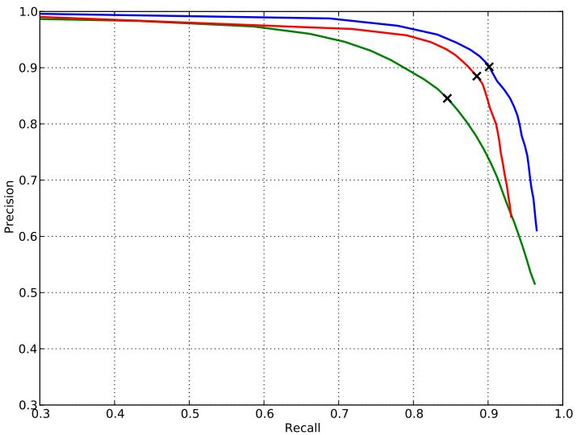  
Figure 3.2: Three example precision-recall plots with their breakeven points marked by ${ } ^ { , , } \mathrm { \ddot { x } \mathrm { \ddot { \ s } } }$

When making comparisons involving more than a few models, we opt for presenting plots or tables of summary statistics because precision-recall plots involving a large number of models can be difficult to interpret. While there are many well known summary statistics for precision-recall curves, including $F _ { \mathrm { 1 ^ { - m e a s u r e } } }$ , breakeven point, or precision at a fixed recall level, they all lose information compared to complete curves. However, we found that in our experiments sorting the models by their performance on most reasonable summary statistics usually lead to the same order of models. This occurred because if one model achieved higher precision at one recall level than another model it often achieved higher precision at all recall levels, dominating the other model. Due to this fact the choice of the summary statistic used to compare models was not particularly important because it had almost no impact on the ordering of models. In the end we chose to report the point on the precision-recall curve where precision is the same as recall, also known as the breakeven point, as the summary statistic. Figure 3.2 shows three precision-recall curves and their breakeven points.

## 3.2 Datasets

Due to the lack of aerial image datasets that are suitable for evaluating machine learning methods, we constructed several large and challenging datasets using aerial images of the Greater Toronto Area. We used these datasets for all experiments performed in Chapters 3, 4, and 5. Unfortunately, the imagery used to construct these datasets is not publicly available because we were not aware of several repositories of free high-resolution aerial imagery at the time. Chapter 6 will present the first large-scale publicly available datasets for road and building detection along with benchmarks of the most promising models developed in this thesis. We now describe the characteristics of the proprietary datasets used in the next three chapters.

## Toronto Roads Dataset

The Toronto Roads dataset consists of roughly 500 square kilometers of training data, 48 square kilometers of test data, and 8 kilometers of validation data at a resolution of 1.2m per pixel. This dataset contains both urban and suburban areas of Toronto. The target road map for the Toronto Roads dataset contains some omitted roads but has only minor registration problems.

## Hamilton Roads Dataset

The Hamilton Roads dataset consists of a training set of roughly 250 square kilometers of the city of Hamilton at a resolution of 1.2m per pixel. The target road map for this dataset contains frequent registration errors in addition to some omitted roads and for this reason we only used it to study the effectiveness of the robust losses introduced in Chapter 4. Figure 4.7(a) shows a representative subset of the Hamilton Roads dataset.

## GTA Buildings Dataset

The GTA Building dataset consists of roughly 600 square kilometers of imagery of the Greater Toronto Area. The target map contains significant omission errors and includes mostly large buildings, with most but not all houses unlabeled. Due to the presence of noise in the targets, we used only 8 square kilometers of hand-labeled data for validation.

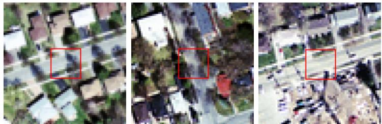  
Figure 3.3: Three sample input patches from the Toronto Roads dataset. The red square denotes the region for which labels are predicted.

## 3.3 Architecture Evaluation

We now proceed to an evaluation of different neural network architectures on the task of road detection. We train the neural networks to predict 16 × 16 map patches from $6 4 \times 6 4$ input aerial image patches in the Toronto Roads dataset. Figure 3.3 shows three example input patches, with a red square denoting the region for which label predictions are to be made. In the Toronto Roads dataset each pixel corresponds to 1.44 square meters, making a $6 4 \times 6 4$ input patch contain sufficient information for a human to correctly identify the objects in the target region.

We evaluate a number of architecture design choices, including the number of layers, the connectivity pattern between layers, types of hidden units, and the use of pooling. While several such studies have been conducted for the problem of object recognition [Jarrett et al., 2009, Coates et al., 2011] it is unclear whether the same conclusions apply for image labeling tasks. For example, max-pooling discards information about the location of features and while this may be beneficial for object recognition it may not lead to similar improvements for image labeling, where the precise location of objects needs to be predicted. Moreover, due to the small size of most object recognition datasets design choices that help reduce overfitting seem to provide substantial benefits, but as we will see later in this chapter overfitting is far less of a problem for our datasets so it is unclear whether methods that aim to reduce overfitting will offer any benefits at all.

## 3.3.1 One Layer Architectures

We first compare different neural networks with a single hidden layer. All the networks we compare have $3 \cdot 6 4 ^ { 2 }$ inputs that correspond to a contrast-normalized $6 4 \times 6 4$

RGB aerial image patch. The input is fed to a hidden layer that extracts roughly 12000 features and applies a nonlinearity, possibly followed by pooling. The number of hidden units is held approximately the same in order to fix the size of the extracted feature representation to be roughly the same. In all of the networks the hidden layer is followed by a fully connected output layer of 256 logistic output units. We compare the following one-layer architecture types differing only in the connectivity pattern of the hidden layer:

Fully connected architecture: As the name suggests, this architecture has a fully connected hidden layer. Since a fully connected network with 12000 hidden units has roughly 150 million parameters it is slow to train even on a GPU. We instead use a fully connected network with 4096 hidden units and roughly 50 million parameters, making it somewhat more manageable.

Factored architecture: The hidden layer of a factored architecture approximates a full $m \times n$ weight matrix as a dot product of two low rank matrices $U ^ { T } V$ where U is an $f \times m$ matrix and V is an $f \times n$ matrix. This low rank approximation can greatly reduce the number of free parameters over the full weight matrix. We use a factored hidden layer with 2048 factors f and 12000 hidden units. This architecture has roughly the same number of parameters as the fully connected one but has three times more hidden units.

Local untied architecture: The hidden layer of a locally connected architecture drastically reduces the number of parameters over both fully connected and factored architectures by only connecting each hidden unit to a small subpatch of the input. To precisely define the connectivity pattern, assume that the input units of a locally connected layer make up a $w _ { i n } \times w _ { i n }$ image consisting of multiple channels. The input image is divided into evenly spaced filter sites by moving a $w _ { f } \times w _ { f }$ window over the image by a stride of $w _ { s t r }$ vertically and horizontally, for a total of $\left( ( w _ { i n } - w _ { f } ) / w _ { s t r } + 1 \right) ^ { 2 }$ filter sites. A different set of f filters of size $w _ { f } \times w _ { f }$ and consisting of the same number of channels as the input image is applied at each filter site. Hence, a single locally connected layer results in $f \cdot \left( ( w _ { i n } - w _ { f } ) / w _ { s t r } + 1 \right) ^ { 2 }$ hidden units and $f \cdot ( ( w _ { i n } - w _ { f } ) / w _ { s t r } + 1 ) ^ { 2 } \cdot w _ { f } ^ { 2 } \cdot c$ parameters, where c is the number of input channels.

<table><tr><td rowspan="2">Layer type</td><td colspan="2">Unit type</td></tr><tr><td>Logistic</td><td>ReLU</td></tr><tr><td>Fully connected</td><td>0.7596</td><td>0.8034</td></tr><tr><td>Factored</td><td>0.7939</td><td>0.8359</td></tr><tr><td>Local</td><td>0.6509</td><td>0.8126</td></tr><tr><td>Convolutional</td><td>0.7898</td><td>0.8673</td></tr></table>

Table 3.2: Precision and recall breakeven points for different layer and unit types.

Convolutional architecture: The hidden layer of a convolutional architecture is simply a locally connected layer where the group of f filters applied at each location is the same. Restricting the filters to be the same at each location further reduces the number of parameters over a local untied architecture for a total of $f \cdot w _ { f } ^ { 2 }$ ·C parameters.

## Layer and unit types

We first compare the different architecture types with two choices for the nonlinearity/activation function in the hidden layer:

• Logistic: $g ( x ) = 1 / ( 1 + \exp ( - x ) )$

• Rectified linear: $g ( x ) = \operatorname* { m a x } ( x , 0 )$

The local untied and convolutional architectures both used 12 × 12 filters and stride 4, while the other architectures are as described above. Table 3.2 shows the precisionrecall breakeven points for the four architectures and activation functions. The rectified linear (ReL) activation function clearly outperforms the logistic activation function for all four architecture types. This result agrees with the findings of Jarrett et al. [2009] and Nair and Hinton [2010] who reported substantial gains in performance when using the ReL activation function on several object recognition tasks.

The best overall result is obtained by the convolutional architecture with ReL hidden units followed by the factored architecture with ReL units, which somewhat surprisingly outperformed the local untied architecture. One possible explanation for this result is the fact that both the convolutional and factored architectures learn a shared set of filters over the input, which could make learning more statistically efficient.

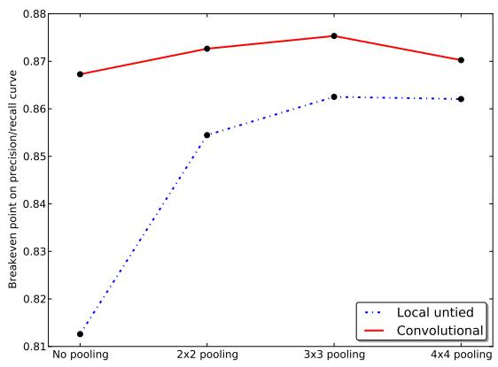  
(a)

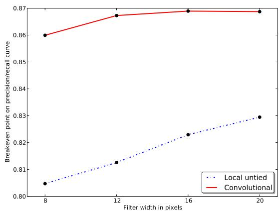  
(b)  
Figure 3.4: Plots showing precision-recall breakeven points for (a) different pooling regions, (b) different filter sizes in the first hidden layer.

Nevertheless, it is still surprising that, even though the only difference between the convolutional and the local architecture is that the filters of the convolutional architecture are tied among all locations, the convolutional architecture substantially outperforms the local architecture. We performed an additional experiment by initializing a local architecture with the weights of a convolutional architecture, which corresponds to untying the weights of the convolutional architecture, and trained for three more epochs. Training the local architecture with this initialization resulted in a precision-recall breakeven point of 0.8695, which is an improvement over the parameters used to initialize the model (0.8673). In comparison, training the convolutional architecture for three more epochs without untying the weights improves the breakeven point from 0.8673 to 0.8713. These results suggest that the tied weights make convolutional networks easier to optimize than untied local networks.

While the above results show that the local untied architecture performed relatively poorly, we will investigate it further along with the convolutional architecture in the context of deep networks due to their computational efficiency when compared to the fully connected and factored architectures.

## The effect of max pooling

Max pooling has been shown to improve performance of convolutional architectures on a number of object recognition tasks [Jarrett et al., 2009] and we observe similar improvements for moderate amounts of pooling on both local untied and convolutional architectures on image labeling tasks. We evaluated the effects of max pooling when placed on top of the hidden layers of local untied and convolutional architectures with 64 filters of size 12 and stride 4. We compared pooling over overlapping regions of size $2 \times 2 , 3 \times 3$ and $4 \times 4$ with stride 1 The results shown in Figure $3 . 4 ( \mathrm { a } )$ show that max pooling helps both untied local and convolutional architectures, with the best results obtained with $3 \times 3$ pooling regions. The fact that pooling over larger regions leads to smaller improvements is not surprising given that the network needs to maintain precise locations of certain features.

## The effects of filter sizes and strides

We now look at the effect of filter size on the performance of local network architectures. Figure 3.4(b) shows the precision-recall breakeven points for networks with filters of size 8, 12, 16, and 20 and filter stride 4. Both convolutional and untied local networks seem to benefit from larger filter sizes, with larger improvements seen for untied local networks. This positive dependence on filter size is the opposite of what Coates et al. [2011] observed for unsupervised feature learning on object detection tasks. It is unclear whether the difference is due to our use of supervised feature learning, differing filter strides, or simply the type of data we use. Since Coates et al. [2011] used a stride of 1 for the filter size experiments we investigated the possibility that smaller filters are better at smaller strides and found that this is not the case.

## 3.3.2 Two Layer Architectures

We now turn to a similar analysis of two layer architectures of untied local and convolutional layers with ReL hidden units. The first layer of both types of architectures had 64 filters of size $1 2 \times 1 2$ with stride 4. We investigated the effect of varying the sizes of the filters and pooling regions in the second hidden layer.

## The effect of max pooling

We fixed the second layer of both architectures to have 128 4 × 4 filters with stride 1 and then compared using no pooling, $2 \times 2$ max pooling, and 3 × 3 max pooling on top of the second layer. Figure 3.5(a) shows a plot of precision-recall breakeven points for the different model configurations. Convolutional architectures do not seem to benefit from pooling in the second layer. Given that the first layer uses 3 max pooling, it is likely that using any additional pooling in the second layer loses too much information about the precise location of object parts to help on a pixel labeling task. Given this result, it is somewhat surprising that untied local architectures seem to benefit from max pooling in the second layer. As in the single hidden layer case, this effect is likely explained by the fact that adding pooling to an untied local architecture encourages filters in the same feature pool to be similar, with the resulting performance boost outweighing the decrease in performance due to the lower spatial resolution.

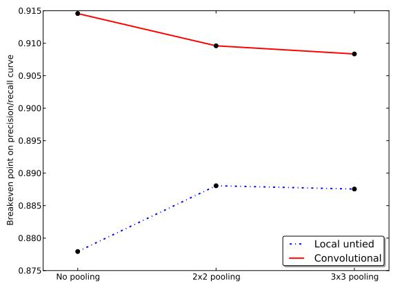  
(a)

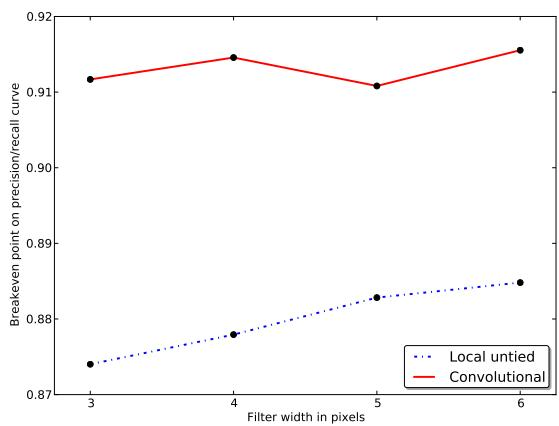  
(b)  
Figure 3.5: Plots showing precision-recall breakeven points for (a) different pooling regions, (b) different filter sizes in the second hidden layer.

## The effects of filter sizes and strides

We compared using filters of size 3, 4, 5, and 6 with stride 1 in the second layer of both architecture types. Figure 3.5(b) shows the precision-recall points for the different model configurations. As in the single hidden layer case, larger filters seem to work better in both types of architectures, with a more noticeable improvement for untied local architectures. We also performed a control experiment to see whether using a smaller stride while holding the number of hidden units fixed improved results and found that, as in the one layer case, there was no significant change.

## Discussion

The local untied and convolutional architectures improve on the breakeven point for a shallow factored model by more than 0.04 and 0.08 respectively while using far fewer parameters. These results also show that increasing network depth clearly improves the accuracy of untied and convolutional architectures on aerial image labeling tasks. Overall, convolutional architectures perform noticeably better than untied architectures suggesting that the ability to learn different filters at different locations is either not helpful or is far outweighed by the benefits of weight sharing found in convolutional nets.

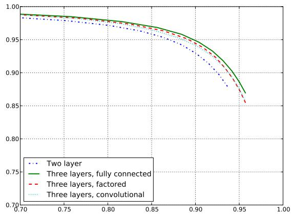  
(a)

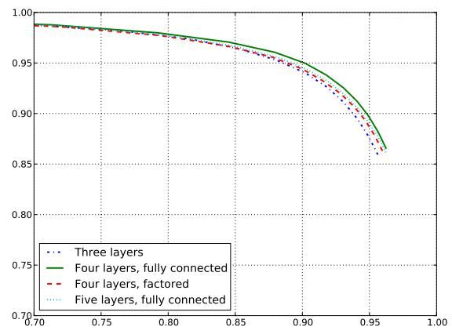  
(b)  
Figure 3.6: A comparison of precision-recall curves for deep architectures. (a) A comparison of different choices for the third layer of a deep architecture. (b). A comparison of three, four and five layer networks.

## 3.3.3 Deeper Architectures

Given the substantial improvements in precision and recall that we gained by adding a second layer to locally connected architectures we investigate whether adding even more layers helps. We start with a two layer convolutional network which has 64 $1 2 \times 1 2$ filters and stride 4 in the first layer and 112 4 × 4 filters with stride 1 in the second layer and add layers until it stops producing better results.

We compare three different choices for the third hidden layer: a fully connected layer with 4096 hidden units, a factored layer with 2048 factors and 4096 hidden units, and a convolutional layer with 80 $3 \times 3$ filters and stride 1 for a total of 3920 hidden units. The precision-recall plots for the three models as well as the base two layer model are shown in Figure 3.6(a). There is a noticeable improvement in precision and recall from adding a third layer. The fully connected layer leads to the largest improvement, but at the cost of using more parameters and computation.

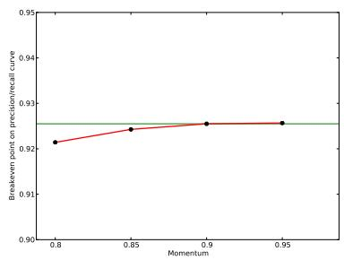  
(a)

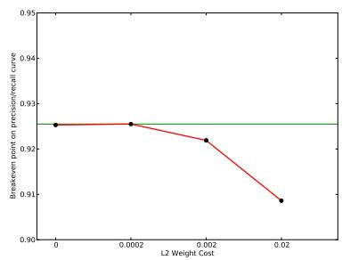  
(b)

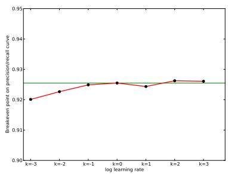  
(c)  
Figure 3.7: Breakeven points for different settings of hyperparameters in a three layer neural network on the Toronto Roads dataset. The green line indicates the performance of a three layer network with the default parameter values. (a) Different amounts of momentum. (b). Different amounts of L2 weight decay. (c) Different learning rates € determined by the parameter k as $\epsilon = 5 \cdot 1 0 ^ { - 4 }$ · (1.25k).

With clear improvements from adding a third hidden layer we look into adding fourth and fifth layers. We use the model with three convolutional layers explored above as the base model and compare adding a fully connected layer with 4096 hidden units, a factored model with 4096 hidden units and 1024 factors, as well as two fully connected layers with 4096 hidden units. Figure 3.6(b) shows the precision-recall plots for these four layer models along with the base model. While there is a small improvement in precision and recall from adding a fourth fully connected layer, the improvement is small and adding a fifth layer actually hurts performance.

## 3.3.4 Sensitivity to Hyper Parameters

In the above experiments, we did not perform a search over SGD and regularization hyperparameters and instead used parameter values that worked well for shallow networks. While the deep networks exhibit good detection performance it is unclear how sensitive they are to these choices and whether performance can be further improved by tuning the hyperparameters. In order to address these questions, we performed a sensitivity analysis for the three most important hyper parameters – the learning rate, the momentum, and the amount of weight decay.

Figures 3.7(a), 3.7(b) 3.7(c) show the effects of varying the momentum, amount of weight decay, and learning rate on the precision-recall breakeven point of a three layer network respectively. First, the plots show that the parameter choices that worked well for shallow networks translate relatively well to deep networks. The default parameter value was always close to the best value tried on the deep network, suggesting that using shallow nets, which are much faster to train, for selecting hyperparmeter values is a sensible strategy. Second, the plots show that the results are not overly sensitive to the values of hyperparameters, which means that, for a new dataset, trying a few values close to our suggested values could produce reasonable results.

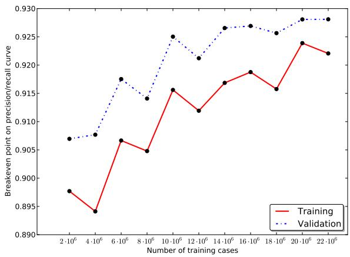  
Figure 3.8: A plot showing training and validation log likelihoods on the Toronto Roads dataset at different points during training of a four layer neural network. The gap between the two curves remains relatively constant even after 20 million training cases.

## 3.3.5 A Word on Overfitting

Since overfitting is a common problem when training large neural networks, we decided to investigate how severe it is for our models and data. In general, we found that even models with tens of millions of parameters do not seem to exhibit significant overfitting when trained on our large datasets. Figure 3.8 shows training and validation log likelihoods at different points during training for a four layer neural network trained on the Toronto Roads dataset. First, the validation log likelihood is always better than the training log likelihood because the relatively small validation set consists of relatively easy regions of the city. Second, the gap between training and validation curves is relatively constant throughout training suggesting that there is relatively little overfitting even after 22 million training cases have been processed.

## 3.4 Qualitative Evaluation

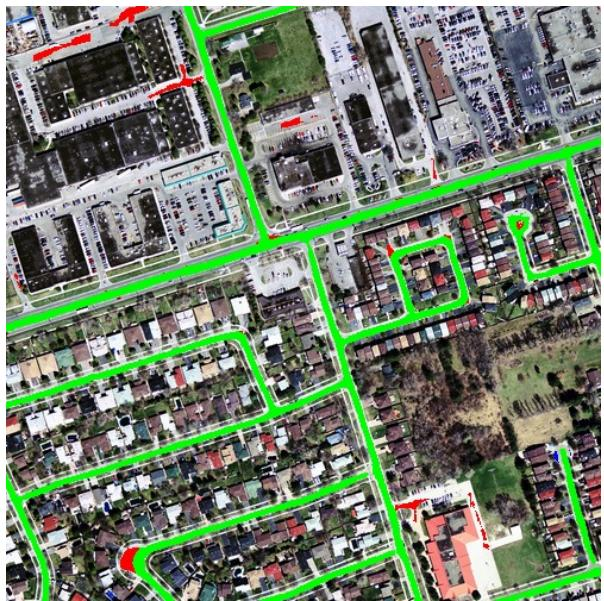  
(a)

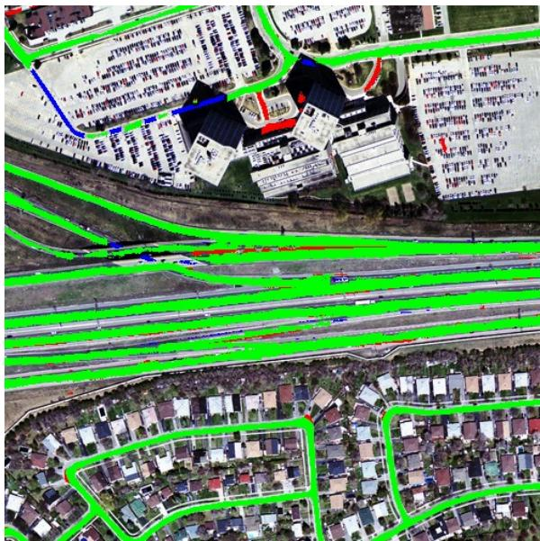  
(b)

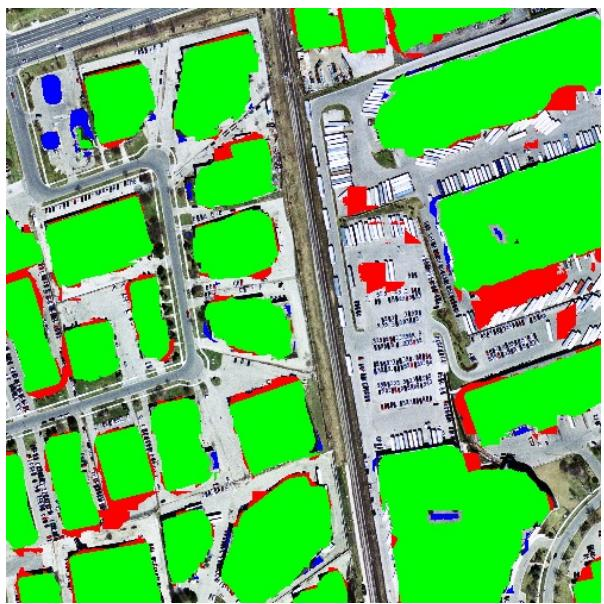  
(c)

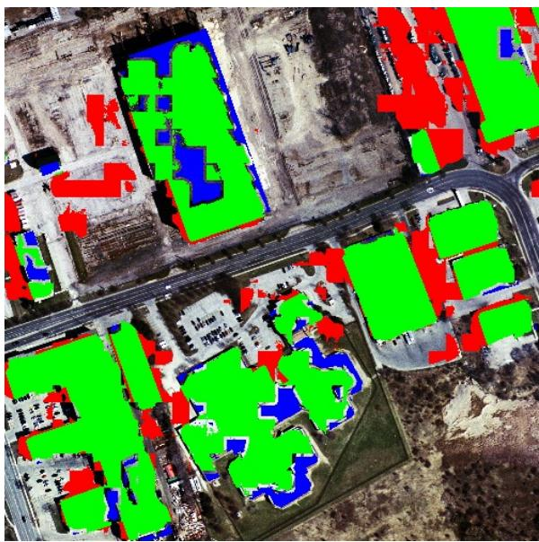  
(d)  
Figure 3.9: Visualizations of neural network predictions on road and building detection tasks. Green pixels are true positives, red pixels are false positives, blue pixels are false negatives, and background pixels are true negatives. Figures 3.9(a) and 3.9(b) show predictions on the Toronto Roads test set. Figures 3.9(c) and 3.9(d) are predictions on the GTA Buildings test set.

We now apply the lessons learned in the previous section to training a large neural network on road and building detection datasets. The network we train has four hidden layers. The first layer is convolutional with 64 filters of size 12 and stride 4, and is followed by size 3 stride 1 max pooling layer. The second hidden layer is convolutional with 112 filters of size 4 and stride 1 followed by another convolutional layer with 112 filters of size 3 and stride 1. The last hidden layer is fully connected and has 4096 hidden units. All four hidden layers use rectified linear units. We trained two copies of this network on the Toronto Roads and GTA Buildings datasets. The network trained on the Toronto Roads dataset achieved a breakeven point of 0.928 on the test set, while the network trained on the GTA Buildings dataset achieved a breakeven point of 0.818 on its test data.

To get some idea of what the numbers mean we visualize the predictions of both networks at their breakeven points. Figure 4.7 visualizes the predictions on parts of the test set by colour coding each pixels based on whether it was a true or false positive/negative, providing many interesting insights into how the networks work.

The predictions on the Toronto Roads dataset, shown in Figures 3.9(a) and 3.9(b), demonstrate that the network is very good at detecting multiple types of roads including two-lane roads in residential areas, multi-lane roads, and even highways. While the false positives and false negatives show several failure cases for our model, they also illustrate several problems with the data. For example, the network sometimes makes predictions for disconnected blobs of road in paved areas, which end up being counted as false positives. This is an artifact of the network making independent predictions for each pixel, making it difficult for the network to realize that it is creating a disconnected component. Such errors can be avoided by incorporating structure into the predictions and Chapter 5 examines different ways of doing so. Another common type of mistake is a false negative caused by the shadow of a tall building. While we do not do so in this thesis, some form of local contrast normalization will likely help in such cases.

We also see that the network is often penalized for making a road prediction in a paved area. These predictions show up as false positives because narrow alleys and roads leading into malls or industrial areas are often not included in vector maps. Whenever this type of mislabeling occurs in the training data the neural network is penalized for what is essentially a correct prediction.

The predictions for the network trained on the GTA Buildings dataset are shown in Figures 3.9(c) and 3.9(d). While the model is clearly not as good as our road detector, there are a number of differences between the two tasks. First, building data, unlike road data, is almost always incomplete with as much as 30% of the buildings left unlabeled, and there is simply less building data than road data. Additionally there is much more variation in the shape and appearance of buildings than in roads. Considering the quality of the data and the difficulty of the task, the neural network still performs reasonably well.

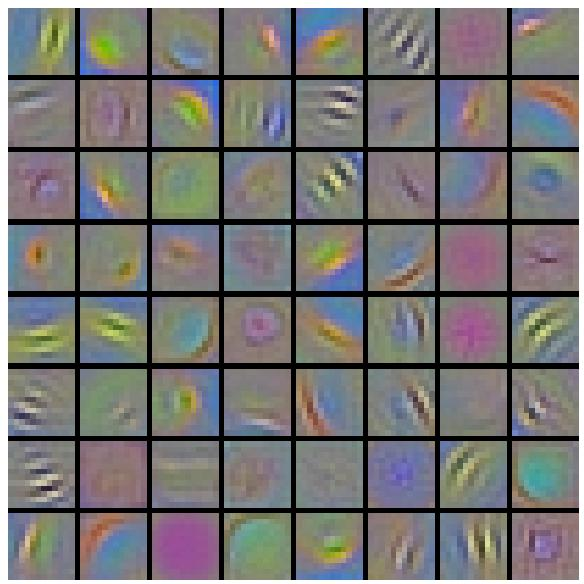  
(a)

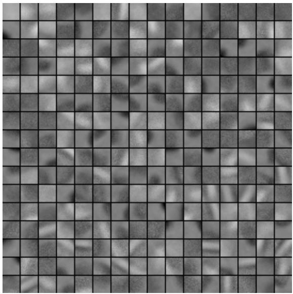  
(b)  
Figure 3.10: Visualizations of the input and output weights for a neural network trained on a road detection task. (a) Convolutional filters from the first layer. (b). Hidden to output weights for the 256 units with the largest weight norms.

The problems seen in the predictions of the building detector are similar to those seen on road detection. For example, the false negatives that often appear in the middle of large buildings can be dealt with by incorporating structure in the predictions. Adding structure should also reduce false positives caused by predicted buildings with really improbable shapes. We will explore the use of structured prediction methods in Chapter 5.

## 3.4.1 Peering into the Mind of the Network

To gain some insight into what the network learns we first display the input and output weights learned by the network on the Toronto Roads dataset. Figure 3.10(a)

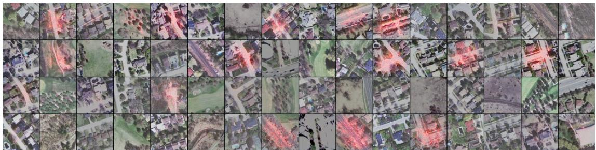  
Figure 3.11: Visualization of the derivatives of the loss function with respect to the input pixel values.

shows all 64 convolutional filters from the first layer and 256 of the output filters with the highest L2 norm. Not surprisingly, the convolutional filters the network learns are oriented edge and grating detectors, often with an overlaid lower frequency opposing yellow/blue and green/red patterns. Convolutional neural networks tend to learn similar filters on other object detection tasks [Krizhevsky, 2011]. The output filters learned by the network, shown in Figure 3.10(b), also exhibit interesting structure that falls into several groups. Two of the most prominent groups are entire road segments at different orientations and filters that make a neutral prediction for much of the patch and a strong vote for the absence of a road in one of the corners.

Another informative way of visualizing the neural network is through a sensitivity analysis, which involves looking at the gradient of the loss function with respect to the inputs at different data points. Figure 3.11 shows a number of input aerial image patches from the Toronto Roads dataset with the squared gradient with respect to the input for each data point overlaid in red. Hence, a change to the values of the input pixels highlighted in red will cause a big change to the value of the loss function. We see that whenever a piece of road is present in the centre 16 × 16 patch for which the neural net is making predictions there is a strong gradient on the road pixels.

## 3.5 Conclusions and Discussion

We have shown that our patch-based framework for learning to label aerial imagery with deep neural networks can achieve good performance on challenging real world road and building detection datasets. The results show that there is a clear advantage to using deep networks over shallow ones and that convolutional networks outperform networks with other types of connectivity. We also saw that while there is a benefit from using a small amount of max pooling, using too much max pooling hurts performance on pixel labeling tasks.

While the framework addresses the basic problem of efficiently learning discriminative features from large amounts of labeled aerial imagery, it has a number of shortcomings. Most importantly, the neural network architectures we examined in this chapter make separate predictions for each pixel. As we saw in the previous section, this leads to a number of undesirable artifacts in the predictions, including disconnected blobs of road and gaps in roads and buildings. Chapter 5 will address the problem of how to efficiently incorporate rich structure into the predictions while maintaining the ability to learn from very large datasets.

Another problem with the framework is the underlying assumption that the training data is perfectly labeled. Figure 4.7 clearly shows problems with the labels which likely hurt the neural networks during training. This issue has not been studied widely in machine learning or computer vision and Chapter 4 will attempt to modify our learning procedure in ways that reduce the effects of noise typically found in maps on the neural networks.

In addition to addressing the above limitations there are many other ways to improve the performance of our system that we do not address in this thesis. One interesting possibility is the use of losses other than negative log likelihood defined on individual label pixels. For example, Turaga et al. [2009] showed how directly optimizing a measure of image segmentation leads to much better segmentations than by optimizing individual pixel disagreement. In our case, optimizing the area under the precision-recall curve could lead to similar improvements because it is a better measure of the quality of the detections than log likelihood.

Another way of improving our system is by performing a more extensive hyperparameter search. While we have only looked at using a fixed learning rate and weight cost for all layers, using different values for each layer could both speed up learning and improve the overall performance. Since doing so requires searching over a very large space of parameters, doing so by brute force search would require a tremendous amount of computation. A more efficient way of performing this search is using the recently developed methods for doing Bayesian global optimization of hyper parameter values [Bergstra et al., 2011, Snoek et al., 2012].

## Chapter 4

## Learning to Label from Noisy Data

The preceding chapter demonstrated that it is possible to use readily available aerial imagery along with vector metadata from sources such as OpenStreetMap to obtain state-of-the-art performance on aerial image labeling tasks. While OpenStreetMap provides an abundance of label information that is clearly of high-enough quality to learn from, the label information is often incomplete or noisy. In particular we classify the most common data inaccuracies into two types of noise:

• Omission noise occurs when an object that appears in an aerial image does not appear in the map. This is the case for many buildings (even in major cities) due to incompleteness of the maps. It is also true for small roads and alleys, which tend to be omitted from maps, often with no clear criterion for when they should be omitted. An example of omission noise is shown in Figure 4.1(a).

• Registration noise occurs when the location of an object in a map is inaccurate. Such errors are quite common because not requiring pixel level accuracy makes maps cheaper to produce for human experts without significantly reducing their usefulness for most purposes. An example of registration noise is shown in Figure 4.1(b)

The presence of these kinds of errors in the training labels can significantly reduce the accuracy of classifiers trained on such data.

This chapter shows how one can deal with the presence of both kinds of noise in the training labels. We present two robust loss functions that can be incorporated into our image labeling framework. The first loss function reduces the effect of omission errors while the second loss function reduces the effects of both omission and translation errors. We then demonstrate the effectiveness of these loss functions on road and building detection tasks.

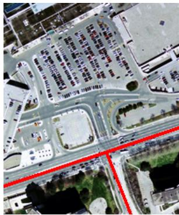  
(a)

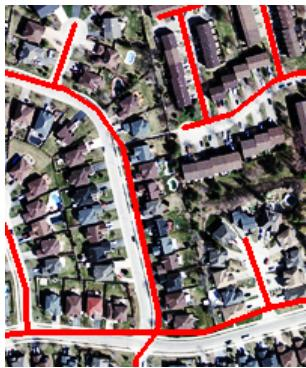  
(b)  
Figure 4.1: Road locations derived from a map are shown in red. (a) Example of omission noise. (b) Example of registration noise.

## 4.1 Dealing With Omission Noise

Omission noise, as shown in Figure 4.1(a), occurs when some map pixels are labeled as not belonging to the object class of interest when they, in fact, do. When trained on data containing a substantial number of such pixels a classifier will be penalized for correctly predicting the value of 1 for pixels affected by omission noise. This will cause a classifier to be less confident and potentially increase the false negative rate.

We propose using a robust loss function that explicitly models asymmetric omission noise in order to reduce its effect on the final classifier. We recall that in Chapter 3 the observed map distribution $p ( \tilde { \mathbf { m } } | \mathbf { s } )$ was modeled directly by a neural network. By doing maximum-likelihood learning under this model we are implicitly assuming that the training data consists of true samples from a model in this class of models. In order to account for the possibility of noisy data we take the approach of explicitly modeling the noise process. We assume a generative process where the true, uncorrupted, and unobserved map patch m is first generated from the aerial image patch s according to some distribution $p ( \mathbf { m } | \mathbf { s } )$ . The corrupted, observed map m is then generated from the uncorrupted m according to a noise distribution $p ( \tilde { \mathbf { m } } | \mathbf { m } )$

For now, we assume that conditioned on m, all components of ñ are independent and that each $\tilde { m } _ { i }$ is conditionally independent of all $m _ { j }$ for $j \neq i$ . The observed map distribution that corresponds to this model can then be obtained by marginalizing out m from $p ( \tilde { \mathbf { m } } | \mathbf { m } ) p ( \mathbf { m } | \mathbf { s } )$ , leading to

$$
\begin{array} { r c l } { p ( \tilde { \mathbf { m } } | \mathbf { s } ) } & { = } & { \displaystyle \sum _ { \mathbf { m } } p ( \tilde { \mathbf { m } } | \mathbf { m } ) p ( \mathbf { m } | \mathbf { s } ) } \end{array}\tag{4.1}
$$

$$
= \prod _ { i = 1 } ^ { w _ { m } ^ { 2 } } \sum _ { m _ { i } } p ( \tilde { m } _ { i } | m _ { i } ) p ( m _ { i } | \mathbf { s } ) .\tag{4.2}
$$

The noise distribution $p ( \tilde { m } _ { i } | m _ { i } )$ is assumed to be the same for all pixels $i ,$ and is parameterized by the parameters

$$
\begin{array} { r c l } { { \theta _ { 0 } } } & { { = } } & { { p ( \tilde { m } _ { i } = 1 | m _ { i } = 0 ) \ \mathrm { a n d } , } } \\ { { } } & { { } } & { { } } \\ { { \theta _ { 1 } } } & { { = } } & { { p ( \tilde { m } _ { i } = 0 | m _ { i } = 1 ) . } } \end{array}
$$

In the presence of omission noise, we expect that $\theta _ { 0 } \ll \theta _ { 1 }$ because the probability that the observed label $\tilde { m } _ { i }$ is 1 given that the true label $m _ { i }$ is 0 should be very close to 0, while the probability that the observed $\tilde { m } _ { i }$ is 0 given that the true label $m _ { i }$ is 1 should still be small but not as close to 0 as $\theta _ { 0 }$

There are several different ways of determining the values of the parameters $\theta _ { 0 }$ and $\theta _ { 1 }$ – they can be learned along with the neural network weights, selected using a validation set, or set by hand. We found that learning the parameters along with the other weights is difficult. This is likely due to the possibility of small changes to $\theta _ { 0 }$ and $\theta _ { 1 }$ resulting in large changes to the derivatives with respect to the other parameters because $\theta _ { 0 }$ and $\theta _ { 1 }$ are parameters of the loss. While this issue could potentially be resolved with second order optimization methods, we did not investigate this possibility and set the values of the parameters using a validation set.

We refer to this model as the asymmetric Bernoulli noise model, or the ABN model for short. While in the noise-free setting of Chapter 3 the observed map distribution was modelled directly by a neural network, in the noisy setting, we instead use the neural network to model the true map distribution $p ( \mathbf { m } | \mathbf { s } )$ . Learning can still be done efficiently by minimizing the negative log probability of the training data under the ABN model given in Equation 4.2. Since the ABN model factorizes over the pixels i and there is only a single Bernoulli latent variable $m _ { i }$ for each pixel $i ,$ the derivative of the negative log probability can be found directly.

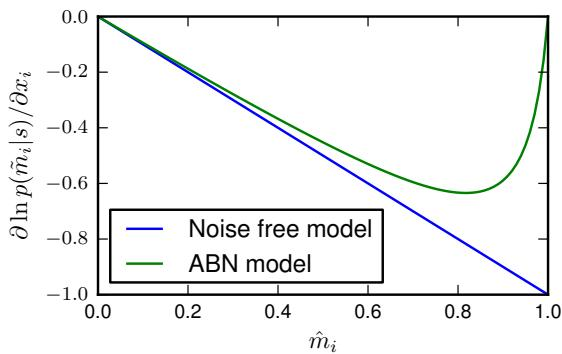  
Figure 4.2: The plot shows the derivative of the log probability with respect to the input to the ith output unit for varying predictions $\hat { m } _ { i }$ . In this example, the observed label $\tilde { m } _ { i }$ is set to 0 while the parameters of the ABN model are $\theta _ { 0 } ~ = ~ 0 . 0 0 1$ and $\theta _ { 1 } = 0 . 0 5$ . The noise free model penalizes incorrect predictions more than the ABN model, especially when the prediction is incorrect and confident.

In order to gain some insight into how the noise model affects learning, we contrast the derivatives of the negative log probability of the data with and without a noise model. Let $x _ { i }$ and $\hat { m } _ { i }$ be the input and output to the ith unit of the neural network respectively. In the noise-free scenario, the derivative of $- \log p ( \tilde { \mathbf { m } } | \mathbf { s } )$ with respect to $x _ { i }$ is $\tilde { m } _ { i } - \hat { m } _ { i }$ . Hence, in the absence of a noise model, the learning procedure tries to make the prediction $\hat { m } _ { i }$ closer to the observed label $\tilde { m } _ { i }$ . Under the ABN model, the derivative of the negative log probability of the data takes the form $p ( m _ { i } ~ =$ $1 | \tilde { m } _ { i } , \mathbf { s } ) - \hat { m } _ { i }$ . Hence, the learning procedure tries to make the prediction $\hat { m } _ { i }$ close to the posterior probability that the unobserved true label $m _ { i }$ is 1. This has the effect that the neural network gets penalized less for making a confident but incorrect prediction. Figure 4.2 demonstrates how the derivatives of the log probability of the data differ for the noise-free and the ABN models differ as a function of the prediction $\hat { m } _ { i }$

## 4.2 Dealing With Registration Noise

Registration noise occurs when an aerial image and the corresponding map are not perfectly aligned. As shown in Figure 4.1(b), the error in alignment between the map and the aerial image can vary spatially over the dataset and hence cannot be corrected by a single global translation. In order to deal with a large class of possible misalignments we make the simplifying assumption that the registration error between the image and the map is approximately constant in any $w _ { m ^ { \prime } } \times w _ { m ^ { \prime } }$ region. This assumption is likely to hold true whenever the error in registration varies over the dataset sufficiently slowly.

## 4.2.1Translational Noise Model

We extend the robust loss function we introduced in the previous section for dealing with omission noise to also handle local registration errors. As with the ABN model, we introduce a generative model of the observed map patches. On a high level, the generative model works by first generating an uncorrupted and perfectly registered map from the aerial image, then selecting a random subpatch of the true map, and generating the observed map by corrupting the selected subpatch with asymmetric noise. More formally, the generative process is as follows:

1) An uncorrupted and perfectly registered true map patch m of size $w _ { m ^ { \prime } } \times w _ { m ^ { \prime } }$ is generated from s according to $p ( \mathbf { m } | \mathbf { s } )$ . Typically $w _ { m ^ { \prime } }$ is at least $w _ { m } + 2 t _ { m a x }$ where $t _ { m a x }$ is the maximum possible registration error/translation between the map and aerial image measured in pixels. We allow for the possibility that $w _ { m ^ { \prime } }$ is greater than $w _ { m } + 2 t _ { m a x }$ because it may be useful to make the size of the region for which misalignments are assumed to be approximately constant be different from the size of the predicted patch.

2) A translation variable t is sampled from some distribution $p ( t )$ over $T + 1$ possible translations $0 , \ldots , T$ . In this thesis, we use $T = 8$ where $t = 0$ corresponds to no translation while the other eight values index the eight possible translations by $t _ { m a x }$ pixels in the vertical and horizontal directions as well as their combinations (see Figure 4.3).

3) An observed map is sampled from the translational noise distribution

$$
\begin{array} { r c l } { p ( \tilde { \mathbf { m } } | \mathbf { m } , t ) } & { = } & { p ( \tilde { \mathbf { m } } | C r o p ( \mathbf { m } , t ) ) } \end{array}\tag{4.3}
$$

$$
\mathbf { \Sigma } = \prod _ { i = 1 } ^ { w _ { m } ^ { 2 } } p _ { A B N } ( \tilde { m } _ { i } | C r o p ( \mathbf { m } , t ) _ { i } ) ,\tag{4.4}
$$

where $C r o p ( \mathbf { m } , t )$ selects a $w _ { m }$ by $w _ { m }$ subpatch from the $w _ { m ^ { \prime } }$ by $w _ { m ^ { \prime } }$ patch m according to the translation variable t as shown in Figure 4.3, and $p _ { A B N } ( \tilde { m } _ { i } | m _ { i } )$ is the pixelwise asymmetric binary noise model defined in the previous section.

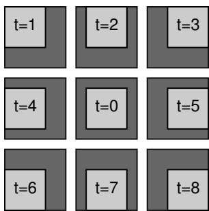  
Figure 4.3: Demonstration of the $C r o p ( \mathbf { m } , t )$ function. For each dark gray patch representing m, the lighter gray subpatch highlights the area cropped by $C r o p ( \mathbf { m } , t )$ for each value of the translation parameter t.

We attempt to parameterize this noise model using as few parameters as possible. By assuming that all non-zero translations are equiprobable, we are able to parameterize the prior over translations using a single parameter $\theta _ { t } = P ( t = 0 )$ . For all other translations, $t > 0$ we get that $P ( t = i ) = ( 1 - P ( t = 0 ) ) / T = ( 1 - \theta _ { t } ) / T$ This assumption is reasonable because we only consider 1 and 2 pixels as the values of $t _ { m a x }$ , but it would not hold for larger values of $t _ { m a x }$ where the diagonal translations should be less probable than the vertical and horizontal ones. Hence, we use a total of four parameters for the entire model: $t _ { m a x } , \theta _ { t }$ , and two parameters needed to parameterize $p _ { A B N } ( \tilde { m } _ { i } | m _ { i } )$ . We refer to this generative model as the translational asymmetric binary noise model, or the TABN model for short.

## 4.2.2 Learning

The observed map distribution under the TABN model is given by

$$
p ( \tilde { \mathbf { m } } | \mathbf { s } ) = \sum _ { t = 0 } ^ { T } p ( t ) \sum _ { \mathbf { m } } p ( \tilde { \mathbf { m } } | \mathbf { m } , t ) p ( \mathbf { m } | \mathbf { s } ) ,\tag{4.5}
$$

where the true map distribution $p ( m | s )$ is modeled by a neural network. In contrast to the ABN model, where the map distribution factors over pixels, the map distribution of the TABN model does not factor, making learning less straightforward. We simplify the learning process by setting the parameters of $p ( t )$ and $p ( \tilde { \mathbf { m } } | \mathbf { m } , t )$ using a validation set and only learning the parameters of the neural network modeling $p ( \mathbf { m } | \mathbf { s } )$ . We learn parameters by minimizing the negative log likelihood under the model in Equation 4.5 using the EM-algorithm with a partial, approximate M-step. We demonstrate how the required EM updates can be performed efficiently.

M-step: The the expected complete data log-likelihood for the TABN model is given by

$$
Q ( \theta ) = \sum _ { t } \sum _ { \mathbf { m } } p ( \mathbf { m } , t | \mathbf { \tilde { m } } , \mathbf { s } ) \ln p ( t ) p ( \mathbf { \tilde { m } } | \mathbf { m } , \mathbf { s } ) p ( \mathbf { m } | \mathbf { s } , \theta ) .\tag{4.6}
$$

While the goal of the M-step is to maximize $Q ( \theta )$ with respect to $\theta ,$ this is not possible for our model because $Q ( \theta )$ is a nonlinear function due to $p ( \mathbf { m } | \mathbf { s } , \theta )$ being modelled by a neural network. We instead perform a partial approximate M-step by doing one minibatch update of stochastic gradient descent on the objective $Q ( \theta )$

We recall that $\begin{array} { r } { p ( \mathbf { m } | \mathbf { s } , \theta ) = \prod _ { i } p ( m _ { i } | \mathbf { s } , \theta ) } \end{array}$ and that $p ( m _ { i } = 1 | \mathbf { s } , \theta ) = \sigma ( x _ { i } )$ , where $x _ { i }$ is the input to the ith output unit of the neural network and $\sigma ( x )$ is the logistic sigmoid function. We compute the derivatives of $Q ( \theta )$ with respect to the $x _ { i } \mathrm { { ' s } }$ because the derivative of $Q ( \theta )$ with respect to any other parameter can be easily computed using backpropagation from the quantities we compute.

We begin by rewriting the expected complete log likelihood as

$$
\begin{array} { r l r } { Q ( \theta ) } & { = } & { \displaystyle \sum _ { t } \sum _ { \bf m } p ( { \bf m } , t | \tilde { \bf m } , { \bf s } ) \ln p ( { \bf m } | { \bf s } ) } \\ & { = } & { \displaystyle \sum _ { i } \sum _ { \bf m } p ( { \bf m } | \tilde { \bf m } , { \bf s } ) \ln p ( m _ { i } | { \bf s } ) } \end{array}
$$

where we rewrote log $p ( \tilde { \mathbf { m } } | \mathbf { s } , \theta )$ as a summation over the marginals of $p ( \mathbf { m } | \mathbf { s } )$ and summed out the translation variable t. We also dropped the terms involving $p ( t )$ and $p ( \tilde { \mathbf { m } } | \mathbf { m } , \mathbf { s } )$ because their parameters are held fixed. It is possible to further simplify $Q ( \theta )$ by summing out $m _ { j }$ for all $j \neq i$ in each term of the outer summation to get

$$
\begin{array} { r l l } { Q ( \theta ) } & { = } & { \displaystyle \sum _ { i } \sum _ { m _ { i } } p ( m _ { i } | \tilde { \mathbf { m } } , \mathbf { s } ) \ln p ( m _ { i } | \mathbf { s } ) } \\ & { = } & { p ( m _ { i } = 1 | \tilde { \mathbf { m } } , \mathbf { s } ) \ln p ( m _ { i } = 1 | \mathbf { s } ) + ( 1 - p ( m _ { i } = 1 | \tilde { \mathbf { m } } , \mathbf { s } ) ) \ln ( 1 - p ( m _ { i } = 1 | \mathbf { s } ) ) } \\ & { = } & { p ( m _ { i } = 1 | \tilde { \mathbf { m } } , \mathbf { s } ) \ln \sigma ( x _ { i } ) + ( 1 - p ( m _ { i } = 1 | \tilde { \mathbf { m } } , \mathbf { s } ) ) \ln ( 1 - \sigma ( x _ { i } ) . } \end{array}
$$

Finally, by recognizing the last term as a binary cross entropy we immediately obtain

$$
\frac { \partial } { \partial x _ { i } } Q ( \theta ) = p ( m _ { i } = 1 | \tilde { \bf m } , { \bf s } ) - \hat { m } _ { i } ,\tag{4.7}
$$

where $\hat { m } _ { i } = \sigma ( x )$ is the output of the ith unit of the neural network. This error derivative for the update performed by the M-step has the intuitive form of the difference between the predicted probability of the label for the pixel being 1 and the posterior probability of the true label for that pixel being 1 under the model.

E-step: The role of the E-step is to compute $p ( m _ { i } | \tilde { \mathbf { m } } , \mathbf { s } )$ for use in the M-step, and as we will show, this computation can be done in time $T \cdot w _ { m } ^ { 2 }$ by exploiting the structure of the noise model.

We begin by expressing the posterior marginals $p ( m _ { i } | \tilde { \mathbf { m } } , \mathbf { s } )$ as

$$
\begin{array} { r c l } { p ( m _ { i } | \tilde { \mathbf { m } } , \mathbf { s } ) } & { = } & { \left[ \sum _ { t } \displaystyle \sum _ { \mathbf { m } _ { - i } } p ( t ) p ( \tilde { \mathbf { m } } | \mathbf { m } , t ) p ( \mathbf { m } | \mathbf { s } ) \right] / p ( \tilde { \mathbf { m } } | \mathbf { s } ) } \\ & { = } & { \left[ \displaystyle \sum _ { t } p ( t ) \prod _ { j \neq i } \sum _ { \mathbf { m } _ { j } } p ( \tilde { m } _ { j } | m _ { j } , t ) p ( m _ { j } | \mathbf { s } ) \right] / p ( \tilde { \mathbf { m } } | \mathbf { s } ) . } \end{array}
$$

Now let $C _ { t }$ be the set of indices of pixels of m that are cropped for transformation t. Since this set has $w _ { m } ^ { 2 }$ entries we slightly abuse notation and also use it to index into m using the one-to-one pixel correspondence. We use $C _ { t }$ to define the intermediate quantity

$$
P _ { t } = \prod _ { i \in C _ { t } } \left( \sum _ { m _ { i } } p ( \tilde { m } _ { i } | m _ { i } ) p ( m _ { i } | \mathbf { s } ) \right) ,\tag{4.8}
$$

and notice that we can conveniently rewrite the above expression for $p ( m _ { i } | \tilde { \mathbf { m } } , \mathbf { s } )$ in terms of $P _ { t }$ by performing two substitutions. First, we rewrite the observed map distribution $p ( \tilde { \mathbf { m } } | \mathbf { s } )$ in the denominator as $\textstyle \sum _ { t } p ( t ) \cdot P _ { t }$ . The second substitution involves replacing the product over pixels $j$ in the summation in the numerator by $P _ { t }$ with the term for pixel i replaced by $p ( \hat { m } _ { i } | m _ { i } ) p ( m _ { i } | s )$ . Putting everything together leads to the final expression

$$
p ( m _ { i } | \mathbf { \tilde { m } } , \mathbf { s } ) = \left[ \sum _ { t } p ( t ) \cdot P _ { t } \cdot \frac { p ( \tilde { m } _ { i } | m _ { i } ) p ( m _ { i } | \mathbf { s } ) } { \sum _ { m _ { i } } p ( \tilde { m } _ { i } | m _ { i } ) p ( m _ { i } | \mathbf { s } ) } \right] / \left[ \sum _ { t } p ( t ) \cdot P _ { t } \right] .\tag{4.9}
$$

This way of computing the posterior marginals is rather efficient because it involves only T different per-pixel computations.

The learning procedure is slightly complicated by allowing $w _ { m ^ { \prime } } ,$ the width of the region for which registration error is assumed to be constant, to substantially differ from $w _ { m } ,$ the width of region predicted by the neural network. While we always set $w _ { m }$ to 16, we found that setting $w _ { m ^ { \prime } }$ to 18 or 20 to allow 1 or 2 pixel translation of a $1 6 \times 1 6$ patch resulted in a model that is too flexible. It was simply too easy for the model to cheat by always choosing to translate its patch of predictions to incur a smaller loss. This effect is greatly reduced by setting $w _ { m ^ { \prime } }$ to a value several times larger than $w _ { m }$ because it makes it much harder to explain a poor prediction by translating it. We found that using $w _ { m ^ { \prime } } = 4 w _ { p } + 2 t _ { m a x }$ leads to a model with the right amount of flexibility for our high resolution data.

To apply the noise model with this value of $w _ { m ^ { \prime } }$ , we construct the $w _ { m ^ { \prime } } \times w _ { m ^ { \prime } }$ patch m out of 16 non-overlapping $w _ { p } \times w _ { p }$ patches predicted by the neural net. We then find the $w _ { m ^ { \prime } } \times w _ { m ^ { \prime } }$ patch of posterior marginals $p ( m _ { i } | \tilde { \mathbf { m } } , \mathbf { s } )$ as described above, break it up into 16 non-overlapping $w _ { p } \times w _ { p }$ subpatches, and backpropagate the derivatives from all the subpatches through the neural network.

## 4.2.3 Understanding the Noise Model

In order to demonstrate how the translational noise model works in practice, we used the TABN model to train a neural network to detect roads from poorly registered road data and plot the target labels, the model predictions, and the inferred true labels for several test cases. Figure 4.4 shows target map labels in the top row, model predictions in the middle row, and means of the marginals of the true map posterior $p ( \mathbf { m } | \tilde { \mathbf { m } } , \mathbf { s } )$ in the bottom row. These examples show how the TABN model is able to correctly realign the target map with the aerial images.

## 4.3 Results

## 4.3.1 Omission Noise

We begin by evaluating the effectiveness of the ABN noise model on the Toronto Roads and GTA Buildings datasets. We estimate that the omission rate is less than

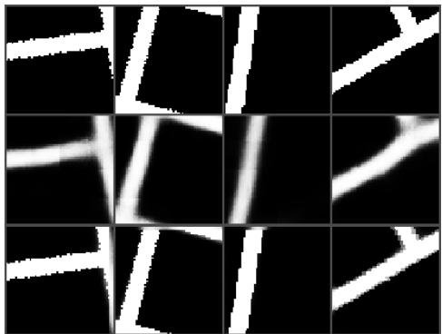  
Figure 4.4: Demonstration of the translational noise model on road detection data. Top row - the target map labels ñ, middle row - model predictions m, bottom row - inferred marginal means for the posterior over the uncorrupted labels $p ( \mathbf { m } | \tilde { \mathbf { m } } , \mathbf { s } )$ Each column corresponds to a training case.

5% on the Toronto Roads dataset and roughly 30% on the GTA buildings dataset so we expect to see some improvement from using a noise model. While the GTA Buildings test set was hand-corrected to include buildings missing from the source map, the Toronto Roads test set was not. We decided to not hand correct the Toronto Roads test set because it is not entirely clear what should and should not be labeled as a road. Since omission noise can potentially lead to worse predictions on all data, it should still be possible for a noise model to improve performance even on a noisy test set.

We trained three layer networks on both datasets with both the ABN model and the noise free model. Since the aim of using the ABN model is to improve robustness to omission noise we apply the ABN model only on training cases where the target map patch m is blank, meaning that all the labels are 0, and use the noise free model for all non-blank training cases. By avoiding non-blank patches, which are much less likely to contain omission errors than blank ones, this procedure helps reduce errors where a noise model incorrectly overrules the ground truth on non-blank patches.

## Road Data

While our earlier work [Mnih and Hinton, 2012] showed a clear improvement from using a noise model on the Toronto Roads dataset, we have since discovered that the improvement cannot be directly attributed to the use of a noise model. The true difference in performance can be explained by the fact that the noise free model used soft labels generated using the procedure described in Chapter 3 while the ABN model required binarized labels. Figure 4.5(a) shows precision-recall plots on the Toronto Roads test set for the ABN model as well as the noise free model with both soft and binarized labels. Using the noise free model with binarized labels instead of soft labels leads to almost the same performance as using the ABN model, with breakeven points of 0.9179 and 0.9181 respectively.

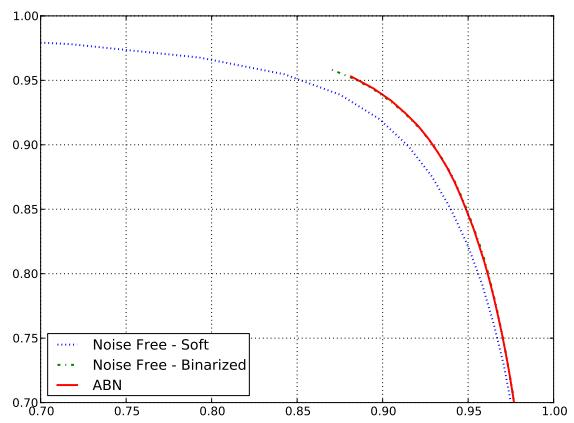  
(a)

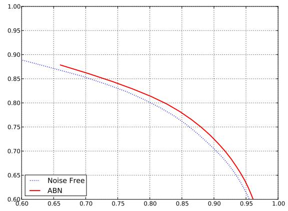  
(b)  
Figure 4.5: Precision/recall plots showing the effect of the ABN noise model. (a) Models trained and tested on the relatively clean Toronto Roads dataset. (b) Models trained on the GTA Buildings dataset.

It is not immediately clear why there is no noticeable improvement in precision and recall from using a noise model on this data. Is it because the noise model does not work or because the noise is not very harmful? In order to answer this question we conduct a number of experiments on the Toronto Roads dataset with synthetic omission noise. We generated three versions of the Toronto Roads training set by dividing it into non-overlapping 500 by 500 meter regions and randomly deleting all labels in 10, 20, or 40 percent of these regions respectively. This type of structured noise is a good approximation to unmapped regions often found in OpenStreetMap data.

We then proceeded to train the same three layer network used in the preceding ABN model experiments on the three versions of the dataset with the noise free and ABN models. The first row of Table 4.1 shows precision-recall breakeven points for the noise free model under varying amounts of label noise. Somewhat surprisingly, our neural network models seem to be quite robust to the presence of omission noise because, when compared to the uncorrupted Toronto Roads dataset, using 10, 20, or 40 percent of synthetic omission noise reduces the precision-recall breakeven point by 0.0043, 0.0075 and 0.0159 respectively.

<table><tr><td rowspan="2">Model Type</td><td>Amount of added omission noise</td><td></td></tr><tr><td>0% 10%</td><td>20% 40%</td></tr><tr><td>Noise free</td><td>0.9179 0.9136</td><td>0.9104 0.902</td></tr><tr><td>ABN</td><td>0.9181 0.9159</td><td>0.9123 0.9065</td></tr></table>

Table 4.1: Precision and recall breakeven points for varying amounts of synthetic noise on the Toronto Roads dataset.

Since according to our estimates the uncorrupted Toronto Roads dataset has an omission rate of less than 5%, the above results suggest that even if the noise model resulted in complete robustness to noise, the improvement in precision and recall would not be large. In fact, given that doubling the amount of synthetic noise seems to roughly double the decrease in precision-recall at the breakeven point, the difference of 0.002 we saw on the uncorrupted test set is in the expected range.

Nevertheless, since the difference on uncorrupted data is so small, we also evaluate the ABN noise model on the corrupted datasets to see how much of the decrease our noise model can recover. The second row of Table 4.1 shows precision-recall breakeven points for the ABN model on the corrupted Toronto Road data. There is a noticeable improvement from using the ABN model compared to using the noise free model at all three noise levels.

## Building Data

Figure 4.5(b) shows the precision-recall plots for the noise free and ABN models on the hand-corrected GTA Buildings test set. Using the ABN model on the GTA Buildings dataset improves the precision-recall breakeven point by roughly 0.085. The improvement is a much larger than what we saw on the Toronto Roads dataset because the GTA Buildings training set has a much higher omission rate of roughly 30%. Given that the results in the previous section suggest that neural networks trained with the noise free loss are quite robust to omission noise the improvement on this data underscores the effectiveness of the ABN noise model.

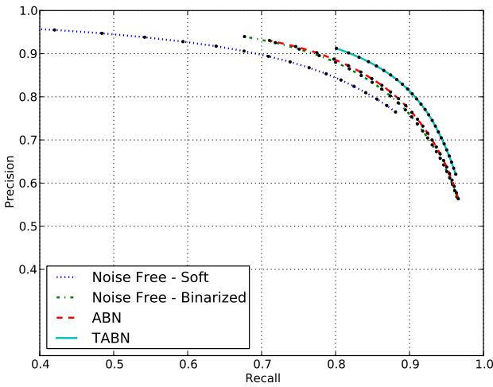  
Figure 4.6: Precision/recall plots showing the effect of the TABN noise model. The models were trained on the smaller and much noisier Hamilton Roads dataset but tested on the cleaner Toronto Roads test set.

## 4.3.2 Registration Noise

In order to evaluate the robustness of the TABN model to registration noise, we perform experiments on the Hamilton Roads dataset. While the Toronto data contains relatively few registration problems, with most road labels within one or two meters of the true locations, road centerlines in the Hamilton Roads dataset are often more than 5 meters away from their true locations. We train the ABN and TABN models on the Hamilton training set and evaluate them on the Toronto Roads test set because it is much cleaner.

Figure 4.6 shows precision-recall curves on the Toronto Roads test set for the models trained on the Hamilton training set and demonstrates the clear advantage of using the TABN robust loss function on this data. In addition to the TABN model, we include results for the ABN model, as well as a noise free model trained on both soft and binarized labels. As we saw on the road data, much of the improvement of the ABN model over the noise free model can be attributed to using binarized labels. Nevertheless, we get a substantial improvement in the precision recall curve from training a network with the TABN model, improving the precision-recall breakeven point by 0.0176 when compared to the ABN model.

It might seem surprising that the improvement from using the TABN model is so much higher than from using the ABN model even on data with a lot of synthetic omission noise. The improvement is likely explained by two factors. First, neural networks are likely less robust to registration errors than omission errors because while omission errors may simply reduce the confidence of the neural network's predictions, registration errors can result in learning encouraging predictions that are entirely wrong. The second factor explaining the effectiveness of the translational noise model is the fact that under truly local registration errors it is possible for the TABN model perfectly recover the true labels by translating the observed labels.

We further demonstrate the robustness of the TABN model to registration noise by visualizing its predictions on noisy training data. Figure 4.7(a) shows an area from the Hamilton Roads training set with the ground truth road locations overlaid in red while Figure 4.7(b) shows the predictions of a model trained with the TABN loss for the same area of the training set. The alignment between the predicted road locations and their true locations is clearly much better than it is for the training labels even though the training labels are what the model was trained to predict.

## 4.4 Conclusions and Discussion

We have shown that by using robust loss functions to train neural networks instead of the standard negative log likelihood loss can provide some level of robustness to label noise. Somewhat surprisingly, large amounts of omission noise do not seem to significantly hurt the training of deep neural networks without a noise model, although our ABN noise model does show across-the-board improvements. We also saw that while the more structured registration noise is more harmful when no noise model is used, it is actually easier to deal with when a translational noise model is used.

While our noise models were designed specifically for the types of noise one faces in aerial image labeling tasks, they can be easily modified to handle other types of noise. For example, the translational noise model can be generalized to handle any type of label noise for which we can write down a graphics program parameterized with a single discrete transformation variable t. Any such graphics program $G ( \mathbf { m } , t )$ leads to a noise distribution

$$
p ( \tilde { \mathbf { m } } | \mathbf { m } , \mathbf { s } , t ) = \prod _ { i = 1 } ^ { w _ { m } ^ { 2 } } p _ { A B N } ( \tilde { m } _ { i } | G ( \mathbf { m } , t ) _ { i } ) ,
$$

that gives us some robustness to the transformation G. Rotations and shears are two basic examples of transformations that can be handled in this manner.

One interesting extension of the ABN model is the addition of dependencies between pixels of the unobserved true map M. This modification would allow strong disagreements with the ground truth in one part of a patch to influence weaker disagreements in nearby parts of the patch. One way to achieve this effect is by placing an MRF prior on M, leading to a combination of a CRF and our ABN noise model. We will show how this model can be trained efficiently in the next chapter.

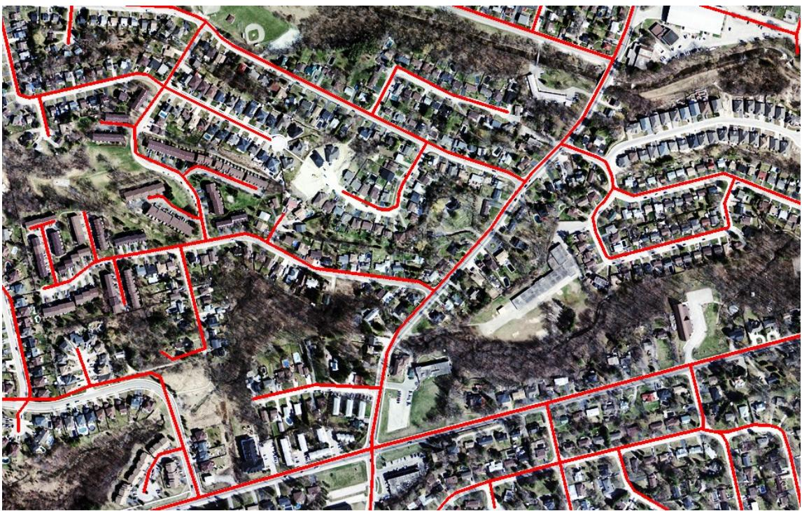

(a)  
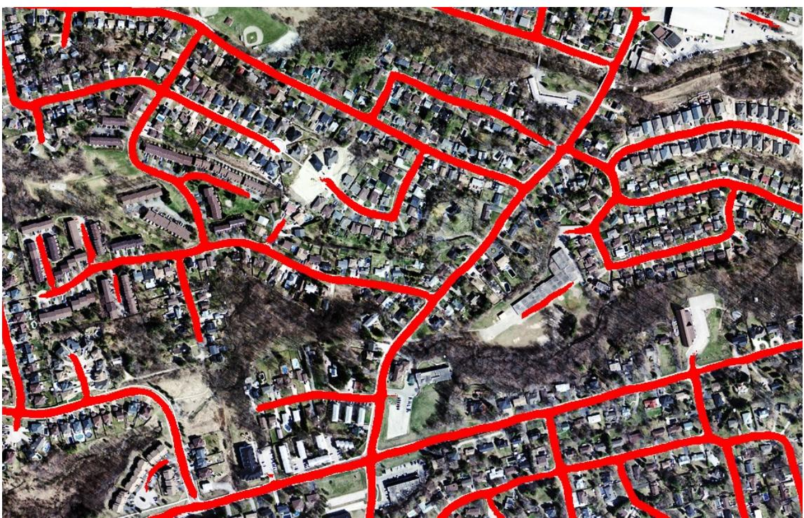  
(b)  
Figure 4.7: Figure 4.7(a) Shows an area from the Hamilton Roads training set with the training labels overlaid in red. Figure 4.7(b) shows the predictions on the training data for a model trained with the TABN loss.

## Chapter 5

## Structured Prediction

So far we have only used unstructured models, meaning ones in which predictions for individual pixels do not directly influence each other. Even though unstructured models seem to be capable of achieving good performance on the tasks we have considered, incorporating knowledge about the smoothness or shape of the predicted objects should lead to even better performance. Indeed, as we discussed in Chapter 2, incorporating structure into aerial and general image labeling methods has often led to big improvements in accuracy and can be traced back to some of the earliest work on the subject [Kettig and Landgrebe, 1976, Bischof et al., 1993, He et al., 2004, Kluckner et al., 2009].

To gain some insight into the kinds of issues that we hope to address by incorporating structure we show sample predictions on the Toronto Roads and GTA Buildings datasets in Figures 5.1(a) and 5.1(b) respectively. On road data, the most common problems are disconnected blobs of road and gaps in the predicted road network. A model that incorporates a connectedness constraint on the road network should be able to avoid both types of errors. Similarly, the most common issues found in predicted building maps are holes and disconnected blobs. Unlike with road data, however, shape and layout are the cues that must be used to resolve these types of errors. Incorporating structure into an image labeling approach by placing a smoothness prior over the labels is likely to help address the issues with both road and building detection. On top of this, incorporating higher level information, such as shape, is likely to lead to further gains.

In this chapter, we aim to address the problem of incorporating rich dependencies among the outputs of our models without sacrificing the ability to learn from large datasets and deal with noisy labels. We first show how stacking neural networks on top of each other indirectly introduces high-level dependencies between the outputs. Training a neural network to clean up the predictions of another neural network in this manner makes it easier to incorporate knowledge about shape into resulting the predictions. We then show how post-processing neural networks can be extended to post-processing Conditional Random Fields by adding direct pairwise dependencies between the outputs of the neural network. Adding direct pairwise dependencies makes it easier for the models to capture low-level properties such as smoothness. The resulting models lead to substantial improvements in precision and recall over our unstructured models.

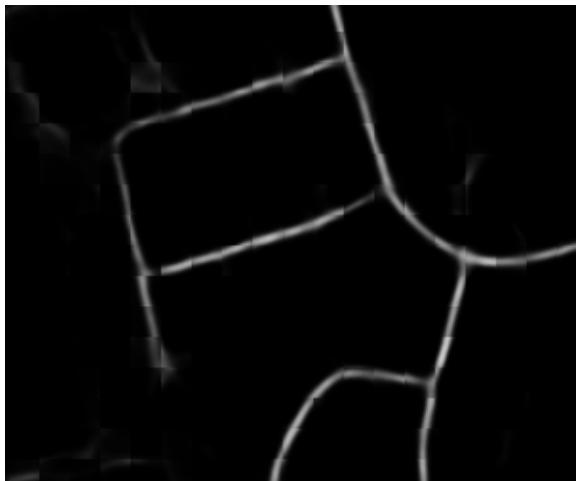  
(a)

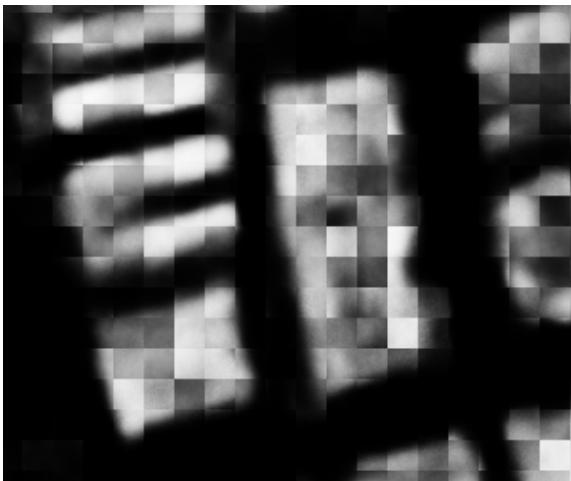  
(b)  
Figure 5.1: Sample predictions for a base network on the Toronto Roads and GTA Buildings datasets.

## 5.1 Post-processing Neural Networks

Given that our goal is to incorporate structure into our models without sacrificing the benefits of fast online training and noise models, perhaps the easiest way to accomplish this is by recycling our existing machinery for training neural networks. While the neural networks we have been using do not have explicit dependencies between the outputs, indirect dependencies can be introduced by stacking several neural networks, each using the outputs of the previous neural network as its inputs. We make use of our patch-based prediction framework using patches of predictions instead of patches of aerial images as input. We will refer to neural networks taking patches of predictions instead of aerial images as input as post-processing or cleanup neural networks.

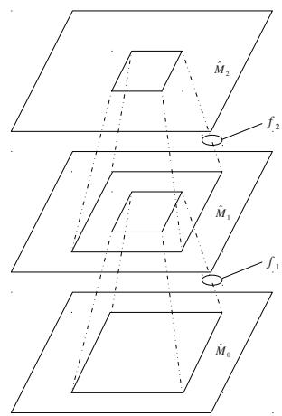  
Figure 5.2: A stack of two post-processing neural networks.

To precisely define the setup, let $\hat { \mathbf { M } } _ { 0 }$ be the map predicted from an aerial image by one of the models described in the preceding chapters. The ith level post-processing neural network $f _ { i }$ takes a $w _ { s }$ by $w _ { s }$ patch of $\hat { { \bf M } } _ { i - 1 }$ and outputs a $w _ { m } \times w _ { m }$ patch of $\hat { { \bf M } } _ { i }$ . As with the other neural network models, $f _ { i }$ is trained to minimize the negative log probability of patches of the observed map $\tilde { \textbf { M } }$ Hence, the ith post-processing neural network aims to improve on the predictions of the previous neural network $f _ { i - 1 }$ . Figure 5.2 shows a stack of two such post-processing neural networks.

Each post-processing neural network should be able to improve or match the quality of the predictions of the previous network for two reasons. First, the fact that the network trained to predict a set of labels from a set of predictions for this set of labels should allow it to at least match the accuracy of the preceding neural network. It should also be easier to represent dependencies between predictions than in a network that is trying to predict the same labels from an aerial image patch. Second, by using an input patch larger than the output patch, each successive network is using information extracted from a larger and larger area of the aerial image as input. This allows post processing networks to propagate confidence along the predicted maps.

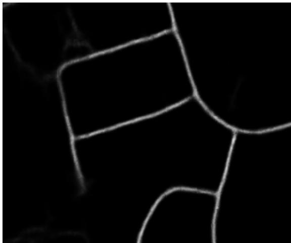  
(a)

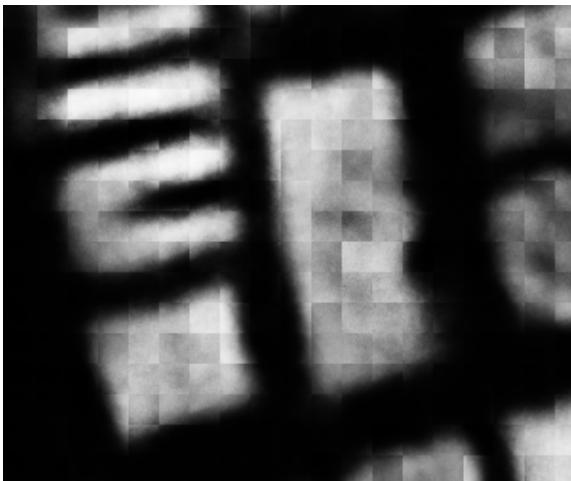  
(b)  
Figure 5.3: Predictions of post-processing neural networks for the areas shown in Figure 5.1.

There are two main advantages to using post-processing neural networks for incorporating structure into the predictions. One immediate benefit is the fact that the robust losses from Chapter 4 can be used to train post-processing networks without modification. Two, given the fact that neural networks are universal approximators, at least in theory, post-processing neural networks are capable of representing arbitrary dependencies between input predictions and output label probabilities.

As we discussed in Chapter 2, trained classifiers have been used for post-processing in the past. For example, Bischof et al. [1993] trained logistic regression models to remove salt and pepper noise from aerial image classification results. In the remainder of this section, we evaluate different types of post-processing neural network architectures, including shallow, single hidden layer networks and networks with multiple levels of local or convolutional features, on road and building detection tasks. Our results confirm the effectiveness of this simple approach to doing structured prediction.

## 5.1.1 Results

To evaluate different post-processing neural network architectures, we first trained two copies of a three layer locally connected network on the Toronto Roads and

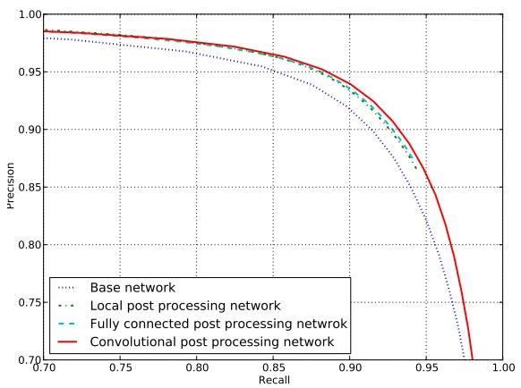  
(a)

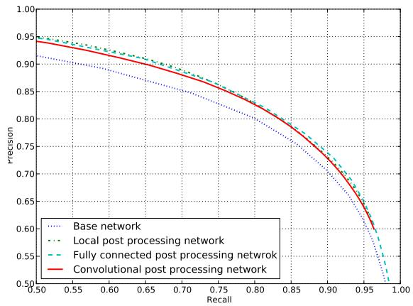  
(b)  
Figure 5.4: Precision/recall plots showing the effect of cleanup with different network architectures. (a) Post processing on the Toronto Roads dataset. (b) Post processing on the GTA Buildings dataset.

GTA Buildings datasets. These base networks used aerial image patches as input and were trained for 20 epochs, at which point validation precision and recall stop improving noticeably. We then trained three different post-processing neural network architectures to predict 16 by 16 map patches from 64 by 64 patches of predictions of the base networks on each dataset.

The first architecture is a neural network with a single fully-connected hidden layer with 4096 hidden units. The second architecture is a two-layer locally-connected network with 64 filters of size 12 by 12 with stride 1 in the first hidden layer and 256 filters of size 4 by 4 with stride 2 in the second hidden layer. Finally the third architecture is a convolutional version of the second architecture. The hidden layers in all three architectures consisted of rectified linear units.

Figures 5.4(a) and 5.4(b) show the precision-recall curves for the models we compared on the Toronto Roads and GTA Buildings datasets respectively. All three post-processing network architectures give a substantial improvement in precision and recall over the base networks, but the difference between different architectures themselves is quite small. We found this to be a general trend – post processing leads to a substantial improvement over the base network, but there is little difference in performance between different architecture choices such as the sizes and types of the hidden layers.

In order to visually demonstrate the improvement in the predictions of the postprocessing networks over the base networks, Figure 5.3 shows the predictions of the best post-processing networks on the areas for which base network predictions are shown in Figure 5.1. The post-processing network suppressed the disconnected blobs of road present in the base network predictions in Figure 5.1(a) and filled in most of the gaps in the road network. The network essentially learns to propagate confident predictions along the map while respecting the constraints of the predicted road network. A similar effect can be seen in the building predictions, where the postprocessing network propagates confident predictions while respecting the constraints on building shape it has learned from the data.

## 5.2 Conditional Random Fields

One drawback of post-processing neural networks is that they do not incorporate prior knowledge by explicitly coupling the model outputs and instead attempt to learn all dependencies from data. While, as we showed in the previous section, this approach is able to learn useful dependencies between outputs, post processing neural networks fail to model local smoothness, which is the strongest local dependence. Though stacking multiple post-processing neural networks on top of one another might eventually come close to modeling smoothness really well, it may be easier and more effective to incorporate such strong prior knowledge directly into the model.

In this section, we explore extending our deep neural networks to deep Conditional Random Fields (CRFs) by adding explicit dependencies between outputs of a neural network. In particular, we add a smoothness term between neighbouring pixels to our model, removing the need to learn smoothness from the data. Using the resulting models for post-processing leads to substantial improvements over unstructured, postprocessing neural networks.

## 5.2.1 Model Description

Following the discussion of Chapter 2, an image labeling CRF is simply a Markov Random Field over the set of pixel labels, which is globally conditioned on the image In the context of our patch-based labeling framework, the observed map distribution

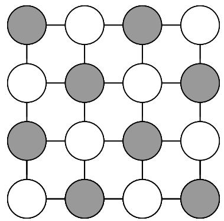  
Figure 5.5: A graphical representation of a 4-lattice MRF. The shaded nodes are all conditionally independent given the non-shaded nodes and vice versa.

for a CRF takes the form

$$
p ( \tilde { \mathbf { m } } | \mathbf { s } ) = \frac { \exp { ( - E ( \tilde { \mathbf { m } } , \mathbf { s } ) ) } } { \sum _ { \mathbf { m } } \exp { ( - E ( \mathbf { m } , \mathbf { s } ) ) } } ,\tag{5.1}
$$

where $E ( { \tilde { \mathbf { m } } } , { \mathbf { s } } )$ is an energy function.

We focus on the most common type of CRF used in the computer vision literature, namely the pairwise lattice CRF. The energy function for a pairwise CRF takes the form

$$
E \left( \tilde { \mathbf { m } } , \mathbf { s } \right) = \sum _ { i } U ( \tilde { \mathbf { m } } _ { i } , \mathbf { s } ) + \sum _ { ( i , j ) \in \mathcal { E } } V ( \tilde { \mathbf { m } } _ { i } , \tilde { \mathbf { m } } _ { j } , \mathbf { s } ) ,
$$

where $\mathcal { E }$ denotes the set of all pairs of neighbouring pixels according to the 4-lattice shown in Figure 5.5. This type of energy function includes unary potentials $U ( \tilde { \mathbf { m } } _ { i } , \mathbf { s } )$ which determine how well label i agrees with the image s and, and pairwise potentials, $V ( \tilde { \mathbf { m } } _ { i } , \tilde { \mathbf { m } } _ { j } , \mathbf { s } )$ , which determine how well neighbouring labels i and $j$ agree with each other and the image.

In particular, we consider grid CRFs in which the unary potentials are determined by the outputs of a deep neural network, and the pairwise potentials encourage neighbouring pixels of similar colour to have the same label. The pairwise potential we use was proposed by Shotton et al. [2008] and is defined as

$$
V ( \tilde { \bf m } _ { i } , \tilde { \bf m } _ { j } , { \bf s } ) = \exp \left\{ - \beta | | { \bf s } _ { i } - { \bf s } _ { j } | | ^ { 2 } \right\} \alpha \delta \left[ \tilde { \bf m } _ { i } \neq \tilde { \bf m } _ { j } \right] ,
$$

where $\alpha$ is a negative constant, $\delta$ is a delta function, and ${ \bf s } _ { i }$ denotes the vector of colour values for pixel i. When the pixels ${ \bf s } _ { i }$ and ${ \bf s } _ { j }$ are not similar, the exponential term of the potential will be close to 0, making a negligible contribution to the energy for all possible labels $\tilde { \mathbf { m } } _ { i }$ and $\tilde { \mathbf { m } } _ { j }$ . When the pixels ${ \bf s } _ { i }$ and ${ \bf s } _ { j }$ are similar, however, the exponential term will be close to 1, which means that the penalty of $\alpha$ will be added to the energy when $\tilde { \mathbf { m } } _ { i }$ and $\tilde { \mathbf { m } } _ { j }$ are different. This type of potential directly encourages smoothness of the labels in homogeneous regions of the image. The energy function for a CRF with these types of potentials can be expressed as

$$
\begin{array} { r l } { E \left( \mathbf { \tilde { m } } , \mathbf { s } \right) } & { = - \sum _ { i } \Bigl ( \tilde { \mathbf { m } } _ { i } \log f _ { i } ( \mathbf { s } ) - \left( 1 - \tilde { \mathbf { m } } _ { i } \right) \log ( 1 - f _ { i } ( \mathbf { s } ) ) } \\ & { - \sum _ { j \in N ( i ) } \exp \left\{ - \beta \lvert \lvert \mathbf { s } _ { i } - \mathbf { s } _ { j } \rvert \rvert ^ { 2 } \right\} \alpha \delta \left[ \tilde { \mathbf { m } } _ { i } \neq \tilde { \mathbf { m } } _ { j } \right] \Bigr ) , } \end{array}
$$

where $f _ { i } ( \mathbf { s } )$ is the ith output of the neural network.

This basic pairwise CRF model can be extended in a number of different ways. For example, Kohli et al. [2009] build a model that combines multiple oversegmentations of an image and obtain more fine-grained segmentations by using higher order potentials to encourage label consistency within superpixels of the oversegmentations. Gould et al. [2008] extend the basic model with a prior over the relative locations of different object types. We do not use these types of extensions and instead hope to capture some of the same dependencies by stacking models on top of each other. Since the unary potentials of our model are determined by the outputs of a deep neural network, the model could conceivably be able to reason about the relative locations of predicted objects whenever it is used for post-processing. We also hope that the use of a deep neural network for the unary potentials will lead to more fine-grained segmentations compared to models with less powerful unary potentials, despite the fact that we use a simple smoothing term.

## 5.2.2 Predictions and Inference

The standard way of making predictions with a CRF is by finding the labeling with the highest probability under the model. More precisely, we would like to find the so called MAP labeling $\mathbf { m } ^ { M A P }$ , defined as

$$
\mathbf { m } ^ { M A P } = \arg \operatorname* { m a x } _ { \tilde { \mathbf { m } } } p ( \tilde { \mathbf { m } } | \mathbf { s } ) .
$$

While the problem of finding the MAP labeling in general CRFs, known as MAP inference, is known to be NP-hard, there are broad classes of CRFs for which efficient exact MAP inference is possible. Pairwise CRFs in which the pairwise potentials satisfy a condition known as submodularity are one such class. Under our formulation, submodularity corresponds to the condition

$$
V ( 0 , 1 , \mathbf { s } ) + V ( 1 , 0 , \mathbf { s } ) \leq V ( 0 , 0 , \mathbf { s } ) + V ( 1 , 1 , \mathbf { s } ) .\tag{5.2}
$$

For any model satisfying this condition, the MAP labeling can be found in polynomial time using graph cuts [Greig et al., 1989]. Conveniently, the submodularity condition simply states that the model should favour smoothness in the labels and it is satisfied by our models for all non-positive values of α.

Despite the fact that efficient and exact MAP inference for our model is possible using graph cuts, it is not a good choice in this setting because it produces a hard $0 / 1$ labeling. The resulting labeling leads to a single pair of precision and recall values, making it impossible to trade off one for the other by choosing a threshold. Indeed, we found that graph cut inference leads to predictions with high precision and moderate recall, which may not be desirable. For this reason, we do not use MAP inference and instead perform marginal inference where the goal is to compute the marginals $p ( \tilde { \mathbf { m } } _ { i } | \mathbf { s } )$ for all pixels i. Computing the marginals allows us to trade off precision and recall against each other by choosing a threshold and using it to produce a hard assignment from the marginal probabilities.

We experimented with two types of marginal inference: mean field inference based on a fully-factored distribution and loopy belief propagation. While the two types of inference led to nearly identical precision-recall curves, mean field inference is both faster and more straight forward to implement, so we present it here in detail.

Mean field inference involves finding the fully-factored distribution $q$ that is closest to $p ( \tilde { \mathbf { m } } | \mathbf { s } )$ in terms of KL-divergence. More precisely, the mean field approximation of $p ( \tilde { \mathbf { m } } | \mathbf { s } )$ is the distribution $q$ defined as

$$
q = \arg \operatorname* { m i n } _ { \boldsymbol { q } ^ { \ast } } K L \left( \boldsymbol { q } ^ { \ast } | | p ( \tilde { \mathbf { m } } | \mathbf { s } ) \right) \mathrm { ~ s u c h ~ t h a t ~ } \boldsymbol { q } ^ { \ast } ( \tilde { \mathbf { m } } ) = \prod _ { i } q _ { i } ^ { \ast } ( \tilde { \mathbf { m } } _ { i } ) ,
$$

Not surprisingly, it is rarely possible to find a closed form solution to this variational minimization problem unless the distribution being approximated is in the class of approximating distributions, which would entirely defeat the purpose of finding an approximation. Instead, solving for $q$ typically leads to an expression for each $q _ { i }$ in terms of the other $q ^ { \prime } \mathrm { s } .$ which can in turn be used to iteratively update the $q \mathrm { ^ { \prime } s }$ starting from some initial guess until a stationary point is reached.

In order to derive the mean field approximation to $p ( \tilde { \mathbf { m } } | \mathbf { s } )$ we first write out $\mathrm { K L } _ { - }$ divergence between $q$ and $p ( \tilde { \mathbf { m } } | \mathbf { s } )$ and separate out its dependence on a single term $q _ { j }$ . Hence,

$$
\begin{array} { r l } { K L ( q | | p ( \mathbf { i n } | s ) ) } & { = \displaystyle \sum _ { i = 1 } \boldsymbol { q } ( | \mathbf { i n } ) \log \frac { p ( \mathbf { i n } | s ) } { q ( \mathbf { i n } ) } } \\ & { = \displaystyle \sum _ { i = 1 } \sum _ { i = 1 } ( \prod _ { i } q _ { i } ( \mathbf { i n } _ { i } ) ) ( \log p ( \mathbf { i n } | s ) - \sum _ { i } \log q ( \mathbf { i n } _ { i } ) ) } \\ & { = \displaystyle \sum _ { i = 2 } [ q _ { i } ( \mathbf { i n } _ { i } ) \sum _ { m \neq i } [ ( \prod _ { i \neq j } q _ { i } ( \mathbf { i n } _ { i } ) ) ( \log p ( \mathbf { i n } | s ) - \sum _ { k } \log q _ { k } ( \mathbf { i n } _ { k } ) ) ] ] } \\ & { = \displaystyle \sum _ { i = 3 } [ q _ { i } ( \mathbf { i n } _ { j } ) \sum _ { m \neq i } [ ( \prod _ { i \neq j } q _ { i } ( \mathbf { i n } _ { i } ) ) \log p ( \mathbf { i n } | s ) ] ] - } \\ & { \displaystyle \sum _ { i = 1 } \eta _ { i } ( \mathbf { i n } _ { i } ) \log q _ { i } ( \mathbf { i n } _ { i } ) + C , } \end{array}
$$

where $C$ is a constant that does not depend on $q _ { j }$ . At this point, we can take partial derivatives of $K L ( q | | p )$ with respect to $q _ { j } ( \tilde { \mathbf { m } } _ { j } = 0 )$ and $q _ { j } ( \tilde { \mathbf { m } } _ { j } = 1 )$ set them to 0 to obtain that

$$
q _ { j } ( \tilde { \mathbf { m } } _ { j } ) = \exp \left( \mathbb { E } _ { q _ { i } , i \neq j } \left[ \log p ( \tilde { \mathbf { m } } | \mathbf { s } ) \right] \right) / Z _ { j } ,
$$

where $Z _ { j }$ is a normalizing constant. This $\mathrm { g i }$ ves us a set of consistency equations that must hold for the distribution $q$ that minimizes $K L ( q | | p )$

While this is not a closed form solution for the best possible approximating distribution $q ,$ we can find a fixed point for these equations by iteratively updating the $q _ { i } { ' } \mathrm { s }$ using the consistency equations starting with some initial guess, with convergence guaranteed. Since updating one $q _ { i }$ at a time does not lend itself to easy parallelization we instead perform damped parallel updates. While convergence to $\mathrm { a }$ fixed point is no longer guaranteed, we find that the procedure works well in practice. We provide the mean field inference procedure for CRFs with the energy function defined in Equation 5.2 as Algorithm 1.

Result: Approximate marginals $q ^ { M F }$

Initialize $q _ { i } ^ { ( 0 ) }$ to 0.5 for all i

for $t = 1 , \dots , T$ do

Compute the iterated $q _ { i } ^ { * } \mathrm { { s } }$ according to:

$$
\begin{array} { r l } { \log q _ { j } ^ { * } \bigl ( \tilde { \mathbf { m } } _ { j } \bigr ) = } & { \tilde { \mathbf { m } } _ { i } \ln f _ { j } ( \mathbf { s } ) + \left( 1 - \tilde { \mathbf { m } } _ { i } \right) \ln ( 1 - f _ { j } ( \mathbf { s } ) ) + } \\ & { \sum _ { k \in N ( j ) } \sum _ { \tilde { \mathbf { m } } _ { k } } q _ { k } ^ { ( t - 1 ) } \bigl ( \tilde { \mathbf { m } } _ { k } \bigr ) V \bigl ( \tilde { \mathbf { m } } _ { j } , \tilde { \mathbf { m } } _ { k } , \mathbf { s } \bigr ) } \end{array}
$$

Compute the updated $q _ { i } \mathrm { ^ { * } s }$ according to:

$$
q _ { j } ^ { ( t ) } ( \tilde { \mathbf { m } } _ { j } ) = \gamma q _ { j } ^ { * } ( \tilde { \mathbf { m } } _ { j } ) + ( 1 - \gamma ) q _ { j } ^ { ( t - 1 ) } ( \tilde { \mathbf { m } } _ { j } )
$$

end

return $q ^ { ( T ) }$

Algorithm 1: Mean-Field Inference for Grid CRFs

One thing to note is that due to the 4-lattice structure of the CRF the update equation for each pixel is a sparse computation involving only its 4 neighbours. By breaking down the computation into four separate steps, one for each direction of neighbours, it is possible to vectorize this update and perform it in parallel for an entire minibatch.

The mean-field inference procedure has two free parameters: the number of inference steps T and the damping factor $\gamma .$ We experimented with a few settings of the parameters and found that using $T = 1 0$ and $\gamma = 0 . 5$ seemed to work well. We used these parameter values for both training and testing in all experiments where mean field inference was used.

Figure 5.6 shows the first six steps $\boldsymbol q ^ { ( 1 ) } , \ldots , \boldsymbol q ^ { ( 6 ) }$ of this mean field inference procedure for a CRF trained on the GTA Buildings dataset. While some boundary artifacts are still present, the inference procedure does a good job of removing some of them by propagating confident predictions.

## 5.2.3 Learning

Our CRF has two sets of parameters – the parameters of the neural network determining the unary potentials and the parameters α and $\beta$ of the pairwise potential. We learn the two sets of parameters separately, which is a common practice in the computer vision literature [Shotton et al., 2008, Krähenbühl and Koltun, 2011].

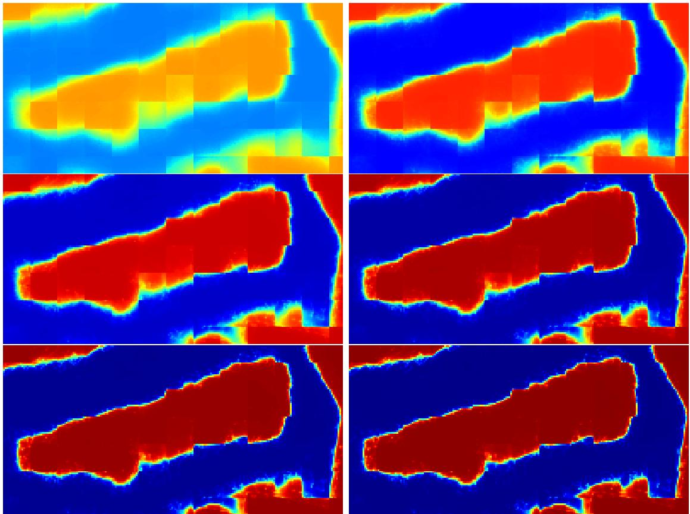  
Figure 5.6: Six steps of mean field inference for a CRF trained on building data. The order of steps is left to right and top to bottom.

We set the smoothness penalty term α based on validation data. In particular, we found that the value α = -1.2 worked well on validation data on both road and building data and used it for all the experiments in this section. Following Shotton et al. [2008], we set $\beta$ based on the training data to be

$$
\beta = \mathbb { E } \left[ | | \mathbf { s } _ { i } - \mathbf { s } _ { j } | | ^ { 2 } \right] ^ { - 1 } ,
$$

where the expectation is over neighbouring pixels i and $j .$ This makes sure that the exponential term of the pairwise potential tends to be in a reasonable range and does not saturate too often.

The simplest procedure for finding good weights for the neural network $f$ is to first train it separately from the CRF using the unstructured approach from Chapter 3. Indeed, we found that initializing the neural network part of the CRF using weights of a separately trained neural network led to good results. Since this way of learning the unary potentials of a CRF does not make use of the pairwise terms, we explored the possibility of finetuning the neural network determining the unary potentials of a CRF using gradient descent on the CRF negative log likelihood.

For a single training case, the partial derivative of the negative log likelihood of a general CRF with respect to a parameter θ is given by

$$
\begin{array} { r l } { - \frac { \partial \log p ( \tilde { \mathbf { m } } | \mathbf { s } , \theta ) } { \partial \theta } } & { = \frac { \partial E ( \tilde { \mathbf { m } } , \mathbf { s } ) } { \partial \theta } - \sum _ { \tilde { \mathbf { m } } } p ( \tilde { \mathbf { m } } | \mathbf { s } , \theta ) \frac { \partial E ( \tilde { \mathbf { m } } , \mathbf { s } ) } { \partial \theta } } \\ & { = \frac { \partial E ( \tilde { \mathbf { m } } , \mathbf { s } ) } { \partial \theta } - \mathbb { E } _ { p ( \tilde { \mathbf { m } } | \mathbf { s } ) } \left[ \frac { \partial E ( \tilde { \mathbf { m } } , \mathbf { s } ) } { \partial \theta } \right] . } \end{array}
$$

The expression for the partial derivative consists of two terms. The first term, known as the positive term, is simply the partial derivative of the energy with respect to the parameter, and is straightforward to compute for most models, including ours. The second term, known as the negative term, is the partial derivative of the log partition function and takes the form of an expected value of the partial derivative of the energy with respect to the model distribution $p ( \tilde { \mathbf { m } } | \mathbf { s } )$ . Since the negative term requires summing over a number of terms exponential in the number of pixels, it is generally intractable to compute, even for a model as simple as a 4-lattice CRF, forcing one to use approximate learning methods.

Broadly speaking, approximate learning methods for models with intractable partition functions can be divided into stochastic and deterministic approximations. We experimented with learning the parameters of f using both types of approximations, which we now discuss in greater detail.

## Deterministic approximations

We considered the broad category of deterministic approximation methods which involves replacing the expectation with respect to the model distribution $p ( \tilde { \mathbf { m } } | \mathbf { s } )$ with an expectation over some tractable distribution q. In models where MAP inference is tractable, a popular choice for q is a point mass distribution with all of its mass placed on the MAP prediction $\mathbf { m } ^ { M A P }$ . While it would be interesting to experiment with using MAP inference during learning we chose to use the fully factored mean field approximation to $p ( \tilde { \mathbf { m } } | \mathbf { s } )$ as the distribution $q$ because the computation can be easily parallelized.

Using the approximation

$$
- \frac { \partial \log p ( \tilde { \bf m } | { \bf s } ) } { \partial \theta } \approx \frac { \partial E \left( \tilde { \bf m } , { \bf s } \right) } { \partial \theta } - \mathbb { E } _ { q ^ { M F } } \left[ \frac { \partial E \left( \tilde { \bf m } , { \bf s } \right) } { \partial \theta } \right] ,
$$

where $q ^ { M F }$ is the result of mean field inference described in Section 5.2.2, we get the intuitively pleasing result that

$$
- \frac { \partial \log p ( \tilde { \bf m } | { \bf s } ) } { \partial a _ { i } ( { \bf s } ) } \approx \tilde { \bf m } _ { i } - q _ { i } ^ { M F } ( \tilde { \bf m } ) ,\tag{5.3}
$$

where $a _ { i } ( \mathbf { s } )$ is the total input to the output unit for the ith pixel. Hence, according to the approximations we have used, the partial derivative of the negative log likelihood with respect to the activation of a single unit $a _ { i } ( \mathbf { s } )$ is just the difference between the observed label and the probability of the observed label being 1 according to mean field inference. The partial derivatives of the loss with respect to the parameters of the neural network f can be easily computed from Equation 5.3 using backpropagation.

Our attempts to learn the unary potentials of the CRF defined by the neural network f using the above approach were not successful. All models finetuned with this approach were considerably worse than the neural networks they were initialized with. The problem likely stems from the fact that the mean field approximation of the model distribution tends to be overconfident because it converges on a single mode [Bishop, 2006]. It is common for the entries of $q$ to be very close to 0 whenever the neural network assigns a low probability of an object of interest being present. This has the effect of driving up the biases of the neural network and leads to an increased false positive rate.

## Stochastic approximations

Stochastic approximation techniques rely on using Monte Carlo methods for approximating the expectation in the negative term. In cases where it is easy to efficiently draw samples from the model distribution, sampling-based techniques can be used to obtain an unbiased estimate of the negative term. Since probabilistic models with intractable partition functions, including the types of CRFs we consider, are usually difficult to sample from, approximate sampling techniques must be used.

We experimented with approximating the negative term expectation using a Markov chain whose stationary distribution is the model distribution $p ( \tilde { \mathbf { m } } | \mathbf { s } )$ . The transition operator of the Markov chain we used for our model is a block Gibbs sampler with two groups defined using a checker board pattern, as shown in Figure 5.5. All the shaded nodes can be updated in parallel given all the unshaded nodes and vice versa, allowing us to update all nodes in just two block Gibbs updates. By running the Markov chain until it reaches equilibrium, we could obtain samples from the model p(m|s) and use them to approximate the negative term expectation. Unfortunately this approach is impractical because it takes a long time to reach equilibrium.

One alternative is to use Contrastive Divergence (CD) learning [Hinton, 2002], which initializes the Markov chain at the data m and runs the Markov chain for a small number of steps instead of running until convergence. We found that finetuning a CRF using CD actually made the predictions worse. This confirms our earlier finding that CD may not work well for training conditional models [Mnih et al., 2011] where the Markov chain mixes slowly. Intuitively, CD training lowers the energy of the observed data and raises the energy of the regions near the true data. This may not work well for a conditional model because test time inference starts away from the true data and may never reach the regions of the state space explored by CD at training time.

We experimented with a number of alternatives to standard CD training and found that we could successfully finetune a CRF using CD where the Markov chain in the negative phase run at temperature 2 instead of 1. Running the Markov chain at the higher temperature improved mixing in the chain. Additionally, we found that using a different value of the pairwise smoothness penalty term α at training time also improved mixing of the chain leading to even better finetuning results. While using the value of $\alpha = - 1 . 2$ works well at test time, it leads to rather rigid smoothness constraints on the labels which make it difficult for our Gibbs sampler to make large moves. Thus our finetuning procedure used CD with the negative chain running at temperature 2 for 5 steps and the pairwise penalty term set to -0.6. While it might be possible to use CD training without any model modifications by using a better sampler such as Swendsen-Wang [Swendsen and Wang, 1987], we did not explore this possibility.

<table><tr><td>Model</td><td>Base Post-processing</td></tr><tr><td>NN 0.7985</td><td>0.8176</td></tr><tr><td>CRF 0.8144</td><td>0.8343</td></tr><tr><td>Finetuned CRF 0.8296</td><td>0.8351</td></tr><tr><td>Finetuned NN CRF 0.8268</td><td>0.8345</td></tr></table>

Table 5.1: Precision and recall breakeven points for different base and cleanup models on the GTA Buildings dataset.

## 5.2.4 Results

Due to the fact that smoothness is more important for building detection than road detection we evaluate the proposed CRF model on the GTA Buildings dataset. We evaluate two types of models – base models taking aerial images as input and postprocessing models using the outputs of a neural network as the input.

Table 5.1 shows precision-recall breakeven point values on the GTA Buildings dataset for neural networks as well as CRFs trained in different ways. NN denotes a deep neural network trained using the procedure described in Chapter 3, while CRF denotes a CRF whose neural network weights were initialized with the weights of NN. The parameters of this model were not finetuned. The model Finetuned CRF corresponds to initializing a CRF with the weights of CRF and finetuning it for two epochs by optimizing the CRF likelihood using Contrastive Divergence. Finally, the model Finetuned NN CRF is a CRF whose neural network weights were obtained by training NN for two more epochs using the standard neural net likelihood. We included Finetuned NN CRF to see if there is a benefit from finetuning a CRF using the CRF likelihood as opposed to just training the neural network part longer using the unstructured neural network likelihood.

CRFs trained using all three procedures substantially outperform NN. For both base and post-processing models, simply placing an MRF over the outputs of a neural network to turn it into a CRF, which is the difference between NN and CRF, improves precision-recall breakeven points by roughly 0.015. We also see that while finetuning a CRF using the CRF likelihood leads to a slightly bigger improvement in performance than simply training the neural network longer, the difference between these two methods is too small to be conclusive.

It is also interesting to note that post-processing CRFs are the best performing models, outperforming both post processing neural networks and base CRFs. This suggests that the improvements from doing post-processing with a neural net and directly incorporating smoothness using a CRF are somewhat orthogonal and that their combination offers the advantages of both.

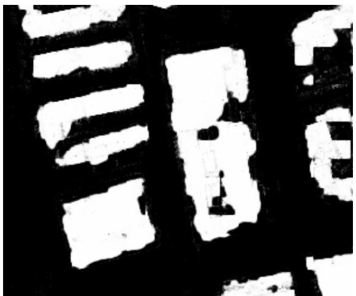  
(a)

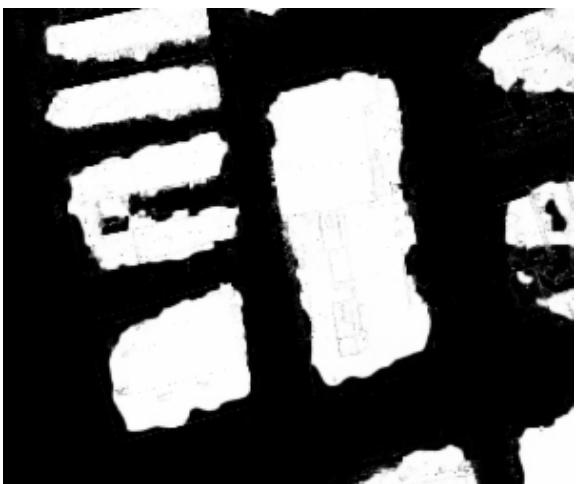  
(b)  
Figure 5.7: Predictions for base and post-processing CRFs on the GTA Buildings datasets.

In order to better understand how adding pairwise dependencies changes the predictions of the models we visualize the predictions of both CRFs. Figure 5.7 shows predictions of the base and cleanup CRFs for the same part of the GTA Buildings dataset that is covered by Figure 5.1(b). First, it is evident that the CRFs produce much smoother predictions than simple post processing neural networks. Second, CRFs seem produce much more extreme predictions than unstructured models, with most pixels assigned probabilities of containing a building close to 0 or 1. For the most part this effect improves predictions by reinforcing moderately confident predictions. Unfortunately, the effect also tends to produce gaps where the initial detection probabilities were too low, and this somewhat hurts precision at lower recall levels.

## 5.3 Combining Structure and Noise Models

In this section, we combine the Asymmetric Binary Noise model we developed in Chapter 4 with the deep CRFs presented in Section 5.2. The combination of these models is especially interesting because the pixel-by-pixel ABN noise model should become more powerful when used to train a CRF. In particular, using the ABN model to train a CRF should allow nearby disagreements of the neural network predictions with the ground truth to reinforce each other. This effect does not exist when the ABN model is used to train a neural network because the negative log likelihood decomposes over pixels due to the lack of direct dependencies between different labels.

## 5.3.1 The model

We recall from Chapter 4 that in order to deal with omission noise we defined the following two-stage generative model of the data:

1. Generate the true, uncorrupted and unobserved map m from the aerial image s according to a data distribution $p ( \mathbf { m } | \mathbf { s } )$

2. Generate the corrupted observed map ñ from the true map m according to a noise distribution $p ( \tilde { \mathbf { m } } | \mathbf { m } )$

When the noise distribution is specified by the asymmetric binary noise model, this generative process leads to the following observed map distribution:

$$
p ( \tilde { \mathbf { m } } | \mathbf { s } ) = \sum _ { \mathbf { m } } \left( \prod _ { i } p ( \tilde { \mathbf { m } } _ { i } | \mathbf { m } _ { i } ) \right) p ( \mathbf { m } | \mathbf { s } ) .
$$

In Chapter 4, the true map distribution $p ( \mathbf { m } | \mathbf { s } )$ was specified using a neural net and factored over pixels, which led to a $p ( \tilde { \mathbf { m } } | \mathbf { s } )$ that also factored over pixels. Here, the true map distribution is specified by a CRF, which means that the observed map distribution no longer factors over pixels. We will refer to this model as the CRF-ABN model. While coupling the pixels in this manner makes learning more difficult, it gives the model some interesting properties. Figure 5.8 shows the difference in the inferred true map m between the ABN and CRF-ABN models. In particular, one can see how nearby disagreements reinforce each other in the CRF-ABN model and not in the ABN model.

## 5.3.2 Inference

Since the noise model only has an effect at training time, the test time inference problem for the CRF-ABN model is the same as for the plain CRF model from Section 5.2. Namely, the goal is to compute the marginals $p ( \mathbf { m } _ { i } | \mathbf { s } )$ for making predictions from

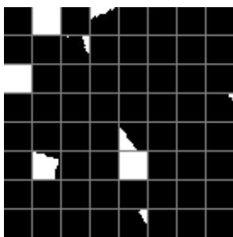  
(a)

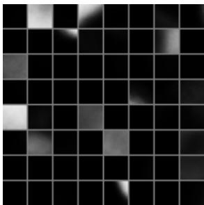  
(b)

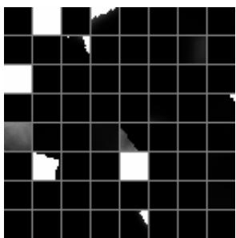  
(c)

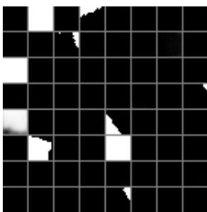  
(d)  
Figure 5.8: Comparison of the ABN and CRF-ABN models. Each plot shows 64 training cases arranged in an 8 by 8 grid. 5.8(a) are the target map patches m. 5.8(b) are the outputs of a neural network. 5.8(c) are the true map patches m inferred according to the ABN model. 5.8(d) are the true map patches m inferred according to the LMRF model.

the CRF. We make use of the mean field inference procedure developed in Section 5.2 and refer to this mean field approximation of $p ( \mathbf { m } | \mathbf { s } )$ as $q ^ { p ( \mathbf { m } | \mathbf { s } ) }$

## 5.3.3 Learning

As the CRF-ABN model can be seen as a latent CRF with a stationary pixelwise emission distribution, we will use the EM algorithm to optimize the log likelihood in the presence of latent variables. As in our application of the EM algorithm to the translational noise model, we are not able to perform a full M-step and instead perform a partial approximate one by doing a single minibatch gradient update. However, unlike in the case of the translational noise model, we are no longer able to perform an exact E-step because expectations with respect to $p ( \mathbf { m } | \tilde { \mathbf { m } } , \mathbf { s } )$ are not tractable under the CRF-ABN model. Instead, we chose to perform a variational E-step, where we use a fully factored mean field approximation q(m) in place of $p ( \mathbf { m } | \tilde { \mathbf { m } } , \mathbf { s } )$ . We found that this scheme works well in practice.

## Variational EM

We briefly review the variational EM algorithm before giving a detailed description of its application to training the CRF-ABN model. Our treatment of the variational EM algorithm follows that of Bishop [2006].

We consider a probabilistic model with observed variables X, latent variables Z,

and a joint distribution $p ( \mathbf { X } , \mathbf { Z } | \boldsymbol { \theta } )$ . The goal is to optimize the log likelihood

$$
\log p ( \mathbf { X } | \theta ) = \log \sum _ { \mathbf { Z } } p ( \mathbf { X } , \mathbf { Z } | \theta ) ,
$$

and we assume that this is difficult due to the presence of the sum inside the logarithm. Additionally, we assume that maximizing the complete log likelihood log $p ( \mathbf { X } , \mathbf { Z } | \boldsymbol { \theta } )$ is straightforward with respect to $\theta .$

The central idea behind the EM algorithm is decomposing the log likelihood as

$$
\log p ( \mathbf { X } | \boldsymbol { \theta } ) = \mathcal { L } ( q , \boldsymbol { \theta } ) + K L ( q | | p ( \mathbf { Z } | \mathbf { X } ) ) ,
$$

where $q$ is a distribution defined over the latent variables $\mathbf { Z } ,$ and

$$
\mathcal { L } ( q , \theta ) = \sum _ { \mathbf { Z } } q ( \mathbf { Z } ) \log \frac { p ( \mathbf { X } , \mathbf { Z } | \theta ) } { q ( \mathbf { Z } ) } .
$$

This decomposition holds for any choice of distribution $q ,$ and because the KLdivergence $K L ( q | | p )$ is nonnegative, the term $\mathcal { L } ( q , \theta )$ is a lower bound on the log likelihood log $p ( \mathbf { X } | \theta )$

The EM algorithm maximizes the log likelihood log $p ( \mathbf { X } | \theta )$ by performing an alternating maximization of the lower bound $\mathcal { L } ( q , \theta )$ . In the E-step, $\mathcal { L }$ is maximized with respect to $q .$ Since $\mathcal { L }$ is bounded from above by log $p ( \mathbf { X } | \theta )$ and $K L ( q | | p )$ is 0 if and only if $q = p , { \mathcal { L } }$ attains its maximum with respect to $q$ at $q = p ( \mathbf { Z } | \mathbf { X } )$ . In the second step of the alternating minimization, the M-step, $\mathcal { L }$ is maximized with respect to the model parameters $\theta ,$ which corresponds to maximizing

$$
\sum _ { \mathbf { Z } } q ( \mathbf { Z } ) \log p ( \mathbf { X } , \mathbf { Z } | \boldsymbol { \theta } ) .\tag{5.4}
$$

Since $\mathcal { L }$ is a lower bound on the log likelihood, increasing $\mathcal { L }$ is guaranteed to increase the log likelihood when the bound is tight.

Unfortunately, maximizing the quantity in Equation 5.4 for the choice $q ( \mathbf { Z } ) =$ $p ( \mathbf { Z } | \mathbf { X } , \theta )$ is intractable for many models of interest. The key idea behind the variational EM algorithm is to restrict the maximization performed in the E-step to a class of distributions for which maximizing the quantity in Equation 5.4 is tractable.

One common choice for $q$ is the mean field approximation which is defined as

$$
q ^ { M F } = \arg \operatorname* { m a x } _ { q ( \mathbf { Z } ) } \mathcal { L } ( q , \theta ) \ \mathrm { s u c h \ t h a t \ } q ( \mathbf { Z } ) = \prod _ { i } q _ { i } ( \mathbf { Z } _ { i } )
$$

and corresponds to restricting the maximization of $\mathcal { L }$ to the class of fully factored distributions $q .$

While the EM algorithm always improves the log likelihood unless a local optimum has already been reached, since the E-step in the variational EM algorithm corresponds to a partial maximization of ${ \mathcal { L } } ,$ the M-step is no longer guaranteed to improve the log likelihood. Nevertheless, both steps of the variational EM algorithm increase $\mathcal { L }$ when possible, and since $\mathcal { L }$ is a lower bound on the log likelihood , variational EM tends to increase the log likelihood in practice.

We now describe our variational EM algorithm for training the CRF-ABN model

## M-step:

The goal of the M-step is to maximize L with respect to the parameter vector θ. Since we are training a nonlinear model, we opt for a partial approximate M-step in which we do a single minibatch update of stochastic gradient descent on the parameters θ. Following the approaches used to learn the parameters of the ABN model in Chapter 4 and the CRF parameters in Section 5.2 we use gradient information only to learn the parameters of the neural network f and use a validation set to learn the pairwise term of the MRF and the noise model parameters.

In order to derive the required update, we take the partial derivative of the variational lower bound $\mathcal { L }$ with respect to a single parameter θ and obtain

$$
{ \frac { \partial { \mathcal { L } } ( q , \theta ) } { \partial \theta } } = { \frac { \partial } { \partial \theta } } \sum _ { \mathbf { m } } q ( \mathbf { m } ) \log p ( \mathbf { m } | \mathbf { s } )\tag{5.5}
$$

$$
\begin{array} { c l } { = } & { - \left( \displaystyle \sum _ { \bf m } q ( { \bf m } ) \left( \frac { \partial E ( { \bf m } , { \bf s } ) } { \partial \theta } - \mathbb { E } _ { p ( { \bf m } \mid { \bf s } ) } \left[ \frac { \partial E ( { \bf m } , { \bf s } ) } { \partial \theta } \right] \right) \right) } \end{array}\tag{5.6}
$$

$$
\mathbf { \Sigma } = \mathbf { \Sigma } - \left( \mathbb { E } _ { q ( \mathbf { m } ) } \left[ \frac { \partial E ( \mathbf { m } , \mathbf { s } ) } { \partial \theta } \right] - \mathbb { E } _ { p ( \mathbf { m } | \mathbf { s } ) } \left[ \frac { \partial E ( \mathbf { m } , \mathbf { s } ) } { \partial \theta } \right] \right) ,\tag{5.7}
$$

by removing terms that do not depend on θ and rewriting summations as expectations where possible. The first term in Equation 5.7 is an expectation of the CRF's energy derivative with respect to the mean field approximation q and is straightforward to evaluate. The second term in the same expression is the expectation of the CRF's energy derivative with respect to the $\mathrm { C R F } \mathrm { { s } }$ model distribution $p ( \mathbf { m } | \mathbf { s } )$ and, as we saw in Section 5.2 is intractable for our model. Since we already addressed the issue of approximating this term, we follow the approach from Section 5.2. In particular we use CD with the Markov chain running at temperature 2 and, as before, we also set the pairwise penalty term to -0.6 at training time in order to further improve mixing of the Markov chain.

Combining the above approximation with Equation 5.7 we obtain that the approximate partial derivative of $\mathcal { L }$ with respect to the activation $a _ { i }$ of the ith output unit of the neural network f is given by

$$
\begin{array} { r c l } { \displaystyle \frac { \partial \mathcal { L } ( q , \theta ) } { \partial a _ { i } } } & { \approx } & { \displaystyle - \left( \mathbb { E } _ { q ( \mathbf { m } ) } \left[ \frac { \partial E ( \mathbf { m } , \mathbf { s } ) } { \partial a _ { i } } \right] - \mathbb { E } _ { p ( \mathbf { m } | \mathbf { s } ) } \left[ \frac { \partial E ( \mathbf { m } , \mathbf { s } ) } { \partial a _ { i } } \right] \right) } \\ { \displaystyle } & { = } & { \displaystyle - \left( q _ { i } ^ { p ( \mathbf { m } | \tilde { \mathbf { m } } , \mathbf { s } ) } ( \mathbf { m } _ { i } = 1 ) - q _ { i } ^ { p ( \mathbf { m } | \mathbf { s } ) } ( \mathbf { m } _ { i } = 1 ) \right) . } \end{array}
$$

The resulting expression for the error derivative of the ith output is the difference between the probability of the ith unit being on under a variational approximation of the posterior $p ( \mathbf { m } | \tilde { \mathbf { m } } , \mathbf { s } )$ and the probability of the ith unit being on under a variational approximation of the CRF distribution $p ( \mathbf { m } | \mathbf { s } )$ . The M-step updates the parameters of the neural network f by backpropagating these error derivatives.

## E-step:

The role of the E-step is to obtain the mean field approximation $q ^ { p ( \mathbf { m } | \tilde { \mathbf { m } } , \mathbf { s } ) }$ of $p ( \mathbf { m } | \tilde { \mathbf { m } } , \mathbf { s } )$ by maximizing the variational lower bound $\mathcal { L } ( q , \theta )$ with respect to $q$ subject to the constraint $\begin{array} { r } { q ( \mathbf { m } ) = \prod _ { i } q _ { i } ( \mathbf { m } _ { i } ) } \end{array}$ . As we saw above, this problem is equivalent to minimizing $K L ( q | | p ( { \bf m } | \tilde { \bf m } , { \bf s } ) )$ subject to the constraint on $q .$

We recall from the derivation of $q ^ { p ( \mathbf { m } | \mathbf { s } ) }$ in Section 5.2.2 that the jth factor of a fully factored mean field approximation of a distribution $p$ is given by

$$
q _ { j } = \exp \left( \mathbb { E } _ { q _ { i } , i \neq j } \left[ \log p \right] \right) / Z _ { j } .
$$

Thus, the terms $q _ { j } ^ { p ( \mathbf { m } | \tilde { \mathbf { m } } , \mathbf { s } ) }$ can be easily obtained by plugging in $p = p ( { \bf m } | \tilde { \bf m } , { \bf s } )$ into the above equation. The resulting inference procedure for the E-step is shown as Algorithm 2.

Result: Approximate marginals $q ^ { p ( \mathbf { m } | \tilde { \mathbf { m } } , \mathbf { s } ) }$

Initialize $q _ { i } ^ { ( 0 ) }$ to 0.5 for all i

for $t = 1 , \dots , T$ do

Compute the iterated $q _ { i } ^ { * } \mathrm { { s } }$ according to:

$$
\begin{array} { r l } { \log q _ { j } ^ { * } ( \mathbf { m } _ { j } ) } & { = \mathbf { m } _ { i } \ln f _ { j } ( \mathbf { s } ) + ( 1 - \mathbf { m } _ { i } ) \ln ( 1 - f _ { j } ( \mathbf { s } ) ) + \ln p ( \tilde { \mathbf { m } } _ { j } | \mathbf { m } _ { j } ) + } \\ & { \qquad \sum _ { k \in N ( j ) } \sum _ { \mathbf { m } _ { k } } q _ { k } ^ { ( t - 1 ) } ( \mathbf { m } _ { k } ) V ( \mathbf { m } _ { j } , \mathbf { m } _ { k } , \mathbf { s } ) } \end{array}
$$

Compute the updated $q _ { i } \mathrm { ^ { * } s }$ according to:

$$
q _ { j } ^ { ( t ) } ( \mathbf { m } _ { j } ) = \gamma q _ { j } ^ { * } ( \mathbf { m } _ { j } ) + ( 1 - \gamma ) q _ { j } ^ { ( t - 1 ) } ( \mathbf { m } _ { j } )
$$

end

return $q ^ { ( T ) }$

Algorithm 2: Mean-Field Inference for Grid CRFs

This inference procedure is nearly identical to mean field inference in a plain CRF, but with each factor $q _ { j }$ also receiving a contribution from the emission distribution $p ( \tilde { \mathbf { m } } _ { j } | \mathbf { m } _ { j } )$

## Alternative Training Procedure

While the training procedure for the CRF-ABN model based on the variational EM algorithm produces reasonable results, we found that a simpler procedure tends to work equally well. Instead of approximately training the CRF-ABN model, we use $q ^ { p ( \mathbf { m } | \tilde { \mathbf { m } } , \mathbf { s } ) }$ as the targets for training a neural network. According to this training scheme, the error backpropagated to the ith output unit of the neural network is

$$
- \left( q _ { i } ^ { p ( \mathbf { m } | \tilde { \mathbf { m } } , \mathbf { s } ) } ( \mathbf { m } _ { i } = 1 ) - f _ { i } ( \mathbf { s } ) \right) .
$$

Hence, we only use the CRF-ABN model to infer the true map m and use it as the target for the input s instead of m. Alternatively this can also be seen as using the point mass distribution centered at the outputs of the neural network f to approximate the negative term expectation in Equation 5.7. Despite the fact that this training scheme ignores the pairwise terms in the negative phase, as we will show in the next section, it seems to work just as well for training the CRF-ABN model.

<table><tr><td>Model</td><td>Base</td><td>Post-processing</td></tr><tr><td>CRF</td><td>0.8296</td><td>0.8351</td></tr><tr><td>CRF-ABN</td><td>0.8327</td><td>0.8413</td></tr><tr><td> $\mathrm { C R F - A B N } ^ { N N }$ </td><td>0.8349</td><td>0.8393</td></tr></table>

Table 5.2: Precision and recall breakeven points for different base and cleanup models on the GTA Buildings dataset.

## 5.3.4 Results

We evaluate both proposed procedures for training the CRF-ABN model on the GTA Buildings dataset using and compare it to the performance of a CRF trained using the CRF likelihood. Table 5.2 shows precision-recall breakeven points for three different settings. CRF corresponds to training a CRF by maximizing the CRF likelihood with Contrastive Divergence while CRF-ABN corresponds to using the training criterion for CRF-ABN based on variational EM. The third line CRF-ABNNN corresponds to using the alternative training criterion for the CRF-ABN model.

The CRF-ABN model outperforms training with the standard CRF likelihood for both base and post-processing networks, although the improvement is larger for postprocessing networks. It is possible that some of the omission errors are predictable from the input aerial image but not from a patch of predictions. The presence of such regularities in the omission noise would explain the larger improvement from training a post-processing network with a noise model.

## 5.3.5 Discussion

This chapter presented two effective and complementary ways of incorporating structure into the outputs of our image labeling system. Adding direct pairwise dependencies between neighbouring labels predicted by a neural network helps produce smooth labelings. We also showed that training a neural network or a CRF using the outputs of a neural network as input helps it indirectly capture higher-order dependencies between outputs. The combination of the two approaches, namely using a CRF to clean up the predictions of a neural network is particularly effective at capturing both low-level and high-level dependencies.

Overall, we saw that, on the GTA Buildings dataset, training a post-processing CRF using a noise model improved the precision-recall breakeven point over a using just a deep neural network by roughly 0.04. Given that the deep neural network is already a powerful model, the improvement is substantial.

There are a number of interesting extensions of the proposed models. One promising direction is to investigate the use of pairwise potentials that are modulated by a neural network instead of a simple image-dependent term. Given that we found it necessary to use image-dependent pairwise potentials in order to get an improvement from using a CRF we believe that making this part of the model more powerful could lead to substantial improvements. The promising results obtained on several image labeling tasks in Jancsary et al. [2012] using a model where the pairwise potentials are determined using regression trees provide further evidence.

## Chapter 6

## Large-Scale Evaluation

So far, we have presented a complete framework for learning to label aerial images, and while we have provided experimental validation along the way, we have not directly compared our results to the work of others. As we discussed in Chapter 2, the rarity of direct comparisons between proposed aerial image interpretation methods is a longstanding problem in the area and we believe that it is primarily caused by the lack of high quality publicly available aerial image datasets. In this chapter, we introduce the first large-scale and publicly available road and building detection datasets, and evaluate the most promising methods from the rest of the thesis on the new datasets. We hope that the availability of these new high-quality datasets will both facilitate more comparisons of existing methods and lead to increased interest in aerial imagery applications in the machine learning and computer vision communities. Furthermore, the evaluation of methods presented in this thesis on challenging datasets that were not used during the development of these methods offers further validation of their effectiveness.

We have assembled three datasets using publicly available imagery and metadata. Two of the datasets make use of imagery released by the state of Massachusetts 1 while the third dataset uses imagery released by the state of New York 2. All imagery was rescaled to a resolution of 1 pixel per square meter. The target maps for all three datasets were generated using data from the OpenStreetMap project. Target maps for the test and validation portions of all three datasets were hand-corrected to make

the evaluations more accurate.

## 6.1 Massachusetts Buildings Dataset

The Massachusetts Buildings Dataset consists of 151 aerial images of the Boston area, with each of the images being 1500 × 1500 pixels for an area of 2.25 square kilometers. Hence, the entire dataset covers roughly roughly 340 square kilometers. We randomly split the data into a training set of 137 images, a test set of 10 images and a validation set of 4 images. The target maps were obtained by rasterizing building footprints obtained from the OpenStreetMap project. Unlike the GTA Buildings dataset we have used throughout the thesis, this data was restricted to regions with an average omission noise level of roughly 5% or less. It was possible to collect such a large a mount of high quality building footprint data because the City of Boston has contributed building footprints for the entire city to the OpenStreetMap project.

The dataset covers mostly urban and suburban areas and buildings of all sizes, including individual houses and garages, are included in the labels. Figures 6.1(a) and 6.1(b) show two representative regions from the Massachusetts Buildings dataset.

## 6.2 Massachusetts Roads Dataset

The Massachusetts Roads Dataset consists of 1171 aerial images of the state of Massachusetts. As with the building data, each image is 1500 × 1500 pixels in size, covering an area of 2.25 square kilometers. We randomly split the data into a training set of 1108 images, a validation set of 14 images and a test set of 49 images. The dataset covers a wide variety of urban, suburban, and rural regions and covers an area of over 2600 square kilometers. With the test set alone covering over 110 square kilometers, this is by far the largest and most challenging aerial image labeling dataset. Figures 6.2(a) and 6.2(b) show two representative regions from the Massachusetts Roads dataset.

The target maps were generated by rasterizing road centerlines obtained from the OpenStreetMap project. We used a line thickness of 7 pixels and no smoothing because, as we discovered in Chapter 4, using hard binary labels for training works better than using soft binary labels.

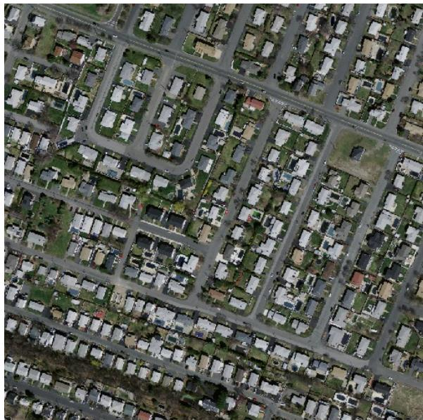  
(a)

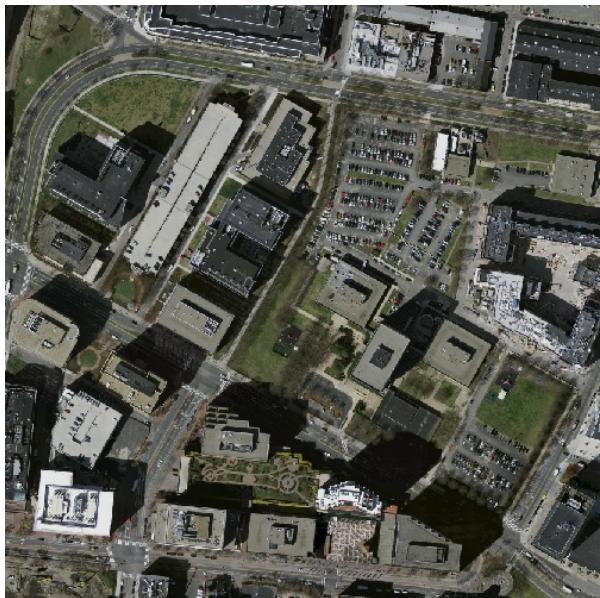  
(b)

  
(c)

  
(d)  
Figure 6.1: Figures 6.1(a) and 6.1(b) show two representative regions from the Massachusetts Buildings dataset. Figures 6.1(c) and 6.1(d) show predictions of a postprocessing network on these regions. Green pixels are true positives, red pixels are false positives, blue pixels are false negatives, and background pixels are true negatives.

## 6.3 Buffalo Roads Dataset

The Buffalo Roads dataset differs substantially from the other two datasets presented in this chapter because it is primarily meant to be used as an additional test set for the Massachusetts Roads dataset. Our aim was to construct a test set that was collected in a different area and under different conditions from the Massachusetts Roads dataset.

  
(a)

  
(b)

  
(c)

  
(d)  
Figure 6.2: Figures 6.2(a) and 6.2(b) show two representative regions from the Massachusetts Roads dataset. Figures 6.2(c) and 6.2(d) show predictions of a postprocessing network on these regions.

The dataset consists of 30 aerial images of the city of Buffalo with each image being $6 0 9 \times 9 1 4$ pixels at a resolution of one pixel per square meter. The dataset was randomly split into a training set of 5 images, a validation set of 5 images and a test set of 20 images. Since the training set is so small it is unlikely that it can be used to learn a good road detector and hence it is mostly available for the purposes of adapting models trained on the Massachusetts data to the Buffalo dataset. As with the Massachusetts Roads dataset, the target maps were generated by rasterizing road centerlines obtained from the OpenStreetMap project with a line thickness of 7 pixels.

The dataset includes a wide variety of roads from both urban and suburban areas, including significant amounts of occlusion from trees. Figures $6 . 3 ( \mathrm { a } )$ and 6.3(b) show two representative regions from the Buffalo Roads dataset. The conditions under which the Buffalo Roads dataset was collected are clearly significantly different from those of the Massachusetts Roads dataset, suggesting that training a model on the later while evaluating it on the former may be a challenging task.

## 6.4 Results

## 6.4.1 Massachusetts Datasets

The main model we evaluated on the Massachusetts datasets is a large convolutional neural network. The input to the model is a 64 by 64 aerial image patch. The first hidden layer is a convolution layer with $6 4 ~ 1 6 \times 1 6$ filters with stride 4. It is followed by $2 \times 2$ max pooling with stride 1. The second hidden layer is also convolutional with 112 filters of size $4 \times 4$ with stride 1, followed by a third convolutional layer with 80 filters of size $3 \times 3$ with stride 1. The fourth, and final, hidden layer is a fully connected layer with 4096 hidden units. All four hidden layers consist of rectified linear units. As before, the output layer is a fully-connected layer of 256 logistic units.

The neural network was trained using stochastic gradient descent with minibatches of size 128 using the hyper-parameter values described in Chapter 3. Additionally, after every $2 ^ { 2 0 }$ training cases, we multiplied the learning rate by 0.95. Training stopped after $2 ^ { 2 5 }$ cases had been processed.

We evaluated two other methods in addition to the plain neural network – a CRF initialized with the neural network weights, and a post-processing network trained on the outputs of the base neural network. We did not tune the value of the CRF's pairwise interaction term α and simply used the value -1.2 because it worked well on the GTA Buildings dataset. The post-processing neural network had one fullyconnected hidden layer with 4096 rectified linear units.

  
(a)

  
(b)

  
(c)

  
(d)  
Figure 6.3: Figures 6.3(a) and 6.3(b) show two representative regions from the Massachusetts Buildings dataset. Figures 6.3(c) and 6.3(d) show predictions of a postprocessing network on these regions.

<table><tr><td rowspan="2">Model</td><td colspan="2">Dataset</td></tr><tr><td>Mass. Roads</td><td>Mass. Buildings</td></tr><tr><td>Neural net</td><td>0.8873</td><td>0.9150</td></tr><tr><td>CRF</td><td>0.8904</td><td>0.9211</td></tr><tr><td>Post-processing net</td><td>0.9006</td><td>0.9203</td></tr></table>

Table 6.1: Precision-recall breakeven points for different models on the Massachusetts datasets.

Table 6.1 shows the precision-recall breakeven points on the Massachusetts datasets for the three models described above. We see that there is a relatively small improvement from using a CRF on both datasets and that post-processing neural networks outperform CRFs on road data. It is surprising that the improvement obtained by structured models on the building data is quite small compared to the improvement obtained on the GTA Buildings dataset. The main difference between the datasets is that the Massachusetts Buildings dataset is dominated by individual houses while the GTA Buildings dataset consists almost entirely of larger buildings. It is possible that the gain from structured prediction on the Massachusetts data is smaller because structure is not as important for detecting small objects such as houses.

To get a better idea of how well these models work, we include visualizations of predictions of the post-processing networks on test data from both datasets. Figures 6.1(c) and 6.1(d) show predictions of the post-processing neural network trained on the building data for the regions shown in Figures 6.1(a) and 6.1(b). The network is very good at detecting individual houses but does less well on larger buildings. This is not entirely surprising because there is significantly more variation in the appearance of large buildings and the model saw fewer of them during training Figures 6.2(c) and 6.2(d) show predictions of the post-processing neural network trained on the Massachusetts Roads dataset. As these results show, the model is very good at detecting roads in a variety of settings and even under significant occlusions by trees.

## 6.4.2 Buffalo Roads Dataset

The Buffalo Roads dataset was constructed in order to evaluate how well models trained on the Massachusetts Roads dataset generalize to substantially different conditions. Table 6.2 shows the precision-recall breakeven points for a number of different models on the Buffalo Roads test set. NN Mass corresponds to the big convolutional neural network trained on the Massachusetts data and this model clearly works poorly on the Buffalo data. NN Buffalo corresponds to the same convolutional architecture, but trained on the small Buffalo Roads training set. While this model works surprisingly well given that it was trained on less than 3 square kilometers of imagery, it still achieves a breakeven point of just 0.7960.

Comparing images from the Massachusetts (Figures 6.2(a) and 6.2(b)) and Buffalo (Figures 6.3(a) and6.3(b)) datasets suggests that the main difference may be in the distribution of colours and that the structure of the roads may be largely the same. Using this hypothesis as motivation we evaluated several ways of adapting the network trained on Massachusetts data to Buffalo data using the small training set.

One straightforward way of compensating for the difference in colour distribution between the datasets is by transforming the Buffalo data to have the same colour histogram as the Massachusetts data. The third model from Table 6.2 corresponds to running the NN Mass model on colour corrected Buffalo data. This simple strategy requires only unlabeled data and turns out to be reasonably effective, as it boosts the breakeven-point from 0.5613 to 0.8099. The other strategy for adapting the NN Mass model to the Buffalo data involves using the small training set to finetune the weights of the model. We started with the weights of NN Mass, trained it on the Buffalo Roads training set for 128 epochs using a learning rate of 10−4, and saved the weights that gave the highest log likelihood on the Buffalo Roads validation set. Using the training set to finetune the weights in this manner improved the breakeven point of the NN Mass model to 0.8785. While this number is comparable to the breakeven point of the NN Mass model on the Massachusetts test set it does not mean that the model works equally well on Buffalo data. In fact, we find that the Buffalo test set appears to be easier than the Massachusetts test set, explaining the comparable performance. Nevertheless, these results show that a model trained under one set of conditions can be adapted to a new dataset using a small amount of labeled training data.

The last model we evaluated on the Buffalo dataset is a post-processing neural network trained on Massachusetts. We applied it to the outputs of the finetuned NN Mass model and achieved a breakeven point of 0.8918 on the Buffalo test set. This shows that post-processing networks do not necessarily have to be retrained for each new dataset as long as the target object class is the same. Figures 6.3(c) and 6.3(d)

<table><tr><td>Model</td><td>Breakeven point</td></tr><tr><td>NN Mass.</td><td>0.5613</td></tr><tr><td>NN Buffalo</td><td>0.7960</td></tr><tr><td>NN Mass. + histogram matching</td><td>0.8099</td></tr><tr><td>NN Mass. + finetuning</td><td>0.8785</td></tr><tr><td>NN Mass. + finetuning + post-processing</td><td>0.8918</td></tr></table>

Table 6.2: Precision-recall values on the Buffalo Roads test.  
show the predictions of this-post processing network on parts of the Buffalo Roads test set.

## Chapter 7

## Conclusions and Future Work

This thesis presented a complete framework for learning to label aerial imagery, advancing the state of the art in both the difficulty of the tasks considered and the quality of the predictions. Our framework addressed what we see as the three central issues in learning from aerial imagery – learning of discriminative features, learning from noisy data, and doing structured prediction.

In Chapter 3, we showed that neural networks trained on large amounts of labeled images using modern GPUs produced good performance on challenging real world road and building detection datasets. We also showed that deep neural networks produced much more accurate predictions than shallow networks. In particular, we found that deep convolutional neural networks with small amounts of maximum pooling were particularly effective on aerial image labeling tasks.

Our introduction of noise models for dealing with omission and registration noise in Chapter 4 is, to the best of our knowledge, the first attempt to address the problem of noisy labels in aerial imagery. It is also, along with the work of Jain [Jain et al. 2010] the first work to directly address the issue of noise in pixel labeling tasks. While our ABN and TABN noise models introduce some level of robustness to two types of label noise, we also looked at how noise in the training data affects a system trained on this data. By using synthetic omission noise, we found that, somewhat surprisingly, a neural network trained on a road detection dataset with as much as 40% of the road labels deleted still performed quite well. Hence, label noise has a negative but relatively small effect on neural networks.

Chapter 5 showed that the quality of the predictions can be further improved using two complementary ways of incorporating structure into the predictions of our system. Post-processing neural networks learn to improve the predictions of a base predictor using our patch-framework from Chapter 3. By reusing the existing framework, post-processing neural networks are able to handle massive datasets using our GPU-based implementation and are capable of learning complex features of the input predictions. We also showed that adding direct, image-dependent dependencies between the outputs of a neural network, turning it into a CRF, improves the predictions by encouraging smoothness between neighbouring labels, a property of the data that is not easily learned by post-processing neural networks. While training such models can be troublesome, we showed that most of the benefit can be obtained by training the neural network separately before using its weights to initialize a CRF.

Finally, we introduced the first large-scale publicly available datasets for both road and building detection along with benchmarks that others can compare to. In both datasets, the regions used for testing are both much larger and more varied than any aerial image labeling dataset, both public or private, that we are aware of. We believe that the availability of large and realistic datasets for aerial image labeling has the potential to significantly advance the area. In particular, we hope that these datasets will stimulate interest among computer vision and machine learning researchers.

While there are many possible directions for improving our system, it is important to consider which ones will lead to the biggest gain in the quality of predictions. Despite the significant gains obtained by incorporating structured prediction into our system in Chapter 5, it is clear that neural network design choices such as using several layers instead of one and convolutions instead of locally connected units lead to the biggest gains in our thesis. For this reason we believe that putting more effort into finding a good neural network architecture is likely to lead to further significant gains. As we mentioned earlier, one way of improving the architecture is by doing a better hyper-parameter search using Bayesian optimization techniques [Snoek et al., 2012]. The recently introduced stochastic pooling [Zeiler and Fergus, 2013] has been shown to work much better than the max pooling operation we use and should be explored within our system.

In addition to finding a good neural network architecture, it is also important to have a good procedure for fitting it to the data. While we have shown that stochastic gradient descent on the negative log likelihood works well, we believe that exploring better loss functions is likely to lead to big improvements in the predictions. For example, the area under the precision-recall curve is a better measure of the quality of the predictions for road and building detection than log likelihood, hence directly maximizing the area under the curve is almost certainly a better approach. Furthermore, due to the fact that even our largest models do not seem to suffer from serious overfitting problems, we believe that exploring better optimization methods is a promising direction.

Beyond improving the architecture and training procedure of the neural network, improving the structured prediction aspect of the model is also likely to lead to significant improvements. The fully connected CRF model recently introduced by Krähenbühl and Koltun [2011] has significantly improved the state-of-the-art in image labeling and is likely to work well on aerial imagery. One interesting question relating to these types of models is whether their performance could be improved by jointly training all parameters using the model likelihood. We had limited success with finetuning the unary potentials of our CRFs using the CRF likelihood, which could simply be the result of using a poor approximate learning procedure. Still, we believe that an end-to-end training procedure is preferable to one in which components are learned separately.

Another important aspect of the overall system design is what data it is trained on, which is equivalent to an underlying assumption about what type of data the system is expected to work on. We have focused on improving performance on several large and realistic aerial image labeling datasets, the most diverse of which covered different parts of the state of Massachusetts. Our success on such datasets suggests that given enough aerial imagery of a geographic area of limited size it is possible to learn a good road or building detector for this area. Ultimately, the goal of the field is probably to build a system that works well for imagery taken from any part of the world under any reasonable conditions. While we showed some success with training on one region while testing on another one and with adapting an existing system to a new region using a small amount of labeled data, building a single good detector probably requires even more varied datasets that cover all distinct regions of the world. Unfortunately, at this point, freely available high resolution imagery is generally limited to parts of Europe and North America.

Furthermore, being able to label pixels of an aerial image with semantic classes is not the ultimate goal of aerial image interpretation but merely a useful abstraction of the underlying problems. To make our system truly useful it must be incorporated into a Geographic Information System (GIS). Two possible use cases for a pixel labeling system in a GIS environment are map updating and automatic object extraction. In the case of map updating, an existing, possibly outdated map needs to be updated based on recent aerial imagery. While maps are usually stored in vector form and our system produces raster images as its predictions, comparing a vector map and a raster predicted map should be relatively straightforward. By looking for parts of the predicted map that significantly disagree with the reference vector map, our system could be used to automatically find regions that need updating. We believe that the quality of the predictions of our system on the Massachusetts Roads data is already sufficient to make it useful in an updating setting.

Finally, we believe that our system could also be used to facilitate automatic extraction of objects from aerial imagery. In the case of roads, this requires extracting vector representations of road centerlines from predicted raster maps. We have experimented with the automatic line extraction algorithm of Steger [1998] and found that it works well when applied to predicted road maps produced by our system. It is interesting that this algorithm was originally applied to extracting roads directly from aerial imagery, but it works substantially better when applied to the output of our system. This suggests that previous work on finding roads by applying active contour models directly to aerial images can be revisited using our predicted maps as input. The combination of strong topological constraints enforced by such models with a data association potential produced by our system could be especially powerful. In the case of buildings, we can already extract their locations by finding the centres of mass of connected components of predicted building pixels. Extracting complete building footprints would likely require training on even higher resolution input data, but could probably be done using existing polygon extraction algorithms. Again, we see the possibility of using the outputs of our system as a powerful data association term in existing building detection methods that use strong topological constraints.

## Bibliography

Ruzena Bajcsy and Mohamad Tavakoli. Computer recognition of roads from satellite pictures. IEEE Transactions on Systems, Man, and Cybernetics, 6(9):623–637, September 1976.

E. P. Baltsavias. Object extraction and revision by image analysis using existing geodata and knowledge: current status and steps towards operational systems. ISPRS Journal of Photogrammetry and Remote Sensing, 58(3-4):129–151, January 2004.

Jon A Benediktsson, Philip H Swain, and Okan K Ersoy. Neural network approaches versus statistical methods in classification of multisource remote sensing data. IEEE Transactions on Geoscience and Remote Sensing, 28(4):540–552, 1990

James S. Bergstra, Rmi Bardenet, Yoshua Bengio, and Balzs Kgl. Algorithms for hyper-parameter optimization. In J. Shawe-Taylor, R.S. Zemel, P. Bartlett, F.C.N. Pereira, and K.Q. Weinberger, editors, Advances in Neural Information Processing Systems 24, pages 2546–2554. 2011.

H. Bischof, W. Schneider, and A. J. Pinz. Multispectral classification of landsat images using neural networks. IEEE Transaction on Geoscience and Remote Sensing, 30(3):482–490, 1993.

Christopher M. Bishop. Pattern Recognition and Machine Learning. Springer-Verlag New York, Inc., Secaucus, NJ, USA, 2006. ISBN 0387310738.

Julian E. Boggess. Identification of roads in satellite imagery using artificial neural networks: A contextual approach. Technical report, Mississippi State University, 1993.

L. Bruzzone and D.F. Prieto. Automatic analysis of the difference image for unsupervised change detection. Geoscience and Remote Sensing, IEEE Transactions on, 38(3):1171–1182, 2000.

Adam Coates, Andrew Y. Ng, and Honglak Lee. An analysis of single-layer networks in unsupervised feature learning. Journal of Machine Learning Research - Proceedings Track, 15:215–223, 2011.

George E. Dahl, Marc'Aurelio Ranzato, Abdel-rahman Mohamed, and Geoffrey E. Hinton. Phone recognition with the mean-covariance restricted Boltzmann machine. In J. Lafferty, C. K. I. Williams, J. Shawe-Taylor, R.S. Zemel, and A. Culotta, editors, Advances in Neural Information Processing Systems 23, pages 469– 477. 2010.

S.E. Decatur. Application of neural networks to terrain classification. In International Joint Conference on Neural Networks, volume 1, pages 283–288, June 1989.

Piotr Dollar, Zhuowen Tu, and Serge Belongie. Supervised learning of edges and object boundaries. In Proceedings of the 2006 IEEE Computer Society Conference on Computer Vision and Pattern Recognition, pages 1964–1971, 2006.

C. Farabet, C. Couprie, L. Najman, and Y. LeCun. Scene parsing with multiscale feature learning, purity trees, and optimal covers. arXiv preprint arXiv:1202.2160, 2012.

S. Gould, J. Rodgers, D. Cohen, G. Elidan, and D. Koller. Multi-class segmentation with relative location prior. International Journal of Computer Vision, 80(3):300– 316, 2008.

D. M. Greig, B. T. Porteous, and A. H. Seheult. Exact maximum a posteriori estimation for binary images. Journal of the Royal Statistical Society. Series B (Methodological), 51(2):271–279, 1989.

R. Haralick. Automatic remote sensor image processing. Digital Picture Analysis, pages 5–63, 1976.

Robert M. Haralick, K. Shanmugam, and Its'Hak Dinstein. Textural Features for Image Classification. IEEE Transactions on Systems, Man, and Cybernetics, 3(6): 610–621, November 1973.

Xuming He, Richard S. Zemel, and Miguel Á. Carreira-Perpiñán. Multiscale conditional random fields for image labeling. In CVPR '04: Proceedings of the 2004 IEEE Computer Society Conference on Computer Vision and Pattern Recognition, pages 695–702, 2004.

Xuming He, R Zemel, and Deb Ray. Learning and incorporating top-down cues in image segmentation. In European Conference on Computer Vision, 2006.

Geoffrey Hinton. Training products of experts by minimizing contrastive divergence. Neural Computation, 14(8):1771–1800, 2002.

C. Huang, L. S. Davis, and J. R. G. Townshend. An assessment of support vector machines for land cover classification. International Journal of Remote Sensing, 23 (4):725–749, 2002.

Xin Huang and Liangpei Zhang. Road centreline extraction from high-resolution imagery based on multiscale structural features and support vector machines. International Journal of Remote Sensing, 30(8):1977–1987, 2009.

J. M. Idelsohn. A learning system for terrain recognition. Pattern Recognition, 2(4): 293–296, 1970.

Viren Jain, Benjamin Bollmann, Mark Richardson, Daniel R. Berger, Moritz Helmstaedter, Kevin L. Briggman, Winfried Denk, Jared B. Bowden, John M. Mendenhall, Wickliffe C. Abraham, Kristen M. Harris, N. Kasthuri, Ken J. Hayworth, Richard Schalek, Juan Carlos Tapia, Jeff W. Lichtman, and H. Sebastian Seung. Boundary learning by optimization with topological constraints. In The Twenty-Third IEEE Conference on Computer Vision and Pattern Recognition, pages 2488– 2495. IEEE, 2010. doi: http://dx.doi.org/10.1109/CVPR.2010.5539950.

Jeremy Jancsary, Sebastian Nowozin, Toby Sharp, and Carsten Rother. Regression tree fields - an efficient, non-parametric approach to image labeling problems. In CVPR, pages 2376–2383, 2012.

Kevin Jarrett, Koray Kavukcuoglu, Marc'Aurelio Ranzato, and Yann LeCun. What is the best multi-stage architecture for object recognition? In Proc. International Conference on Computer Vision (ICCV'09). IEEE, 2009.

David M. McKeown Jr., Wilson A. Harvey, and John P. McDermott. Rule-based interpretation of aerial imagery. IEEE Trans. Pattern Anal. Mach. Intell., 7(5): 570–585, 1985.

R. L. Kettig and D. A. Landgrebe. Classification of multispectral image data by extraction and classification of homogeneous objects. IEEE Transactions on Geoscience Electronics, 14:19–26, 1976.

Stefan Kluckner and Horst Bischof. Semantic classification by covariance descriptors within a randomized forest. In Computer Vision Workshops (ICCV), pages 665- 672. IEEE, 2009.

Stefan Kluckner, Thomas Mauthner, Peter M. Roth, and Horst Bischof. Semantic classification in aerial imagery by integrating appearance and height information. In ACCV, volume 5995 of Lecture Notes in Computer Science, pages 477–488. Springer, 2009.

Pushmeet Kohli, Lubor Ladický, and Philip H. S. Torr. Robust Higher Order Potentials for Enforcing Label Consistency. International Journal of Computer Vision, 82(3):302–324, January 2009.

Philipp Krähenbühl and Vladlen Koltun. Efficient inference in fully connected crfs with gaussian edge potentials. In J. Shawe-Taylor, R.S. Zemel, P. Bartlett, F.C.N. Pereira, and K.Q. Weinberger, editors, Advances in Neural Information Processing Systems 24, pages 109–117. 2011.

Alex Krizhevsky. Convolutional deep belief networks on cifar-10. Technical report, University of Toronto, 2011.

S. Lazebnik, C. Schmid, and J. Ponce. Beyond Bags of Features: Spatial Pyramid Matching for Recognizing Natural Scene Categories. Computer Vision and Pattern Recognition, 2:2169–2178, 2006.

Y LeCun, FJ Huang, and Leon Bottou. Learning methods for generic object recognition with invariance to pose and lighting. In Computer Vision and Pattern Recognition, 2004.

Jonathan Lee, Ronald C. Weger, Sailes K. Sengupta, and Ronald M. Welch. A Neural Network Approach to Cloud Classification. IEEE Transactions on Geoscience and Remote Sensing, 28:846–855, September 1990.

Helmut Mayer. Object extraction in photogrammetric computer vision. ISPRS Journal of Photogrammetry and Remote Sensing, 63(2):213–222, March 2008.

Volodymyr Mnih and Geoffrey Hinton. Learning to detect roads in high-resolution aerial images. In Proceedings of the 11th European Conference on Computer Vision (ECCV), September 2010.

Volodymyr Mnih and Geoffrey Hinton. Learning to label aerial images from noisy data. In Andrew McCallum and Sam Roweis, editors, Proceedings of the 29th Annual International Conference on Machine Learning (ICML 2012), June 2012.

Volodymyr Mnih, Hugo Larochelle, and Geoffrey Hinton. Conditional restricted boltzmann machines for structured output prediction. In Proceedings of the International Conference on Uncertainty in Artificial Intelligence, 2011.

J.W. Modestino and J. Zhang. A Markov random field model-based approach to image interpretation. In Computer Vision and Pattern Recognition, 1989. Proceedings CVPR'89., IEEE Computer Society Conference on, pages 458–465. IEEE, 1989.

Vinod Nair and Geoffrey E. Hinton. Rectified linear units improve restricted boltzmann machines. In ICML, pages 807–814, 2010.

T. Nguyen, Stefan Kluckner, Horst Bischof, and Franz Leberl. Aerial Photo Building Classification by Stacking Appearance and Elevation Measurements. In In: Proceedings ISPRS, 100 Years ISPRS-Advancing Remote Sensing Science, on CD-ROM, 2010.

Thuy Thi Nguyen, Helmut Grabner, Horst Bischof, and Barbara Gruber. On-line Boosting for Car Detection from Aerial Images. In 2007 IEEE International Conference on Research, Innovation and Vision for the Future, pages 87–95. IEEE, March 2007.

J Niemeyer, C. Mallet, F Rottensteiner, and U Sörgel. Conditional Random Fields for the Classification of LiDAR Point Clouds. International Archives of Photogrammetry and Remote Sensing, 38:4, 2008.

J.D. Paola and R.A. Schowengerdt. A detailed comparison of backpropagation neural network and maximum-likelihood classifiers for urban land use classification Geoscience and Remote Sensing, IEEE Transactions on, 33(4):981–996, jul 1995.

Jake Porway, Kristy Wang, Benjamin Yao, and Song Chun Zhu. A hierarchical and contextual model for aerial image understanding. In Computer Vision and Pattern Recognition, IEEE Computer Society Conference on, 2008.

Roberto Rigamonti, Engin Turetken, German Gonzalez, and Pascal Fua. Filter Learning for Linear Structure. Technical report, Swiss Federal Institute of Technology, Lausanne (EPFL), 2011.

Pierre Sermanet, Soumith Chintala, and Yann LeCun. Convolutional neural networks applied to house numbers digit classification. In Proceedings of International Conference on Pattern Recognition (ICPR’12), 2012.

Jamie Shotton, Matthew Johnson, and R. Cipolla. Semantic texton forests for image categorization and segmentation. In Computer Vision and Pattern Recognition, 2008. IEEE Conference on, pages 1–8. IEEE, 2008.

Jasper Snoek, Hugo Larochelle, and Ryan Prescott Adams. Practical bayesian optimization of machine learning algorithms. In Neural Information Processing Systems, 2012.

Xiaomu Song, Guoliang Fan, and Mahesh Rao. Automatic CRP Mapping Using Machine Learning Approaches. IEEE Transactions on Geoscience and Remote Sensing, 43(4):888–897, 2005.

Carsten Steger. An unbiased detector of curvilinear structures. Pattern Analysis and Machine Intelligence, IEEE Transactions on, 20(2):113 –125, feb 1998. ISSN 0162-8828. doi: 10.1109/34.659930.

R.H. Swendsen and J.S. Wang. Nonuniversal critical dynamics in monte carlo simulations. Physical Review Letters, 58(2):86, 1987.

Srinivas Turaga, Kevin Briggman, Moritz Helmstaedter, Winfried Denk, and Sebastian Seung. Maximin affinity learning of image segmentation. In Y. Bengio, D. Schuurmans, J. Lafferty, C. K. I. Williams, and A. Culotta, editors, Advances in Neural Information Processing Systems 22, pages 1865–1873. 2009.

P. Viola and M. Jones. Rapid object detection using a boosted cascade of simple features. In Computer Vision and Pattern Recognition, 2001. CVPR 2001. Proceedings of the 2001 IEEE Computer Society Conference on, volume 1, pages I–511. IEEE, 2001.

Christian Wiedemann, Christian Heipke, Helmut Mayer, and Olivier Jamet. Empirical evaluation of automatically extracted road axes. In Empirical Evaluation Techniques in Computer Vision, pages 172–187, 1998.

M. D. Zeiler and R. Fergus. Stochastic Pooling for Regularization of Deep Convolutional Neural Networks. ArXiv e-prints, January 2013.

Ping Zhong and Runsheng Wang. Using combination of statistical models and multilevel structural information for detecting urban areas from a single gray-level image. Geoscience and Remote Sensing, IEEE Transactions on, 45(5):1469–1482, 2007.