Article

# Automatic Segmentation of Coronary Arteries in X-ray Angiograms using Multiscale Analysis and Artificial Neural Networks

Fernando Cervantes-Sanchez, Ivan Cruz-Aceves, Arturo Hernandez-Aguirre, Martha Alicia Hernandez-Gonzalez and Sergio Eduardo Solorio-Meza

Special Issue

Signal Processing and Machine Learning for Biomedical Data

Edited by Prof. Dr. Giuseppe Raso and Prof. Dr. Donato Cascio

Article

# Automatic Segmentation of Coronary Arteries in X-ray Angiograms using Multiscale Analysis and Artificial Neural Networks

Fernando Cervantes-Sanchez 1①, Ivan Cruz-Aceves 2,\*①, Arturo Hernandez-Aguirre 1, Martha Alicia Hernandez-Gonzalez ³ and Sergio Eduardo Solorio-Meza 4

1 Centro de Investigación en Matemáticas, A.C. (CIMAT), Guanajuato 36023, Gto, Mexico; fernando.cervantes@cimat.mx (F.C.-S.); artha@cimat.mx (A.H.-A.)

2 CONACYT-Centro de Investigación en Matemáticas, A.C. (CIMAT), Guanajuato 36023, Gto., Mexico

3 Unidad Médica de Alta Especialidad (UMAE)-Hospital de Especialidades No.1. Centro Médico Nacional del Bajio, IMSS, CP. León 37320, Guanajuato, Mexico; martha.hernandezg@imss.gob.mx

4 Department of Health Sciences, Universidad Tecnológica de México (UNITEC) Campus León, León 37200, Gto., Mexico; s.solorio64@gmail.com

\* Correspondence: ivan.cruz@cimat.mx

Received: 22 October 2019; Accepted: 10 December 2019; Published: 14 December 2019

Abstract: This paper presents a novel method for the automatic segmentation of coronary arteries in X-ray angiograms, based on multiscale analysis and neural networks. The multiscale analysis is performed by using Gaussian filters in the spatial domain and Gabor filters in the frequency domain, which are used as inputs by a multilayer perceptron (MLP) for the enhancement of vessel-like structures. The optimal design of the MLP is selected following a statistical comparative analysis, using a training set of 100 angiograms, and the area under the ROC curve $( A _ { z } )$ for assessment of the detection performance. The detection results of the proposed method are compared with eleven state-of-the-art blood vessel enhancement methods, obtaining the highest performance of $A _ { z } = 0 . 9 7 7 5$ , with a test set of 30 angiograms. The database of 130 X-ray coronary angiograms has been outlined by a specialist and approved by a medical ethics committee. On the other hand, the vessel extraction technique was selected from fourteen binary classification algorithms applied to the multiscale filter response. Finally, the proposed segmentation method is compared with twelve state-of-the-art vessel segmentation methods in terms of six binary evaluation metrics, where the proposed method provided the most accurate coronary arteries segmentation with a classification rate of 0.9698 and Dice coefficient of 0.6857, using the test set of angiograms. In addition to the experimental results, the performance in the detection and segmentation steps of the proposed method have also shown that it can be highly suitable for systems that perform computer-aided diagnosis in X-ray imaging.

Keywords: automatic segmentation; coronary arteries; medical imaging; multiscale Gabor filters; Multiscale Gaussian Filters; multilayer perceptron

## 1. Introduction

The task of automatic segmentation of coronary arteries in X-ray angiograms can be integrated in a computer-aided diagnosis system (CAD) to support the analysis of coronary heart disease. In cardiology, the X-ray coronary angiogram is the gold standard employed to evaluate and monitor abnormalities of the coronary arteries. However, the detection of blood vessels in coronary angiograms is a challenging task for the current CAD systems. The most common problems that are present in coronary angiograms involve the non-uniform illumination, weak contrast between arterial features and image background, and occlusion caused by different organs or medical devices in the acquired images.

In the literature, the challenge of automatic detection of blood vessels has been widely addressed by different methods. A common approach is the use of operators and transformations from the mathematical morphology framework. The most used strategy to enhance vessel-like structures is the Top-hat operator, which was applied by Eiho and Qian [1] in coronary angiograms. The Top-hat response is combined with an interactive procedure to segment the main artery using another morphological operator. Later, a multiscale approach composed for the Top-hat filter responses of a number of structuring elements at different size was proposed by Qian et al. [2]. This method allows the automatic detection of vessels with different diameters in a single medical image.

Other common methodology is based on the information of the Hessian matrix of the medical image. In this approach, the gradient of an image is defined as the convolution of itself and the first order derivative of a Gaussian curve. Consequently, the Hessian matrix of the image is the second order derivative of a Gaussian curve convolved with the image. Frangi et al. [3] proposed the enhancement of tubular structures, such is the case of blood vessels, by using a vesselness measure defined from the eigenvalues of the Hessian matrix. For the particular problem of detection of coronary arteries in X-ray angiograms, multiple vesselness measures have been recently proposed. Wang et al. [4] used the eigenvalues of the Hessian matrix to construct a vessel probability map; in a similar manner, Li et al. [5] proposed the generation of a vessel feature map also from the Hessian matrix using a different vesselness measure. These two works use the vessel map as starting point for a region growing method to segment the coronary artery tree.

On the other hand, methods based on matching templates have considered the shape of a blood vessel in the spatial domain to propose a suitable model. Chaudhuri et al. [6] introduced a two dimensional Gaussian Matched Filter (GMF) for the enhancement of blood vessels in retinal fundus images. GMF is founded under the fact that in the spatial domain the cross-section of a blood vessel is Gaussian shaped. In addition, GMF assumes that vessels can be modeled in segments that share the same orientation and diameter. To detect vessel segments at different orientations, a directional filter bank is built by rotating the GMF template into a number of evenly spaced directions in the range $\left[ - \pi / 2 , \pi / 2 \right]$ to be later convolved with the input image. Methods based on the GMF have modified the parameters that govern the shape of the matching template and the number of orientations. Most of them have selected the parameters empirically, such is the case of the method proposed by Cinsdikici and Aydın [7], where the number of directional templates is increased in order to improve the detection performance. In the method proposed by Kang et al. [8], the parameters were empirically modified to allow the detection of arteries in coronary angiograms. Moreover, some methods have addressed the selection of the parameters by a training step prior to its application. A first approach is the proposed by Al-Rawi et al. [9], where a full-search of the parameters was employed. Later, Al-Rawi and Karajeh [10] proposed a method from the Evolutionary Computation algorithms (EC) to reduce the computational time consumed by the exhaustive search. More recently, Cruz et al. [11] performed a study to determine the most suitable EC method for the automatic selection of parameters for the GMF applied to the coronary artery segmentation problem.

An alternative to the analysis of the image in the spatial domain is the use of Gabor filters in the frequency domain. Gabor filters for blood vessel enhancement in medical images was proposed by Soares et al. [12] based on its capability of detecting oriented features. Similarly to GMF, Gabor filters can be rotated into different directions in order to detect vessel-like structures in multiple orientations. An important modification to the Gabor filter was proposed by Rangayyan et al. [13], where a simplified definition of the filter is presented, in addition to the use of only the real part of the filter, discarding the imaginary part which is commonly used to detect edge features. For Gabor filters, recent methods have been proposed to select the most appropriate parameters for the detection of blood vessels in image data. The method proposed by Rangayyan et al. [13,14] performs a full-search for the parameters of elongation, average width, and number of oriented filters before selecting the most suitable values for the detection of blood vessels in retinal fundus images. Later, Cervantes et al. [15] proposed the use of a Boltzmann based EC algorithm for the automatic selection of the Gabor filter parameters for the coronary artery segmentation problem.

Considering that the filter responses obtained by the blood vessel detection methods can be treated as multilevel classifiers, the Receiver Operating Characteristic curve analysis (ROC) has been frequently used to evaluate and compare their vessel detection efficiency.

Gabor filters have shown the best detection performance in coronary arteries compared to the state-of-the-art approaches [15,16], followed in efficiency by the Gaussian matched filters [11]. Because these two methods have obtained superior performance to carry out the automatic detection of blood vessels in medical images, in this work they are thoroughly studied. However, it is important to point out that coronary arteries present a natural variant thickness along their span; consequently, a multiscale approach is convenient in order to enhance vessel-like structures properly.

In this paper a novel method that uses the multiscale filter responses of the GMF and Gabor filters to improve the detection of coronary arteries in X-ray angiograms is presented. The proposed method addresses the limitation that single-scale versions of the GMF and Gabor filters present when enhancing vessel-like structures of a unique thickness at a time. In the method, a multilayer perceptron network (MLP) is fed with the multiscale filter responses of the GMF and Gabor filters methods in order to obtain an improved detection response using information from the spatial and frequency domains of the X-ray image.

In addition, to select the optimal MLP configuration for detecting coronary arteries, a hypothesis test for stochastic domination between multiple possible architectures has been performed. To evaluate the detection step of the proposed method, eleven methods for blood vessel enhancement are compared with the proposed method in terms of the area under the ROC curve. Finally, in the segmentation step of the proposed method, twelve specialized blood vessel segmentation methods are used for comparative analysis in terms of six binary classification metrics.

The organization of this paper is the following. In Section 2, the basis of the Gaussian matched filters, Gabor filters and Artificial Neural Networks, along with the proposed method including multiscale analysis, are described in detail. Computational experiments including numerical and qualitative results are discussed in Section 3, and finally, the concluding remarks can be found in Section 4.

## 2. Methods

In this section, the single-scale and multiscale versions of the Gaussian matched filters and Gabor filters are described first in Sections 2.1 and 2.2. Later, an introduction to Artificial Neural Networks that are used by the proposed method to perform the multiscale analysis of the coronary angiograms is given in Section 2.3. Additionally, the proposed method and the metrics used to evaluate its detection and segmentation performance can be found in Sections 2.4 and 2.5, respectively.

## 2.1. Multiscale Gaussian Matched Filters

Gaussian matched filters were proposed for vessel enhancement in medical images of the retina [6]. The original GMF method follows the assumption that a vessel cross-section can be approximated by a single-scaled Gaussian curve. Moreover, this method considers that blood vessels can be studied as individual segments that share a similar orientation and diameter, and consequently can be detected with matching templates. In the detection process of the GMF, the vessel structures are enhanced by the convolution of the original image with a gray-scale template defined under a Gaussian distribution. After filtering, the vessel detection response shows an increased contrast between vessel-like structures and the image background. The main idea behind the GMF is supported by the single-scale Gaussian template, which is defined as follows:

$$
G M F ( x , y ) = - \exp \left( - \frac { x ^ { 2 } } { 2 \sigma ^ { 2 } } \right) \| y \| < L / 2 ,\tag{1}
$$

where $x \in \left[ - T / 2 , T / 2 \right]$ . The parameter T delimits the Gaussian curve trails and produce a filter of finite width. The value of L corresponds to the length of a vessel segment which shares the same cross-section profile and orientation. The average vessel diameter to be detected is specified by σ as the standard deviation of the Gaussian distribution. In addition, because vessel structures can be found in multiple orientations, the filter template is transformed in order to detect segments at different directions with the rotation matrix as follows:

$$
R ( \theta ) = \left[ \begin{array} { c c } { { c o s \theta } } & { { - s i n \theta } } \\ { { s i n \theta } } & { { c o s \theta } } \end{array} \right] .\tag{2}
$$

Commonly, K directions are considered by defining θ to be evenly spaced in the range $\left[ - \pi / 2 , \pi / 2 \right]$

Observing the similarity to blood vessels in the retina, the GMF method has been applied to the detection of coronary arteries in X-ray angiograms [11]. However, due to the original GMF works with a single scale of σ for the whole image, only vessels with the same diameter are correctly enhanced. This fact represents a disadvantage because coronary arteries show a natural thickness variation over their span, and ramifications of vessels with minor diameters are commonly present along the coronary artery tree. To overcome this drawback, a multiscale approach was proposed by Cruz et al. [17] to increase the vessel detection capability of the GMF method.

In order to illustrate the detection process carried out by the GMF, in Figure 1, Gaussian templates with different parameter values are presented. The variation between single-scale and multiscale filtering is the number of templates defined at different scales of σ that produce the directional filter bank, which is shown in Figure 1d,g. Each template is intended to enhance vessels of different diameters, providing a multiscale response for the same angiogram, which can be appreciated in Figure 1f,i. The multiscale analysis of the GMF presents a trade-off between the gain in vessel detection efficiency and the increment of computational cost because the high number of convolution operations.

## 2.2. Multiscale Gabor Filters

The Gabor filter is a Gaussian curve modulated by a sinusoid function which presents an anisotropic property capable of detecting directional features [18]. Soares et al. [12] proposed the use of Gabor filters for the detection of blood vessels of the retina. The Gabor wavelet is employed to detect the edges of blood vessels in the space domain by identifying singularities in the frequency domain. This method was originally proposed to work in a single scale, which increase the contrast of features that share a similar diameter and orientation. The real part of the single-scale Gabor filter can be defined as follows:

$$
G ( x , y ) = \frac { 1 } { 2 \pi \sigma _ { x } \sigma _ { y } } \exp \left[ - \frac { 1 } { 2 } \left( \frac { x ^ { 2 } } { \sigma _ { x } ^ { 2 } } + \frac { y ^ { 2 } } { \sigma _ { y } ^ { 2 } } \right) \right] \cos ( 2 \pi f _ { 0 } x ) \ ,\tag{3}
$$

where $\sigma _ { x }$ and $\sigma _ { y }$ control the standard deviation of a two dimensional Gaussian curve in the x and y axis, respectively. The value of $f _ { 0 }$ determines the frequency at which the Gaussian curve is modulated. The filter design was simplified by Rangayyan et al. [13,14] in the sense of using only two parameters to define the Gabor template. The simplification states that the spreads $\sigma _ { x }$ and $\sigma _ { y }$ can be defined as $\sigma _ { x } = \tau / 2 \sqrt { 2 \ln { 2 } }$ and $\sigma _ { y } = l \sigma _ { y }$ . In addition, the frequency $f _ { 0 }$ is set to modulate the curve under a period of τ. The reformulated Gabor filter depends only on two parameters: τ and l. The diameter of the features to be detected by the Gabor filter is controlled by τ, while l governs the elongation of a segment that shares a similar orientation. For the detection of vessel-like structures in multiple directions, the Gabor filter is rotated into k evenly spaced angles in the range of $\theta \in \left[ { - \pi / 2 , \pi / 2 } \right]$

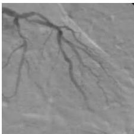  
(a)

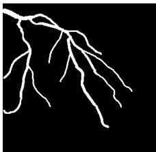  
(b)

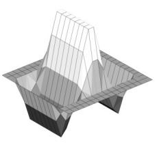

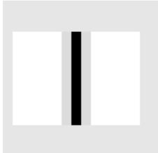  
(d)

(c)  
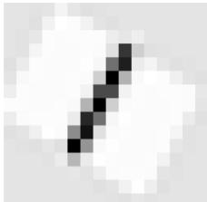

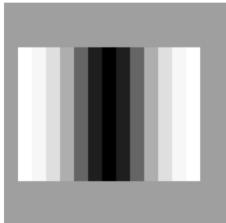  
(g)

(e)  
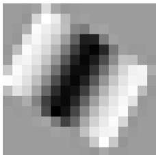  
(h)

(f)  
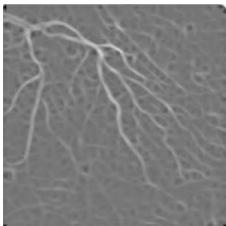  
(i)  
Figure 1. (a) An original X-ray angiogram, and (b) the corresponding ground-truth delineated by a specialist. (c) The three-dimensional plot of the GMF filter proposed by Chaudhuri et al. [6]. (d) The GMF template defined with $\sigma = 0 . 5 ,$ (e) the oriented template at $4 5 ^ { \circ }$ , and (f) the corresponding detection response. (g) The GMF template defined with $\sigma = 2 ,$ (h) the template rotated $4 5 ^ { \circ } ,$ , and (i) the corresponding detection result.

Under the same principle that the single-scale Gabor filter was proposed to detect blood vessels in the retina, this method has been successfully applied to the detection of coronary arteries in X-ray angiograms [16]. Although single-scale Gabor filters are capable of detecting the main vessels in coronary angiograms, the response obtained tends to ignore vessels of diameters lower than τ. To avoid this problem, a multiscale approach was proposed by Rangayyan et al. [14] for the detection of blood vessels in the retina, and later Cruz et al. [16] applied this method to segment coronary arteries.

In Figure 2, two templates defined with different width of the Gabor filter are presented in order to illustrate the detection process carried out by this method. The main difference between single-scale and multiscale Gabor filters is the number of templates at different width employed for the directional filter bank construction, which is illustrated in Figure $2 \mathrm { d } , \mathbf { g } .$ The variation of the filter width allows to enhance blood vessels of different diameters in the coronary angiogram, as shown in Figure $\mathrm { 2 f , i }$ The multiscale analysis with Gabor filters provides an improved vessel detection quality at expenses of increasing the computational time, which is mostly because of the number of image transformations between the spatial and frequency domains.

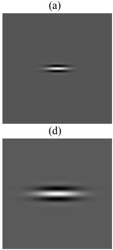  
(f)  
(e)

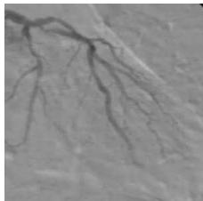

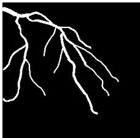

(b)  
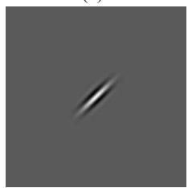

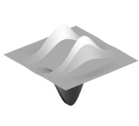  
(c)

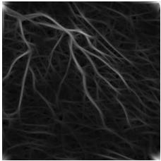

(g)  
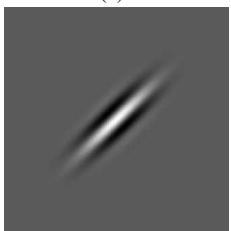  
(h)

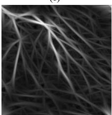  
(i)  
Figure 2. (a) An original X-ray angiogram, and (b) the corresponding ground-truth delineated by a specialist. (c) The three-dimensional plot of the single-scale Gabor filter proposed by Rangayyan et al. [13], (d) The single-scale Gabor filter template defined with $\tau = 8 ,$ (e) the oriented template at $4 5 ^ { \circ } .$ , and (f) the corresponding vessel enhancement result. (g) The single-scale Gabor filter template defined with $\tau = 1 6 ,$ (h) the template rotated 45°, and (i) the corresponding filter response.

## 2.3. Artificial Neural Networks

An Artificial Neural Network (ANN) is a machine learning technique consisting on the assembly of multiple processing units called neurons. ANN are capable of replicate the behavior of unknown functions as universal function approximators [19]. A common function to replicate by an ANN is the judgment of an expert during image labeling, which could be considered as a classification problem.

In classification problems, the prediction process of an artificial neural network could be interpreted as a sequence of projections into new feature spaces, where the linear separation of patterns represents a simpler task. In the projection sequence, each neuron performs a weighted sum of its corresponding inputs; in addition, a bias term is frequently employed to center the neuron response around a decision boundary.

In order to simulate the biological activation of the neuron, a function is applied to the resulting neuron response. The asymptotic behavior of the activation of a neuron is commonly approximated by a nonlinear step function, such as hyperbolic tangent and sigmoid functions. Moreover, differentiable activation functions are selected when gradient-based methods are used for the optimization of the artificial neural network parameters.

The operation executed by a single neuron can be expressed as

$$
N ( x , w , b ) = g \left( \sum _ { i = 1 } ^ { m } w _ { i } x _ { i } + b \right) ,\tag{4}
$$

where x is an input pattern, $w _ { i }$ is the associated weight corresponding to the i-th variable of the pattern, b is the bias corresponding to the neuron, n is the number of input features, and $g$ is a nonlinear activation function.

The classification performance of an ANN can be increased by adding more neurons to the network; however, the selection of the proper configuration represents a computational challenge given the large possible neuron arrangements. Layered configurations are a particular arrangement for the ANN neurons, where the computing units apply the same transfer function and share the input data. Moreover, layers of neurons can be connected to other layers, being the Multilayer Perceptron (MLP) illustrated in Figure 3, a frequently used model.

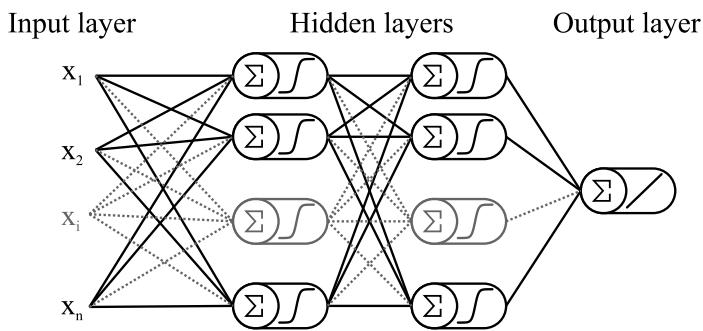  
Figure 3. Diagram of a four layered perceptron network with two hidden layers and one neuron in the output layer.

The design of a MLP network to carry out a specific task relies on the selection of the appropriate number of hidden layers, and the number of neurons that compose them. Additionally, a training stage is essential in order to find the most appropriate weight values for each neuron of the network to obtain high approximation performance.

## 2.4. Proposed Method

To enhance and segment coronary arteries in X-ray angiograms, the proposed method consists of four different steps, which are illustrated in Figure 4.

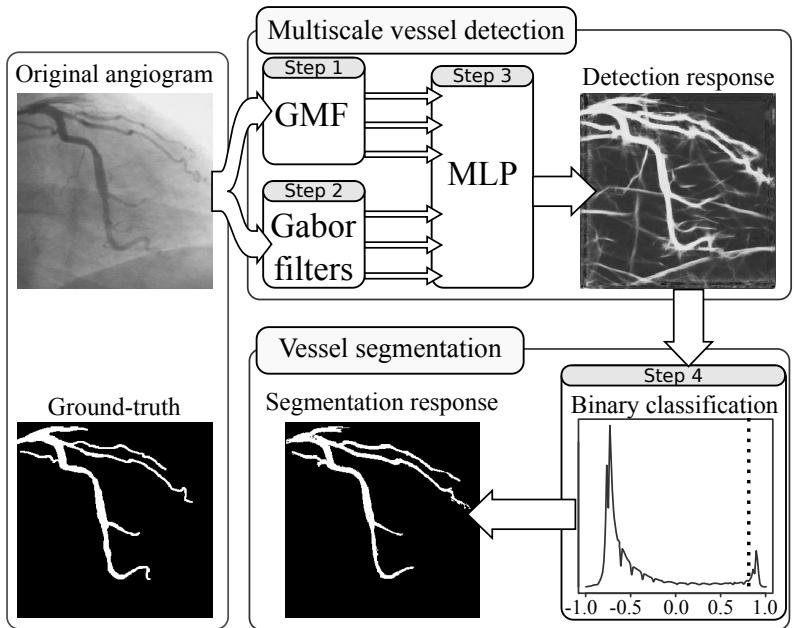  
Figure 4. Diagram of the proposed method, involving the steps of multiscale vessel detection, and coronary arteries segmentation by binary classification.

The first step enhance vessel-like structures in the original angiogram by using multiscale Gaussian matched filters. The parameters of the GMF are directly related to spatial features found in coronary angiograms, such as length, diameter, and orientation of vessel segments. In order to detect any coronary artery efficiently, the parameters of the GMF have to be selected from a search space properly defined. The combination of the parameters σ and T control the coronary arteries diameter that can be detected, for this reason the value of T is selected from the range $\left[ 8 , 9 , \ldots , 1 5 \right]$ pixels, and σ in the range $[ 1 . 5 , 1 . 6 , \ldots , 2 . 5 ]$ . The different vessel segments frequently present lengths in the range $\left[ 8 , 9 , \ldots , 1 5 \right]$ pixels, which is governed in the GMF by the parameter L. The orientation of the vessel segments is controlled by the parameter $K ,$ which is defined to cover the angular range $\left[ - \pi / 2 , \pi / 2 \right]$ and is commonly fixed to sample 12 evenly spaced orientations.

To perform the multiscale analysis in the spatial domain, only σ is varied within its corresponding search space in order to enhance blood vessels of different diameters, while T, L, and K are kept fixed. The multiscale GMF response is conformed by 11 detection response images, corresponding to the different scales of $\sigma ,$ and can be considered as a three-dimensional image of size $3 0 0 \times 3 0 0 \times 1 1$ pixels.

The second step consists of the analysis of the coronary angiograms using multiscale Gabor filters. For the simplified parameterization of Gabor filters, the parameter l governs the elongation of the vessel-like structures detector in a search space of $[ 1 , 1 . 1 , 1 . 2 , \ldots , 2 0 ]$ . The parameter τ controls the width of the detector in a range of $\left[ 1 , 3 , \ldots , 1 9 \right]$ . The value of κ determines the number of directional filter templates, which is commonly fixed to 45 evenly spaced orientations in the range $\left[ - \pi / 2 , \pi / 2 \right]$ The multiscale analysis of the coronary angiograms in the frequency domain is performed by varying the value of τ within its corresponding search space, in order to enhance vessel-like structures of different diameters, while the parameters l and κ are kept unchanged. The resulting multiscale Gabor filter response is conformed by 10 different images, one per each scale of τ, that can be considered as a three-dimensional image of size $3 0 0 \times 3 0 0 \times 1 0 \mathrm { p i x e l s } .$

In the third step, a four-layered perceptron network provides the coronary artery detection. The multiscale filter responses obtained from the first and second steps are concatenated to form a three-dimensional image of size $3 0 0 \times 3 0 0 \times 2 1$ . The $\mathrm { M L P }$ performs the vessel detection by using each $1 \times 1 \times 2 1$ pixel-wise inputs from the concatenated multiscale detection response, forming the input layer of the artificial neural network with 21 neurons. The second and third layers of the MLP are hidden layers, where the number of neurons in each is selected by following a statistical hypothesis test for stochastic domination between a set of candidate architectures. The sigmoid function is selected as activation function for both hidden layers to provide a nonlinear transformation of the neuron responses. The set of all possible architectures is large; for that reason, in this work the search space has been limited to $i , j = 1 , 2 , \ldots , 1 0 ,$ , where i and j are the number of neurons in the first and second hidden layers, respectively. The fourth layer is the output layer, which provides the final coronary artery detection response in an unbounded continuous scale by using a linear activation function. The detailed procedure followed for the selection of the best MLP architecture, along with the selection of the parameters employed by the multiscale Gaussian matched filters and Gabor filters, is presented in Section 3.2.

Finally, the fourth step consists of the binary classification of the pixels in the detection response obtained from the third step. Each pixel is discriminated between two classes: vessel features, and image background. In literature, multiple classification methods exist for the binarization of images that can be employed over the arbitrary values of a filter response image. However, none of them has been able to obtain an efficient use of the high detection performance presented in the previous steps of the proposed method. This reason leads to the definition of a fixed threshold value in the detection response scale that separates the image pixels into the two different classes. The selection process of the binary classification method can be found in Section 3.4.

## 2.5. Performance Evaluation

The area under the Receiver Operating Characteristic (ROC) curve has been widely used to evaluate the capacity that a method has to detect features in medical images. The ROC curve computes the True Positive Fraction (TPF) and False Positive Fraction (FPF) by applying a sliding threshold to a given filter response, which is in general a gray-scale image, and comparing the number of resulting binary images with the corresponding ground-truth angiogram. The area under the ROC curve $( A _ { z } )$ can be computed using the trapezoidal rule, and it is in the range [0, 1]. Being $A _ { z } = 1$ a perfect detection of the features of interest, and $A _ { z } = 0$ the opposite meaning.

To evaluate the performance of a binary segmentation method, the accuracy metric has been the most commonly used in literature. However, because accuracy metric is low sensitive to imbalanced classes, in this work the metrics of mean class accuracy [20], sensitivity, specificity, positive predictive value, and Dice similarity coefficient are also employed to evaluate the segmentation performance of the proposed method. The six metrics are in the range [0, 1]. An accuracy of 1 means a perfect extraction of the features of interest, and 0 otherwise. The mean class accuracy provides a metric that is not biased by the difference of sizes between the classes of blood vessel pixels and image background that are present in a coronary angiogram. The percentage of feature pixels correctly classified, and background pixels correctly classified, are measured by the sensitivity and specificity metrics, respectively. The positive predictive value corresponds to the percentage of actual feature pixels classified by the feature of interest. The Dice coefficient measures the similarity between the features of interest extracted by a segmentation method and the ground-truth, ignoring the background pixels correctly classified.

The computation of the six metrics for binary classification performance require to obtain the total number of feature pixels correctly classified as features (TP), feature pixels incorrectly classified as background (FP), background pixels correctly classified as background (TN), and background pixels incorrectly classified as features (FN). The classification accuracy is then defined as following:

$$
A c c u r a c y = \frac { T P + T N } { T P + F P + T N + F N } .\tag{5}
$$

Sensitivity and specificity are defined respectively as follows:

$$
S e n s i t i v i t y = \frac { T P } { T P + F N } ,\tag{6}
$$

$$
S p e c i f i c i t y = \frac { T N } { T N + F P } .\tag{7}
$$

When only two classes are present in an image, mean class accuracy can be computed from sensitivity and specificity as follows:

$$
M e a n c l a s s a c c u r a c y = \frac { S e n s i t i v i t y + S p e c i f i c i t y } { 2 } .\tag{8}
$$

The positive predictive value is computed as follows:

$$
P o s i t i v e \ p r e d i c t i v e \ v a l u e = \frac { T P } { T P + F P } .\tag{9}
$$

The Dice similarity coefficient is computed as follows:

$$
D i c e = \frac { 2 \cdot T P } { 2 \cdot T P + F P + F N } .\tag{10}
$$

In the context of artificial neural networks, the approximation performance is generally measured using the Mean Squared Error (MSE). In addition, a scheme of cross validation with random sub-sampling is integrated to the training stage in order to prevent the parameters overfitting. The cross validation scheme allows to employ images from the training set repeatedly without invalidating the results obtained during the training stage [21]. This scheme separates the training set into two subsets, one to train the network, and the second one to validate the generalization capability of the neural network. In this work, for each training trial, the validation set is conformed by a random sample of

25% of the angiograms of the training set, while the remaining X-ray images of this set are used to train the artificial neural network.

## 3. Experimental Results

Since the proposed method consists of detection and segmentation steps, the results of each step are presented in separated sections. In the detection step, the methodology employed to select the most appropriate configuration for the MLP is presented. In addition, a comparison with eleven vessel enhancement methods is carried out by using the area under the ROC curve $( A _ { z } )$ as comparative metric. On the segmentation step, the selection process to define a specific method that complements the proposed detection step as an integral vessel extraction approach is introduced. Moreover, this section presents the comparative analysis of the proposed coronary arteries segmentation method with respect to twelve state-of-the-art blood vessel extraction methods in terms of six binary classification metrics.

The computational experiments were implemented on a computer with an Intel Core ${ \mathrm { i } } 7 ,$ 4 GB of RAM, and 3.50 GHz processor using the version 2016b of Matlab.

## 3.1. Database of Coronary Angiograms

The database used in this work consists of 130 X-ray coronary angiograms, and their corresponding ground-truth image outlined by an expert cardiologist. Each angiogram is a $3 0 0 \times 3 0 0$ pixels, gray-scale image in pgm (Portable gray map) format. The Cardiology Department of the Mexican Social Security Institute, UMAE T1-León has provided the whole image database, and the ethics approval for its use in the present research, under reference $R - 2 0 1 9 - 1 0 0 1 - 0 7 8$

To evaluate the detection and segmentation performance of the comparative methods presented in this paper, the database of X-ray images was divided into two subsets: training and testing. The training set consists of 100 images, and the remaining 30 angiograms form the test set.

The complete database of X-ray images, along with the ground-truth images employed in this research will be available via web page (http://personal.cimat.mx:8181/\~ivan.cruz/DB\_Angiograms. html). This database represents the first set of angiograms and ground-truth images made accessible to the scientific community for research and comparison purposes.

## 3.2. MLP Architecture Selection

In order to determine the optimal Multilayer perceptron architecture, the number of layers plays an essential role. In general, the input and output layers are directly related with the nature of the problem to be solved. The main challenge is given to establish the number of hidden layers along with the number of hidden neurons for each of them. To establish the number of hidden layers in the proposed Multilayer perceptron, the range of hidden layers $h = [ 1 , 2 , 3 , 4 ]$ was explored. MLP architectures with more than two hidden layers present low performance in terms of the area under ROC curve and high computational time using the present training set. Consequently, MLP architectures with one and two hidden layers were selected to be analyzed in detail. According to the statistical analysis presented below, the optimal performance of the MLP architecture can be obtained using two hidden layers; therefore, a Multilayer perceptron with a four layers architecture was proposed in the present paper. In addition, the number of hidden neurons for each hidden layer represents one of the main contributions of the present paper, since it has been determined by using a stochastic dominance approach, which is also discussed below.

Since the Gaussian matched filter is governed by 4 parameters $( K , L , T , \sigma )$ , and Gabor filters are governed by 3 parameters $( \tau , l , \kappa )$ , these seven parameters have to be determined previously to be used in the artificial neural network. The parameter that govern the directional filters is fixed as $K = 1 2$ for the GMF, and $\kappa = 4 5$ for the Gabor filters, because the number of oriented filters is independent from the training set of images, and they are the most common values in literature. Moreover, to select the optimal set of values for the remaining $^ 5$ parameters $( T , L ,$ and $\sigma$ for Gaussian matched filter and $l ,$ and τ for Gabor filters), the training set of 100 X-ray images, and the area under the ROC curve were used to evaluate the filter responses (gray-scale images) for each parameter combination applying an exhaustive full-search procedure over the predefined search space (See Section 2.4).

In this procedure, each possible combination of the Gaussian matched filter parameters are taken from the search space and used to perform a single-scale filtering for each image of the training set, which provides a detection response with the same dimension as the input image (300 × 300 pixels). The detection responses obtained with each parameter combination are evaluated in terms of the area under the ROC curve with respect to the ground-truth images. The optimal parameter combination is the one that provides the highest Az value from the single-scale detection responses.

The optimal values of L and T for the single-scale Gaussian filtering are used later with each scale of σ when the multiscale analysis is performed in the spatial domain. Moreover, the same procedure was performed in order to determine the optimal l (elongation) parameter for the Gabor filters. In this case, the optimal elongation parameter found for the single-scale filtering is combined with each scale of τ during the multiscale analysis in the frequency domain.

After the exhaustive search, the most appropriate set of values for the parameters of the GMF are defined to be $T = 1 5$ and L = 13 pixels, and for the Gabor filters the elongation is defined to be $l = 3 .$ The multiscale analysis was performed in the range $\sigma = [ 1 . 5 , 1 . 6 , \ldots , 2 . 5 ]$ for Gaussian matched filters (11 scales) and using the range $\tau = [ 1 , 3 , 5 , \dots , 1 9 ]$ for Gabor filters (10 scales).

On the other hand, the selection of the MLP architecture requires a procedure based on a statistical hypothesis test. The main reason is the stochastic nature of the training process of an artificial neural network, which is introduced by the random initialization of the weights for each neuron, and the sampling process used to form the validation and training subsets. For the training stage of each possible architecture of the MLP, the back-propagation with the Levenberg-Marquardt optimization algorithm [22] are employed for the weights fitting, using the training set of 100 angiograms. After the training stage, the generalization performance of the artificial neural network is evaluated using the test set of 30 angiograms, and the area under the ROC curve as metric. The ROC analysis is used since the final detection response of the proposed method is provided in an unbounded continuous scale, which can be considered as a multiple level classifier for the pixels of the coronary angiograms.

To illustrate the stochastic behavior of the generalization performance of the tested MLP architectures, Figure 5 presents the distribution of the performance achieved using 30 trials by each artificial neural network configuration. In addition, the Shapiro-Wilk test is applied to determine whether the behavior of the generalization performance of each tested configuration follows a normal distribution. The results of the Shapiro-Wilk test are presented in Table 1, where the analysis suggests that normality cannot be assumed for all MLP configurations with a significance level of 5%. Consequently, a non-parametric comparison approach is required to select the most appropriate MLP architecture.

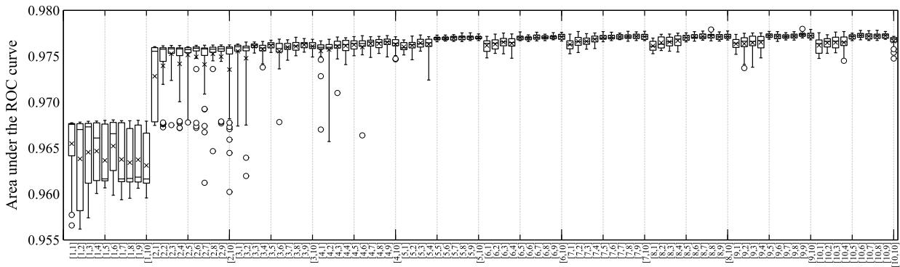  
MLP hidden layers configuration  
Figure 5. Distribution of the generalization performance of each MLP configuration, measured in terms of the area under the ROC curve obtained using the testing set of 30 images.

Table 1. P-values of the Shapiro-Wilk test to determine normality distribution of the generalization performance of each MLP configuration, using the test set of 30 images. The configurations are presented as $[ i , \cdot ]$ for configurations with i neurons in the first hidden layer, and $[ \cdot , j ]$ for configurations with j neurons in the second hidden layer.
<table><tr><td></td><td> $\left[ \cdot , \mathbf { 1 } \right]$ </td><td> $[ \cdot , 2 ]$ </td><td> $\left[ \cdot , 3 \right]$ </td><td> $[ \cdot , 4 ]$ </td><td> $[ \cdot , 5 ]$ </td><td> $[ \cdot , 6 ]$ </td><td> $[ \cdot , 7 ]$ </td><td> $\left[ \cdot , 8 \right]$ </td><td> $[ \cdot , 9 ]$ </td><td> $[ \cdot , \bf { 1 0 } ]$ </td></tr><tr><td> $\left[ 1 , \cdot \right]$ </td><td>&lt;0.0001</td><td>&lt;0.0001</td><td>&lt;0.0001</td><td>&lt;0.0001</td><td>&lt;0.0001</td><td>0.0003</td><td>&lt;0.0001</td><td>&lt;0.0001</td><td>&lt;0.0001</td><td>&lt;0.0001</td></tr><tr><td>[2, ]</td><td>&lt;0.0001</td><td>&lt;0.0001</td><td>&lt;0.0001</td><td>&lt;0.0001</td><td>&lt;0.0001</td><td>&lt;0.0001</td><td>&lt;0.0001</td><td>&lt;0.0001</td><td>&lt;0.0001</td><td>&lt;0.0001</td></tr><tr><td>[3, ]</td><td>&lt;0.0001</td><td>&lt;0.0001</td><td>0.0114</td><td>&lt;0.0001</td><td>0.0017</td><td>&lt;0.0001</td><td>0.0276</td><td>0.8296</td><td>0.4916</td><td>&lt;0.0001</td></tr><tr><td>[4, ]</td><td>&lt;0.0001</td><td>&lt;0.0001</td><td>&lt;0.0001</td><td>0.0009</td><td>0.1310</td><td>&lt;0.0001</td><td>0.0099</td><td>0.1526</td><td>0.0008</td><td>0.0023</td></tr><tr><td>[5, ]</td><td>0.1264</td><td>0.0175</td><td>&lt;0.0001</td><td>&lt;0.0001</td><td>0.0005</td><td>0.0305</td><td>0.0042</td><td>&lt;0.0001</td><td>&lt;0.0001</td><td>&lt;0.0001</td></tr><tr><td>[6, ]</td><td>0.0456</td><td>0.2161</td><td>0.3827</td><td>&lt;0.0001</td><td>&lt;0.0001</td><td>0.0047</td><td>0.0147</td><td>&lt;0.0001</td><td>0.0016</td><td>0.0002</td></tr><tr><td>[7,]</td><td>0.6347</td><td>&lt;0.0001</td><td>0.1427</td><td>&lt;0.0001</td><td>&lt;0.0001</td><td>0.0005</td><td>0.0004</td><td>&lt;0.0001</td><td>&lt;0.0001</td><td>0.0002</td></tr><tr><td>[8, ]</td><td>0.2948</td><td>0.0499</td><td>&lt;0.0001</td><td>&lt;0.0001</td><td>0.0002</td><td>&lt;0.0001</td><td>&lt;0.0001</td><td>0.0047</td><td>0.0006</td><td>&lt;0.0001</td></tr><tr><td>[9, ]</td><td>0.3329</td><td>&lt;0.0001</td><td>0.0020</td><td>0.0011</td><td>0.0001</td><td>0.0017</td><td>&lt;0.0001</td><td>&lt;0.0001</td><td>&lt;0.0001</td><td>0.0092</td></tr><tr><td>[10, ]</td><td>0.0643</td><td>0.0005</td><td>0.0699</td><td>0.0012</td><td>&lt;0.0001</td><td>0.0001</td><td>&lt;0.0001</td><td>0.5704</td><td>&lt;0.0001</td><td>0.0004</td></tr></table>

In literature, the Wilcoxon-Mann-Whitney test is the most common non-parametric technique used to compare the performance of two methods applied to independent samples. This test is used to determine the most appropriate MLP configuration for coronary arteries detection in X-ray angiograms by pairwise comparison of all candidate architectures using the testing set of images. The hypothesis test determines whether the detection performance between two configurations are similarly distributed, by using a significance level of 5%. On the other hand, when the hypothesis of similarly distributed detection performance is rejected, the sum of ranks is employed to determine whether the left or right hand configuration is stochastically dominant. For the best 10 MLP configurations, Table 2 illustrates the hypothesis testing process by reporting the p-value and the corresponding left and right hand sum of ranks, denoted respectively by – and +. The stochastic dominance comparison is summarized in Figure 6, where a high detection performance can be observed for configurations with more than 4 neurons in each hidden layer. In this figure, the configuration [9, 9] is highlighted with a dotted line, corresponding to the architecture that stochastically dominates most of the other configurations of the comparative analysis.

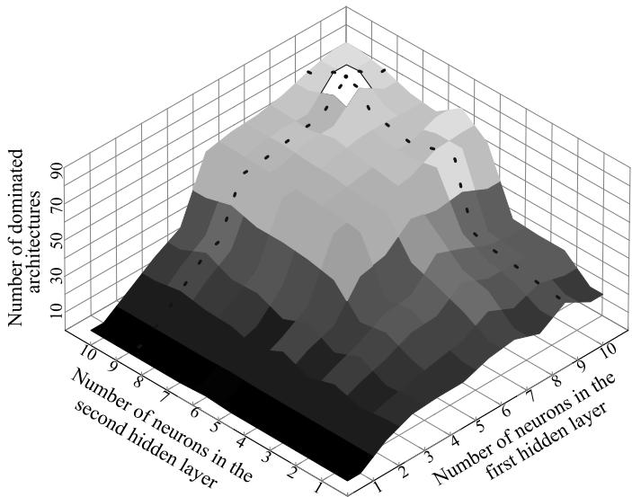  
Figure 6. Distribution of the number of architectures dominated by each configuration according to the ranking procedure using the testing set of images. The configuration [9, 9] that dominates most of the other architectures is highlighted with a dotted line.

The stochastic dominance comparison results are ranked according to the number of other architectures stochastically dominated, in order to determine the most appropriate configuration to be used in the proposed method. Table 3 shows the comparative results of the top 10 architectures from the 100 comparative architectures tested. According to comparative analysis, the configuration that stochastically dominates the most of other architectures is the [9, 9] architecture, being superior to other 90 configurations. In addition, the [9, 9] architecture obtains a detection performance stochastically similar to only other 9 configurations, and it is not stochastically dominated by any other configuration. Because the MLP [9, 9] configuration presents the highest stochastic dominance results, it was selected as the most appropriate architecture to provide the final detection response of the proposed method.

Table 2. P-values, left-hand (-), and right-hand (+) sum of ranks from the Wilcoxon-Mann-Whitney test for stochastic difference of the best 10 MLP configurations. The configurations are presented as [i, j], where i is the number of neurons in the first hidden layer, and j the number of neurons in the second hidden layer.
<table><tr><td></td><td>[8,10]</td><td></td><td>[9,5]</td><td>[9,8]</td><td>[9,9]</td><td>[9,10]</td><td></td><td>[10, 6]</td><td>[10,8]</td><td>[10,9]</td><td></td><td>[10,10]</td></tr><tr><td></td><td colspan="3">0.6627</td><td>0.9293</td><td>0.0614</td><td>0.7901</td><td>0.3042</td><td></td><td>0.9823</td><td>0.5106</td><td></td><td>0.6574</td></tr><tr><td>[8,8]</td><td colspan="3">-:480 +:420 -:415.5</td><td>+:484.5 -:456.5 +:443.5</td><td>-:323 +:577</td><td>-:431.5</td><td>+:468.5 -:380</td><td>+:520</td><td>-:452 +:448</td><td>-:405</td><td>+:495 -:419.5</td><td>+:480.5</td></tr><tr><td rowspan="2">[8,10]</td><td rowspan="2">一 一</td><td colspan="3">0.2143</td><td>0.0068</td><td>0.4464</td><td>0.1120</td><td></td><td>0.7788</td><td>0.3147</td><td></td><td>0.1474</td></tr><tr><td colspan="3">-:365.5 +:534.5 -:408.5</td><td>0.5444 +:491.5 -:266.5</td><td colspan="3">+:633.5 -:398 +:502 -:342</td><td>+:558 -:430.5</td><td>+:469.5 -:381.5</td><td>+:518.5 -:351.5</td><td>+:548.5</td></tr><tr><td rowspan="2">[9,5]</td><td rowspan="2"></td><td colspan="3">一</td><td>0.0905</td><td>0.9411</td><td>0.5444</td><td></td><td>0.5153</td><td>0.9823</td><td>0.7394</td><td></td></tr><tr><td colspan="3">一 一 -:476</td><td>0.7062 +:424 -:335</td><td colspan="3">+:565 -:455.5 +:444.5 -:408.5</td><td>+:491.5 -:494.5</td><td>+:405.5 -:448</td><td>+:452 -:427</td><td>+:473</td></tr><tr><td rowspan="2">[9,8]</td><td colspan="3"></td><td>-</td><td>0.0378</td><td>0.6757</td><td>0.3147</td><td></td><td>0.9352</td><td>0.5154</td><td></td><td>0.5819</td></tr><tr><td colspan="3"></td><td></td><td>-:309 +:591</td><td>-:421</td><td>+:479 -:381.5</td><td>+:518.5</td><td>-:456 +:444</td><td>-:405.5 +:494.5</td><td>-:412</td><td>+:488</td></tr><tr><td rowspan="2">[9,9]</td><td colspan="3"></td><td>一 一</td><td>一</td><td>0.0905</td><td>0.2938</td><td></td><td>0.0371</td><td>0.1354</td><td></td><td>0.1087</td></tr><tr><td colspan="3"></td><td></td><td>一</td><td>-:565 +:335 -:521.5</td><td></td><td>+:378.5 -:591.5</td><td>+:308.5</td><td>-:551.5 +:348.5</td><td>-:559</td><td>+:341</td></tr><tr><td rowspan="2">[9,10]</td><td colspan="3"></td><td></td><td></td><td>一</td><td></td><td>0.6952</td><td>0.6574</td><td>0.7450</td><td></td><td>0.7227</td></tr><tr><td colspan="3"></td><td></td><td></td><td>一 一 -:423</td><td></td><td>+:477 -:480.5</td><td>+:419.5</td><td>-:427.5 +:472.5</td><td>-:425.5</td><td>+:474.5</td></tr><tr><td rowspan="2">[10, 6]</td><td colspan="3"></td><td></td><td></td><td></td><td></td><td>-</td><td>0.3255</td><td>0.7172</td><td></td><td></td></tr><tr><td colspan="3"></td><td></td><td></td><td></td><td></td><td>一 -:517</td><td>+:383</td><td>-:475 +:425</td><td>-:456.5</td><td>0.9293 +:443.5</td></tr><tr><td rowspan="2">[10,8]</td><td colspan="3"></td><td></td><td></td><td></td><td>一</td><td></td><td>一</td><td>0.5346</td><td></td><td></td></tr><tr><td colspan="3"></td><td></td><td></td><td></td><td></td><td></td><td></td><td>+:492.5</td><td></td><td>0.3136</td></tr><tr><td rowspan="2">[10,9]</td><td colspan="3"></td><td></td><td></td><td></td><td></td><td>一</td><td>一</td><td>-:407.5</td><td>-:381</td><td>+:519</td></tr><tr><td colspan="3"></td><td></td><td></td><td></td><td></td><td></td><td></td><td>一</td><td>-:428</td><td>0.7524</td></tr></table>

Table 3. Ranking of the best 10 configurations from the 100 comparative architectures of the MLP, according to the number of stochastically dominated architectures. The configurations are presented as $[ i , j ] ,$ where i is the number of neurons in the first hidden layer, and j the number of neurons in the second hidden layer.
<table><tr><td>Rank</td><td>Configuration</td><td>Number of Dominated Architectures</td><td>Architectures Similarly Distributed</td><td>Dominated by Other Architectures</td></tr><tr><td>1</td><td>[9,9]</td><td>90</td><td>9</td><td>0</td></tr><tr><td>2</td><td>[10,6]</td><td>78</td><td>21</td><td>0</td></tr><tr><td>3</td><td>[10,10]</td><td>78</td><td>21</td><td>0</td></tr><tr><td>4</td><td>[9,5]</td><td>77</td><td>22</td><td>0</td></tr><tr><td>5</td><td>[10,9]</td><td>75</td><td>24</td><td>0</td></tr><tr><td>6</td><td>[9, 10]</td><td>74</td><td>25</td><td>0</td></tr><tr><td>7</td><td>[8, 8]</td><td>72</td><td>27</td><td>0</td></tr><tr><td>8</td><td>[9,8]</td><td>72</td><td>27</td><td>0</td></tr><tr><td>9</td><td>[10,8]</td><td>70</td><td>29</td><td>0</td></tr><tr><td>10</td><td>[8, 10]</td><td>69</td><td>29</td><td>1</td></tr></table>

## 3.3. Detection Results

To evaluate the performance of the detection step of the proposed method, the comparative analysis with respect blood vessel enhancement methods from the state of the art is reported in this section. The proposed method is compared with four artificial neural network based methods, and seven state-of-the-art methods for blood vessel enhancement, using the test set of 30 images. The detection performance of each blood vessel enhancement method is evaluated in terms of the area under the ROC curve.

The methods based on neural networks were trained using the training set of 100 images, and were selected from several candidates that were previously tested, and according to their relevant high blood vessel detection performance. The multiscale Gaussian matched filter [17], which employs a multilayer perceptron network with 3 neurons in a first hidden layer, and 8 neurons in a second hidden layer. This method obtains a vessel detection performance of $A _ { z } = 0 . 9 3 6 2$ , using a database of 100 angiograms, and the set of parameters l = 13, T = 15, K = 12 and $\sigma = [ 1 . 5 , 1 . 6 , \ldots , 2 . 5 ]$ for the multiscale GMF. The multiscale Gabor filter [16], that uses a multilayer perceptron with two hidden layers with 5 neurons each. This coronary artery detection method achieves a performance of $A _ { z } = 0 . 9 5 2 0$ using a database of 80 angiograms, whereas the parameters for the multiscale Gabor filters are set as $l = 3 , \tau = [ 2 , 3 , \dots , 2 0 ]$ and $\kappa = 4 5$ . The following two methods are convolutional neural networks (CNN) that were originally proposed to perform object recognition in images; however, in this work those architectures are adapted to perform the detection of blood vessels in coronary angiograms. The architecture proposed by Lecun et al. [23] which is applied to the multiscale responses of the Gaussian matched filters and Gabor filters, using the same parameters of the proposed method for both multiscale vessel enhancement methods. Finally, the architecture proposed by Simonyan and Zisserman [24] is employed using 32 × 32 pixel sized patches from the original angiogram without additional processing.

The following seven blood vessel enhancement methods are the most referenced in literature. The method of Cruz et al. [11] employs the single-scale GMF, where the filter parameters are selected with an algorithm inspired by natural evolution. Cinsdikici and Aydin [7] proposed to use the single-scale GMF extending the number of orientations to $K = 1 8 ,$ keeping the other parameters in the original values proposed by Chaudhuri et al. [6]. Nguyen et al. [25] addressed the detection of blood vessels by using a line detector and varying its scale in a range of 1 to 15 pixels. The method of Al-Rawi and Karajeh [10] is based on the single-scale GMF, where the parameters T and L that govern the filter are selected by a genetic algorithm from the evolutionary computation family, preserving the orientations in $K = 1 2$ . The mathematical morphology based method of Eiho and Qian [1] applies the Top-hat operator with a disk-shaped structuring element at multiple scales over the original image. The single-scale Gabor filter proposed by Rangayyan et al. [13] defines the parameters with a full-search, resulting on a filter with parameters $\tau = 8 , l = 2 . 9$ , and $\kappa = 1 8 0$ orientations. The method of Frangi et al. [3] is based on a vesselness measure computed from the Hessian matrix of the original angiogram using multiple scales in the range $\left[ 1 , 1 . 2 5 , 1 . 5 , \ldots , 2 1 \right]$ in order to detect vessels of different diameters.

The comparative analysis between the proposed method, and the eleven blood vessel enhancement methods described above, is illustrated in Figure 7 using the test set of 30 images of the present database. The comparative analysis reveals that the proposed method presents the highest vessel detection performance with $A _ { z } = 0 . 9 7 7 5 ,$ compared with the eleven methods from the state of the art. To visualize the vessel detection results, Figure 8 presents the responses obtained by applying the different methods over a subset of angiograms of the testing set.

## 3.4. Segmentation Results

This section presents the process to determine the most suitable binary classification technique to be used in the fourth step of the proposed method. Later, the evaluation of the segmentation performance of the proposed method is presented in a comparative analysis approach with other blood-vessel segmentation methods from the state of the art. For the evaluation of the blood vessels classification efficiency, the accuracy metric is employed.

To select the most suitable technique for the segmentation step of the proposed method, fourteen binary classification tools are compared using the detection response of the multiscale analysis performed in the previous steps. Thirteen methods of the comparative set are automatic binary classification techniques frequently used in vessel-segmentation literature. The remaining method is a soft computing approach which selects the threshold value from the detection response scale that maximizes the accuracy metric. The soft computing procedure followed to define the most appropriate threshold value is illustrated in Figure 9, where the best value found is 0.87 in the detection response scale using the training set of 100 images and a full search strategy.

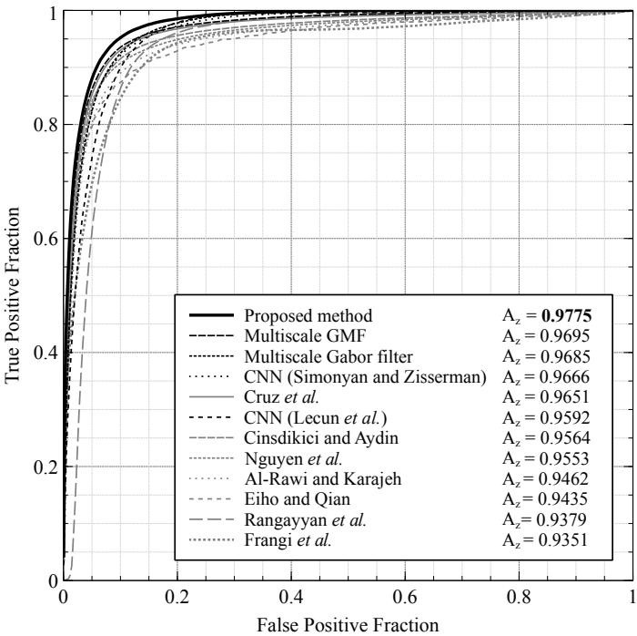  
Figure 7. ROC curves obtained by the eleven vessel detection methods, and the proposed method, using the test set of 30 images.

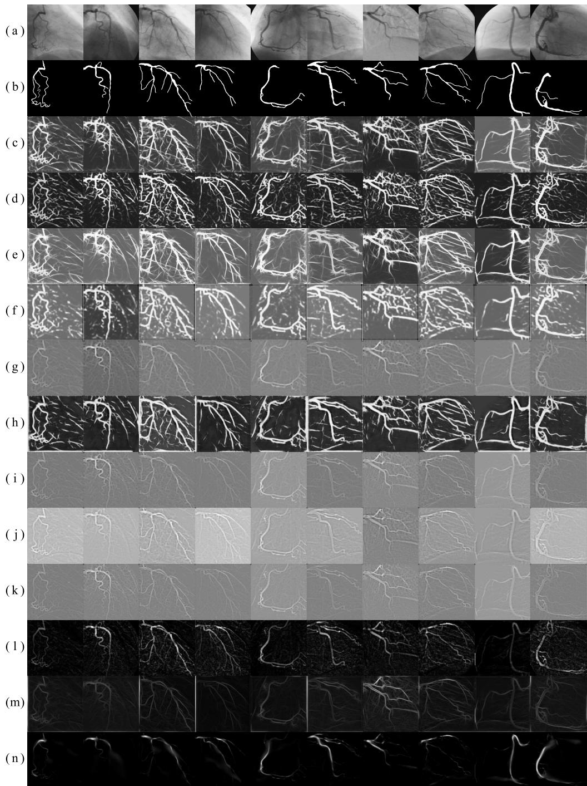  
Figure 8. (a) Ten original angiograms from the test set of 30 images, and (b) their respective delineated ground-truth. The following rows present the detection responses obtained by using (c) the proposed method, (d) the multiscale Gaussian matched filters, (e) the multiscale Gabor filter, (f) the CNN (Simonyan and Zisserman) method, (g) the method of Cruz et al. [11], (h) the CNN (Lecun et al.) method, (i) the method of Cinsdikici and Aydın [7], (j) the method of Nguyen et al. [25], (k) the method of Al-Rawi and Karajeh [10], (1) the method of Eiho and Qian [1], (m) the method of Rangayyan et al. [13], and (n) the method of Frangi et al. [3].

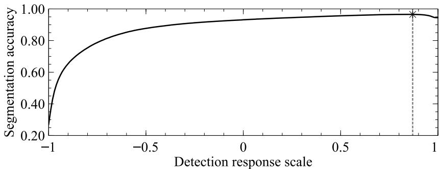  
Figure 9. Soft computing procedure for the selection of the threshold value that maximizes the blood vessels segmentation accuracy using the training set of angiograms.

In addition, Table 4 presents the comparative analysis of the fourteen automatic binary classification tools in terms of six different binary evaluation metrics, using the test set of 30 angiograms. The analysis is performed by applying each of the compared segmentation tools to the multiscale response of the proposed method, which is illustrated in Figure 10. After visual examination of Figure 10, it can be noticed that the soft computing approach provides the lowest incorrect classification rate of background pixels as vessel features, reflected in its high specificity. On the other hand, most of the other classification tools have presented high sensitivity at the cost of a considerable high number of false positives that results in a low positive predictive value, whereas the fixed threshold performs the correct classification of vessel pixels with a significant rate of positive predictive value. Moreover, the Dice coefficient achieved by the fixed threshold is significantly higher than the obtained by the other binary classification methods, being the soft computing approach the one that provides the most similar vessel segmentation to the ground-truth. Because of its high overall segmentation performance presented in the comparative analysis, the best classification technique to segment the multiscale detection response is the binarization under a threshold value of 0.87 obtained with a soft computing procedure.

Table 4. Segmentation accuracy obtained by the comparative threshold methods applied to the multiscale detection response by using the testing set of 30 angiograms.
<table><tr><td>Segmentation Method</td><td>Accuracy</td><td>Mean Class Accuracy</td><td>Sensitivity</td><td>Specificity</td><td>Positive Predictive Value</td><td>Dice</td></tr><tr><td>Threshold (0.87)</td><td>0.9698</td><td>0.8122</td><td>0.6364</td><td>0.9880</td><td>0.7434</td><td>0.6857</td></tr><tr><td>Otsu [26]</td><td>0.9173</td><td>0.9315</td><td>0.9472</td><td>0.9157</td><td>0.3806</td><td>0.5430</td></tr><tr><td>Ridler and Calvard [27]</td><td>0.9164</td><td>0.9312</td><td>0.9478</td><td>0.9147</td><td>0.3779</td><td>0.5403</td></tr><tr><td>Niblack [28]</td><td>0.9146</td><td>0.9252</td><td>0.9370</td><td>0.9134</td><td>0.3717</td><td>0.5322</td></tr><tr><td>Moment-preserving [29]</td><td>0.9081</td><td>0.9321</td><td>0.9589</td><td>0.9053</td><td>0.3565</td><td>0.5197</td></tr><tr><td>RATS [30]</td><td>0.8989</td><td>0.9300</td><td>0.9646</td><td>0.8953</td><td>0.3350</td><td>0.4973</td></tr><tr><td>Vessel repair [5]</td><td>0.8902</td><td>0.9262</td><td>0.9664</td><td>0.8860</td><td>0.3168</td><td>0.4772</td></tr><tr><td>Sauvola [31]</td><td>0.8884</td><td>0.9241</td><td>0.9639</td><td>0.8843</td><td>0.3130</td><td>0.4726</td></tr><tr><td>Entropy maximization [32]</td><td>0.8853</td><td>0.9274</td><td>0.9744</td><td>0.8804</td><td>0.3082</td><td>0.4683</td></tr><tr><td>Background unification [1]</td><td>0.8757</td><td>0.9213</td><td>0.9721</td><td>0.8704</td><td>0.2909</td><td>0.4478</td></tr><tr><td>Degree-based [33]</td><td>0.8581</td><td>0.9176</td><td>0.9840</td><td>0.8512</td><td>0.2656</td><td>0.4183</td></tr><tr><td>White [34]</td><td>0.8574</td><td>0.9098</td><td>0.9682</td><td>0.8514</td><td>0.2627</td><td>0.4132</td></tr><tr><td>Histogram concavity [35]</td><td>0.8442</td><td>0.9117</td><td>0.9871</td><td>0.8363 0.8156</td><td>0.2480</td><td>0.3965</td></tr><tr><td>Local entropy [36]</td><td>0.8247</td><td>0.9028</td><td>0.9900</td><td></td><td>0.2270</td><td>0.3693</td></tr></table>

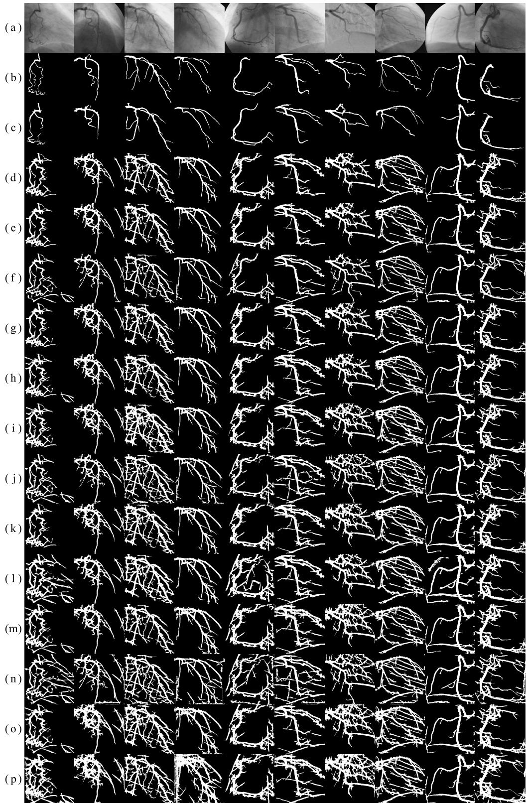  
Figure 10. (a) Ten angiograms from the testing set of 30 images, and (b) their respective ground-truth. The following rows are the segmentation results of (c) the fixed threshold (0.87) method, (d) the method of Otsu [26], (e) the method of Ridler and Calvard [27], (f) the method of Niblack [28], (g) the Moment-preserving [29] method, (h) the RATS [30] method, (i) the Vessel repair [5] method, (j) the method of Sauvola [31], (k) the Entropy maximization [32] method, (1) the Background unification [1] method, (m) the Degree-based [33] method, (n) the method of White [34], (o) the Histogram concavity [35] method, and (p) the Local entropy [36] method.

Moreover, in order to evaluate the results of the proposed method, twelve specialized vessel segmentation methods of the state of the art have been selected to perform a comparative analysis From the set of comparative methods, the method introduced by Eiho and Qian [1] uses the Top-hat operator for coronary arteries enhancement in angiograms, which combined with a background unification algorithm, extracts vessel features from coronary angiograms. Qian et al. [2] used the background unification algorithm on the multiscale response of the Top-hat operator, applied at three different scales over the original angiogram. Chanwimaluang and Fan [37] addressed the vessel segmentation from the single-scale GMF response. The binary segmentation is obtained by selecting the threshold value that maximizes the local entropy computed from the co-occurrence matrix. Kang et al. [8] applies two different enhancement methods to the original image: the Top-hat operator, and the single-scale GMF. The segmentation result is obtained with a threshold level that maximizes the entropy of the gray-scale intensity of each detection response. The method proposed by Kang et al. [38] introduces a segmentation procedure based on a similarity degree between pixels of the gray-scale detection response. The approach of Nguyen et al. [25] segments vessel pixels from the multiline detector response by using a fixed threshold value of 0.56. The value is selected as the binarization level that maximizes the classification accuracy using a training set of images. The method of Li et al. [5] defines a vessel probability map from a coronary angiogram using a Hessian matrix based method. The vessel segmentation is performed by a region growing algorithm and a subsequent vessel detail repairing procedure. The inter-class variance maximization method of Otsu [26] has been an efficient separation tool employed by the following methods. The method of Cervantes et al. [15] employs the single-scale Gabor filter, which parameters are selected using a nature inspired algorithm for numerical optimization. The U-Net [39] is a convolutional neural network that has been widely used for biomedical image segmentation tasks in recent years. For the comparative analysis, the U-Net [39] was trained using the training set of 100 images, by taking patches of size 32 × 32 pixels from the zero-padded angiograms as inputs, and using the cross entropy function as loss metric. Finally, the method proposed by Cruz et al. [17] introduced the multiscale GMF that improves the detection performance of its single-scale version.

The result of the comparative analysis of the twelve specialized vessel segmentation methods, and the proposed method, is presented in Table 5. The test set of 30 angiograms is used to evaluate the segmentation methods in terms of binary classification accuracy. According to Table 5, the proposed method obtains the highest segmentation performance with respect to the twelve methods from the state of the art by reaching a classification accuracy of 0.9698. The resulting segmentation responses of the comparative segmentation methods are illustrated in Figure 11.

Table 5. Comparison of the segmentation performance of twelve vessel segmentation methods from the state of the art, and the proposed method, in terms of six binary segmentation metrics. The testing set of 30 images is used to evaluate the classification performance.
<table><tr><td>Segmentation Method</td><td>TP</td><td>TN</td><td>FP</td><td>FN</td><td>Accuracy</td><td>Mean Class Accuracy</td><td>Sensitivity</td><td>Specificity</td><td>Positive Predictive Value</td><td>Dice</td></tr><tr><td>Proposed method/Threshold (0.87)</td><td>89089</td><td>2529250</td><td>30750</td><td>50911</td><td></td><td>0.8122</td><td></td><td>0.9880</td><td>0.7434</td><td>0.6857</td></tr><tr><td>GMF/Entropy Maximization [8]</td><td>95244</td><td>2515257</td><td>44743</td><td>44756</td><td>0.9698 0.9669</td><td>0.8314</td><td>0.6364 0.6803</td><td>0.9825</td><td>0.6804</td><td>0.6803</td></tr><tr><td></td><td>59019</td><td>2545005</td><td>14995</td><td>80981</td><td>0.9645</td><td>0.7079</td><td>0.4216</td><td>0.9941</td><td>0.7974</td><td>0.5515</td></tr><tr><td>U-Net (Ronneberger et al.) [39]</td><td>92073</td><td>2500198</td><td>59802</td><td>47927</td><td>0.9601</td><td>0.8172</td><td>0.6577</td><td>0.9766</td><td>0.6062</td><td>0.6309</td></tr><tr><td>Multiscale Top-hat/Background Unification [2]</td><td>93724</td><td>2497734</td><td>62266</td><td>46276</td><td>0.9598</td><td>0.8226</td><td>0.6695</td><td>0.9757</td><td>0.6008</td><td>0.6333</td></tr><tr><td>Top-hat/Background Unification [1]</td><td>121286</td><td>2459149</td><td>100851</td><td>18714</td><td>0.9557</td><td>0.9135</td><td>0.8663</td><td>0.9606</td><td>0.5460</td><td>0.6698</td></tr><tr><td>Multiline Detector/Threshold (0.56) [25] Hessian Matrix-based/Vessel Repair [5]</td><td>90769</td><td>2486287</td><td>73713</td><td>49231</td><td>0.9545</td><td>0.8098</td><td>0.6484</td><td>0.9712</td><td>0.5518</td><td>0.5962</td></tr><tr><td>Multiscale GMF/Otsu [17]</td><td>130560</td><td>2367934</td><td>192066</td><td>9440</td><td>0.9326</td><td>0.9288</td><td>0.9326</td><td>0.9250</td><td>0.4047</td><td>0.5644</td></tr><tr><td>CNN (Simonyan and Zisserman) [24]</td><td>123717</td><td>2388849</td><td>171151</td><td>16283</td><td>0.9306</td><td>0.9084</td><td>0.8837</td><td>0.9331</td><td>0.4196</td><td>0.5690</td></tr><tr><td>Single-scale Gabor filters/Otsu [15]</td><td>54876</td><td>2473308</td><td>86692</td><td>85124</td><td>0.9196</td><td>0.6791</td><td>0.3920</td><td>0.9661</td><td>0.3876</td><td>0.3898</td></tr><tr><td>CNN (Lecun et al.) [23]</td><td>125764</td><td>2324732</td><td>235268</td><td>14236</td><td>0.9076</td><td>0.9032</td><td>0.8983</td><td>0.9081</td><td>0.3483</td><td>0.5020</td></tr><tr><td>GMF/Degree-based [38]</td><td>92169</td><td>2330746</td><td>229254</td><td>47831</td><td>0.8974</td><td>0.7844</td><td>0.6584</td><td>0.9104</td><td>0.2868</td><td>0.3995</td></tr><tr><td>GMF/Local Entropy [37]</td><td>132769</td><td>2214091</td><td>345909</td><td>7231</td><td>0.8692</td><td>0.9066</td><td>0.9484</td><td>0.8649</td><td>0.2774</td><td>0.4292</td></tr></table>

By visual inspection of Figure 11, it can be noticed that the method of GMF/Local Entropy [37] presents responses with a high rate of false positive pixels, obtaining the lowest segmentation accuracy of the comparison, this problem is also reflected in the low positive predictive value. The method of GMF/Degree-based [38] can obtain a relative high number of false negative pixels, affecting the segmentation accuracy and sensitivity of the method. The method based on single-scale Gabor filters [15] presents a frequent problem on the resulting image edges reducing the sensitivity of the method. The high false positive rate in those areas is associated to the strong detection intensities obtained by using only the average vessel width as single scale. In the method based on multiscale Gaussian templates [17], the accuracy and positive predictive value are affected by the incorrect classification of the pixels that are closer to the main coronary artery. This problem is because of the strong detection responses obtained by the multiscale Gaussian matched filter for small tubular structures in the background. The methods Hessian Matrix-based/Vessel Repair [5], and Multiline Detector/Threshold (0.56) [25] achieve similar classification accuracy. However, their segmentation performance is affected by the presence of irregular edges, holes, and broken vessels, being the method of Hessian Matrix-based/Vessel Repair [5] the most affected between both, reducing its segmentation sensitivity. The methods Top-hat/Background Unification [1], and Multiscale Top-hat/Background Unification [2] achieve high classification accuracy, only limited by the frequent presence of irregular borders and broken vessels in the segmentation result which reduces their positive predictive value and Dice similarity coefficient with the ground-truth. The U-Net (Ronneberger et al.) [39] method presents the highest specificity and positive predictive value; however, the segmentation result show a high rate of false negative pixels in several images, resulting in broken vessels and a reduction of its overall vessel extraction performance. The method of GMF/Entropy Maximization [8] presents high segmentation results in overall, being affected only by the presence of holes, broken vessels, and false positives in image edges, reducing its positive predictive value. On the other hand, the experimental results obtained by the proposed method achieved the highest segmentation accuracy, specificity, positive predictive value, and Dice similarity coefficient, using the testing set of the present database. Because of the suitable performance of the proposed method, the segmented coronary arteries present a low rate of false positives along with a low presence of holes and isolated vessels.

The comparison of the average execution time of the proposed method, and twelve vessel segmentation methods from the state of the art, is presented in Table 6. The methods of GMF/Entropy Maximization [8] and GMF/Degree-based [38] present the lowest computational times, followed by the methods Top-hat/Background Unification [1] and GMF/Local Entropy [37], which low computational time can be attributed to the single-scale analysis performed in the detection step. The methods of Multiscale Top-hat/Background Unification [2] and Multiline Detector/Threshold (0.56) [25] employ a multiscale analysis during the detection step, which increases the execution time with respect to single-scale approaches. The Single-scale Gabor filters/Otsu [15] involve transformations between the space and frequency domain that affects the overall execution time. The Multiscale GMF/Otsu [17] method performs a multiscale analysis in the spatial domain, which demand a greater execution time than other single-scale GMF methods. The Hessian Matrix-based/Vessel Repair [5] method employs a multiscale approach during the detection step, and a vessel repair process in the segmentation step. This method requires a greater execution time than other multiscale methods and is reflected on its average execution time. The proposed method presents the highest execution time in the comparative as a trade-off for its high segmentation accuracy. The computational time demanded by the proposed method is directly related to the number of multiple scales of the Gaussian filter applied in the spatial domain and the Gabor filters performed in the frequency domain.

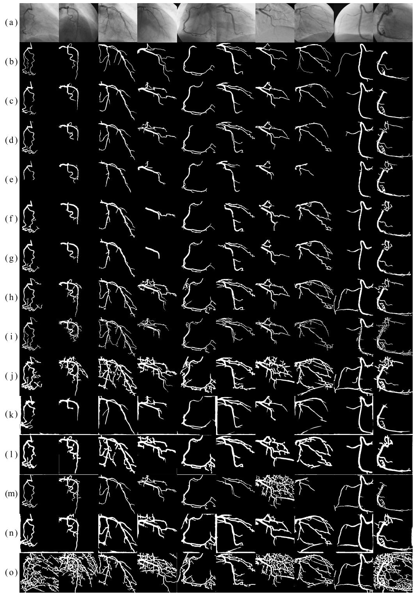  
Figure 11. (a) Ten angiograms from the testing set of 30 images, and (b) their respective ground-truth. The following rows are the segmentation response obtained by (c) the proposed method, (d) the the GMF/Entropy Maximization [8] method, (e) the U-Net (Ronneberger et al.) [39] method, (f) the Multiscale Top-hat/Background Unification [2] method, (g) the Top-hat/Background Unification [1] method, (h) the Multiline Detector/Threshold (0.56) [25] method, (i) the Hessian Matrix-based/Vessel Repair [5] method, (j) the Multiscale GMF/Otsu [17] method, (k) the Single-scale Gabor filters/Otsu [15] method, (1) the CNN (Simonyan and Zisserman) [24] method, (m) the GMF/Degree-based [38] method, (n) the CNN (Lecun et al.) [23], and (o) the GMF/Local Entropy [37] method.

Table 6. Average execution time of the proposed method and the twelve vessel segmentation methods from the state of the art presented in Table $5 ,$ using the testing set of 30 images.
<table><tr><td>Segmentation Method</td><td>Execution Time (s)</td></tr><tr><td>GMF/Entropy Maximization [8]</td><td>0.02</td></tr><tr><td>GMF/Degree-based [38]</td><td>0.03</td></tr><tr><td>Top-hat/Background Unification [1]</td><td>0.07</td></tr><tr><td>GMF/Local Entropy [37]</td><td>0.08</td></tr><tr><td>Multiscale Top-hat/Background Unification [2]</td><td>0.09</td></tr><tr><td>Multiline Detector/Threshold (0.56) [25]</td><td>0.14</td></tr><tr><td>U-Net (Ronneberger et al.) [39]</td><td>0.17 *</td></tr><tr><td>CNN (Simonyan and Zisserman) [24]</td><td>0.19 *</td></tr><tr><td>Single-scale Gabor filters/Otsu [15]</td><td>0.47</td></tr><tr><td>Multiscale GMF/Otsu [17]</td><td>0.59</td></tr><tr><td>Hessian Matrix-based/Vessel Repair [5]</td><td>1.22</td></tr><tr><td>CNN (Lecun et al.) [23]</td><td>1.88 *</td></tr><tr><td>Proposed method/Threshold (0.87)</td><td>1.89</td></tr></table>

Finally, it is important to point out that the proposed method for the automatic segmentation of coronary arteries achieved the most accurate results using the present database and different evaluation metrics for each of the vessel detection and segmentation steps. The high segmentation accuracy can be attributed to the multiscale analysis performed in both spatial and frequency domains along with the statistically determined artificial neural network. In addition, given the efficiency obtained by the proposed method and the competitive computational time, it could be integrated into a computer-aided diagnosis system to support cardiologist during the decision-making process.

## 4. Conclusions

In this paper, a new method for automatic segmentation of coronary arteries, based on multiscale analysis of X-ray angiograms, has been introduced. The proposed method employs the multiscale Gaussian matched filters, applied in the image domain, and the multiscale Gabor filter, applied in the frequency domain, in order to improve the contrast between vessel features and background, suppress noise in the image, and homogenize the illumination of the angiogram. Both multiscale responses are used as input layer in a four layered perceptron network. A statistical analysis has shown that the Multilayer perceptron with 9 neurons in each of the two hidden layers is the appropriate using a comparative set of configurations. Moreover, the proposed method based on an artificial neural network with multiscale analysis has performed better than eleven vessel detection methods from the state of the art by reaching an $A _ { z } = 0 . 9 7 7 5$ when applied to 30 test images. The use of a fixed threshold value of 0.87, over the multiscale response of the proposed method, has proved to be the most appropriate from fourteen segmentation techniques. Finally, according to comparative experiments with twelve state-of-the-art vessel segmentation methods, the proposed method has provided the most accurate vessel segmentation of the test set of 30 angiograms with a classification accuracy of 0.9698, and Dice coefficient of 0.6857. In addition to the experimental results, the high performance and robustness in the detection and segmentation steps have shown that the proposed method could be a potential method to be integrated in a computer decision support system to aid diagnosis in medical practice.

Author Contributions: Conceptualization, F.C.-S. and I.C.-A.; Data curation, M.A.H.-G. and S.E.S.-M.; Funding acquisition, A.H.-A., M.A.H.-G. and S.E.S.-M.; Investigation, F.C.-S.; Methodology, I.C.-A. and A.H.-A.; Resources, M.A.H.-G. and S.E.S.-M.; Supervision, I.C.-A. and A.H.-A.; Validation, F.C.-S., A.H.-A., M.A.H.-G. and S.E.S.-M.; Writing original draft, F.C.-S. and I.C.-A.

Funding: This work was supported by the Mexican National Council for Science and Technology (CONACYT) under the project No. 3150-3097 and the national scholarship for doctorate studies No. 626949/332702.

## Abbreviations

The following abbreviations are used in this manuscript:

GMF Gaussian matched filters

ANN Artificial neural network

MLP Multilayer perceptron

ROC receiver operating characteristic

CAD Computer-aided diagnosis system

ECEvolutionary computation algorithms

TPF True Positive Fraction

FPF False Positive Fraction

MSE Mean Squared Error

CNN Convolutional Neural Network

## References

1. Eiho, S.; Qian, Y. Detection of coronary artery tree using morphological operator. In Proceedings of the Computers in Cardiology 1997, Lund, Sweden, 7–10 September 1997; pp. 525–528. [CrossRef]

2. Qian, Y.; Eiho, S.; Sugimoto, N.; Fujita, M. Automatic extraction of coronary artery tree on coronary angiograms by morphological operators. In Proceedings of the Computers in Cardiology 1998, Cleveland, OH, USA, 13–16 September 1998; Volume 25, pp. 765–768. [CrossRef]

3. Frangi, A.F.; Niessen, W.J.; Vincken, K.L.; Viergever, M.A. Multiscale vessel enhancement filtering. In Medical Image Computing and Computer-Assisted Intervention—MICCAI'98; Wells, W.M., Colchester, A., Delp, S., Eds.; Springer: Berlin/Heidelberg, Germany, 1998; pp. 130–137.

4. Wang, S.; Li, B.; Zhou, S. A Segmentation Method of Coronary Angiograms Based on Multi-scale Filtering and Region-Growing. In Proceedings of the 2012 International Conference on Biomedical Engineering and Biotechnology, Macao, China, 28–30 May 2012; pp. 678–681. [CrossRef]

5. Li, Y.; Zhou, S.; Wu, J.; Ma, X.; Peng, K. A Novel Method of Vessel Segmentation for X-ray Coronary Angiography Images. In Proceedings of the 2012 Fourth International Conference on Computational and Information Sciences, Chongqing, China, 17–19 August 2012; pp. 468–471. [CrossRef]

6. Chaudhuri, S.; Chatterjee, S.; Katz, N.; Nelson, M.; Goldbaum, M. Detection of blood vessels in retinal images using two-dimensional matched filters. IEEE Trans. Med Imaging 1989, 8, 263–269. [CrossRef] [PubMed]

7. Cinsdikici, M.G.; Aydın, D. Detection of blood vessels in ophthalmoscope images using MF/ant (matched filter/ant colony) algorithm. Comput. Methods Programs Biomed. 2009, 96, 85–95. [CrossRef] [PubMed]

8. Kang, W.; Wang, K.; Chen, W.; Kang, W. Segmentation Method Based on Fusion Algorithm for Coronary Angiograms. In Proceedings of the 2009 2nd International Congress on Image and Signal Processing, Tianjin, China, 17–19 October 2009; pp. 1–4. [CrossRef]

9. Al-Rawi, M.; Qutaishat, M.; Arrar, M. An improved matched filter for blood vessel detection of digital retinal images. Comput. Biol. Med. 2007, 37, 262–267. [CrossRef] [PubMed]

10. Al-Rawi, M.; Karajeh, H. Genetic algorithm matched filter optimization for automated detection of blood vessels from digital retinal images. Comput. Methods Programs Biomed. 2007, 87, 248-253. [CrossRef] [PubMed]

11. Cruz-Aceves, I.; Hernandez-Aguirre, A.; Valdez, S.I. On the performance of nature inspired algorithms for the automatic segmentation of coronary arteries using Gaussian matched filters. Appl. Soft Comput. 2016, 46, 665–676. [CrossRef]

12. Soares, J.V.B.; Leandro, J.J.G.; Cesar, R.M.; Jelinek, H.F.; Cree, M.J. Retinal vessel segmentation using the 2-D Gabor wavelet and supervised classification. IEEE Trans. Med Imaging 2006, 25, 1214–1222. [CrossRef]

13. Rangayyan, R.M.; Oloumi, F.; Oloumi, F.; Eshghzadeh-Zanjani, P.; Ayres, F.J. Detection of Blood Vessels in the Retina Using Gabor Filters. In Proceedings of the 2007 Canadian Conference on Electrical and Computer Engineering, Vancouver, BC, Canada, 22–26 April 2007; pp. 717–720. [CrossRef]

14. Rangayyan, R.M.; Ayres, F.J.; Oloumi, F.; Oloumi, F.; Eshghzadeh-Zanjani, P. Detection of blood vessels in the retina with multiscale Gabor filters. J. Electron. Imaging 2008, 17, 1–7. [CrossRef]

15. Cervantes-Sanchez, F.; Cruz-Aceves, I.; Hernandez-Aguirre, A.; Aviña-Cervantes, J.; Solorio-Meza, S.; Ornelas-Rodriguez, M.; Torres-Cisneros, M. Segmentation of coronary angiograms using Gabor filters and Boltzmann univariate marginal distribution algorithm. Comput. Intell. Neurosci. 2016, 2016, 1–9. [CrossRef]

16. Cruz-Aceves, I.; Oloumi, F.; Rangayyan, R.M.; Aviña-Cervantes, J.G.; Hernandez-Aguirre, A. Automatic segmentation of coronary arteries using Gabor filters and thresholding based on multiobjective optimization. Biomed. Signal Process. Control 2016, 25, 76–85. [CrossRef]

17. Cruz-Aceves, I.; Cervantes-Sanchez, F.; Avila-Garcia, M.S. A novel multiscale Gaussian matched filter using neural networks for the segmentation of x-ray coronary angiograms. J. Healthc. Eng. 2018, 2018, 1–22. [CrossRef]

18. Gabor, D. Theory of communication. Part 1: The analysis of information. J. Inst. Electr. Eng. Part III Radio Commun. Eng. 1946, 93, 429–441. [CrossRef]

19. Hornik, K. Approximation capabilities of multilayer feedforward networks. Neural Networks 1991, 4, 251–257. [CrossRef]

20. Benammar Elgaaied, A.; Cascio, D.; Bruno, S.; Ciaccio, M.C.; Cipolla, M.; Fauci, A.; Morgante, R.; Taormina, V.; Gorgi, Y.; Marrakchi Triki, R.; et al. Computer-Assisted Classification Patterns in Autoimmune Diagnostics: The AIDA Project. BioMed Res. Int. 2016, 2016, 1–9. [CrossRef] [PubMed]

21. Cascio, D.; Taormina, V.; Cipolla, M.; Bruno, S.; Fauci, F.; Raso, G. A multi-process system for HEp-2 cells classification based on SVM. Pattern Recognit. Lett. 2016, 82, 56–63. [CrossRef]

22. Hagan, M.T.; Menhaj, M.B. Training feedforward networks with the Marquardt algorithm. IEEE Trans. Neural Networks 1994, 5, 989–993. [CrossRef]

23. Lecun, Y.; Bottou, L.; Bengio, Y.; Haffner, P. Gradient-based learning applied to document recognition. Proc. IEEE 1998, 86, 2278–2324. [CrossRef]

24. Simonyan, K.; Zisserman, A. Very Deep Convolutional Networks for Large-Scale Image Recognition. In Proceedings of the 3rd International Conference on Learning Representations, San Diego, CA, USA, 7–9 May 2015; Conference Track Proceedings.

25. Nguyen, U.T.; Bhuiyan, A.; Park, L.A.; Ramamohanarao, K. An effective retinal blood vessel segmentation method using multi-scale line detection. Pattern Recognit. 2013, 46, 703–715. [CrossRef]

26. Otsu, N. A Threshold Selection Method from Gray-Level Histograms. IEEE Trans. Syst. Man Cybern. 1979, 9, 62–66. [CrossRef]

27. Ridler, T.; Calvard, S. Picture Thresholding Using an Iterative Selection Method. IEEE Trans. Syst. Man Cybern. 1978, 8, 630–632. [CrossRef]

28. Niblack, W. An Introduction to Digital Image Processing; Strandberg Publishing Company: Birkeroed, Denmark, 1985.

29. Tsai, W.H. Moment-preserving thresolding: A new approach. Comput. Vision Graph. Image Process. 1985, 29, 377–393. [CrossRef]

30. Kittler, J.; Illingworth, J.; Föglein, J. Threshold selection based on a simple image statistic. Comput. Vision Graph. Image Process. 1985, 30, 125–147. [CrossRef]

31. Sauvola, J.; Pietikäinen, M. Adaptive document image binarization. Pattern Recognit. 2000, 33, 225–236. [CrossRef]

32. Kapur, J.; Sahoo, P.; Wong, A. A new method for gray-level picture thresholding using the entropy of the histogram. Comput. Vision Graph. Image Process. 1985, 29, 273–285. [CrossRef]

33. Kang, W.; Kang, W.; Li, Y.; Wang, Q. The segmentation method of degree-based fusion algorithm for coronary angiograms. In Proceedings of the 2013 2nd International Conference on Measurement, Information and Control, Harbin, China, 16–18 August 2013; Volume 1, pp. 696–699. [CrossRef]

34. White, J.M.; Rohrer, G.D. Image Thresholding for Optical Character Recognition and Other Applications Requiring Character Image Extraction. IBM J. Res. Dev. 1983, 27, 400–411. [CrossRef]

35. Rosenfeld, A.; De La Torre, P. Histogram concavity analysis as an aid in threshold selection. IEEE Trans. Syst. Man, Cybern. 1983, SMC-13, 231–235. [CrossRef]

36. Pal, N.R.; Pal, S.K. Entropic thresholding. Signal Process. 1989, 16, 97–108. [CrossRef]

37. Chanwimaluang, T.; Fan, G. An efficient blood vessel detection algorithm for retinal images using local entropy thresholding. In Proceedings of the 2003 International Symposium on Circuits and Systems, Bangkok, Thailand, 25–28 May 2003; Volume 5, pp. 21–24. [CrossRef]

38. Kang, W.; Kang, W.; Chen, W.; Liu, B.; Wu, W. Segmentation method of degree-based transition region extraction for coronary angiograms. In Proceedings of the 2010 2nd International Conference on Advanced Computer Control, Shenyang, China, 27–29 March 2010; Volume 4, pp. 466–470. [CrossRef]

39. Ronneberger, O.; Fischer, P.; Brox, T. U-Net: Convolutional Networks for Biomedical Image Segmentation; Springer Nature: Cham, Switzerland, 2015.

© 2019 by the authors. Licensee MDPI, Basel, Switzerland. This article is an open access article distributed under the terms and conditions of the Creative Commons Attribution (CC BY) license (http://creativecommons.org/licenses/by/4.0/).