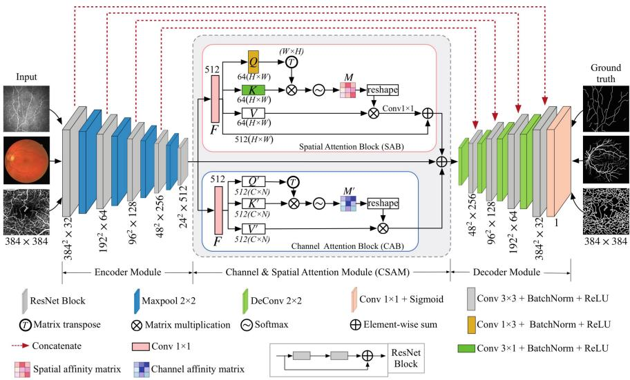
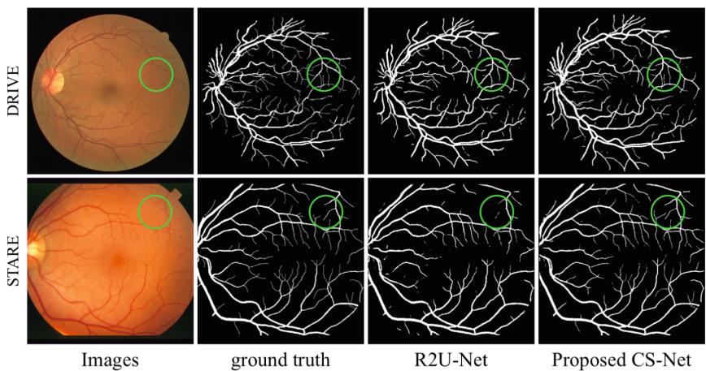
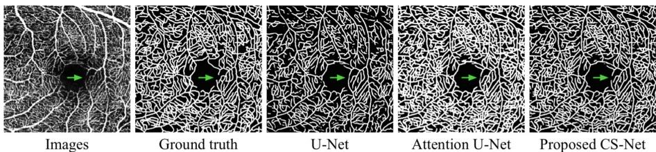
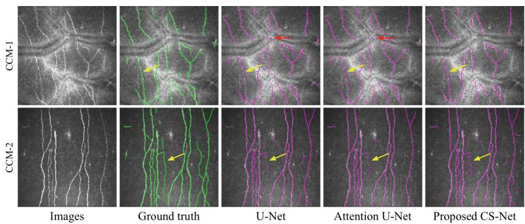

# CS-Net: Channel and Spatial Attention Network for Curvilinear Structure Segmentation

Lei Mou1,2, Yitian Zhao2(⊗), Li Chen1, Jun Cheng2, Zaiwang Gu2, Huaying Hao2, Hong Qi3, Yalin Zheng4, Alejandro Frangi2,5, and Jiang Liu2,6

1 School of Computer Science and Technology, Wuhan University of Science and Technology, Wuhan, China 2 Cixi Institute of Biomedical Engineering, Chinese Academy of Sciences, Ningbo, China yitian.zhao@nimte.ac.cn

3 Department of Ophthalmology, Peking University Third Hospital, Beijing, China 4 Department of Eye and Vision Science, University of Liverpool, Liverpool, UK School of Computing, University of Leeds, Leeds, UK 6 Department of Computer Science and Engineering, Southern University of Science and Technology, Shenzhen, China

Abstract. The detection of curvilinear structures in medical images, e.g., blood vessels or nerve fibers, is important in aiding management of many diseases. In this work, we propose a general unifying curvilinear structure segmentation network that works on different medical imaging modalities: optical coherence tomography angiography (OCT-A), color fundus image, and corneal confocal microscopy (CCM). Instead of the U-Net based convolutional neural network, we propose a novel network (CS-Net) which includes a self-attention mechanism in the encoder and decoder. Two types of attention modules are utilized - spatial attention and channel attention, to further integrate local features with their global dependencies adaptively. The proposed network has been validated on five datasets: two color fundus datasets, two corneal nerve datasets and one OCT-A dataset. Experimental results show that our method outperforms state-of-the-art methods, for example, sensitivities of corneal nerve fiber segmentation were at least 2% higher than the competitors. As a complementary output, we made manual annotations of two corneal nerve datasets which have been released for public access.

Keywords: Curvilinear structure · Segmentation · Encoder and decoder

## 1 Introduction

Accurate detection of curvilinear structures, such as retinal vasculature from color fundus image [1], optical coherence tomography angiography (OCT-A), and corneal nerve fiber from corneal confocal microscopy (CCM), are essential for many clinical applications [2]. Manual labeling the curvilinear structures is an exhausting, subjective and tedious tasks for human operators, and practically impossible in high-throughput analysis settings like screening programs or high-throughput microscopy. In consequence, an automatic segmentation method for general curvilinear structures is indispensable to overcome time constraints, scale-up to big data analysis, and avoid human error. However, computer-aided systems under development have yet to solve the segmentation problems as posed by high anatomical variation across the population, and the varying scales of curvilinear structures within an image. Noise, poor contrast and low resolution, exacerbate these problems.

Extensive work has been carried out towards automatic vessel segmentation or fiber tracing (see [3] for extensive review). As vasculatures or fibers are curvilinear structures distributed across different orientations and scales, various filtering methods have been proposed, include Hessian matrix-based filters [4], symmetry filter [2], and tensor-based filter [5], to name only the most widely used ones. These approaches aim to remove undesired intensity variations in the image, and suppress background structures and image noise, thereby easing the subsequent segmentation problem. Recently, several deep learning-based methods have been proposed for vessel segmentation and nerve fiber tracing in color fundus and CCM, respectively. Liskowski et al. [6] introduced a retinal vessel segmentation method based on Convolutional Neural Network (CNN), and Fu et al. [7] further applied the CNN along with Conditional Random Field to detect retinal vessels. Alom et al. [8] adopted recurrent residual convolution block as the backbone of the U-shaped network (R2U-Net) to segment the vessels. Colonna et al. [9] used the U-Net-based CNN [10] to trace the corneal nerve. However, deep learning-based method has yet to be used to segment retinal vessels in OCT-A.

Most of these models were designed for segmentation of vessels or fibers from specific biomedical imaging modalities. In this work, we proposed a Channel and Spatial Attention Network (CS-Net) based on U-Net that has proven to be effective to extract curvilinear structures from three biomedical imaging modalities. This paper makes four contributions: (1) a new segmentation method was proposed with self-attention mechanism; (2) CS-Net can deal with multiple types of curvilinear structure segmentation in a unified manner; (3) results on 5 datasets demonstrate state-of-the-art performance; (4) we made manual annotations of two corneal nerve datasets which have been released for public access.

## 2 Proposed Method

The proposed CS-Net consists of three phases: the encoder module, the channel and spatial attention module (CSAM), and the decoder module, as shown in Fig. 1. The feature encoder module includes four encoder blocks, and the residual network (ResNet) block was employed as the backbone for each block, and then followed by a max-pooling layer to increase the receptive field for better extraction of global features. Then the features from the encoder are fed into two parallel attention blocks - the channel attention block (CAB) and a spatial attention block (SAB), as shown in the red and blue rectangles in Fig. 1. Finally, the decoder module was used to reconstruct depth feature.

  
Fig. 1. CS-Net structure diagram. It comprises of three phases: the feature encoder module, the channel and spatial attention module and the feature decoder module. (Color figure online)

## 2.1 Spatial Attention Module

Many recent works have shown the local feature representation produced by traditional fully convolutional networks (FCNs) may lead to object misclassification [11,12]. To model rich contextual dependencies over local feature representations, the first step is to generate a spatial attention matrix, which models spatial relationships between features of any two pixels. In practice, treelike structures always are distributed throughout the biomedical image [13]. In consequence, we introduce the SAB to encode a wider range of contextual information into local features, to increase their representative capability.

We first feed the input features $F \in \mathbb { R } ^ { C \times H \times W }$ with batch normalization and ReLU layers or channel transformation, where C indicates the number of input channels, H and W are the height and width of $F _ { ; }$ respectively. Then a $1 \times 3$ and a $3 \times 1$ kernel convolution layer is to generate two new feature maps $Q \in \mathbb { R } ^ { C \times H \times W }$ , and $K \in \mathbb { R } ^ { C \times H \times W }$ , respectively, to capture edge information of tree-like structures in horizontal and vertical orientations. These two new feature maps are then reshaped to $\mathbb { R } ^ { C \times N }$ , where $N = H \times W$ is the number of features. The transpose of $Q$ and K is further fused by a matrix multiplication, and the spatial association of intra-class may be obtained by applying a softmax layer:

$$
S _ { ( x , y ) } = \frac { \exp { \left( K _ { ( x ) } \cdot Q ^ { \mathrm { T } } { } _ { ( y ) } \right) } } { \sum _ { x = 1 } ^ { N } \exp { \left( K _ { ( x ) } \cdot Q ^ { \mathrm { T } } { } _ { ( y ) } \right) } } ,\tag{1}
$$

where $\boldsymbol { S } _ { ( x , y ) }$ denotes the $x ^ { t h }$ position's impact on $y ^ { t h }$ position.

Meanwhile, the feature map F is fed into a $1 \times 1$ convolution layer to produce a dimension-reduced feature map $V \in \mathbb { R } ^ { C \times H \times W }$ , and then we reshape the $s$ to $\mathbb { R } ^ { C \times H \times W }$ . A matrix multiplication is performed between V and $s$ to obtain the spatial affinities $M \in \mathsf { \bar { R } } ^ { C \times H \times W }$ at the pixel level. Finally, we perform a pixel-level summation of F and M.

SAB gains a global contextual view and selectively aggregates contexts according to the spatial attention map. It will achieve a more accurate segmentation performance for curvilinear structures.

## 2.2 Channel Attention Module

Each channel of a high-level feature can be regarded as a specific-class response [13]. Therefore, we further exploit the interdependencies of channel maps in this section. Feature representation may be improved by emphasizing interdependent feature maps.

Three channel attention maps $Q ^ { \prime } \in \mathbb { R } ^ { C \times H \times W } , K ^ { \prime } \in \mathbb { R } ^ { C \times H \times W }$ , and $V ^ { \prime } \in$ $\mathbb { R } ^ { C \times H \times W }$ are calculated directly by a $1 \times 1$ convolution layer on the input feature maps $F \in \mathbb { R } ^ { C \times H \times W }$ . Similar to SAB, we reshape $F$ to $\check { \mathbb R } ^ { C \times N }$ . We then perform a multiplication between $F$ and its transpose. The channel affinities map $M ^ { \prime } \in$ $\mathbb { R } ^ { C \times C }$ is then obtained by applying a softmax layer:

$$
\mathcal { C } _ { ( x , y ) } = \frac { \exp \left( F _ { ( x ) } \cdot F _ { ( y ) } \right) } { \sum _ { x = 1 } ^ { C } \exp \left( F _ { ( x ) } \cdot F _ { ( y ) } \right) } ,\tag{2}
$$

where $\mathcal { C } _ { ( x , y ) }$ denotes the similarity between the $x ^ { t h }$ channel and the $y ^ { t h }$ channel. A matrix multiplication between the transpose of $\mathcal { C }$ and $V ^ { \prime }$ is added to obtain the final output. The result is reshaped as $\stackrel { \cdot } { \mathbb { R } } { } ^ { C \times H \times W }$ . Such operations emphasize class-dependent feature mapping and help improve feature discriminability.

Instead of directly upsampling the features of the CSAM to the original image dimensions, we introduce a feature decoder module that restores the dimensions of the high level semantic features layer by layer. In each layer, we use ResNet block as the backbone of the decoder block which is followed by a $2 \times 2$ deconvolution layer. Similar to U-Net [10], we add a skip connection between each layer of the encoder and decoder. At the end of the CS-Net, we apply a $1 \times 1$ convolution layer and a sigmoid layer on the output of the feature encoder module to gain the final segmentation map.

## 3 Experiment Results

The proposed CS-Net was implemented on PyTorch library with a single NVIDIA GPU (GeForce GTX 1080Ti). We choose adaptive moment estimation (Adam) optimization. The initial learning rate is set to 0.0001 and a weight decay of 0.0005. We use poly learning rate policy where the learning rate is multiplied by $\begin{array} { r } { \left( 1 - \frac { i t e r } { m a x . i t e r } \right) ^ { \frac { 1 } { p _ { o w } } \times e r } } \end{array}$ with power 0.9. All training images are rescaled to 384 × 384. We use the k-fold (k = 4 for STARE; and k = 5 for CCM-1, CCM-2, and OCT-A) cross-validation method to divide the images. The reported values are the mean values across all the folds.

  
Fig. 2. Retinal vessel segmentation results for two randomly selected images by R2U-Net and our CS-Net.

Table 1. Performance of vessel segmentation methods on color fundus datasets.
<table><tr><td rowspan=2 colspan=1>Methods</td><td rowspan=1 colspan=4>DRIVE</td><td rowspan=1 colspan=4>STARE</td></tr><tr><td rowspan=1 colspan=1>ACC</td><td rowspan=1 colspan=1>SE</td><td rowspan=1 colspan=1>SP</td><td rowspan=1 colspan=1>AUC</td><td rowspan=1 colspan=1>ACC</td><td rowspan=1 colspan=1>SE</td><td rowspan=1 colspan=1>SP</td><td rowspan=1 colspan=1>AUC</td></tr><tr><td rowspan=1 colspan=1>BCOSFIRE [14]</td><td rowspan=1 colspan=1>0.9442</td><td rowspan=1 colspan=1>0.7655</td><td rowspan=1 colspan=1>0.9704</td><td rowspan=1 colspan=1>0.9614</td><td rowspan=1 colspan=1>0.9497</td><td rowspan=1 colspan=1>0.7716</td><td rowspan=1 colspan=1>0.9701</td><td rowspan=1 colspan=1>0.9563</td></tr><tr><td rowspan=1 colspan=1>WSF [2]</td><td rowspan=1 colspan=1>0.9580</td><td rowspan=1 colspan=1>0.7740</td><td rowspan=1 colspan=1>0.9790</td><td rowspan=1 colspan=1>0.9750</td><td rowspan=1 colspan=1>0.9570</td><td rowspan=1 colspan=1>0.7880</td><td rowspan=1 colspan=1>0.9760</td><td rowspan=1 colspan=1>0.9590</td></tr><tr><td rowspan=1 colspan=1>DeepVessel [7]</td><td rowspan=1 colspan=1>0.9533</td><td rowspan=1 colspan=1>0.7603</td><td rowspan=1 colspan=1>0.9776</td><td rowspan=1 colspan=1>0.9789</td><td rowspan=1 colspan=1>0.9609</td><td rowspan=1 colspan=1>0.7412</td><td rowspan=1 colspan=1>0.9701</td><td rowspan=1 colspan=1>0.9790</td></tr><tr><td rowspan=1 colspan=1>U-Net [10]</td><td rowspan=1 colspan=1>0.9531</td><td rowspan=1 colspan=1>0.7537</td><td rowspan=1 colspan=1>0.9639</td><td rowspan=1 colspan=1>0.9601</td><td rowspan=1 colspan=1>0.9409</td><td rowspan=1 colspan=1>0.7675</td><td rowspan=1 colspan=1>0.9631</td><td rowspan=1 colspan=1>0.9705</td></tr><tr><td rowspan=1 colspan=1>R2U-Net [8]</td><td rowspan=1 colspan=1>0.9556</td><td rowspan=1 colspan=1>0.7792</td><td rowspan=1 colspan=1>0.9813</td><td rowspan=1 colspan=1>0.9784</td><td rowspan=1 colspan=1>0.9712</td><td rowspan=1 colspan=1>0.8298</td><td rowspan=1 colspan=1>0.9862</td><td rowspan=1 colspan=1>0.9914</td></tr><tr><td rowspan=1 colspan=1>CE-Net [15]</td><td rowspan=1 colspan=1>0.9545</td><td rowspan=1 colspan=1>0.8309</td><td rowspan=1 colspan=1>0.9747</td><td rowspan=1 colspan=1>0.9779</td><td rowspan=1 colspan=1>0.9583</td><td rowspan=1 colspan=1>0.7841</td><td rowspan=1 colspan=1>0.9725</td><td rowspan=1 colspan=1>0.9787</td></tr><tr><td rowspan=1 colspan=1>CS-Net</td><td rowspan=1 colspan=1>0.9632</td><td rowspan=1 colspan=1>0.8170</td><td rowspan=1 colspan=1>0.9854</td><td rowspan=1 colspan=1>0.9798</td><td rowspan=1 colspan=1>0.9752</td><td rowspan=1 colspan=1>0.8816</td><td rowspan=1 colspan=1>0.9840</td><td rowspan=1 colspan=1>0.9932</td></tr></table>

## 3.1 Vessel Segmentation in Color Fundus Image

We evaluated the proposed method for retinal blood vessel segmentation on two color fundus datasets: DRIVE1 and STARE2. We chose the first manual annotation of both datasets as the groundtruth. Figure2 demonstrates the retinal vessel segmentation performance by applying one of the state-of-the art methods (named R2U-Net) and the CS-Net. It is clear from visual inspection that CS-Net achieved better performance than the R2U-Net, as more small vessels were extracted from regions of poor contrast.

To facilitate better observation and objective performance evaluation of the proposed method, these metrics were calculated: sensitivity $( S E ) = T P / ( T P +$ FN), accuracy $( A C C ) = ( T P + T N ) / ( T P + F P + T N + F N )$ , and the Area Under the ROC Curve (AUC). In addition, the segmentation results were further compared with those of state-of-the-art retinal vessel segmentation algorithms and deep learning networks: Bar-COSFIRE (BCOSFIRE) [14], Weighted Symmetry Filter (WSF) [2], DeepVessel [7], U-Net [10], R2U-Net [8], and CE-Net [15]. Table 1 shows the proposed CS-Net outperforms all competing methods, except for SE in the DRIVE dataset and SP in the STARE dataset, which are 0.91% and 0.22% lower than those of [15] and [8], respectively. Nevertheless, it can be confirmed that the spatial and channel attention modules are beneficial for retinal vessel detection in color fundus image.

  
Fig. 3. Visualization results of vessel segmentation in OCT-A.

## 3.2 Vessel Segmentation in OCT-A Image

We then evaluate the proposed CS-Net on one in-house OCT-A dataset to further validate its segmentation performance. All the 30 OCT-A images were acquired using Heidelberg Spectralis device (Heidelberg, Germany) and all the vessels within the superficial vascular plexus (SVP) were manually traced using an inhouse program written in Matlab (Mathworks R2018, Natwick) by a clinical expert as the ground truth.

To our best knowledge, it is the first attempt to use deep learning approach to extract the vessels for OCT-A image. We compared the proposed network with other state-of-the-art segmentation networks: U-Net [10], Deep ResUNet [16], UNet++ [17], and Attention U-Net [18]. Figure 3 presents for visual comparison the vessel segmentation results of the competing methods on an example image. Overall, all methods demonstrated similar performance on vessel with large diameters. The Attention U-Net is able to detect most larger vessels, but also falsely enlarges background features where elongated intensity inhomogeneities are presented. U-Net misses vessels with small diameters, which leads to a relative lower sensitivity. In contrast to these networks, the proposed CS-Net integrates local features with global dependencies adaptively, hence, it demonstrated superior performance in detecting small vessels, indicated by the green arrow, and provided relatively higher sensitivity. These findings were also confirmed by the evaluation measures reported in Table2: the CS-Net shows this superior segmentation performance in terms of all metrics, since it considers the attention mechanism to build the association among features.

Table 2. Performance of compared methods on OCT-A dataset.
<table><tr><td rowspan=1 colspan=1>Methods</td><td rowspan=1 colspan=1>ACC</td><td rowspan=1 colspan=1>SE</td><td rowspan=1 colspan=1>SP</td><td rowspan=1 colspan=1>AUC</td></tr><tr><td rowspan=1 colspan=1>U-Net [10]</td><td rowspan=1 colspan=1>0.8422</td><td rowspan=1 colspan=1>0.7867</td><td rowspan=1 colspan=1>0.8780</td><td rowspan=1 colspan=1>0.9108</td></tr><tr><td rowspan=1 colspan=1>Deep ResUNet [16]</td><td rowspan=1 colspan=1>0.8659</td><td rowspan=1 colspan=1>0.8032</td><td rowspan=1 colspan=1>0.8863</td><td rowspan=1 colspan=1>0.9175</td></tr><tr><td rowspan=1 colspan=1>UNet++ [17]</td><td rowspan=1 colspan=1>0.8965</td><td rowspan=1 colspan=1>0.8309</td><td rowspan=1 colspan=1>0.9101</td><td rowspan=1 colspan=1>0.9203</td></tr><tr><td rowspan=1 colspan=1>Attention U-Net [18]</td><td rowspan=1 colspan=1>0.9125</td><td rowspan=1 colspan=1>0.8274</td><td rowspan=1 colspan=1>0.9007</td><td rowspan=1 colspan=1>0.9290</td></tr><tr><td rowspan=1 colspan=1>CS-Net</td><td rowspan=1 colspan=1>0.9183</td><td rowspan=1 colspan=1>0.8631</td><td rowspan=1 colspan=1>0.9192</td><td rowspan=1 colspan=1>0.9453</td></tr></table>

  
Fig. 4. Illustrative results of corneal nerve fiber tracing by different networks. (Color figure online)

## 3.3 Corneal Nerve Fiber Tracing in CCM Image

Finally, the proposed CS-Net was verified by the corneal nerve fiber tracing on two CCM datasets. CCM-1 has 1578 CCM, which were acquired from Peking

Table 3. Fiber tracing performance of different methods on two CCM datasets (mean ± standard deviation).
<table><tr><td rowspan=2 colspan=1>Methods</td><td rowspan=1 colspan=2>CCM-1</td><td rowspan=1 colspan=2>CCM-2</td></tr><tr><td rowspan=1 colspan=1>SE</td><td rowspan=1 colspan=1>FDR</td><td rowspan=1 colspan=1>SE</td><td rowspan=1 colspan=1>FDR</td></tr><tr><td rowspan=1 colspan=1>U-Net [10]</td><td rowspan=1 colspan=1>0.7856 ± 0.0096</td><td rowspan=1 colspan=1>0.3257 ± 0.0238</td><td rowspan=1 colspan=1>0.7657 ± 0.0193</td><td rowspan=1 colspan=1>0.3365 ± 0.0178</td></tr><tr><td rowspan=1 colspan=1>Deep ResUNet [16]</td><td rowspan=1 colspan=1>0.8067 ± 0.0056</td><td rowspan=1 colspan=1>0.2873 ± 0.0210</td><td rowspan=1 colspan=1>0.8009 ± 0.0221</td><td rowspan=1 colspan=1>0.2949 ± 0.0217</td></tr><tr><td rowspan=1 colspan=1>UNet++ [17]</td><td rowspan=1 colspan=1>0.8290 ± 0.0077</td><td rowspan=1 colspan=1> $0 . 2 6 8 5 \pm 0 . 0 1 3 4$ </td><td rowspan=1 colspan=1> $0 . 8 2 5 7 \pm 0 . 0 1 7 7$ </td><td rowspan=1 colspan=1> $0 . 2 7 4 4 \pm 0 . 0 1 0 1$ </td></tr><tr><td rowspan=1 colspan=1>Attention U-Net [18]</td><td rowspan=1 colspan=1> $0 . 8 2 3 1 \pm 0 . 0 0 3 1$ </td><td rowspan=1 colspan=1> $0 . 2 7 1 7 \pm 0 . 0 1 4 5$ </td><td rowspan=1 colspan=1> $0 . 8 1 0 1 \pm 0 . 0 2 3 1$ </td><td rowspan=1 colspan=1> $0 . 2 8 0 6 \pm 0 . 0 0 9 4$ </td></tr><tr><td rowspan=1 colspan=1>CS-Net</td><td rowspan=1 colspan=1> $\mathbf { 0 . 8 4 1 5 \pm 0 . 0 0 3 0 }$ </td><td rowspan=1 colspan=1> $\mathbf { 0 . 2 5 2 1 \pm 0 . 0 0 4 4 }$ </td><td rowspan=1 colspan=1> $\mathbf { 0 . 8 3 4 5 \pm 0 . 0 1 6 5 }$ </td><td rowspan=1 colspan=1> $\mathbf { 0 . 2 5 9 1 \pm 0 . 0 0 1 1 }$ </td></tr></table>

University Third Hospital; CCM-2 includes 120 CCM, which were obtained from University of Padova3. All the images were acquired at size 384 × 384. The fiber ground truths of these two datasets were segmented manually by our ophthalmologist, who traced the centerlines of all visible nerves, and we made these manual annotations available online⁴.

To validate the nerve fiber tracing performance, we computed the sensitivity and false discovery rate (FDR) [19] between the predicted centerlines and groundtruth. FDR is defined as the fraction of the total of pixels incorrectly detected as nerve segments over the total of pixels of the traced nerves in groundtruth. As customary in the evaluating methods extracting one pixel-wide curves [19], a three-pixel tolerance region around the manually traced nerves is considered a true positive.

In a similar fashion to the vessel segmentation in OCT-A, we also used U-Net [10], Deep ResUNet [16], UNet++ [17], and Attention U-Net [18] to demonstrate the superiority of the CS-Net. Figure 4 illustrates two randomly selected CCMs from two datasets. All the methods present visually appealing results, however, both U-Net and Attention U-Net have falsely detect part of the Kstructures [20] (indicated by red arrows) as nerve fibers, due to the fact that they share similar morphological characteristics. Table 3 demonstrates this superior tracing performance in terms of SE and FDR, and is accompanied by their standard deviations: demonstrating both higher sensitivity and lower FDR by significant margins.

## 4 Conclusion

Curvilinear structure segmentation is a fundamental step in automated diagnosis of many diseases, and it remains a challenging medical image analysis problem despite considerable efforts in research. In this paper, we developed a new channel and spatial attention network named CS-Net for curvilinear structure segmentation. It considers the attention mechanism to build the associates among features, and aggregate the global contextual information, as thus to improve the inter-class discrimination and intra-class aggregation abilities by applying a self-attention mechanism to high level features in the channel and spatial dimension. Our experimental results show that the proposed method can improve the segmentation of curvilinear structure for color fundus, OCT-A and CCM images. Its superior performance confirms it as a powerful tool for wide healthcare applications and beyond.

Acknowledgement. This work was supported by National Science Foundation Program of China (61601029, 61773297), Zhejiang Provincial Natural Science Foundation (LZ19F0 10001), and Ningbo Natural Science Foundation (2018A610055).

## References

1. Zhao, Y., et al.: Automated vessel segmentation using infinite perimeter active contour model with hybrid region information with application to retinal images. IEEE Trans. Med. Imag. 34(9), 1797–1807 (2015)

2. Zhao, Y., et al.: Automatic 2D/3D vessel enhancement in multiple modality images using a weighted symmetry filter. IEEE Trans. Med. Imag. 37(2), 438–450 (2018)

3. Fraz, M., et al.: Blood vessel segmentation methodologies in retinal images - a survey. Comput. Meth. Prog. Bio. 108, 407–433 (2012)

4. Frangi, A.F., Niessen, W.J., Vincken, K.L., Viergever, M.A.: Multiscale vessel enhancement filtering. In: Wells, W.M., Colchester, A., Delp, S. (eds.) MICCAI 1998. LNCS, vol. 1496, pp. 130–137. Springer, Heidelberg (1998). https://doi.org/ 10.1007/BFb0056195

5. Cetin, S., Unal, G.: A higher-order tensor vessel tractography for segmentation of vascular structures. IEEE Trans. Med. Imag. 34, 2172–2185 (2015)

6. Liskowski, P., Krawiec, K.: Segmenting retinal blood vessels with deep neural networks. IEEE Trans. Med. Imag. 35, 2369–2380 (2016)

7. Fu, H., Xu, Y., Lin, S., Kee Wong, D.W., Liu, J.: DeepVessel: retinal vessel segmentation via deep learning and conditional random field. In: Ourselin, S., Joskowicz, L., Sabuncu, M.R., Unal, G., Wells, W. (eds.) MICCAI 2016. LNCS, vol. 9901, pp. 132–139. Springer, Cham (2016). https://doi.org/10.1007/978-3-319-46723-8\_16

8. Alom, M., et al.: Recurrent residual convolutional neural network based on U-net (R2U-Net) for medical image segmentation. arXiv:1802.06955 (2018)

9. Colonna, A., Scarpa, F., Ruggeri, A.: Segmentation of corneal nerves using a U-Net-based convolutional neural network. In: Stoyanov, D., et al. (eds.) OMIA/COMPAY -2018. LNCS, vol. 11039, pp. 185–192. Springer, Cham (2018). https://doi.org/10.1007/978-3-030-00949-6\_22

10. Ronneberger, O., Fischer, P., Brox, T.: U-Net: convolutional networks for biomedical image segmentation. In: Navab, N., Hornegger, J., Wells, W.M., Frangi, A.F. (eds.) MICCAI 2015. LNCS, vol. 9351, pp. 234–241. Springer, Cham (2015). https://doi.org/10.1007/978-3-319-24574-4\_28

11. Zhao, H., et al.: Pyramid scene parsing network. In: CVPR 2017, pp. 2281–2890 (2017)

12. Peng, C., et al.: Large kernel matters-improve semantic segmentation by global convolutional network. In: CVPR 2017, pp. 4353–4361 (2017)

13. Jun, F., et al.: Dual attention network for scene segmentation. In: CVPR 2019, pp. 3146–3154 (2019)

14. Azzopardi, G., et al.: Trainable cosfire filters for vessel delineation with application to retinal images. Med. Image Anal. 19(1), 46–57 (2015)

15. Gu Z., et al.: CE-NET: context encoder network for 2D medical image segmentation. IEEE Trans. Med. Imaging (2019)

16. Zhang, Z., Liu, Q., Wang, Y.: Road extraction by deep residual U-NET. IEEE Geosci. Remote Sens. Lett. 15(5), 749–753 (2018)

17. Zhou, Z., Rahman Siddiquee, M.M., Tajbakhsh, N., Liang, J.: UNet++: a nested U-Net architecture for medical image segmentation. In: Stoyanov, D., et al. (eds.) DLMIA/ML-CDS -2018. LNCS, vol. 11045, pp. 3–11. Springer, Cham (2018). https://doi.org/10.1007/978-3-030-00889-5\_1

18. Oktay, O., et al.: Attention U-NET: learning where to look for the pancreas. arXiv:1804.03999 (2018)

19. Guimarães, P., et al.: A fast and efficient technique for the automatic tracing of corneal nerves in confocal microscopy. Trans. Vis. Sci. Technol. 5(5), 7 (2016)

20. Yokogawa, H., et al.: Mapping of normal corneal K-structures by in vivo laser confocal microscopy. Cornea 27, 879–883 (2008)