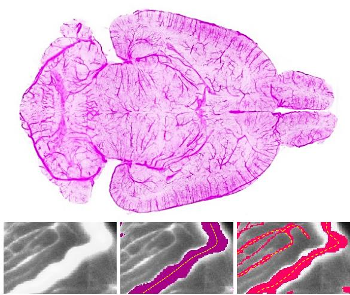
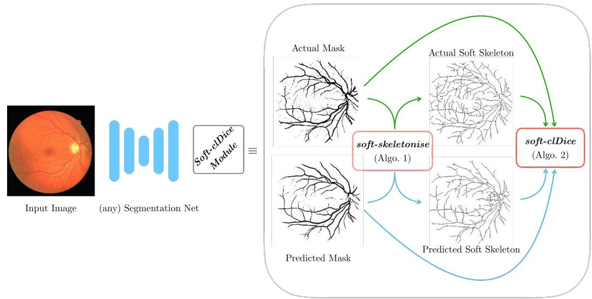
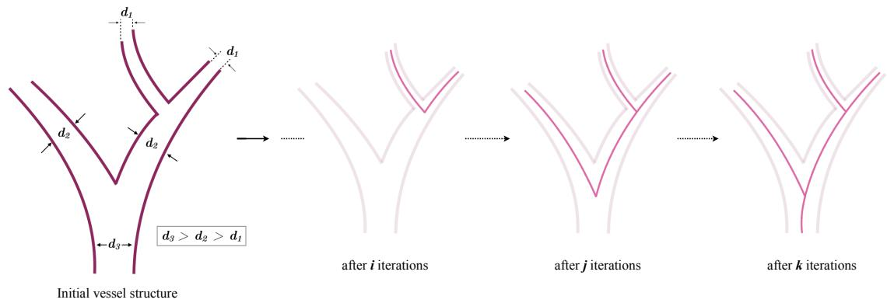
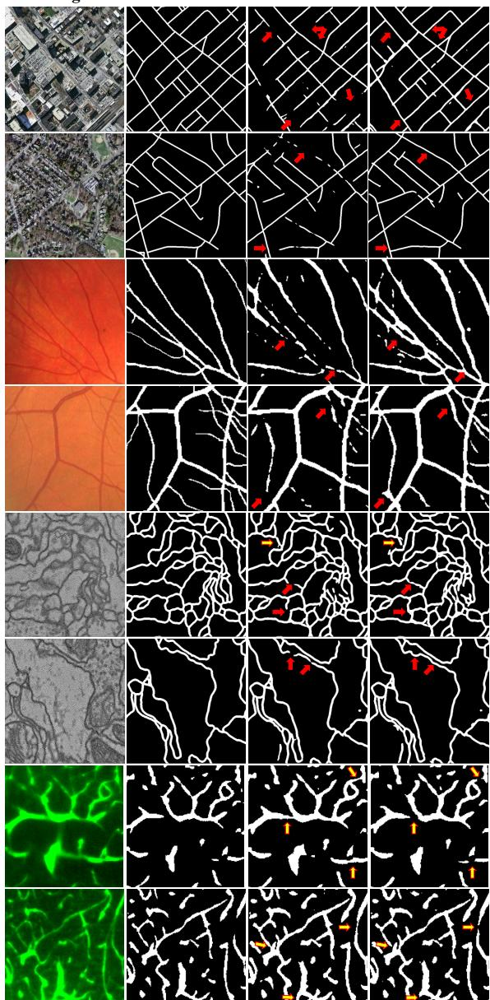

# clDice - a Novel Topology-Preserving Loss Function for Tubular Structure Segmentation

Suprosanna Shit \* 1 Johannes C. Paetzold \* 1 Anjany Sekuboyina1 Ivan Ezhov1 Alexander Unger1 Andrey Zhylka2 Josien P. W. Pluim² Ulrich Bauer1 Bjoern H. Menze1 1Technical University of Munich 2 Eindhoven University of Technology

## Abstract

Accurate segmentation of tubular, network-like structures, such as vessels, neurons, or roads, is relevant to many fields of research. For such structures, the topology is their most important characteristic; particularly preserving connectedness: in the case of vascular networks, missing a connected vessel entirely alters the blood-flow dynamics. We introduce a novel similarity measure termed centerlineDice (short clDice), which is calculated on the intersection of the segmentation masks and their (morphological) skeleta. We theoretically prove that clDice guarantees topology preservation up to homotopy equivalence for binary 2D and 3D segmentation. Extending this, we propose a computationally efficient, differentiable loss function (soft-clDice) for training arbitrary neural segmentation networks. We benchmark the soft-clDice loss on five public datasets, including vessels, roads and neurons (2D and 3D). Training on soft-clDice leads to segmentation with more accurate connectivity information, higher graph similarity, and better volumetric scores.

## 1. Introduction

Segmentation of tubular and curvilinear structures is an essential problem in numerous domains, such as clinical and biological applications (blood vessel and neuron segmentation from microscopic, optoacoustic, or radiology images), remote sensing applications (road network segmentation from satellite images) and industrial quality control, etc. In the aforementioned domains, a topologically accurate segmentation is necessary to guarantee error-free downstream tasks, such as computational hemodynamics, route planning, Alzheimer's disease prediction [18], or stroke modeling [20]. When optimizing computational algorithms for segmenting curvilinear structures, the two most commonly used categories of quantitative performance measures for evaluating segmentation accuracy of tubular structures, are 1) overlap based measures such as Dice, precision, recall, and Jaccard index; and 2) volumetric distance measures such as the Hausdorff and Mahalanobis distance [21, 40, 36, 16].

  
Figure 1. Motivation: The figure shows a 3D rendering of a complex, whole brain vascular dataset [48], where an exemplary 2D slice of the data is chosen and segmented by two different models, see purple (middle) and red (right), respectively. The two segmentation results achieve identical quality in terms of the traditional Dice score. Note that the purple segmentation does not capture the small vessels while segmenting the large vessel very accurately; on the other side, the red segmentation captures all vessels in the image while being less accurate on the radius of the large vessel. Skeleta are drawn in yellow. From a topology or network perspective, the red segmentation is evidently preferred.

However, in most segmentation problems, where the object of interest is 1) locally a tubular structure and 2) globally forms a network, the most important characteristic is the connectivity of the global network topology. Note that network in this context implies a physically connected structure, such as a vessel network, a road network, etc., which is also the primary structure of interest for the given image data. As an example, one can refer to brain vasculature analysis, where a missed vessel segment in the segmentation mask can pathologically be interpreted as a stroke or may lead to dramatic changes in a global simulation of blood flow. On the other hand, limited over- or undersegmentation of vessel radius can be tolerated, because it does not affect clinical diagnosis.

For evaluating segmentations in such tubular-network structures, traditional volume-based performance indices are sub-optimal. For example, Dice and Jaccard rely on the average voxel-wise hit or miss prediction [46]. In a task like network-topology extraction, a spatially contiguous sequence of correct voxel prediction is more meaningful than a spurious correct prediction. This ambiguity is relevant for objects of interest, which are of the same thickness as the resolution of the signal. For them, it is evident that a singlevoxel shift in the prediction can change the topology of the whole network. Further, a globally averaged metric does not equally weight tubular-structures with large, medium, and small radii (cf. Fig 1). In real vessel datasets, where vessels of wide radius ranges exist, e.g. 30 µm for arterioles and 5 µm for capillaries [48, 9], training on a globally averaged loss induces a strong bias towards the volumetric segmentation of large vessels. Both scenarios are pronounced in imaging modalities, such as fluorescence microscopy [48, 58] and optoacoustics, which focus on mapping small capillary structures.

To this end, we are interested in a topology-aware image segmentation, eventually enabling a correct network extraction. Therefore, we ask the following research questions:

Q1. What is a good pixelwise measure to benchmark segmentation algorithms for tubular, and related linear and curvilinear structure segmentation while guaranteeing the preservation of the network-topology?

Q2. Can we use this improved measure as a loss function for neural networks, which is a void in existing literature?

## 1.1. Related Literature

Achieving topology preservation can be crucial to obtain meaningful segmentation, particularly for elongated and connected shapes, e.g. vascular structures or roads. However, analyzing preservation of topology while simplifying geometries is a difficult analytical and computational problem [11, 10].

For binary geometries, various algorithms based on thinning and medial surfaces have been proven to be topologypreserving according to varying definitions of topology [23, 25, 26, 35]. For non-binary geometries, existing methods applied topology and connectivity constraints onto variational and Markov random field-based methods: tree shape priors for vessel segmentation [44], graph representation priors to natural images [2], higher-order cliques which connect superpixels [53] and adversarial learning for road segmentation [51], integer programming to general curvilinear structures [49], and proposed a tree-structured convolutional gated recurrent unit [22], morphological optimization [14], among others [3, 15, 32, 31, 33, 37, 41, 52, 57, 56]. Further, topological priors of containment were applied to histology scans [5], a 3D CNN with graph refinement was used to improve airway connectivity [19], and recently, Mosinska et al. trained networks which perform segmentation and path classification simultaneously [30]. Another approach enables the predefinition of Betti numbers and enforces them on the training[8].

The aforementioned literature has advanced the communities understanding of topology-preservation, but critically, they do not possess end-to-end loss functions that optimize topology-preservation. In this context, the literature remains sparse. Recently, Mosinska et al. suggested that pixel-wise loss-functions are unsuitable and used selected filter responses from a VGG19 network as an additional penalty [29]. Nonetheless, their approach does not prove topology preservation. Importantly, Hu et al. proposed the first continuous-valued loss function based on the Betti number and persistent homology [17]. However, this method is based on matching critical points, which, according to the authors makes the training very expensive and error-prone for real image-sized patches [17]. While this is already limiting for a translation to large real world data set, we find that none of these approaches have been extended to three dimensional (3D) data.

## 1.2. Our Contributions

The objective of this paper is to identify an efficient, general, and intuitive loss function that enables topology preservation while segmenting tubular objects. We introduce a novel connectivity-aware similarity measure named clDice for benchmarking tubular-segmentation algorithms. Importantly, we provide theoretical guarantees for the topological correctness of the clDice for binary 2D and 3D segmentation. As a consequence of its formulation based on morphological skeletons, our measure pronounces the network's topology instead of equally weighting every voxel. Using a differentiable soft-skeletonization, we show that the clDice measure can be used to train neural networks. We show experimental results for various 2D and 3D network segmentation tasks to demonstrate the practical applicability of our proposed similarity measure and loss function.

## 2. Let's Emphasize Connectivity

We propose a novel connectivity-preserving metric to evaluate tubular and linear structure segmentation based on intersecting skeletons with masks. We call this metric centerlineDice or clDice.

  
Figure 2. Schematic overview of our proposed method: Our proposed clDice loss can be applied to any arbitrary segmentation network. The soft-skeletonization can be easily implemented using pooling functions from any standard deep-learning toolbox.

We consider two binary masks: the ground truth mask $( V _ { L } )$ and the predicted segmentation masks $( V _ { P } )$ . First, the skeletons $S _ { P }$ and $S _ { L }$ are extracted from $V _ { P }$ and $V _ { L }$ respectively. Subsequently, we compute the fraction of $S _ { P }$ that lies within $V _ { L }$ , which we call Topology Precision or ${ \mathrm { T p r e c } } ( S _ { P } , V _ { L } )$ , and vice-a-versa we obtain Topology Sensitivity or Tsens $( S _ { L } , V _ { P } )$ as defined bellow;

$$
\mathrm { T p r e c } ( S _ { P } , V _ { L } ) = \frac { \left| S _ { P } \cap V _ { L } \right| } { \left| S _ { P } \right| } ; \mathrm { T s e n s } ( S _ { L } , V _ { P } ) = \frac { \left| S _ { L } \cap V _ { P } \right| } { \left| S _ { L } \right| }\tag{1}
$$

We observe that the measure ${ \mathrm { T p r e c } } ( S _ { P } , V _ { L } )$ is susceptible to false positives in the prediction while the measure $\mathrm { T s e n s } ( S _ { L } , V _ { P } )$ is susceptible to false negatives. This explains our rationale behind referring to the Tprec $( S _ { P } , V _ { L } )$ as topology's precision and to the Tsens $( S _ { L } , V _ { P } )$ as its sensitivity. Since we want to maximize both precision and sensitivity (recall), we define clDice to be the harmonic mean (also known as F1 or Dice) of both the measures:

$$
\operatorname { c l D i c e } ( V _ { P } , V _ { L } ) = 2 \times { \frac { \operatorname { T p r e c } ( S _ { P } , V _ { L } ) \times \operatorname { T s e n s } ( S _ { L } , V _ { P } ) } { \operatorname { T p r e c } ( S _ { P } , V _ { L } ) + \operatorname { T s e n s } ( S _ { L } , V _ { P } ) } }\tag{2}
$$

Note that our clDice formulation is not defined for ${ \mathrm { T p r e c } } =$ 0 and $\mathrm { T s e n s } = 0 ,$ but can easily be extended continuously with the value 0.

## 3. Topological Guarantees for clDice

The following section provides general theoretical guarantees for the preservation of topological properties achieved by optimizing clDice under mild conditions on the input. Roughly, these conditions state that the object of interest is embedded in $S ^ { 3 }$ in a non-knotted way, as is typically the case for blood vessel and road structures.

Specifically, we assume that both ground truth and prediction admit foreground and background skeleta, which means that both foreground and background are homotopyequivalent to topological graphs, which we assume to be embedded as skeleta. Here, the voxel grid is considered as a cubical complex, consisting of elementary cubes of dimensions 0, 1, 2, and 3. This is a special case of a cell complex (specifically, a CW complex), which is a space constructed inductively, starting with isolated points (0-cells), and gluing a collection of topological balls of dimension k (called k-cells) along their boundary spheres to a $k - 1 \cdot$ dimensional complex. The voxel grid, seen as a cell complex in this sense, can be completed to an ambient complex that is homeomorphic to the 3-sphere $S ^ { 3 }$ by attaching a single exterior cell to the boundary. In order to consider foreground and background of a binary image as complementary subspaces, the foreground is now assumed to be the union of closed unit cubes in the voxel grid, corresponding to voxels with value 1; and the background is the complement in the ambient complex. This convention is commonly used in digital topology [24, 23]. The assumption on the background can then be replaced by a convenient equivalent condition, stating that the foreground is also homotopy equivalent to a subcomplex obtained from the ambient complex by only removing 3-cells and 2-cells. Such a subcomplex is then clearly homotopy-equivalent to the complement

of a 1-complex.

We will now observe that the above assumptions imply that the foreground and the background are connected and have a free fundamental group and vanishing higher fundamental groups. In particular, the homotopy type is already determined by the first Betti number ¹; moreover, a map inducing an isomorphism in homology is already a homotopy equivalence. To see this, first note that both foreground and background are assumed to have the homology of a graph, in particular, homology is trivial in degree 2. By Alexander duality [1], then, both foreground and background have trivial reduced cohomology in degree 0, meaning that they are connected. This implies that both have a free fundamental group (as any connected graph) and vanishing higher homotopy groups. In particular, since homology in degree 1 is the Abelianization of the fundamental group, these two groups are isomorphic. This in turn implies that in our setting a map that induces isomorphisms in homology already induces isomorphisms between all homotopy groups. By Whitehead's theorem [54], such a map is then a homotopy equivalence.

The following theorem shows that under our assumptions on the images admitting foreground and background skeleta, the existence of certain nested inclusions already implies the homotopy-equivalence of foreground and background, which we refer to as topology preservation.

Theorem 1. Let $L _ { A } \subseteq A \subseteq K _ { A }$ and $L _ { B } \subseteq B \subseteq K _ { B }$ be connected subcomplexes of some cell complex. Assume that the above inclusions are homotopy equivalences. If the subcomplexes also are related by inclusions $L _ { A } \subseteq B \subseteq$ $K _ { A }$ and $L _ { B } \subseteq A \subseteq K _ { B } ,$ then these inclusions must be homotopy equivalences as well. In particular, A and B are homotopy-equivalent.

Proof. An inclusion of cell complexes map is a homotopy equivalence if and only if it induces isomorphisms on all homotopy groups. Since the inclusion $L _ { A } \subseteq B \subseteq K _ { A }$ induces an isomorphism, the inclusion $L _ { A } \subseteq B$ induces a left-inverse, and since $B \subseteq K _ { B }$ induces an isomorphism, the inclusion $L _ { A } \subseteq K _ { B }$ also induces a left-inverse. At the same time, since the inclusion $L _ { B } \subseteq A \subseteq K _ { B }$ induces an isomorphism, the inclusion $A \subseteq K _ { B }$ induces a left-inverse, and since $L _ { A } \subseteq A$ induces an isomorphism, the inclusion $L _ { A } \subseteq K _ { B }$ also induces a right-inverse. Together, this implies that the inclusion $L _ { A } \subseteq K _ { B }$ induces an isomorphism.

Together with the isomorphisms induced by $L _ { A } \subseteq A$ and $B \subseteq K _ { B } ,$ we obtain isomorphisms induced by $L _ { A } \subseteq B$ and by $A \subseteq K _ { B }$ , which compose to an isomorphism between the homotopy groups of A and B. □

Corollary 1.1. Let $V _ { L }$ and Vp be two binary masks admitting foreground and background skeleta, such that the foreground skeleton of $V _ { L }$ is included in the foreground of $V _ { P }$ and vice versa, and similarly for the background. Then the foregrounds of $V _ { L }$ and $V _ { P }$ are homotopy equivalent, and the same is true for their backgrounds.

Note that the inclusion condition in this corollary is satisfied if and only if clDice evaluates to 1 on both foreground and background of $( V _ { L } , V _ { P } )$

This proof lays the ground for a general interpretation of clDice as a topology preserving metric. Additionally, we provide an elaborate explanation of clDice topological properties, using concepts of applied digital topology in the theory section of the Supplementary material [24, 23].

## 4. Training Neural Networks with clDice

In the previous section we provided general theoretic guarantees how clDice has topology preserving properties. The following chapter shows how we applied our theory to efficiently train topology preserving networks using the clDice formulation.2

## 4.1. Soft-clDice using Soft-skeletonization:

Extracting accurate skeletons is essential to our method. For this task, a multitude of approaches has been proposed. However, most of them are not fully differentiable and therefore unsuited to be used in a loss function. Popular approaches use the Euclidean distance transform or utilize repeated morphological thinning. Euclidean distance transform has been used on multiple occasions [42, 55], but remains a discrete operation and, to the best of our knowledge, an end-to-end differentiable approximation remains to be developed, preventing the use in a loss function for training neural networks. On the contrary, morphological thinning is a sequence of dilation and erosion operations [c.f. Fig. 3].

Importantly, thinning using morphological operations (skeletonization) on curvilinear structures can be topologypreserving [35]. Min- and max filters are commonly used as the grey-scale alternative of morphological dilation and erosion. Motivated by this, we propose ‘soft-skeletonization', where an iterative min- and max-pooling is applied as a proxy for morphological erosion and dilation. The Algorithm 1 describes the iterative processes involved in its computation. The hyper-parameter k involved in its computation represents the iterations and has to be greater than or equal to the maximum observed radius. In our experiments, this parameter depends on the dataset. For example, it is $k = 5 . . . 2 5$ in our experiments, matching the pixel radius of the largest observed tubular structures. Choosing a larger k does not reduce performance but increases computation time. On the other hand, a too low k leads to incomplete skeletonization.

  
Figure 3. Based on the initial vessel structure (purple), sequential bagging of skeleton voxels (red) via iterative skeletonization leads to a complete skeletonization, where d denotes the diameter and k $\because j > i$ iterations.

Algorithm 1: soft-skeleton   
Input: I, k   
I' ← maxpool(minpool(I))   
$S \gets R e L U ( I - I ^ { \prime } )$   
for i ← 0 to k do   
I ← minpool(I)   
I' ← maxpool(minpool(I))   
$S \gets S + ( 1 - \dot { S } ) \circ R e L \dot { U } ( I - I ^ { \prime } )$   
end   
Output: S   
Algorithm 2: soft-clDice   
Input: $\overline { { V _ { P } , V _ { L } } }$   
$S _ { P } \gets s o f t .$ skeleton(VP)   
$S _ { L } \gets s o f t  – s k e l e t o n ( V _ { L } )$   
Tprec $\begin{array} { r } { ( S _ { P } , V _ { L } )  \frac { \vert S _ { P } \circ V _ { L } \vert + \epsilon } { \vert S _ { P } \vert + \epsilon } } \end{array}$   
Tsens $\begin{array} { r } { ( S _ { L } , V _ { P } )  \frac { \vert S _ { L } \circ V _ { P } \vert + } { \vert S _ { L } \vert + \epsilon } } \end{array}$   
clDice ←   
$\begin{array} { r } { 2 \times \frac { T p r e c ( S _ { P } , V _ { L } ) \times T s e n s ( S _ { L } , V _ { P } ) } { T p r e c ( S _ { P } , V _ { L } ) + T s e n s ( S _ { L } , V _ { P } ) } } \end{array}$   
Output: cl Dice  
Figure 4. Algorithm 1 calculates the proposed soft-skeleton, here I is the mask to be soft-skeletonized and k is the number of iterations for skeletonization. Algorithm 2, calculates the soft-clDice loss, where Vp is a real-valued probabilistic prediction from a segmentation network and $V _ { L }$ is the true mask. We denote Hadamard product using o.

In Figure 3, the successive steps of our skeletonization are intuitively represented. In the early iterations, the structures with a small radius are skeletonized and preserved until the later iterations when the thicker structures become skeletonized. This enables the extraction of a parameterfree, morphologically motivated soft-skeleton. The aforementioned soft-skeletonization enables us to use clDice as a fully differentiable, real-valued, optimizable measure. The Algorithm 2 describes its implementation. We refer to this as the $s o f t - c l D i c e$

For a single connected foreground component and in the absence of knots, the homotopy type is specified by the number of linked loops. Hence, if the reference and the predicted volumes are not homotopy equivalent, they do not have pairwise linked loops. To include these missing loops or exclude the extra loops, one has to add or discard deformation retracted skeleta of the solid foreground. This implies adding new correctly predicted voxels. In contrast to other volumetric losses such as Dice, cross-entropy, etc., clDice only considers the deformation-retracted graphs of the solid foreground structure. Thus, we claim that clDice requires the least amount of new correctly predicted voxels to guarantee the homotopy equivalence. Along these lines, Dice or cross-entropy can only guarantee homotopy equivalence if every single voxel is segmented correctly. On the other hand, clDice can guarantee homotopy equivalence for a broader combinations of connected-voxels. Intuitively, this is a very much desirable property as it makes clDice robust towards outliers and noisy segmentation labels.

## 4.2. Cost Function

Since our objective here is to preserve topology while achieving accurate segmentations, and not to learn skeleta, we combine our proposed soft-clDice with soft-Dice in the following manner:

$$
\mathcal { L } _ { c } = ( 1 - \alpha ) ( 1 - s o f t D i c e ) + \alpha ( 1 - s o f t c l D i c e )\tag{3}
$$

where $\alpha ~ \in ~ [ 0 , 0 . 5 ]$ . In stark contrast to previous works, where segmentation and centerline prediction has been learned jointly as multi-task learning [50, 47], we are not interested in learning the centerline. We are interested in learning a topology-preserving segmentation. Therefore, we restrict our experimental choice of alpha to $\alpha \in [ 0 , 0 . 5 ]$ We test clDice on two state-of-the-art network architectures: i) a 2D and 3D U-Net[38, 6], and ii) a 2D and 3D fully connected networks (FCN) [47, 13]. As baselines, we use the same architectures trained using soft-Dice [27, 45].

## 4.3. Adaption for Highly Imbalanced Data

Our theory (Section 3), describes a two-class problem where clDice should be computed on both the foreground and the background channels. In our experiments, we show that for complex and highly imbalanced dataset it is sufficient to calculate the clDice loss on the underrepresented foreground class. We attribute this to the distinct properties of tubularness, sparsity of foreground and the lack of cavities (Betti number 2) in our data. An intuitive interpretation how these assumptions are valid in terms of digital topology can be found in the supplementary material.

## 5. Experiments

## 5.1. Datasets

We employ five public datasets for validating clDice and soft-clDice as a measure and an objective function, respectively. In 2D, we evaluate on the DRIVE retina dataset [43], the Massachusetts Roads dataset [28] and the CREMI neuron dataset [12]. In 3D, a synthetic vessel dataset with an added Gaussian noise term [39] and the Vessap dataset of multi-channel volumetric scans of brain vessels is used [48, 34]. For the Vessap dataset we train different models for one and two input channels. For all of the datasets, we perform three fold cross-validation and test on held-out, large, and highly-variant test sets. Details concerning the experimental setup can be found in the supplementary material.

## 5.2. Evaluation Metrics

We compare the performance of various experimental setups using three types of metrics: volumetric, topologybased, and graph-based.

1. Volumetric: We compute volumetric scores such as Dice coefficient, Accuracy, and the proposed clDice.

2. Topology-based: We calculate the mean of absolute Betti Errors for the Betti Numbers $\beta _ { 0 }$ and $\beta _ { 1 }$ and the mean absolute error of Euler characteristic, $\chi = V -$ $E { + } F .$ where $V , E$ and $F$ denotes number of vertices, edges, and faces.

3. Graph-based: we extract random patch-wise graphs for the 2D/3D images. We uniformly sample fixed number of points from the graph and compute the StreetmoverDistance (SMD) [4]. SMD captures a Wasserstein distance between two graphs. Additionally we compute the F1 score of junction-based metric [7].

## 5.3. Results and Discussion

We trained two segmentation architectures, a U-Net and an FCN, for the various loss functions in our experimental setup. As a baseline, we trained the networks using soft-dice and compared it with the ones trained using the proposed loss (Eq. 3), by varying α from (0.1 to 0.5).

Quantitative: We observe that including soft-clDice in any proportion $( \alpha > 0 )$ leads to improved topological, volumetric and graph similarity for all 2D and 3D datasets, see Table 1. We conclude that α can be interpreted as a hyper parameter which can be tuned per-dataset. Intuitively, increasing the α improves the clDice measure for most experiments. Most often, clDice is high or highest when the graph and topology based measures are high or highest, particularly the $\beta _ { 1 }$ Error, Streetmover distance and Opt-J F1 score; quantitatively indicating that topological properties are indeed represented in the clDice measure.

In spite of not optimizing for a high soft-clDice on the background class, all of our networks converge to superior segmentation results. This not only reinforces our assumptions on dataset-specific necessary conditions but also validates the practical applicability of our loss. Our findings hold for the different network architectures, for 2D or 3D, and for tubular or curvilinear structures, strongly indicating its generalizability to analogous binary segmentation tasks.

Observe that CREMI and the synthetic vessel dataset (see Supplementary material) appear to have the smallest increase in scores over the baseline. We attribute this to them being the least complex datasets in the collection, with CREMI having an almost uniform thickness of radii and the synthetic data having a high signal-to-noise ratio and insignificant illumination variation. More importantly, we observe larger improvements for all measures in case of the more complex Vessap and Roads data see Figure 5. In direct comparison to performance measures reported in two recent publications by Hu et al. and Mosinska et al. [17, 29], we find that our approach is on par or better in terms of Accuracy and Betti Error for the Roads and CREMI dataset. It is important to note that we used a smaller subset of training data for the Road dataset compared to both while using the same test set.

Hu et al. reported a Betti error for the DRIVE data, which exceeds ours; however, it is important to consider that their approach explicitly minimizes the mismatch of the persistence diagram, which has significantly higher computational complexity during training, see the section below. We find that our proposed loss performs superior to the baseline in almost every scenario. The improvement appears to be pronounced when evaluating the highly relevant graph and topology based measures, including the recently introduced OPT-Junction F1 by Citraro et al. [7]. Our results are consistent across different network architectures, indicating that soft-clDice can be deployed to any network architecture.

Table 1. Quantitative experimental results for the Massachusetts road dataset (Roads), the CREMI dataset, the DRIVE retina dataset and the Vessap dataset (3D). Bold numbers indicate the best performance. The performance according to the clDice measure is highlighted in rose. For all experiments we observe that using soft-clDice in $\mathcal { L } _ { c }$ results in improved scores compared to soft-Dice. This improvement holds for almost α > 0; α can be interpreted as a dataset specific hyper-parameter.
<table><tr><td>Dataset</td><td>Network</td><td>Loss</td><td>Dice</td><td>Accuracy</td><td>clDice</td><td>β0 Error</td><td>β1 Error</td><td>SMD [4]</td><td>Xerror</td><td>Opt-J F1 [7]</td></tr><tr><td rowspan="10">Roads</td><td rowspan="10">FCN</td><td>soft-dice  $\bar { \mathcal { L } } _ { c } , \bar { \alpha } \equiv \bar { 0 . 1 }$ </td><td>64.84 66.52</td><td>95.16 95.70</td><td>70.79 74.80</td><td> $\overline { { 1 . 4 7 4 } }$  0.987</td><td>1.408 1.227</td><td>0.1216 0.1002</td><td>2.634 2.625</td><td>0.766 0.768</td></tr><tr><td></td><td>67.42</td><td></td><td>76.25</td><td>0.920</td><td>1.280</td><td>0.0954</td><td></td><td></td></tr><tr><td> $\mathcal { L } _ { c } , \alpha = 0 . 2$ </td><td></td><td>95.80</td><td></td><td></td><td></td><td></td><td>2.526</td><td>0.770</td></tr><tr><td> $\mathcal { L } _ { c } , \alpha = 0 . 3$ </td><td>65.90</td><td>95.35</td><td>74.86</td><td>0.974</td><td>1.197</td><td>0.1003</td><td>2.448</td><td>0.775</td></tr><tr><td> $\mathcal { L } _ { c } , \alpha = 0 . 4$ </td><td>67.18</td><td>95.46</td><td>76.92</td><td>0.934</td><td>1.092</td><td>0.0991</td><td>2.183</td><td>0.803</td></tr><tr><td> $\mathcal { L } _ { c } , \alpha = 0 . 5$ </td><td>65.77</td><td>95.09</td><td>75.22</td><td>0.947</td><td>1.184</td><td>0.0991</td><td>2.361</td><td>0.782</td></tr><tr><td> $\overline { { s o f t - d i c e } }$ </td><td>76.23</td><td>96.75</td><td>86.83</td><td>0.491</td><td>1.256</td><td>0.0589</td><td>1.120</td><td>0.881</td></tr><tr><td> $\bar { \mathcal { L } } _ { c } , \bar { \alpha } \equiv \bar { 0 . 1 }$ </td><td>76.66</td><td>96.77</td><td>87.35</td><td>0.359</td><td>0.938</td><td>0.0457</td><td>0.980</td><td>0.878</td></tr><tr><td> $\mathcal { L } _ { c } , \alpha = 0 . 2$ </td><td>76.25</td><td>96.76</td><td>87.29</td><td>0.312</td><td>1.031</td><td>0.0415</td><td>0.865</td><td>0.900</td></tr><tr><td> $\mathcal { L } _ { c } , \alpha = 0 . 3$ </td><td>74.85 75.38</td><td>96.57 96.60</td><td>86.10 86.16</td><td>0.322 0.344</td><td>1.062 1.016</td><td>0.0504</td><td>0.827</td><td>0.913</td></tr><tr><td></td><td> $\mathcal { L } _ { c } , \alpha = 0 . 4$ </td><td></td><td></td><td></td><td></td><td></td><td>0.0483</td><td>0.755</td><td>0.916</td></tr><tr><td>Mosinska et al.</td><td> $\mathcal { L } _ { c } , \alpha = 0 . 5$ </td><td>76.45</td><td>96.64</td><td>88.17</td><td>0.375</td><td>0.953</td><td>0.0527</td><td>1.080</td><td>0.894</td></tr><tr><td>Hu et al.</td><td>[29,17] [17]</td><td>-</td><td>97.54 97.28</td><td></td><td>-</td><td>2.781 1.275</td><td>-</td><td></td><td>-</td></tr><tr><td></td><td>soft-dice</td><td></td><td></td><td></td><td></td><td></td><td></td><td>-</td><td></td></tr><tr><td rowspan="6">CREMI</td><td rowspan="6">U-NET</td><td></td><td>91.54 91.76</td><td>97.11 97.21</td><td>95.86 96.05</td><td>0.259 0.222</td><td>0.657 0.556</td><td>0.0461</td><td>1.087</td><td>0.904 0.900</td></tr><tr><td> $\bar { \mathcal { L } } _ { c } , \bar { \alpha } \equiv \bar { 0 . 1 }$ </td><td>91.66</td><td></td><td>96.01</td><td>0.231</td><td>0.630</td><td>0.0395</td><td>1.000</td><td></td></tr><tr><td> $\mathcal { L } _ { c } , \alpha = 0 . 2$ </td><td></td><td>97.15</td><td>96.21</td><td></td><td></td><td>0.0419</td><td>0.991</td><td>0.902</td></tr><tr><td> $\mathcal { L } _ { c } , \alpha = 0 . 3$ </td><td>91.78</td><td>97.18</td><td></td><td>0.204</td><td>0.537</td><td>0.0437</td><td>0.919</td><td>0.913</td></tr><tr><td> $\mathcal { L } _ { c } , \alpha = 0 . 4$ </td><td>91.56</td><td>97.12</td><td>96.09</td><td>0.250</td><td>0.630</td><td>0.0444</td><td>0.995</td><td>0.902</td></tr><tr><td> $\mathcal { L } _ { c } , \alpha = 0 . 5$ </td><td>91.66</td><td>97.16</td><td>96.16</td><td>0.231</td><td>0.620</td><td>0.0455</td><td>0.991</td><td>0.907</td></tr><tr><td rowspan="2">Mosinska et al. Hu et al.</td><td>[29,17]</td><td>82.30</td><td>94.67 94.56</td><td></td><td></td><td>1.973 1.113</td><td></td><td></td><td></td></tr><tr><td>[17]</td><td></td><td></td><td></td><td></td><td></td><td></td><td></td><td></td></tr><tr><td rowspan="8">DRIVE retina</td><td rowspan="8">FCN</td><td> $\overline { { s o f t - D i c e } }$ </td><td>78.23</td><td>96.27 96.25</td><td>78.02 79.02</td><td>2.187 2.100</td><td>1.860 1.610</td><td>0.0429 0.0393</td><td>3.275</td><td>0.773</td></tr><tr><td> $\bar { \mathcal { L } } _ { c } , \bar { \alpha } \equiv \bar { 0 . 1 }$ </td><td>78.36</td><td></td><td></td><td></td><td></td><td></td><td>3.203</td><td>0.777</td></tr><tr><td> $\mathcal { L } _ { c } , \alpha = 0 . 2$ </td><td>78.75</td><td>96.29</td><td>80.22</td><td>1.892</td><td>1.382</td><td>0.0383</td><td>2.895</td><td>0.793</td></tr><tr><td> $\mathcal { L } _ { c } , \alpha = 0 . 3$ </td><td>78.29</td><td>96.20</td><td>80.28</td><td>1.888</td><td>1.332</td><td>0.0318</td><td>2.918</td><td>0.798</td></tr><tr><td> $\mathcal { L } _ { c } , \alpha = 0 . 4$ </td><td>78.00</td><td>96.11</td><td>80.43</td><td>2.036</td><td>1.602</td><td>0.0423</td><td>3.141</td><td>0.764</td></tr><tr><td> $\mathcal { L } _ { c } , \alpha = 0 . 5$ </td><td>77.76</td><td>96.04</td><td>80.95</td><td>1.836</td><td>1.408</td><td>0.0394</td><td>2.848</td><td>0.794</td></tr><tr><td> $\overline { { s o f t - D i c e } }$ </td><td>74.25</td><td>95.63</td><td>75.71</td><td>1.745</td><td>1.455</td><td>0.0649</td><td>2.997</td><td>0.760</td></tr><tr><td> $\mathcal { L } _ { c } , \alpha = 0 . 5$ </td><td>75.21</td><td>95.82</td><td>76.86</td><td>1.538</td><td>1.389</td><td>0.0586</td><td>2.737</td><td>0.767</td></tr><tr><td rowspan="2">Mosinska et al. Hu et al.</td><td> $[ 2 9 , 1 7 ]$ </td><td></td><td>95.43</td><td></td><td></td><td>2.784</td><td></td><td></td><td></td></tr><tr><td>[17]</td><td></td><td>95.21</td><td></td><td>-</td><td>1.076</td><td></td><td>-</td><td></td></tr><tr><td rowspan="10"></td><td rowspan="9">FCN, 1 ch</td><td> $\overline { { s o f t - d i c e } }$ </td><td>85.21</td><td>96.03</td><td>90.88 91.32</td><td>3.385 2.292</td><td>4.458 3.677</td><td>0.00459 0.00417</td><td>5.850</td><td>0.862</td></tr><tr><td> $\mathcal { L } _ { c } , \alpha = 0 . 5$ </td><td>85.44</td><td>95.91</td><td></td><td></td><td></td><td></td><td>5.620</td><td>0.864</td></tr><tr><td> $\overline { { s o f t - d i c e } }$ </td><td>85.31</td><td>95.82</td><td>90.10</td><td>2.833</td><td>4.771</td><td>0.00629</td><td>6.080</td><td>0.849</td></tr><tr><td> $\bar { \mathcal { L } } _ { c } ^ { - } , \bar { \alpha } \overset { - } { = } \bar { 0 . 1 } \bar { 1 }$   $\mathcal { L } _ { c } , \alpha = 0 . 2$ </td><td>85.96 86.45</td><td>95.99</td><td>91.02</td><td>2.896</td><td>4.156</td><td>0.00447</td><td>5.980</td><td>0.860</td></tr><tr><td></td><td>85.72</td><td>96.11 95.93</td><td>91.22 91.20</td><td>2.656 2.719</td><td>4.385 4.469</td><td>0.00466 0.00423</td><td>5.530</td><td>0.869</td></tr><tr><td> $\mathcal { L } _ { c } , \alpha = 0 . 3$ </td><td>85.65</td><td></td><td>91.65</td><td></td><td></td><td>0.00423</td><td>5.470</td><td>0.866</td></tr><tr><td> $\mathcal { L } _ { c } , \alpha = 0 . 4$ </td><td>85.28</td><td>95.95</td><td></td><td>2.719</td><td>4.469</td><td>0.00433</td><td>5.670</td><td>0.869</td></tr><tr><td> $\mathcal { L } _ { c } , \alpha = 0 . 5$   $\overline { { s o f t - d i c e } }$ </td><td>87.46</td><td>95.76 96.35</td><td>91.22 91.18</td><td>2.615 3.094</td><td>4.615 5.042</td><td>0.00549</td><td>5.320 5.300</td><td>0.870 0.863</td></tr><tr></table>

Qualitative: In Figure 5, typical results for our datasets are depicted. Our networks trained on the proposed loss term recover connections, which were false negatives when trained with the soft-Dice loss. These missed connections appear to be particularly frequent in the complex road and DRIVE dataset. For the CREMI dataset, we observe these situations less frequently, which is in line with the very high quantitative scores on the CREMI data. Interestingly, in the real 3D vessel dataset, the soft-Dice loss oversegments vessels, leading to false positive connections. This is not the case when using our proposed loss function, which we attribute to its topology-preserving nature. Additional qualitative results can be inspected in the supplementary.

Computational Efficiency: Naturally, inference times of CNNs with the same architecture but different training losses are identical. However, during training, our soft-skeleton algorithm requires $O ( k n ^ { 2 } )$ complexity for an n × n 2D image where k is the number of iterations. As a comparison, [17] needs $O ( c ^ { 2 } m l o g ( m ) )$ (see [15]) complexity to compute the 1d persistent homology where d is the number of points with zero gradients in the prediction and m is the number of simplices. Roughly, c is proportional to $n ^ { 2 }$ , and m is of $O ( n ^ { 2 } )$ for a 2D Euclidean grid. Thus, the worst complexity of [17] is $O ( n ^ { 6 } l o g ( n ) )$ 1 Additionally, their approach requires an $O ( c l o g ( c ) )$ complexity to find an optimal matching of the birth-death pairs. We note that the total run-time overhead for soft-clDice compared to soft-Dice is marginal, i.e., for batch-size of 4 and 1024x1024 image resolution, the former takes 1.35s while the latter takes 1.24s on average (<10% increase) on an RTX-8000.

Future Work: Although our proposed soft-skeleton approximation works well in practice, a better differentiable skeletonization can only improve performance, which we reserve for future research. Any such skeletonization can be readily plugged into our approach. Furthermore, theoretical and experimental multi-class studies would sensibly extend our study.

## 6. Conclusive Remarks

We introduce clDice, a novel topology-preserving similarity measure for tubular structure segmentation. Importantly, we present a theoretical guarantee that clDice enforces topology preservation up to homotopy equivalence. Next, we use a differentiable version of the clDice, soft-clDice, in a loss function, to train state-of-the-art 2D and 3D neural networks. We use clDice to benchmark segmentation quality from a topology-preserving perspective along with multiple volumetric, topological, and graph-based measures. We find that training on soft-clDice leads to segmentations with more accurate connectivity information, better graph-similarity, better Euler characteristics, and improved Dice and Accuracy. Our soft-clDice is computationally efficient and can be readily deployed to any other deep learning-based segmentation tasks such as neuron segmentation in biomedical imaging, crack detection in industrial quality control, or remote sensing.

Acknowledgement: J. C. Paetzold. and S. Shit. are supported by the GCB and Translatum, TU Munich. S.Shit., A. Zhylka. and I. Ezhov. are supported by TRABIT (EU Grant: 765148). We thank Ali Ertuerk, Mihail I. Todorov, Nils Börner and Giles Tetteh.

Image  
Label  
Soft-Dice  
Ours  
  
Figure 5. Qualitative results: from top to bottom we show two rows of results for: the Massachusetts road dataset, the DRIVE retina dataset, the CREMI neuron data and 2D slices from the 3D Vessap dataset. From left to right, the real image, the label, the prediction using soft-Dice and the U-Net predictions using $\mathcal { L } _ { c } ( \alpha = 0 . 5 )$ are shown, respectively. The images indicate that clDice segments road, retina vessel connections and neuron connections which the soft-Dice loss misses, but also does not segment false-positive vessels in 3D. Some, but not all, missed connections are indicated with solid red arrows, false positives are indicated with red-yellow arrows. More qualitative results can be found in the Supplementary material.

## References

[1] Pavel S Aleksandrov. Combinatorial topology, volume 1. Courier Corporation, 1998.

[2] Bjoern Andres et al. Probabilistic image segmentation with closedness constraints. In ICCV, pages 2611–2618. IEEE, 2011.

[3] Ricardo J Araújo, Jaime S Cardoso, and Hélder P Oliveira. A deep learning design for improving topology coherence in blood vessel segmentation. In International Conference on Medical Image Computing and Computer-Assisted Intervention, pages 93–101. Springer, 2019.

[4] Davide Belli and Thomas Kipf. Image-conditioned graph generation for road network extraction. arXiv preprint arXiv:1910.14388, 2019.

[5] Aïcha BenTaieb and Ghassan Hamarneh. Topology aware fully convolutional networks for histology gland segmentation. In MICCAI, pages 460–468. Springer, 2016.

[6] Özgün Çiçek and Aothers. 3D U-Net: learning dense volumetric segmentation from sparse annotation. In MICCAI, pages 424–432. Springer, 2016.

[7] Leonardo Citraro, Mateusz Koziński, and Pascal Fua. Towards reliable evaluation of algorithms for road network reconstruction from aerial images. In European Conference on Computer Vision, pages 703–719. Springer, 2020.

[8] James Clough, Nicholas Byrne, Ilkay Oksuz, Veronika A Zimmer, Julia A Schnabel, and Andrew King. A topological loss function for deep-learning based image segmentation using persistent homology. IEEE Transactions on Pattern Analysis and Machine Intelligence, 2020.

[9] Antonino Paolo Di Giovanna et al. Whole-brain vasculature reconstruction at the single capillary level. Scientific reports, 8(1):12573, 2018.

[10] Herbert Edelsbrunner et al. Topological persistence and simplification. In FOCS, pages 454–463. IEEE, 2000.

[11] Herbert Edelsbrunner and John Harer. Computational topology: an introduction. American Mathematical Soc., 2010.

[12] Jan Funke, Fabian Tschopp, William Grisaitis, Arlo Sheridan, Chandan Singh, Stephan Saalfeld, and Srinivas C. Turaga. Large scale image segmentation with structured loss based deep learning for connectome reconstruction. IEEE Transactions on Pattern Analysis and Machine Intelligence, 41(7):1669–1680, Jul 2019.

[13] Stefan Gerl et al. A distance-based loss for smooth and continuous skin layer segmentation in optoacoustic images. In International Conference on Medical Image Computing and Computer-Assisted Intervention, pages 309–319. Springer, 2020.

[14] Shir Gur, Lior Wolf, Lior Golgher, and Pablo Blinder. Unsupervised microvascular image segmentation using an active contours mimicking neural network. In Proceedings of the IEEE/CVF International Conference on Computer Vision, pages 10722–10731, 2019.

[15] Xiao Han et al. A topology preserving level set method for geometric deformable models. IEEE TPAMI, 25(6):755– 768, 2003.

[16] Kai Hu et al. Retinal vessel segmentation of color fundus images using multiscale convolutional neural network with

an improved cross-entropy loss function. Neurocomputing, 309:179–191, 2018.

[17] Xiaoling Hu et al. Topology-preserving deep image segmentation. In NeurIPS, pages 5658–5669, 2019.

[18] Jesse M Hunter et al. Morphological and pathological evolution of the brain microcirculation in aging and Alzheimer's disease. PloS one, 7(5):e36893, 2012.

[19] Dakai Jin, Ziyue Xu, Adam P Harrison, Kevin George, and Daniel J Mollura. 3d convolutional neural networks with graph refinement for airway segmentation using incomplete data labels. In International Workshop on Machine Learning in Medical Imaging, pages 141–149. Springer, 2017.

[20] Anne Joutel et al. Cerebrovascular dysfunction and microcirculation rarefaction precede white matter lesions in a mouse genetic model of cerebral ischemic small vessel disease. JCI, 120(2):433–445, 2010.

[21] Cemil Kirbas and Francis Quek. A review of vessel extraction techniques and algorithms. CSUR, 36(2):81–121, 2004.

[22] Bin Kong, Xin Wang, Junjie Bai, Yi Lu, Feng Gao, Kunlin Cao, Jun Xia, Qi Song, and Youbing Yin. Learning tree-structured representation for 3d coronary artery segmentation. Computerized Medical Imaging and Graphics, 80:101688, 2020.

[23] T. Yung Kong. On topology preservation in 2-D and 3-D thinning. International journal of pattern recognition and artificial intelligence, 9(05):813–844, 1995.

[24] T Yung Kong and Azriel Rosenfeld. Digital topology: Introduction and survey. Computer Vision, Graphics, and Image Processing, 48(3):357–393, 1989.

[25] Ta-Chih Lee et al. Building skeleton models via 3-D medial surface axis thinning algorithms. CVGIP: Graphical Models and Image Processing, 56(6):462–478, 1994.

[26] Cherng Min Ma. On topology preservation in 3D thinning. CVGIP: Image understanding, 59(3):328–339, 1994.

[27] Fausto Milletari et al. V-net: Fully convolutional neural networks for volumetric medical image segmentation. In 3DV, pages 565–571. IEEE, 2016.

[28] Volodymyr Mnih. Machine Learning for Aerial Image Labeling. PhD thesis, University of Toronto, 2013.

[29] Agata Mosinska et al. Beyond the pixel-wise loss for topology-aware delineation. In CVPR, pages 3136–3145, 2018.

[30] Agata Mosinska, Mateusz Koziński, and Pascal Fua. Joint segmentation and path classification of curvilinear structures. IEEE Transactions on Pattern Analysis and Machine Intelligence, 42(6):1515–1521, 2019.

[31] Fernando Navarro, Suprosanna Shit, et al. Shape-aware complementary-task learning for multi-organ segmentation. In International Workshop on MLMI, pages 620–627. Springer, 2019.

[32] Sebastian Nowozin and Christoph H Lampert. Global connectivity potentials for random field models. In CVPR, pages 818–825. IEEE, 2009.

[33] Martin Ralf Oswald et al. Generalized connectivity constraints for spatio-temporal 3D reconstruction. In ECCV, pages 32–46. Springer, 2014.

[34] Johannes C Paetzold, Oliver Schoppe, et al. Transfer learning from synthetic data reduces need for labels to segment brain vasculature and neural pathways in 3d. In International Conference on Medical Imaging with Deep Learning— Extended Abstract Track, 2019.

[35] Kálmán Palágyi. A 3-subiteration 3D thinning algorithm for extracting medial surfaces. Pattern Recognition Letters, 23(6):663–675, 2002.

[36] Renzo Phellan et al. Vascular segmentation in TOF MRA images of the brain using a deep convolutional neural network. In MICCAI Workshop, pages 39–46. Springer, 2017.

[37] Markus Rempfler et al. Efficient algorithms for moral lineage tracing. In ICCV, pages 4695–4704, 2017.

[38] Olaf Ronneberger et al. U-net: Convolutional networks for biomedical image segmentation. In MICCAI, pages 234– 241. Springer, 2015.

[39] Matthias Schneider et al. Tissue metabolism driven arterial tree generation. Med Image Anal., 16(7):1397–1414, 2012.

[40] Matthias Schneider et al. Joint 3-D vessel segmentation and centerline extraction using oblique Hough forests with steerable filters. Med Image Anal., 19(1):220–249, 2015.

[41] Florent Ségonne. Active contours under topology control—genus preserving level sets. International Journal of Computer Vision, 79(2):107–117, 2008.

[42] Frank Y Shih and Christopher C Pu. A skeletonization algorithm by maxima tracking on euclidean distance transform. Pattern Recognition, 28(3):331–341, 1995.

[43] Joes Staal, Michael D Abràmoff, Meindert Niemeijer, Max A Viergever, and Bram Van Ginneken. Ridge-based vessel segmentation in color images of the retina. IEEE transactions on medical imaging, 23(4):501–509, 2004.

[44] Jan Stuhmer et al. Tree shape priors with connectivity constraints using convex relaxation on general graphs. In ICCV, pages 2336–2343, 2013.

[45] Carole H Sudre et al. Generalised dice overlap as a deep learning loss function for highly unbalanced segmentations. In MICCAI Workshop, pages 240–248. Springer, 2017.

[46] Abdel Aziz Taha and Allan Hanbury. Metrics for evaluating 3D medical image segmentation: analysis, selection, and tool. BMC Medical Imaging, 15(1):29, 2015.

[47] Giles Tetteh et al. Deepvesselnet: Vessel segmentation, centerline prediction, and bifurcation detection in 3-d angiographic volumes. arXiv preprint arXiv:1803.09340, 2018.

[48] Mihail Ivilinov Todorov, Johannes C. Paetzold, et al. Automated analysis of whole brain vasculature using machine learning. bioRxiv, page 613257, 2019.

[49] Engin Türetken et al. Reconstructing curvilinear networks using path classifiers and integer programming. IEEE TPAMI, 38(12):2515–2530, 2016.

[50] Fatmatülzehra Uslu and Anil Anthony Bharath. A multitask network to detect junctions in retinal vasculature. In MICCAI, pages 92–100. Springer, 2018.

[51] Subeesh Vasu, Mateusz Kozinski, Leonardo Citraro, and Pascal Fua. Topoal: An adversarial learning approach for topology-aware road segmentation. arXiv preprint arXiv:2007.09084, 2020.

[52] Sara Vicente et al. Graph cut based image segmentation with connectivity priors. In CVPR, pages 1–8. IEEE, 2008.

[53] Jan D Wegner et al. A higher-order CRF model for road network extraction. In CVPR, pages 1698–1705. IEEE, 2013.

[54] John HC Whitehead. Combinatorial homotopy. i. Bulletin of the American Mathematical Society, 55(3):213–245, 1949.

[55] Mark W Wright et al. Skeletonization using an extended euclidean distance transform. Image and Vision Computing, 13(5):367–375, 1995.

[56] Aaron Wu, Ziyue Xu, Mingchen Gao, Mario Buty, and Daniel J Mollura. Deep vessel tracking: A generalized probabilistic approach via deep learning. In 2016 IEEE 13th International Symposium on Biomedical Imaging (ISBI), pages 1363–1367. IEEE, 2016.

[57] Yun Zeng et al. Topology cuts: A novel min-cut/max-flow algorithm for topology preserving segmentation in n-d images. CVIU, 112(1):81–90, 2008.

[58] Shan Zhao et al. Cellular and molecular probing of intact human organs. Cell, 2020.