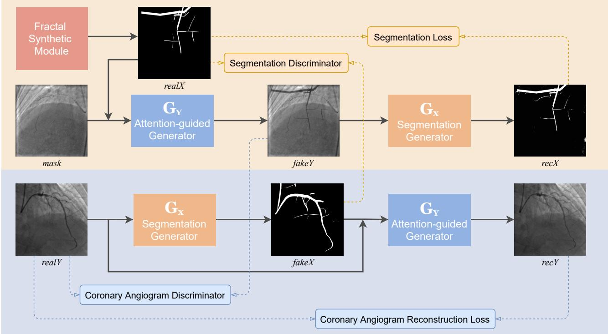
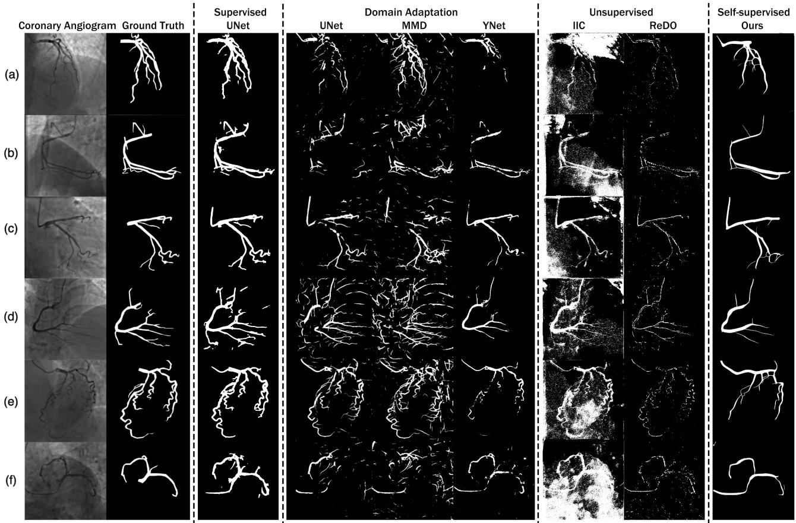
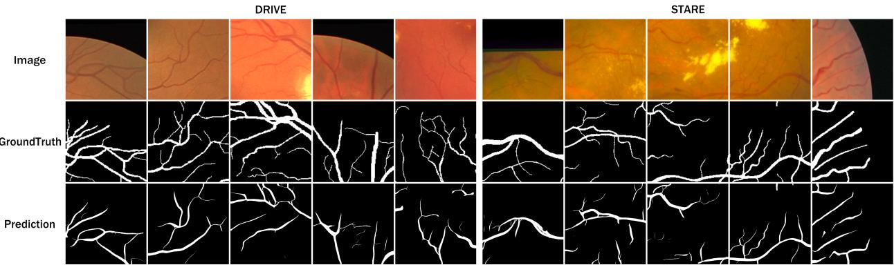

# Self-Supervised Vessel Segmentation viaAdversarial Learning

Yuxin Ma1,Yang Hua2,Hanming Deng1, Tao Song1, Hao Wang3, Zhengui Xue1 Heng Cao4, Ruhui Ma¹, Haibing Guan1 \*

1Shanghai Jiao Tong University 2Queen's University Belfast 3Louisiana State University 4Shanghai General Hospital

{1umosmyx,denghanmig,songt333,zhenguixue,ruhuima,hbguan}@sjtu.edu.cn,

Y.Hua@qub.ac.uk,haowang@lsu.edu, thegreatheng@163.com

## Abstract

Vessel segmentation is critically essential for diagnosing a series of diseases, including coronary artery disease and retinal disease. However, annotating vessel segmentation maps of medical images is notoriously challenging due to the tiny and complex vessel structures, leading to insufficient available annotated datasets for existing supervised methods and domain adaptation methods. The subtle structures and confusing background of medical images further suppress the efficacy of unsupervised methods. In this paper, we propose a self-supervised vessel segmentation method with adversarial learning. This method learns vessel representations by training an attention-guided generator and a segmentation generator to simultaneously synthesize fake vessels and segment vessels out of coronary angiograms, respectively. The method further applies the pretrained segmentation generator for coronary vessel segmentation and retinal vessel segmentation. We also build XCAD, the first X-ray angiography coronary vessel segmentation dataset. Our extensive experiments demonstrate the proposed method's effectiveness against existing segmentation methods on multiple datasets, including the XCAD dataset, DRIVE dataset, and STARE dataset.

## 1. Introduction

As the most common heart disease, coronary artery disease is one of the leading causes of death in the world. Atherosclerosis in the coronary artery hinders blood from normally flowing into the heart, eventually leading to a heart attack. Among various imaging modalities, X-ray angiography is taken as a gold standard for coronary artery disease diagnosis. As X-ray angiography can quickly display small vessel branches with a high resolution, it has been more widely utilized in medical diagnosis for determining the presence, location, degree, and scope of coronary artery stenosis. It is crucial but challenging to accurately estimate subtle vessel structures from coronary angiograms. To minimize the ionizing radiation exposure of patients and medical personnel, low-power X-ray is used during X-ray coronary angiography, usually leading to noisy and low-contrast coronary angiograms. However, such images make it hard to distinguish vessels from the background artifacts¹ that share similar appearances with vessel structures.

During X-ray coronary angiogram acquisition, a special cardiac catheter is utilized to inject contrast agent into the coronary artery. With the contrast agent taking effect, blood vessels gradually emerge, leaving a sequence of coronary angiography images under the X-ray. In such a coronary angiography sequence, the first frame with no contrast agent injected is the mask frame, without any vessels shown. On the contrary, the frame with a fully injected contrast agent is considered as the contrast frame. Note that in this paper, we use coronary angiogram to indicate the contrast frame in particular. Our objective is to segment vessels out of the coronary angiograms.

Existing segmentation methods can be classified into four main categories: traditional methods [17, 23], supervised methods [8, 25], domain adaptation methods [3, 31], and unsupervised methods [4, 15]. Traditional methods are typically based on predefined rules that require significant expertise and manual model tuning, leading to limited model expressiveness and generality. Supervised methods require a massive amount of annotated data for training, though public large-scale annotated vessel datasets are practically unavailable. The complex vessel structure consists of numerous tiny branches that easily fade into the image background artifacts, making the manual annotation process extremely laborious and time-consuming, even for professional medical experts. The effectiveness of domain adaptation methods is largely dependent on the quality of annotated source domain dataset and constrained by the gap between the source domain and target domain. Existing unsupervised segmentation methods for natural images, such as animals and flowers, can hardly work on medical images due to their thorny characteristics—numerous tiny branches and confusing background artifacts.

Inspired by self-supervised methods that learn representations from large-scale unsupervised data [6, 24], we exploit coronary angiography images' specific characteristics and design a self-supervised vessel segmentation method. Existing self-supervised methods learn useful representations for solving other tasks by constructing pretext tasks on unsupervised data. However, no existing self-supervised methods are designed for segmentation tasks due to the complexity of semantic segmentation. We observed that there are two kinds of images in coronary angiography images: images with vessels (i.e., coronary angiograms) and images without vessels (i.e., mask frames). According to this characteristic, we propose to learn self-supervised vessel representations by simultaneously training two adversarial networks that synthesize fake vessels on mask frames and segment vessels out of coronary angiograms. These learned vessel representations can be easily applied to multiple vessel segmentation tasks by directly using the pretrained model.

Without labeled vessel segmentation maps, we design a fractal synthetic module for self-supervised learning. Fractals synthesized by the fractal synthetic module are further utilized to guide the generation of vessels and serve as segmentation maps of synthetic fake coronary angiograms. We propose an attention-guided generator to confirm that vessels of synthetic fake coronary angiograms matches input segmentation maps. The idea of cycle consistency in Cycle-GAN [39] is applied to segmentation tasks. In our framework, the two adversarial networks for vessel synthesis and segmentation form a cycle to produce reconstructed coronary angiograms and reconstructed segmentation maps. We further propose to use segmentation loss to enforce the consistency between segmentation maps and reconstructed segmentation maps.

To support our research and facilitate the work of other researchers, we are the first to create an X-ray angiography coronary artery disease (XCAD) dataset. The XCAD dataset contains 1621 mask frames and 1620 coronary angiograms in the training set, and 126 coronary angiograms annotated by experienced radiologists in the testing set. Experimental results on the XCAD dataset demonstrate the effectiveness of the proposed method on coronary vessel segmentation. Moreover, our method shows competitive performance with other retinal vessel segmentation methods on the DRIVE dataset [34] and STARE dataset [13].

The main contributions of this paper are summarized as follows:

• To our best knowledge, we are the first to design a self-supervised method for vessel segmentation. Our method solves vessel segmentation tasks of both coronary angiograms and retinal images, with selfsupervised vessel representations learned from unannotated coronary angiography images.

• We build a large-scale XCAD dataset and will release it to public.

• The proposed method eliminates the limitations of existing segmentation methods and shows remarkably competitive performance on the XCAD dataset, DRIVE dataset, and STARE dataset.

## 2. Related Work

## 2.1. Traditional Methods for Vessel Segmentation

Traditional vessel segmentation methods [17, 23] require designing predefined rules for specific images. Khan et al. [17] designed several filters for retinal image denoising, enhancement and finally for vessel segmentation. Memari et al. [23] proposed to firstly enhance retinal images using contrast limited adaptive histogram equalisation and several filters. Then they utilized a genetic algorithm enhanced spatial fuzzy c-means method for extracting an initial vessel segmentation map. Finally the segmentation is further refined by an integrated level set approach.

Traditional methods with manually designed strategies can only be used for the specific task and have poor scalability. Methods for retinal vessel segmentation cannot solve the coronary vessel segmentation problem. However, our method successfully solves the problems of both retinal vessel segmentation and coronary vessel segmentation. Moreover, our method is scalable and easy to be utilized.

## 2.2. Supervised Methods for Vessel Segmentation

At the early stage of supervised vessel segmentation, Esfahani et al. [25] used Top-Hat transform to enhance the input angiograms. Then, the vessel regions can be recognized by training Convolutional Neural Networks (CNNs) with quantities of patches. Khowaja et al. [18] applied bidirectional histogram equalization on the inverted green channel to enhance the retinal images in supervised retinal vessel segmentation. Soomro et al. [33] utilized fuzzy logic and image processing tactics for pre-processing, and they removed the noisy pixels for post-processing. These methods require specifically designed pre-processing and postprocessing strategies.

Mask images are utilized to distinguish vessels from artifacts and remove the influence of background artifacts. Yang et al. [37] utilized the DeepMatching method [30] for the registration between the mask frames and contrast frames, then used both of them as multi-channel inputs to provide enhanced information of the vessel structure. The performance of this method highly relies on the registration for paired mask frames and contrast frames. On the contrary, our method does not need to use paired mask frames and contrast frames.

UNet [32] is mostly used as the backbone of vessel segmentation [8, 33, 36]. Fan et al. [8] proposed an octave UNet for accurate retinal vessel segmentation, which adopts octave convolution for multiple-spatial-frequency features learning. Yang et al. [36] studied the segmentation of the major vessels in X-ray coronary angiograms with UNet on annotated datasets. Supervised methods require complex vessel annotations. Our method alleviates the vessel annotation burden by self-supervised learning.

## 2.3. Domain Adaptation Methods

Domain adaptation [1] transfers knowledge from the annotated dataset in the source domain to the unannotated dataset in the target domain. An adversarial network [9] is utilized for domain adaptation in many semantic segmentation tasks [12, 5]. Adversarial training generates domaininvariant features through domain confusion. During this process, cycle consistency is usually employed for preserving structures [11, 38].

In medical image segmentation, Dou et al. [7] studied domain adaptation between CT and MRI by proposing a plug-and-play adversarial domain adaptation network to align feature spaces of both domains presenting significant domain shift. A domain adaptation method named MMD [3] was proposed for brain tissue segmentation by minimizing the maximum mean discrepancy between the source domain and target domain. YNet [31] extended classificationbased domain adaptation techniques to segmentation networks by regularizing the encoder features.

These methods fail to handle tasks that lack of largescale annotated datasets in a close source domain. However, our method does not require any annotated dataset as source domain.

## 2.4. Unsupervised Segmentation Methods

Xu et al. [15] proposed a method named Invariant Information Clustering. It can automatically partition the input images into clusters that are recognizable as different semantic classes. Another method named ReDO [4] utilized an adversarial architecture to extract the object mask of the input, then redrew a new object at the same location with different textures or colors. Because segmentation objects and backgrounds of medical images are very similar and difficult to distinguish, these methods are less effective on medical image segmentation. In contrast, our method takes into account the characteristics of medical images and outperform these methods on vessel segmentation of coronary angiograms and retinal images.

## 2.5. Self-supervised Representation Learning

Self-supervised learning methods construct pretexts to learn representations from large-scale unsupervised data. Spatial representations are learned by predicting the relative positions between two image patches [6, 26]. Similar studies designed pretext tasks for image inpainting [28] super-resolution [21] and image colorization [20] by applying transformations on original images. Different from single pretext tasks, Ren et al. [29] learned more generalizable high-level visual representations from multi-task including depth, surface normal and instance contour. Misra et al. [24] employed Siamese networks to input multiple video frames in parallel and learn temporal representations by shuffling image sequences. Xu et al. [35] learned both spatial and temporal information by sorting the order of 3D clips. SpeedNet [2] predicted the speed of the video from the input of full video sequences. These learned representations are proved to be helpful to action recognition, image classification, and object detection tasks, by finetuning the pretrained model on annotated datasets. However, it is hard to design a suitable pretext task and learn useful representations for complex semantic segmentation. We propose to use fractal synthetic module for self-supervised learning. Our method learns representations for vessel segmentation by adversarial vessel synthesis and segmentation.

## 3. Methodology

## 3.1. Overview

In this section we present the details of the proposed method. We generate fake coronary angiograms and vessel segmentation maps at the same time, using unpaired mask frames mask and coronary angiograms realY as inputs. Figure 1 depicts an illustration of the overall framework.

First of all, a fractal synthetic module synthesizes random fractals realX in a designed policy. These synthetic fractals are further utilized to guide the synthesis of fake vessels on mask frames. Then, the attention-guided generator utilizes fractals realX and mask frames mask as inputs, and generates fake coronary angiograms fakeY. After that, fractals can be treated as vessel segmentation maps of corresponding fake coronary angiograms. Finally, the segmentation generator segments vessels out of coronary angiograms and recovers vessel segmentation maps recX, which forms a reconstruction cycle as the upper orange area of Figure 1.

Similarly, the coronary angiogram reconstruction cycle is shown in the bottom blue area of Figure 1. For input coronary angiograms realY, the segmentation generator produces segmentation maps fakeX. These segmentation maps are further input into the attention-guided generator to reconstruct coronary angiograms recY.

  
Figure 1. The framework of the proposed method. X indicates the segmentation map and Y indicates the coronary angiogram. Fractal synthetic module synthesizes segmentation maps realX for self-supervised learning. Attention-guided generator generates fake coronary angiograms fakeY, while segmentation generator obtains segmentation maps fakeX from input coronary angiograms realY. Both generators are applied twice and complete two reconstruction cycles, obatining reconstructed segmentation maps recX and reconstructed coronary angiograms recY. The two reconstruction cycles are shown in the upper orange area and bottom blue area, respectively. Solid lines show data flows, and dashed lines indicate the flow of values to loss functions. Best viewed in color.

## 3.2. Fractal Synthetic Module

Fractals are simple graphic patterns rendered by mathematical formulas. It is demonstrated that fractals can assist learning image representations for recognizing natural scenes and objects. Kataoka et al. assisted natural image understanding by pretraining classification networks on an automatically generated Fractal DataBase [16]. However, one limitation of fractals is that the rendered fractal patterns consist of discrete points without textures, which limits the application of fractals. Therefore, we propose to synthetic fractals as segmentation maps and use attention-guided generator to add realistic textures on these fractals.

Unlike Fractal DataBase that synthesized different fractals by designing a function to literately draw points on a black background, we synthesize fractals that look similar to vessels by literately drawing rectangles on a black background and adding local distortions on it. We design a fractal space as follows:

$$
\mathcal { X } = \{ ( D r a w , s _ { d } ) , ( A f f u n e , s _ { a } ) , ( R o t a t e , s _ { r } ) \} ,\tag{1}
$$

where Draw draws random rectangles with branches and $s _ { d }$ controls the depth of the branch. Moreover, Affine applys a piecewise affine transformation with a random scale $s _ { a }$ to add local distortions on these rectangles and make them present a curved shape. The piecewise affine transformation places a regular grid of points on the input and randomly moves the neighbourhood of these points around via affine transformations. Rotate applys rotations with a random angle sr to make fractals present more various shapes. More details of fractal synthesis are presented in the supplementary material. We can synthesize any numbers of random fractals in the space X.

## 3.3. Attention-guided Generator

The attention-guided generator aims to generate vessels of given fractal shapes on mask frames and transform mask frames to coronary angiograms. The main difference between coronary angiograms and mask frames is the presence and absence of vessels. Thus, the attentionguided generator only generates vessels on specific areas, and keeps the rest parts unchanged. Segmentation maps enable some specific areas to get more focus, making the areas of synthetic vessels match focused areas. We utilize the following formulation to restrict the synthetic vessels on specific areas and calculate output coronary angiograms

$$
f a k e Y = r e a l X \odot G ( r e a l X ) + ( 1 - r e a l X ) \odot m a s k ,\tag{2}
$$

where realX, mask and $f a k e Y$ represent segmentation maps, input mask frames, and output coronary angiograms, respectively. G() is a generative network for transforming the texture style of segmentation maps to the texture style of vessels. We use realX  G(realX) to generate fake vessels with the shape of segmentation maps realX and the texture of realistic vessels. Then, we merge the vessels to background areas of mask frames (1 — real X)  mask and obtain fake coronary angiograms fakeY.

The attention-guided generator is applied twice to complete the reconstruction cycle. For segmentation maps fakeX, we get reconstructed coronary angiograms recY with a similar formulation as follows:

$$
r e c Y = f a k e X \odot G ( f a k e X ) + ( 1 - f a k e X ) \odot r e a l Y .\tag{3}
$$

Note that our method does not require paired inputs of mask frames and contrast frames. We directly use real coronary angiograms realY as backgrounds, and avoid troublesome alignments of mask frames and contrast frames.

## 3.4. Optimization Objective

## 3.4.1 Adversarial Loss

For each generator, a discriminator is iteratively trained competing against with the generator in the manner of twoplayer minimax.

The attention-guided generator $G _ { Y }$ tries to generate images that look similar to coronary angiograms, while coronary angiogram discriminator $D _ { Y }$ attempts to distinguish between real and fake coronary angiograms. We use the MSE loss inspired by LSGAN [22] to calculate the adversarial loss. The adversarial loss of generator has the form

$$
\begin{array} { r l } & { \mathcal { L } _ { a d v G } ( G _ { Y } , D _ { Y } , X , Y ) } \\ & { \qquad = \mathbb { E } _ { X \sim p _ { d a t a } ( X ) } [ ( 1 - D _ { Y } ( G _ { Y } ( X ) ) ) ^ { 2 } ] . } \end{array}\tag{4}
$$

It aims to improve the plausibility of the output coronary angiograms with the coronary angiogram discriminator, thus fooling the discriminator that the generated $G _ { Y } ( X )$ to be real. At the same time, the coronary angiogram discriminator $D _ { Y }$ attempts to distinguish the generated $G _ { Y } ( X )$ to be fake and real Y to be real with adversarial loss in the following form

$$
\begin{array} { r } { \mathcal { L } _ { a d v D } ( G _ { Y } , D _ { Y } , X , Y ) = \mathbb { E } _ { X \sim p _ { d a t a } ( X ) } [ ( D _ { Y } ( G _ { Y } ( X ) ) ) ^ { 2 } ] } \\ { + \mathbb { E } _ { Y \sim p _ { d a t a } ( Y ) } [ ( 1 - D _ { Y } ( Y ) ) ^ { 2 } ] . . } \end{array}\tag{5}
$$

Similarly, segmentation generator $G _ { X }$ tries to generate images that look similar to segmentation maps using $\mathcal { L } _ { a d v G } ( G _ { X } , D _ { X } , Y , X )$ , while segmentation discriminator $D _ { X }$ attempts to distinguish between real and fake segmentation maps with $\mathcal { L } _ { a d v D } ( G _ { X } , D _ { X } , Y , X )$

## 3.4.2 Cycle Consistency Loss

Adversarial losses alone cannot guarantee that the generator obtains desired outputs. We use cycle consistency [39] to restrict the training without paired inputs.

Coronary Angiogram Reconstruction Loss. The coronary angiogram reconstruction loss $\mathcal { L } _ { r e c }$ aims to enforce the consistency between reconstructed coronary angiograms recY and input coronary angiograms realY. It is expressed as

$$
\begin{array} { r l } & { \mathcal { L } _ { r e c } ( G _ { Y } , G _ { X } , Y ) = \mathcal { L } _ { L 1 } ( r e c Y , r e a l Y ) } \\ & { \qquad = \mathbb { E } _ { Y \sim p _ { d a t a } ( Y ) } [ \| G _ { Y } ( G _ { X } ( Y ) ) - Y \| _ { 1 } ] . } \end{array}\tag{6}
$$

Segmentation Loss. The segmentation loss $\mathcal { L } _ { s e g }$ aims to enforce the consistency between reconstructed segmentation maps recX and input segmentation maps realX. As a special case of semantic segmentation, coronray vessel segmentation should end up with accurately segmented vessels from coronary angiograms. In other words, it is a binary classification problem for all pixels in coronary angiograms. Hence, the binary cross entropy loss $\mathcal { L } _ { B C E }$ between groundtruth segmentation maps realX and predicted segmentation maps fakeX is utilized as the segmentation loss, as shown in the following equation

$$
\begin{array} { r l } & { \mathcal { L } _ { s e g } ( G _ { X } , G _ { Y } , X ) = \mathcal { L } _ { B C E } ( r e a l X , f a k e X ) } \\ & { \quad \quad \quad = \mathbb { E } _ { X \sim p _ { d a t a } ( X ) } [ X G _ { X } ( G _ { Y } ( X ) ) } \\ & { \quad \quad \quad \quad + ( 1 - X ) ( 1 - G _ { X } ( G _ { Y } ( X ) ) ) ] . } \end{array}\tag{7}
$$

## 3.4.3 Full Optimization Objective

To be concluded, the complete objective loss of the two generators can be formulated as follows:

$$
\begin{array} { l } { \mathcal { L } = \mathcal { L } _ { a d v G } ( G _ { Y } , D _ { Y } , X , Y ) + \mathcal { L } _ { a d v G } ( G _ { X } , D _ { X } , Y , X ) } \\ { \quad + \lambda _ { 1 } \mathcal { L } _ { r e c } ( G _ { Y } , G _ { X } , Y ) + \lambda _ { 2 } \mathcal { L } _ { s e g } ( G _ { X } , G _ { Y } , X ) , } \end{array}\tag{8}
$$

where $\lambda _ { 1 }$ and $\lambda _ { 2 }$ are parameters controlling the relative relation of objectives terms.

## 4. Experiments

## 4.1. Dataset

XCAD dataset. We build an X-ray angiography coronary artery disease (XCAD) dataset with coronary angiography images obtained during stent placement using a General Electric Innova IGS 520 system. Each image has a resolution of 512 × 512 pixels with one channel. The training set contains 1621 mask frames and 1620 coronary angiograms. The testing set contains 126 independent coronary angiograms with vessel segmentation maps annotated by experienced radiologists. Note that the training set and the testing set have no shared samples. This XCAD dataset will be made publicly available for research purpose.

  
Figure 2. Visualization of coronary vessel segmentation.

Retinal dataset. We further employ two public datasets to validate the effectiveness of the proposed method. All images have been cropped and then resized to 512 × 512 pixels. The DRIVE [34] dataset consists of 40 color retinal images of size 565 × 584 pixels. The STARE [13] dataset contains 20 color retinal images of size 700 × 605 pixels.

## 4.2. Evaluation Metrics

The metrics Jaccard Index, Dice Coefficient, accuracy (Acc.), sensitivity (Sn.) and specificity (Sp.) are used to evaluate the performance of coronary vessel segmentation in different aspects, following the paper [10]. In DRIVE dataset and STARE dataset, follows other retina vessel segmentation works [8, 33], we use accuracy, sensitivity, specificity and AUC as evaluation metrics.

## 4.3. Implementation Details

The open-source library PyTorch [27] is employed to implement all the experiments in this paper. The training is done on a 128GB RAM Linux machine with 2 NVIDIA GTX 1080 Ti graphics cards. The Adam optimizer [19] is utilized for the training of the segmentation networks with a batch size of 2. All networks are trained from scratch with a learning rate of 0.0002 for 10 epochs at first. Then, we linearly decay the rate to zero over the next 100 epochs.

The network architecture reuses the existing CycleGAN [39]. The generative network contains 2 downsampling layers, 9 residual blocks and 2 upsampling layers. Besides, we add an attention layer in the attention-guided generator. The discriminator network is adapted from PatchGAN [14], which contains 4 convolution layers and a final layer for map a 1-dimensional output. Parameters $\lambda _ { 1 }$ and $\lambda _ { 2 }$ in Equation 8 are both set to 10 as in CycleGAN.

## 4.4. Experimental Results

## 4.4.1 Coronary Vessel Segmentation

Table 1 reports the performance of vessel segmentation on coronary angiograms with existing methods. The visualization segmentation results are shown in Figure 2.

We firstly compare our method with UNet [32] that is commonly used for vessel segmentation, in a supervised setting. Considering the small size of XCAD dataset, we adapt 3-fold cross-validation over the 126 annotated images. Although supervised methods achieve higher performance than our method, supervised methods require a timeconsuming and labor-intensive annotation process. However, the proposed method does not require annotation costs and still achieves high performance.

Table 1. Performance comparison of coronary vessel segmentation on the XCAD dataset.
<table><tr><td></td><td>Method</td><td>Jaccard</td><td>Dice</td><td>Acc.</td><td> $\mathbf { s n } .$ </td><td> $\mathbf { S p . }$ </td></tr><tr><td>Supervised Method</td><td>UNet [32]</td><td> $0 . 5 7 1 { \scriptstyle \pm 0 . 0 0 9 }$ </td><td> $0 . 7 2 4 { \scriptstyle \pm 0 . 0 1 0 }$ </td><td> $0 . 9 8 1 { \scriptstyle \pm 0 . 0 0 5 }$ </td><td> $0 . 8 6 8 { \scriptstyle \pm 0 . 0 1 1 }$ </td><td> $0 . 9 9 6 { \scriptstyle \pm 0 . 0 0 4 }$ </td></tr><tr><td rowspan="3">Domain Adaptation</td><td>UNet [32]</td><td> $0 . 2 2 8 { \scriptstyle \pm 0 . 0 2 0 }$ </td><td> $0 . 3 6 5 { \scriptstyle \pm 0 . 0 1 6 }$ </td><td> $0 . 8 3 1 { \scriptstyle \pm 0 . 0 1 8 }$ </td><td> $0 . 4 4 4 { \scriptstyle \pm 0 . 0 2 0 }$ </td><td> $0 . 9 0 6 { \scriptstyle \pm 0 . 0 1 7 }$ </td></tr><tr><td>MMD [3]</td><td> $0 . 2 6 2 _ { \pm 0 . 0 1 7 }$ </td><td> $0 . 4 1 6 { \scriptstyle \pm 0 . 0 2 1 }$ </td><td> $0 . 8 7 3 { \scriptstyle \pm 0 . 0 1 6 }$ </td><td> $0 . 5 5 3 { \scriptstyle \pm 0 . 0 1 1 }$ </td><td> $0 . 9 2 0 { \scriptstyle \pm 0 . 0 1 3 }$ </td></tr><tr><td>YNet [31]</td><td> $0 . 2 8 7 { \scriptstyle \pm 0 . 0 1 5 }$ </td><td> $0 . 4 3 4 { \scriptstyle \pm 0 . 0 1 9 }$ </td><td> $0 . 8 9 1 { \scriptstyle \pm 0 . 0 1 2 }$ </td><td> $0 . 5 2 3 { \scriptstyle \pm 0 . 0 0 8 }$ </td><td> $0 . 9 3 5 { \scriptstyle \pm 0 . 0 1 4 }$ </td></tr><tr><td rowspan="2">Unsupervised Method</td><td>IIC [15]</td><td> $0 . 1 2 4 { \scriptstyle \pm 0 . 0 5 2 }$ </td><td> $0 . 1 7 8 { \scriptstyle \pm 0 . 0 4 8 }$ </td><td> $0 . 7 3 8 { \scriptstyle \pm 0 . 1 0 7 }$ </td><td> $0 . 4 8 7 { \scriptstyle \pm 0 . 0 5 5 }$ </td><td> $0 . 7 5 4 { \scriptstyle \pm 0 . 0 3 8 }$ </td></tr><tr><td>ReDO [4]</td><td> $0 . 1 5 1 { \scriptstyle \pm 0 . 0 4 2 }$ </td><td> $0 . 2 6 1 \substack { \pm 0 . 0 3 7 }$ </td><td> $0 . 7 5 3 { \scriptstyle \pm 0 . 0 9 8 }$ </td><td> $0 . 3 9 2 { \scriptstyle \pm 0 . 1 0 8 }$ </td><td> $0 . 9 2 3 { \scriptstyle \pm 0 . 0 1 8 }$ </td></tr><tr><td>Self-supervised Method</td><td>Ours</td><td> $0 . 3 8 9 { \scriptstyle \pm 0 . 0 1 5 }$ </td><td> $0 . 5 5 7 { \scriptstyle \pm 0 . 0 1 7 }$ </td><td> $0 . 9 4 5 \pm \mathrm { 0 . 0 0 9 }$ </td><td> $0 . 5 8 3 \scriptstyle \pm 0 . 0 1 8$ </td><td> $0 . 9 7 2 { \scriptstyle \pm 0 . 0 0 5 }$ </td></tr></table>

Table 2. Ablation Study.
<table><tr><td>Method</td><td>Jaccard</td><td>Dice</td><td> $\mathbf { A c c . }$ </td><td> $\mathbf { s n } .$ </td><td> $\mathbf { S p . }$ </td></tr><tr><td>Base</td><td>0.229</td><td>0.363</td><td>0.850</td><td>0.320</td><td>0.877</td></tr><tr><td> $\mathbf { B a s e + A t t e n t i o n }$ </td><td>0.305</td><td>0.464</td><td>0.902</td><td>0.487</td><td>0.931</td></tr><tr><td> $\mathrm { B a s e + S e g l o s s }$ </td><td>0.346</td><td>0.511</td><td>0.911</td><td>0.552</td><td>0.945</td></tr><tr><td>Base + Attention + Segloss (ours)</td><td>0.389</td><td>0.557</td><td>0.945</td><td>0.583</td><td>0.972</td></tr></table>

In domain adaptation (DRIVE → XCAD), the networks are pretrained on the DRIVE dataset and tested on the XCAD dataset. We use UNet [32] and two state-of-theart domain adaptation methods MMD [3] and YNet [31] for comparison. Even with knowledge from an annotated source domain, these methods are still inferior to ours. Specifically, more than 35% improvement on Jaccard Index, 28% improvement on Dice Coefficient, 6% improvement on accuracy, 5% improvement on sensitivity, and 4% improvement on specificity are obtained with our method.

Unsupervised methods IIC [15] and ReDO [4] perform poorly on gray-scale X-ray images where the segmentation objects can be hardly distinguished from the background and lacks color information. Moreover, the ReDO method is extremely unstable and easy to collapse. Sometimes it fails to segment vessels and outputs all black segmentation maps. In contrast, the proposed method outperforms these unsupervised methods on all of the five metrics and shows more stable performance. We run it for multiple times and give the variance in the table.

## 4.4.2 Ablation Study

We conduct the ablation study to evaluate the impact of different architectures and loss functions on the segmentation quality. The results are shown in Table 2. We test the following four setups.

Base. In this setup, we use CycleGAN [39] as the baseline, which deals with unpaired image-to-image translation of two domain X and Y. We use synthetic segmentation maps generated by fractal synthetic module as domain X and coronary angiograms as domain Y. Although this baseline can coarsely segment vessels out of coronary angiograms, the segmentation quality is not high and synthetic fake coronary angiograms are very different from real coronary angiograms.

Base + Attention. The attention-guided generator helps the network make use of the self supervised information in coronary angiograms. Moreover, the segmentation quality improves while the synthetic fake coronary angiograms become more realistic.

Base + Segloss. Replacing the cycle consistency loss with segmentation loss extensively improves the performance of the vessel segmentation.

Base + Attention + Segloss. The best performance is obtained when both the attention-guided generator and the segmentation loss are used. Note that the network cannot achieve unsupervised vessel segmentation without fractal synthetic module. Besides, removing the segmentation loss substantially degrades the performance, same as does removing the attention-guided generator. We therefore conclude that fractal synthetic module, attention-guided generator and segmentation loss are all critical to our results.

  
Figure 3. Visualization of retinal vessel segmentation on the DRIVE and STARE datasets.

Table 3. Performance comparison of retinal vessel segmentation on the DRIVE and STARE datasets.
<table><tr><td rowspan="2"></td><td rowspan="2">Method</td><td colspan="4">DRIVE</td><td colspan="4">STARE</td></tr><tr><td>Acc.</td><td>Sn.</td><td>Sp.</td><td>AUC</td><td>Acc.</td><td>Sn.</td><td>Sp.</td><td>AUC</td></tr><tr><td rowspan="2">Traditional Method</td><td>Memari [23]</td><td>0.961</td><td>0.761</td><td>0.981</td><td>0.871</td><td>0.951</td><td>0.782</td><td>0.965</td><td>0.783</td></tr><tr><td>Khan [17]</td><td>0.958</td><td>0.797</td><td>0.973</td><td>0.885</td><td>0.996</td><td>0.792</td><td>0.998</td><td>0.895</td></tr><tr><td rowspan="3">Supervised Method</td><td>Khowaja [18]</td><td>0.975</td><td>0.818</td><td>0.971</td><td>0.895</td><td>0.975</td><td>0.824</td><td>0.975</td><td>0.899</td></tr><tr><td>Fan [8]</td><td>0.966</td><td>0.796</td><td>0.982</td><td>0.889</td><td>0.974</td><td>0.816</td><td>0.987</td><td>0.901</td></tr><tr><td>Soomro [33]</td><td>0.959</td><td>0.802</td><td>0.974</td><td>0.948</td><td>0.961</td><td>0.801</td><td>0.969</td><td>0.945</td></tr><tr><td rowspan="2">Unsupervised Method</td><td>IIC [15]</td><td>0.738</td><td>0.632</td><td>0.840</td><td>0.736</td><td>0.710</td><td>0.586</td><td>0.832</td><td>0.709</td></tr><tr><td>ReDO [4]</td><td>0.761</td><td>0.593</td><td>0.927</td><td>0.760</td><td>0.756</td><td>0.567</td><td>0.899</td><td>0.733</td></tr><tr><td>Self-supervised Method</td><td>Ours</td><td>0.913</td><td>0.794</td><td>0.982</td><td>0.888</td><td>0.910</td><td>0.774</td><td>0.980</td><td>0.877</td></tr></table>

## 4.4.3 Retinal Vessel Segmentation

The proposed self-supervised method solves multiple vessel segmentation tasks after learning vessel representations from coronary angiograhy. We further demonstrate the effectiveness of our method on retinal vessel segmentation of the DRIVE dataset and STARE dataset, directly using the pretrained model. We present retinal vessel segmentation results of the existing methods in Table 3. The visual segmentation results of our method are shown in Figure 3.

Compared with traditional methods, the AUC of our method improves by 0.3% on the DRIVE dataset. Although the overall performance of our method is slightly worse than the traditional methods, our method solves multiple kinds of vessel segmentation tasks. Moreover, the proposed method is convenient and does not require complex processing. Traditional methods are inconvenient and specifically designed for retinal vessel segmentation. When compared with supervised methods, the performance of the proposed method decreases less than 7% on all of the four metrics. Besides, our method is totally unsupervised and does not require troublesome annotations. Our method surpasses unsupervised methods to a large extent. Quantitatively, our method brings more than 20% improvements on accuracy, 25% improvements on sensitivity, 6% improvements on specificity and 16% improvements on AUC on both DRVIE and STARE dataset.

## 5. Conclusion

In this paper, we propose a self-supervised vessel segmentation method, which has advantages against existing segmentation methods. The proposed method applies adversarial learning to learn vessel representations from unannotated coronary angiograms and mask frames. We further successfully utilize these learned representations for coronary vessel segmentation and retinal vessel segmentation. Extensive experimental results on the XCAD dataset, DRIVE dataset, and STARE dataset demonstrate the effectiveness of the proposed method.

## References

[1] Shai Ben-David, John Blitzer, Koby Crammer, Alex Kulesza, Fernando Pereira, and Jennifer Wortman Vaughan. A Theory of Learning from Different Domains. Machine Learning, 79(1):151–175, 2010. 3

[2] Sagie Benaim, Ariel Ephrat, Oran Lang, Inbar Mosseri, William T Freeman, Michael Rubinstein, Michal Irani, and Tali Dekel. Speednet: Learning the Speediness in Videos. In CVPR, 2020. 3

[3] Róger Bermúdez-Chacón, Pablo Márquez-Neila, Mathieu Salzmann, and Pascal Fua. A Domain-Adaptive Two-Stream U-Net for Electron Microscopy Image Segmentation. In ISBI, 2018. 1, 3, 7

[4] Mickaël Chen, Thierry Artières, and Ludovic Denoyer. Unsupervised object segmentation by redrawing. In NeurIPS, 2019.1, 3, 7,8

[5] Jaehoon Choi, Taekyung Kim, and Changick Kim. Self-Ensembling with GAN-based Data Augmentation for Domain Adaptation in Semantic Segmentation. In ICCV, 2019. 3

[6] Carl Doersch, Abhinav Gupta, and Alexei A Efros. Unsupervised Visual Representation Learning by Context Prediction. In ICCV, 2015. 2, 3

[7] Qi Dou, Cheng Ouyang, Cheng Chen, Hao Chen, and Pheng-Ann Heng. Unsupervised Cross-Modality Domain Adaptation of Convnets for Biomedical Image Segmentations with Adversarial Loss. In IJCAI, 2018. 3

[8] Zhun Fan, Jiajie Mo, Benzhang Qiu, Wenji Li, Guijie Zhu, Chong Li, Jianye Hu, Yibiao Rong, and Xinjian Chen. Accurate Retinal Vessel Segmentation via Octave Convolution Neural Network. arXiv preprint arXiv:1906.12193, 2019. 1, 3,6,8

[9] Ian J Goodfellow, Jean Pouget-Abadie, Mehdi Mirza, Bing Xu, David Warde-Farley, Sherjil Ozair, Aaron Courville, and Yoshua Bengio. Generative Adversarial Networks. In NeurIPS, 2014. 3

[10] Mohammad Haft-Javaherian, Martin Villiger, Chris B Schaffer, Nozomi Nishimura, Polina Golland, and Brett E Bouma. A Topological Encoding Convolutional Neural Network for Segmentation of 3D Multiphoton Images of Brain Vasculature Using Persistent Homology. In CVPR Workshop, 2020. 6

[11] Judy Hoffman, Eric Tzeng, Taesung Park, Jun-Yan Zhu, Phillip Isola, Kate Saenko, Alexei Efros, and Trevor Darrell. Cycada: Cycle-Consistent Adversarial Domain Adaptation. In ICML, 2018. 3

[12] Weixiang Hong, Zhenzhen Wang, Ming Yang, and Junsong Yuan. Conditional Generative Adversarial Network for Structured Domain Adaptation. In CVPR, 2018. 3

[13] AD Hoover, Valentina Kouznetsova, and Michael Goldbaum. Locating Blood Vessels in Retinal Images by Piecewise Threshold Probing of a Matched Filter Response. IEEE Transactions on Medical Imaging, 19(3):203–210, 2000. 2 6

[14] Phillip Isola, Jun-Yan Zhu, Tinghui Zhou, and Alexei A Efros. Image-to-Image Translation with Conditional Adversarial Networks. In CVPR, 2017. 6

[15] Xu Ji, João F Henriques, and Andrea Vedaldi. Invariant Information Clustering for Unsupervised Image Classification and Segmentation. In ICCV, 2019. 1, 3, 7, 8

[16] Hirokatsu Kataoka, Kazushige Okayasu, Asato Matsumoto, Eisuke Yamagata, Ryosuke Yamada, Nakamasa Inoue, Akio Nakamura, and Yutaka Satoh. Pre-Training without Natural Images. In ACCV, 2020. 4

[17] Khan Bahadar Khan, Muhammad Shahbaz Siddique, Muhammad Ahmad, and Manuel Mazzara. A Hybrid Unsupervised Approach for Retinal Vessel Segmentation. BioMed Research International, 2020, 2020. 1, 2, 8

[18] Sunder Ali Khowaja, Parus Khuwaja, and Imdad Ali Ismaili. A Framework for Retinal Vessel Segmentation from Fundus Images using Hybrid Feature Set and Hierarchical Classification. Signal, Image and Video Processing, 13(2):379–387, 2019.2,8

[19] Diederik P Kingma and Jimmy Ba. Adam: A Method for Stochastic Optimization. In ICLR, 2015. 6

[20] Gustav Larsson, Michael Maire, and Gregory Shakhnarovich. Colorization as a Proxy Task for Visual Understanding. In CVPR, 2017. 3

[21] Christian Ledig, Lucas Theis, Ferenc Huszár, Jose Caballero, Andrew Cunningham, Alejandro Acosta, Andrew Aitken, Alykhan Tejani, Johannes Totz, Zehan Wang, et al. Photo-Realistic Single Image Super-Resolution using a Generative Adversarial Network. In CVPR, 2017. 3

[22] Xudong Mao, Qing Li, Haoran Xie, Raymond YK Lau, Zhen Wang, and Stephen Paul Smolley. Least Squares Generative Adversarial Networks. In ICCV, 2017. 5

[23] Nogol Memari, M Iqbal Bin Saripan, Syamsiah Mashohor, Mehrdad Moghbel, et al. Retinal Blood Vessel Segmentation by using Matched Filtering and Fuzzy C-Means Clustering with Integrated Level Set Method for Diabetic Retinopathy Assessment. Journal of Medical and Biological Engineering, 39(5):713–731, 2019. 1, 2, 8

[24] Ishan Misra, C Lawrence Zitnick, and Martial Hebert. Shuffle and Learn: Unsupervised Learning using Temporal Order Verification. In ECCV, 2016. 2, 3

[25] Ebrahim Nasr-Esfahani et al. Vessel extraction in x-ray angiograms using deep learning. In EMBC, 2016. 1, 2

[26] Mehdi Noroozi and Paolo Favaro. Unsupervised Learning of Visual Representations by Solving Jigsaw Puzzles. In ECCV, 2016.3

[27] Adam Paszke et al. Pytorch: An Imperative Style, High-Performance Deep Learning Library. In NeurIPS, 2019. 6

[28] Deepak Pathak, Philipp Krahenbuhl, Jeff Donahue, Trevor Darrell, and Alexei A Efros. Context Encoders: Feature Learning by Inpainting. In CVPR, 2016. 3

[29] Zhongzheng Ren and Yong Jae Lee. Cross-Domain Self-Supervised Multi-Task Feature Learning using Synthetic Imagery. In CVPR, 2018. 3

[30] Jérôme Revaud, Philippe Weinzaepfel, Zaïd Harchaoui, and Cordelia Schmid. DeepMatching: Hierarchical Deformable Dense Matching. International Journal of Computer Vision, 120(3):300–323, 2016.2

[31] Joris Roels, Julian Hennies, Yvan Saeys, Wilfried Philips, and Anna Kreshuk. Domain Adaptive Segmentation in Volume Electron Microscopy Imaging. In ISBI, 2019. 1, 3, 7

[32] Olaf Ronneberger, Philipp Fischer, and Thomas Brox. U-Net: Convolutional Networks for Biomedical Image Segmentation. In MICCAI, 2015. 3, 6, 7

[33] Toufique Ahmed Soomro, Ahmed J Afifi, Ahmed Ali Shah, Shafiullah Soomro, Gulsher Ali Baloch, Lihong Zheng, Ming Yin, and Junbin Gao. Impact of Image Enhancement Technique on CNN Model for Retinal Blood Vessels Segmentation. IEEE Access, 7:158183–158197, 2019. 2, 3, 6, 8

[34] Joes Staal, Michael D Abràmoff, Meindert Niemeijer, Max A Viergever, and Bram Van Ginneken. Ridge-based Vessel Segmentation in Color Images of the Retina. IEEE Transactions on Medical Imaging, 23(4):501–509, 2004. 2, 6

[35] Dejing Xu, Jun Xiao, Zhou Zhao, Jian Shao, Di Xie, and Yueting Zhuang. Self-Supervised Spatiotemporal Learning via Video Clip Order Prediction. In CVPR, 2019. 3

[36] Su Yang et al. Deep Learning Segmentation of Major Vessels in X-Ray Coronary Angiography. Scientific Reports, 9(1):1– 11,2019.3

[37] Siyuan Yang, Jian Yang, Yachen Wang, Qi Yang, Danni Ai, and Yongtian Wang. Automatic Coronary Artery Segmentation in X-ray Angiograms by Multiple Convolutional Neural Networks. In ICMIP, 2018. 2

[38] Yue Zhang, Shun Miao, Tommaso Mansi, and Rui Liao. Task Driven Generative Modeling for Unsupervised Domain Adaptation: Application to X-ray Image Segmentation. In MICCAI, 2018. 3

[39] Jun-Yan Zhu, Taesung Park, Phillip Isola, and Alexei A Efros. Unpaired Image-to-Image Translation using Cycle-Consistent Adversarial Networkss. In ICCV, 2017. 2, 5, 6, 7