# BCU-Net: Bridging ConvNeXt and U-Net for medical image segmentation


Hongbin Zhang a, \*, Xiang Zhong a, Guangli Li b, Wei Liu a, Jiawei Liu a, Donghong Ji c, Xiong Li a, Jianguo Wud

a School of Software, East China Jiaotong University, China

b School of Information Engineering, East China Jiaotong University, China

c School of Cyber Science and Engineering, Wuhan University, China

d The Second Affiliated Hospital of Nanchang University, China

## ARTICLE INFO

Keywords:   
ConvNeXt   
U-Net   
Medical image segmentation   
Multi-label recall loss   
Class imbalance

## ABSTRACT

Medical image segmentation enables doctors to observe lesion regions better and make accurate diagnostic decisions. Single-branch models such as U-Net have achieved great progress in this field. However, the complementary local and global pathological semantics of heterogeneous neural networks have not yet been fully explored. The class-imbalance problem remains a serious issue. To alleviate these two problems, we propose a novel model called BCU-Net, which leverages the advantages of ConvNeXt in global interaction and U-Net in local processing. We propose a new multilabel recall loss (MRL) module to relieve the class imbalance problem and facilitate deep-level fusion of local and global pathological semantics between the two heterogeneous branches. Extensive experiments were conducted on six medical image datasets including retinal vessel and polyp images. The qualitative and quantitative results demonstrate the superiority and generalizability of BCU-Net. In particular, BCU-Net can handle diverse medical images with diverse resolutions. It has a flexible structure owing to its plug-and-play characteristics, which promotes its practicality.

## 1. Introduction

Medical image segmentation has been used to identify clinically valuable lesions in medical images. For example, accurate vessel boundaries, definite lesion areas, and complete anatomy segmentation are crucial for the clinical assessment of various diseases, including glaucoma [1], diabetic retinopathy [2], prostate [3], polyps [4,5], brain tumors [6], and other maladies [7–11]. More automated medical image segmentation systems have been proposed to provide a firm reference for the quantification of disease progression. These systems can assist doctors in their actual diagnostic work more positively and efficiently, including measuring the size or shape of the human brain, completing targeted treatments, and implementing imaging-guided interventions. Hence, with the rapid development of artificial intelligence, medical image segmentation tools have become an important part of modern healthcare and have attracted increasing attention. Recently, deep neural networks have been used to construct medical image segmentation models. Various novel models such as U-Net [12], DeepLab V3+ [13], SegNet [14], RefineNet [15], and PSPNet [16] have achieved accurate segmentation of diverse medical images for clinical diagnosis.

Among all the models, U-Net [12] has shown much greater potential for different segmentation tasks [17,18]. U-Net and its model variants have been successfully used for the segmentation tasks of the liver [19, 20], heart [21], skin lesions [22], colon histology [23,24], retinal vessel [25–27], polyps [28,29], and prostate [30]. U-Net consists of an encoder and a decoder. The encoder implements continuous down-sampling of the input medical image, focusing on the corresponding pathological details. By contrast, the decoder completes continuous upsampling, which generates the final segmentation result. The encoder-decoder structure provides a firm foundation for subsequent research. However, U-Net and its variants may lose global or multiscale pathological information because of the use of small convolutions. Consequently, numerous emerging technologies such as pyramid-scale aggregation blocks [31], hard attention networks [32], gate attention mechanisms [33], atrous convolution [34], multi-scale aggregation blocks [35], a combination of high- and low-frequency information [36], and the fusion of spatial and contextual paths [37] have been proposed to address this problem. Recently, transformers have shown remarkable advantages in global relationship modeling. Hence, to mine global information in medical images, TransUNet [38], TransFuse [39], PCAT-UNet [40], and UTNet [41] have been designed by combining Transformer and U-Net in diverse ways. These methods [38–41] have obtained convincing results. However, they used a transformer model directly to achieve global relationship modeling, leading to very complex network structures. In addition, the traditional transformer structure inevitably loses key positional information even with the addition of position embeddings.

Researchers typically employ a single-branch model to implement medical image segmentation in most scenarios. Owing to the natural characteristics of a single network, it extracts only specific pathological semantics, such as local or global information. As described above, U-Net uses small convolutions to extract local information. TransUNet focuses on the extraction of global information. Two-branch models have recently attracted increasing attention in computer vision (CV). For example, Mobile-Former [42], a parallel design of MobileNet and Transformer with a two-way bridge in between, leverages the advantages of MobileNet for local processing and Transformer for global extraction. It exhibited superior performance in image classification and object detection tasks. Similar to Mobile-Former, other researchers have built two-branch medical image segmentation models, such as W-net [43], Medical Transformer [44], DoubleU-Net [45], and S-UNet [46]. They intend to create bridges" between different branches and fully exploit the advantages of each branch. However, most of these studies used only two homogeneous networks to generate segmentation models. However, the complementary local and global pathological semantics of heterogeneous networks have not been fully explored. To this end, we go beyond the standard U-Net framework and investigate the possibility of bridging two heterogeneous networks smartly and conveniently to mine sufficient pathological semantics and complete medical image segmentation more effectively.

To appreciate the capabilities of U-Net, we scrutinized its network architecture and identified some core areas for model improvement. To make full use of the global and local pathological semantics in the medical images, on the one hand, we embed the ConvNeXt [47] into our two-branch model seamlessly. As we know ConvNeXt, with an encoding structure, has been successfully used for various CV tasks, including brain age estimation [48], speech recognition [49], crack detection [50], and breast malignancy prediction [51]. It absorbs the latest advanced technologies of transformers into the traditional CNN structure and explores the inverted bottleneck design and large kernels. On the other hand, inspired by Mobile-Former [42], W-net [43], and DoubleU-Net [45], we seamlessly bridge U-Net and ConvNeXt in parallel to mine the complementary pathological semantics between the two heterogeneous networks. To the best of our knowledge, this is the first study that bridges U-Net and ConvNeXt in medical image segmentation. Finally, we propose a new multilabel recall loss (MRL) module to address the class imbalance problem. We designed a novel two-branch model called BCU-Net for medical image segmentation. Here, "B" means bridge, “C" represents ConvNeXt and “U-Net" represents U-Net. We validated BCU-Net using six medical image datasets. Extensive experiments show that BCU-Net has a highly competitive performance compared to the most advanced baselines. This study makes four conceptual and empirical contributions:

1) We redesigned the original ConvNeXt to satisfy the encoder-decoder structure, which is suitable for medical image segmentation and built a firm foundation for BCU-Net. To the best of our knowledge, this is the first study employing ConvNeXt for medical image segmentation.

2) We propose BCU-Net, which seamlessly bridges U-Net and ConvNeXt using a loss function. BCU-Net not only alleviates the class imbalance problem but also makes full use of the complementary local and global pathological semantics between the two heterogeneous networks.

3) Extensive experiments on six medical image datasets demonstrated the effectiveness and robustness of BCU-Net. Notably, BCU-Net and its variants achieved satisfactory segmentation performance. BCU-Net code is available at https://github.com/ZX-ECJTU/BCU-Net.

4) BCU-Net is plug-and-play and more flexible. This required fewer network interactions. Each branch of BCU-Net can be replaced with other off-the-shelf segmentation networks. More importantly, BCU-Net has two-dimensional generalization capabilities. First, it works on different datasets, including blood vessel and polyp images. Second, it handles medical images of different resolutions well.

The remainder of this paper is organized as follows. In Section 2, we review existing related research. In Section 3, we present the detailed design information of the BCU-Net. The experimental results are presented in Section 4. The discussion and conclusions are presented in Section 5.

## 2. Related work

## 2.1. Medical image segmentation

With the rapid development of neural networks, encoder-decoderbased structures such as U-Net [12] have achieved remarkable progress in the field of medical image segmentation. Inspired by U-Net, an increasing number of researchers have focused on modifying the encoder-decoder structure to obtain a more satisfactory segmentation performance. Therefore, we must first provide a concise review of this study.

Zhou et al. [52] proposed U-Net++ using a group of nested and dense skipping connections to aggregate multiscale features. U-Net++ exhibits superior performance for different morphologies, including polyps, nuclei, liver, and brain tumors. Cui et al. [53] embedded a spatial pyramid pool into skip connections, which helped to acquire multiscale features for retinal vessel segmentation. Huang et al. [54] proposed U-Net3+ optimize full-size features for liver CT segmentation. Unlike previous works [52–54], Huang et al. [55] and Jha et al. [56] inserted a squeeze and excitation module into each convolutional layer to effectively facilitate feature extraction. Rather than modifying the structure of U-Net, other researchers employed diverse losses, including focal loss [57], joint loss [58], and focal Tversky loss [59], to optimize U-Net. Each loss type addresses a specific segmentation problem. The aforementioned methods [52–59] pay more attention to the extraction of local pathological semantics owing to the use of a small convolution. Most global information was ignored, which affected the final segmentation performance. To alleviate this problem, numerous multiscale dilated convolution modules [60–62] providing larger receptive fields have been proposed to extract sufficient global pathological information. Moreover, a dual-encoded U-Net (DEU-Net) [63], which uses a contextual path with multiscale convolution blocks, was designed to achieve the same goal. Some researchers have strived to make full use of the advantages of U-Net and Transformer. Hence, TransUNet [38], TransFuse [39], PCAT-UNet [40], and UTNet [41] have recently been designed. Owing to the combination of local and global information, these models achieved satisfactory segmentation performances. However, they [40,41] are too complex to implement because of the direct application of the transformer structure. In addition, they lose most of their key positional information.

In summary, most of the aforementioned models ignore global pathological semantics in medical images. Although transformers have been incorporated into recent models [38–41] for global relationship modeling, they can be difficult to reproduce. More importantly, they employed only a single branch to complete medical image segmentation. Complementary local and global pathological semantics between heterogeneous networks have not been fully explored, which may lower the final segmentation performance. Therefore, an effective segmentation model that considers both local and global pathological semantics is

required.

## 2.2. Two-branch segmentation model

Recently, two-branch models have been shown to play an important role in CV. For example, Mobile-Former [42], a parallel design of MobileNet and Transformer with a two-way bridge between them, was proposed to implement image classification and object detection. Tan et al. [64] proposed a two-branch parallel deep fusion network for 3D object detection. Neven et al. [65] designed a two-branch network for pixel-based defect segmentation and severity estimations. Bao et al. [66] proposed a two-branch deep network for 3D point cloud classification. Ma et al. [67] combined a multiscale matched filter and a U-net model to extract vascular features using three channels and fused the segmentation results of the three channels.

Recently, inspired by the two-branch studies above, researchers introduced the two-branch idea into medical image segmentation. Chen et al. [43] utilized a bridging method to connect two U-Nets, making full use of the complementarity of the two networks to improve the final performance. Kumar et al. [68] proposed a dual U-Net architecture using an improved Swish function for brain-tumor segmentation. Zhuang et al. [69] implemented two U-Net links for retinal vessel segmentation. Zhuang's model contains multiple encoder-decoder branches and allows for more information flow. Huang et al. [70] designed a two-branch U-Net model that allowed one branch to be trained using weighting schemes, emphasizing harder examples to improve the overall segmentation performance.

In summary, these two-branch methods [43,68–70] added too many skip connections between the two networks. This increases the complexity of the corresponding model and reduces its practicality. Each branch of these models focuses on the extraction of local pathological semantics. This significant global information, which is useful for medical image segmentation, is partly ignored. Third, the class imbalance problem remains a serious problem in current methods. Finally, most of these studies tended to use homogeneous rather than heterogeneous networks to create two-branch segmentation models. The implicit pathological correlations between heterogeneous branches are not fully mined, which helps boost the final segmentation performance. These problems inspired us to design a novel two-branch segmentation model using two heterogeneous but complementary neural networks. The new model should make the best of all types of pathological semantics and address the class-imbalance problem. However, it does not require additional parameters, which improves its practicality. Table 1 provides detailed descriptions of the aforementioned studies.

## 2.3. Research motivations

Inspired by Mobile-Former [42], W-net [43], and Medical Transformer [44], we propose a two-branch segmentation model called BCU-Net. Our research motivation is fourfold: First, the local and global pathological semantics should be considered. We leverage the advantages of ConvNeXt for global interaction and U-Net for local processing. Second, we investigated the possibility of bridging two heterogeneous networks smartly and conveniently to extract sufficient complementary pathological semantics. Third, we must bridge the two heterogeneous branches efficiently and alleviate the class-imbalance problem. Finally, we propose a flexible network structure to reduce the complexity of the proposed model. Based on these motivations, we propose the BCU-Net for medical image segmentation.

Table 1  
Category of related work.
<table><tr><td>Category</td><td>Single-Branch Model</td><td>Two-Branch Model</td></tr><tr><td>Based on U-Net</td><td>U-Net [12], U-Net++ [52], MF2ResU-Net [53], UNet 3+</td><td>[43], MBDF-Net [64,65], GLSNet [66–68], LadderNet</td></tr><tr><td>Based on U-Net</td><td>[54–56,63] TransUNet [38], TransFuse</td><td>[69], DBFU-Net [70] /</td></tr><tr><td>and Transformer</td><td>[39], PCAT-UNet [40], UTNet [41],</td><td></td></tr></table>

## 3. BCU-Net

Problem definition: The medical image segmentation task in this study is a type of binary classification task. Each segmented image contains two types of samples, including foreground objects (we usually use “1" to represent them) and background uncorrelated parts (we usually use $\ " 0 \ "$ to represent them). Hence, our goal is to predict the corresponding label map of an arbitrary medical image of size H × W × C. The map consists of “0" and “1,"where H denotes the height of the image W is the width of the image and C denotes the corresponding channel number. Please see Fig. 1 for a more intuitive understanding of medical image segmentation.

The underlying hypothesis behind our architecture is that the model can capture fine-grained details more efficiently when the local feature maps extracted from the U-Net network branch are fused with the global feature maps extracted from the ConvNeXt network branch. Complementary learning of the two branches is more conducive to improving model segmentation performance. Moreover, following [64,65,68,70], the two-branch model provides an efficient and complementary fusion model. The network structure of the proposed BCU-Net is illustrated in Fig. 2.

As illustrated in Fig. 2, the BCU-Net consists of two heterogeneous branches. It seamlessly bridges two heterogeneous networks, ConvNeXt and U-Net, smartly and conveniently. Traditionally, ConvNeXt is not a U-shaped (encoder-decoder) model and is used only for image classification and object detection. To complete medical image segmentation, we first add a “decoder" part into the ConvNeXt branch, whereas the original structure is regarded as the “encoder"part of this branch. Thus, the redesigned ConvNeXt model can meet the “encoder-decoder' structure, which is useful for medical image segmentation. Larger convolutional kernels in the ConvNeXt branch can acquire a relatively large perceptual field, which contributes to the capture of global pathological semantics in medical images. In contrast to the ConvNeXt branch, the U-Net branch acquires a relatively small perceptual field that contributes to the extraction of local pathological semantic information. Finally, the final feature map of each branch was input into the MRL module to implement deep-level feature fusion. The two heterogeneous branches complement each other to complete medical image segmentation. Here, we describe BCU-Net in detail as follows:

First, in the U-Net branch, we retained its original structure as much as possible because we were eager to determine whether the corresponding performance improvement of BCU-Net originated from another ConvNeXt branch or a two-branch structure. The U-Net branch consists of five continuous downsampling blocks, four skip connections, and four continuous upsampling blocks. Each downsampling block (U-Net Block) contains two stacked 3 × 3 convolutions, one batch norm (BN) layer [71], and a rectified linear unit (ReLU) layer. Each up-sampling block (Up-Sample-2) contained one bilinear layer, two stacked 3 × 3 convolutions, one BN layer, and one ReLU layer. The final feature map $X _ { 1 }$ is generated by the U-Net branch and is input into the MRL module for subsequent feature fusion. The smaller convolution in the U-Net branch makes the proposed model sufficiently capable of capturing local pathological semantics.

Second, in the ConvNeXt branch, we modified the original structure of ConvNeXt by adding the "decoder" part to make this branch suitable for medical image segmentation. Thus, the ConvNeXt branch comprised four continuous downsampling blocks, three skip connections, and three continuous upsampling blocks. Each downsampling block (ConvNeXt Block) contained one $7 \times 7$ convolution, one LayerNorm (LN), one 1 × 1 convolution, one Gaussian error linear unit (GELU) layer [72], and one $1 ~ \times ~ 1$ convolution. A larger convolution in this branch makes the proposed model sufficiently capable of capturing global pathological semantics. Fig. 3 shows the GELU and RELU functions. We modified the decoder part of this branch by replacing the ReLU with a GELU. Each up-sampling block (Up-Sample-1) contained one $3 \times 3$ convolution, one BN layer, one GELU layer, and one 1 × 1 convolution. The final feature map $X _ { 2 }$ was generated by the ConvNeXt branch and input into the MRL module for subsequent feature fusion.

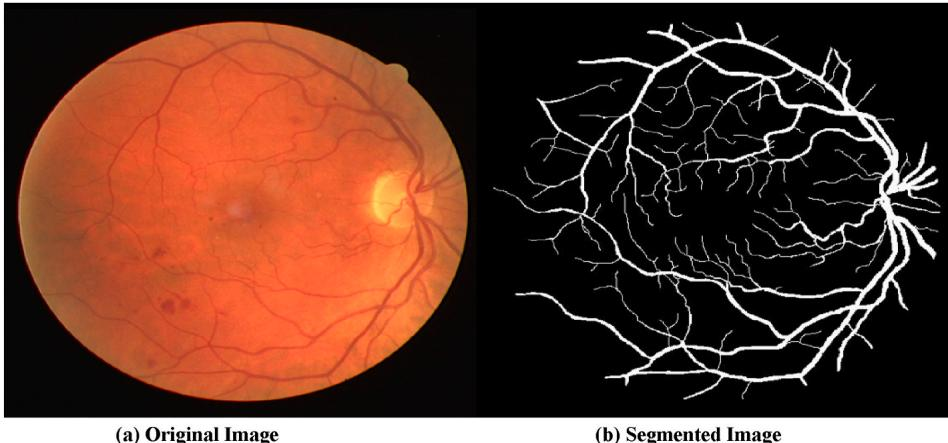  
Fig. 1. Original and segmented images.

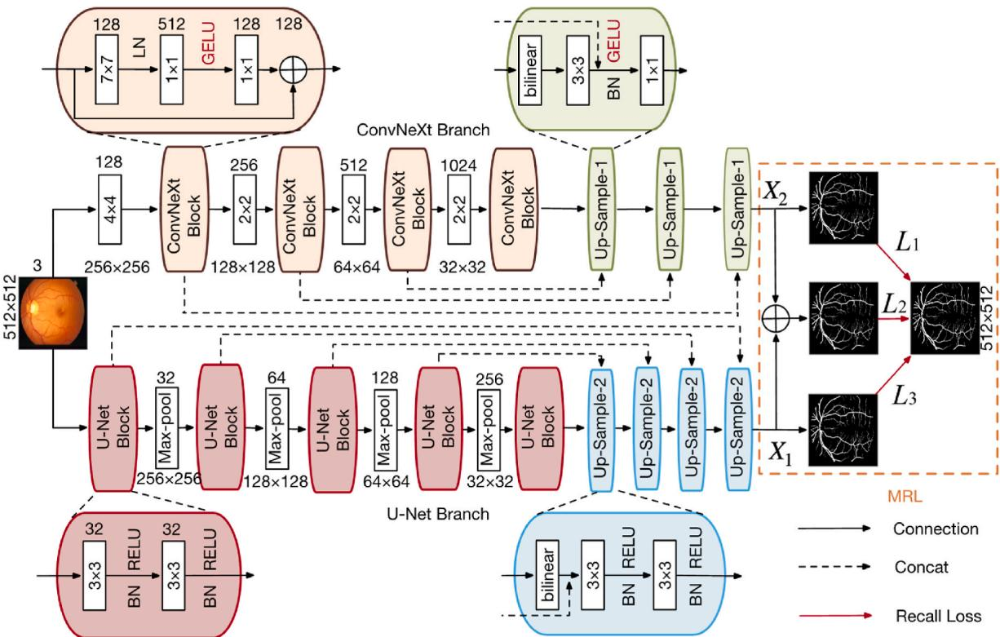  
Fig. 2. Structure of BCU-Net. Each layer of the encoder is marked with the corresponding feature map size and the number of feature channels.

Finally, we propose an MRL module to facilitate the deep-level fusion of global and local pathological semantics between the two branches. We absorbed the recall loss [73] into the MRL module to address the class-imbalance problem. Recall loss weighs the samples in a class according to their instantaneous recall performance during training. The corresponding weights were varied dynamically to reflect the relative performance variations between different classes. The corresponding gradients of the minority classes are boosted, whereas those of the majority classes are suppressed to some degree. The recall loss RecallCE is expressed as

$$
R e c a l l C E = - \sum _ { c = 1 } ^ { c } \biggl ( 1 - \frac { T P _ { c } } { F N _ { c } + T P _ { c } } \biggr ) N _ { c } \log ( p ^ { c } ) = - \sum _ { c = 1 } ^ { c } \sum _ { n : y _ { i } = c } ( 1 - R _ { c } ) \log ( p _ { n } )\tag{1}
$$

where $\{ x _ { n } , y _ { n } \} \forall n \in \{ 1 , . . . , N \}$ and $x _ { n }$ denote the training image, and $y _ { n } \in$ $\{ 1 , . . . , C \}$ denotes the set of corresponding medical labels. In this study, $C = 2 .$ As illustrated in Fig. 1, a binary image was acquired after implementing BCU-Net. In this binary image, $\mathbf { \vec { \omega } } ^ { 6 } 0 ^ { , 5 }$ represents the background pixel or uncorrelated objects whereas $^ { \ast } \mathbf { 1 } ^ { \ast }$ represents the foreground pixel or segmented object. $N _ { c }$ denotes the number of pixels belonging to the class $\begin{array} { r } { c \in \{ 1 , . . . , C \} . p ^ { c } = { ( \prod _ { n : y _ { n } = c } p _ { n } ) } ^ { 1 } / _ { N _ { c } } } \end{array}$ denotes the geometric mean confidence of class $c , p _ { n }$ is the predictive softmax distribution of input image $x _ { n }$ over all classes. $T P _ { c }$ denotes the true positive (TP) of class c. $F N _ { c }$ denotes the false negative (FN) of class c. $R _ { c }$ is the recall value of class c. $\{ n : y _ { i } = c \}$ denotes a set of images with label c.

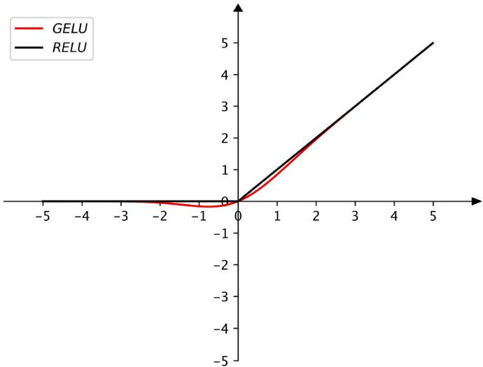  
Fig. 3. GELU and RELU activate functions.

In the MRL module, we designed four losses, namely $L , L _ { 1 } , L _ { 2 } ,$ and $L _ { 3 } ,$ to complete the medical image segmentation. The $\mathrm { L } _ { 1 }$ loss supervised the ConvNeXt branch, whereas the $L _ { 3 }$ loss supervised the U-Net branch. The two losses use RecallCE as shown in Equation (1). Particularly, the $L _ { 2 }$ loss plays a “bridging supervision" role after the average fusion of $X _ { 1 }$ and $X _ { 2 } .$ The $\mathrm { L } _ { 2 }$ loss is shown by the following equation:

$$
L _ { 2 } = \alpha L _ { 1 } + \beta L _ { 3 }\tag{2}
$$

where α and $\beta$ are the weights of the corresponding $L _ { 1 }$ and $L _ { 3 }$ losses, respectively. The $\mathrm { L } _ { 2 }$ loss bridges the two heterogeneous branches smoothly and efficiently. It can take full advantage of the complementarity between the two heterogeneous networks. Furthermore, the addition of other parameters is not required. During model training, L is defined as the total loss function shown in Equation (3) whereas $L _ { 2 }$ is used to complete the final image segmentation during testing.

$$
{ \cal L } = { \cal L } _ { 1 } + { \cal L } _ { 2 } + { \cal L } _ { 3 }\tag{3}
$$

According to the above design, the MRL module facilitates the deeplevel fusion of global and local pathological semantics, which makes the parallel structure effective and efficient for medical image segmentation. The BCU-Net algorithm is shown in Table 2.

## 4. Experiments and analysis

In this section, BCU-Net is compared with numerous state-of-the-art baselines in terms of qualitative and quantitative analyses. We also validated the generalization capability of the BCU-Net. Moreover, we evaluated the real contribution of each module in BCU-Net through ablation analysis. In all the experiments, BCU-Net (CE) represents the proposed model using the traditional cross-entropy (CE) loss function, whereas BCU-Net (RE) represents the proposed model using the recall (RE) loss function. All the experimental settings were the same for the

```powershell
Algorithm: BCU-Net Algorithm
Input: the medical image with the size of H ${ \textsc { \times W } } \times { \mathbf { C } } .$
Output: the predicted image label with the size of H × W × C.
(1) Data augmentation
(2) Train ConvNeXt based on $L _ { 1 }$
(3) Train U-Net based on $L _ { 3 }$
(4) Bridge ConvNeXt and U-Net using $L _ { 2 }$
(5) Construct the loss L based on $L _ { 1 } , L _ { 2 }$ and $L _ { 3 } ,$ and train BCU-Net based on L
(6) Model test using $L _ { 2 }$ and predict image label
(7) Output the predicted image label of each medical image
```

two variants used in this study.

## 4.1. Datasets and data augmentation

We conducted extensive experiments on four retinal image datasets: STARE [74], CHASEDB1 [75], DRIVE [76], and DR HRIGS [77], and two polyp image datasets: CVC-612 [78] and KVASIR [79]. Following [31, 40,80–84], each dataset was randomly divided into training and test sets, as shown in Table 3.

Traditional data-augmentation strategies were used to enrich the original training sets. As shown in Fig. 4, each retinal vessel dataset was augmented 18 times using the following data augmentation methods: rotation, flipping, increasing noise, changing brightness, blurring, and a combination of them.

After data augmentation, each medical image was resized to 512 × 512 pixels, excluding the DR HAGIS dataset. Considering that large medical images contain more valuable pathological semantics, we resized the DR HAGIS images to 2048 × 2048 pixels. Hence, this study processed diverse image resolutions with diverse sample numbers, which helped demonstrate the generalizability of the BCU-Net. We did not use any other preprocessing methods except for the above operations. We used the PyTorch backend to implement all networks and conducted all experiments on a computer server with four NVIDIA GeForce GTX 2080Ti GPUs. The learning rate was set to 0.00015. Because of the input of the entire medical image and hardware limitations, we set the batch size to two. According to our careful tuning, α and β were equally set to 0.5 (please refer to the “4.5.1 Model Parameter Tuning" section).

## 4.2. Evaluation metrics

Following the most recent work [32,34,53,85–89], we used a group of popular evaluation metrics, such as accuracy (Acc), sensitivity (Se), specificity (Sp), area under ROC (AUC), mean Dice, mean Intersection over Union (IoU), F1-Score (F1), Matthews's Correlation Coefficient (MCC), and Balanced Accuracy (BAcc), to evaluate our segmentation model more comprehensively. In this section, we provide a detailed description of each metric.

Acc was used to evaluate the overall segmentation performance of the corresponding foreground objects (positive samples) and background objects (negative samples). This metric focuses on the two types of samples simultaneously. The Acc metric is expressed as

$$
\mathrm { A c c } = { \frac { T P + T N } { T P + T N + F P + F N } }\tag{4}
$$

Se is another important metric for medical image segmentation. This is the ratio of the correct positive predictions to the total number of positive predictions in the segmented results. The Se metric represents the ability to correctly recall positive samples from all the actual positive samples. This is also called recall, and focuses on one type of sample. The Se metric was calculated as

$$
\mathrm { S e } = { \frac { T P } { T P + F N } }\tag{5}
$$

Medical image segmentation datasets. “\*"means that the image has diverse resolutions.
<table><tr><td rowspan="2">Dataset</td><td colspan="2">Image Number</td><td rowspan="2">Original Resolution</td></tr><tr><td>Training</td><td>Test</td></tr><tr><td>STARE</td><td>14</td><td>6</td><td>605 × 700</td></tr><tr><td>CHASEDB1</td><td>20</td><td>8</td><td>999 × 960</td></tr><tr><td>DRIVE</td><td>20</td><td>20</td><td>565 × 584</td></tr><tr><td>DR HAGIS</td><td>20</td><td>20</td><td>2816 × 1880&amp;4752 × 3168</td></tr><tr><td>CVC-612</td><td>544</td><td>68</td><td>384 × 288</td></tr><tr><td>KVASIR</td><td>156</td><td>40</td><td>(401–672)×(415–547)*</td></tr></table>

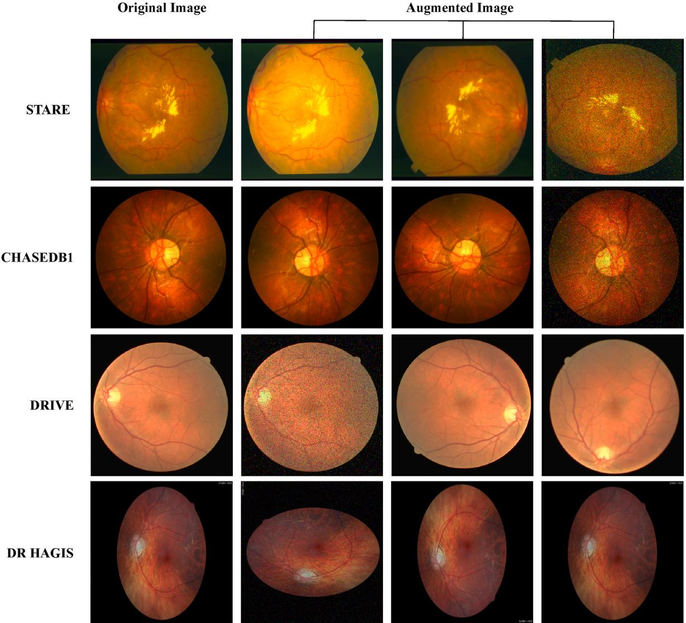  
Fig. 4. Augmented medical images after using some conventional augmentation methods.

Similar to Se, Sp is another metric used in medical image segmentation. This is the ratio of the number of correct negative predictions to the total number of negative predictions. The Sp metric represents the ability to correctly distinguish negative samples from all actual negative samples. It focuses on only one type of sample. The Sp metric is expressed as

$$
\mathrm { S p } { = } \frac { T N } { T N + F P }\tag{6}
$$

Dice is a comprehensive evaluation metric known as F1 that is used to calculate the similarity between two objects. The Dice (or F1) metric is shown in Equation (7). The mean Dice indicates the average value of all classes of Dice.

$$
{ \mathrm { D i c e } } = { \frac { 2 * T P } { ( T P + F N ) + ( T P + F P ) } }\tag{7}
$$

The IoU is another important metric used to measure the similarity between the actual segmentation results and ground truth annotations in the image segmentation field. The larger the value of IoU, the larger the overlap area between the actual segmentation results and the ground truth annotations, which indicates more accurate segmentation results. The IoU metric is shown in Equation (8). The mean IoU is the average value of all classes of the IoU.

$$
\mathrm { I o U } = { \frac { T P } { T P + F N + F P } }\tag{8}
$$

BAcc is typically used to measure the accuracy of a model's overall segmentation, considering both positive and negative classes, without worrying about the class imbalance problem. The BAcc was calculated as follows. Here, Se was computed using Equation (5), whereas Sp was obtained using Equation (6).

$$
\mathbf { B A c c } = { \frac { \mathbf { S e } + \mathbf { S p } } { 2 } }\tag{9}
$$

MCC is a relatively balanced metric that is more suitable for imbalanced conditions, such as foreground and background pixels in blood vessel images. The MCC is expressed as follows:

$$
{ \bf M C C } = \frac { T P * T N - F P * F N } { \sqrt { ( T P + F P ) * ( T P + F N ) * ( T N + F P ) * ( T N + F N ) } }\tag{10}
$$

In the abovementioned equations, TP, TN, FP, and FN denote the numbers of true positives, true negatives, false positives, and false negatives, respectively.

In addition, we employed the AUC metric [90] to evaluate the overall segmentation performance of each model. A larger AUC indicates a more satisfactory overall segmentation performance, which means that the corresponding ROC curve is closer to the (0, 1) point and farther from the 45° diagonal of the coordinate axis.

## 4.3. Comparisons with state-of-the-arts

In this section, we compare the performances of four retinal vessel image datasets and two polyp image datasets. We demonstrated the effectiveness and generalizability of our model. We first complete the model parameters and flop comparison. Fig. 5 presents the corresponding comparison results.

As shown in Fig. 5, although BCU-Net has more parameters than the state-of-the-art Swin-UNet [91], the increased number of parameters is acceptable. Compared to TransUNet [38] and UNETR [92], BCU-Net has fewer model parameters, which indicates that BCU-Net has a certain advantage in terms of model parameters. However, it is undeniable that BCU-Net requires higher flops owing to the integration of the two models, which is also our future research direction. Can we achieve a good trade-off between efficiency and effectiveness?

## 4.3.1. Quantitative results on retinal vessel images

In this subsection, we present the corresponding performance comparisons of the STARE, CHASEDB1, DRIVE, and DR HAGIS datasets in Tables 4–7. It is worth noting that we compare BCU-Net with the ConvNeXt branch (single-branch model), U-Net branch (single-branch model), LadderNet [69] (two-branch method), and S-UNet [46] (two-- branch method), respectively.

As shown in Table 4, the proposed ConvNeXt branch achieves a competitive performance compared with most baselines, which demonstrates that our modification of the original ConvNeXt is successful. Thus, the redesigned ConvNeXt is suitable for medical image segmentation. This builds a firm foundation for BCU-Net. Second, BCU-Net and its variants achieved competitive performance in most metrics, particularly the Acc, AUC, and Se metrics. Competitive Acc means that both vessels (positive samples) and background pixels (negative samples) can be segmented accurately using BCU-Net. The best Se value indicates that the best false negative rate (FNR) is acquired by BCU-Net (RE). We hypothesized that recall loss alleviates the class imbalance problem so that more blood vessels are recalled for clinical observation and diagnostic decisions. It is worth noting that, compared with the U-Net or ConvNeXt branches, evident performance improvements of BCU-Net were observed on most metrics, which indicates that the complementary local and global pathological semantics between the two heterogeneous branches were fully extracted to improve the final segmentation performance. We infer that “bridging supervision" makes this goal possible. Finally, compared with performance-balanced competitive baselines, such as [32,88,89], our model still has advantages. It achieves

## Table 4

Performance comparisons on the STARE dataset. $^ { * * } \gamma ^ { * }$ means that the corresponding value was not provided by the author. The top three values of each metric are depicted in bold.
<table><tr><td>Model</td><td>Acc ↑</td><td>Se ↑</td><td>Sp ↑</td><td>AUC↑</td><td>F1↑</td></tr><tr><td>U-Net branch [12] (2015)</td><td>0.9681</td><td>0.7753</td><td>0.9858</td><td>0.9188</td><td>0.7965</td></tr><tr><td>ConvNeXt branch (this paper)</td><td>0.9700</td><td>0.8069</td><td>0.9845</td><td>0.9815</td><td>0.8143</td></tr><tr><td>Orlando&#x27;s model [81] (2017)</td><td>/</td><td>0.7680</td><td>0.9738</td><td>/</td><td>0.7644</td></tr><tr><td>Yan&#x27;s model [82] (2018)</td><td>0.9612</td><td>0.7581</td><td>0.9846</td><td>0.9801</td><td>/</td></tr><tr><td>Yan&#x27;s model [83] (2018)</td><td>0.9638</td><td>0.7735</td><td>0.9857</td><td>0.9833</td><td>/</td></tr><tr><td>DUNet [85] (2019)</td><td>0.9641</td><td>0.7595</td><td>0.9878</td><td>0.9832</td><td>0.8143</td></tr><tr><td>Dense U-Net [26] (2019)</td><td>0.9538</td><td>0.8136</td><td>0.9809</td><td>0.9403</td><td>/</td></tr><tr><td>EfficientNet [84] (2020)</td><td>0.9569</td><td>0.7554</td><td>0.9970</td><td>/</td><td>/</td></tr><tr><td>HANet [32] (2020)</td><td>0.9673</td><td>0.8186</td><td>0.9844</td><td>0.9881</td><td>0.8379</td></tr><tr><td>Naveed&#x27;s model [93] (2021)</td><td>0.9541</td><td>0.8288</td><td>0.9653</td><td>0.9541</td><td>/</td></tr><tr><td>Nest U-Net [88] (2021)</td><td>0.9641</td><td>0.8230</td><td>0.9945</td><td>0.9620</td><td>0.8230</td></tr><tr><td>Huang&#x27;s model [55] (2021)</td><td>0.9683</td><td>0.6032</td><td>0.9967</td><td>/</td><td>/</td></tr><tr><td>Xu&#x27;s model [89] (2022)</td><td>0.9683</td><td>0.7747</td><td>0.9910</td><td>0.9893</td><td>0.8369</td></tr><tr><td>BCU-Net (CE) (this paper)</td><td>0.9732</td><td>0.7979</td><td>0.9887</td><td>0.9858</td><td>0.8274</td></tr><tr><td>BCU-Net (RE) (this paper)</td><td>0.9701</td><td>0.8500</td><td>0.9807</td><td>0.9869</td><td>0.8223</td></tr></table>

(a) Size comparison of models

## Table 5

Performance comparisons on the CHASEDB1 dataset. $^ { 6 4 } / ^ { 9 }$ means that the corresponding value was not provided by the author. The top three values of each metric are depicted in bold.
<table><tr><td>Model</td><td>Acc ↑</td><td>Se ↑</td><td>Sp ↑</td><td>AUC↑</td><td>F1↑</td></tr><tr><td>U-Net branch [12] (2015)</td><td>0.9724</td><td>0.7770</td><td>0.9856</td><td>0.9371</td><td>0.7736</td></tr><tr><td>ConvNeXt branch (this paper)</td><td>0.9733</td><td>0.7597</td><td>0.9877</td><td>0.9692</td><td>0.7820</td></tr><tr><td>Wu&#x27;s model [94] (2018)</td><td>0.9637</td><td>0.7538</td><td>0.9847</td><td>0.9825</td><td>/</td></tr><tr><td>DUNet [85] (2019)</td><td>0.9610</td><td>0.8155</td><td>0.9752</td><td>0.9804</td><td>0.7883</td></tr><tr><td>DEUNet [34] (2019)</td><td>0.9661</td><td>0.8074</td><td>0.9821</td><td>0.9812</td><td>0.8037</td></tr><tr><td>LadderNet [69] (2019)</td><td>0.9656</td><td>0.7978</td><td>0.9818</td><td>0.9839</td><td>0.8031</td></tr><tr><td>S-UNet [46] (2019)</td><td>0.9658</td><td>0.8044</td><td>0.9841</td><td>0.9867</td><td>0.8242</td></tr><tr><td>HANet [32] (2020)</td><td>0.9670</td><td>0.8239</td><td>0.9813</td><td>0.9871</td><td>0.8191</td></tr><tr><td>IterNet [95] (2020)</td><td>0.9655</td><td>0.7970</td><td>0.9823</td><td>0.9851</td><td>0.8073</td></tr><tr><td>MF2ResU-Net [53] (2021)</td><td>0.9776</td><td>0.8102</td><td>0.9809</td><td>0.9837</td><td>0.8142</td></tr><tr><td>Naveed&#x27;s model [93] (2021)</td><td>0.9561</td><td>0.8153</td><td>0.9711</td><td>0.9565</td><td>/</td></tr><tr><td>Pyramid U-Net [31] (2021)</td><td>0.9639</td><td>0.8035</td><td>0.9787</td><td>0.9832</td><td>/</td></tr><tr><td>MSC-Net [96] (2022)</td><td>0.9686</td><td>0.8056</td><td>0.9869</td><td>0.9714</td><td>/</td></tr><tr><td>BCU-Net (CE) (this paper)</td><td>0.9746</td><td>0.8013</td><td>0.9863</td><td>0.9770</td><td>0.7999</td></tr><tr><td>BCU-Net (RE) (this paper)</td><td>0.9731</td><td>0.8463</td><td>0.9817</td><td>0.9814</td><td>0.7991</td></tr></table>

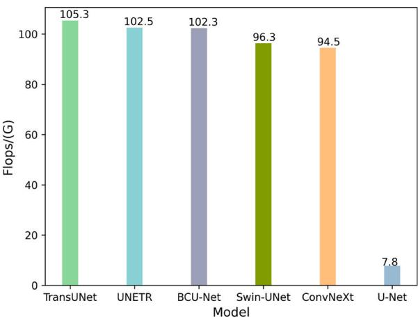

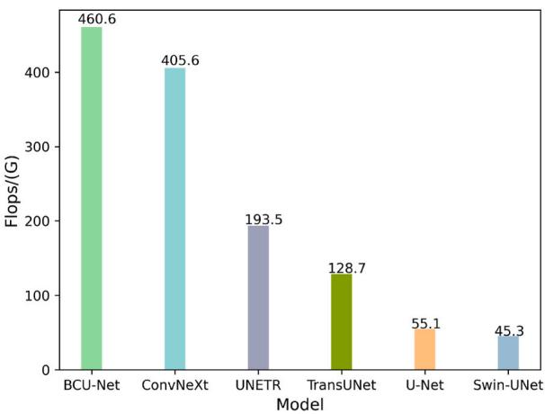  
(b) Flops comparison of models  
Fig. 5. Comparisons of model parameters and flops. ConvNeXt and U-Net are the two single branches of BCU-Net, respectively.

Table 7  
Table 6  
Performance comparisons on the DRIVE dataset. “/" means that the corresponding value was not provided by the author. The top three values of each metric are depicted in bold.
<table><tr><td>Model</td><td>Acc ↑</td><td>Se ↑</td><td>Sp ↑</td><td>AUC↑</td><td>F1↑</td></tr><tr><td>U-Net branch [12] (2015)</td><td>0.9657</td><td>0.7200</td><td>0.9895</td><td>0.9263</td><td>0.7849</td></tr><tr><td>ConvNeXt branch (this paper)</td><td>0.9636</td><td>0.7979</td><td>0.9797</td><td>0.9780</td><td>0.7921</td></tr><tr><td>Wu&#x27;s model [94] (2018)</td><td>0.9567</td><td>0.7844</td><td>0.9807</td><td>0.9819</td><td>/</td></tr><tr><td>Yang&#x27;s model [97] (2019)</td><td>0.9421</td><td>0.7560</td><td>0.9696</td><td>/</td><td>/</td></tr><tr><td>DEUNet [34] (2019)</td><td>0.9567</td><td>0.7940</td><td>0.9816</td><td>0.9772</td><td>0.8270</td></tr><tr><td>Dense U-Net [26] (2019)</td><td>0.9676</td><td>0.7886</td><td>0.9716</td><td>0.9483</td><td>/</td></tr><tr><td>LadderNet [69] (2019)</td><td>0.9561</td><td>0.7856</td><td>0.9810</td><td>0.9793</td><td>0.8202</td></tr><tr><td>HANet [32] (2020)</td><td>0.9581</td><td>0.7991</td><td>0.9813</td><td>0.9823</td><td>0.8293</td></tr><tr><td>DGUNet [98] (2020)</td><td>0.9604</td><td>0.7614</td><td>0.9837</td><td>0.9846</td><td>/</td></tr><tr><td>Nest U-Net [88] (2021)</td><td>0.9512</td><td>0.8060</td><td>0.9869</td><td>0.9512</td><td>0.7863</td></tr><tr><td>MF2ResU-Net [53] (2021)</td><td>0.9700</td><td>0.8013</td><td>0.9842</td><td>0.9797</td><td>0.8223</td></tr><tr><td>Huang&#x27;s model [55] (2021)</td><td>0.9701</td><td>0.8011</td><td>0.9849</td><td>/</td><td>/</td></tr><tr><td>Xu&#x27;s model [89] (2022)</td><td>0.9518</td><td>0.7580</td><td>0.9804</td><td>0.9750</td><td>0.7992</td></tr><tr><td>BCU-Net (CE) (this paper)</td><td>0.9667</td><td>0.8142</td><td>0.9816</td><td>0.9791</td><td>0.8096</td></tr><tr><td>BCU-Net (RE) (this paper)</td><td>0.9662</td><td>0.8238</td><td>0.9800</td><td>0.9810</td><td>0.8089</td></tr></table>

Quantitative results on the DR HAGIS dataset. “/"means that the corresponding value was not provided by the author. The best value of each metric is depicted in bold.
<table><tr><td>Model</td><td>Acc ↑</td><td>Se ↑</td><td>Sp ↑</td><td>AUC↑</td><td>F1↑</td></tr><tr><td>U-Net branch [12] (2015)</td><td>0.9792</td><td>0.6586</td><td>0.9916</td><td>0.9467</td><td>0.6991</td></tr><tr><td>ConvNeXt branch (this paper)</td><td>0.9798</td><td>0.6987</td><td>0.9906</td><td>0.9619</td><td>0.7169</td></tr><tr><td>Aswini&#x27;s model [99] (2018)</td><td>0.9513</td><td>0.6691</td><td>0.9618</td><td>/</td><td></td></tr><tr><td>Sarhan&#x27;s model [100] (2021)</td><td>0.9687</td><td>0.6713</td><td>0.9857</td><td>/</td><td>/</td></tr><tr><td>BCU-Net (CE) (this paper)</td><td>0.9815</td><td>0.6906</td><td>0.9926</td><td>0.9699</td><td>0.7318</td></tr><tr><td>BCU-Net (RE) (this paper)</td><td>0.9790</td><td>0.7839</td><td>0.9865</td><td>0.9721</td><td>0.7320</td></tr></table>

a balanced performance on the STARE dataset. In summary, the proposed two-branch BCU-Net performed well on the STARE dataset.

As listed in Table $^ { 5 , }$ the ConvNeXt branch achieved the best performance for the Acc and Sp metrics. Our modification of ConvNeXt is effective and builds a firm foundation for the two-branch BCU-Net. Second, BCU-Net and its variants achieved highly competitive results for the Acc, Se, and Sp metrics. The best Se indicates the best FNR, whereas the competitive Sp indicates a satisfactory false positive rate (FPR). Third, compared to each single-branch model (U-Net or ConvNeXt), evident performance improvements were observed for BCU-Net. The two branches in the BCU-Net complement each other. Both local and global pathological semantics were fully mined to improve final segmentation performance. Finally, compared with performance-balanced baselines, such as [32,34,46,53,95], BCU-Net has advantages in terms of the Acc and Se metrics. However, owing to the relatively lower true-positive rate, the AUC metric of BCU-Net requires further improvement. We assume that image resizing may cause corresponding performance degradation. Overall, the two-branch structure performed well for the CHASEDB1 dataset.

On the DRIVE dataset, BCU-Net and its variants achieved very competitive performances on the Acc, Se, and Sp metrics. Compared to Refs. [32,88,98], BCU-Net has advantages, particularly for the Acc and Se metrics. The other metrics of our model are very close to the best values. Moreover, the two-branch BCU-Net model easily outperformed each single-branch model, which demonstrates the effective complementarity of the pathological semantics between the two heterogeneous branches. In summary, BCU-Net was competitive for retinal vessel segmentation using the DRIVE dataset. We believe that additional training data will be beneficial for improving the performance in our future

work.

By reviewing many references, we found that the DR HAGIS dataset has rarely been chosen for retinal vessel segmentation owing to its higher image resolution and lower image quality (heavy background interference). As shown in Fig. 4, compared with the above three datasets, DR HAGIS is a more challenging dataset. As shown in Table 7, the ConvNeXt branch achieved the best performance in terms of the Acc and Sp metrics. The redesigned ConvNeXt structure is effective for medical image segmentation and creates a solid foundation for BCU-Net. Second, BCU-Net outperformed all baselines, particularly for the Se, AUC, and F1 metrics. In particular, it achieves a relatively balanced performance. Compared to the U-Net or ConvNeXt branches, significant performance improvements were observed for BCU-Net. This indicates that BCU-Net takes full advantage of the complementary local and global pathological semantics between the two branches, which contributes to improving the final segmentation performance. Notably, the fundus images in the DR HAGIS dataset were of lower quality owing to background interference, image blurring, or unexpected illumination reflection (Fig. 6). Hence, unlike other fundus image datasets, DR HAGIS is closer to an actual diagnosis. BCU-Net's segmentation performance on the DR HAGIS dataset is superior, and its applicability to actual diagnosis is increased. In conclusion, BCU-Net outperformed all the baselines on this more challenging retinal vessel image dataset. Another advantage of BCU-Net is that it can effectively handle high-resolution medical images.

Finally, the experimental results are summarized. 1) The modified ConvNeXt branch exhibited highly competitive performance. This provides a powerful foundation for subsequent fusion. 2) Compared with the state-of-the-art methods, the overall segmentation performance of BCU-Net was competitive and balanced, particularly for the Acc, Se, and Sp metrics. The complementary local and global pathological semantics between the U-Net and ConvNeXt branches were fully mined using BCU-Net to depict the key visual contents in the retinal vessel images and boost the final performance. 3) BCU-Net achieved the best segmentation performance on the more challenging retinal vessel image dataset.

In summary, extensive experiments demonstrated the effectiveness and robustness of BCU-Net for retinal vessel segmentation. Our model handled retinal images with diverse resolutions and image qualities that were close to the actual diagnosis scenario, validating the practicality of BCU-Net.

## 4.3.2. Quantitative results on polyp images

To verify the generalization capability of BCU-Net, we conducted experiments on two polyp image datasets and compared them with recent representative baselines. The corresponding performance comparisons are presented in Table 8.

As shown in Table 8, BCU-Net and its variant achieved highly competitive results for all metrics on the CVC-612 dataset. Referring to Table 3, we find that CVC-612 contains sufficient training images, which creates a firm data foundation for model training. From another significant perspective, we assumed that the complementary local and global semantic information between the U-Net and ConvNeXt branches was fully mined to boost the final segmentation performance (please refer to the corresponding results for the U-Net and ConvNeXt branches, respectively). Second, our model performs slightly worse on the “"Mean Dice" metric on the KVASIR dataset. Compared to CVC-612, KVASIR is more challenging to segment owing to relatively fewer training images (see Table 3) or more complex background interference (see Fig. 6). Future studies should pay more attention to this dataset. Table 8 shows the generalization ability of BCU-Net to a certain degree. BCU-Net is effective and robust for polyp image segmentation. It is worth noting that BCU-Net is an early work that employs the two-branch “"bridging" structure to effectively complete polyp image segmentation.

In summary, the ConvNeXt branch provides a firm foundation for BCU-Net. The redesigned ConvNeXt branch was effective for medical image segmentation. Second, all the above results for the six datasets fully demonstrate the effectiveness and robustness of BCU-Net. BCU-Net

BCU-Net (CE)

U-Net

BCU-Net (RE)

ConvNeXt  
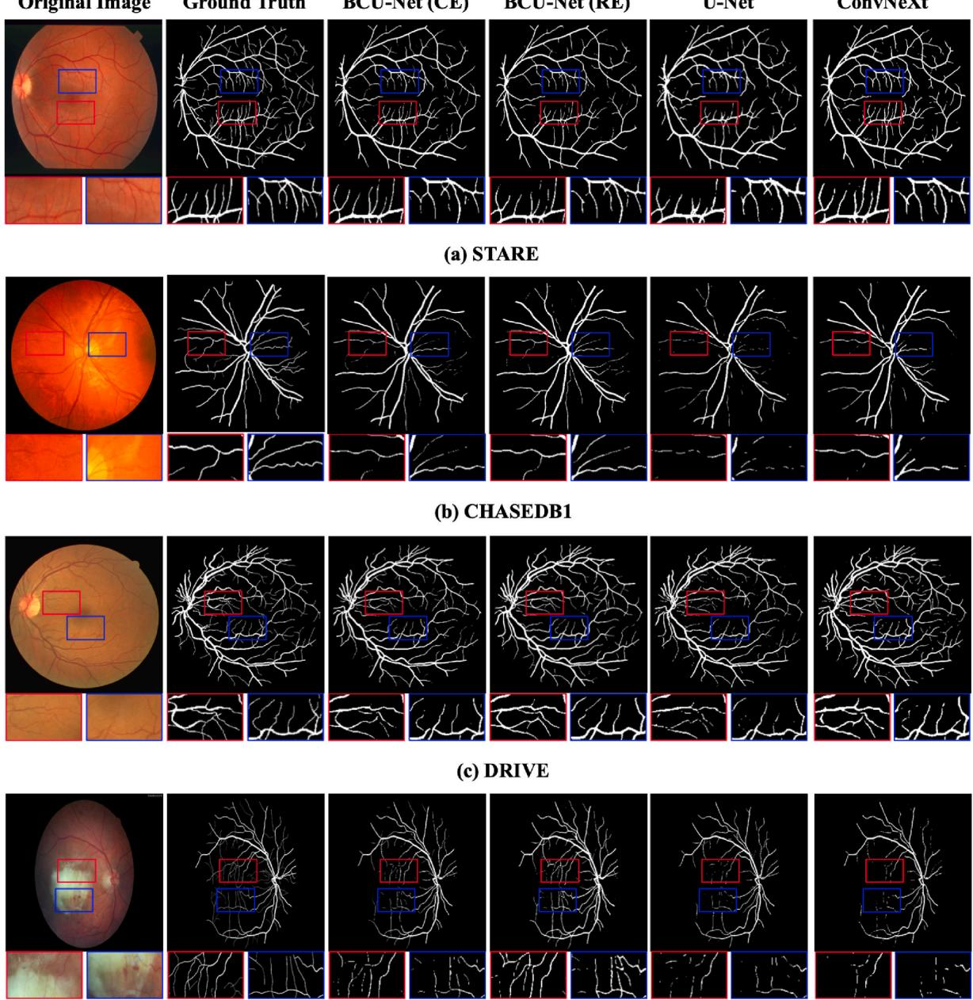  
(d) DR HAGIS  
Fig. 6. Blood vessel segmentation results on four datasets. The first row of each sample is the whole image, whereas the second row shows the zoomed areas of the marked red and blue boxes in the original image.

can achieve an overall competitive and balanced segmentation performance on these public datasets. It is highly competitive and robust for both retinal vessel and polyp segmentation. Hence, a satisfactory tradeoff between the efficiency and effectiveness of BCU-Net was observed (Fig. 5). Third, BCU-Net has two-dimensional generalization abilities. It works well on different datasets and can handle medical images with diverse resolutions and qualities. Another important advantage is that BCU-Net is plug-and-play and more flexible because of its seamless two-branch structure. Each branch of the BCU-Net can be replaced with other off-the-shelf segmentation networks (see Table 15).

It remains challenging to strive for an excellent performance of each metric on each dataset. We believe that the interactions between the intermediate feature layers of each branch will be an effective way to achieve this goal. We need to further broaden our “bridging" method in our future research.

## 4.4. Qualitative results

The morphological characteristics of the segmented retina can be used to assist doctors in the clinical diagnosis of diabetic retinopathy, glaucoma, or age-related macular degeneration. Similarly, the morphological characteristics of the segmented polyps can be used to assist physicians in the diagnosis of colorectal cancer. Hence, qualitative visualization is necessary, which significantly complements the above quantitative results. The corresponding qualitative results of the retinal vessel segmentation are shown in Fig. 6. The corresponding qualitative results of the polyp image segmentation are shown in Fig. 7. Each segmented medical image is binary, which only consists of “0 (negative)" and “1 (positive)"pixels.

As shown in Fig. 6, representative localized areas were selected for magnification. Please refer to the red and blue boxes in each image. Competitive and satisfactory qualitative results were obtained for BCU-

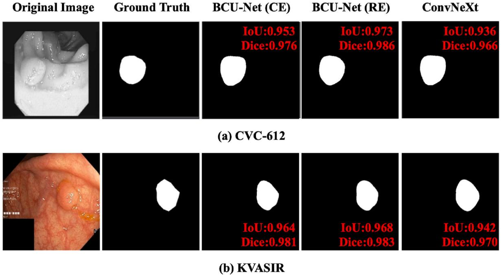  
Fig. 7. Qualitative segmentation results on two polyp image datasets.

Table 8  
Quantitative results on the CVC-612 and KVASIR datasets. The top three values of each metric are depicted in bold.
<table><tr><td>Model</td><td colspan="2">CVC-612</td><td colspan="2">KVASIR</td></tr><tr><td></td><td>Mean Dice↑</td><td>Mean IoU↑</td><td>Mean Dice↑</td><td>Mean IoU↑</td></tr><tr><td>U-Net branch [12] (2015)</td><td>0.823</td><td>0.755</td><td>0.818</td><td>0.746</td></tr><tr><td>ConvNeXt branch (this paper)</td><td>0.926</td><td>0.895</td><td>0.834</td><td>0.788</td></tr><tr><td>U-Net++ [101] (2019)</td><td>0.794</td><td>0.729</td><td>0.821</td><td>0.743</td></tr><tr><td>ResUNet++ [56] (2019)</td><td>0.796</td><td>0.796</td><td>0.813</td><td>0.793</td></tr><tr><td>SFA [102] (2019)</td><td>0.700</td><td>0.607</td><td>0.723</td><td>0.611</td></tr><tr><td>PraNet [86] (2020)</td><td>0.899</td><td>0.849</td><td>0.898</td><td>0.840</td></tr><tr><td>MSNet [87] (2021)</td><td>0.921</td><td>0.879</td><td>0.907</td><td>0.862</td></tr><tr><td>Mobile-PolypNet [80] (2022)</td><td>0.945</td><td>0.906</td><td>0.935</td><td>0.888</td></tr><tr><td>BCU-Net (CE) (this paper)</td><td>0.932</td><td>0.905</td><td>0.861</td><td>0.813</td></tr><tr><td>BCU-Net (RE) (this paper)</td><td>0.914</td><td>0.880</td><td>0.873</td><td>0.825</td></tr></table>

Net. Each branch of BCU-Net plays a positive role in blood vessel segmentation. Notably, BCU-Net has a powerful ability to capture thin vessels. Both the thin and thick blood vessels were sharpened owing to the larger Se values of BCU-Net. Thus, more pathological details are offered to doctors for evident pathological observations and definite diagnostic conclusions. Additionally, unlike other datasets, the fundus images in the DR HAGIS dataset were of lower quality. This presents a significant challenge to our model. However, BCU-Net effectively meets this challenge.

Unlike the retinal blood vessel segmentation analyzed above, polyp segmentation focuses more on the overall contour of each lesion region. From a color perspective, the foreground polyps and background tissue were very similar. This implies that traditional segmentation models are more susceptible to background interference. However, as shown in Fig. 7, BCU-Net outperforms the single-branch ConvNeXt (refer to the corresponding IoU and Dice values). The segmentation results of BCU-Net exhibited excellent similarity to the ground-truth annotation, which fully demonstrated the effectiveness and generalization ability of BCU-Net. This can provide valuable pathological information for clinical diagnoses.

Net provided satisfactory qualitative segmentation results that can provide sufficient pathological information for the clinical work of doctors. Hence, our model is competitive and effective for medical image segmentation if we comprehensively consider both the qualitative and quantitative results.

## 4.5. Model tuning

## 4.5.1. Model Parameter Tuning

For the parameters α and β used in Equation (2), we conducted a series of validation experiments to obtain the best segmentation performance. Fig. 8 shows the corresponding F1 values by setting different α andβ on the DRIVE dataset. As shown in Fig. 8, we obtain the best F1 when $\pmb { \alpha } = \pmb { \beta } = 0 . 5$

## 4.5.2. Five-fold cross-validation

Cross-validation experiments can help reduce the dependence of the performance evaluation on data. Thus, we completed the five-fold crossvalidation experiments described in this section. In five-fold cross-validation, four folds were considered for training, whereas the remaining fold was only used for evaluation. This process was repeated five times and the average value of each metric was reported. As shown in Table 9, a five-fold cross-validation scheme was applied to the KVASIR dataset. The average results of the fivefold cross-validation are very close to those in Table 8 (Mean Dice = 0.873 and Mean $\mathrm { I o U } = 0 . 8 2 5 )$ , which demonstrates the robustness and stability of BCU-Net. Similar results were observed for other datasets.

## 4.5.3. Real-time running curves

Fig. 9 depicts the real-time running curves of BCU-Net on the STARE dataset. As shown in Fig. 9 (a), BCU-Net exhibited consistently decreasing trends in both training and validation losses. The model converges to the optimal value at 100 epochs. As shown in Fig. 9 (b), the corresponding accuracy curves improved stepwise. These results indicate that the optimization procedure of our model is satisfactory and that BCU-Net has certain reproducibility. Similar results were observed for other datasets.

Overall, in addition to satisfactory quantitative performance, BCU-

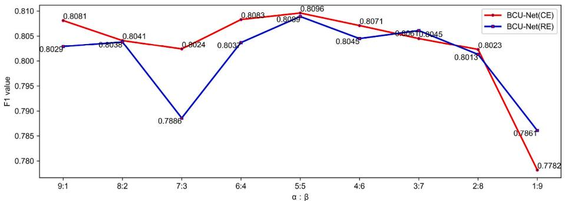  
Fig. 8. Parameter tuning procedure on the DRIVE dataset. α is the weight of the ConvNeXt branch, and β is the weight of the U-Net branch.

Table 9  
Five-fold cross-validation on the KVASIR dataset.
<table><tr><td>Metrics</td><td>Mean Dice↑</td><td>Mean IoU↑</td></tr><tr><td>Fold = 1</td><td>0.849</td><td>0.791</td></tr><tr><td>Fold = 2</td><td>0.875</td><td>0.816</td></tr><tr><td>Fold = 3</td><td>0.844</td><td>0.790</td></tr><tr><td>Fold = 4</td><td>0.879</td><td>0.815</td></tr><tr><td>Fold = 5</td><td>0.857</td><td>0.798</td></tr><tr><td>Average</td><td>0.861</td><td>0.802</td></tr></table>

## 4.5.4. Comparisons with other models

To evaluate the ability of BCU-Net to handle the class imbalance problem, we used the MCC and BAcc metrics to complete the segmentation performance evaluation. Four representative baselines, U-Net, ConvNeXt, MMDC-Net, and FCU-Net, were selected for the evaluation. All experiments were performed on the STARE, CHASEDB1, DRIVE, and DR HAGIS datasets using the same experimental settings for a fair comparison. All experimental results are listed in Table 10.

As shown in Table 10, compared with the other models, the best results were observed for the proposed BCU-Net on each dataset. This validated the effectiveness and robustness of the proposed model. More importantly, BCU-Net has certain advantages in alleviating the class imbalance problem. Furthermore, BCU-Net outperformed each branch, demonstrating the benefit of the proposed “bridging" concept. However, we wanted to verify whether the results of the models were comparable. Hence, a t-test was conducted to complete the task. First, the statistics of the MCC and BAcc metrics were performed on three datasets (STARE, CHASEDB1 and DRIVE), and six groups of MCC and BAcc metrics corresponding to the model in Table 10 were obtained. Second, four groups of models, including BCU-Net (CE) and BCU-Net (RE), were tested using a t-test with the models proposed in this study. Table 11 presents the ttest results. Significance values (Sig.) less than 0.05 have been bolded. It is worth noting that the significance values of BCU-Net(RE) in the test with all models were less than 0.05 on the BAcc metric, indicating a significant difference between BCU-Net(RE) and the four models. In other words, the corresponding segmentation performance is significantly improved. However, there was no significant difference between the proposed model and baselines in terms of the MCC metric.

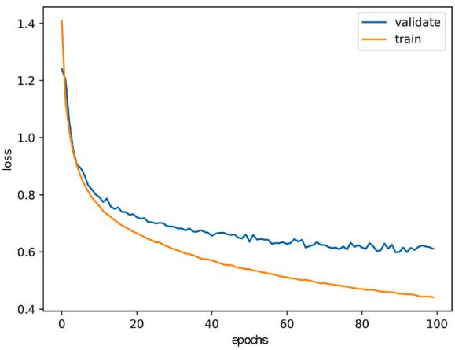  
(a) Loss curve

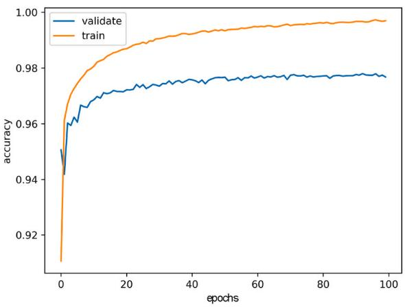  
(b) Accuracy curve  
Fig. 9. Real-time loss and accuracy curves on STARE.

Table 10  
Performance comparisons of solving the class imbalance problem. The best value of each metric is depicted in bold.
<table><tr><td>Model</td><td colspan="2">STARE</td><td colspan="2">CHASEDB1</td><td colspan="2">DRIVE</td><td colspan="2">DR HAGIS</td></tr><tr><td></td><td>MCC↑</td><td>BAcc↑</td><td>MCC↑</td><td>BAcc↑</td><td>MCC↑</td><td>BAcc↑</td><td>MCC↑</td><td>BAcc↑</td></tr><tr><td>U-Net branch</td><td>0.7994</td><td>0.8806</td><td>0.7558</td><td>0.8813</td><td>0.7805</td><td>0.8548</td><td>0.7153</td><td>0.8251</td></tr><tr><td>ConvNeXt branch</td><td>0.7948</td><td>0.8957</td><td>0.7673</td><td>0.8737</td><td>0.7815</td><td>0.8888</td><td>0.7079</td><td>0.8447</td></tr><tr><td>FCU-Net [103]</td><td>0.7667</td><td>0.8588</td><td>0.7618</td><td>0.8862</td><td>0.7818</td><td>0.8724</td><td>0.6837</td><td>0.8266</td></tr><tr><td>MMDC-Net [11]</td><td>0.7738</td><td>0.8800</td><td>0.7527</td><td>0.8887</td><td>0.7799</td><td>0.8703</td><td>0.6993</td><td>0.8309</td></tr><tr><td>BCU-Net (CE)</td><td>0.8167</td><td>0.8933</td><td>0.7866</td><td>0.8938</td><td>0.7919</td><td>0.8979</td><td>0.7244</td><td>0.8416</td></tr><tr><td>BCU-Net (RE)</td><td>0.8092</td><td>0.9153</td><td>0.7863</td><td>0.9140</td><td>0.7918</td><td>0.9019</td><td>0.7237</td><td>0.8852</td></tr></table>

Table 11  
Significance values of t-test of Table 10.
<table><tr><td colspan="2">Test model</td><td colspan="2">Sig.</td></tr><tr><td colspan="2"></td><td>MCC</td><td>BAcc</td></tr><tr><td>BCU-Net (CE)</td><td>U-Net branch</td><td>0.274</td><td>0.062</td></tr><tr><td></td><td>ConvNeXt branch</td><td>0.232</td><td>0.251</td></tr><tr><td></td><td>FCU-Net [103]</td><td>0.063</td><td>0.049</td></tr><tr><td></td><td>MMDC-Net [11]</td><td>0.076</td><td>0.050</td></tr><tr><td>BCU-Net (RE)</td><td>U-Net branch</td><td>0.298</td><td>0.017</td></tr><tr><td></td><td>ConvNeXt branch</td><td>0.238</td><td>0.035</td></tr><tr><td></td><td>FCU-Net [103]</td><td>0.049</td><td>0.013</td></tr><tr><td></td><td>MMDC-Net [11]</td><td>0.066</td><td>0.011</td></tr></table>

## 4.5.5. Confusion matrix results

To show the actual and predicted classes, we present the confusion matrices for the DRIVE and DR HAGIS datasets. The corresponding results are presented in Fig. 10.

As shown in Fig. 10, each confusion matrix contains two classes: foreground blood vessels (positive samples) and uncorrelated background parts (negative samples). The two classes were extremely imbalanced, particularly on the DR HAGIS dataset, which inspired us to employ recall loss in BCU-Net. In summary, the two matrices validate that our model can effectively handle class-imbalance problems. Most vessels and background pixels were classified correctly using BCU-Net for each dataset.

## 4.5.6. Cross-testing of different datasets

This section presents a cross-validation of the training and test sets between different retinal vessel datasets. We tested the generalization ability of BCU-Net by applying a well-trained model on one dataset to another. The results of the cross-testing experiments are summarized in Table 12. Most Acc and Sp values did not change significantly after cross-testing. However, some Sp values also improved. Background pixels were classified correctly using BCU-Net. Valuable background information was transferred from one dataset to another. In particular, the test performance of STARE remained nearly unchanged when the model was trained using DRIVE. A likely explanation is that there is some visual similarity between the two datasets, which does not significantly affect the model performance. However, performance degradation was observed in the Se and F1 metrics. We assume that the vessel details vary from dataset to dataset owing to differences in imaging or photography. In summary, according to the cross-testing experiments, the overall performance of the model did not decline significantly. Some metrics also improved. This verifies the robustness and generalization ability of the BCU-Net model to a certain degree. However, this task poses several challenges. Some domain adaption methods may be used to address the “gap" between different datasets.

Table 12  
Performance results of cross-testing of different retinal vessel datasets. Bold for those with little performance change (±0.02). Performance improvements are underlined.
<table><tr><td>Test dataset</td><td>Trained dataset</td><td>Acc ↑</td><td>Se ↑</td><td>Sp ↑</td><td>AUC ↑</td><td>F1 ↑</td></tr><tr><td>STARE</td><td>CHASEDB1</td><td>0.9609</td><td>0.6712</td><td>0.9868</td><td>0.9497</td><td>0.7345</td></tr><tr><td></td><td>DRIVE</td><td>0.9663</td><td>0.8688</td><td>0.9748</td><td>0.9857</td><td>0.8096</td></tr><tr><td></td><td>DR HAGIS</td><td>0.9660</td><td>0.7283</td><td>0.9870</td><td>0.9731</td><td>0.7753</td></tr><tr><td></td><td>STARE</td><td>0.9701</td><td>0.8500</td><td>0.9807</td><td>0.9869</td><td>0.8223</td></tr><tr><td>CHASEDB1</td><td>STARE</td><td>0.9542</td><td>0.6826</td><td>0.9727</td><td>0.9628</td><td>0.6476</td></tr><tr><td></td><td>DRIVE</td><td>0.9634</td><td>0.7190</td><td>0.9800</td><td>0.9671</td><td>0.7114</td></tr><tr><td></td><td>DR HAGIS</td><td>0.9626</td><td>0.5877</td><td>0.9881</td><td>0.9516</td><td>0.6617</td></tr><tr><td></td><td>CHASEDB1</td><td>0.9731</td><td>0.8463</td><td>0.9817</td><td>0.9814</td><td>0.7991</td></tr><tr><td>DRIVE</td><td>STARE</td><td>0.9654</td><td>0.7240</td><td>0.9886</td><td>0.9702</td><td>0.7834</td></tr><tr><td></td><td>CHASEDB1</td><td>0.9576</td><td>0.6170</td><td>0.9905</td><td>0.9376</td><td>0.7158</td></tr><tr><td></td><td>DR HAGIS</td><td>0.9593</td><td>0.6684</td><td>0.9875</td><td>0.9568</td><td>0.7406</td></tr><tr><td></td><td>DRIVE</td><td>0.9662</td><td>0.8238</td><td>0.9800</td><td>0.9810</td><td>0.8089</td></tr><tr><td>DR HAGIS</td><td>STARE</td><td>0.9717</td><td>0.6534</td><td>0.9836</td><td>0.9461</td><td>0.6270</td></tr><tr><td></td><td>CHASEDB1</td><td>0.9748</td><td>0.6336</td><td>0.9879</td><td>0.9587</td><td>0.6473</td></tr><tr><td></td><td>DRIVE</td><td>0.9733</td><td>0.5811</td><td>0.9877</td><td>0.9198</td><td>0.5899</td></tr><tr><td></td><td>DR HAGIS</td><td>0.9790</td><td>0.7839</td><td>0.9865</td><td>0.9721</td><td>0.7320</td></tr></table>

## 4.6. Ablation analysis

BCU-Net consists of the U-Net branch, the ConvNeXt branch, and the newly-designed MRL module (we use “Recall" here). Each module plays a role in medical image segmentation. We conducted numerous ablation analysis experiments to evaluate the contribution of each module to BCU-Net. We performed ablation analysis on three retinal-vessel image datasets (STARE, CHASEDB1, and DRIVE) and one polyp image dataset (CVC-612). For the first three datasets, the Acc, Se, Sp, AUC, and F1 metrics were used to evaluate each model variant. The corresponding results are presented in Table 13. For the latter dataset, the mean Dice and IoU values were used to evaluate each model variant. The corresponding results are presented in Table 14.

As shown in Table 13, the ConvNeXt branch played a more significant role in the two-branch structure than the U-Net branch, particularly in the AUC and F1 metrics. Second, the U-Net and ConvNeXt branches primarily improved the Se and AUC metrics after applying the recall loss. For the U-Net branch, the average improvements in Se and AUC were nearly 11.36% and 3.77%, respectively. For the ConvNeXt branch, the corresponding average improvements were nearly 7.81% and 0.67%, respectively. Third, a slight performance degradation was observed for the other metrics, except for Se and AUC. This phenomenon is more evident in the “U-Net + Recall" model. This indicates that the recall loss is a relatively stronger constraint. This dramatically improves

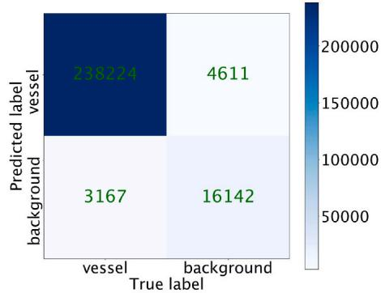  
(a) DRIVE

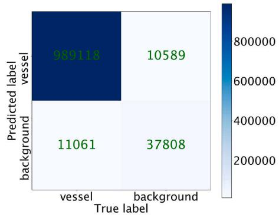  
(b) DR HAGIS  
Fig. 10. Confusion matrices on the DRIVE and DR HAGIS datasets.

Table 13  
Corresponding ablation analysis results on three retinal vessel image datasets. The best value of each metric is shown as 0.8500. We use the numbers filled with different colors, like 0.9732, 0.8362, 0.8500, and 0.9587, to represent the model variant that outperforms the corresponding model before the ablation operation.
<table><tr><td>Dataset</td><td>U-Net</td><td>ConvNeXt</td><td>Recall</td><td>Acc ↑</td><td>Se ↑</td><td>Sp ↑</td><td>AUC↑</td><td>F1↑</td></tr><tr><td rowspan="6">STARE</td><td>√</td><td></td><td></td><td>0.9681</td><td>0.7753</td><td>0.9858</td><td>0.9188</td><td>0.7965</td></tr><tr><td></td><td>√</td><td></td><td>0.9700</td><td>0.8069</td><td>0.9845</td><td>0.9815</td><td>0.8143</td></tr><tr><td>√</td><td></td><td>√</td><td>0.9552</td><td>0.8399</td><td>0.9652</td><td>0.9587</td><td>0.7557</td></tr><tr><td></td><td>√</td><td>√</td><td>0.9651</td><td>0.8362</td><td>0.9762</td><td>0.9822</td><td>0.7947</td></tr><tr><td> $\checkmark$ </td><td>√</td><td></td><td>0.9732</td><td>0.7979</td><td>0.9887</td><td>0.9858</td><td>0.8274</td></tr><tr><td> $\checkmark$ </td><td>√</td><td>√</td><td>0.9701</td><td>0.8500</td><td>0.9807</td><td>0.9869</td><td>0.8223</td></tr><tr><td rowspan="6">CHASEDB1</td><td> $\checkmark$ </td><td></td><td></td><td>0.9724</td><td>0.7770</td><td>0.9856</td><td>0.9371</td><td>0.7736</td></tr><tr><td></td><td>√</td><td></td><td>0.9733</td><td>0.7597</td><td>0.9877</td><td>0.9692</td><td>0.7820</td></tr><tr><td> $\checkmark$ </td><td></td><td>√</td><td>0.9638</td><td>0.8774</td><td>0.9696</td><td>0.9774</td><td>0.7526</td></tr><tr><td></td><td>√</td><td>√</td><td>0.9667</td><td>0.8721</td><td>0.9731</td><td>0.9853</td><td>0.7670</td></tr><tr><td>√</td><td>√</td><td></td><td>0.9746</td><td>0.8013</td><td>0.9863</td><td>0.9770</td><td>0.7999</td></tr><tr><td> $\checkmark$ </td><td>√</td><td>√</td><td>0.9731</td><td>0.8463</td><td>0.9817</td><td>0.9814</td><td>0.7991</td></tr><tr><td rowspan="6">DRIVE</td><td> $\checkmark$ </td><td></td><td></td><td>0.9657</td><td>0.7201</td><td>0.9895</td><td>0.9263</td><td>0.7849</td></tr><tr><td></td><td>√</td><td></td><td>0.9636</td><td>0.7979</td><td>0.9797</td><td>0.9780</td><td>0.7921</td></tr><tr><td> $\checkmark$ </td><td></td><td>√</td><td>0.9493</td><td>0.8960</td><td>0.9545</td><td>0.9592</td><td>0.7545</td></tr><tr><td></td><td>√</td><td>√</td><td>0.9537</td><td>0.8906</td><td>0.9599</td><td>0.9813</td><td>0.7700</td></tr><tr><td>√</td><td>√</td><td></td><td>0.9667</td><td>0.8142</td><td>0.9816</td><td>0.9791</td><td>0.8096</td></tr><tr><td> $\checkmark$ </td><td> $\checkmark$ </td><td>√</td><td>0.9662</td><td>0.8238</td><td>0.9800</td><td>0.9810</td><td>0.8089</td></tr></table>

Table 14  
Corresponding ablation analysis results on the CVC-612 dataset. The best value of each metric is shown as 0.932.
<table><tr><td>Dataset</td><td>U-Net</td><td>ConvNeXt</td><td>Recall</td><td>Mean Dice↑</td><td>Mean IoU↑</td></tr><tr><td>CVC-612</td><td>√</td><td></td><td></td><td>0.823</td><td>0.755</td></tr><tr><td></td><td></td><td>√</td><td></td><td>0.926</td><td>0.895</td></tr><tr><td></td><td>√</td><td></td><td>√</td><td>0.777</td><td>0.701</td></tr><tr><td></td><td></td><td>√</td><td>√</td><td>0.906</td><td>0.856</td></tr><tr><td></td><td>√</td><td>√</td><td></td><td>0.932</td><td>0.905</td></tr><tr><td></td><td>√</td><td>√</td><td>√</td><td>0.914</td><td>0.880</td></tr></table>

Table 15  
Corresponding ablation analysis results of different model selection methods on STARE. The best value of each metric is shown as 0.9734.
<table><tr><td>Model</td><td>Acc ↑</td><td>Se ↑</td><td>Sp ↑</td><td>AUC ↑</td><td>F1↑</td></tr><tr><td>BCU-Net (CE)</td><td>0.9732</td><td>0.7979</td><td>0.9887</td><td>0.9858</td><td>0.8274</td></tr><tr><td>BCU-Net (RE)</td><td>0.9701</td><td>0.8500</td><td>0.9807</td><td>0.9869</td><td>0.8223</td></tr><tr><td>BCU-Net++ (CE)</td><td>0.9734</td><td>0.7930</td><td>0.9894</td><td>0.9805</td><td>0.8270</td></tr><tr><td>BCU-Net++ (RE)</td><td>0.9708</td><td>0.8693</td><td>0.9797</td><td>0.9866</td><td>0.8291</td></tr><tr><td>BUU-Net (CE)</td><td>0.9703</td><td>0.7499</td><td>0.9899</td><td>0.9461</td><td>0.8010</td></tr><tr><td>BUU-Net (RE)</td><td>0.9638</td><td>0.8389</td><td>0.9754</td><td>0.9564</td><td>0.7898</td></tr></table>

the Se metric because it focuses on alleviating the class imbalance problem. There are two aspects to everything. This stronger constraint caused performance degradation in other metrics. Using the recall loss in a single branch cannot achieve balanced performance improvement. Thus, we prefer to compensate for the loss using a two-branch structure. Fourth, the proposed ConvNeXt branch is a powerful foundation for the subsequent “bridging" operation. The ablation analysis results demonstrated the effectiveness and robustness of the proposed ConvNeXt branch from another perspective. Our modification of the original ConvNeXt structure was successful in medical image segmentation. Finally, most metrics are improved when we bridge the two branches seamlessly in the BCU-Net framework (Please refer to the results of the “U-Net + ConvNeXt" models). Therefore, the proposed “bridging” idea between U-Net and ConvNeXt is effective and robust for medical image

segmentation.

As shown in Table 14, the ConvNeXt branch plays a more important role in BCU-Net. The combination of ConvNeXt and Recall outperformed the combination of U-Net and Recall. Performance improvements can also be achieved using the CVC-612 dataset by seamlessly “bridging" two heterogeneous branches. The proposed BCU-Net (CE) obtains the best segmentation performance. However, the recall loss is a significant constraint in medical image segmentation. BCU-Net (CE) outperformed BCU-Net (RE) (Table 8). In a word, the “bridging" operation of the two heterogeneous branches makes the segmentation performance more balanced.

Another deep-level analysis of the contributions of the ConvNeXt branch, U-Net branch, and recall loss is shown in Fig. 11. As shown in Fig. 11, the proposed ConvNeXt branch had an evident positive effect on all evaluation metrics except for the Se metric. Particularly, the polyp image dataset achieved more significant performance improvements than the ConvNeXt branch. Similar to the above analysis, the ConvNeXt branch, with its diverse capabilities in mining complementary pathological semantics, builds a firm foundation for constructing BCU-Net. Second, the U-Net branch makes a contribution that is inferior to that of the ConvNeXt branch. This contributed more to the F1 and mean IoU metrics, which are important complements to the ConvNeXt branch. Therefore, an efficient method is required to bridge the two branches seamlessly; the proposed BCU-Net achieved this goal. Third, the recall loss significantly improves the Se metric and makes a slight positive contribution to the AUC metric. Using this module can alleviate the class-imbalance problem and make the final segmentation performance more balanced. Finally, according to the deep-level analysis, we obtained a contribution descent order of all modules shown as “ConvNeXt > U-Net > recall loss".

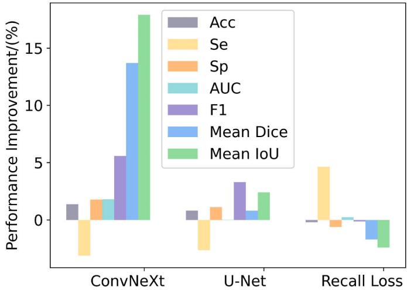  
Fig. 11. Average performance improvement of each metric, the mean Dice and mean IoU metrics are only used for the CVC-612 dataset.

Notably, several other experiments have been conducted. We replaced the U-Net branch with a U-Net++ [101] called BCU-Net++, which has two model variants owing to the different loss functions (CE or RE), namely, BCU-Net++(CE) and BCU-Net++(RE). Similarly, we replaced the ConvNeXt branch with U-Net called BUU-Net, which has two model variants: BUU-Net (CE) and BUU-Net (RE). A validation of whether our two-branch “bridging" idea is robust for model selection is required. These models can also be regarded as variants of the BCU-Net. The corresponding experimental results for the STARE are listed in Table 15. Similar results were observed for the other datasets.

As shown in Table 15, BCU-Net++ performed slightly better than BCU-Net because U-Net++ outperformed U-Net in most cases. This indicates three important conclusions: First, our two-branch “bridging" idea is effective and robust for model selection in the field of medical image segmentation. Second, each branch of BCU-Net can be replaced with other state-of-the-art segmentation networks, which can further boost the final segmentation performance. Third, our model variants are highly competitive in medical image segmentation tasks, which further demonstrates the effectiveness of the novel idea proposed in this study. Finally, our model and its variants were easier to reproduce, validating their practicality to a certain degree.

## 5. Conclusion

We considered improving the efficiency of the traditional U-Net model and proposed a novel BCU-Net for medical image segmentation. We first modified the original ConvNeXt to meet the standard “encoderdecoder" demand. We made ConvNeXt suitable for medical-image segmentation. We then seamlessly bridged the redesigned ConvNeXt and U-Net to create BCU-Net. BCU-Net comprises two parallel but complementary network branches. One branch is ConvNeXt and the other is U-Net. Finally, an MRL module is proposed to efficiently and smoothly bridge the two heterogeneous branches. This module also alleviates the class imbalance problem using recall loss and facilitates the deep-level fusion of global and local pathological semantics originating from different branches.

Extensive experimental results on six public datasets show that BCU-Net is highly competitive for medical image segmentation. Moreover, it has two-dimensional generalization capabilities. First, it is effective for diverse datasets, including blood vessel and polyp images. Second, it handles medical images of different resolutions well. In addition, the ConvNeXt and U-Net branches contributed to improving the final performance. An important advantage of the BCU-Net is that it is more flexible owing to its seamless plug-and-play structure. Each branch can be replaced with other off-the-shelf segmentation networks to further improve the segmentation performance. Moreover, BCU-Net is easier to reproduce and deploy, thereby promoting its practicality.

In the future, we plan to make more active interactions (diverse “bridging" methods) between the intermediate feature layers of each branch. We hope that this optimization will achieve excellent results in each evaluation metric. We intend to compress BCU-Net using state-ofthe-art knowledge distillation methods [104,105]. This helps to narrow the gap between theoretical research and practical applications. Further, some mainstream domain adaption methods may be used to address the “gap" between different datasets, which helps alleviate the data scarcity issue.

## Authorship contribution statement

Hongbin Zhang: Conceptualization, Validation, Investigation, Writing - Review & Editing, Supervision, Project Administration, Funding Acquisition. Xiang Zhong: Software, Validation, Methodology, Formal Analysis, Investigation, Resources, Visualization, Data Curation, Writing - Original Draft. Guangli Li: Funding Acquisition, Investigation. Wei Liu: Resources, Formal Analysis. Jiawei Liu: Software, Validation, Methodology. Donghong Ji: Conceptualization, Formal Analysis. Xiong Li: Formal Analysis. Jianguo Wu: Investigation.

## Declaration of competing interest

The authors declare that they have no conflict of interest.

## Acknowledgment

We should give thanks to the authors for collecting and organizing the six datasets [74–79]. The authors also would like to thank the editor and the reviewers for their helpful suggestions.

This research was partly funded by the National Natural Science Foundation of China (Grant No. 62161011), the Key Research and Development Plan of Jiangxi Provincial Science and Technology Department (Key Project) (Grant No. 20223BBE51036), the Natural Science Foundation of Jiangxi Provincial Department of Science and Technology (Grant Nos. 20212BAB202006 and 20224BAB202016), the Humanity and Social Science Foundation of the Jiangxi Province (Grant No. 22TQ01), the Training Plan for Academic and Technical Leaders of Major Disciplines of Jiangxi Province (Grant No. 20204BCJL23035), and the Humanity and Social Science Foundation of Jiangxi University (Grant Nos. TQ20108 and TQ21203).

## References

[1] V. Jesi, S. Aslam, G. Ramkumar, A. Sabarivani, A. Gnanasekar, P. Thomas, Energetic glaucoma segmentation and classification strategies using depth optimized machine learning strategies, Contrast Media Mol. Imaging (2021), https://doi.org/10.1155/2021/5709257.

[2] D. Antonetti, P. Silva, A. Stitt, Current understanding of the molecular and cellular pathology of diabetic retinopathy, Nat. Rev. Endocrinol. 17 (2021) 195-206, https://doi.org/10.1038/s41574-020-00451-4.

[3] A. Comelli, N. Dahiya, A. Stefano, F. Vernuccio, M. Portoghese, G. Cutaia, A. Bruno, G. Salvaggio, A. Yezzi, Deep learning-based methods for prostate segmentation in magnetic resonance imaging, Appl. Sci. 11 (2021), https://doi. org/10.3390/app11020782.

[4] J. Wei, Y. Hu, R. Zhang, Z. Li, S. Zhou, S. Cui, Shallow Attention Network for Polyp Segmentation, MICCAI, 2021, https://doi.org/10.1007/978-3-030-87193- 266.

[5] K. Hu, L. Zhao, S. Feng, S. Zhang, Q. Zhou, X. Gao, Y. Guo, Colorectal polyp region extraction using saliency detection network with neutron sophic enhancement, Comput. Biol. Med. (2022), 105760, https://doi.org/10.1016/j. compbiomed.2022.105760.

[6] A. Hatamizadeh, V. Nath, Y. Tang, D. Yang, H. Roth, D. Xu, Swin UNETR: Swin Transformers for Semantic Segmentation of Brain Tumors in MRI Images, MICCAI, 2021, https://doi.org/10.1007/978-3-031-08999-2\_22.

[7] H. Su, D. Zhao, H. Elmannai, A. Heidari, S. Bourouis, Z. Wu, Z. Cai, W. Gui, M. Chen, Multilevel threshold image segmentation for COVID-19 chest radiography: a framework using horizontal and vertical multiverse optimization, Comput. Biol. Med. (2022), 105618, https://doi.org/10.1016/j. compbiomed.2022.105618.

[8] A. Qi, D. Zhao, F. Yu, A. Heidari, Z. Wu, Z. Cai, F. Alenezi, R. Mansour, H. Chen, M. Chen, Directional mutation and crossover boosted ant colony optimization with application to COVID-19 X-ray image segmentation, Comput. Biol. Med. (2022), 105810, https://doi.org/10.1016/j.compbiomed.2022.105810.

[9] W. Wang, A. Tu, F. Bergholm, Improved minimum spanning tree based image segmentation with guided matting, KSII Transactions on Internet and Information Systems (TIIS) 16 (1) (2022) 211–230, https://doi.org/10.3837/ tiis.2022.01.012.

[10] B. He, W. Hu, K. Zhang, S. Yuan, X. Han, C. Su, J. Zhao, G. Wang, G. Wang, L. Zhang, Image segmentation algorithm of lung cancer based on neural network model, Expet Syst. 39 (3) (2022), https://doi.org/10.1111/exsy.12822.

[11] X. Zhong, H. Zhang, G. Li, D. Ji, Do you need sharpened details? Asking MMDC-Net: multi-layer multi-scale dilated convolution network for retinal vessel segmentation, Comput. Biol. Med. (2022), 106198, https://doi.org/10.1016/j. compbiomed.2022.106198.

[12] O. Ronneberger, P. Fischer, T. Brox, U-net: convolutional networks for biomedical image segmentation, in: International Conference on Medical Image Computing and Computer Assisted Intervention, 2015, pp. 234–241, https://doi.org/ 10.1007/978-3-319-24574-4 28.

[13] L. Chen, Y. Zhu, G. Papandreou, F. Schroff, H. Adam, Encoder-decoder with atrous separable convolution for semantic image segmentation, ECCV (2018), https://doi.org/10.1007/978-3-030-01234-2\_49.

[14] V. Badrinarayanan, A. Kendall, R. Cipolla, SegNet: a deep convolutional encoderdecoder architecture for image segmentation,, IEEE Trans. Pattern Anal. Mach. Intell. 39 (2017) 2481–2495, https://doi.org/10.1109/TPAMI.2016.2644615.

[15] G. Lin, A. Milan, C. Shen, I. Reid, RefineNet: multi-path refinement networks for high-resolution semantic segmentation, in: 2017 IEEE Conference on Computer Vision and Pattern Recognition (CVPR), 2017, pp. 5168–5177, https://doi.org/ 10.1109/CVPR.2017.549.

[16] H. Zhao, J. Shi, X. Qi, X. Wang, J. Jia, Pyramid scene parsing network, in: 2017 IEEE Conference on Computer Vision and Pattern Recognition (CVPR), 2017, pp. 6230–6239, https://doi.org/10.1109/CVPR.2017.660.

[17] F. Milletari, N. Navab, S. Ahmadi, V-net: fully convolutional neural networks for volumetric medical image segmentation, in: 2016 Fourth International Conference on 3D Vision (3DV), 2016, pp. 565–571, https://doi.org/10.1109/ 3DV.2016.79.

[18] X. Luo, J. Chen, T. Song, Y. Chen, G. Wang, S. Zhang, Semi-supervised Medical Image Segmentation through Dual-Task Consistency, 2021, https://doi.org/ 10.1609/aaai.v35i10.17066.

[19] H. Seo, C. Huang, M. Bassenne, Modified U-net (mU-Net) with incorporation of object-dependent high level features for improved liver and liver-tumor segmentation in CT images, IEEE Trans. Med. Imag. 39 (2020) 1316–1325, https://doi.org/10.1109/TMI.2019.2948320.

[20] P. Christ, M. Elshaer, F. Ettlinger, S. Tatavarty, M. Bickel, P. Bilic, Automatic liver and lesion segmentation in ct using cascaded fully convolutional neural networks and 3d conditional random fields, in: International Conference on Medical Image Computing and Computer-Assisted Intervention, 2016, pp. 415–423, https://doi. org/10.1007/978-3-319-46723-8 48.

[21] A. Yoshida, Y. Lee, N. Yoshimura, T. Kuramoto, A. Hasegawa, T. Kanazawa, Automated heart segmentation using U-Net in pediatric cardiac CT, Measurement: Sensors (2021), https://doi.org/10.1016/j.measen.2021.100127.

[22] B. Lin, K. Michael, S. Kalra, H. Tizhoosh, Skin lesion segmentation: U-nets versus clustering, in: 2017 IEEE Symposium Series on Computational Intelligence (SSCI), 2017, pp. 1-7, https://doi.org/10.1109/SSCI.2017.8280804.

[23] M. Dabass, S. Vashisth, R. Vig, Attention-Guided deep atrous-residual U-Net architecture for automated gland segmentation in colon histopathology images, Inform. Med. Unlocked (2021), https://doi.org/10.1016/j.imu.2021.100784.

[24] J. Silva-Rodríguez, E. Payá-Bosch, G. García, A. Colomer, V. Naranjo, Prostate Gland Segmentation in Histology Images via Residual and Multi-Resolution U-NET, 2020, https://doi.org/10.1007/978-3-030-62362-3\_1.

[25] Y. Zhang, M. He, Z. Chen, K. Hu, X. Li, X. Gao, Bridge-Net: context-involved U-net with patch-based loss weight mapping for retinal blood vessel segmentation, Expert Syst. Appl. 195 (2022), 116526, https://doi.org/10.1016/j. eswa.2022.116526.

[26] C. Wang, Z. Zhao, Q. Ren, Y. Xu, Y. Yu, Dense U-net based on patch-based learning for retinal vessel segmentation, Entropy 21 (2019), https://doi.org/ 10.3390/e21020168.

[27] D. Alvarado-Carrillo, O. Dalmau-Cedeño, Width attention based convolutional neural network for retinal vessel segmentation, Expert Syst. Appl. (2022), https:/ doi.org/10.1016/j.eswa.2022.118313.

[28] P. Kora, B. Haneesha, D. Sahith, S. Grace, et al., Automatic segmentation of polyps using U-net from colonoscopy images, in: 2021 Third International Conference on Inventive Research in Computing Applications (ICIRCA), 2021, pp. 855–859, https://doi.org/10.1109/ICIRCA51532.2021.9544573.

[29] K. Patel, A. Bur, G. Wang, Enhanced U-net: a feature enhancement network for polyp segmentation, 2021 18th Conference on Robots and Vision (CRV) (2021) 181-188, https://doi.org/10.1109/CRV52889.2021.00032.

[30] A. Ushinsky, M.D. Bardis, J. Glavis-Bloom, E. Uchio, C. Chantaduly, M. Nguyentat, D.S. Chow, P.D. Chang, R. Houshyar, A 3D-2D hybrid U-net convolutional neural network approach to prostate organ segmentation of multiparametric MRI, Am. J. Roentgenol. (2021), https://doi.org/10.2214/ AJR.19.22168.

[31] J. Zhang, Y. Zhang, X. Xu, Pyramid U-net for retinal vessel segmentation, in: ICASSP 2021-2021 IEEE International Conference on Acoustics, Speech and Signal Processing (ICASSP), 2021, pp. 1125–1129, https://doi.org/10.1109/ ICASSP39728.2021.9414164.

[32] D.Y. Wang, H. Ayman, P. Jessica, S. Osamah, T. Yang, Hard attention net for automatic retinal vessel segmentation, IEEE J. Biomed. Health Inform. 24 (2020) 3384–3396, https://doi.org/10.1109/JBHI.2020.3002985.

[33] S. Zhang, H. Fu, Y. Yan, Y. Zhang, Q. Wu, M. Yang, et al., Attention Guided Network for Retinal Image Segmentation, MICCAI, 2019, https://doi.org/ 10.1007/978-3-030-32239-788.

[34] X. Xiao, S. Lian, Z. Luo, S. Li, Weighted res-UNet for high-quality retina vessel segmentation, in: 2018 9th International Conference on Information Technology

in Medicine and Education (ITME), 2018, pp. 327–331, https://doi.org/10.1109/ ITME.2018.00080.

[35] R. Xu, X. Ye, G. Jiang, T. Liu, L. Li, S. Tanaka, Retinal vessel segmentation via a semantics and multi-scale aggregation network, ICASSP 2020-2020 IEEE International Conference on Acoustics, Speech and Signal Processing (ICASSP) (2020) 1085–1089, https://doi.org/10.1109/ICASSP40776.2020.9052914.

[36] C. Tian, T. Fang, Y. Fan, W. Wu, Multi-path convolutional neural network in fundus segmentation of blood vessels, Biocybern. Biomed. Eng. 40 (2020) 583–595, https://doi.org/10.1016/j.bbe.2020.01.011.

[37] B. Wang, S. Qiu, H. He, Dual encoding U-net for retinal vessel segmentation, in: Proc. Int. Conf. Med. Image Comput. Comput. -Assisted Intervention, 2019, pp. 84–92, https://doi.org/10.1007/978-3-030-32239-7\_10.

[38] J. Chen, Y. Lu, Q. Yu, X. Luo, E. Adeli, Y. Wang, et al., TransUNet: transformers make strong encoders for medical image segmentation, ArXiv, abs/2102.04306 (2021).

[39] Y.D. Zhang, H.Y. Liu, Q. Hu, TransFuse: Fusing Transformers and CNNs for Medical Image Segmentation, MICCAI, 2021, https://doi.org/10.1007/978-3- 030-87193-2 2.

[40] D. Chen, W. Yang, L. Wang, S. Tan, J. Lin, W.B. Bu, PCAT-UNet: UNet-like network fused convolution and transformer for retinal vessel segmentation, PLoS One 17 (2022), https://doi.org/10.1371/journal.pone.0262689.

[41] Y. Gao, M. Zhou, D.N. Metaxas, UTNet: A Hybrid Transformer Architecture for Medical Image Segmentation, 2021, https://doi.org/10.1007/978-3-030-87199- 4\_6.

[42] Y. Chen, X. Dai, D. Chen, M. Liu, X. Dong, L. Yuan, Z. Liu, Mobile-former: bridging MobileNet and transformer, ArXiv, abs/2108.05895 (2021).

[43] W. Chen, Y. Zhang, J. He, Y. Qiao, Y. Chen, H. Shi, X. Tang, W-Net: bridged U-net for 2D medical image segmentation, ArXiv, abs/1807.04459 (2018).

[44] J.M. Valanarasu, P. Oza, I. Hacihaliloglu, V.M. Patel, Medical Transformer: Gated Axial-Attention for Medical Image Segmentation, MICCAI, 2021, https://doi.org/ 10.1007/978-3-030-87193-2 4.

[45] D. Jha, M. Riegler, D. Johansen, P. Halvorsen, H.D. Johansen, DoubleU-net: a deep convolutional neural network for medical image segmentation, in: 2020 IEEE 33rd International Symposium on Computer-Based Medical Systems (CBMS), 2020, pp. 558–564, https://doi.org/10.1109/CBMS49503.2020.00111.

[46] J. Hu, H. Wang, S. Gao, M. Bao, T. Liu, Y. Wang, J. Zhang, S-UNet: a bridge-style U-net framework with a saliency mechanism for retinal vessel segmentation,, IEEE Access 7 (2019)174167–174177, https://doi.org/10.1109/ ACCESS.2019.2940476.

[47] Z. Liu, H. Mao, C. Wu, C. Feichtenhofer, T. Darrell, S. Xie, A ConvNet for the 2020s, CVPR (2022) 11966–11976, https://doi.org/10.1109/ CVPR52688.2022.01167.

[48] Y. Fu, Y. Huang, Y. Wang, S. Dong, L. Xue, X. Yin, Q. Yang, Y. Shi, C. Zhuo, OTFPF: optimal transport-based feature pyramid fusion network for brain age estimation with 3D overlapped ConvNeXt, ArXiv, abs/2205.04684 (2022).

[49] Y. Jiang, J. Yu, W. Yang, B. Zhang, Y. Wang, Nextformer: A ConvNeXt Augmented Conformer for End-To-End Speech Recognition, 2022. https://arxiv.org/abs/22 06.14747.

[50] H. Zhang, C. Liu, J. Ho, Z. Zhang, Crack detection based on convnext and normalization, J. Phys. Conf. (2022) 2289, https://doi.org/10.1088/1742-6596/ 2289/1/012022.

[51] M.A. Hassanien, V.K. Singh, D. Puig, M. Abdel-Nasser, Predicting breast tumor malignancy using deep ConvNeXt radiomics and quality-based score pooling in ultrasound sequences, Diagnostics 12 (2022), https://doi.org/10.3390/ diagnostics12051053.

[52] Z. Zhou, M.M.R. Siddiquee, N. Tajbakhsh, J. Liang, Unet++: a nested U- net architecture for medical image segmentation, Deep Learning in Medical Image Analysis and Multi-modal Learning for Clinical Decision Support (2018) 3–11, https://doi.org/10.1007/978-3-030-00889-5\_1.

[53] Z. Cui, S. Song, L. Chen, X. Chen, J. Qi, MF2ResU-Net: A Multi-Feature Fusion Deep Learning Architecture for Retinal Blood Vessel Segmentation, 2021, https:// doi.org/10.21203/rs.3.rs-627790/v1.

[54] H. Huang, L. Lin, R. Tong, H. Hu, Q. Zhang, Y. Iwamoto, X. Han, Y. Chen, J. Wu, UNet 3+: a full-scale connected UNet for medical image segmentation, ICASSP 2020-2020 IEEE international conference on acoustics, Speech and Signal Processing (ICASSP) (2020)1055–1059, https://doi.org/10.1109/ ICASSP40776.2020.9053405.

[55] Z.H. Huang, Y. Fang, H. Huang, X. Xu, J. Wang, X. Lai, Automatic retinal vessel segmentation based on an improved U-Net approach, Sci. Program. 2021 (2021) 15, https://doi.org/10.1155/2021/5520407.

[56] D. Jha, P.H. Smedsrud, M.A. Riegler, D. Johansen, T. De Lange, P. Halvorsen, H. D. Johansen, Resunet++: an advanced architecture for medical image segmentation, IEEE ISM (2019) 225–2255, https://doi.org/10.1109/ ISM46123.2019.00049.

[57] T. Lin, P. Goyal, R.B. Girshick, K. He, P. Dollár, Focal loss for dense object detection, IEEE Trans. Pattern Anal. Mach. Intell. 42 (2020) 318–327, https://doi. org/10.1109/TPAMI.2018.2858826.

[58] Z. Yan, X. Yang, K. Cheng, Joint segment-level and pixel-wise losses for deep learning based retinal vessel segmentation, IEEE (Inst. Electr. Electron. Eng.) Trans. Biomed. Eng. 65 (2018) 1912–1923, https://doi.org/10.1109/ TBME.2018.2828137.

[59] N. Abraham, N.M. Khan, A novel focal Tversky loss function with improved attention U-net for lesion segmentation, 2019 IEEE 16th International Symposium on Biomedical Imaging (ISBI 2019) (2019) 683–687, https://doi.org/10.1109/ ISBI.2019.8759329

[60] H.Y. Xia, W.F. Sun, S.X. Song, X.W. Mou, Md-net: multi-scale dilated convolution network for CT images segmentation, Neural Process. Lett. 51 (2020), https://doi. org/10.1007/s11063-020-10230-x.

[61] W.V. Devi, S. Roy, K. Thongam, Multi-scale dilated fusion network (MSDFN) for automatic instrument segmentation, J. Comput. Sci. Technol. Stud. (2022), https://doi.org/10.32996/jcsts.2022.4.1.7.

[62] X.R. Fu, N. Cai, K.M. Huang, H.H. Wang, P. Wang, C.C. Liu, H. Wang, M-Net: a novel U-net with multi-stream feature fusion and multi-scale dilated convolutions for bile ducts and hepatolith segmentation (september 2019), IEEE Access 7 (2019), https://doi.org/10.1109/ACCESS.2019.2946582.

[63] B. Wang, S. Qiu, H. He, Dual encoding U-net for retinal vessel segmentation, in: Proc. Int. Conf. Med. Image Comput. Comput. -Assisted Intervention, 2019, pp. 84–92, https://doi.org/10.1007/978-3-030-32239-7\_10.

[64] X. Tan, X. Chen, G. Zhang, J. Ding, X. Lan, MBDF-net: multi-branch deep fusion network for 3D object detection, Proceedings of the 1st International Workshop on Multimedia Computing for Urban Data (2021), https://doi.org/10.1145/ 3475721.3484311.

[65] R. Neven, T. Goedemé, A multi-branch U-net for steel surface defect type and severity segmentation,, Metals 11 (2021) 870, https://doi.org/10.3390/ MET11060870.

[66] R. Bao, K. Palaniappan, Y. Zhao, G. Seetharaman, W. Zeng, GLSNet: global and local streams network for 3D point cloud classification, 2019 IEEE Applied Imagery Pattern Recognition Workshop (AIPR) (2019), https://doi.org/10.1109/ AIPR47015.2019.9174587.

[67] Y. Ma, Z. Zhu, Z. Dong, T. Shen, M. Sun, W. Kong, Multichannel retinal blood vessel segmentation based on the combination of matched filter and U-net network, BioMed Res. Int. (2021), https://doi.org/10.1155/2021/5561125.

[68] S. Kumar, S. Myana, S.R. Kanakamedala, Enhancing and nonenhancing 3D brain tumor segmentation with modified swish activation and double U-net architecture, in: Proceedings of the 2020 4th International Conference on Vision, Image and Signal Processing, 2020, https://doi.org/10.1145/3448823.3448847.

[69] J. Zhuang, LadderNet: multi-path networks based on U-Net for medical image segmentation, ArXiv, abs/1810.07810 (2018).

[70] J. Huang, Z. Lin, Y. Chen, X. Zhang, W. Zhao, J. Zhang, Y. Li, X. He, M. Zhan, L. Lu, X. Jiang, Y. Peng, DBFU-Net: double branch fusion U-Net with hard example weighting train strategy to segment retinal vessel, Peer J. Comput. Sci. 8 (2022), https://doi.org/10.7717/peerj-cs.871.

[72] H. Dan, G. Kevin, Gaussian error linear units (gelus), arXiv:1606.08415 (2016).

[71] S. Ioffe, Batch renormalization: towards reducing mini- batch dependence in batch-normalized models, NeurIPS (2017), https://doi.org/10.48550/ arXiv.1702.03275.

[73] J.J. Tian, N. Chowdhury, Z. Seymour, H.P. Chiu, Z. Kira, Striking the Right Balance: Recall Loss for Semantic Segmentation, 2021, https://doi.org/10.1109/ icra46639.2022.9811702.

[74] A.D. Hoover, V. Kouznetsova, M. Goldbaum, Locating blood vessels in retinal images by piecewisee threshold probing of a matched filter response, IEEE Trans. Med. Imag. 19 (3) (2000) 203–210. http://cecas.clemson.edu/\~ahoover/stare/.

[75] C.G. Owen, A.R. Rudnicka, R. Mullen, S.A. Barman, D. Monekosso, P.H. Whincup, et al., Measuring retinal vessel tortuosity in 10-year- old children: validation of the computer-assisted image analysis of the retina (CAIAR) program, Investigative Ophthalmol, Vis. Sci. 50 (2009) 2004–2010. https://blogs.kingston. ac.uk/retinal/chasedb1/.

[76] J. Staal, M.D. Abràmoff, M. Niemeijer, M.A. Viergever, B. Van Ginneken, Ridgebased vessel segmentation in color images of the retina, IEEE Trans. Med. Imag. 23 (4) (2004) 501–509. https://drive.grand-challenge.org/.

[77] S.I. Holm, G. Russell, V. Nourrit, N. McLoughlin, DR HAGIS—a fundus image database for the automatic extraction of retinal surface vessels from diabetic patients, J. Med. Imag. 4 (2017). https://paperswithcode.com/dataset/dr-hagis.

[78] J. Bernal, F.J. Sánchez, G. Fernández-Esparrach, D. Gil, C. Rodrıguez, F. Vilarińo, Wm-dova maps for accurate polyp highlighting in colonoscopy: validation vs. saliency maps from physicians, CMIG (Comput. Med. Imaging Graph.) 43 (2015) 99-111. https://paperswithcode.com/dataset/cvc-clinicdb.

[79] D. Jha, P.H. Smedsrud, M.A. Riegler, P. Halvorsen, T. Lange, D. Johansen, H. D. Johansen, Kvasir-seg: A Segmented Polyp Dataset, MMM, Springer, 2020, pp. 451-462. https://paperswithcode.com/dataset/kvasir-seg.

[80] R. Karmakar, S. Nooshabadi, Mobile-PolypNet: lightweight colon polyp segmentation network for low-resource settings, J. Imag. 8 (2022), https://doi. org/10.3390/jimaging8060169.

[81] J.I. Orlando, E. Prokofyeva, M.B. Blaschko, A discriminatively trained fully connected conditional random field model for blood vessel segmentation in fundus images,, IEEE Trans. Biomed. Eng. 64 (1) (2017) 16–27, https://doi.org/ 10.1109/TBME.2016.2535311.

[82] Z. Yan, X. Yang, K.T. Cheng, A three-stage deep learning model for accurate retinal vessel segmentation, IEEE J. Biomed, Healthc. Inf. 23 (4) (2019) 1427-1436, https://doi.org/10.1109/JBHI.2018.2872813.

[83] Z. Yan, X. Yang, K.T. Cheng, Joint segment-level and pixel-wise losses for deep learning based retinal vessel segmentation, IEEE Trans. Biomed. Eng. 65 (9) (2018)1912–1923, https://doi.org/10.1109/TBME.2018.2828137.

[84] M.R. Mathews, S.M. Anzar, R.K. Krishnan, EfficientNet for retinal blood vessel segmentation, in: 2020 3rd International Conference on Signal Processing and Information Security (ICSPIS), 2020, pp. 1-4, https://doi.org/10.1109/ ICSPIS51252.2020.9340135.

[85] Q. Jin, Z. Meng, T.D. Pham, Q. Chen, L. Wei, R. Su, DUNet: a deformable network for retinal vessel segmentation,, Knowl. Base Syst. 178 (2019) 149–162, https:// doi.org/10.1016/j.knosys.2019.04.025.

[86] D. Fan, G. Ji, T. Zhou, G. Chen, H. Fu, J. Shen, L. Shao, PraNet: Parallel Reverse Attention Network for Polyp Segmentation, MICCAI, 2020, https://doi.org/ 10.1007/978-3-030-59725-2 26.

[87] X. Zhao, L. Zhang, H. Lu, Automatic Polyp Segmentation via Multi-Scale Subtraction Network, MICCAI, 2021, https://doi.org/10.1007/978-3-030-87193- 2 12.

[88] C. Wang, Z. Zhao, Y. Yu, Fine retinal vessel segmentation by combining Nest Unet and patch-learning, Soft Comput. 25 (2021) 5519–5532, https://doi.org/ 10.1007/s00500-020-05552-w.

[89] X. Xu, Y. Wang, Y. Liang, S. Luo, J. Wang, W. Jiang, X. Lai, Retinal vessel automatic segmentation using SegNet, Comput. Math. Methods Med. (2022), https://doi.org/10.1155/2022/3117455.

[90] A. Carrington, P. Fieguth, H. Qazi, A. Holzinger, H. Chen, F. Mayr, D. Manuel, A new concordant partial AUC and partial c statistic for imbalanced data in the evaluation of machine learning algorithms, Springer/Nature BMC Medical Informatics and Decision Making 20 (1) (2020) 1–12, https://doi.org/10.1186/ s12911-019-1014-6.

[91] H. Cao, Y. Wang, J. Chen, D. Jiang, X. Zhang, Q. Tian, M. Wang, Swin-unet: unetlike pure transformer for medical image segmentation, ArXiv, abs/2105.05537 (2021).

[92] A. Hatamizadeh, D. Yang, H.R. Roth, D. Xu, UNETR: transformers for 3D medical image segmentation, in: 2022 IEEE/CVF Winter Conference on Applications of Computer Vision (WACV), 2022, pp. 1748–1758, https://doi.org/10.1109/ WACV51458.2022.00181.

[93] K. Naveed, F. Abdullah, H.A. Madni, M.A. Khan, T.M. Khan, S.S. Naqvi, Towards automated eye diagnosis: an improved retinal vessel segmentation framework using ensemble block matching 3D filter, Diagnostics 11 (2021), https://doi.org/ 10.3390/diagnostics11010114.

[94] Y. Wu, Y. Xia, Y. Song, Y. Zhang, W. Cai, Multiscale network followed network model for retinal vessel segmentation, in: Proc. Int. Conf. Med. Image Comput. Comput. - Assisted Intervention, 2018, pp. 119–126, https://doi.org/10.1007/ 978-3-030-00934-2 14.

[95] L. Li, M. Verma, Y. Nakashima, H. Nagahara, R. Kawasaki, Iternet: retinal image segmentation utilizing structural redundancy in vessel networks, in: Proceedings of the IEEE/CVF Winter Conference on Applications of Computer Vision, 2020, pp. 3656–3665, https://doi.org/10.1109/WACV45572.2020.9093621.

[96] L. Pan, Z. Zhang, S. Zheng, L. Huang, MSC-net: multitask learning network for retinal vessel segmentation and centerline extraction, Appl. Sci. (2021), https:// doi.org/10.3390/app12010403.

[97] Y. Yang, F. Shao, Z. Fu, R. Fu, Discriminative dictionary learning for retinal vessel segmentation using fusion of multiple features, Signal, Image and Video Processing 13 (8) (2019) 1529–1537, https://doi.org/10.1007/S11760-019- 01501-9.

[98] P. Yin, R. Yuan, Y. Cheng, Q. Wu, Deep guidance network for biomedical image segmentation, IEEE Access 8 (2020) 116106–116116, https://doi.org/10.1109/ ACCESS.2020.3002835.

[99] S.A. Aswini, P. Suresh, B.V. Santhosh, K. Santhosh, Retinal Vessel Segmentation Using Morphological Top Hat Approach on Diabetic Retinopathy Images, 2018, pp. 1–5, https://doi.org/10.1109/AEEICB.2018.8480970.

[100] A. Sarhan, J.G. Rokne, R. Alhajj, A. Crichton, Transfer learning through weighted loss function and group normalization for vessel segmentation from retinal images, in: 2020 25th International Conference on Pattern Recognition (ICPR), 2021, pp. 9211-9218, https://doi.org/10.1109/ICPR48806.2021.9412378.

[101] Z. Zhou, M.M.R. Siddiquee, N. Tajbakhsh, J. Liang, Unet++: a nested U- net architecture for medical image segmentation, Deep Learning in Medical Image Analysis and Multi-modal Learning for Clinical Decision Support (2018) 3–11, https://doi.org/10.1007/978-3-030-00889-5\_1.

[102] Y. Fang, C. Chen, Y. Yuan, R.K. Tong, Selective Feature Aggregation Network with Area-Boundary Constraints for Polyp Segmentation, MICCAI, 2019, https://doi. org/10.1007/978-3-030-32239-7\_34.

[103] J. Gurrola-Ramos, O.D. Cedeño, T.E. Alarcón, Factorized U-Net for Retinal Vessel Segmentation, MCPR, 2022, https://doi.org/10.1007/978-3-031-07750-0\_17.

[104] C. Yang, H. Zhou, Z. An, X. Jiang, Y. Xu, Q. Zhang, Cross-image relational knowledge distillation for semantic segmentation, in: 2022 IEEE Conference on Computer Vision and Pattern Recognition (CVPR), 2022, https://doi.org/ 10.1109/CVPR52688.2022.01200.

[105] Z. Yang, Z. Li, M. Shao, D. Shi, Z. Yuan, C. Yuan, Masked Generative Distillation, 2022, https://doi.org/10.48550/arXiv.2205.01529.