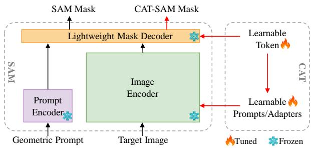
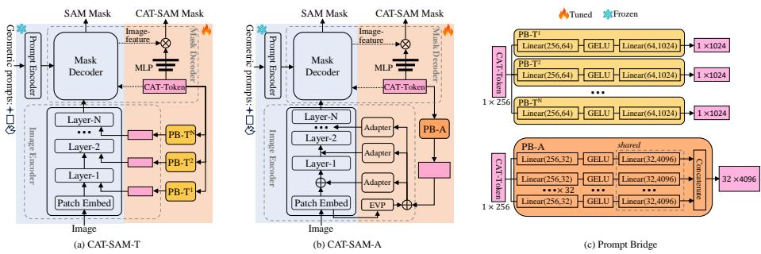
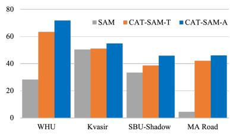
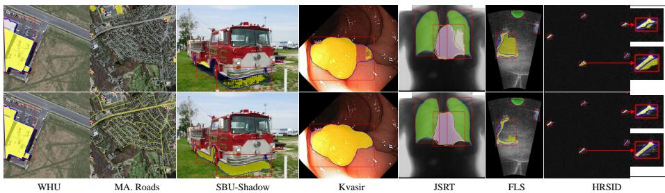

# CAT-SAM: Conditional Tuning for Few-Shot Adaptation of Segment Anything Model

Aoran Xiao1\*0, Weihao Xuan2,3\*, Heli Qi40, Yun Xing10, Ruijie Ren⁵0, Xiaoqin Zhang60, Ling Shao70, and Shijian Lu1†0

1 Nanyang Technological University, Singapore

2 The University of Tokyo, Japan

3 RIKEN AIP, Japan

4 Nara Institute of Science and Technology, Japan 5 Waseda University, Japan

6 Zhejiang University of Technology, China

7 UCAS-Terminus AI Lab, University of Chinese Academy of Sciences, China

Abstract. The Segment Anything Model (SAM) has demonstrated remarkable zero-shot capability and flexible geometric prompting in general image segmentation. However, it often struggles in domains that are either sparsely represented or lie outside its training distribution, such as aerial, medical, and non-RGB images. Recent efforts have predominantly focused on adapting SAM to these domains using fully supervised methods, which necessitate large amounts of annotated training data and pose practical challenges in data collection. This paper presents CAT-SAM, a ConditionAl Tuning network that explores fewshot adaptation of SAM toward various challenging downstream domains in a data-efficient manner. The core design is a prompt bridge structure that enables decoder-conditioned joint tuning of the heavyweight image encoder and the lightweight mask decoder. The bridging maps the domain-specific features of the mask decoder to the image encoder, fostering synergic adaptation of both components with mutual benefits with few-shot target samples only, ultimately leading to superior segmentation in various downstream tasks. We develop two CAT-SAM variants that adopt two tuning strategies for the image encoder: one injecting learnable prompt tokens in the input space and the other inserting lightweight adapter networks. Extensive experiments over 11 downstream tasks show that CAT-SAM achieves superior segmentation consistently even under the very challenging one-shot adaptation setup.

Keywords: Segment Anything Model · Few-shot Learning · Parameter Efficient Tuning

## 1 Introduction

Accurate image segmentation is a fundamental computer vision task that plays a pivotal role in various applications such as robotics, autonomous driving, healthcare, earth observation, etc. The recently developed Segment Anything Model (SAM) [23], trained with 1.1 billion masks, has emerged as a momentous leap forward in image segmentation. By taking geometric prompts with points, boxes, or masks as input, SAM demonstrates remarkable zero-shot capability for general image segmentation, as well as great potential for fine-grained mask segmentation in different downstream tasks across a variety of contexts.

  
Fig. 1: The proposed CAT-SAM performs ConditionAl joint Tuning (CAT) to establish communication between SAM's heavyweight image encoder and lightweight mask decoder. This enables synergistic adaptation of the two network components, mitigating tuning imbalances and improving few-shot SAM adaptation

On the other hand, SAM often fails to generate high-quality predictions when dealing with domains that are either sparsely represented or lie outside its training distribution [5, 19], such as challenging RGB images including aerial, medical, and intricate structural images, as well as non-RGB images like X-ray, Sonar, Synthetic Aperture Radar (SAR) images, etc. This greatly undermines the versatility and applicability of SAM as a foundational segmentation model while handling various downstream tasks. Several studies attempted to address this issue by fine-tuning SAM with a large number of target samples with mask annotations [21, 30]. However, they require extensive masked images for each specialized field, posing a formidable task with poor scalability. How to effectively adapt SAM toward various downstream tasks in a data-efficient manner has become an essential challenge in the segmentation field.

We exploit few-shot target samples for effective and efficient adaptation of SAM toward various downstream tasks. Inspired by the recent advancements in parameter-efficient tuning for foundation models [1,13], we freeze the entire SAM and lightly expand its image encoder and mask decoder with a tiny amount of learnable parameters. This expansion preserves SAM's zero-shot capabilities and flexibility while capturing domain-specific features that are essential for the segmentation of downstream data. However, SAM's image encoder is much larger than its mask decoder, which directly leads to tuning imbalance and further suboptimal adaptation, especially under the limited supervision of few-shot target samples.

To address this challenge, we design CAT-SAM, a novel ConditionAl Tuning network for effective and data-efficient adaptation of SAM. The key idea is to exploit the lightweight decoder tuning to guide the heavyweight encoder tuning and formulate decoder-conditioned joint tuning of both as depicted in Fig. 1. To this end, we design a prompt bridge structure that maps the domain-specific features from the mask decoder to the image encoder. With the collaboration between the two partners, CAT-SAM enables synergistic adaptation of both which mitigates the tuning imbalance and improves the few-shot SAM adaptation effectively. In addition, the prompt bridge can be seamlessly embedded into two representative tuning approaches, including prompt tuning [20, 25, 27] that introduces learnable prompt tokens into the input space and adapters [15, 29, 37, 38] that leverage lightweight adaptive networks. This directly leads to two CAT-SAM variants, namely, CAT-SAM-T and CAT-SAM-A. Extensive evaluations over 11 diverse and challenging downstream tasks show that both variants achieve superior adaptation and segmentation with few-shot target samples only.

The major contributions of this work can be summarized in three aspects. First, we propose CAT-SAM, a conditional tuning network that enables effective and data-efficient adaptation of SAM toward various challenging downstream domains. We design prompt bridge within CAT-SAM, a decoder-conditioned joint tuning structure that enables synergistic and data-efficient adaptation of the heavyweight image encoder and the lightweight mask decoder effectively. Second, we develop two CAT-SAM variants by embedding the prompt bridge into two representative tuning strategies, one introducing learnable prompt tokens in the input space and the other inserting lightweight adapter networks. Third, extensive experiments over 11 diverse segmentation datasets show that CAT-SAM achieves superior image segmentation consistently even under the challenging one-shot setup.

## 2 Related Work

Parameter-Efficient Tuning for foundation models has become increasingly crucial due to the over-size model parameters and costly one-task-one-model deployment. One popular approach involves updating only the newly added learnable parameters while keeping the model backbone frozen. These lightweight parameters are often introduced in two ways: 1) as prompt tuning [12,20,22,58] by adding learnable tokens to input tokens at transformer layers, 2) as adapters [11, 29, 37, 38, 49] by integrating learnable lightweight sub-networks into transformer layers. However, prior visual studies primarily focus on adapting single backbone modules [3, 20, 29] or dual encoder backbones for vision-language tasks [22, 57], which are suboptimal tuning solutions while applying to SAM due to its particular architecture of a heavyweight image encoder and a lightweight mask decoder In contrast, we explore a novel conditional joint tuning strategy tailored to SAM, which facilitates its adaptation even with limited downstream data.

SAM for Downstream Tasks. The release of SAM has spurred several subsequent studies. Some concentrate on expanding semantic recognition capabilities [24, 26, 43, 50, 54], while others aim to create more lightweight SAM variants [48, 52, 55] for faster computations. Several studies explore SAM's adaptation in underperforming downstream scenarios, primarily by directly fine-tuning SAM's mask decoder [4,8,30,41,46, 53], which can severely degrade SAM's zeroshot capabilities. The recent HQ-SAM [21] freezes the entire pre-trained SAM and prompt-tunes the mask decoder with a new mask head for adaptive mask prediction. However, these adaptation studies rely on large target datasets with a considerable number of annotated images, which are often costly to collect. In contrast, our CAT-SAM achieves superior adaptation with only few-shot target samples, significantly reducing adaptation costs and expanding the applicability of SAM as a visual foundation model.

## 3 Method

## 3.1 Preliminaries of SAM

SAM [23] handles each image with three key modules: a heavyweight image encoder (i.e., ViT [9] as the backbone) that extracts image embeddings, a prompt encoder that encodes the geometric prompts (i.e., points, a box, or a coarse mask) to generate prompt embeddings, and a lightweight mask decoder that combines the two types of embeddings to predict segmentation masks. The released SAM model is trained on a super large-scale SA-1B dataset, which consists of over 11 million images as well as 1.1 billion automatically generated masks. SAM has demonstrated remarkable zero-shot capability while dealing with various conventional natural images, as well as superb flexibility in accepting various geometric prompt inputs. On the other hand, it often struggles while facing challenging downstream domains that are often sparse or falling outside of its training data distribution, such as RGB domains of aerial, medical, and intricate structural images, as well as non-RGB domains of X-ray, SAR, and Sonar images. More details about SAM are presented in [23].

## 3.2 CAT-SAM

This subsection introduces CAT-SAM, a ConditionAl Tuning network that is designed for adapting SAM toward various under-performed downstream data. The objective is to adapt SAM efficiently with only few-shot annotated target images, meanwhile preserving SAM's powerful zero-shot capability and geometric prompting flexibility

CAT-SAM freezes the entire SAM and facilitates the simultaneous tuning of SAM's image encoder and mask decoder to capture representative information from few-shot target samples for effective adaptation of SAM. However, a critical issue with simultaneous tuning arises from the clear imbalance between the heavyweight image encoder (308.3 M parameters for ViT-L [9]) and the lightweight mask decoder (4.1 M), which often leads to sub-optimal adaptation while only few-shot target samples are available. To tackle this challenge, we design decoder-conditioned joint tuning, a novel tuning strategy that mitigates the imbalance by establishing a linkage between the encoding tuning and the decoding tuning. Specifically, we design prompt bridge—a lightweight network that maps the domain-specific features from the mask decoder to the image encoder. The bridge design facilitates joint and balanced tuning of both network components, leading to synergistic and effective adaptation of SAM with few-shot and even a single target sample.

  
Fig. 2: Overview of CAT-SAM. CAT-SAM keeps the whole SAM frozen while simultaneously tuning the image encoder and mask decoder for downstream adaptation. To address the tuning imbalance between these two network components, we introduce decoder-conditioned joint tuning through the design of Prompt Bridge structure, enabling synergetic and enhanced adaptation. We present two CAT-SAM variants: CAT-SAM-T in (a) and CAT-SAM-A in (b), achieved by integrating the prompt bridge with prompt-based and adapter-based tuning strategies for the image encoder, respectively. (c) illustrates two tailored prompt bridge structures, PB-T and PB-A.

We develop two CAT-SAM variants by integrating the proposed decoderconditioned joint tuning into two prevalent tuning approaches, namely CAT-SAM-T and CAT-SAM-A, as illustrated in Fig. 2.

Tuning Image Encoder. We first brief SAM's image encoder and then introduce two tuning approaches in our CAT-SAM, including prompt tuning in CAT-SAM-T and lightweight adapters in CAT-SAM-A.

• SAM's Image Encoder, denoted as V with K transformer layers $\{ \gamma _ { i } \} _ { i = 1 } ^ { K } ,$ first splits the input image I of the size (H, W) into M fixed-size patches, and then projects them into patch embeddings $\dot { E _ { 0 } } \in \mathbb { R } ^ { M \times d _ { v } }$ . Patch embeddings $E _ { i - 1 }$ are input to the $i ^ { t h }$ transformer layer (Vi) and sequentially processed through K transformer layers:

$$
[ E _ { i } ] = \mathcal { V } _ { i } ( [ E _ { i - 1 } ] ) , i = 1 , 2 , . . . , K .
$$

• CAT-SAM-T: As illustrated in Fig. 2 (a), we introduce a set of learnable tokens $\{ P _ { i } \in \mathbb { R } ^ { d _ { v } } \} _ { i = 0 } ^ { K - 1 }$ in the image encoder alongside the input patch embeddings. These new learnable tokens are introduced in each transformer layer of the image encoder V and updated through the adaptation process:

$$
[ E _ { i } ] = { \mathcal { V } } _ { i } ( [ E _ { i - 1 } , P _ { i - 1 } ] ) ] , i = 1 , 2 , . . . , K .
$$

• CAT-SAM-A: As illustrated in Fig. 2 (b), we introduce Adapters [15] to tune SAM's image encoder in CAT-SAM-A. The adapter is a lightweight sub-network that is inserted into each transformer layer, comprising a linear down-projection, a nonlinear activation function, a linear up-projection, and a residual connection. High-frequency image information is also incorporated in CAT-SAM as the input of the adapters as in [29]. In this process, highfrequency components $I _ { h f c }$ are first extracted from the input image I and then reversed to the space domain using the Fast Fourier Transform and its inverse. These components are then partitioned into small patches $I _ { h f c } ^ { p }$ similar to the image patches. Subsequently, convolutional layers and linear layers project $I _ { h f c }$ and the original image embeddings $E _ { 0 }$ into c-dimensional features independently, yielding $F _ { h f c }$ and $F _ { p e }$ , respectively. The result of element-wise addition of $F _ { p e }$ and $F _ { h f c }$ is then forwarded (as denoted "EVP" in Fig. 2 (b)) to the adapter $\operatorname { A d a p t } _ { i }$ for transformer layer i. Finally, the output is added element-wise to the original input of the transformer layer i:

$$
E _ { i - 1 } = E _ { i - 1 } + \mathrm { A d a p t } _ { i } ( F _ { p e } + F _ { h f c } ) .
$$

Tuning Mask Decoder. We tune the mask decoder of SAM similarly as [21]. Specifically, we freeze the entire pre-trained decoder of SAM and introduce a learnable CAT-Token that is concatenated with SAM's original output tokens and prompt tokens to form the input to SAM's mask decoder. The CAT-Token is updated during training but remains fixed during inference, the same as SAM's output tokens. After passing through two decoder layers, the updated CAT-Token is used to generate dynamic weights for a newly introduced three-layer MLP. Simultaneously, SAM's mask decoder features are fused with the image features decoded by the image encoder. Finally, the fused features and the threelayer MLP are combined through the dot product to generate the target mask. Please refer to the appendix for more details about the decoder structures in CAT-SAM.

Decoder-Conditioned Joint Tuning. The proposed decoder-conditioned joint tuning can be seamlessly embedded via two implementations of the proposed prompt bridging ideas, i.e., PB-T and PB-A as illustrated in Fig. 2 (c).

• CAT-SAM-T: The prompt bridge $\mathrm { P B } _ { i } ^ { T }$ is a two-layer MLP. It projects the CAT-Token Q in the mask decoder to each transformer layer i in the image encoder and outputs a single learnable token replacing $P _ { i }$ by $\tilde { P } _ { i } ^ { T } = \mathrm { P B } _ { i } ^ { T } ( Q )$ These mapped tokens are directly applied for prompt tuning of the image encoder as follows:

$$
[ E _ { i } ] = \mathcal { V } _ { i } ( [ E _ { i - 1 } , \tilde { P } _ { i - 1 } ^ { T } ] ) ] , i = 1 , 2 , . . . , K .
$$

• CAT-SAM-A: The prompt bridge $\mathrm { P B } ^ { A }$ maps the CAT-Token Q into an embedding $\tilde { P } ^ { A } = \tilde { \mathrm { P B } ^ { A } } ( Q )$ of the same size as $F _ { p e }$ and $F _ { h f c } . \ \tilde { P } ^ { A }$ is then element-wise added to the EVP before being fed to every adapter as follows:

$$
E _ { i - 1 } = E _ { i - 1 } + \mathrm { A d a p t } _ { i } ( F _ { p e } + F _ { h f c } + \tilde { P } ^ { A } ) .
$$

Table 1: Comparisons of trainable parameters between ViT-L [9] based SAM and two variants of the proposed CAT-SAM.
<table><tr><td>Model</td><td>Trainable Parameters (M)</td><td>Trainable Params vs. SAM</td></tr><tr><td>SAM [23]</td><td>312.4</td><td></td></tr><tr><td>CAT-SAM-T</td><td>3.3</td><td>1.1%</td></tr><tr><td>CAT-SAM-A</td><td>1.9</td><td>0.6%</td></tr></table>

As illustrated in Fig. 2 (c), PB-A employs c different linear down-projection layers to generate embeddings independently. After GELU layers, these embeddings are up-projected to the dimension of 1 × M (M is the spatial size of the patch) with a shared linear layer to mitigate the computation cost. Finally, the up-projected embeddings are concatenated to produce $\tilde { P } ^ { A }$

Tab. 1 compares the amount of trainable parameters between the SAM (implemented with the ViT-L [9]) and our CAT-SAM that is built upon the SAM. It can be observed that both CAT-SAM variants introduce very limited additional parameters, yet yield significant performance improvements in various downstream segmentation tasks as to be detailed in Section 4.

## 3.3 Training and Inference

During training, we feed target samples together with geometric prompts into CAT-SAM to generate CAT-SAM masks, under the supervision of ground-truth masks as well as a linear combination of BCE loss and dice loss [31]. We freeze the pre-trained SAM parameters and update solely the parameters that are introduced in the above-described tuning modules. Note we train CAT-SAM with a mixture of sampled geometric prompts, including bounding boxes, randomly selected points, and coarse masks. In addition, we create degraded coarse masks by introducing random Gaussian noise in the boundary regions of the groundtruth masks as in [21]. Further training details can be found in Section 4.1 and the appendix.

During the inference phase, the input image is fed into SAM's image encoder along with the integrated prompt tokens in CAT-SAM-T or adapters in CAT-SAM-A, to generate adaptive image embeddings. These embeddings, combined with the prompt tokens from SAM's prompt encoder, serve as input to the mask decoder. Subsequently, the updated CAT-token and associated MLP are utilized for the target mask prediction. Lastly, we up-sample the mask to the original resolution to produce the final output.

## 4 Experiments

We evaluate CAT-SAM's efficacy through comprehensive experiments involving eight segmentation tasks across 11 datasets, all hailing from challenging downstream fields that SAM struggles to address effectively. Our experiments encom-

Table 2: We evaluate and benchmark CAT-SAM over eight challenging segmentation tasks across 11 datasets.
<table><tr><td>Tasks</td><td>Dataset Names</td><td>Imagery</td></tr><tr><td>Building segmentation</td><td>WHU [18]</td><td>Aerial images</td></tr><tr><td>Road segmentation</td><td>MA. Roads [32]</td><td>Aerial images</td></tr><tr><td>Polyp segmentation</td><td>Kvasir [34]</td><td>Medical images</td></tr><tr><td>Chest X-ray segmentation</td><td>JSRT [39]</td><td>X-ray images</td></tr><tr><td>Marine debris segmentation</td><td>FLS [40]</td><td>Sonar images</td></tr><tr><td>Ship instance segmentation</td><td>HRSID [45]</td><td>SAR images</td></tr><tr><td>Shadow segmentation</td><td>SBU-Shadow [42]</td><td>Natural images</td></tr><tr><td>Intricate segmentation</td><td>DIS [35],ThinObject [28], HRSOD [51],COIFT [28]</td><td>Natural images</td></tr></table>

pass a wide array of scenarios and tasks, spanning from varying target shots to different imagery modalities.

## 4.1 Experimental Setup

Datasets. We conduct experiments on two collections of datasets listed in Tab. 2: 1) True-color images, including WHU [18] for building segmentation, Kvasir [34] for polyp segmentation, SBU-Shadow [42] for shadow segmentation, Massachusetts (MA.) Roads [32] for road segmentation, as well as fine-grained segmentation datasets DIS [35], ThinObject [28], HRSOD [51], and COIFT [28]. 2) Non-RGB domains, encompassing JSRT [39] for chest organ segmentation (X-ray images), HRSID [45] for ship instance segmentation (high-resolution SAR images), and FLS [40] for marine debris segmentation (Sonar images). We use official dataset splits for fair comparisons.

Evaluation Metrics. For single-class datasets including WHU, Kvasir, SBU-Shadow, and MA. Roads, we employ standard mask IoU of foreground. JSRT and FLS, which have multiple classes, are evaluated using individual class IoU and their average. As for DIS, ThinObject, HRSOD, and COIFT, we follow [21] and report mIoU and the boundary metrics (mBIoU) [7] for fair comparisons. For instance segmentation of HRSID, we use standard AP, $\mathrm { A P _ { 5 0 } }$ , and $\mathrm { A P _ { 7 5 } }$

Implementation Details. Unless otherwise specified, CAT-SAM and its comparing models use ViT-L [9] as the image encoder backbone. We train on 1 NVIDIA RTX A6000 GPU for one-shot adaptation, while 4 GPUs for multipleshots. Following [21], ground truth boxes serve as the default input geometric prompts during evaluation to ensure fair comparison and minimize randomness, with the exception of Fig. 3 where point prompts are evaluated. Please refer to the appendix for more implementation details.

## 4.2 Ablation Studies

We first investigate the contributions of different tuning modules within both CAT-SAM variants to assess their impact on overall adaptation performance.

Table 3: Ablation study of CAT-SAM-T in (a) and CAT-SAM-A in (b) for 1-shot adaptation over datasets: "W" for WHU [18] (on building segmentation), "K" for Kvasir [34] (on polyp segmentation), and "S" for SBU-Shadow [42] (on shadow segmentation). "Enc-T." and "Enc-A." means tuning the image encoder with prompt tokens and adapters, respectively. "Dec." means tuning the mask decoder. "PB-T" and "PB-A" denote two customized prompt bridges for conditional tuning. Model 1 is the baseline SAM without adaptation.  
(a) CAT-SAM-T.  
(b) CAT-SAM-A.
<table><tr><td></td><td>|Enc-T. Dec. PB-T| W</td><td></td><td>K</td><td>S</td><td>|AVG</td><td>|Enc-A. Dec. PB-A| W</td><td></td><td></td><td>K</td><td>S</td><td>|AVG</td></tr><tr><td>1</td><td></td><td></td><td>|43.5 79.0</td><td>62.4|61.6</td><td></td><td>1|</td><td></td><td></td><td>43.5 79.0</td><td></td><td>62.4| 61.6</td></tr><tr><td>2|</td><td>√</td><td></td><td>57.8 80.4 76.0</td><td></td><td>71.4</td><td>2 √</td><td></td><td></td><td>86.5 73.7 76.3</td><td></td><td>78.8</td></tr><tr><td>3</td><td>√</td><td></td><td>71.2 73.8 63.5</td><td></td><td>69.5</td><td>3</td><td>√</td><td></td><td>71.2 73.8 63.5</td><td></td><td>69.5</td></tr><tr><td>4</td><td>√ √</td><td></td><td>66.4 73.2 61.8</td><td></td><td>67.1</td><td>4 √</td><td>√</td><td>83.4 79.8 76.3</td><td></td><td></td><td>79.8</td></tr><tr><td>5</td><td>√ √</td><td>√</td><td>86.8 83.4 78.0</td><td></td><td>82.7</td><td>5 √</td><td>√ √</td><td>88.2 85.4 81.9</td><td></td><td></td><td>85.2</td></tr></table>

Tab. 3 shows the experiments of one-shot adaptation across three true-color image segmentation benchmarks WHU [18], Kvasir [34], and SBU-Shadow [42]. For each CAM-SAM variant CAM-SAM-T/CAM-SAM-A, we compare 5 models including: 1. The original SAM without adaptation (baseline); 2. Tuning SAM's image encoder alone with prompt tokens or adapters; 3. Tuning SAM's mask decoder alone; 4. Tuning SAM's image encoder and mask decoder independently; and 5. Conditional tuning of SAM's image encoder and mask decoder with the proposed prompt bridging (i.e., the complete CAT-SAM-T and CAT-SAM-A).

We can see that the original SAM struggles to produce high-quality masks in these challenging domains, indicating its limitations as a foundational segmentation model for many downstream applications. Tuning the image encoder or the mask decoder alone in 2 and 3 enhances target segmentation, underlining the efficacy and necessity of SAM adaptation. However, simultaneously tuning the image encoder and mask decoder in an independent way in model 4 does not show complementary and consistent improvement. This suggests instability and imbalance in tuning between the heavyweight image encoder and the lightweight mask decoder, which could lead to suboptimal adaptation solutions. Differently, including the proposed prompt bridging with either PB-T or PB-A (i.e., the complete CAT-SAM-T and CAT-SAM-A) mitigates the tuning imbalance and produces substantial performance enhancement consistently.

## 4.3 Comparison with the State-of-the-Art

CAT-SAM for One-Shot Adaptation. To assess CAT-SAM's effectiveness in reducing downstream training data and its adaptability with few-shot samples, we first evaluate it under the extremely challenging one-shot adaptation scenario. Given the lack of prior studies under such setup, we comprehensively benchmark it against closely related methods that can be broadly categorized into two groups. The first group comprises state-of-the-art tuning methods for foundation models of different modalities, including VPT [20] and AdaptFormer [3] for large vision foundation models, and LoRA [16] for large language models. The second group comprises recent SAM-based adaptation methods which were largely designed for full-shot adaptation [21,30, 41, 46, 53] ([47] tackles few-shot adaptation but requires 20 shots).

Table 4: Comparison of adaptive segmentation performance on challenging true-color datasets: WHU [18] (on building segmentation), Kvasir [34] (on Polyp segmentation), and SBU-Shadow [42] (on shadow segmentation). The baseline is SAM without adaptation. All compared methods utilize one-shot sample for adaptation, except for those denoted by \* which utilize 20 shots with metric numbers sourced from [47].
<table><tr><td>Methods</td><td>WHU</td><td>Kvasir</td><td>SBU-Shadow</td><td>Average</td></tr><tr><td>SAM [23] (baseline)</td><td>43.5</td><td>79.0</td><td>62.4</td><td>61.6</td></tr><tr><td>VPT-shallow [20]</td><td>60.8</td><td>79.8</td><td>68.7</td><td>69.8</td></tr><tr><td>VPT-deep [20]</td><td>57.8</td><td>80.4</td><td>76.0</td><td>71.4</td></tr><tr><td>AdaptFormer [3]</td><td>83.2</td><td>76.8</td><td>77.2</td><td>79.1</td></tr><tr><td>LoRA [16]</td><td>86.1</td><td>77.5</td><td>74.4</td><td>79.3</td></tr><tr><td>Med-SA [46]</td><td>34.5</td><td>28.6</td><td>22.1</td><td>28.4</td></tr><tr><td>MedSAM [30]</td><td>30.6</td><td>29.8</td><td>53.4</td><td>37.9</td></tr><tr><td>SimAda [41]</td><td>48.6</td><td>18.7</td><td>49.3</td><td>38.9</td></tr><tr><td>SPFS-SAM* [47] (20-shots)</td><td>-</td><td>53.4</td><td>-</td><td></td></tr><tr><td>SAMed* [53] (20-shots)</td><td></td><td>51.7</td><td>-</td><td></td></tr><tr><td>HQ-SAM [2i]</td><td>71.2</td><td>73.8</td><td>63.5</td><td>69.5</td></tr><tr><td>CAT-SAM-T (Ours)</td><td>86.8</td><td>83.4</td><td>78.0</td><td>82.7</td></tr><tr><td>CAT-SAM-A (Ours)</td><td>88.2</td><td>85.4</td><td>81.9</td><td>85.2</td></tr></table>

Tab. 4 presents results over WHU, Kvasir, and SBU-Shadow datasets. We can observe that all three tuning methods for foundation models exhibit clear adaptation effects. Notably, AdaptFormer and LoRA demonstrate significantly better performance than VPT-deep and VPT-shallow, highlighting the effectiveness of modifying the model's structure over prompt tuning in the input space during SAM adaptation. On the other hand, most SAM-based adaptation methods, including Med-SA, SimAda, SPFS-SAM, SAMed, and MedSAM, yield much lower performance, primarily due to their reliance on many more target images which leads to overfitting while learning from one-shot target sample. HQ-SAM achieves substantial segmentation improvements but it still cannot compete with the three tuning methods, demonstrating the significance of tuning the image encoder over the mask decoder. Finally, both CAT-SAM variants consistently outperform all compared methods, with CAT-SAM-A exhibiting a slight edge due to its network structure modifications. These experiments validate the superiority of the proposed decoder-conditioned joint tuning approach in extracting domain-specific features with few-shot samples.

Table 5: Comparison of state-of-the-art segmentation achieved by fully supervised learning (FSL) methods trained on full-shot data (upper part) and mask segmentation by SAM and our CAT-SAM (lower part). Evaluation follows official criteria of each FSL benchmark, reporting IoU for WHU, mIoU for Kvasir, and BER for SBU-Shadow to ensure consistency. "(1)", "(16)", and "(full) " after CAT-SAM-T/CAT-SAM-A denote tuning with 1-shot, 16-shots, and full-shots samples.
<table><tr><td rowspan=1 colspan=2>WHU</td><td rowspan=1 colspan=1>Kvasir</td><td rowspan=1 colspan=1>SBU-Shadow</td></tr><tr><td rowspan=1 colspan=2>Model               IoU</td><td rowspan=1 colspan=1>Model                mIoU</td><td rowspan=1 colspan=1>Model               BER(↓)</td></tr><tr><td rowspan=1 colspan=2>STT [2]             90.5</td><td rowspan=1 colspan=1>CASCADE [36]      87.8</td><td rowspan=1 colspan=1>BDRAR [59]          3.64</td></tr><tr><td rowspan=2 colspan=2>BuildFormer [44]   91.4CBR-Net [14]       91.4</td><td rowspan=1 colspan=1>4</td><td rowspan=1 colspan=1>PatchRefineNet [33]  89.1</td></tr><tr><td rowspan=1 colspan=1>DUCK-Net [10]      90.5</td><td rowspan=1 colspan=1>MTMT [6]            3.15</td></tr><tr><td rowspan=1 colspan=2>SAM                43.5</td><td rowspan=1 colspan=1>SAM                  87.3</td><td rowspan=1 colspan=1>SAM                 13.22</td></tr><tr><td rowspan=1 colspan=2>CAT-SAM-T (1)   86.8</td><td rowspan=1 colspan=1>CAT-SAM-T (1)     90.0</td><td rowspan=1 colspan=1>CAT-SAM-T (1)     7.81</td></tr><tr><td rowspan=3 colspan=2>CAT-SAM-A (1)   88.2CAT-SAM-T (16)  89.6CAT-SAM-A (16)  90.3</td><td rowspan=1 colspan=1>CAT-SAM-A (1)     91.3</td><td rowspan=1 colspan=1>CAT-SAM-A (1)     5.27</td></tr><tr><td rowspan=1 colspan=1>CAT-SAM-T (16)    93.1</td><td rowspan=1 colspan=1>CAT-SAM-T (16)    4.04</td></tr><tr><td rowspan=1 colspan=1>CAT-SAM-A (16)    93.6</td><td rowspan=1 colspan=1>CAT-SAM-A (16)    3.80</td></tr><tr><td rowspan=1 colspan=2>CAT-SAM-T (full) 93.3</td><td rowspan=1 colspan=1>CAT-SAM-T (full)   94.5</td><td rowspan=1 colspan=1>CAT-SAM-T (full)   2.54</td></tr><tr><td rowspan=1 colspan=2>CAT-SAM-A (full) 93.6</td><td rowspan=1 colspan=1>CAT-SAM-A (full)   94.3</td><td rowspan=1 colspan=1>CAT-SAM-A (full)   2.39</td></tr></table>

Full-Shot Learning. While CAT-SAM is primarily designed for few-shot adaptation, it also demonstrates proficiency in full-shot adaptation scenarios. In Tab. 5, we present the state-of-the-art performances of traditional fully-supervised learning (FSL) methods trained over full-shot data and compare them with SAM and our CAT-SAM (adapted with various target samples). We report official evaluation metrics for three public benchmarks, including IoU for WHU, mIoU for Kvasir, and BER [17] for SBU-Shadow. Note the distinction in setups between the FSL segmentation and the mask segmentation: FSL focuses on traditional semantic segmentation of specific classes without prompt input while SAM and CAT-SAM involve general mask segmentation with prompt input. Despite these differences, these performances can serve as valuable references for evaluating CAT-SAM's segmentation ability.

With full target training data, both CAT-SAM variants outperform state-ofthe-art FSL methods consistently. Notably, the two CAT-SAM variants achieve impressive target segmentation under the challenging one-shot setup with a single target sample. With 16 shots of target samples, their performance is even on par with the FSL methods that are trained by using full target training data. These experiments underscore the superiority of effective transfer of broad knowledge from the foundation model SAM as compared with training from scratch with FSL. It also demonstrates the remarkable efficacy of CAT-SAM in substantially expanding SAM's applicability across various downstream tasks.

We conducted further experiments to compare CAT-SAM against HQ-SAM [21], a state-of-the-art SAM-based adaptation solution for intricate structural image segmentation. For fair comparisons, we follow the evaluation protocol of

Table 6: Extremely fine-grained segmentation over four intricate structural image datasets. HQ-SAM and the two CAT-SAM variants are fine-tuned over full HQSeg-44K [21]. All adopt the boxes converted from their GT masks as the box prompt input for fair comparisons.
<table><tr><td>Models</td><td>DIS [35]</td><td>COIFT [28] mIoU mBIoU|mIoU mBIoU|mIoU mBIoU|mIoU mBIoU</td><td></td><td></td><td></td><td>[HRSOD [51] |ThinObject [28]]</td><td>Average mIoU mBIoU</td></tr><tr><td>SAM [23]</td><td>62.0 52.8</td><td>92.1</td><td>86.5</td><td>90.2</td><td>83.1 73.6</td><td>61.8</td><td>79.5 71.1</td></tr><tr><td>HQ-SÀM [21]</td><td>78.6 70.4</td><td>94.8</td><td>90.1</td><td>93.6 86.9</td><td>89.5</td><td>79.9</td><td>89.1 81.8</td></tr><tr><td>CAT-SAM-T</td><td>84.0 78.1</td><td>95.6</td><td>92.0</td><td>93.4 87.6</td><td>94.0</td><td>87.9</td><td>91.7 86.4</td></tr><tr><td>CAT-SAM-A</td><td>83.6 77.7</td><td>95.6</td><td>92.2</td><td>93.1 87.1</td><td>94.1</td><td>88.2</td><td>91.6 86.3</td></tr></table>

HQ-SAM and tune CAT-SAM on the complete HQSeg-44K dataset, consisting of 44,320 meticulously annotated image masks. Tab. 6 shows experiments across four exceptionally fine-grained segmentation datasets including DIS [35], ThinObject [28], HRSOD [51], and COIFT [28] (in mIoU and the boundary metrics (mBIoU) [7]). We can see that CAT-SAM-T achieves slightly better performance than CAT-SAM-A, while both clearly outperform HQ-SAM and the original SAM. These experiments further demonstrate the efficacy of our proposed conditional tuning in adapting SAM toward challenging downstream tasks. Visual qualitative comparisons are provided in the appendix.

## 4.4 CAT-SAM for Non-RGB Domains

We also explore CAT-SAM's performance across more challenging image modalities characterized by larger domain discrepancies. Specifically, we assess its efficacy on non-RGB domains, including JSRT [39] for chest organ segmentation using X-ray images and FLS [40] for marine debris segmentation with Sonar images, and HRSID [45] for ship instance segmentation with SAR images. For adaptation, we randomly select either one or sixteen target images for 1-shot and 16-shot scenarios, respectively, while employing the entire training set for full-shot adaptation. These datasets represent novel image distributions as compared with SAM's training data. Note we train instances of all classes together while evaluating them by classes. Since no images in FLS contain objects of all 11 classes, we only report results of 16-shot and full-shot adaptation for FLS.

Tab. 7 shows experimental results. Notably, CAT-SAM-T and CAT-SAM-A improve the mIoU to 93.0% and 92.6%, respectively, with only one shot of JSRT training image. The improvements saturate gradually as the number of training samples increases, with marginal gains of 1.4% and 2.0%, respectively, when adapted with full-shot target data. These findings underscore the superior few-shot capability of the proposed CAT-SAM and align well with those reported in Tab. 5. Experiments on FLS [40] show different results. While both CAT-SAM variants exhibit clear adaptation effects, the performance gains for both 16-shot and full-shot adaptation are notably lower as compared with previously evaluated datasets. The discrepancy is largely attributed to two primary factors: 1) the inherent difficulty of FLS with its 11 semantic classes (per-class performances are provided in appendix); and 2) the larger variation of FLS data in shapes and object sizes as compared with previously evaluated data. As for ship instance segmentation using SAR images in HRSID [45], this dataset presents different challenges as ships are very small in size. The results show that CAT-SAM consistently outperforms SAM in this diverse domain, highlighting its efficiency in domain adaptation with large domain discrepancy. These experiments further underscore the need for a more comprehensive adaptation of SAM for exceptionally challenging downstream tasks. We expect further studies along this research direction.

Table 7: Few-shot adaptation with varying number of training samples for non-RGB datasets, including FLS [40] with Sonar images for marine debris segmentation, JSRT [39] for chest X-ray segmentation, and HRSID [45] for ship instance segmentation with SAR images. $" \mathrm { N } / \mathrm { A } "$ denotes that 1-shot adaptation over FLS is unattainable due to the absence of images containing objects from all 11 classes.
<table><tr><td rowspan="2">#Samples | Methods</td><td rowspan="2"></td><td colspan="3">JSRT [39]</td><td rowspan="2">|FLS [40] |</td><td colspan="3">HRSID [45]</td></tr><tr><td>Lungs</td><td>Heart</td><td>mIoU</td><td>mIoU AP</td><td> $\mathrm { A P _ { 5 0 } }$ </td><td> $\mathrm { A P _ { 7 5 } }$ </td></tr><tr><td>None</td><td>SAM [23]</td><td>85.0</td><td>71.9</td><td>78.5</td><td>69.7</td><td>38.2</td><td>86.6</td><td>26.8</td></tr><tr><td rowspan="2">1-shot</td><td>CAT-SAM-T</td><td>95.4</td><td>90.5</td><td>93.0</td><td>N/A</td><td>46.0</td><td>88.4</td><td>45.4</td></tr><tr><td>CAT-SAM-A</td><td>94.7</td><td>90.5</td><td>92.6</td><td>N/A</td><td>44.9</td><td>88.0</td><td>41.4</td></tr><tr><td rowspan="2">16-shot</td><td>CAT-SAM-T</td><td>95.8</td><td>92.7</td><td>94.2</td><td>73.2</td><td>46.2</td><td>89.3</td><td>45.2</td></tr><tr><td>CAT-SAM-A</td><td>95.5</td><td>91.5</td><td>93.5</td><td>71.4</td><td>45.7</td><td>89.4</td><td>43.7</td></tr><tr><td rowspan="2">Full-shot</td><td>CAT-SAM-T</td><td>96.3</td><td>92.6</td><td>94.4</td><td>81.7</td><td>51.4</td><td>93.0</td><td>55.0</td></tr><tr><td>CAT-SAM-A</td><td>96.4</td><td>92.8</td><td>94.6</td><td>82.0</td><td>52.9</td><td>93.9</td><td>56.0</td></tr></table>

## 4.5 Analysis & Discussion

Prompts with Single Point. SAM provides flexibility in geometric prompts including a single foreground point. However, prompting with a single foreground point can be challenging as the single point could correspond to multiple objects [23]. Nonetheless, adaptation with few-shot target samples can alleviate this ambiguity by guiding the model to focus on the specific foreground distribution within the annotation space. We evaluate this by using the same randomly-selected single point as the geometric prompt, and Fig. 3 shows

  
Fig. 3: Single point to mask evaluation for one-shot adaptation.

the segmentation results for images from WHU, Kvasir, SBU-Shadow, and MA.   
Roads [32] on road segmentation.

  
Fig. 4: Visual comparisons of SAM [23] (top row) and CAT-SAM (bottom row). We illustrate samples from WHU [18] for building segmentation, MA. Roads [32] for road segmentation, SBU-Shadow [42] for shadow segmentation, Kvasir [34] for polyp segmentation, JSRT [39] for chest organ segmentation (X-ray images), FLS [40] for marine debris segmentation (Sonar images), and HRSID [45] for ship instance segmentation (SAR images). CAT-SAM exhibits one-shot adaptation across most datasets, except for 16-shot over FLS. Red boxes and stars denote geometric prompts, colored regions are mask predictions, and lines show the boundary of ground truth segmentation.

Similar to the experiments using boxes as prompts, CAT-SAM consistently demonstrates superior target segmentation while using a single point as prompt, underscoring its robustness in adaptation while preserving SAM's inherent geometric prompting flexibility. In addition, both CAT-SAM variants achieve relatively less improvement for the dataset Kvasir. This can be largely attributed to the high similarities in color and texture between the polyps and the local gastrointestinal regions in Kvasir, making it challenging for a single point to provide clear geometric guidance.

Visual Illustrations. Fig. 4 shows qualitative comparisons between SAM and CAT-SAM across multiple segmentation tasks. These illustrations demonstrate how our proposed CAT-SAM remarkably enhances the mask quality of SAM under the presence of only one-shot target samples. Please refer to the appendix for more visual comparisons.

## 5 Conclusion

We introduce CAT-SAM, a conditional tuning network tailored for few-shot adaptation of SAM. We propose decoder-conditional joint tuning to mitigate the tuning imbalance between SAM's heavyweight image encoder and lightweight mask decoder and facilitate efficient SAM adaptation. To achieve this, we design the prompt bridge structures, enabling interaction when tuning these two network modules. We develop two CAT-SAM variants by integrating the prompt bridge with two representative tuning strategies including prompt tuning and adapter. Our comprehensive evaluation across diverse scenarios and tasks on 11 segmentation datasets underscores the superior domain adaptive efficiency of both CAT-SAM variants, even in the extremely challenging one-shot scenario.

## Acknowledgements

This project is partly funded by the Ministry of Education Singapore, under the Tier-1 scheme with project number RG18/22 and the Tier-2 scheme with project number MOE-T2EP20123-0003. It is also supported in part by the National Natural Science Foundation of China [grant no. U2033210], in part by the Zhejiang Provincial Natural Science Foundation [grant no. LDT23F02024F02].

## References

1. Bommasani, R., Hudson, D.A., Adeli, E., Altman, R., Arora, S., von Arx, S., Bernstein, M.S., Bohg, J., Bosselut, A., Brunskill, E., et al.: On the opportunities and risks of foundation models. arXiv preprint arXiv:2108.07258 (2021)

2. Chen, K., Zou, Z., Shi, Z.: Building extraction from remote sensing images with sparse token transformers. Remote Sensing 13(21), 4441 (2021)

3. Chen, S., Ge, C., Tong, Z., Wang, J., Song, Y., Wang, J., Luo, P.: Adaptformer: Adapting vision transformers for scalable visual recognition. Advances in Neural Information Processing Systems 35, 16664–16678 (2022)

4. Chen, T., Zhu, L., Deng, C., Cao, R., Wang, Y., Zhang, S., Li, Z., Sun, L., Zang, Y., Mao, P.: Sam-adapter: Adapting segment anything in underperformed scenes. In: Proceedings of the IEEE/CVF International Conference on Computer Vision (ICCV) Workshops. pp. 3367–3375 (October 2023)

5. Chen, T., Zhu, L., Ding, C., Cao, R., Zhang, S., Wang, Y., Li, Z., Sun, L., Mao, P., Zang, Y.: Sam fails to segment anything?-sam-adapter: Adapting sam in underperformed scenes: Camouflage, shadow, and more. arXiv preprint arXiv:2304.09148 (2023)

6. Chen, Z., Zhu, L., Wan, L., Wang, S., Feng, W., Heng, P.A.: A multi-task mean teacher for semi-supervised shadow detection. In: Proceedings of the IEEE/CVF Conference on computer vision and pattern recognition. pp. 5611–5620 (2020)

7. Cheng, B., Girshick, R., Dollár, P., Berg, A.C., Kirillov, A.: Boundary iou: Improving object-centric image segmentation evaluation. In: Proceedings of the IEEE/CVF Conference on Computer Vision and Pattern Recognition. pp. 15334- 15342 (2021)

8. Cheng, J., Ye, J., Deng, Z., Chen, J., Li, T., Wang, H., Su, Y., Huang, Z., Chen, J., Jiang, L., et al.: Sam-med2d. arXiv preprint arXiv:2308.16184 (2023)

9. Dosovitskiy, A., Beyer, L., Kolesnikov, A., Weissenborn, D., Zhai, X., Unterthiner, T., Dehghani, M., Minderer, M., Heigold, G., Gelly, S., et al.: An image is worth 16x16 words: Transformers for image recognition at scale. arXiv preprint arXiv:2010.11929 (2020)

10. Dumitru, R.G., Peteleaza, D., Craciun, C.: Using duck-net for polyp image segmentation. Scientific Reports 13(1), 9803 (2023)

11. Gao, P., Geng, S., Zhang, R., Ma, T., Fang, R., Zhang, Y., Li, H., Qiao, Y.: Clip-adapter: Better vision-language models with feature adapters. International Journal of Computer Vision pp. 1–15 (2023)

12. Gong, Z., Li, F., Deng, Y., Bhattacharjee, D., Zhu, X., Ji, Z.: Coda: Instructive chain-of-domain adaptation with severity-aware visual prompt tuning (2024)

13. Gu, J., Han, Z., Chen, S., Beirami, A., He, B., Zhang, G., Liao, R., Qin, Y., Tresp, V., Torr, P.: A systematic survey of prompt engineering on vision-language foundation models. arXiv preprint arXiv:2307.12980 (2023)

14. Guo, H., Du, B., Zhang, L., Su, X.: A coarse-to-fine boundary refinement network for building footprint extraction from remote sensing imagery. ISPRS Journal of Photogrammetry and Remote Sensing 183, 240–252 (2022)

15. Houlsby, N., Giurgiu, A., Jastrzebski, S., Morrone, B., De Laroussilhe, Q., Gesmundo, A., Attariyan, M., Gelly, S.: Parameter-efficient transfer learning for nlp. In: International Conference on Machine Learning. pp. 2790–2799. PMLR (2019)

16. Hu, E.J., Wallis, P., Allen-Zhu, Z., Li, Y., Wang, S., Wang, L., Chen, W., et al.: Lora: Low-rank adaptation of large language models. In: International Conference on Learning Representations (2021)

17. Hu, X., Zhu, L., Fu, C.W., Qin, J., Heng, P.A.: Direction-aware spatial context features for shadow detection. In: Proceedings of the IEEE conference on computer vision and pattern recognition. pp. 7454–7462 (2018)

18. Ji, S., Wei, S., Lu, M.: Fully convolutional networks for multisource building extraction from an open aerial and satellite imagery data set. IEEE Transactions on geoscience and remote sensing 57(1), 574–586 (2018)

19. Ji, W., Li, J., Bi, Q., Li, W., Cheng, L.: Segment anything is not always perfect: An investigation of sam on different real-world applications. arXiv preprint arXiv:2304.05750 (2023)

20. Jia, M., Tang, L., Chen, B.C., Cardie, C., Belongie, S., Hariharan, B., Lim, S.N.: Visual prompt tuning. In: European Conference on Computer Vision. pp. 709–727. Springer (2022)

21. Ke, L., Ye, M., Danelljan, M., Liu, Y., Tai, Y.W., Tang, C.K., Yu, F.: Segment anything in high quality. arXiv preprint arXiv:2306.01567 (2023)

22. Khattak, M.U., Rasheed, H., Maaz, M., Khan, S., Khan, F.S.: Maple: Multi-modal prompt learning. In: Proceedings of the IEEE/CVF Conference on Computer Vision and Pattern Recognition. pp. 19113–19122 (2023)

23. Kirillov, A., Mintun, E., Ravi, N., Mao, H., Rolland, C., Gustafson, L., Xiao, T., Whitehead, S., Berg, A.C., Lo, W.Y., et al.: Segment anything. arXiv preprint arXiv:2304.02643 (2023)

24. Lan, X., Lyu, J., Jiang, H., Dong, K., Niu, Z., Zhang, Y., Xue, J.: Foodsam: Any food segmentation. IEEE Transactions on Multimedia pp. 1–14 (2023). https: //doi.org/10.1109/TMM.2023.3330047

25. Lester, B., Al-Rfou, R., Constant, N.: The power of scale for parameter-efficient prompt tuning. arXiv preprint arXiv:2104.08691 (2021)

26. Li, F., Zhang, H., Sun, P., Zou, X., Liu, S., Yang, J., Li, C., Zhang, L., Gao, J.: Semantic-sam: Segment and recognize anything at any granularity. arXiv preprint arXiv:2307.04767 (2023)

27. Li, X.L., Liang, P.: Prefix-tuning: Optimizing continuous prompts for generation. arXiv preprint arXiv:2101.00190 (2021)

28. Liew, J.H., Cohen, S., Price, B., Mai, L., Feng, J.: Deep interactive thin object selection. In: Proceedings of the IEEE/CVF Winter Conference on Applications of Computer Vision. pp. 305–314 (2021)

29. Liu, W., Shen, X., Pun, C.M., Cun, X.: Explicit visual prompting for low-level structure segmentations. In: Proceedings of the IEEE/CVF Conference on Computer Vision and Pattern Recognition. pp. 19434–19445 (2023)

30. Ma, J., He, Y., Li, F., Han, L., You, C., Wang, B.: Segment anything in medical images. Nature Communications 15(1), 654 (2024)

31. Milletari, F., Navab, N., Ahmadi, S.A.: V-net: Fully convolutional neural networks for volumetric medical image segmentation. In: 2016 fourth international conference on 3D vision (3DV). pp. 565–571. Ieee (2016)

32. Mnih, V.: Machine Learning for Aerial Image Labeling. Ph.D. thesis, University of Toronto (2013)

33. Nagendra, S., Kifer, D.: Patchrefinenet: Improving binary segmentation by incorporating signals from optimal patch-wise binarization. In: Proceedings of the IEEE/CVF Winter Conference on Applications of Computer Vision. pp. 1361–1372 (2024)

34. Pogorelov, K., Randel, K.R., Griwodz, C., Eskeland, S.L., de Lange, T., Johansen, D., Spampinato, C., Dang-Nguyen, D.T., Lux, M., Schmidt, P.T., et al.: Kvasir: A multi-class image dataset for computer aided gastrointestinal disease detection. In: Proceedings of the 8th ACM on Multimedia Systems Conference. pp. 164–169 (2017)

35. Qin, X., Dai, H., Hu, X., Fan, D.P., Shao, L., Van Gool, L.: Highly accurate dichotomous image segmentation. In: European Conference on Computer Vision. pp. 38–56. Springer (2022)

36. Rahman, M.M., Marculescu, R.: Medical image segmentation via cascaded attention decoding. In: Proceedings of the IEEE/CVF Winter Conference on Applications of Computer Vision. pp. 6222–6231 (2023)

37. Rebuffi, S.A., Bilen, H., Vedaldi, A.: Learning multiple visual domains with residual adapters. Advances in neural information processing systems 30 (2017)

38. Rebuffi, S.A., Bilen, H., Vedaldi, A.: Efficient parametrization of multi-domain deep neural networks. In: Proceedings of the IEEE Conference on Computer Vision and Pattern Recognition. pp. 8119–8127 (2018)

39. Shiraishi, J., Katsuragawa, S., Ikezoe, J., Matsumoto, T., Kobayashi, T., Komatsu, K.i., Matsui, M., Fujita, H., Kodera, Y., Doi, K.: Development of a digital image database for chest radiographs with and without a lung nodule: receiver operating characteristic analysis of radiologists' detection of pulmonary nodules. American Journal of Roentgenology 174(1), 71–74 (2000)

40. Singh, D., Valdenegro-Toro, M.: The marine debris dataset for forward-looking sonar semantic segmentation. In: Proceedings of the IEEE/CVF International Conference on Computer Vision. pp. 3741–3749 (2021)

41. Song, Y., Zhou, Q., Lu, X., Shao, Z., Ma, L.: Simada: A simple unified framework for adapting segment anything model in underperformed scenes. arXiv preprint arXiv:2401.17803 (2024)

42. Vicente, T.F.Y., Hou, L., Yu, C.P., Hoai, M., Samaras, D.: Large-scale training of shadow detectors with noisily-annotated shadow examples. In: Computer Vision-ECCV 2016: 14th European Conference, Amsterdam, The Netherlands, October 11-14, 2016, Proceedings, Part VI 14. pp. 816–832. Springer (2016)

43. Wang, H., Vasu, P.K.A., Faghri, F., Vemulapalli, R., Farajtabar, M., Mehta, S., Rastegari, M., Tuzel, O., Pouransari, H.: Sam-clip: Merging vision foundation models towards semantic and spatial understanding. arXiv preprint arXiv:2310.15308 (2023)

44. Wang, L., Fang, S., Meng, X., Li, R.: Building extraction with vision transformer. IEEE Transactions on Geoscience and Remote Sensing 60, 1–11 (2022)

45. Wei, S., Zeng, X., Qu, Q., Wang, M., Su, H., Shi, J.: Hrsid: A high-resolution sar images dataset for ship detection and instance segmentation. Ieee Access 8, 120234–120254 (2020)

46. Wu, J., Fu, R., Fang, H., Liu, Y., Wang, Z., Xu, Y., Jin, Y., Arbel, T.: Medical sam adapter: Adapting segment anything model for medical image segmentation. arXiv preprint arXiv:2304.12620 (2023)

47. Wu, Q., Zhang, Y., Elbatel, M.: Self-prompting large vision models for few-shot medical image segmentation. In: MICCAI Workshop on Domain Adaptation and Representation Transfer. pp. 156–167. Springer (2023)

48. Xiong, Y., Varadarajan, B., Wu, L., Xiang, X., Xiao, F., Zhu, C., Dai, X., Wang, D., Sun, F., Iandola, F., et al.: Efficientsam: Leveraged masked image pretraining for efficient segment anything. arXiv preprint arXiv:2312.00863 (2023)

49. Xu, M., Zhang, Z., Wei, F., Hu, H., Bai, X.: Side adapter network for openvocabulary semantic segmentation. In: Proceedings of the IEEE/CVF Conference on Computer Vision and Pattern Recognition. pp. 2945–2954 (2023)

50. Yang, H., Ma, C., Wen, B., Jiang, Y., Yuan, Z., Zhu, X.: Recognize any regions. arXiv preprint arXiv:2311.01373 (2023)

51. Zeng, Y., Zhang, P., Zhang, J., Lin, Z., Lu, H.: Towards high-resolution salient object detection. In: Proceedings of the IEEE/CVF international conference on computer vision. pp. 7234–7243 (2019)

52. Zhang, C., Han, D., Qiao, Y., Kim, J.U., Bae, S.H., Lee, S., Hong, C.S.: Faster segment anything: Towards lightweight sam for mobile applications. arXiv preprint arXiv:2306.14289 (2023)

53. Zhang, K., Liu, D.: Customized segment anything model for medical image segmentation. arXiv preprint arXiv:2304.13785 (2023)

54. Zhang, R., Jiang, Z., Guo, Z., Yan, S., Pan, J., Dong, H., Gao, P., Li, H.: Personalize segment anything model with one shot. arXiv preprint arXiv:2305.03048 (2023)

55. Zhao, X., Ding, W., An, Y., Du, Y., Yu, T., Li, M., Tang, M., Wang, J.: Fast segment anything. arXiv preprint arXiv:2306.12156 (2023)

56. Zheng, Q., Qiao, X., Cao, Y., Lau, R.W.: Distraction-aware shadow detection. In: Proceedings of the IEEE/CVF Conference on Computer Vision and Pattern Recognition. pp. 5167–5176 (2019)

57. Zhou, K., Yang, J., Loy, C.C., Liu, Z.: Conditional prompt learning for visionlanguage models. In: Proceedings of the IEEE/CVF Conference on Computer Vision and Pattern Recognition. pp. 16816–16825 (2022)

58. Zhou, K., Yang, J., Loy, C.C., Liu, Z.: Learning to prompt for vision-language models. International Journal of Computer Vision 130(9), 2337–2348 (2022)

59. Zhu, L., Deng, Z., Hu, X., Fu, C.W., Xu, X., Qin, J., Heng, P.A.: Bidirectional feature pyramid network with recurrent attention residual modules for shadow detection. In: Proceedings of the European Conference on Computer Vision (ECCV). pp. 121–136 (2018)