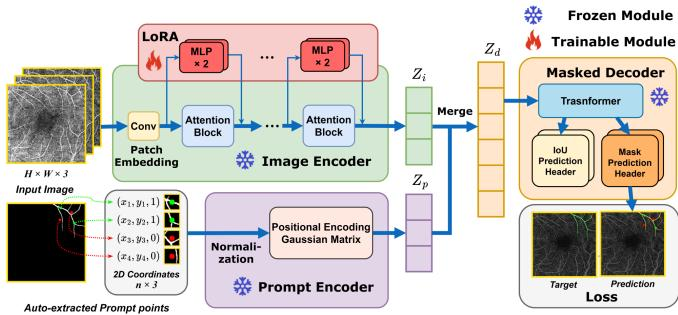
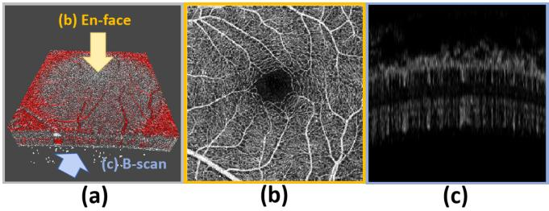
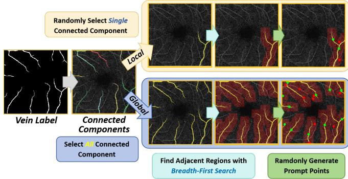
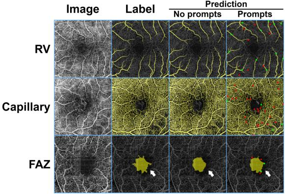
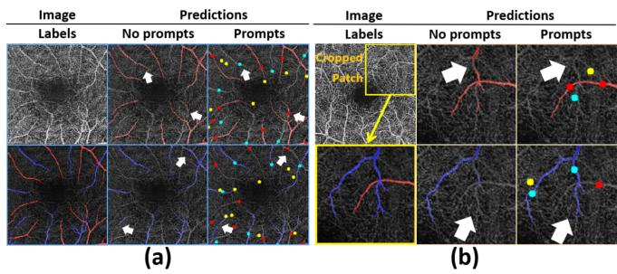

# SAM-OCTA: A FINE-TUNING STRATEGY FOR APPLYING FOUNDATION MODEL TO OCTA IMAGE SEGMENTATION TASKS

Chengliang Wang, Xinrun Chen, Haojian Ning

Chongqing University College of Computer Science Chongqing, China

## ABSTRACT

In the analysis of optical coherence tomography angiography (OCTA) images, the operation of segmenting specific targets is necessary. Existing methods typically train on supervised datasets with limited samples (approximately a few hundred), which can lead to overfitting. To address this, the low-rank adaptation technique is adopted for foundation model fine-tuning and proposed corresponding prompt point generation strategies to process various segmentation tasks on OCTA datasets. This method is named SAM-OCTA and has been experimented on the publicly available OCTA-500 dataset. While achieving state-of-the-art performance metrics, this method accomplishes local vessel segmentation as well as effective artery-vein segmentation, which was not well-solved in previous works. The code is available at: https://github.com/ShellRedia/SAM-OCTA.

Index Terms— OCTA, Image Segmentation, Fine-tuning, Prompt Generation

## 1. INTRODUCTION

Optical coherence tomography angiography (OCTA) is an innovative and non-invasive imaging technique that enables the visualization of retinal microvasculature with high resolution and without needing dye injection [1]. It is a valuable tool for disease staging and preclinical diagnosis [2], benefits for monitoring lesions such as diabetic retinopathy, macular degeneration, glaucoma, and retinal vein occlusion.

Xiang'an Hospital of Xiamen University Department of Ophthalmology Xiamen, China

Certain specific retinal structures, such as retinal vessels (RV) and the foveal avascular zone (FAZ) of the macula, usually need to be segmented from the raw data of OCTA for further analysis [2, 3]. Researchers have been actively exploring deep learning-based methods for image quality assessment and segmentation to address these challenges and enhance the accuracy and efficiency of OCTA image analysis. Most deep learning segmentation methods related to OCTA are based on self-designed neural networks and modules. This requires training the model from scratch, which can lead to overfitting issues. The foundational models, trained on large-scale data, can be applied to various scenarios [4].

Shiying Li

Segment Anything Model (SAM) was introduced as a foundational model for addressing natural image tasks. This benchmark model demonstrated, for the first time, the promising wide applicability to various image segmentation tasks without the need for prior re-training [5]. However, medical images differ significantly from natural images in terms of quality, noise, resolution, and other factors, which can affect SAM's segmentation performance. Thus, further research and optimization efforts are required to harness the potential of SAM in medical image segmentation fully [6].

We find that adopting a fine-tuning approach to SAM and introducing prompt information can enhance and guide the model's segmentation, aiming to improve some complex OCTA segmentation cases. We call our method SAM-OCTA and summarize the contributions as follows:

(1) Applying Low-Rank Adaptation (LoRA) technology for fine-tuning the SAM model enables it to perform effective segmentation of specific targets within OCTA images.

(2) A strategy for generating prompt points is proposed, which optimizes the segmentation performance of FAZ and artery-vein(AV) tasks within OCTA samples.

## 2. RELATED WORK

## 2.1. OCTA Segmentation Models

As a typical architecture for deep image processing, the vision transformer (ViT) is frequently used for segmentation tasks in OCTA [7]. In OCTA images, the distribution of RV is extensive, and it requires the models to utilize the global information effectively in the images. The TCU-Net, OCT2Former, and StruNet methods have improved ViT, achieving accurate RV segmentation and addressing issues such as vessel discontinuities or missing segments [8, 9, 10]. Other methods, from the perspectives of efficiency, denoising, and the utilization of three-dimensional data, have designed a series of techniques and strategies, achieving promising segmentation results on OCTA datasets [2, 11, 12, 13, 14]. The above-mentioned methods have demonstrated that existing deep networks are capable of achieving precise segmentation of RV and FAZ.

  
Fig. 1. Schematic diagram illustrating the fine-tuning of SAM using OCTA samples.

## 2.2. SAM and Related Fine-tuning Approaches

The SAM is a foundational vision model for general image segmentation. With the ability to segment diverse objects, parts, and visual structures in various scenarios, SAM takes prompts in the form of points, bounding boxes, or coarse masks as input. Its remarkable zero-shot segmentation capabilities enable its easy transfer to numerous applications through simple prompting [5]. Although SAM has established an efficient data engine for model training, there are relatively few cases collected for medical applications or other rare image scenarios. Therefore, some fine-tuning methods have been applied to SAM to improve its performance in certain segmentation failure cases [15, 16]. The common characteristic of these fine-tuning methods is that they introduce additional network layers on top of the pre-trained SAM. With a small number of added trainable parameters, fine-tuning becomes feasible through further training on a new dataset. The advantage of fine-tuning methods lies in their ability to preserve SAM's strong zero-shot capabilities and flexibility.

## 3. METHOD

In this paper, we fine-tuned the pre-trained SAM using OCTA datasets and corresponding annotations. The process is shown in Figure 1. SAM consists of three parts: an image encoder, a flexible prompt encoder, and a fast mask decoder [5].

## 3.1. Fine-tuning of Image Encoder

The image encoder utilizes a ViT pre-trained with the masked auto-encode method. The ViT model comes in three variants: vit-b, vit-1, and vit-h, which can only process fixed-size inputs (e.g., 1024 \* 1024 \* 3). Scaling and padding operations are employed to support input images of different resolutions. In this study, we used the image encoder from the "vit-h"model for the fine-tuning process.

As shown in Figure 2, OCTA data is inherently in 3D format, but most datasets provide en-face 2D projection forms. En-face projection is obtained through layer-wise segmentation based on vascular anatomical structures. As SAM requires three-channel images as input, in this work, we stack projection layers of OCTA images in different depths to adapt to this input format. The benefit of this approach is that it preserves the vascular structure information in the OCTA images while fully utilizing SAM's feature-extracting capabilities. Fine-tuning aims to retain SAM's powerful image-understanding capabilities while enhancing its performance on OCTA. The approach used in this paper involves utilizing the LoRA technique [17], which introduces additional linear network layers in each transformer block of the image encoder, similar in form to a ResNet block. During the training process, the weights of the SAM are frozen, and only the newly introduced parameters are updated.

  
Fig. 2. OCTA structural diagram. (a) Three-dimensional volume rendering with arrows indicating different projection directions. (b) En-face projection. (c) B-scan projection.

## 3.2. Prompt Points Generation Strategy

The prompt encoder is divided into two types of prompts: sparse prompts (points, boxes, text) and dense prompts (masks). In our work, we chose points as the prompt for OCTA segmentation. For each sample's prompt points input, assuming there are n points in the prompt point input, it can be represented as $( x _ { 1 } , y _ { 1 } , 1 ) , ( x _ { 2 } , y _ { 2 } , 1 ) , . . . , ( x _ { n } , y _ { n } , 0 )$ where x and y denote the coordinates of prompt points in the image. The values "1" and "0" indicate positive (foreground) and negative (background) points, respectively. The prompt encoder of SAM will perform embedding on this input, and due to its pre-training, it can appropriately integrate with the information from the input image.

The prompt points generation strategy has two types: global and local modes. The global mode is applied to all OCTA segmentation tasks, while the local mode is specific to AV segmentation. The study of segmenting individual vessels as a local segmentation task has not been attempted in previous works. By the prompt encoder, more accurate regional vessel segmentation can be achieved in OCTA datasets. For this task, the first step is to identify and label all connected components in the segmentation masks with unique identifiers. Due to the weak connectivity at the endpoints of some vessels in OCTA labels, we adopt the eight-connectivity criterion. Then, positive points are randomly selected within each connected component. Due to varying numbers of vessels in different samples, to standardize their data format, negative points are added from the background adjacent to the connected components. The prompt points generation process can be described as Figure 3.

  
Fig. 3. Illustration of prompt points generation. Green and red points represent positive and negative points, respectively.

## 3.3. Mask Decoder

The role of the mask decoder is to efficiently map the image embeddings, prompt embeddings, and output tokens to a segmentation mask. A modified version of the transformer decoder block is employed, followed by a dynamic mask prediction head. For an image input and corresponding prompt input, the mask decoder outputs multiple segmentation masks to represent objects at different semantic levels. In this work, the loss function (in the fine-tuning process) is computed with the highest confidence based on the segmentation output.

## 4. EXPERIMENTS

## 4.1. Dataset and Preprocessing

The publicly available dataset used in this paper is OCTA-500 [18]. The OCTA-500 dataset contains 500 samples, classified based on the field of view (FoV): 3mm \* 3mm (3M) and 6mm \* 6mm (6M). The corresponding image resolutions are 304\*304 and 400 \*400, with 200 and 300 samples respectively. The OCTA-500 dataset annotates RV, FAZ, capillary, artery, and vein. The adopted data augmentation tool is Albumentations [19]. The data augmentation strategies include horizontal flipping, brightness and contrast adjustment, and random slight rotation.

## 4.2. Experimental Settings

The OCTA-SAM is deployed on A100 graphic cards with 80 GB memory. To evaluate the training results, 10-fold crossvalidation is adopted. The optimizer used is AdamW, and the learning rate adopts a warm-up strategy, starting from $1 0 ^ { - 5 }$ and gradually increasing to $1 0 ^ { - 3 }$

The loss functions used for fine-tuning vary depending on the segmentation tasks. For FAZ and capillary, the Dice loss is employed. However, for RV, artery, and vein, the clDice loss is utilized, which is more feasible for tubular segmentation [20]. These two loss functions can be represented as:

$$
L _ { c l D i c e } = 0 . 8 * L _ { D i c e } + 0 . 2 * L _ { c l D i c e } ^ { \prime } ,
$$

$$
\begin{array} { r l } & { \mathrm { ~ e ~ } L _ { D i c e } = 1 - \frac { 2 * \dot { | \hat { Y } \cap Y | } } { | \hat { Y } | + | Y | } \mathrm { , } } \\ & { \begin{array} { r } { L _ { c l D i c e } ^ { \prime } = 1 - 2 * \frac { T p r e c ( \hat { Y } _ { s } , Y ) * T s e n s ( Y _ { s } , \hat { Y } ) } { T p r e c ( \hat { Y } _ { s } , Y ) + T s e n s ( Y _ { s } , \hat { Y } ) } \mathrm { , } } \\ { Y  t h e g r o u n d - t r u t h , } \\ { \hat { Y }  t h e p r e d i c t e d ~ \nu a l u e , } \end{array} } \\ & { \begin{array} { r } { Y _ { s } , \hat { Y } _ { s }  s o f t - s k e l e t o n ( Y , \hat { Y } ) , \mathrm { a n d } } \\ { T p r e c , T s e n s  p r e c i s i o n ~ a n d ~ s e n s i t i \nu i t y . } \end{array} } \end{array}
$$

## 4.3. Results

We conducted extensive experiments with various cases on the OCTA-500 dataset. The segmentation results using metrics Dice and Jaccard, which are calculated as follows:

$$
D i c e ( \hat { Y } , Y ) = \frac { 2 | \hat { Y } \cap Y | } { | \hat { Y } | + | Y | } , ~ J a c c a r d ( \hat { Y } , Y ) = \frac { | \hat { Y } \cap Y | } { | \hat { Y } \cup Y | } .
$$

## 4.3.1. Global Mode

We have experimented with various prompt point generation strategies, including the number of points and the generation area for negative points. The best metrics have been selected as the final results. RV and FAZ are common segmentation tasks in previous studies. Therefore, we will summarize the comparative results in Table 1. The experimental data from previous methods are referenced from [21]. Our method's comprehensive performance reaches the state-of-the-art level.

The impact of prompt points is insignificant for segmentation tasks involving global vessels such as RV and capillary However, for FAZ, artery, and vein segmentation, prompt points lead to a noticeable improvement in segmentation performance. The segmentation results can be observed in Figures 4, 5, and Table 2. It can be inferred that the effect of prompt point information is more pronounced within a local region. For the widely distributed vessels, importing more prompt points has a limited effect. However, the prompt points can help improve the boundary delineation of the FAZ.

## 4.3.2. Local Mode

The local mode primarily focuses on precisely segmenting vessels in local regions. The segmentation targets include the artery and vein. For each sample, two positive points are selected on the target vessels and two negative points on the adjacent region.

Due to the morphological similarities between retinal arteries and veins and the complexities introduced by factors such as age, gender, and disease conditions, deep learning methods often encounter segmentation disconnections or confusion in the AV segmentation task [22]. Without prompt points, the OCTA-SAM is prone to confusion when an artery and a vein are closed or overlapping. Table 2 reveals the substantial metrics improvement with prompts. From Figure 5, it can be seen that the introduced prompt points (especially the negative points on the vein when segmenting the artery) assist the model in effectively distinguishing different types of vessels, thereby improving the artery-vein segmentation results.

Table 1. RV and FAZ segmentation results on OCTA-500 (underscores indicate the top two highest values).
<table><tr><td>Label</td><td colspan="4">RV</td><td colspan="4">FAZ</td></tr><tr><td rowspan="2">Method</td><td colspan="2">OCTA-500(3M)</td><td colspan="2">OCTA-500(6M)</td><td colspan="2">OCTA-500(3M)</td><td colspan="2">OCTA-500(6M)</td></tr><tr><td>Dice ↑</td><td>Jaccard ↑</td><td>Dice ↑</td><td>Jaccard ↑</td><td>Dice ↑</td><td>Jaccard ↑</td><td>Dice ↑</td><td>Jaccard ↑</td></tr><tr><td>U-Net (2015)</td><td>0.9068</td><td>0.8301</td><td>0.8876</td><td>0.7987</td><td>0.9747</td><td>0.9585</td><td>0.8770</td><td>0.8124</td></tr><tr><td>IPN (2020)</td><td>0.9062</td><td>0.8325</td><td>0.8864</td><td>0.7973</td><td>0.9505</td><td>0.9091</td><td>0.8802</td><td>0.7980</td></tr><tr><td>IPN V2+ (2020)</td><td>0.9274</td><td>0.8667</td><td>0.8941</td><td>0.8095</td><td>0.9755</td><td>0.9532</td><td>0.9084</td><td>0.8423</td></tr><tr><td>FARGO (2021)</td><td>0.9112</td><td>0.8374</td><td>0.8798</td><td>0.7864</td><td>0.9785</td><td>0.9587</td><td>0.8930</td><td>0.8355</td></tr><tr><td>Joint-Seg (2022)</td><td>0.9113</td><td>0.8378</td><td>0.8972</td><td>0.8117</td><td>0.9843</td><td>0.9693</td><td>0.9051</td><td>0.8424</td></tr><tr><td>SAM-OCTA (ours)</td><td>0.9199</td><td>0.8520</td><td>0.8869</td><td>0.7975</td><td>0.9838</td><td>0.9692</td><td>0.9073</td><td>0.8473</td></tr></table>

Table 2. The effect of prompt points on segmentation tasks.
<table><tr><td colspan="2">FoV</td><td colspan="2">OCTA-500(3M)</td><td colspan="2">OCTA-500(6M)</td></tr><tr><td colspan="2">Prompts</td><td>X</td><td>V</td><td>X</td><td>V</td></tr><tr><td colspan="2"></td><td colspan="4">Global Mode</td></tr><tr><td rowspan="3">RV</td><td>Dice ↑</td><td>0.9165</td><td>0.9199</td><td>0.8865</td><td>0.8869</td></tr><tr><td>Jaccard ↑</td><td>0.8431</td><td>0.8520</td><td>0.7955</td><td>0.7975</td></tr><tr><td>Dice ↑</td><td>0.9545</td><td>0.9838</td><td>0.8787</td><td>0.9073</td></tr><tr><td rowspan="2">FAZ</td><td>Jaccard ↑</td><td>0.9345</td><td>0.9692</td><td>0.7991</td><td>0.8473</td></tr><tr><td>Dice ↑</td><td>0.8813</td><td>0.8785</td><td>0.8337</td><td>0.8379</td></tr><tr><td rowspan="2">Capillary Artery</td><td>Jaccard ↑</td><td>0.7881</td><td>0.7837</td><td>0.7152</td><td>0.7213</td></tr><tr><td>Dice ↑</td><td>0.8342</td><td>0.8747</td><td>0.8352</td><td>0.8602</td></tr><tr><td rowspan="2">Vein</td><td>Jaccard ↑</td><td>0.7528</td><td>0.7785</td><td>0.7325</td><td>0.7572</td></tr><tr><td>Dice ↑</td><td>0.8409</td><td>0.8817</td><td>0.8263</td><td>0.8526</td></tr><tr><td></td><td>Jaccard ↑</td><td>0.7463</td><td>0.7897</td><td>0.7168</td><td>0.7474</td></tr><tr><td rowspan="3">Artery</td><td></td><td></td><td></td><td>Local Mode</td><td></td></tr><tr><td>Dice ↑</td><td>0.7393</td><td>0.8707</td><td>0.6865</td><td>0.7922</td></tr><tr><td>Jaccard ↑</td><td>0.6339</td><td>0.7792</td><td>0.5699</td><td>0.6851</td></tr><tr><td rowspan="2">Vein</td><td>Dice ↑</td><td>0.7742</td><td>0.8352</td><td>0.7053</td><td>0.8167</td></tr><tr><td>Jaccard ↑</td><td>0.6658</td><td>0.7267</td><td>0.5823</td><td>0.7014</td></tr></table>

## 5. CONCLUSION

We propose a fine-tuning method for SAM for OCTA image segmentation and design prompt point generation strategies as global and local modes. It excels in both RV and FAZ tasks while also firstly exploring and achieving good results in the AV segmentation task on the OCTA-500 dataset. This is expected to assist in analyzing and diagnosing related diseases with varying impacts on arteries and veins.

Fig. 4. Segmentation of RV, capillary, and FAZ. White arrows indicate the improvement area with added prompt points.  
  
Fig. 5. The performance of SAM-OCTA on AV segmentation tasks. (a) Global mode; (b) Local mode. The red and blue vessels represent arteries and veins, respectively. Red dots indicate arteries, while cyan dots indicate veins. Yellow dots represent negative background prompt points. White arrows indicate areas of improvement with added prompt points.

## Acknowledgement

This work is supported by the Chongqing Technology Innovation & Application Development Key Project (cstc2020jscx; dxwtBX0055; cstb2022tiad-kpx0148).

## 6. REFERENCES

[1] Yufei Wang, Yiqing Shen, Meng Yuan, Jing Xu, Bin Yang, Chi Liu, Wenjia Cai, Weijing Cheng, and Wei Wang, “A deep learning-based quality assessment and segmentation system with a large-scale benchmark dataset for optical coherence tomographic angiography image," arXiv preprint arXiv:2107.10476, 2021.

[2] Zhijin Liang, Junkang Zhang, and Cheolhong An, "Foveal avascular zone segmentation of octa images using deep learning approach with unsupervised vessel segmentation," in ICASSP 2021-2021 IEEE International Conference on Acoustics, Speech and Signal Processing (ICASSP). IEEE, 2021, pp. 1200-1204.

[3] Weisheng Li, Hongchuan Zhang, Feiyan Li, and Linhong Wang, “Rps-net: An effective retinal image projection segmentation network for retinal vessels and foveal avascular zone based on octa data," Medical Physics, vol. 49, no. 6, pp. 3830– 3844, 2022.

[4] Chunhui Zhang, Li Liu, Yawen Cui, Guanjie Huang, Weilin Lin, Yiqian Yang, and Yuehong Hu, “A comprehensive survey on segment anything model for vision and beyond," arXiv preprint arXiv:2305.08196, 2023.

[5] Alexander Kirillov, Eric Mintun, Nikhila Ravi, Hanzi Mao, Chloe Rolland, Laura Gustafson, Tete Xiao, Spencer Whitehead, Alexander C Berg, Wan-Yen Lo, et al., “Segment anything," arXiv preprint arXiv:2304.02643, 2023.

[6] Yichi Zhang and Rushi Jiao, "How segment anything model (sam) boost medical image segmentation?," arXiv preprint arXiv:2305.03678, 2023.

[7] Alexey Dosovitskiy, Lucas Beyer, Alexander Kolesnikov, Dirk Weissenborn, Xiaohua Zhai, Thomas Unterthiner, Mostafa Dehghani, Matthias Minderer, Georg Heigold, Sylvain Gelly, et al., “An image is worth 16x16 words: Transformers for image recognition at scale," arXiv preprint arXiv:2010.11929, 2020.

[8] Zidi Shi, Yu Li, Hua Zou, and Xuedong Zhang, “Tcu-net: Transformer embedded in convolutional u-shaped network for retinal vessel segmentation," Sensors, vol. 23, no. 10, pp. 4897, 2023.

[9] Xiao Tan, Xinjian Chen, Qingquan Meng, Fei Shi, Dehui Xiang, Zhongyue Chen, Lingjiao Pan, and Weifang Zhu, "Oct2former: A retinal oct-angiography vessel segmentation transformer," Computer Methods and Programs in Biomedicine, vol. 233, pp. 107454, 2023.

[10] Yuhui Ma, Qifeng Yan, Yonghuai Liu, Jiang Liu, Jiong Zhang, and Yitian Zhao, “Strunet: Perceptual and low-rank regularized transformer for medical image denoising," Medical Physics, 2023.

[11] Chengliang Wang, Haojian Ning, Xinrun Chen, and Shiying Li, "Db-unet: Mlp based dual branch unet for accurate vessel segmentation in octa images," in ICASSP 2023-2023 IEEE International Conference on Acoustics, Speech and Signal Processing (ICASSP). IEEE, 2023, pp. 1–5.

[12] Mingchao Li, Yerui Chen, Zexuan Ji, Keren Xie, Songtao Yuan, Qiang Chen, and Shuo Li, "Image projection network:

3d to 2d image segmentation in octa images," IEEE Transactions on Medical Imaging, vol. 39, no. 11, pp. 3343–3354, 2020.

[13] Chengzhang Zhu, Han Wang, Yalong Xiao, Yulan Dai, Zixi Liu, and Beiji Zou, “Ovs-net: An effective feature extraction network for optical coherence tomography angiography vessel segmentation," Computer Animation and Virtual Worlds, vol. 33, no. 3-4, pp. e2096, 2022.

[14] Ziping Ma, Dongxiu Feng, Jingyu Wang, and Hu Ma, "Retinal octa image segmentation based on global contrastive learning," Sensors, vol. 22, no. 24, pp. 9847, 2022.

[15] Kaidong Zhang and Dong Liu, “Customized segment anything model for medical image segmentation," arXiv preprint arXiv:2304.13785, 2023.

[16] Junde Wu, Rao Fu, Huihui Fang, Yuanpei Liu, Zhaowei Wang, Yanwu Xu, Yueming Jin, and Tal Arbel, "Medical sam adapter: Adapting segment anything model for medical image segmentation,"arXiv preprint arXiv:2304.12620, 2023.

[17] Edward J Hu, Yelong Shen, Phillip Wallis, Zeyuan Allen-Zhu, Yuanzhi Li, Shean Wang, Lu Wang, and Weizhu Chen, "Lora: Low-rank adaptation of large language models," arXiv preprint arXiv:2106.09685, 2021.

[18] Mingchao Li, Yuhan Zhang, Zexuan Ji, Keren Xie, Songtao Yuan, Qinghuai Liu, and Qiang Chen, "Ipn-v2 and octa-500: Methodology and dataset for retinal image segmentation,' arXiv preprint arXiv:2012.07261, 2020.

[19] Alexander Buslaev, Vladimir I. Iglovikov, Eugene Khvedchenya, Alex Parinov, Mikhail Druzhinin, and Alexandr A. Kalinin, “Albumentations: Fast and flexible image augmentations," Information, vol. 11, no. 2, 2020.

[20] Suprosanna Shit, Johannes C Paetzold, Anjany Sekuboyina, Ivan Ezhov, Alexander Unger, Andrey Zhylka, Josien PW Pluim, Ulrich Bauer, and Bjoern H Menze, "cldice-a novel topology-preserving loss function for tubular structure segmentation," in Proceedings of the IEEE/CVF Conference on Computer Vision and Pattern Recognition, 2021, pp. 16560– 16569.

[21] Kai Hu, Shuai Jiang, Yuan Zhang, Xuanya Li, and Xieping Gao, “Joint-seg: Treat foveal avascular zone and retinal vessel segmentation in octa images as a joint task," IEEE Transactions on Instrumentation and Measurement, vol. 71, pp. 1–13, 2022.

[22] Xiayu Xu, Peiwei Yang, Hualin Wang, Zhanfeng Xiao, Gang Xing, Xiulan Zhang, Wei Wang, Feng Xu, Jiong Zhang, and Jianqin Lei, “Av-casnet: Fully automatic arteriole-venule segmentation and differentiation in oct angiography," IEEE Transactions on Medical Imaging, vol. 42, no. 2, pp. 481–492, 2022.