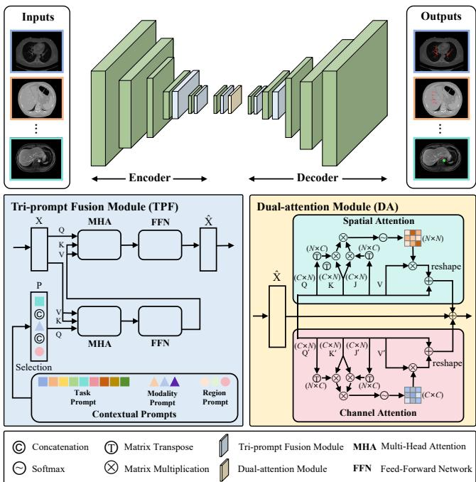
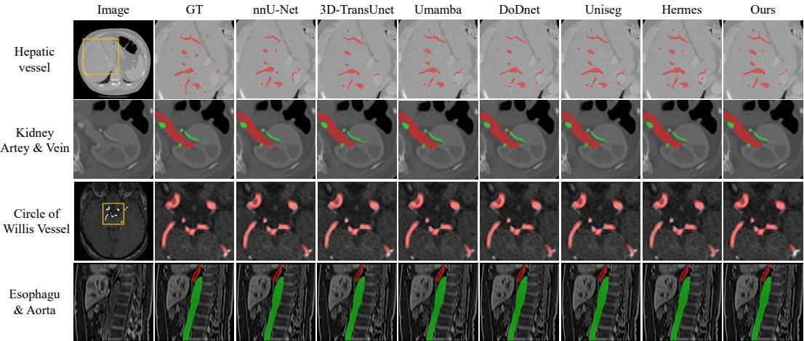

# UNICURVSEG: LEARNING CONTEXTUAL PROMPT FOR UNIVERSAL VESSEL-LIKE CURVILINEAR STRUCTURE SEGMENTATION

Qiuting Hu1†, Li Lin1,2†, Pujin Cheng1,2, Xiaoying Tang1,3,\*

1Department of Electronic and Electrical Engineering, Southern University of Science and Technology Shenzhen, China

2Department of Electrical and Electronic Engineering, The University of Hong Kong, Hong Kong SAR, China

3Jiaxing Research Institute, Southern University of Science and Technology, Jiaxing, China

## ABSTRACT

Universal model excels at handling multi-task and multimodal medical image segmentation, effectively addressing the variations between different tasks. However, most existing universal models fail to adequately consider the interrelations between different structures, overlooking their latent semantic connections. In this paper, we propose a novel prompt-driven model based on in-context learning that aims to achieve 3D universal vessel-like curvilinear structure segmentation (UniCurvSeg) across domains and modalities. In UniCurvSeg, a learnable task prompt is designed to capture the correlations across all tasks, integrating a modality prompt to help the model recognise features from different modalities and a region prompt to accurately localize target regions. These prompts are injected into feature maps through cross-attention, addressing the challenges of data heterogeneity and annotation discrepancies. In addition, we incorporate a dual attention mechanism to learn rich hierarchical representations of vessel-like structures. Extensive experimental results demonstrate that UniCurvSeg outperforms existing methods on 9 datasets (1662 images) across three modalities (CT, MRI, MRA).

Index Terms— Universal model, in-context learning, medical image segmentation, multi-attention

## 1. INTRODUCTION

Many studies suggest that the geometric and morphological changes of vessel-like structures (e.g., hepatic vessel, aorta and brain vessel) in medical image are closely linked to various diseases [1]. Medical image segmentation plays a crucial role in computer-aided detection and diagnosis, enabling precise delineation of anatomical structures. In recent years, deep learning (DL) has achieved remarkable success in medical image segmentation, with single-task models[2] [3] becoming the prevailing paradigm. However, due to the high cost of medical data collection and annotation, single-task model is often constrained by limited training data. Furthermore, different tasks require specialized networks, resulting in distributed research efforts.

Several strategies, including multi-head and universal models, have been proposed to address these challenges. Multi-head models typically fall into three categories: (1) A shared encoder with task-specific decoders, exemplified by Med3D [4], which facilitates feature sharing across tasks. (2) Task-specific encoders with a shared decoder [5], effectively handling diverse input modalities by learning and fusing distinct features at a semantic level. (3) Task-specific encoders and decoders connected through shared middle layers [6], balancing specialized learning with knowledge transfer. However, these models require strong task relevance and often lead to structural redundancy due to the need for multiple specialized components. There is a growing interest in developing universal models. DoDnet [7] employs one-hot encoding and a controller to generate dynamic convolutions for multi-task segmentation. Uniseg [8] introduces a promptdriven universal segmentation model. FedLPPA [9] employs two learnable prompts and n one-hot prompts, integrating learnable parameters with predefined one-hot encodings to elicit a more nuanced and efficient response. Hermes [10] leverages contextual prior learning to effectively integrate task and modality information. However, these methods primarily focus on segmenting various anatomical structures, such as organs and tumors, failing to fully harness the semantic consistency shared among similar structures, which limits their performance across diverse structures. In contrast to specialized model, universal model can achieve superior performance by learning from the representations of analogous topologies [11]. In such context, it is desirable to design a universal framework for structures with similar morphology.

  
Fig. 1. Overview of the proposed UniCurvSeg framework and its key components.

In this paper, we introduce a novel framework with learnable prompts and dual-attention mechanism for universal vessel-like structures curvilinear segmentation (UniCurvSeg). In UniCurvSeg, prompts represent the task, modality and target region, which are fused with feature via a cross-attention mechanism, and a dual-attention module is introduced for network to efficiently extract vessel-like structures. The contributions of our work are as follows:

• We propose a universal segmentation paradigm for the segmentation of vessel-like curvilinear structure, capable of handling tasks across different anatomical regions and modalities.

• We introduce a Tri-prompt Fusion (TPF) module for incontext learning, enabling model to adapt to task, modality, and region priors for contextual prompt learning.

• A Dual-attention (DA) module is introduced to generate attention-aware feature representations, effectively utilizing multi-channel spatial information for feature representation and normalization, allowing the network to better distinguish vessel-like structures from the background.

• Results across 9 datasets demonstrate that UniCurvSeg clearly outperforms other single-task and multi-task models in the segmentation of vessel-like structures.

## 2. METHOD

In this section, we first briefly overview our UniCurvSeg framework, followed by an introduction of the TPF and DA modules. The TPF module leverages in-context learning, allowing the model to grasp shared knowledge across tasks, modalities, and regions, while the DA module capture rich hierarchical representations of vessel-like structures. The overview of UniCurvSeg is provided in Fig. 1.

## 2.1. UniCurvSeg Paradigm Overview

Generally, N segmentation tasks requires designing N unique architectures, which limits the ability to leverage information from other tasks and prevents the model from capturing semantic connections between similar structures. To address this, we propose a universal vessel-like curvilinear structure segmentation framework that enables a single model to perform segmentation across nine common curvilinear structure datasets spanning three modalities. Given a set of N datasets $\{ D _ { 1 } , D _ { 2 } , \ldots , D _ { N } \}$ , where $D _ { i } \ = \ \{ ( { \bf { x } } _ { i j } , { \bf { y } } _ { i j } , { \bf { t } } _ { i } , { \bf { m } } _ { i } , { \bf { r } } _ { i } ) \} _ { j = 1 } ^ { n _ { i } }$ represents that the $i ^ { t h }$ dataset has $n _ { i }$ images, and $\mathbf { \boldsymbol { x } } _ { i j }$ and $\mathbf { \nabla } _ { \mathbf { \boldsymbol { y } } _ { i j } }$ are the image and ground truth, respectively. $\mathbf { \Delta } _ { t _ { i } }$ denotes the $i ^ { t h }$ task, where each task corresponds to a distinct dataset. $\pmb { m } _ { i }$ represents the imaging modality, including CT, MRI and MRA. $r _ { i }$ denotes the target region, such as the abdomen, thoracic or brain. The objective is to train a single model that can effectively handle multiple tasks. The main architecture of UniCurvSeg is based on nnU-Net, which consists of a shared encoder and a share decoder. To enhance our framework's ability to effectively learn task, modality, and region prompts, we applied the TPF module at five key positions within the network. Additionally, a DA module is inserted in the middle. Since the number of classes varies across tasks, the channel number of multi-scale segmentation map is set to match the maximum number of classes across all tasks. Finally, the final output is adjusted to correspond to the actual class number in each specific task. A combination of cross-entropy and Dice loss is used:

$$
\mathcal { L } = \mathcal { L } _ { \mathrm { c e } } ( \pmb { y } , \hat { \pmb { y } } ) + \mathcal { L } _ { \mathrm { d i c e } } ( \pmb { y } , \hat { \pmb { y } } ) ,\tag{1}
$$

where $\hat { y }$ is sample's prediction probability.

## 2.2. Tri-prompt Fusion Module

Our TPF employs a tri-prompt strategy, integrating with features to learn contextual priors influenced by external factors, enabling the network to adaptively optimise itself. Unlike DoDNet which uses a set of one-hot codes, we apply learnable tokens to generate prompts, aiming to encourage interaction and fusion among different task, modality and region prompts. Given a set of N datasets comprising N tasks, K modalities, and L regions, we initialize a learnable task prompt (TP) $p _ { t } \in \mathbb { R } ^ { N \times \check { C } }$ , where C denotes the token dimension. Similarly, we use learnable prompts to represent the modality prompt (MP) $p _ { m } \in \mathbb { R } ^ { K \times C }$ and the region prompt (RP) $p _ { r } \in \mathbb { R } ^ { L \times C }$ . As illustrated in Fig. 1, for the $\cdot ^ { \mathit { t h } }$ task, we select the $\mathrm { T P } p _ { t , i } ,$ MP $p _ { m , i }$ and $\mathrm { R P } p _ { r , i }$ and concatenate them: $p _ { i } = \left[ p _ { t , i } , p _ { m , i } , p _ { r , i } \right] \in \mathbb { R } ^ { 3 \times C }$ . Given an encoded image feature map $X \in \mathbb { R } ^ { C \times D \times H \times W }$ , where D, H, W represent the depth, height and width of the 3D feature map, a tri-prompt fusion module is applied to fuse prompts and feature:

$$
\hat { X } = F u s i o n ( p _ { i } , X ) .\tag{2}
$$

Here, $\hat { X }$ denotes the prompt-injected feature map. A bidirectional cross-attention module is employed to process both the feature map $X$ and the concatenated prompt $p _ { i } ,$ as shown in Fig 1.

## 2.3. Dual-attention Module

To enable our UniCurvSeg to extract the vessel-like structures, we follow the dual-attention mechanism in both spatial and channel dimensions [12]. As illustrated in Fig. 1, the spatial attention value is calculated as follows:

$$
s _ { ( x , y , z ) } = \frac { \exp [ ( Q _ { y } ^ { T } \otimes K _ { x } ) \otimes ( J _ { z } ^ { T } \otimes K _ { x } ) ] } { \sum _ { x ^ { \prime } = 1 } ^ { N } \exp [ ( Q _ { y } ^ { T } \otimes K _ { x ^ { \prime } } ) \otimes ( J _ { z } ^ { T } \otimes K _ { x ^ { \prime } } ) ] } ,\tag{3}
$$

where $Q _ { y } , K _ { x }$ and $J _ { z } \in \mathbb { R } ^ { N \times C }$ are derived from the feature map X through batch normalization and ReLU activations, capturing the boundary features of vessel-like structures in the width, height, and depth directions. The spatial attention value $s _ { ( x , y , z ) }$ denotes the mutual impacts of features at the width, height, and depth directions. Next, we apply a convolutional layer on the input feature map X and reshaping it to R $N { \times } C$ to obtain the feature map V. A matrix multiplication is performed between V and $s _ { ( x , y , z ) }$ to generates the voxellevel attention-enhanced features $X _ { s } ,$ which are then reshaped to $\mathbb { R } ^ { C \times H \times W \times D }$ . Finally, $X _ { s }$ is added to $\hat { X }$ at each voxel to produce $\hat { X } _ { s } ^ { \prime } ,$ the output of the spatial attention block.

Similarly, the channel attention value is formulated as:

$$
c _ { ( x , y , z ) } = \frac { \exp \left[ \left( K _ { x } ^ { \prime } \otimes Q _ { y } ^ { \prime T } \right) \otimes \left( K _ { x } ^ { \prime } \otimes J _ { z } ^ { \prime T } \right) \right] } { \sum _ { x ^ { \prime } = 1 } ^ { C } \exp \left[ \left( K _ { x ^ { \prime } } ^ { \prime } \otimes Q _ { y } ^ { \prime T } \right) \otimes \left( K _ { x ^ { \prime } } ^ { \prime } \otimes J _ { z } ^ { \prime T } \right) \right] } ,\tag{4}
$$

where $c _ { ( x , y , z ) }$ represents the mutual impacts of features across width, height, and depth channels. Matrix multiplication between $V ^ { \prime }$ and $c _ { ( x , y , z ) }$ yields $X _ { c } ,$ which is then reshaped. Similarly, $X _ { c }$ is added to $\hat { X }$ at each voxel, producing $\hat { X } _ { c } ^ { \prime } ,$ the output of the channel attention block.

Finally, a voxel-level matrix summation is applied to the output $\hat { X } _ { s } ^ { \prime }$ of the spatial attention block, the output $\hat { X } _ { c } ^ { \prime }$ of the channel attention block, and the fused feature X to obtain the output of the DA module.

## 3. EXPERIMENTS

## 3.1. Dataset and Preprecessing

We collect 9 datasets involving 3 regions—thoracic, abdominal, and brain—and 3 imaging modalities: CT, MRI, and MRA. As shown in Table 1, all images come from public datasets. We demonstrate the effectiveness of our model by comparing both single-task and universal models. A standardized preprocessing pipeline is implemented across all datasets within the widely used nnU-Net framework. Firstly, all images are aligned to the same coordinate system, and the spacing is resampled to a uniform $1 . 5 \times 0 . 8 \times 0 . 8 m m ^ { 3 }$ Then, image intensities are normalized, followed by further normalization for each image.

Table 1. Dataset statistics.
<table><tr><td>Dataset</td><td>Modality</td><td>Region</td><td>Annotations</td><td>#Cls</td><td>Size</td></tr><tr><td>Parse [13]</td><td>CT</td><td>Thoracic</td><td>Pulmonary Artery</td><td>1</td><td>100</td></tr><tr><td>KiPA [14]</td><td>CT</td><td>Abdomen</td><td>Kidney Artery &amp; Vein</td><td>2</td><td>300</td></tr><tr><td>3D-IRCADb-01 [15]</td><td>CT</td><td>Abdomen</td><td>Hepatic Vessel</td><td>1</td><td>20</td></tr><tr><td>AMOS CT [16]</td><td>CT</td><td>Thoracic</td><td>Esophagus &amp; Aorta</td><td>2</td><td>200</td></tr><tr><td>ATM [17]</td><td>CT</td><td>Thoracic</td><td>Airway Tree</td><td>1</td><td>280</td></tr><tr><td>AMOS MR [16]</td><td>MRI</td><td>Thoracic</td><td>Esophagus &amp; Aorta</td><td>2</td><td>60</td></tr><tr><td>IXI [18]</td><td>MRA</td><td>Brain</td><td>Brain Vessel</td><td>1</td><td>570</td></tr><tr><td>TubeTK [19]</td><td>MRA</td><td>Brain</td><td>Brain Vessel</td><td>1</td><td>42</td></tr><tr><td>TopCoW [20]</td><td>MRA</td><td>Brain</td><td>Circle of Willis Vessel</td><td>1</td><td>90</td></tr></table>

## 3.2. Implementation Details

We implement UniCurvSeg using PyTorch on NVIDIA RTX A6000 GPU, integrating it within the widely adopted nnU-Net framework. During training, we utilize the SGD optimizer with a learning rate of 0.01, a batch size of 2, and a default patch size of 64 $\times ~ 1 9 2 \times 1 9 2$ The model undergoes training for 1000 epochs, amounting to 450,000 iterations.

## 3.3. Comparisons with State-of-the-art

We benchmark UniCurvSeg against several representative segmentation frameworks, covering both commonly used single-task model like nnU-Net [2], 3D-TransUNet [21] and U-Mamba [22], and universal model, such as DoDnet [7], Uniseg [8] and Hermes [10]. For a fair comparison, all tasks across the single-task models adopt the same number of epochs, batch size, and patch size as used in our method. It is worth noting that 3D-TransUNet employs transformer encoder and transformer encoder, and U-Mamba only use the U-Mmaba block in the bottleneck.

As shown in Table 2, our method achieves the best performance on average Dice score and achieves the highest Dice score on 8 clinical anatomical structures in 6 datasets. Moreover, UniCurvSeg also present superior performance with an average margin of 1.49% compared to second-best universal model, demonstrating its superior performance. Visualization results for all methods on 4 datasets are provided in Fig. 2.

## 3.4. Ablation Studies

We conducted a series of intra-component ablations to investigate the efffectiveness of each key component in UniCurvSeg.

  
Fig. 2. Visualize comparison results on 3D-IRCADb-01, KiPA, TopCoW and AMOS MR dataset. In the second row, red represents artery, while green denotes vein. In the fourth row, red indicates the esophagus, and green signifies the aorta.

Table 2. Results of single-task model and universal models on nine dataset. The best results on each task are in bold.
<table><tr><td>Method</td><td>Parse</td><td>KiPA_Artery</td><td>KiPA_Vein</td><td>3D-IRCADb-01</td><td>AMOS CT_Eso</td><td>AMOS CT_Aorta</td><td>ATM</td><td>AMOS MR_Eso</td><td>AMOS MR_Aorta</td><td>IXI</td><td>TubeTK</td><td>TopCoW</td><td>Avg Dice</td></tr><tr><td colspan="10">Single-task Model</td><td colspan="7"></td></tr><tr><td>nnU-Net (2021) [2]</td><td>87.36</td><td>81.55</td><td>81.05</td><td>49.58</td><td>87.87</td><td>95.81</td><td>90.05</td><td>80.25</td><td>93.99</td><td></td><td>72.37</td><td>48.91</td><td>81.65</td><td>79.20</td></tr><tr><td>3D-TransUNet (2024) [21]</td><td>87.04</td><td>81.40</td><td>81.09</td><td>48.55</td><td>87.45</td><td>95.65</td><td>89.83</td><td>80.42</td><td>94.40</td><td>72.19</td><td></td><td>53.95</td><td>81.59</td><td>79.46</td></tr><tr><td>U-Mamba (2024) [22]</td><td>87.49</td><td>80.92</td><td>81.84</td><td>50.50</td><td>87.10</td><td>95.55</td><td>90.26</td><td>79.22</td><td>94.20</td><td></td><td>72.28</td><td>50.25</td><td>75.63</td><td>78.77</td></tr><tr><td>86.55</td><td></td><td></td><td></td><td></td><td>Universal Model</td><td></td><td></td><td></td><td></td><td></td><td></td><td></td><td></td><td></td></tr><tr><td colspan="10">81.28 59.99 84.61 95.10</td><td colspan="7">94.62</td></tr><tr><td>Uniseg (2023) [8]</td><td>86.43</td><td>81.84 82.37</td><td>79.49</td><td>60.52</td><td>80.95</td><td>93.33</td><td>89.93 89.55</td><td>84.28 83.58</td><td></td><td>93.34</td><td>72.77 71.49</td><td>54.62 53.14</td><td>81.82 81.68</td><td>80.59 79.66</td></tr><tr><td>Hermes (2024) [10]</td><td>86.32</td><td>80.65</td><td>80.38</td><td>60.71</td><td>85.16</td><td>93.86</td><td>88.47</td><td>82.84</td><td>93.64</td><td></td><td>72.55 53.40</td><td></td><td>81.92</td><td>79.99</td></tr><tr><td>Ours</td><td>86.86</td><td>83.57</td><td>83.93</td><td>61.93</td><td>85.21</td><td>95.25</td><td>89.52</td><td>84.31</td><td>94.92</td><td></td><td>77.02</td><td>58.46</td><td>83.99</td><td>82.08</td></tr><tr><td></td><td></td><td></td><td></td><td></td><td></td><td></td><td></td><td></td><td></td><td></td><td></td><td></td><td></td><td></td></tr></table>

## 3.4.1. Ablation studies of TPF

In the ablation of TPF module, we retain the dual-attention module while systematically ablating the different prompts to examine the impact of various prompts. Since TP provides the model with explicit task information and guidance, serving as the foundation of the universal model, it remains a constant element in this ablation experiment. From Table 3, it is evident that the addition of either MP or RP leads to a noticeable improvement in performance, and the integration of both, forming the triple prompt composition, achieves the best performance outcomes.

Table 3. Ablation study on three key prompts.
<table><tr><td>Task Prompt</td><td>Modality Prompt</td><td>Region Prompt | Avg Dice</td><td></td></tr><tr><td>√</td><td></td><td>一</td><td>78.63</td></tr><tr><td>√</td><td>√</td><td></td><td>81.50</td></tr><tr><td>√</td><td></td><td>√</td><td>78.82</td></tr><tr><td>√</td><td>√</td><td>√</td><td>82.08</td></tr></table>

## 3.4.2. Ablation studies of DA

Moreover, we explore the effectiveness of the dual attention module. Table 4 demonstrates that variants without attention block yield inferior outcomes. The introduction of either the spatial attention block or the channel attention block enhances performance, while the incorporation of both together yields the best outcomes, underscoring the importance of the attention module.

Table 4. Ablation study on two attention blocks.
<table><tr><td>Channel Attention Space Attention | Avg Dice</td><td></td><td></td></tr><tr><td></td><td></td><td>80.32</td></tr><tr><td>V</td><td></td><td>81.40</td></tr><tr><td></td><td>√</td><td>80.47</td></tr><tr><td>√</td><td>√</td><td>82.08</td></tr></table>

## 4. CONCLUSION

This study propose a novel universal segmentation framework, UniCurvSeg, to address the challenging problem of multi-task segmentation. A TPF module and a DA module are introduced to enable in-context learning and effectively extract vessel-like structures. Extensive experiments conducted on nine medical imaging datasets across three modalities successfully demonstrate the superiority of UniCurvSeg.

## 5. ACKNOWLEDGMENTS

This study was supported by the National Key Research and Development Program of China (2023YFC2415400); the National Natural Science Foundation of China (T2422012, 62071210); the Guangdong Basic and Applied Basic Research (2024B1515020088); the Shenzhen Science and Technology Program (RCYX20210609103056042); the Guangdong Basic and Applied Basic Research (2021A1515220131); the High Level of Special Funds (G030230001, G03034K003).

## 6. REFERENCES

[1] Juno Kim and Maria Markoulli, “Automatic analysis of corneal nerves imaged using in vivo confocal microscopy," Clinical and Experimental Optometry, vol. 101, no. 2, pp. 147–161, 2018.

[2] Fabian Isensee et al., “nnu-net: a self-configuring method for deep learning-based biomedical image segmentation," Nature methods, vol. 18, no. 2, pp. 203– 211,2021.

[3] Li Lin et al., “Yolocurvseg: You only label one noisy skeleton for vessel-style curvilinear structure segmentation,"Medical image analysis, vol. 90, pp. 102937,2023.

[4] Chen Sihong, Kai Ma, and Yefeng Zheng, "Med3d: Transfer learning for 3d medical image analysis," arXiv preprint arXiv:1904.00625, 2019.

[5] Li Xiaomeng et al., “3d multi-scale fcn with random modality voxel dropout learning for intervertebral disc localization and segmentation from multi-modality mr images," Medical image analysis, vol. 45, pp. 41–54, 2018.

[6] Gijs van Tulder and Marleen de Bruijne, “Learning cross-modality representations from multi-modal images," IEEE Transactions on Medical Imaging, vol. 38, no. 2, pp. 638–648, 2018.

[7] Zhang Jianpeng et al., “Dodnet: Learning to segment multi-organ and tumors from multiple partially labeled datasets," in Proceedings of the IEEE/CVF Conference on Computer Vision and Pattern Recognition (CVPR), 2021, pp. 1195–1204.

[8] Yiwen Ye et al., “Uniseg: A prompt-driven universal segmentation model as well as a strong representation learner," in International Conference on Medical Image Computing and Computer-Assisted Intervention (MIC-CAI). Springer, 2023, pp. 508–518.

[9] Li Lin et al.,“Fedlppa: Learning personalized prompt and aggregation for federated weaklysupervised medical image segmentation," arXiv preprint arXiv:2402.17502, 2024.

[10] Yunhe Gao, “Training like a medical resident: Contextprior learning toward universal medical image segmentation," in Proceedings of the IEEE/CVF Conference on Computer Vision and Pattern Recognition (CVPR), 2024, pp. 11194–11204.

[11] Shaoting Zhang and Dimitris Metaxas, "On the challenges and perspectives of foundation models for medical image analysis," Medical image analysis, vol. 91, pp. 102996, 2024.

[12] Mou Lei et al., “Cs2-net: Deep learning segmentation of curvilinear structures in medical imaging," Medical image analysis, vol. 61, pp. 101874, 2021.

[13] Gongning Luo et al., “Efficient automatic segmentation for multi-level pulmonary arteries: The parse challenge," arXiv preprint arXiv:2304.03708, 2023.

[14] He Yuting et al., “Meta grayscale adaptive network for 3d integrated renal structures segmentation," Medical image analysis, vol. 71, pp. 102055, 2021.

[15] Luc Soler et al., “3d image reconstruction for comparison of algorithm database: a patient-specific anatomical and medical image database," 2010.

[16] Yuanfeng Ji et al., “Amos: A large-scale abdominal multi-organ benchmark for versatile medical image segmentation," Advances in Neural Information Processing Sstems, vol. 35, pp. 36722–36732, 2022.

[17] Minghui Zhang et al., “Multi-site, multi-domain airway tree modeling (atm'22): a public benchmark for pulmonary airway segmentation," arXiv preprint arXiv:2303.05745, 2023.

[18] Žiga Bizjak et al., “Novel dataset and evaluation of state-of-the-art vessel segmentation methods," Medical Imaging 2022: Image Processing, vol. 12032, pp. 772– 780, 2022.

[19] Bullitt Elizabeth et al., “Vessel tortuosity and brain tumor malignancy: a blinded study1," Academic radiology, vol. 12, no. 10, pp. 1232–1240, 2005.

[20] Md Shakib Shahariar Junayed et al., “Topology-aware anatomical segmentation of the circle of willis: Hunet unveils the vascular network," IET Image Processing, 2024.

[21] Jieneng Chen et al., “Transunet: Rethinking the unet architecture design for medical image segmentation through the lens of transformers," Medical Image Analysis, vol. 97, pp. 103280, 2024.

[22] Jun Ma, Feifei Li, and Bo Wang, "U-mamba: Enhancing long-range dependency for biomedical image segmentation," arXiv preprint arXiv:2401.04722, 2024.