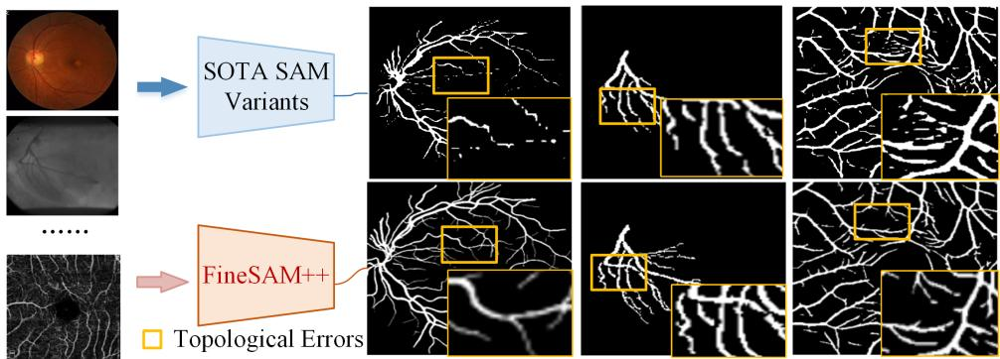
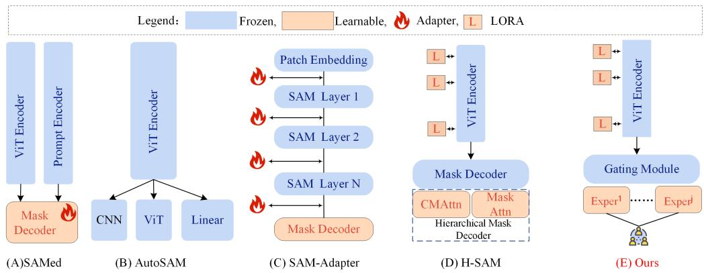
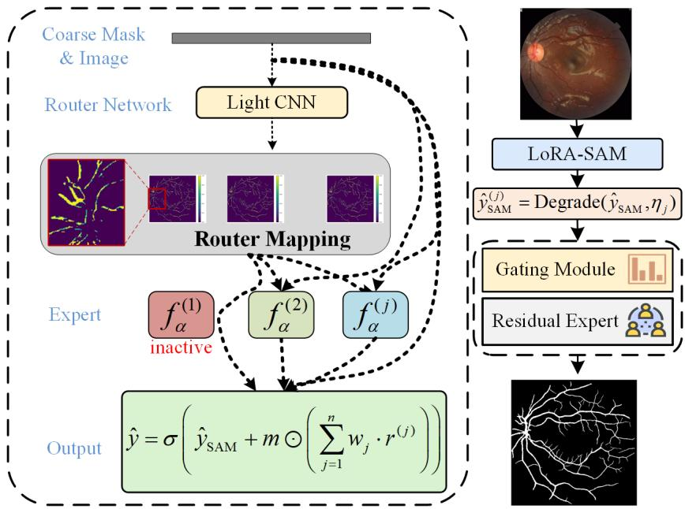
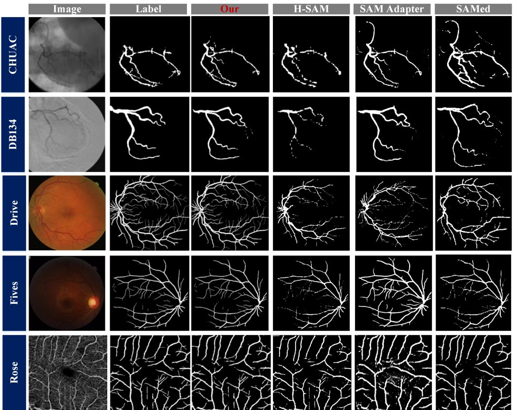
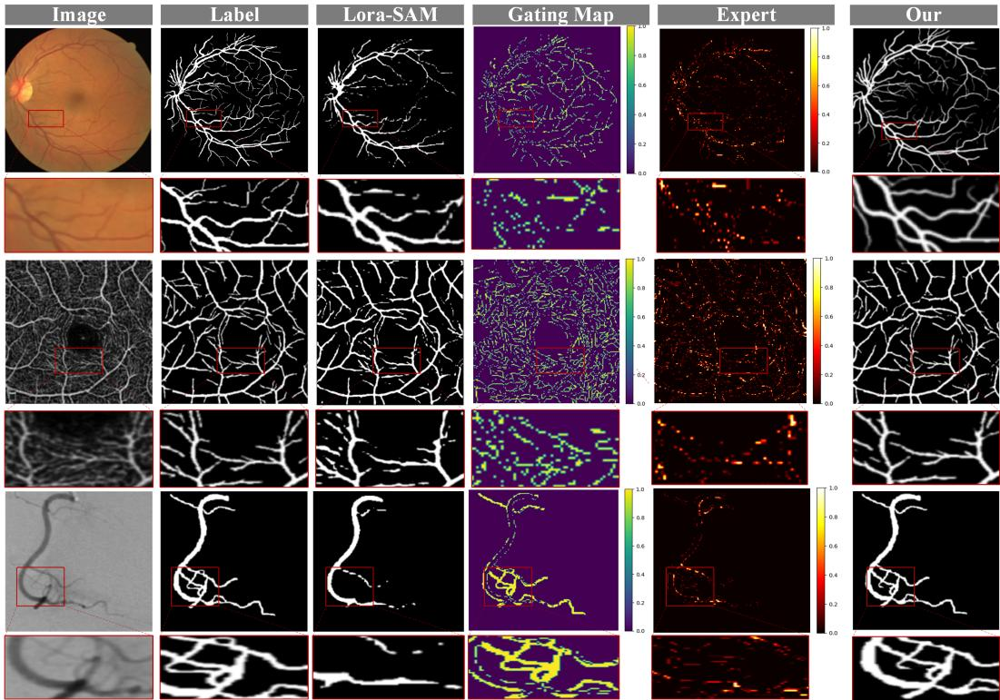

# Gate to the Vessel: Residual Experts Restore What SAM Overlooks

Weili Jiang School of Computing and Artificial Intelligence Southwest Jiaotong University jiangweili@swjtu.edu.cn

Jinrong Lv School of Computing and Artificial Intelligence Southwest Jiaotong University lvjinrong@my.swjtu.edu.cn

Xun Gong School of Computing and Artificial Intelligence Southwest Jiaotong University xgong@swjtu.edu.cn

Xiaomeng Li   
Department of Electronic and Computer Engineering   
The Hong Kong University of Science and Technology eexmli@ust.hk

Chubin Ou\* Institute of Biomedical Engineering, Peking University Shenzhen Graduate School Department of Radiology, Guangdong Provincial People's Hospital cou@connect.ust.hk

## Abstract

Foundation segmentation models like Segment Anything (SAM) exhibit strong generalization on natural images but struggle with localized failures in medical imaging, especially on fine-grained structures such as vessels with complex morphology and indistinct boundaries. To address this, we propose FineSAM++, a structure-aware sparse expert framework designed to refine SAM outputs by introducing a confidence-driven soft Routing Module. This module dynamically identifies structurally uncertain regions and activates a lightweight Residual Expert to model and correct residual structural errors only within these areas, thereby achieving efficient "refinement over retraining." Extensive experiments on five public vascular segmentation datasets demonstrate that FineSAM++ consistently outperforms both SAM-adapted baselines and task-specific models in terms of accuracy, topological consistency. Our results highlight the effectiveness of sparse, structure-driven Mixture-of-Experts (MoE) strategies for enhancing the reliability of foundation vision models in clinical image understanding tasks.

## 1 Introduction

  
Figure 1: Illustration of the core motivation behind FineSAM++.

Foundation vision models such as Segment Anything Model (SAM)[1] have demonstrated remarkable prompt responsiveness and zero-shot generalization capabilities for natural image segmentation tasks. With the increasing popularity of SAM in general-purpose computer vision, recent efforts have explored its adaptation to medical image segmentation [2–4]. However, empirical studies consistently report substantial performance degradation when SAM is applied to medical structures, especially for fine-grained targets like vessels, where predictions often suffer from topological errors, including disconnections, boundary ambiguity, and local omissions [4, 5] (see Fig.1).

To bridge the domain gap between natural and medical images, existing approaches have explored domain adaptation strategies including Adapters [6, 7], LoRA [8], prompt generation [9], and SAM-CLIP hybrid models [10, 11] (see Fig.2). Nevertheless, these methods primarily focus on aligning global semantic representations, leaving structurally ambiguous or uncertain regions undermodeled [5, 4]. As a result, they fail to resolve the persistent issue of local structural degradation. We further observe that mispredictions in medical images predominantly occur around blurred boundaries or fine structural details, which typically manifest as high uncertainty or large residual deviations from the ground truth. This suggests that a unified global adaptation scheme inherently struggles to satisfy both semantic alignment and structural recovery, as the modeling objectives present a natural conflict.

  
Figure 2: Comparison of SAM-based adaptation methods for medical image segmentation.

Inspired by the sparse activation of Mixture-of-Experts (MoE) architectures in large model design [12–14], we argue that MoE provides a promising paradigm for fine-grained structure modeling. By dynamically activating expert pathways only where necessary, an MoE-inspired framework can focus modeling capacity on local difficult regions without sacrificing overall efficiency. Based on this principle, we propose FineSAM++, a structure-enhanced framework following the MoE philosophy. FineSAM++ introduces two expert modules: a global LoRA Expert for domain adaptation and a Residual Expert for local residual correction and structural refinement. Their activation and cooperation are jointly controlled by an uncertainty-aware Gating Module, resulting in an efficient shared-backbone + localized refinement strategy. Our main contributions are summarized as follows.

• We propose FineSAM++, the structure-aware sparse MoE framework that integrates multiple localized residual correction pathways into frozen foundation segmentation models like SAM, addressing their systematic failures on fine-grained medical structures.

• We design a spatially-aware soft routing mechanism that jointly predicts spatial uncertainty masks and fractional expert routing weights, dynamically activating only a small subset of residual experts for structurally ambiguous regions.

• We conduct extensive experiments to validate the effectiveness of the proposed module and achieve state-of-the-art performance on five public vessel datasets covering three distinct imaging modalities.

## 2 Related Work

## 2.1 Foundation Models for Medical Image Segmentation

Foundation vision models such as the SAM [1] have demonstrated strong generalization and zero-shot capabilities in natural image segmentation. However, their performance degrades significantly in medical imaging tasks, particularly for fine-grained structures like vessels and retinal layers, due to domain shifts and a lack of priors for thin, low-contrast anatomy[15, 16]. To bridge this gap recent studies have explored adapter-based tuning [6, 7], LoRA-based silent fine-tuning [8], automatic prompt generation [9], and hybrid approaches combining SAM with CLIP [10, 11], as well as methods that improve boundary accuracy through high-quality priors and edge-aware refinement [17]. While these methods improve global adaptability, they often overlook localized structural failures—such as vessel discontinuities, blurred edges, and fragmented predictions—that are critical in clinical applications [18]. FineSAM++ addresses this limitation by introducing a sparse residual expert framework guided by uncertainty-aware gating, enabling selective correction of structurally uncertain regions while preserving global semantic consistency.

## 2.2 Mixture-of-Experts Architectures in Vision Modeling

Mixture-of-Experts (MoE) architectures have emerged as a powerful paradigm for scaling deep networks while maintaining efficiency [12, 13]. In vision, recent works have explored various MoE formulations for different purposes. Switch Transformers [19] propose token-based routing to conditionally activate expert blocks in large-scale transformers. Expert Choice Routing [14] and SwitchHead [20] further improve routing efficiency and stability by optimizing expert selection and assignment. CuMo [21] introduces co-upcycled expert reuse to scale multimodal models, achieving strong performance with limited expert redundancy. Neural Experts [22] and related vision-specific MoE designs have focused primarily on large-scale classification and vision-language pretraining tasks. However, these works focus on token or patch-level routing for classification or vision-language tasks, and have not explored dense prediction or fine-grained structural correction. FineSAM++ to systematically integrate sparse expert routing into a dense segmentation pipeline. By introducing a soft Gating Module and Residual Expert, FineSAM++ applies MoE principles to address local structural inconsistencies in medical vessel segmentation, which remains largely underexplored in prior vision MoE literature.

## 3 Method

Inspired by the success of sparse MoE in scaling LLMs and vision models [12, 13], we propose FineSAM++, a sparse expert framework designed for fine-grained targets. Fine-grained target segmentation naturally fits the MoE paradigm due to the extreme sparsity, topology irregularity, and strong locality of error-prone regions. Our framework incorporates two specialized lightweight experts: a global LoRA Expert for domain adaptation and a Residual Expert for structure-aware local residual correction. A differentiable Gating Module inspired by Expert Choice Routing [21] coordinates dynamic activation of experts.

  
Figure 3: Overview of the FineSAM++ architecture.

## 3.1 Overview

Given an input image $\boldsymbol { x } \in \mathbb { R } ^ { H \times W \times 3 }$ , FineSAM++ first generates a coarse segmentation prediction ÎSAM $\in [ 0 , \dot { 1 } ] ^ { H \times W }$ using a LoRA-SAM model with degraded inputs (see Sec. 3.3 for details). Here, LoRA-ŠAM refers to a frozen SAM backbone augmented with LoRA adapters, following the parameter-efficient fine-tuning strategy in [2]. Additionally, for the prompt encoder in LoRA-SAM, FineSAM++ does not require any manual prompts; instead, it learns a fixed default embedding during training. While the coarse prediction is generally effective, it often exhibits topological inconsistencies in challenging regions such as vascular bifurcations, blurred boundaries, and disconnected thin structures.

To address this, FineSAM++ introduces a modular sparse refinement pathway consisting of (1) a Gating Module to estimate spatial uncertainty and expert routing weights, and (2) J lightweight Residual Experts to perform localized residual correction (see Fig.3). Each Residual Expert receives a perturbed variant of the coarse mask to promote specialization. The final output is obtained by fusing the original SAM prediction with the aggregated residual corrections:

$$
\hat { y } = \sigma \left( \hat { y } _ { \mathrm { S A M } } + m \odot \left( \sum _ { j = 1 } ^ { J } w _ { j } \cdot r ^ { ( j ) } \right) \right) ,\tag{1}
$$

where m is the uncertainty mask, $w _ { j }$ are routing weights, and $r ^ { ( j ) }$ are the expert outputs.  denotes element-wise multiplication

## 3.2 Gating Module

Classical MoE architectures rely on token-level routing based on dense embedding vectors [12, 19]. However, dense vision transformers like SAM produce structured 2D feature maps, where localized spatial uncertainty plays a critical role. To address this gap, FineSAM++ introduces a spatiallyaware soft routing mechanism via a dedicated Gating module. Our Gating module $g _ { \theta }$ serves two purposes: (1) generate a soft mask $m \in [ 0 , 1 ] ^ { H \times W }$ indicating spatial uncertainty at each pixel, and (2) output fractional routing weights $\{ w _ { j } \}$ for $J$ parallel Residual Experts. The module receives the concatenation of the image x and coarse mask ÎsAm as input, capturing both appearance and prediction context:

$$
m , \{ w _ { j } \} = g _ { \theta } ( \mathbf { C o n c a t } ( x , \hat { y } _ { \mathrm { S A M } } ) ) .\tag{2}
$$

This design is fundamentally different from standard MoE routers, which treat each input as independent. Instead, our Gating module explicitly leverages spatial correlations, identifying localized regions that require residual correction. By assigning soft weights to multiple experts, the routing mechanism enables fine-grained specialization without hard top-k decisions, which are known to suffer from instability and expert imbalance [14, 22].

We supervise the Gating module using pseudo-labels derived from backbone prediction errors. A binary pseudo-label mask $g _ { t }$ is first generated by thresholding the absolute error between the SAM coarse prediction $\hat { y } _ { \mathrm { S A M } }$ and the ground truth label y:

$$
g _ { t } ( i ) = \mathbb { I } \left( | \hat { y } _ { \mathrm { S A M } } ( i ) - y ( i ) | > \delta \right) ,\tag{3}
$$

where $\mathbb { I } ( \cdot )$ is the indicator function that outputs 1 if the condition holds and 0 otherwise, and δ is a pre-defined error threshold. The Gating module is trained to predict a router map $m \in [ 0 , 1 ] ^ { H \times W }$ where higher values indicate greater structural uncertainty. We optimize the Gating output using the standard binary cross-entropy (BCE) loss:

$$
\mathcal { L } _ { \mathrm { g a t e } } = - \frac { 1 } { N } \sum _ { i } \left[ g _ { t } ( i ) \log m ( i ) + ( 1 - g _ { t } ( i ) ) \log ( 1 - m ( i ) ) \right] ,\tag{4}
$$

where N is the total number of pixels. This loss encourages the Gating module to activate only in regions where the backbone prediction is structurally unreliable, while suppressing unnecessary expert invocation elsewhere.

## 3.3 Residual Experts

Conventional segmentation refinement frameworks either retrain the full model or introduce a single auxiliary head for residual prediction [8, 2]. In contrast, FineSAM++ proposes a diverse multi-expert residual correction scheme. Inspired by MoE principles of expert specialization, we deploy J parallel Residual Experts $f _ { \alpha } ^ { ( j ) }$ , each receiving a slightly degraded version of the coarse mask:

$$
\begin{array} { r } { \hat { y } _ { \mathrm { S A M } } ^ { ( j ) } = \mathrm { D e g r a d e } ( \hat { y } _ { \mathrm { S A M } } , \eta _ { j } ) , } \end{array}\tag{5}
$$

where Degrade(·) applies random masking, noise injection, or occlusion perturbations to promote input diversity. This novel perturbation-based expert diversification allows each expert to specialize in correcting specific structural failures, such as disconnections, thin vessel loss, or noisy edges.

Each expert predicts residual corrections conditioned on both the perturbed coarse mask $\hat { y } _ { \mathrm { S A M } } ^ { ( j ) }$ and input image x:

$$
r ^ { ( j ) } = f _ { \alpha } ^ { ( j ) } ( x , \hat { y } _ { \mathrm { S A M } } ^ { ( j ) } ) ,\tag{6}
$$

where $r ^ { ( j ) } \in \mathbb { R } ^ { H \times W }$ denotes the residual correction map predicted by the j-th expert. This formulation allows each expert to focus on different perturbation patterns and promotes specialization. Unlike prior works that produce complete segmentation masks, our experts focus exclusively on local residual correction. We supervise this process using a gated mean squared error (MSE) loss between the fused expert output and the ground truth:

$$
\mathcal { L } _ { \mathrm { r e s } } = \frac { 1 } { N } \sum _ { i } \left( ( \boldsymbol { m } \cdot \sum _ { j = 1 } ^ { J } w _ { j } \cdot \boldsymbol { r } ^ { ( j ) } ) ( i ) + ( \hat { y } _ { \mathrm { S A M } } ( i ) - y ( i ) ) \right) ^ { 2 } ,\tag{7}
$$

where N is the total number of pixels, $m ( i ) \in [ 0 , 1 ]$ is the soft spatial uncertainty mask from the Gating Module at pixel $i , w _ { j }$ are the normalized routing weights for each expert, and $y ( i )$ is the ground truth label.

## 3.4 Progressive Optimization with Dynamic Weighting

Training strategy with two-phase adaptive learning. The Residual Expert strongly depends on stable backbone predictions to avoid overfitting to noisy residual targets. Therefore, we design a two-phase adaptive training strategy. In Phase 1, we freeze both the Gating Module and Residual Expert and train only the SAM backbone until $\mathcal { L } _ { \mathrm { S A M } }$ falls below a threshold € for k consecutive epochs. This warm-up stage stabilizes the coarse prediction output.

Once convergence is detected, Phase 2 activates the residual correction pathway and applies dynamic loss weighting $\lambda _ { \mathrm { r e s } } ( t )$ •

$$
\lambda _ { \mathrm { { r e s } } } ( t ) = \operatorname* { m i n } \left( 1 , \frac { t - t _ { 0 } } { T } \right) , \quad \lambda _ { \mathrm { { S A M } } } ( t ) = 1 - \lambda _ { \mathrm { { r e s } } } ( t ) ,\tag{8}
$$

where $t _ { 0 }$ is the warm-up completion epoch and T controls the progressive ramp-up of the Residual Expert contribution. This two-phase curriculum minimizes early instability and ensures smoother joint optimization of both the backbone and expert modules.

Overall Loss. The final training objective of FineSAM++ combines the semantic segmentation loss of the SAM backbone and the structural refinement losses of the Residual Expert:

$$
\begin{array} { r } { \mathcal { L } = \lambda _ { \mathrm { S A M } } \mathcal { L } _ { \mathrm { S A M } } + \lambda _ { \mathrm { r e s } } \mathcal { L } _ { \mathrm { r e s } } + \lambda _ { \mathrm { g a t e } } \mathcal { L } _ { \mathrm { g a t e } } , } \end{array}\tag{9}
$$

where $\mathcal { L } _ { \mathrm { S A M } }$ represents the combined Dice and binary cross-entropy loss on the backbone output, $\mathcal { L } _ { \mathrm { r e s } }$ is the masked residual regression loss, and $\mathcal { L } _ { \mathrm { g a t e } }$ is the gating supervision loss. The weighting coefficients λ balance the contributions of each component and are dynamically adjusted as described above. This formulation enables FineSAM++ to jointly optimize global semantic consistency and local structural refinement in a stable and interpretable manner.

Table 1: Quantitative comparison on DRIVE, DCAI, CHUAC and ROSE datasets. The best results are bolded while the second best are underlined. Other Dataset (FIVES) quantitative comparison are provided in the supplementary material.
<table><tr><td rowspan="2">Data</td><td rowspan="2">Method</td><td colspan="4">Metric</td><td rowspan="2">Data</td><td rowspan="2">Method</td><td rowspan="2"></td><td colspan="5">Metric</td></tr><tr><td>Dice</td><td>ACC</td><td>AUC</td><td>SE SP</td><td></td><td>Dice ACC</td><td>AUC</td><td></td><td>SE SP</td></tr><tr><td rowspan="20">DRIVE</td><td>U-Net</td><td>0.7787 0.7808</td><td>0.9616 0.9621</td><td>0.9863 0.9774</td><td>0.7802 0.7931</td><td>0.9792 0.9795</td><td></td><td>U-Net 0.7392 Att U-Net 0.7511</td><td>0.9741 0.9753</td><td></td><td>0.9803 0.9834</td><td>0.7647 0.7851</td><td>0.9851 0.9861</td></tr><tr><td>Att U-Net</td><td></td><td></td><td></td><td></td><td>0.9850</td><td></td><td></td><td>0.9757</td><td></td><td></td><td></td><td></td></tr><tr><td>U-Net++</td><td>0.7860</td><td>0.9635</td><td>0.9825</td><td>0.7891</td><td>0.9813</td><td></td><td>U-Net++ 0.7766</td><td></td><td></td><td>0.9860</td><td>0.7932</td><td>0.9857</td></tr><tr><td>R2U-Net</td><td>0.8171</td><td>0.9556</td><td>0.9784</td><td>0.7792</td><td></td><td></td><td>CS-Net</td><td>0.7790</td><td>0.9763</td><td>0.9889</td><td>0.7895</td><td>0.9867</td></tr><tr><td>TransUNet</td><td>0.7872</td><td>0.9577</td><td>0.9792</td><td>0.7819</td><td>0.9788</td><td></td><td>VSSC Net</td><td></td><td>0.9700</td><td>0.9831</td><td>0.7728</td><td>0.9809</td></tr><tr><td>CAViT</td><td></td><td>0.9700</td><td>0.9864</td><td>0.7924</td><td>0.9872</td><td></td><td>FR-UNet 0.7736</td><td>0.9744</td><td></td><td>0.9897</td><td>0.8344</td><td>0.9824</td></tr><tr><td>MCDAU-Net</td><td>0.8129</td><td>0.9589</td><td></td><td>0.8215</td><td>0.9739</td><td></td><td>MedUNAS 0.7820 G2ViT</td><td>0.9800</td><td></td><td></td><td>0.8089</td><td>0.9905</td></tr><tr><td>Retina-TransNet</td><td>0.7964</td><td></td><td>0.8836</td><td>0.7850</td><td>0.9821 0.9837</td><td></td><td>0.7659</td><td>0.9761</td><td></td><td>0.9904</td><td>0.8387</td><td>0.9914</td></tr><tr><td>MRC-Net</td><td></td><td>0.9698</td><td>0.9825 0.8843</td><td>0.8250 0.7863</td><td>0.9824</td><td></td><td>HRNet 0.7919</td><td></td><td>0.9777</td><td>0.9899</td><td>0.8007</td><td>0.9876</td></tr><tr><td>Gupta et al</td><td>0.7978</td><td>0.9677 0.9649</td><td>0.8830</td><td>0.7796</td><td>0.9821</td><td></td><td>Gupta et al</td><td>0.7938 0.7948</td><td>0.9681 0.9685</td><td>0.9911 0.9923</td><td>0.8853 0.8857</td><td>0.9891</td></tr><tr><td>RETFound</td><td>0.8020</td><td>0.9698</td><td>0.8940</td><td></td><td></td><td>DCAI</td><td>RETFound</td><td>0.8045</td><td>0.9584</td><td>0.9903</td><td></td><td>0.9872</td></tr><tr><td>nnUnet</td><td>0.8220 0.4498</td><td>0.9311</td><td>0.9204</td><td>0.8019 0.7577</td><td>0.9862 0.9377</td><td></td><td>nnUnet</td><td></td><td>0.9727</td><td>0.9408</td><td>0.8264</td><td>0.9879</td></tr><tr><td>SAM Aapter</td><td>0.6622</td><td>0.9485</td><td>0.7824</td><td>0.5808</td><td>0.9840</td><td></td><td>SAM Aapter</td><td>0.7583</td><td>0.9661</td><td>0.7810</td><td>0.7882 0.5732</td><td>0.9836</td></tr><tr><td>H-SAM</td><td>0.6603</td><td>0.9414</td><td>0.9872</td><td>0.8368</td><td>0.9822</td><td></td><td>H-SAM</td><td>0.6374</td><td>0.9693</td><td>0.8483</td><td></td><td>0.9887</td></tr><tr><td>AutoSAm SAMed</td><td>0.6170</td><td>0.9450</td><td>0.9600</td><td>0.5070</td><td>0.9880</td><td></td><td>AutoSAm</td><td>0.7175 0.5750</td><td>0.9540</td><td>0.9550</td><td>0.7120</td><td>0.9760</td></tr><tr><td>HQ-SAM</td><td>0.7978</td><td>0.9697</td><td>0.8824</td><td>0.8033</td><td>0.9824</td><td></td><td>SAMed</td><td>0.7880</td><td>0.9770</td><td>0.8890</td><td>0.5750</td><td>0.9760</td></tr><tr><td>Ours</td><td>0.8231</td><td>0.9790</td><td>0.9870</td><td>0.8366</td><td>0.9834</td><td></td><td>HQ-SAM</td><td></td><td>0.9775</td><td>0.9931</td><td>0.7890 0.8479</td><td>0.988</td></tr><tr><td></td><td>0.6768</td><td>0.9744</td><td>0.9582</td><td>0.5801</td><td>0.9941</td><td></td><td>Ours U-Net</td><td>0.8127 0.7116</td><td>0.8955</td><td>0.9218</td><td>0.7867</td><td>0.9872 0.8780</td></tr><tr><td rowspan="14">CHUAC</td><td>U-Net Att U-Net</td><td>0.6941</td><td>0.9803</td><td>0.9515</td><td>0.6420</td><td>0.9922</td><td>CS-Net</td><td>0.7608</td><td>0.9152</td><td>0.9392</td><td></td><td></td><td>0.9112</td></tr><tr><td></td><td></td><td></td><td></td><td></td><td>0.9949</td><td></td><td></td><td></td><td></td><td></td><td>0.8631</td><td></td></tr><tr><td>U-Net++</td><td>0.7000</td><td>0.9802</td><td>0.9669</td><td>0.6109</td><td>0.9918</td><td>CE-Net</td><td>0.7511</td><td>0.9121 0.9227</td><td></td><td>0.9292</td><td></td><td></td></tr><tr><td>CS-Net</td><td>0.7171</td><td>0.9796 0.9721</td><td>0.9747</td><td>0.6735</td><td>0.9797</td><td>COSFIRE</td><td>0.7517</td><td>0.8530</td><td></td><td>0.9286 0.8689</td><td></td><td></td></tr><tr><td>VSSC Net</td><td>0.7543</td><td>0.9740</td><td>0.9757</td><td>0.7892</td><td>0.9867</td><td>COOF</td><td>0.6606</td><td>0.9098</td><td></td><td></td><td></td><td></td></tr><tr><td>FR-UNet</td><td>0.7456</td><td></td><td>0.9786</td><td>0.7836</td><td>0.9912</td><td>ResU-Net DUNet</td><td>0.7461</td><td></td><td></td><td>0.9252</td><td></td><td></td></tr><tr><td>MedUNAS</td><td>0.7612</td><td>0.9807 0.9809</td><td></td><td>0.7829</td><td>0.9950</td><td></td><td>0.7505</td><td>0.9118</td><td></td><td>0.9334</td><td></td><td></td></tr><tr><td>G2ViT</td><td>0.7526</td><td>0.9811</td><td>0.9858</td><td>0.7908 0.7456</td><td>0.9906</td><td></td><td>three-stage 0.7663</td><td>0.9179</td><td></td><td>0.9179</td><td></td><td></td></tr><tr><td>HRNet</td><td>0.7168</td><td>0.9799</td><td>0.9906 0.9739</td><td>0.6728</td><td>0.9907</td><td>OCTA-Net</td><td>0.7697</td><td>0.9182</td><td>0.9164</td><td>0.9453 0.9399</td><td></td><td></td></tr><tr><td>Gupta et al</td><td>0.7636</td><td>0.9604</td><td>0.9904</td><td>0.7325</td><td>0.9906</td><td>ROSE</td><td>Gupta et al</td><td>0.7601 0.7126</td><td>0.9197</td><td>0.9337</td><td>0.8563</td><td>0.9109</td></tr><tr><td>RETFound</td><td>0.7814</td><td>0.9776</td><td></td><td></td><td></td><td></td><td>RETFound</td><td></td><td>0.9470</td><td></td><td>0.8563</td><td>0.9193</td></tr><tr><td>nnUnet SAM Aapter</td><td>0.7636</td><td>0.9784</td><td>0.8842 0.9359</td><td>0.7788 0.7583</td><td>0.9896 0.9902</td><td></td><td>nnUnet SAM Aapter</td><td>0.8270 0.6316</td><td>0.8578</td><td>0.9310 0.8451</td><td>0.8650 0.6503</td><td>0.9940 0.9801</td></tr><tr></table>

## 4 Experiments

## 4.1 Implementation Details

Dataset. We evaluate FineSAM++ across five publicly available vascular segmentation datasets spanning three imaging modalities. The DRIVE dataset [23] contains two-dimensional retinal fundus images with ground truth vessel masks. ROSE [24] provides retinal vessel segmentation from 2D optical coherence tomography angiography (OCTA) scans. FIVES [25] includes 800 high-resolution multi-disease color fundus photographs annotated for vessel structures. DCA1 [26] and CHUAC [27] are coronary angiography datasets containing fluoroscopic X-ray vessel images. We select these datasets to cover the full spectrum of challenges targeted by FineSAM++, including variations in anatomical regions (retina vs. coronary arteries), imaging modalities (fundus photography, OCTA, X-ray angiography), and segmentation difficulties (low contrast, thin structures, fragmented vessels). Detailed dataset statistics and preprocessing steps are provided in the supplementary material.

Beyond vascular segmentation. To further assess cross-domain generalization, we additionally evaluate multi-class abdominal organ segmentation on the Synapse Multi-Organ CT dataset (eight organs), demonstrating that FineSAM++ maintains strong performance outside the vascular domain Detailed dataset statistics and results are provided in the supplementary material.

  
Figure 4: Qualitative comparison of FineSAM++ against H-SAM, SAM Adapter, and SAMed across five datasets. FineSAM++ provides more continuous and complete vessel segmentation with fewer false positives and fragmentation artifacts.

Training settings. All experiments are implemented using PyTorch and trained on two NVIDIA RTX 4090 GPUs. Data augmentation includes random elastic deformation, rotation, scaling, and intensity jittering. For the backbone, we follow [2] and integrate LoRA adapters into the frozen SAM encoder with a rank of 4. We adopt the ViT-B configuration of SAM as the base encoder. For fair comparison across datasets, all images are resized to $5 1 \bar { 2 } \times 5 1 2$ resolution. The maximum training epoch is set to 300. We use the AdamW optimizer with $\beta _ { 1 } = 0 . 9 , \beta _ { 2 } = 0 . 9 9 9$ , and weight decay of 0.1. The initial learning rate is set to $5 \times 1 0 ^ { - 5 }$ and decayed using a cosine annealing schedule. All hyperparameters are fixed across datasets without additional tuning to ensure fair comparison and reproducibility.

Evaluation metrics. To comprehensively assess model performance, we evaluate FineSAM++ and all baselines across standard segmentation accuracy metrics and specialized structural consistency metrics tailored for vascular image analysis. The primary evaluation metrics include Dice, accuracy (ACC), sensitivity (SE), specificity (SP), connectivity (C), overlapping area (A), vessel length consistency (L), and centerline Dice (clDice). For completeness and reproducibility, detailed definitions for all metrics are provided in the supplementary material.

Compared methods. In this study, we comprehensively benchmark FineSAM++ against a wide range of state-of-the-art (SOTA) methods previously reported on the evaluated datasets. The baselines include both classical CNN-based and modern Transformer-based segmentation models, topologyaware segmentation method, as well as several recent SAM-variant foundation model adaptations. For clarity and reproducibility, the full list of compared methods and corresponding references are provided in the supplementary material.

Table 2: Quantitative comparison on DRIVE, FIVES, DCAI, CHUAC and ROSE datasets. Metrics include connectivity (C), area accuracy (A), length similarity (L), and centerline Dice (CiDice). The best results are bolded and the second best are underlined.
<table><tr><td rowspan="2">Data</td><td rowspan="2">Method</td><td colspan="4">Metrics</td><td rowspan="2">Data</td><td rowspan="2">Method</td><td colspan="4">Metrics</td></tr><tr><td>C</td><td>A</td><td>L</td><td>CIDice</td><td></td><td>C A</td><td>L</td><td>ClDice</td></tr><tr><td rowspan="8">DRIVE</td><td>U-Net</td><td>0.998</td><td>0.712</td><td>0.608</td><td>0.761</td><td rowspan="6">FIVES</td><td>U-Net Swin-Unet</td><td>0.994</td><td>0.897</td><td>0.912</td><td>0.889</td></tr><tr><td>Att U-Net</td><td>0.994</td><td>0.768</td><td>0.732</td><td>0.775</td><td></td><td>0.997</td><td>0.863</td><td>0.871</td><td>0.785</td></tr><tr><td>U-Net++</td><td>0.994</td><td>0.783</td><td>0.774</td><td>0.801</td><td>TransUnet</td><td>0.997</td><td>0.919</td><td>0.923</td><td>0.911</td></tr><tr><td>SAM Adapter</td><td>0.993</td><td>0.412</td><td>0.321</td><td>0.488</td><td>SAM Adapter</td><td>0.993</td><td>0.713</td><td>0.654</td><td>0.878</td></tr><tr><td>H-SAM</td><td>0.997</td><td>0.631</td><td>0.654</td><td>0.612</td><td>H-SAM</td><td>0.994</td><td>0.698</td><td>0.711</td><td>0.645</td></tr><tr><td>AutoSAM</td><td>0.998</td><td>0.597</td><td>0.621</td><td>0.598</td><td>AutoSAM</td><td>0.996</td><td>0.652</td><td>0.675</td><td>0.887</td></tr><tr><td>SAMed</td><td>0.996</td><td>0.583</td><td>0.561</td><td>0.556</td><td>SAMed</td><td>0.994</td><td>0.691</td><td>0.712</td><td>0.657</td></tr><tr><td rowspan="8">DCAI</td><td>Ours</td><td>0.998</td><td>0.848</td><td>0.865</td><td>0.832</td><td></td><td>Ours</td><td>0.997</td><td>0.921</td><td>0.925</td><td>0.914</td></tr><tr><td>U-Net</td><td>0.995</td><td>0.78</td><td>0.812</td><td>0.7900</td><td></td><td>U-Net</td><td>0.996</td><td>0.723</td><td>0.739</td><td>0.7100</td></tr><tr><td>Att U-Net</td><td>0.996</td><td>0.812</td><td>0.798</td><td>0.8050</td><td></td><td>CS-Net</td><td>0.997</td><td>0.776</td><td>0.789</td><td>0.7500</td></tr><tr><td>U-Net++</td><td>0.998</td><td>0.831</td><td>0.813</td><td>0.8150</td><td></td><td>OCTA-Net</td><td>0.999</td><td>0.781</td><td>0.765</td><td>0.7550</td></tr><tr><td>SAM Adapter</td><td>0.998</td><td>0.785</td><td>0.812</td><td>0.8</td><td>ROSE</td><td>SAM Adapter</td><td>0.992</td><td>0.683</td><td>0.657</td><td>0.6600</td></tr><tr><td>H-SAM</td><td>0.992</td><td>0.732</td><td>0.734</td><td>0.72</td><td></td><td>H-SAM</td><td>0.994</td><td>0.721</td><td>0.719</td><td>0.7050</td></tr><tr><td>AutoSAM</td><td>0.995</td><td>0.732</td><td>0.757</td><td>0.735</td><td></td><td>AutoSAM</td><td>0.995</td><td>0.736</td><td>0.743</td><td>0.7150</td></tr><tr><td>SAMed</td><td>0.997</td><td>0.643</td><td>0.651</td><td>0.65</td><td></td><td>SAMed</td><td>0.997</td><td>0.675</td><td>0.674</td><td>0.6900</td></tr><tr><td rowspan="5">CHUAC</td><td>Ours U-Net</td><td>0.997</td><td>0.903</td><td>0.877</td><td>0.865</td><td>CHUAC</td><td>Ours H-SAM</td><td>0.997 0.994</td><td>0.819 0.712</td><td>0.839</td><td>0.8050</td></tr><tr><td></td><td>0.994</td><td>0.631</td><td>0.629</td><td>0.6200</td><td></td><td></td><td>0.993</td><td>0.698</td><td>0.719</td><td>0.7000</td></tr><tr><td>Att U-Net</td><td>0.995</td><td>0.702</td><td>0.698</td><td>0.6850</td><td></td><td>AutoSAM</td><td></td><td></td><td>0.723</td><td>0.6900</td></tr><tr><td>U-Net++</td><td>0.996</td><td>0.723</td><td>0.722</td><td>0.7150</td><td></td><td>SAMed</td><td>0.997</td><td>0.757</td><td>0.739</td><td>0.7350</td></tr><tr><td>SAM Adapter</td><td>0.998</td><td>0.759</td><td>0.768</td><td>0.75</td><td>Ours</td><td></td><td>0.998</td><td>0.787</td><td>0.795</td><td>0.7700</td></tr></table>

## 4.2 Main Results

Quantitative Comparisons. Tab. 1 summarizes the performance comparison across four datasets. FineSAM++ consistently achieves superior results over both CNN- and Transformer-based baselines as well as recent SAM-derived methods. On DRIVE and DCAI, FineSAM++ sets new state-of-the-art Dice scores of 0.8231 and 0.8127, respectively, substantially outperforming AutoSAM (0.6603 and 0.7175) and H-SAM (0.6622 and 0.6374). On CHUAC and ROSE, our method also delivers the highest Dice scores (0.7768 and 0.8220), demonstrating robust generalization across diverse vascular modalities. These results validate the effectiveness of our multi-expert sparse refinement strategy in addressing localized structural failures of foundation segmentation models while maintaining high global consistency.

Qualitative Results. Fig. 4 shows representative qualitative comparisons of FineSAM++ against leading SAM-variant methods (H-SAM, SAM Adapter, SAMed) across five datasets. Our method consistently produces sharper and more continuous vessel structures with fewer false positives and disconnected branches. In coronary angiography datasets (CHUAC, DB134), FineSAM++ better captures thin vessel bifurcations and suppresses background noise. On retinal fundus images (DRIVE, FIVES), our model recovers small peripheral vessels missed by baselines. For OCTA images (ROSE) FineSAM++ yields smoother centerlines with significantly reduced fragmentation compared to prior approaches. These visual improvements highlight the advantage of our multi-expert sparse refinement design for addressing localized structural errors while preserving global topology.

Topological analysis. Tab. 7 reports connectivity (C), area (A), length (L), and CiDice metrics across four datasets. FineSAM++ consistently achieves the highest CIDice scores, indicating superior preservation of vessel topology and centerline continuity. On DRIVE and DCAI, our method outperforms the strongest baseline by margins of 0.832 vs. 0.801 and 0.865 vs. 0.815 respectively. Similar trends are observed on CHUAC and ROSE. The strong gains in connectivity (C) and length (L) further highlight the advantage of our sparse expert refinement design in correcting disconnections and fragmented vessels present in the coarse backbone predictions. These results demonstrate that FineSAM++ not only improves segmentation accuracy but also enhances structural fidelity, which is critical in clinical vascular analysis.

  
Figure 5: Visualization of the FineSAM++ refinement process.

## 4.3 Ablation Study

Parameter Efficiency.To address concerns about the parameter efficiency of our proposed method FineSAM++ among SAM-based segmentation approaches, we conducted a comprehensive comparison under a standard input resolution of (1, 3, 1024, 1024). Specifically, we measured the number of parameters, FLOPs (GAMCs), and inference latency, as summarized in Table 3. As shown, Fine-SAM++ introduces only about 0.7M additional learnable parameters over the SAM backbone (94.4M vs. 93.7M). Compared with other SAM-based methods—such as SAM Adapter (104.3M), H-SAM (111.3M), and AutoSAM (135.29M)—FineSAM++ demonstrates substantially higher parameter efficiency. Moreover, while its total parameter count is higher than lightweight architectures like Unet, FineSAM++ achieves the highest Dice score (0.8231) among all evaluated methods. These results indicate that FineSAM++ achieves an excellent balance between parameter efficiency and segmentation performance.

Table 3: Comparison of model size, computational cost, latency, and segmentation accuracy (Dice score) across segmentation methods using an input of size (1, 3, 1024, 1024).
<table><tr><td>Model</td><td>Params (M)</td><td>GAMCs (G)</td><td>Latency (ms)</td><td>Dice</td></tr><tr><td>Unets</td><td>34.53</td><td>4.08</td><td>1.10</td><td>0.7787</td></tr><tr><td>nnUnet</td><td>126.2</td><td>1864.9</td><td>37.4</td><td>0.8220</td></tr><tr><td>SAM Adapter</td><td>104.3</td><td>400.1</td><td>127.8</td><td>0.4498</td></tr><tr><td>H-SAM</td><td>111.3</td><td>370.6</td><td>124.8</td><td>0.6622</td></tr><tr><td>AutoSAM</td><td>135.29</td><td>774.16</td><td>166.22</td><td>0.6603</td></tr><tr><td>SAMed</td><td>92.2</td><td>370.5</td><td>117.1</td><td>0.6170</td></tr><tr><td>SAM</td><td>93.7</td><td>372.0</td><td>116.33</td><td>1</td></tr><tr><td>Ours (FineSAM++)</td><td>94.4</td><td>376.8</td><td>117.6</td><td>0.8231</td></tr></table>

Ablation Study on the Gating Threshold δ. To assess the sensitivity of the Gating module to the pre-defined error threshold δ, we conduct an ablation on the DRIVE dataset by varying $\delta \in \{ \bar { 0 . 3 } , 0 . 4 , 0 . 5 , 0 . 6 , 0 . 7 \}$ , with results summarized in Table 4. While certain metrics (e.g., SE at $\delta = 0 . 3 )$ are slightly higher, δ = 0.5 delivers the best overall performance across Dice, ACC, AUC, SE, and SP. Intuitively, a too-small threshold treats most pixels as uncertain, triggering unnecessary refinement and reducing gating sparsity, whereas a too-large threshold routes only a few pixels and underutilizes the refinement experts. Balancing these effects, we adopt a fixed threshold of δ = 0.5 across all five public datasets for both accuracy and efficiency.

Table 4: The ablation results of threshold δ in the Gating module.
<table><tr><td>δ</td><td>Dice</td><td>ACC</td><td>AUC</td><td>SE</td><td>SP</td></tr><tr><td>0.3</td><td>0.8124</td><td>0.9712</td><td>0.9812</td><td>0.8432</td><td>0.9601</td></tr><tr><td>0.4</td><td>0.8187</td><td>0.9755</td><td>0.9846</td><td>0.8410</td><td>0.9732</td></tr><tr><td>0.5</td><td>0.8231</td><td>0.9790</td><td>0.9870</td><td>0.8366</td><td>0.9834</td></tr><tr><td>0.6</td><td>0.8180</td><td>0.9767</td><td>0.9854</td><td>0.8204</td><td>0.9807</td></tr><tr><td>0.7</td><td>0.8129</td><td>0.9735</td><td>0.9822</td><td>0.8083</td><td>0.9784</td></tr></table>

Effect of number of Residual Experts. We evaluate the effect of varying the number of Residual Experts $( J = 1 , 2 , 4 , 6 )$ on the DRIVE dataset, as shown in Tab. 6. Increasing j consistently improves segmentation performance. The Dice score rises from 0.7501 (1 expert) to 0.8231 (6 experts), with corresponding gains across all other metrics. Notably, performance gains begin to saturate beyond j = 4, suggesting that using a moderate number of experts balances accuracy and computational efficiency. We adopt j = 4 for all remaining experiments as a trade-off between performance and resource consumption.

Table 5: Ablation study of FineSAM++ modules on the DRIVE dataset.
<table><tr><td>Lora-SAM</td><td>Gating</td><td>Residual Experts</td><td>Dice</td><td>ACC</td><td>AUC</td><td>SE</td><td>SP</td></tr><tr><td>√</td><td>×</td><td>×</td><td>0.7322</td><td>0.9524</td><td>0.9711</td><td>0.7865</td><td>0.9678</td></tr><tr><td>√</td><td>×</td><td>√</td><td>0.7871</td><td>0.9634</td><td>0.9821</td><td>0.8147</td><td>0.9772</td></tr><tr><td>√</td><td>√</td><td>√</td><td>0.8231</td><td>0.9790</td><td>0.9870</td><td>0.8366</td><td>0.9834</td></tr></table>

Qualitative Analysis of Local Structure Refinement. Fig. 5 presents the FineSAM++ refinement pipeline across multiple vascular segmentation datasets, including fundus, angiography, and OCT-like images. Starting from the coarse LoRA-SAM prediction, which often suffers from topological errors, the Gating Module identifies uncertain regions and selectively routes them to Residual Experts for localized correction. The final output shows improved connectivity and boundary completeness. For visualization clarity, only the first expert's outputs are shown, though FineSAM++ operates with a mixture of experts.

Table 6: Ablation study of the number of Residual Experts (J) on the DRIVE dataset.
<table><tr><td>Number</td><td>Dice</td><td>ACC</td><td>AUC</td><td>SE</td><td>SP</td></tr><tr><td>1</td><td>0.7501</td><td>0.956</td><td>0.9751</td><td>0.7943</td><td>0.9723</td></tr><tr><td>2</td><td>0.7769</td><td>0.9621</td><td>0.9803</td><td>0.8081</td><td>0.9763</td></tr><tr><td>4</td><td>0.8025</td><td>0.9655</td><td>0.9811</td><td>0.8139</td><td>0.9783</td></tr><tr><td>6</td><td>0.8231</td><td>0.9790</td><td>0.9870</td><td>0.8366</td><td>0.9834</td></tr></table>

Ablation study of modules. Tab. 5 presents the effect of incrementally adding FineSAM++ components. Using only the LoRA-SAM backbone yields limited performance (Dice 0.7322). Adding Residual Experts without the Gating Module, where all J experts are uniformly averaged without spatial weighting, improves performance to 0.7871 Dice by introducing localized correction. However, enabling the full pipeline with the Gating Module further increases performance to 0.8231 Dice and leads to consistent improvements across all metrics. The Gating Module provides a soft spatial routing mechanism that dynamically assigns different weights to each expert's output based on local uncertainty, promoting expert specialization and sparse activation. These results validate that targeted soft routing is critical for maximizing expert effectiveness and minimizing unnecessary corrections in confident regions.

## 5 Conclusion

We presented FineSAM++, a structure-aware sparse expert framework for enhancing foundation segmentation models in fine-grained medical image analysis. By introducing a soft Gating Module with uncertainty-aware spatial routing and deploying multiple Residual Experts with input perturbation diversity, our method achieves localized structural refinement while maintaining global consistency. Extensive experiments on five vascular segmentation benchmarks demonstrate that FineSAM++ consistently outperforms both classical and SAM-adapted baselines across accuracy and topological continuity. Our results validate the effectiveness of sparse expert activation for addressing localized segmentation failures. Future work will explore dynamic expert allocation, adaptive perturbation strategies, and generalization to other medical and natural image dense prediction tasks.

## Acknowledgments

This work was supported by the National Natural Science Foundation of China (Grant No. 82302300). National Natural Science Foundation of China (62376231), Sichuan Science and Technology Program (2024NSFC0658).

## References

[1] A. Kirillov, E. Mintun, N. Ravi, H. Mao, C. Rolland, L. Gustafson, T. Xiao, S. Whitehead, A. C. Berg, W.-Y. Lo, et al., “Segment anything," in Proceedings of the IEEE/CVF International Conference on Computer Vision, pp. 4015–4026, 2023.

[2] S. Gong, Y. Zhong, W. Ma, J. Li, Z. Wang, J. Zhang, P.-A. Heng, and Q. Dou, “3dsam-adapter: Holistic adaptation of sam from 2d to 3d for promptable medical image segmentation," arXiv preprint arXiv:2306.13465, 2023.

[3] J. Ma, Y. He, F. Li, L. Han, C. You, and B. Wang, “Segment anything in medical images," Nature Communications, vol. 15, no. 1, p. 654, 2024.

[4] Y. Huang, X. Yang, L. Liu, H. Zhou, A. Chang, X. Zhou, R. Chen, J. Yu, J. Chen, C. Chen, et al., “Segment anything model for medical images?,"Medical Image Analysis, vol. 92, p. 103061, 2024.

[5] Z. Qiu, Y. Hu, H. Li, and J. Liu, "Learnable ophthalmology sam," arXiv preprint arXiv:2304.13425, 2023.

[6] J. Zhu, A. Hamdi, Y. Qi, Y. Jin, and J. Wu, "Medical sam 2: Segment medical images as video via segment anything model 2," arXiv preprint arXiv:2408.00874, 2024.

[7] J. Wu, Z. Wang, M. Hong, W. Ji, H. Fu, Y. Xu, M. Xu, and Y. Jin, "Medical sam adapter: Adapting segment anything model for medical image segmentation,"Medical image analysis, vol. 102, p. 103547, 2025.

[8] Z. Cheng, Q. Wei, H. Zhu, Y. Wang, L. Qu, W. Shao, and Y. Zhou, "Unleashing the potential of sam for medical adaptation via hierarchical decoding," in Proceedings of the IEEE/CVF Conference on Computer Vision and Pattern Recognition, pp. 3511–3522, 2024.

[9] C. Li, R. I. Sultan, P. Khanduri, Y. Qiang, C. Indrin, and D. Zhu, “Autoprosam: Automated prompting sam for 3d multi-organ segmentation," in 2025 IEEE/CVF Winter Conference on Applications of Computer Vision (WACV), pp. 3570–3580, IEEE, 2025.

[10] X. Yan, S. Sun, K. Han, T.-T. Le, H. Ma, C. You, and X. Xie, "After-sam: Adapting sam with axial fusion transformer for medical imaging segmentation," in Proceedings of the IEEE/CVF Winter Conference on Applications of Computer Vision, pp. 7975–7984, 2024.

[11] S. Aleem, F. Wang, M. Maniparambil, E. Arazo, J. Dietlmeier, K. Curran, N. E. Connor, and S. Little, “Test-time adaptation with salip: A cascade of sam and clip for zero-shot medical image segmentation," in Proceedings of the IEEE/CVF Conference on Computer Vision and Pattern Recognition, pp. 5184–5193, 2024.

[12] N. Shazeer, A. Mirhoseini, K. Maziarz, A. Davis, Q. Le, G. Hinton, and J. Dean, "Outrageously large neural networks: The sparsely-gated mixture-of-experts layer," arXiv preprint arXiv:1701.06538, 2017.

[13] C. Riquelme, J. Puigcerver, B. Mustafa, M. Neumann, R. Jenatton, A. Susano Pinto, D. Keysers, and N. Houlsby, “Scaling vision with sparse mixture of experts,"Advances in Neural Information Processing Systems, vol. 34, pp. 8583–8595, 2021.

[14] D. Lepikhin, H. Lee, Y. Xu, D. Chen, O. Firat, Y. Huang, M. Krikun, N. Shazeer, and Z. Chen “Gshard: Scaling giant models with conditional computation and automatic sharding," arXiv preprint arXiv:2006.16668, 2020.

[15] J. Huang, K. Jiang, J. Zhang, H. Qiu, L. Lu, S. Lu, and E. Xing, “Learning to prompt segment anything models," arXiv preprint arXiv:2401.04651, 2024.

[16] Z. Qin, H. Yi, Q. Lao, and K. Li, “Medical image understanding with pretrained vision language models: A comprehensive study," arXiv preprint arXiv:2209.15517, 2022.

[17] L. Ke, M. Ye, M. Danelljan, Y.-W. Tai, C.-K. Tang, F. Yu, et al., "Segment anything in high quality," Advances in Neural Information Processing Systems, vol. 36, pp. 29914–29934, 2023.

[18] Y. Zhang, Z. Shen, and R. Jiao, “Segment anything model for medical image segmentation: Current applications and future directions," Computers in Biology and Medicine, p. 108238, 2024.

[19] W. Fedus, B. Zoph, and N. Shazeer, “Switch transformers: Scaling to trillion parameter models with simple and efficient sparsity," Journal of Machine Learning Research, vol. 23, no. 120, pp. 1–39, 2022.

[20] R. Csordás, P. Piękos, K. Irie, and J. Schmidhuber, “Switchhead: Accelerating transformers with mixture-of-experts attention," Advances in Neural Information Processing Systems, vol. 37, pp. 74411–74438, 2024.

[21] J. Li, X. Wang, S. Zhu, C.-W. Kuo, L. Xu, F. Chen, J. Jain, H. Shi, and L. Wen, "Cumo: Scaling multimodal llm with co-upcycled mixture-of-experts," Advances in Neural Information Processing Systems, vol. 37, pp. 131224–131246, 2024.

[22] Y. Ben-Shabat, C. Hewa Koneputugodage, S. Ramasinghe, and S. Gould, "Neural experts: Mixture of experts for implicit neural representations," Advances in Neural Information Processing Systems, vol. 37, pp. 101641–101670, 2024.

[23] J. Staal, M. D. Abràmoff, M. Niemeijer, M. A. Viergever, and B. Van Ginneken, "Ridge-based vessel segmentation in color images of the retina," IEEE transactions on medical imaging, vol. 23, no. 4, pp. 501–509, 2004.

[24]Y. Ma, H. Hao, J. Xie, H. Fu, J. Zhang, J. Yang, Z. Wang, J. Liu, Y. Zheng, and Y. Zhao, "Rose: a retinal oct-angiography vessel segmentation dataset and new model,"IEEE transactions on medical imaging, vol. 40, no. 3, pp. 928–939, 2020.

[25] K. Jin, X. Huang, J. Zhou, Y. Li, Y. Yan, Y. Sun, Q. Zhang, Y. Wang, and J. Ye, "Fives: A fundus image dataset for artificial intelligence based vessel segmentation,"Scientific Data, vol. 9, no. 1, p. 475, 2022.

[26] D. Hao, S. Ding, L. Qiu, Y. Lv, B. Fei, Y. Zhu, and B. Qin, "Sequential vessel segmentation via deep channel attention network," Neural Networks, vol. 128, pp. 172–187, 2020.

[27] F. Cervantes-Sanchez, I. Cruz-Aceves, A. Hernandez-Aguirre, M. A. Hernandez-Gonzalez, and S. E. Solorio-Meza, “Automatic segmentation of coronary arteries in x-ray angiograms using multiscale analysis and artificial neural networks," Applied Sciences, vol. 9, no. 24, p. 5507, 2019.

[28] H. Zhang, Z. Gao, D. Zhang, W. K. Hau, and H. Zhang, “Progressive perception learning for main coronary segmentation in x-ray angiography," IEEE Transactions on Medical Imaging, vol. 42, no. 3, pp. 864–879, 2022.

[29] B. Landman, Z. Xu, J. Igelsias, M. Styner, T. Langerak, and A. Klein, "Miccai multi-atlas labeling beyond the cranial vault-workshop and challenge," in Proc. MICCAI Multi-Atlas Labeling Beyond Cranial Vault—Workshop Challenge, vol. 5, p. 12, 2015.

[30] J. Chen, Y. Lu, Q. Yu, X. Luo, E. Adeli, Y. Wang, L. Lu, A. L. Yuille, and Y. Zhou, “Transunet: Transformers make strong encoders for medical image segmentation," arXiv preprint arXiv:2102.04306, 2021.

[31] O. Ronneberger, P. Fischer, and T. Brox, “U-net: Convolutional networks for biomedical image segmentation," in Medical image computing and computer-assisted intervention–MICCAI 2015: 18th international conference, Munich, Germany, October 5-9, 2015, proceedings, part III 18, pp. 234–241, Springer, 2015.

[32] O. Oktay, J. Schlemper, L. L. Folgoc, M. Lee, M. Heinrich, K. Misawa, K. Mori, S. McDonagh, N. Y. Hammerla, B. Kainz, et al., “Attention u-net: Learning where to look for the pancreas," arXiv preprint arXiv:1804.03999, 2018.

[33] Z. Zhou, M. M. Rahman Siddiquee, N. Tajbakhsh, and J. Liang, "Unet++: A nested u-net architecture for medical image segmentation," in Deep Learning in Medical Image Analysis and Multimodal Learning for Clinical Decision Support: 4th International Workshop, DLMIA 2018, and 8th International Workshop, ML-CDS 2018, Held in Conjunction with MICCAI 2018, Granada, Spain, September 20, 2018, Proceedings 4, pp. 3–11, Springer, 2018.

[34] L. Mou, Y. Zhao, L. Chen, J. Cheng, Z. Gu, H. Hao, H. Qi, Y. Zheng, A. Frangi, and J. Liu, "Csnet: Channel and spatial attention network for curvilinear structure segmentation,"in Medical Image Computing and Computer Assisted Intervention-MICCAI 2019: 22nd International Conference, Shenzhen, China, October 13–17, 2019, Proceedings, Part I 22, pp. 721–730, Springer, 2019.

[35] P. M. Samuel and T. Veeramalai, “Vssc net: vessel specific skip chain convolutional network for blood vessel segmentation," Computer methods and programs in biomedicine, vol. 198, p. 105769, 2021.

[36] W. Liu, H. Yang, T. Tian, Z. Cao, X. Pan, W. Xu, Y. Jin, and F. Gao, "Full-resolution network and dual-threshold iteration for retinal vessel and coronary angiograph segmentation,"IEEE journal of biomedical and health informatics, vol. 26, no. 9, pp. 4623–4634, 2022.

[37] R. Li, S. Zheng, C. Duan, J. Su, and C. Zhang, “Multistage attention resu-net for semantic segmentation of fine-resolution remote sensing images," IEEE Geoscience and Remote Sensing Letters, vol. 19, pp. 1–5, 2021.

[38] Z. Kuş and B. Kiraz, “Evolutionary architecture optimization for retinal vessel segmentation," IEEE Journal of Biomedical and Health Informatics, 2023.

[39] Q. Jin, Z. Meng, T. D. Pham, Q. Chen, L. Wei, and R. Su, "Dunet: A deformable network for retinal vessel segmentation," Knowledge-Based Systems, vol. 178, pp. 149–162, 2019.

[40] K. Sun, B. Xiao, D. Liu, and J. Wang, “Deep high-resolution representation learning for human pose estimation," in Proceedings of the IEEE/CVF conference on computer vision and pattern recognition, pp. 5693–5703, 2019.

[41] M. Z. Alom, M. Hasan, C. Yakopcic, T. M. Taha, and V. K. Asari, “"Recurrent residual convolutional neural network based on u-net (r2u-net) for medical image segmentation," arXiv preprint arXiv:1802.06955, 2018.

[42] L. Yao, C. Mao, and Y. Luo, “Graph convolutional networks for text classification," in Proceedings of the AAAI conference on artificial intelligence, vol. 33, pp. 7370–7377, 2019.

[43] L.-C. Chen, Y. Zhu, G. Papandreou, F. Schroff, and H. Adam, “Encoder-decoder with atrous separable convolution for semantic image segmentation," in Proceedings of the European conference on computer vision (ECCV), pp. 801–818, 2018.

[44] S. Woo, J. Park, J.-Y. Lee, and I. S. Kweon, "Cbam: Convolutional block attention module," in Proceedings of the European conference on computer vision (ECCV), pp. 3–19, 2018.

[45] H. Zhao, J. Shi, X. Qi, X. Wang, and J. Jia, "Pyramid scene parsing network," in Proceedings of the IEEE conference on computer vision and pattern recognition, pp. 2881–2890, 2017.

[46] A. Paszke, A. Chaurasia, S. Kim, and E. Culurciello, “Enet: A deep neural network architecture for real-time semantic segmentation," arXiv preprint arXiv:1606.02147, 2016.

[47] W. Wu, Y. Zhang, D. Wang, and Y. Lei, "Sk-net: Deep learning on point cloud via end-to-end discovery of spatial keypoints," in Proceedings of the AAAI Conference on Artificial Intelligence, vol. 34, pp. 6422–6429, 2020.

[48] V. Badrinarayanan, A. Kendall, and R. Cipolla, “Segnet: A deep convolutional encoder-decoder architecture for image segmentation,"IEEE transactions on pattern analysis and machine intelligence, vol. 39, no. 12, pp. 2481–2495, 2017.

[49] G. Azzopardi and N. Petkov, “Trainable cosfire filters for keypoint detection and pattern recognition," IEEE Transactions on Pattern Analysis and Machine Intelligence, vol. 35, no. 2, pp. 490–503, 2012.

[50] Z. Gu, J. Cheng, H. Fu, K. Zhou, H. Hao, Y. Zhao, T. Zhang, S. Gao, and J. Liu, “Ce-net: Context encoder network for 2d medical image segmentation," IEEE transactions on medical imaging, vol. 38, no. 10, pp. 2281–2292, 2019.

[51] J. Zhang, Y. Qiao, M. S. Sarabi, M. M. Khansari, J. K. Gahm, A. H. Kashani, and Y. Shi, “"3d shape modeling and analysis of retinal microvasculature in oct-angiography images,"IEEE transactions on medical imaging, vol. 39, no. 5, pp. 1335–1346, 2019.

[52] W. Zhou, W. Bai, J. Ji, Y. Yi, N. Zhang, and W. Cui, "Dual-path multi-scale context dense aggregation network for retinal vessel segmentation," Computers in Biology and Medicine, vol. 164, p. 107269, 2023.

[53] T. M. Khan, S. S. Naqvi, A. Robles-Kelly, and I. Razzak, “Retinal vessel segmentation via a multi-resolution contextual network and adversarial learning,"Neural Networks, vol. 165, pp. 310–320, 2023.

[54] H. Cao, Y. Wang, J. Chen, D. Jiang, X. Zhang, Q. Tian, and M. Wang, "Swin-unet: Unet-like pure transformer for medical image segmentation," in European conference on computer vision, pp. 205–218, Springer, 2022.

[55] J. Lin, X. Huang, H. Zhou, Y. Wang, and Q. Zhang, “Stimulus-guided adaptive transformer network for retinal blood vessel segmentation in fundus images," Medical Image Analysis, p. 102929, 2023.

[56] H.-C. Shao, C.-Y. Chen, M.-H. Chang, C.-H. Yu, C.-W. Lin, and J.-W. Yang, “Retina-transnet: a gradient-guided few-shot retinal vessel segmentation net,"IEEE Journal of Biomedical and Health Informatics, 2023.

[57] M. S. Hossain, M. M. Rahman, M. M. Syeed, U. H. Hannan, M. F. Uddin, and S. B. Mumu, “Cavit: Early stage dental caries detection from smartphone-image using vision transformer," in 2023 4th International Conference on Artificial Intelligence, Robotics and Control (AIRC), pp. 9–14, IEEE, 2023.

[58] H. Xu and Y. Wu, “G2vit: Graph neural network-guided vision transformer enhanced network for retinal vessel and coronary angiograph segmentation,"Neural Networks, vol. 176, p. 106356, 2024.

[59] T. Chen, L. Zhu, C. Deng, R. Cao, Y. Wang, S. Zhang, Z. Li, L. Sun, Y. Zang, and P. Mao, “Sam-adapter: Adapting segment anything in underperformed scenes," in Proceedings of the IEEE/CVF International Conference on Computer Vision, pp. 3367–3375, 2023.

[60] X. Hu, X. Xu, and Y. Shi, “How to efficiently adapt large segmentation model (sam) to medical images," arXiv preprint arXiv:2306.13731, 2023.

[61] S. Gupta, Y. Zhang, X. Hu, P. Prasanna, and C. Chen, “Topology-aware uncertainty for image segmentation," Advances in Neural Information Processing Systems, vol. 36, pp. 8186–8207, 2023.

## A Dataset Details and Evaluation Metrics

## A.1 Dataset Details

We conduct experiments on five publicly available medical segmentation datasets. The 2D datasets include DRIVE [23], ROSE [24], FIVES [25], DCA1 [26], and CHUAC [27].

DRIVE [23]. The DRIVE dataset consists of 40 retinal fundus images (584 × 565 pixels) for vessel segmentation. We follow the official split of 20 training and 20 testing images.

ROSE [24]. The ROSE dataset contains 2D retinal optical coherence tomography angiography (OCTA) scans. We use the ROSE-1 (SVC) subset comprising 30 training and 9 testing images (304 × 304 pixels).

FIVES [25]. The FIVES dataset (Fundus Image Vessel Segmentation) provides 800 high-resolution color fundus images (2048 × 2048 pixels) with pixel-level vessel annotations. The dataset is split into 600 training and 200 testing images.

DCA1 [26]. The DCA1 dataset contains 134 coronary angiography images (300 × 300 pixels). We follow the dataset's standard split with 100 training and 34 testing images.

CHUAC [27]. The CHUAC dataset consists of 30 coronary angiography images (189 × 189 pixels) with vessel annotations. Following [28], we split the dataset into 20 training and 10 testing images.

Synapse Dataset. The dataset [29] contains 30 subjects for training and 20 subjects for testing with abdominal CT scans. It consists of 13 organs, including 8 organs of Synapse, along with esophagus, inferior vena cava, portal and splenic veins, right and left adrenal gland. Consistent with the partitioning strategy outlined in [30].

## A.2 Compared Methods

We compare FineSAM++ against a comprehensive set of state-of-the-art (SOTA) methods previously reported on the evaluated datasets. The competing approaches are categorized into three groups: CNN-based segmentation models, Transformer-based segmentation models, and foundation model variants.

(1) CNN-based methods. Classical and recent CNN architectures include U-Net [31], Attention U-Net [32], U-Net++ [33], CS-Net [34], VSSC Net [35], FR-UNet [36], ResU-Net [37], MedUNAS [38], DUNet [39], HRNet [40], R2U-Net [41], GCN [42], Deeplab V3+ [43], CBAM [44], PSPNet [45], ENet [46], SK-Net [47], SegNet [48], COSFIRE [49], CE-Net [50], OCTA-Net [24], COOF [51], MCDAU-Net [52], and MRC-Net [53].

(2) Transformer-based methods. Recent hybrid or fully Transformer architectures include Swin-Unet [54], TransUNet [30], SGAT-Net [55], Retina-TransNet [56], CAViT [57], and G2ViT [58].

(3) SAM foundation model variants. To benchmark against foundation model-based baselines, we include SAM Adapter [59], H-SAM [8], AutoSAM [60], SAMed [3].

(4) Topology-aware segmentation. the topology-aware adaptation by Gupta et al. [61].

## B Evaluation metrics

To comprehensively assess the model's performance, we introduce the following evaluation metrics: Dice coefficient (Dice), accuracy (ACC), sensitivity (SE), specificity (SP).

Dice. DICE score is a popular metric which measures the area/volumetric overlap between the predicted and ground truth discrete masks. It overcomes the class imbalance problem in the pixelwise accuracy metric by considering only the foreground classes for measuring the overlap. The higher the DICE, the better the segmentation.

Accuracy (ACC). ACC measures the overall correctness of the segmentation results, calculating the proportion of correctly classified pixels or voxels to the total number of pixels or voxels.

Sensitivity (SE). SE also known as true positive rate or recall, quantifies the model's ability to correctly identify positive instances, indicating the proportion of true positives correctly classified among all actual positives.

Specificity (SP). SP measures the model's ability to correctly identify negative instances, representing the proportion of true negatives correctly classified among all actual negatives.

Connectivity (C). Connectivity evaluates the structural consistency between the predicted segmentation and the ground truth. It measures the extent to which the connectivity of predicted regions matches that of the ground truth, ensuring the preservation of continuous structures, particularly in medical images.

Overlapping Area (A). Overlapping Area measures the absolute area of intersection between the predicted segmentation and the ground truth. Unlike IOU, it focuses solely on the shared region size often serving as a supplementary metric for segmentation overlap evaluation.

Consistency of Vessel Length (L). L quantifies the similarity in vessel lengths between the predicted segmentation and the ground truth. This metric is particularly critical in vascular structure segmentation, ensuring that the predicted vessels maintain accurate geometric proportions.

clDice. A topology-based metric is particularly sensitive to a model's performance on thin structures. This metric evaluates the overlap between predicted and ground truth masks while incorporating the topological features of the segmentation output.

## C Experiments Results

## C.1 Result on Vessel Segmentation

In this section, we add quantitative comparison on FIVES datasets. As shown in Tables 7, it can be seen that our method has relatively higher evaluation indicators.

Table 7: Quantitative comparison on FIVES datasets. The best results are bolded while the second best are underlined.
<table><tr><td rowspan="2">Method</td><td colspan="2"></td><td rowspan="2">Metric AUC</td><td colspan="2"></td></tr><tr><td>Dice</td><td>ACC</td><td>SP</td><td>IOU</td></tr><tr><td>U-Net</td><td>0.8887</td><td>0.9866</td><td>0.9300</td><td>0.9910</td><td>0.8077</td></tr><tr><td>R2U-Net</td><td>0.8492</td><td>0.9809</td><td>0.9238</td><td>0.9899</td><td>0.7465</td></tr><tr><td>Att Unet</td><td>0.8881</td><td>0.9868</td><td>0.9272</td><td>0.9907</td><td>0.8073</td></tr><tr><td>GCN</td><td>0.9002</td><td>0.9879</td><td>0.9399</td><td>0.9922</td><td>0.8260</td></tr><tr><td>Deeplab V3+</td><td>0.8856</td><td>0.9850</td><td>0.9485</td><td>0.9933</td><td>0.8075</td></tr><tr><td>SK</td><td>0.8835</td><td>0.9858</td><td>0.9334</td><td>0.9912</td><td>0.7994</td></tr><tr><td>CBAM</td><td>0.8850</td><td>0.9867</td><td>0.9226</td><td>0.9901</td><td>0.8029</td></tr><tr><td>PSPNet</td><td>0.8988</td><td>0.9878</td><td>0.9396</td><td>0.9920</td><td>0.8235</td></tr><tr><td>ENet</td><td>0.8909</td><td>0.9867</td><td>0.9409</td><td>0.9922</td><td>0.8110</td></tr><tr><td>SegNet</td><td>0.8509</td><td>0.9813</td><td>0.9244</td><td>0.9899</td><td>0.7498</td></tr><tr><td>Swin-Unet</td><td>0.9013</td><td>0.9882</td><td>0.9402</td><td>0.9922</td><td>0.8276</td></tr><tr><td>TransU-Net</td><td>0.9037</td><td>0.9883</td><td>0.9447</td><td>0.9928</td><td>0.8317</td></tr><tr><td>SGAT-Net</td><td>0.9051</td><td>0.9886</td><td>0.9467</td><td>0.9933</td><td>0.8347</td></tr><tr><td>SAM Aapter</td><td>0.6313</td><td>0.8578</td><td>0.8451</td><td>0.9081</td><td>0.4630</td></tr><tr><td>H-SAM</td><td>0.6696</td><td>0.9603</td><td>0.7851</td><td>0.9887</td><td>0.5077</td></tr><tr><td>AutoSAM</td><td>0.8817</td><td>0.9875</td><td>0.9843</td><td>0.9921</td><td>0.7979</td></tr><tr><td>SAMed</td><td>0.6750</td><td>0.9590</td><td>0.9720</td><td>0.9840</td><td>0.5140</td></tr><tr><td>Ours</td><td>0.9141</td><td>0.9963</td><td>0.9961</td><td>0.9939</td><td>0.8258</td></tr></table>

## C.2 Generalization beyond vessel segmentation

To validate that our framework generalizes beyond vessel segmentation, we evaluate multi-class abdominal organ segmentation on the Synapse Multi-Organ CT dataset (eight organs). Following prior work [30, 3, 8], we adopt the standard split of 18 training and 12 test volumes and apply the corresponding preprocessing and augmentation protocols. As summarized in Table 8, our method attains the highest mean Dice (87.97%) and the lowest Hausdorff Distance (HD; 7.89) among all compared methods, surpassing strong baselines such as H-SAM and nnU-Net. Notably, our approach maintains high accuracy on challenging small structures (e.g., pancreas), indicating that FineSAM++ preserves strong segmentation quality and robustness when extended to more delicate anatomical targets.

Table 8: Comparison with state-of-the-art models on the Synapse multi-organ CT dataset.
<table><tr><td>Method</td><td>Spleen</td><td>Right Kidney</td><td>Left Kidney</td><td>Gallbladder</td><td>Liver</td><td>Stomach</td><td>Aorta</td><td>Pancreas</td><td>Mean Dice (%)</td><td>HD</td></tr><tr><td>TransUNet</td><td>87.23</td><td>63.13</td><td>81.87</td><td>77.02</td><td>94.08</td><td>55.86</td><td>85.08</td><td>75.62</td><td>77.48</td><td>31.69</td></tr><tr><td>SwinUNet</td><td>85.47</td><td>66.53</td><td>83.28</td><td>79.61</td><td>94.29</td><td>56.58</td><td>90.66</td><td>76.60</td><td>79.13</td><td>21.55</td></tr><tr><td>TransDeepLab</td><td>86.04</td><td>69.16</td><td>84.08</td><td>79.88</td><td>93.53</td><td>61.19</td><td>89.00</td><td>78.40</td><td>80.16</td><td>21.25</td></tr><tr><td>DAE-Former</td><td>88.96</td><td>72.30</td><td>86.08</td><td>80.88</td><td>94.98</td><td>65.12</td><td>91.94</td><td>79.19</td><td>82.43</td><td>17.46</td></tr><tr><td>MERIT</td><td>92.01</td><td>84.85</td><td>87.79</td><td>74.40</td><td>95.26</td><td>85.38</td><td>87.71</td><td>71.81</td><td>84.90</td><td>13.22</td></tr><tr><td>nnU-Net</td><td>91.68</td><td>88.46</td><td>83.68</td><td>70.82</td><td>97.13</td><td>83.34</td><td>93.04</td><td>81.50</td><td>87.33</td><td>10.78</td></tr><tr><td>AutoSAM</td><td>80.54</td><td>80.02</td><td>79.60</td><td>41.37</td><td>89.24</td><td>61.14</td><td>82.56</td><td>44.22</td><td>62.08</td><td>27.56</td></tr><tr><td>SAM Adapter</td><td>83.68</td><td>79.00</td><td>79.02</td><td>57.49</td><td>92.67</td><td>69.48</td><td>77.93</td><td>43.07</td><td>72.80</td><td>33.08</td></tr><tr><td>SAMed</td><td>87.77</td><td>69.11</td><td>80.45</td><td>79.95</td><td>94.80</td><td>72.17</td><td>88.72</td><td>82.06</td><td>81.88</td><td>20.64</td></tr><tr><td>H-SAM</td><td>93.34</td><td>89.93</td><td>91.88</td><td>73.49</td><td>95.72</td><td>87.10</td><td>89.38</td><td>71.11</td><td>86.49</td><td>8.18</td></tr><tr><td>Ours</td><td>94.25</td><td>91.53</td><td>93.21</td><td>71.23</td><td>96.89</td><td>90.83</td><td>92.52</td><td>82.23</td><td>87.97</td><td>7.89</td></tr></table>

## D Ablation study

## D.1 Effect of Progressive Optimization with Dynamic Weighting

We evaluate the impact of progressive optimization with dynamic uncertainty-based loss weighting by comparing three training strategies: (i) Naïve Joint Training, i.e., end-to-end optimization with uniform loss weights; (ii) Stage-wise (Independent), which freezes the coarse module and trains the refinement module separately; and (iii) Ours (Progressive), which progressively optimizes the two modules with dynamic, uncertainty-aware weighting. As summarized in Table 9, the progressive strategy consistently achieves the best overall performance across Dice, ACC, AUC, SE, and SP. We attribute these gains to tighter interaction between the coarse and refinement modules and the reweighting of supervision toward uncertain regions, which improves refinement quality without overfitting.

Table 9: Ablation study on training strategies.
<table><tr><td>Strategy</td><td>Dice</td><td>ACC</td><td>AUC</td><td>SE</td><td>SP</td></tr><tr><td>Naïve Joint Training</td><td>0.7984</td><td>0.9641</td><td>0.9745</td><td>0.8123</td><td>0.9632</td></tr><tr><td>Stage-wise (Independent)</td><td>0.8117</td><td>0.9722</td><td>0.9810</td><td>0.8289</td><td>0.9766</td></tr><tr><td>Ours (Progressive)</td><td>0.8231</td><td>0.9790</td><td>0.9870</td><td>0.8366</td><td>0.9834</td></tr></table>

## D.2 Degrade Strategy for Robust Multi-Expert Refinement

Refinement modules may overfit to thin structures, which can increase false positives or degrade mask quality in regions with weak boundaries or ambiguous textures. To mitigate this, we introduce a Degrade strategy in FineSAM++: rather than feeding all experts the same coarse mask, we apply randomized degradations to the coarse mask (see Eq. (5)) to encourage input diversity and expert specialization. This promotes complementary expertise across residual experts and improves robustness to structural uncertainty. As summarized in Table 10, enabling the Degrade strategy yields consistent gains across Dice, ACC, AUC, and SP, while maintaining competitive SE, indicating fewer false positives and stronger generalization.

Table 10: Ablation study of the Degrade strategy for multi-expert training.
<table><tr><td>Strategy</td><td>Dice</td><td>ACC</td><td>AUC</td><td>SE</td><td>SP</td></tr><tr><td>No Degrade</td><td>0.8154</td><td>0.9735</td><td>0.9813</td><td>0.8281</td><td>0.9720</td></tr><tr><td>Degrade</td><td>0.8231</td><td>0.9790</td><td>0.9870</td><td>0.8366</td><td>0.9834</td></tr></table>

## E Statistical significance.

We assess the statistical significance of our improvements using paired t-tests between our method and each baseline across all test images and datasets. Table 11 reports the resulting p-values for five

metrics (Dice, ACC, AUC, SE, SP); values in bold indicate $p < 0 . 0 5$ As shown, the majority of comparisons reach statistical significance, supporting that our approach yields superior segmentation accuracy with improved consistency (lower variance) across datasets.

Table 11: Paired t-test p-values comparing our method against baselines. Bold indicates statistical significance $( p < 0 . 0 5 )$
<table><tr><td>Dataset</td><td>Method</td><td>Dice</td><td>ACC</td><td>AUC</td><td>SE</td><td>SP</td></tr><tr><td>DRIVE</td><td>HQ-SAM</td><td>9.86E-03</td><td>3.99E-04</td><td>2.47E-12</td><td>1.55E-01</td><td>1.32E-01</td></tr><tr><td></td><td>nnU-Net</td><td>5.50E-02</td><td>9.79E-06</td><td>2.44E-12</td><td>3.62E-03</td><td>2.08E-02</td></tr><tr><td></td><td>RETFound</td><td>1.38E-02</td><td>9.61E-07</td><td>1.38E-13</td><td>5.60E-03</td><td>5.96E-01</td></tr><tr><td>DCAI</td><td>HQ-SAM</td><td>4.53E-07</td><td>9.97E-01</td><td>1.07E-21</td><td>3.28E-06</td><td>2.57E-01</td></tr><tr><td></td><td>nnU-Net</td><td>8.79E-04</td><td>1.35E-14</td><td>2.10E-02</td><td>6.22E-03</td><td>1.14E-02</td></tr><tr><td></td><td>RETFound</td><td>1.24E-05</td><td>1.80E-05</td><td>4.79E-01</td><td>1.93E-06</td><td>1.70E-02</td></tr><tr><td>CHUAC</td><td>HQ-SAM</td><td>1.04E-01</td><td>8.28E-08</td><td>1.71E-04</td><td>9.80E-03</td><td>6.41E-05</td></tr><tr><td></td><td>nnU-Net</td><td>6.96E-01</td><td>2.50E-01</td><td>2.50E-03</td><td>2.77E-01</td><td>4.46E-01</td></tr><tr><td></td><td>RETFound</td><td>3.23E-01</td><td>7.69E-04</td><td>2.23E-01</td><td>3.12E-01</td><td>4.02E-01</td></tr><tr><td>ROSE</td><td>HQ-SAM</td><td>1.97E-03</td><td>3.20E-01</td><td>1.25E-01</td><td>1.43E-06</td><td>7.49E-01</td></tr><tr><td></td><td>nnU-Net</td><td>7.03E-01</td><td>3.13E-01</td><td>1.65E-01</td><td>3.02E-04</td><td>8.90E-01</td></tr><tr><td></td><td>RETFound</td><td>1.64E-04</td><td>1.51E-03</td><td>3.11E-01</td><td>6.43E-06</td><td>4.93E-02</td></tr></table>

## F Societal impact discussion

FineSAM++ is designed to mitigate localized failures in medical image segmentation—particularly in fine-grained regions (e.g., vessels with blurred boundaries)—via a structure-aware, sparsely activated expert mechanism that enhances fidelity with minimal computational overhead. This design advances two practical goals: (i) improving the reliability of automated tools that support clinical decisionmaking, thereby reducing the risk of missed or spurious findings in delicate anatomical structures; and (ii) enabling a scalable, resource-efficient adaptation strategy that lowers deployment barriers in low-resource healthcare settings where retraining or maintaining large models is impractical.

## G Limitations

While FineSAM++ demonstrates strong performance and robustness across multiple vascular segmentation benchmarks, several limitations remain. First, the current design employs a fixed number of Residual Experts with pre-defined perturbation settings, which may not fully capture the variability of structural errors across highly diverse anatomical regions. Future work could explore dynamic expert allocation or adaptive degradation strategies conditioned on image content. Second, FineSAM++ introduces additional complexity compared to single-expert or fully fine-tuned models. Third, our study focuses primarily on vascular datasets. Extension to other fine-grained medical segmentation tasks, such as tumor boundary refinement or organ delineation, remains to be validated. We believe these directions provide promising opportunities for further improving the generality and applicability of sparse expert refinement frameworks.

## NeurIPS Paper Checklist

The checklist is designed to encourage best practices for responsible machine learning research, addressing issues of reproducibility, transparency, research ethics, and societal impact. Do not remove the checklist: The papers not including the checklist will be desk rejected. The checklist should follow the references and follow the (optional) supplemental material. The checklist does NOT count towards the page limit.

Please read the checklist guidelines carefully for information on how to answer these questions. For each question in the checklist:

• You should answer [Yes] , [No] , or [NA] .

• [NA] means either that the question is Not Applicable for that particular paper or the relevant information is Not Available.

• Please provide a short (1–2 sentence) justification right after your answer (even for NA).

The checklist answers are an integral part of your paper submission. They are visible to the reviewers, area chairs, senior area chairs, and ethics reviewers. You will be asked to also include it (after eventual revisions) with the final version of your paper, and its final version will be published with the paper.

The reviewers of your paper will be asked to use the checklist as one of the factors in their evaluation. While "[Yes] " is generally preferable to "[No] ", it is perfectly acceptable to answer "[No] " provided a proper justification is given (e.g., "error bars are not reported because it would be too computationally expensive" or "we were unable to find the license for the dataset we used"). In general, answering "[No] " or "[NA] " is not grounds for rejection. While the questions are phrased in a binary way, we acknowledge that the true answer is often more nuanced, so please just use your best judgment and write a justification to elaborate. All supporting evidence can appear either in the main paper or the supplemental material, provided in appendix. If you answer [Yes] to a question, in the justification please point to the section(s) where related material for the question can be found.

IMPORTANT, please:

• Delete this instruction block, but keep the section heading “NeurIPS Paper Checklist",

• Keep the checklist subsection headings, questions/answers and guidelines below.

• Do not modify the questions and only use the provided macros for your answers.

## 1. Claims

Question: Do the main claims made in the abstract and introduction accurately reflect the paper's contributions and scope?

Answer: [Yes]

Justification: [TODO]

Guidelines: The abstract and/or introduction should clearly state the claims made, including the contributions made in the paper and important assumptions and limitations.

• The answer NA means that the abstract and introduction do not include the claims made in the paper.

• The abstract and/or introduction should clearly state the claims made, including the contributions made in the paper and important assumptions and limitations. A No or NA answer to this question will not be perceived well by the reviewers.

• The claims made should match theoretical and experimental results, and reflect how much the results can be expected to generalize to other settings.

• It is fine to include aspirational goals as motivation as long as it is clear that these goals are not attained by the paper.

## 2. Limitations

Question: Does the paper discuss the limitations of the work performed by the authors?

Answer: [Yes]

## Justification: [TODO]

Guidelines: the paper discuss the limitations of the work performed.

• The answer NA means that the paper has no limitation while the answer No means that the paper has limitations, but those are not discussed in the paper.

• The authors are encouraged to create a separate "Limitations" section in their paper.

• The paper should point out any strong assumptions and how robust the results are to violations of these assumptions (e.g., independence assumptions, noiseless settings, model well-specification, asymptotic approximations only holding locally). The authors should reflect on how these assumptions might be violated in practice and what the implications would be.

• The authors should reflect on the scope of the claims made, e.g., if the approach was only tested on a few datasets or with a few runs. In general, empirical results often depend on implicit assumptions, which should be articulated.

• The authors should reflect on the factors that influence the performance of the approach. For example, a facial recognition algorithm may perform poorly when image resolution is low or images are taken in low lighting. Or a speech-to-text system might not be used reliably to provide closed captions for online lectures because it fails to handle technical jargon.

• The authors should discuss the computational efficiency of the proposed algorithms and how they scale with dataset size.

• If applicable, the authors should discuss possible limitations of their approach to address problems of privacy and fairness.

• While the authors might fear that complete honesty about limitations might be used by reviewers as grounds for rejection, a worse outcome might be that reviewers discover limitations that aren't acknowledged in the paper. The authors should use their best judgment and recognize that individual actions in favor of transparency play an important role in developing norms that preserve the integrity of the community. Reviewers will be specifically instructed to not penalize honesty concerning limitations.

## 3. Theory assumptions and proofs

Question: For each theoretical result, does the paper provide the full set of assumptions and a complete (and correct) proof?

Answer: [Yes]

Justification: For each theoretical result, the paper provide the full set of assumptions and a complete (and correct) proof.

Guidelines:

• The answer NA means that the paper does not include theoretical results.

• All the theorems, formulas, and proofs in the paper should be numbered and crossreferenced.

• All assumptions should be clearly stated or referenced in the statement of any theorems.

• The proofs can either appear in the main paper or the supplemental material, but if they appear in the supplemental material, the authors are encouraged to provide a short proof sketch to provide intuition.

• Inversely, any informal proof provided in the core of the paper should be complemented by formal proofs provided in appendix or supplemental material.

• Theorems and Lemmas that the proof relies upon should be properly referenced.

## 4. Experimental result reproducibility

Question: Does the paper fully disclose all the information needed to reproduce the main experimental results of the paper to the extent that it affects the main claims and/or conclusions of the paper (regardless of whether the code and data are provided or not)?

Answer: [Yes]

Justification: the paper fully disclose all the information needed to reproduce the main experimental results.

Guidelines:

• The answer NA means that the paper does not include experiments.

• If the paper includes experiments, a No answer to this question will not be perceived well by the reviewers: Making the paper reproducible is important, regardless of whether the code and data are provided or not.

• If the contribution is a dataset and/or model, the authors should describe the steps taken to make their results reproducible or verifiable.

• Depending on the contribution, reproducibility can be accomplished in various ways. For example, if the contribution is a novel architecture, describing the architecture fully might suffice, or if the contribution is a specific model and empirical evaluation, it may be necessary to either make it possible for others to replicate the model with the same dataset, or provide access to the model. In general. releasing code and data is often one good way to accomplish this, but reproducibility can also be provided via detailed instructions for how to replicate the results, access to a hosted model (e.g., in the case of a large language model), releasing of a model checkpoint, or other means that are appropriate to the research performed.

• While NeurIPS does not require releasing code, the conference does require all submissions to provide some reasonable avenue for reproducibility, which may depend on the nature of the contribution. For example

(a) If the contribution is primarily a new algorithm, the paper should make it clear how to reproduce that algorithm.

(b) If the contribution is primarily a new model architecture, the paper should describe the architecture clearly and fully.

(c) If the contribution is a new model (e.g., a large language model), then there should either be a way to access this model for reproducing the results or a way to reproduce the model (e.g., with an open-source dataset or instructions for how to construct the dataset).

(d) We recognize that reproducibility may be tricky in some cases, in which case authors are welcome to describe the particular way they provide for reproducibility. In the case of closed-source models, it may be that access to the model is limited in some way (e.g., to registered users), but it should be possible for other researchers to have some path to reproducing or verifying the results.

## 5. Open access to data and code

Question: Does the paper provide open access to the data and code, with sufficient instructions to faithfully reproduce the main experimental results, as described in supplemental material?

Answer: [Yes]

Justification: The paper uses publicly available data and provides sufficient explanations to faithfully reproduce the main experimental results.

Guidelines:

• The answer NA means that paper does not include experiments requiring code.

• Please see the NeurIPS code and data submission guidelines (https://nips.cc/ public/guides/CodeSubmissionPolicy) for more details.

• While we encourage the release of code and data, we understand that this might not be possible, so “No" is an acceptable answer. Papers cannot be rejected simply for not including code, unless this is central to the contribution (e.g., for a new open-source benchmark).

• The instructions should contain the exact command and environment needed to run to reproduce the results. See the NeurIPS code and data submission guidelines (https : //nips.cc/public/guides/CodeSubmissionPolicy) for more details.

• The authors should provide instructions on data access and preparation, including how to access the raw data, preprocessed data, intermediate data, and generated data, etc.

• The authors should provide scripts to reproduce all experimental results for the new proposed method and baselines. If only a subset of experiments are reproducible, they should state which ones are omitted from the script and why.

• At submission time, to preserve anonymity, the authors should release anonymized versions (if applicable).

• Providing as much information as possible in supplemental material (appended to the paper) is recommended, but including URLs to data and code is permitted.

## 6. Experimental setting/details

Question: Does the paper specify all the training and test details (e.g., data splits, hyperparameters, how they were chosen, type of optimizer, etc.) necessary to understand the results?

Answer: [Yes]

Justification: The paper specifies all the training and testing details needed to understand the results.

Guidelines:

• The answer NA means that the paper does not include experiments.

• The experimental setting should be presented in the core of the paper to a level of detail that is necessary to appreciate the results and make sense of them.

• The full details can be provided either with the code, in appendix, or as supplemental material.

## 7. Experiment statistical significance

Question: Does the paper report error bars suitably and correctly defined or other appropriate information about the statistical significance of the experiments?

Answer: [Yes]

Justification: The paper reports defined error bars.

Guidelines:

• The answer NA means that the paper does not include experiments.

• The authors should answer "Yes" if the results are accompanied by error bars, confidence intervals, or statistical significance tests, at least for the experiments that support the main claims of the paper.

• The factors of variability that the error bars are capturing should be clearly stated (for example, train/test split, initialization, random drawing of some parameter, or overall run with given experimental conditions).

• The method for calculating the error bars should be explained (closed form formula, call to a library function, bootstrap, etc.)

• The assumptions made should be given (e.g., Normally distributed errors).

• It should be clear whether the error bar is the standard deviation or the standard error of the mean.

• It is OK to report 1-sigma error bars, but one should state it. The authors should preferably report a 2-sigma error bar than state that they have a 96% CI, if the hypothesis of Normality of errors is not verified.

• For asymmetric distributions, the authors should be careful not to show in tables or figures symmetric error bars that would yield results that are out of range (e.g. negative error rates).

• If error bars are reported in tables or plots, The authors should explain in the text how they were calculated and reference the corresponding figures or tables in the text.

## 8. Experiments compute resources

Question: For each experiment, does the paper provide sufficient information on the computer resources (type of compute workers, memory, time of execution) needed to reproduce the experiments?

Answer: [Yes]

Justification: For experiments, the paper provides information on the computer resources needed to reproduce the experiments.

Guidelines:

• The answer NA means that the paper does not include experiments.

• The paper should indicate the type of compute workers CPU or GPU, internal cluster, or cloud provider, including relevant memory and storage.

• The paper should provide the amount of compute required for each of the individual experimental runs as well as estimate the total compute.

• The paper should disclose whether the full research project required more compute than the experiments reported in the paper (e.g., preliminary or failed experiments that didn't make it into the paper).

## 9. Code of ethics

Question: Does the research conducted in the paper conform, in every respect, with the NeurIPS Code of Ethics https://neurips.cc/public/EthicsGuidelines?

Answer: [Yes]

Justification: The research conducted in this paper complies in all respects with the NeurIPS Code of Ethics.

Guidelines:

• The answer NA means that the authors have not reviewed the NeurIPS Code of Ethics.

• If the authors answer No, they should explain the special circumstances that require a deviation from the Code of Ethics.

• The authors should make sure to preserve anonymity (e.g., if there is a special consideration due to laws or regulations in their jurisdiction).

## 10. Broader impacts

Question: Does the paper discuss both potential positive societal impacts and negative societal impacts of the work performed?

Answer: [Yes]

Justification: The paper discusses the possible social impact of the work carried out.

Guidelines:

• The answer NA means that there is no societal impact of the work performed.

• If the authors answer NA or No, they should explain why their work has no societal impact or why the paper does not address societal impact.

• Examples of negative societal impacts include potential malicious or unintended uses (e.g., disinformation, generating fake profiles, surveillance), fairness considerations (e.g., deployment of technologies that could make decisions that unfairly impact specific groups), privacy considerations, and security considerations.

• The conference expects that many papers will be foundational research and not tied to particular applications, let alone deployments. However, if there is a direct path to any negative applications, the authors should point it out. For example, it is legitimate to point out that an improvement in the quality of generative models could be used to generate deepfakes for disinformation. On the other hand, it is not needed to point out that a generic algorithm for optimizing neural networks could enable people to train models that generate Deepfakes faster.

• The authors should consider possible harms that could arise when the technology is being used as intended and functioning correctly, harms that could arise when the technology is being used as intended but gives incorrect results, and harms following from (intentional or unintentional) misuse of the technology.

• If there are negative societal impacts, the authors could also discuss possible mitigation strategies (e.g., gated release of models, providing defenses in addition to attacks, mechanisms for monitoring misuse, mechanisms to monitor how a system learns from feedback over time, improving the efficiency and accessibility of ML).

## 11. Safeguards

Question: Does the paper describe safeguards that have been put in place for responsible release of data or models that have a high risk for misuse (e.g., pretrained language models, image generators, or scraped datasets)?

## Answer: [No]

Justification: The paper uses public datasets.

## Guidelines:

• The answer NA means that the paper poses no such risks.

• Released models that have a high risk for misuse or dual-use should be released with necessary safeguards to allow for controlled use of the model, for example by requiring that users adhere to usage guidelines or restrictions to access the model or implementing safety filters.

• Datasets that have been scraped from the Internet could pose safety risks. The authors should describe how they avoided releasing unsafe images.

• We recognize that providing effective safeguards is challenging, and many papers do not require this, but we encourage authors to take this into account and make a best faith effort.

## 12. Licenses for existing assets

Question: Are the creators or original owners of assets (e.g., code, data, models), used in the paper, properly credited and are the license and terms of use explicitly mentioned and properly respected?

Answer: [Yes]

Justification: The creators or original owners of assets used in the paper (e.g., code, data, models) are appropriately acknowledged, and the licenses and terms of use are clearly mentioned and appropriately respected.

Guidelines:

• The answer NA means that the paper does not use existing assets.

• The authors should cite the original paper that produced the code package or dataset.

• The authors should state which version of the asset is used and, if possible, include a URL.

• The name of the license (e.g., CC-BY 4.0) should be included for each asset.

• For scraped data from a particular source (e.g., website), the copyright and terms of service of that source should be provided.

• If assets are released, the license, copyright information, and terms of use in the package should be provided. For popular datasets, paperswithcode. com/datasets has curated licenses for some datasets. Their licensing guide can help determine the license of a dataset.

• For existing datasets that are re-packaged, both the original license and the license of the derived asset (if it has changed) should be provided.

• If this information is not available online, the authors are encouraged to reach out to the asset's creators.

## 13. New assets

Question: Are new assets introduced in the paper well documented and is the documentation provided alongside the assets?

Answer: [No]

Justification: the paper does not release new assets.

Guidelines:

• The answer NA means that the paper does not release new assets.

• Researchers should communicate the details of the dataset/code/model as part of their submissions via structured templates. This includes details about training, license, limitations, etc.

• The paper should discuss whether and how consent was obtained from people whose asset is used.

• At submission time, remember to anonymize your assets (if applicable). You can either create an anonymized URL or include an anonymized zip file.

## 14. Crowdsourcing and research with human subjects

Question: For crowdsourcing experiments and research with human subjects, does the paper include the full text of instructions given to participants and screenshots, if applicable, as well as details about compensation (if any)?

Answer: [No]

Justification: The data used in the paper is a public dataset.

Guidelines:

• The answer NA means that the paper does not involve crowdsourcing nor research with human subjects.

• Including this information in the supplemental material is fine, but if the main contribution of the paper involves human subjects, then as much detail as possible should be included in the main paper.

• According to the NeurIPS Code of Ethics, workers involved in data collection, curation, or other labor should be paid at least the minimum wage in the country of the data collector.

## 15. Institutional review board (IRB) approvals or equivalent for research with human subjects

Question: Does the paper describe potential risks incurred by study participants, whether such risks were disclosed to the subjects, and whether Institutional Review Board (IRB) approvals (or an equivalent approval/review based on the requirements of your country or institution) were obtained?

Answer: [No]

Justification: The paper does not involve crowdsourcing nor research with human subjects. Guidelines:

• The answer NA means that the paper does not involve crowdsourcing nor research with human subjects.

• Depending on the country in which research is conducted, IRB approval (or equivalent) may be required for any human subjects research. If you obtained IRB approval, you should clearly state this in the paper.

• We recognize that the procedures for this may vary significantly between institutions and locations, and we expect authors to adhere to the NeurIPS Code of Ethics and the guidelines for their institution.

• For initial submissions, do not include any information that would break anonymity (if applicable), such as the institution conducting the review.

## 16. Declaration of LLM usage

Question: Does the paper describe the usage of LLMs if it is an important, original, or non-standard component of the core methods in this research? Note that if the LLM is used only for writing, editing, or formatting purposes and does not impact the core methodology, scientific rigorousness, or originality of the research, declaration is not required.

Answer: [No]

Justification: This study does not involve any significant, original or non-standard LLM.

Guidelines:

• The answer NA means that the core method development in this research does not involve LLMs as any important, original, or non-standard components.

• Please refer to our LLM policy (https://neurips.cc/Conferences/2025/LLM) for what should or should not be described.