# Learnable Prompting SAM-Induced Knowledge Distillation for Semi-Supervised Medical Image Segmentation

Kaiwen Huang, Tao Zhou, Senior Member, IEEE, Huazhu Fu, Senior Member, IEEE, Yizhe Zhang, Yi Zhou, Senior Member, IEEE, Chen Gong®, Senior Member, IEEE, and Dong Liang®, Senior Member, IEEE

Abstract—The limited availability of labeled data has driven advancements in semi-supervised learning for medical image segmentation. Modern large-scale models tailored for general segmentation, such as the Segment Anything Model (SAM), have revealed robust generalization capabilities. However, applying these models directly to medical image segmentation still exposes performance degradation. In this paper, we propose a learnable prompting SAM-induced Knowledge distillation framework (KnowSAM) for semi-supervised medical image segmentation. Firstly, we propose a Multi-view Co-training (MC) strategy that employs two distinct sub-networks to employ a co-teaching paradigm, resulting in more robust outcomes. Secondly, we present a Learnable Prompt Strategy (LPS) to dynamically produce dense prompts and integrate an adapter to fine-tune SAM specifically for medical image segmentation tasks. Moreover, we propose SAM-induced Knowledge Distillation (SKD) to transfer useful knowledge from SAM to two sub-networks, enabling them to learn from SAM's predictions and alleviate the effects of incorrect pseudo-labels during training. Notably, the predictions generated by our subnets are used to produce mask prompts for SAM, facilitating effective inter-module information exchange. Extensive experimental results on various medical segmentation tasks demonstrate that our model outperforms the state-of-the-art semi-supervised segmentation approaches. Crucially, our SAM distillation framework can

be seamlessly integrated into other semi-supervised segmentation methods to enhance performance. The code will be released upon acceptance of this manuscript at https://github.com/taozh2017/KnowSAM.

Index Terms—Semi-supervised learning, medical image segmentation, SAM, knowledge distillation.

## I. INTRODUCTION

MCAL   tin  s s n Lobserving various organs, diseased tissues, or areas of interest in patients more clearly, thus improving the accuracy of disease diagnosis [1], [2]. Moreover, qualitative and quantitative analysis of medical images can reveal new disease characteristics and treatment methods, enabling the evaluation of treatment effectiveness and timely adjustments to treatment plans [3]. Annotating large-scale pixel-level medical data for fully-supervised training is a costly and time-consuming task. This constraint has sparked a surge of interest in semi-supervised learning (SSL) approaches [4], [5], which leverage a vast amount of unlabeled data to enhance model performance.

Numerous efforts have been dedicated to semi-supervised medical image segmentation [6], [7], [8], [9], [10]. Consistency regularization has emerged as a popular technique in SSL. One notable method, mean teacher (MT) [11], involves a student network that updates parameters through gradient propagation and a teacher network that updates parameters via exponential moving average (EMA), as shown in Fig. 1(a). Despite the promising results achieved by MT-based methods [12], [13], they often overlook the impact of cognitive biases within the model. Subsequently, as illustrated in Fig. 1(b), various methods employ a co-training strategy that utilizes two subnets and explores the fusion of their outputs. Nevertheless, due to the absence of ground truth label supervision for unlabeled data, it is crucial to mitigate the impact of disagreement and the generation of low-quality pseudo-labels that may arise during co-training [10], [14]. Moreover, other semi-supervised methods acquire prior knowledge through self-supervised learning strategies. For instance, Hu et al. [15] enhanced the model's understanding of latent image representations through contrastive learning during the pre-training phase. He et al. [16] developed an autoencoder to extract deep prior anatomy (DPA) features and incorporated them into the model to enhance segmentation performance. Despite the progress that has been achieved, these methods still face numerous challenges, particularly in further enhancing the model's generalization capability.

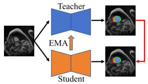  
(a) Mean Teacher

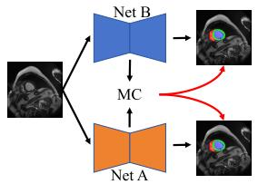

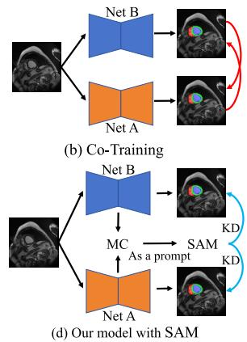  
(c) Our model without SAM  
Fig. 1. A comparison of different semi-supervised frameworks: (a) MT framework with a student model and a teacher model, (b) co-training framework with two subnets, (c) our proposed semi-supervised framework without SAM, which enhances the dual-stream network with Multi-view Co-training (MC), and (d) our model with Knowledge Distillation (KD) from SAM.

Recently, foundational models like the Segment Anything Model (SAM) [17] have demonstrated promising progress in segmentation tasks. However, SAM cannot be directly applied to all segmentation scenarios, especially in medical image segmentation tasks [18]. To address this issue, several studies [18], [19], [20], [21] integrate an adapter into SAM and subsequently fine-tune SAM on the specific dataset for downstream tasks. Furthermore, some studies [22], [23] have incorporated SAM to enhance the accuracy of pseudo-labels for unlabeled data, thereby improving model performance. These methods supply SAM with precise prediction points or boxes as prompts to generate pseudo-labels. However, a limitation of this strategy is that providing incorrect prompts can directly lead to a substantial decrease in SAM's effectiveness. While numerous studies have integrated SAM into medical segmentation tasks, the optimal utilization of SAM's generalization capability to enhance semi-supervised medical image segmentation remains an area deserving of further investigation.

To this end, as depicted in Fig. 1(d), we propose a learnable prompting SAM-induced knowledge distillation framework (termed KnowSAM) for semi-supervised medical image segmentation. KnowSAM leverages the generalization ability of SAM through distillation learning to enhance segmentation performance. Specifically, we propose a Multi-view Co-training (MC) strategy, where two subnets engage in a co-teaching paradigm and mutually correct each other. Additionally, the MC incorporates a Hybrid Aggregation Module (HAM) to adaptively merge prediction maps with entropy maps and dissimilarity maps, reducing discordant predictions and uncertainties between the two subnets. Furthermore, we propose a Learnable Prompt Strategy (LPS) to extract dense prompts from a designed lightweight network and integrate them into SAM's decoder. Concurrently, we introduce an adapter module in SAM's image encoder and decoder layers for fine-tuning, enhancing SAM's performance on medical segmentation tasks. Additionally, we present a simple yet effective Uncertainty-Guided Data Augmentation (UGDA) method to boost the generalization of our model by increasing diversity in unlabeled data. Lastly, we present a SAM-induced Knowledge Distillation (SKD) strategy to enable the two sub-networks to learn valuable information from SAM.

Our main contributions are summarized as follows:

• We propose a novel KnowSAM framework to harness the generalization capabilities of the foundation model through distillation learning to improve semi-supervised medical image segmentation performance. Importantly, our SAM distillation framework can be seamlessly applied to other semi-supervised segmentation methods.

• We present a multi-view co-training component to integrate multi-view maps, including the subnets’ outputs, entropy uncertainty maps, and spatial information from regions where discrepancies exist in the subnets' predictions. This approach gradually reduces cognitive differences between the two subnets, leading to improved segmentation accuracy.

• A learnable prompt strategy is proposed to dynamically provide effective feature prompts. This strategy prevents performance degradation of SAM caused by incorrect hard coordinates, thus improving SAM's capability in medical segmentation tasks.

• Extensive experimental results on a diversity of medical segmentation tasks demonstrate that our model outperforms the other state-of-the-art semi-supervised methods.

## II. RELATED WORK

## A. Semi-Supervised Medical Image Segmentation

Pseudo-labeling, consistency regularization, and co-training are three common methods in semi-supervised medical image segmentation, and we discuss these related studies below.

1) Pseudo-Labeling: Pseudo-labeling methods involve generating pseudo-annotations for unlabeled data and then using them as labels for model retraining. For example, Zeng et al. [24] designed a novel double-threshold pseudolabeling method for dual-task image segmentation and classification to enhance the joint model's utilization of unlabeled data. Yao et al. [25] proposed a confidence-aware cross pseudo-supervision algorithm, which enhances the quality of pseudo labels for unlabeled images by utilizing Fourier transformations. Moreover, strategies such as uncertainty guidance and confidence awareness can improve the quality of generated pseudo-labels, with higher confidence typically leading to more effective pseudo-labels [26], [27].

2) Consistency Regularization: Consistency regularization aims to maintain prediction invariance under different perturbations. For example, Huang et al. [28] used pixel-level predictions between unlabeled samples and their perturbed counterparts for consistency regularization, enhancing the model's generalization by extracting valuable information from unlabeled data. Zheng et al. [29] enhanced the robustness of the network through consistency regularization by introducing random noise into the parameters of the teacher model to perturb the feature layers. Yang et al. [30] used an auxiliary feature perturbation stream to expand the perturbation space and proposed a dual-stream perturbation technique, enabling two strong augmented views to be guided by a common weak view. Additionally, several methods [31], [32] used adversarial learning to encourage the prediction distribution of unlabeled images to be as similar as possible to that of labeled data.

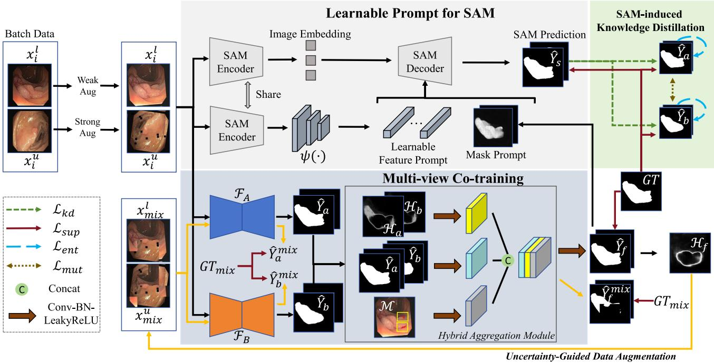  
Fig. 2. Overview of our KnowSAM framework. An input image is initially processed by two distinct subnets, $\mathcal { F } _ { A }$ and ${ \mathcal { F } } _ { B }$ to obtain $\hat { Y } _ { a }$ and $\hat { Y } _ { b } ,$ which are then fed into a hybrid aggregation module to produce the composite map $\hat { Y } _ { f } .$ Concurrently, the input image is processed by the SAM encoder to extract feature embeddings, which are refined by ψ(·) to produce the learnable feature prompt. The two types of prompts $\hat { ( Y _ { f } }$ and the learnable feature prompt) are provided to the SAM decoder to produce predictions, which serve as the basis for knowledge distillation. Furthermore, we leverage an uncertainty-guided data augmentation approach to generate new training samples for enhancing robustness.

3) Co-Training: Co-training methods [10], [33] train multiple models on diverse subsets or perspectives of the data, facilitating information exchange between the models throughout the training process. MCF [10] employs a co-training strategy to enable the network to recognize its own errors and perform bias correction through comparisons between subnets. Co-BioNet [33] utilizes a dual-view framework based on adversarial learning for semi-supervised volumetric medical image segmentation, which allows one perspective to learn from the high-confidence predictions of the other perspective. However, the effective reduction of bias in various subnets and the optimal fusion of their outputs are areas that still require further exploration.

## B. Knowledge Distillation

KD technology has achieved significant results in model compression and transfer learning, yet there has been relatively less exploration in the SSL domain. KD guides the training of student models using soft labels generated by teacher models, which typically provide more information than hard labels. For example, Xie et al. [34] proposed deep mutual distillation (DMD), a high-entropy online mutual distillation process that enhances semi-supervised medical image segmentation by providing more informative training than low-entropy methods, particularly in ambiguous regions. You et al. [35] introduced SimCVD, a contrastive distillation framework that improves voxel representation learning and segmentation accuracy by using unsupervised training and structural distillation of pair-wise similarities. To tackle the multi-class label imbalance challenge, You et al. [36] proposed an anatomical-aware contrastive distillation framework for semi-supervised medical image segmentation, which leverages iterative contrastive distillation, soft negative labeling, and anatomical contrast sampling to boost segmentation accuracy. Additionally, Shu et al. [37] employed a cross-mix teaching paradigm and a lightweight transductive monitor for active knowledge extraction. This serves as a bridge between the teacher and student models, improving performance in scenarios with limited supervision.

## III. METHODOLOGY

Overview: In the semi-supervised setting, we have a labeled dataset $\mathcal { D } ^ { L } = \{ ( x _ { i } ^ { l } , y _ { i } ^ { l } ) \} _ { i = 1 } ^ { N _ { l } }$ and an unlabeled dataset $\mathcal { D } ^ { U } =$ $\{ x _ { i } ^ { u } \} _ { i = N _ { l } + 1 } ^ { N _ { l } + N _ { u } }$ , with $N _ { l } \mathrm { ~ \ ' ~ } \ll \mathrm { ~ \ ' ~ } N _ { u } . \mathrm { ~ \ } x _ { i } \mathrm { ~ \ \in ~ \mathbb { R } ^ { \it H \times W } ~ }$ represents an input image, and $y _ { i } ~ \in ~ \{ 0 , 1 \} ^ { C \times H \times W }$ is the corresponding ground-truth annotation with C classes. The architecture of our KnowSAM framework is illustrated in Fig. 2. Specifically, an input image is fed into two distinct subnets, ${ \mathcal { F } } _ { A }$ and $\mathcal { F } _ { B }$ Following this, the segmentation outputs, $\hat { Y } _ { a }$ and $\hat { Y } _ { b }$ , from the two subnets are subsequently input into a hybrid aggregation module, resulting in the composite map $\hat { Y } _ { f }$ . This map serves as the mask prompt for the SAM decoder. Concurrently, the input image is passed through the SAM encoder to extract the image embedding, which is then processed by $\psi ( \cdot )$ to derive the learnable feature prompt. Together with the mask prompt, these are provided to the SAM decoder to produce predictions. Subsequently, the outputs of multi-view co-training are refined by SAM predictions via a knowledge distillation process. Additionally, as highlighted by the yellow flow line in Fig. 2, we propose a UGDA strategy to strengthen the model's generalization capabilities. This strategy involves generating new hybrid images by substituting regions of low confidence, which are subsequently employed to retrain the model.

## A. Multi-View Co-Training

The MC component comprises two distinct structural subnets with independent parameter updates, which are designed to correct each other through a simple aggregation strategy. In particular, the aggregation module focuses on addressing inherent uncertainty and areas of prediction inconsistency within the two sub-networks. To achieve this, we initially utilize the entropy map H [38] as the uncertainty map, which can be defined as follows:

$$
\mathcal { H } = - \sum _ { c = 0 } ^ { C - 1 } \hat { Y _ { c } } \times \log \hat { Y _ { c } } ,\tag{1}
$$

where $\hat { Y } _ { c }$ denotes the prediction for the c-th class of a subnetwork. Hence, we can obtain the entropy maps $\mathcal { H } _ { a }$ and $\mathcal { H } _ { b }$ for the two sub-networks. Then, we utilize the XOR operation to determine areas of disagreement in predictions between the two sub-networks. The dissimilarity map, denoted as $\mathcal { M } .$ is formalized by

$$
\mathcal { M } = \mathcal { B } ( \hat { Y _ { a } } ) \oplus \mathcal { B } ( \hat { Y _ { b } } ) ,\tag{2}
$$

where $\hat { Y _ { a } }$ and $\hat { Y _ { b } }$ represent the predicted maps of the two sub-networks, respectively. B and  denote the binarization and XOR operation, respectively. To mitigate the impact of uncertainty and inconsistency predictions from the two subnets, we propose a Hybrid Aggregation Module (HAM) to fuse multi-view maps. These include the two prediction maps, entropy maps, and the dissimilarity map. Consequently, the aggregated prediction can be obtained by fusing these maps, which can be formulated by

$$
\hat { Y } _ { f } = \mathcal { F } _ { \mathrm { C B L } } ( \mathcal { F } _ { \mathrm { C A T } } \{ \mathcal { F } _ { \mathrm { C B L } } ( \mathcal { H } _ { a } , \mathcal { H } _ { b } ) , \mathcal { F } _ { \mathrm { C B L } } ( \mathcal { M } ) , \mathcal { F } _ { \mathrm { C B L } } ( \hat { Y } _ { a } , \hat { Y } _ { b } ) \} ) ,\tag{3}
$$

where $\mathcal { F } _ { \mathrm { C B L } }$ and ${ \mathcal { F } } _ { \mathrm { C A T } }$ denote the Conv-BatchNorm-LeakyReLU and concatenation operations, respectively. Note that, the aggregated prediction maps are only supervised by the ground truth labels of labeled data. Therefore, the supervised loss can be formulated as follows:

$$
\mathcal { L } _ { f u s e } = \mathcal { L } _ { S E G } ( \hat { Y } _ { f } , Y ^ { l } ) ,\tag{4}
$$

where $\mathcal { L } _ { S E G } = \mathcal { L } _ { D I C E } + \mathcal { L } _ { C E }$ , with $\mathcal { L } _ { D I C E }$ and $\mathcal { L } _ { C E }$ denoting the Dice loss and Cross-Entropy (CE) loss, respectively. $Y ^ { \bar { l } }$ denotes ground truth labels of labeled data. Furthermore, we adopt the mutual supervision strategy as presented in [39] to ensure the alignment between $\hat { Y } _ { a }$ and $\hat { Y } _ { b } .$ , generated by the two subnets. Specifically, $\hat { Y } _ { a }$ acts as a pseudo-label for $\hat { Y } _ { b } .$ and vice versa, establishing mutual consistency between them. The mutual consistency loss is defined as follows:

$$
\mathcal { L } _ { m u t } = \mathcal { L } _ { C E } ( \hat { Y } _ { a } , \hat { Y } _ { b } ) + \mathcal { L } _ { C E } ( \hat { Y } _ { b } , \hat { Y } _ { a } ) .\tag{5}
$$

## B. Learnable Prompt for SAM

We present a Learnable Prompt Strategy (LPS) to generate learnable feature prompt that are fed into the decoder of SAM. This effectively alleviates the significant performance degradation of SAM caused by inputting incorrect sparse information $( e . g .$ , containing only horizontal and vertical coordinate points). Specifically, as depicted in Fig. 2, we devise a lightweight decoder $\psi ( \cdot )$ to generate dense prompts (embedding features), which can be represented as follows:

$$
\mathbf { P } _ { b } = \psi ( Z ; \Theta _ { m } ) ,\tag{6}
$$

where $Z ~ \in ~ \mathbb { R } ^ { B \times D \times H \times W }$ denotes the feature map of input images extracted by SAM's image encoder, where $B , D , H .$ and W respectively represent the batch size, channel, width, and height. $\Theta _ { m }$ represents the parameters of ψ(·). $\mathbf { P } _ { b }$ ∈ $\mathbb { R } ^ { B \times N _ { b } \times \overline { { L } } }$ denotes learnable feature prompt, with $N _ { b }$ denoting the number of feature prompts. Moreover, the aggregated map from the two subnets is used to form the mask prompt. Therefore, the above process can be expressed as follows:

$$
\hat { Y } _ { s } = \mathcal { F } _ { s } ( \mathbf { P } _ { b } , \hat { Y } _ { f } ; \Theta _ { s } ) ,\tag{7}
$$

where $\mathcal { F } _ { s } ( \cdot )$ represents SAM's decoder, $\hat { Y } _ { s }$ denotes the SAM's prediction. $\Theta _ { s }$ represents the parameters of $\mathcal { F } _ { s } ( \cdot )$ . Moreover, we introduce an adapter [19] tuning strategy to the image encoder and decoder of the SAM model for fine-tuning, aligning the model with this new prompt approach. SAM is solely supervised by ground truth labels, thus the loss function is formulated by

$$
\mathcal { L } _ { s a m } = \mathcal { L } _ { S E G } ( \hat { Y } _ { s } , Y ^ { l } ) .\tag{8}
$$

## C. SAM-Induced Knowledge Distillation

We propose the SKD strategy to transfer useful knowledge from SAM to two subnets, thereby enhancing the intrinsic generalization capability of each subnet. More importantly, by introducing distillation learning, the overfitting of subnets to noise can be mitigated [40]. Following the approach of KD [41], we employ temperature calibrated softmax (T-S) to soften probability maps in the Kullback-Leibler divergence function, which can be expressed as:

$$
\hat { Y } _ { T } ^ { c } = \frac { \exp ( \hat { \mathbf { q } } _ { c } / T ) } { \sum _ { c } \exp ( \hat { \mathbf { q } } _ { c } / T ) } ,\tag{9}
$$

where $\hat { \mathbf { q } } _ { c }$ is the logit prediction for class c, and $\hat { Y } _ { T } ^ { c }$ is the soft probability value for class c. Besides, T denotes a temperature parameter, and a high value can generate a softer probability distribution. After that, we utilize SAM as the teacher model and employ two sub-models as student models for knowledge distillation. Thus, the KD loss function can be expressed as follows:

$$
\mathcal { L } _ { k d } = K L ( \hat { Y } _ { T } ^ { a } , \hat { Y } _ { T } ^ { s } ) + K L ( \hat { Y } _ { T } ^ { b } , \hat { Y } _ { T } ^ { s } ) ,\tag{10}
$$

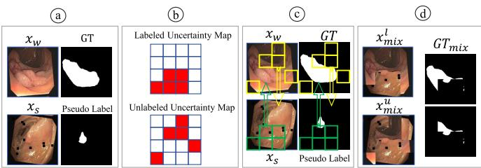  
Fig. 3. Pipeline of the proposed UGDA strategy. (a) Labeled data undergo weak augmentation with ground-truth labels, while unlabeled data receive strong augmentation with pseudo labels. (b) An uncertainty map is obtained from the aggregated prediction $\hat { Y } _ { f } ,$ and the top five regions with the highest uncertainty are identified. (c) Interactive bidirectional copy-paste is employed based on the uncertainty map (a single region is depicted here for demonstration purposes). (d) Mixed images with labels are used as additional training samples.

where $\hat { Y } _ { T } ^ { a } , \hat { Y } _ { T } ^ { b }$ and $\hat { Y } _ { T } ^ { s }$ denote the soft probability maps of two subnets and SAM, respectively. K L(·) is the Kullback-Leibler divergence function. Note that the gradient of $\mathcal { L } _ { k d }$ is solely back-propagated to the two subnets, facilitating knowledge distillation from SAM to the subnets.

## D. Uncertainty-Guided Data Augmentation

A data augmentation method, such as CutMix [42], is a straightforward and effective way to enhance model segmentation performance while bolstering model robustness. However current copy-paste methods (e.g., BCP [4] and MiDSS [43]) are typically random, leading to instability. Therefore, we propose the UGDA strategy to address this issue. As shown in Fig. 3, in the first step, we apply weak augmentation to labeled data and strong augmentation to unlabeled data, thus we can obtain as follows:

$$
x _ { w } = \mathcal { A } ^ { W } ( x _ { i } ^ { l } ) , x _ { s } = \mathcal { A } ^ { S } ( x _ { i } ^ { u } ) ,\tag{11}
$$

where $A ^ { W }$ and $\mathcal { A } ^ { S }$ represent weak and strong data augmentation, respectively. In the second step, the data are fed into the entire model to obtain the aggregated result $\hat { Y } _ { f }$ . The cutting positions are determined by calculating the entropy uncertainty [38] of $\hat { Y } _ { f }$ . Then, we divide the uncertainty map into N patches, where N is set to 16. Moreover, we calculate the mean uncertainty value for each region using average pooling and select the top five patches with the highest uncertainty value. In the third step, we leverage the patch coordinates indicated by the uncertainty map to perform a cross copy-pasting operation between labeled and unlabeled data, thereby creating mixed images. Additionally, the outputs from SAM serve as the pseudo-labels for the unlabeled data. Consequently, this strategy not only enhances the diversity of the sample set but also mitigates the noise stemming from uncertain predictions.

## E. Overall Loss Function

To effectively conduct distillation learning from SAM to our subnets, the training scheme comprises two components: the SAM loss and the subnets' loss. In this scenario, it is preferable to carry out inference using only the subnets. The details of the SAM loss can be found in Sec. III-B. Additionally, the loss of subnets includes supervised loss, KD loss, entropy loss, and mutual consistency loss. Initially, the supervised loss on labeled data can be formulated as follows:

$$
\mathcal { L } _ { s u p } = \mathcal { L } _ { S E G } ( \hat { Y } _ { a } , Y ^ { l } ) + \mathcal { L } _ { S E G } ( \hat { Y } _ { b } , Y ^ { l } ) + \mathcal { L } _ { f u s e } .\tag{12}
$$

Then, minimizing entropy can enhance the confidence of model predictions. The entropy loss function is defined by

$$
\begin{array} { r l r } {  { \mathcal { L } _ { e n t } = - \frac { 1 } { H \times W } \sum _ { k } ^ { H \times W } \sum _ { c = 0 } ^ { C } ( \hat { Y } _ { a } ^ { c } ( k ) \log ( \hat { Y } _ { a } ^ { c } ( k ) ) } } \\ & { } & { + \hat { Y } _ { b } ^ { c } ( k ) \log ( \hat { Y } _ { b } ^ { c } ( k ) ) ) , ~ } \end{array}\tag{13}
$$

where ${ \hat { Y } } _ { a } ^ { c } ( k )$ and $\hat { Y } _ { b } ^ { c } ( k )$ are the predictions of two sub-networks for class $c$ at pixel k. Hence, the overall loss function for the subnets is as follows:

$$
\mathcal { L } _ { t o t a l } = \mathcal { L } _ { s u p } + \mathcal { L } _ { k d } + \lambda _ { e } \mathcal { L } _ { e n t } + \lambda _ { m } \mathcal { L } _ { m u t } ,\tag{14}
$$

where $\lambda _ { e }$ and $\lambda _ { m }$ are coefficients for entropy loss and mutual consistency loss, respectively. It is noteworthy that there is no supervised loss for unlabeled data.

## IV. EXPERIMENTS AND RESULTS

## A. Datasets

1) Colonoscopy Datasets: Five colonoscopy datasets are used for polyp segmentation, including ETIS [47], CVC-ClinicDB [48], CVC-ColonDB [49], CVC-300 [50], and Kvasir [51]. Following the previous setting [52], a total of 1, 450 images are selected from the CVC-ClinicDB and Kvasir datasets to form the training set, while all remaining 798 images are used for testing.

2) Ultrasound Thyroid Nodule Datasets: Three ultrasound datasets are used, namely TN3K [53], TG3K [54], and DDTI [55]. The TN3K dataset consists of 3, 493 ultrasound images, with 2, 879 images for training and 614 ones for testing. The DDTI dataset contains 637 ultrasound images captured using the same device. The TG3K dataset includes 3, 585 ultrasound images collected from 16 ultrasound videos. Following the experimental setup described in [53], we combine 2, 879 images from TN3K and 3, 585 images from TG3K to form the training and validation datasets, while 614 images from TN3K and 637 images from DDTI are formed the test set.

3) ISIC Dataset: The ISIC-2018 [56] dataset, provided by the International Skin Imaging Collaboration (ISIC), is derived from a substantial collection of dermoscopy images. It comprises 2, 594 images for training and 1, 000 images for testing.

4) ACDC Dataset: The ACDC dataset [57], introduced during the MICCAI 2017 challenge, includes four classes, (i.e., background, right ventricle, left ventricle, and myocardium). It comprises imaging scans from 100 patients. Following the data partitioning strategy outlined in [4], we split the dataset into 70 scans for training, 10 for validation, and 20 for testing.

5) BCSS Dataset: The Breast Cancer Semantic Segmentation (BCSS) dataset [58] contains 151 pathological images of varying sizes. In this study, we utilize an overlap-based cropping method to produce a dataset of 3, 888 images, each with a resolution of 1024 × 1024 pixels. This choice of dimension was strategic, aimed at ensuring that each image captures a comprehensive amount of tumor-related details. Our focus is exclusively on the tumor category, with all other regions considered as background. These collected images are divided into training, validation, and test sets in the proportions of 70%, 10%, and 20%, respectively.

## B. Experimental Setup

1) Implementation Details: All experiments are conducted in a PyTorch 1.8.1 environment with CUDA 11.2 and an NVIDIA 3090 GPU. The two subnets in the study are U-Net [59]and V-Net [60], and the SAM uses the base version. For SAM, the Adam optimizer is employed with an initial learning rate set to 0.0001. Other subnets use the SGD optimizer with a momentum of 0.9, a weight decay of 0.0001, and an initial learning rate of 0.01. Batch size and the number of iterations are set to 24 and 50k. The input size of all images is fixed at 256 × 256. Moreover, we use a Gaussian warm-up function $\lambda _ { m } ( t ) = \beta { * } e ^ { - 5 ( 1 - t / t _ { m a x } ) ^ { 2 } }$ in consistency loss, where $\beta$ is set to $1 . \lambda _ { e }$ is empirically set to 0.9. Note that in the training without SAM, we utilize the fused predictions $\hat { Y } _ { f }$ as pseudo-labels for unlabeled data. During inference, the $\hat { Y _ { f } }$ serves as the final segmentation results. For all tasks, 10% or 30% are randomly selected from the training set as labeled data, while the remaining ones are adopted as unlabeled data.

2) Evaluation Metrics: For 2D datasets, we employ three commonly used evaluation metrics, namely the Dice coefficient (Dice), Intersection over Union (IoU), and 95% Hausdorff Distance (95HD). For 3D data, we introduce an additional metric, i.e., Average Surface Distance (ASD).

## C. Comparison With State-of-the-Art Methods

We compare the proposed model with 12 SOTA semisupervised methods, namely MT [11], UA-MT [12], DTC [7], MC-Net [8], URPC [9], MC-Net+ [44], MCF [10], BCP [4], and CAML [5]. For a fair comparison, consistent data preprocessing is applied to all the models, and the open-source code and hyperparameters are used for each method.

1) Results on Colonoscopy Datasets: Table I shows the quantitative results of various semi-supervised methods on five colonoscopy and the ISIC datasets. In the polyp segmentation task, we utilize two ratios of labeled data: 10% (145 labeled images) and 30% (435 labeled images) in the comparison experiments. Without using SAM distillation and utilizing only 10% labeled data for training, our semi-supervised method achieves satisfactory results. Moreover, our method with SAM distillation obtains significant improvements in the dice coefficient on unseen datasets such as CVC-ColonDB and ETIS.

2) Results on Ultrasound Datasets: Table I shows the quantitative results across three ultrasound datasets. Due to the complex background in ultrasound images, incomplete segmentation is a common challenge. With only 10% labeled data, our method achieves a 0.51% dice coefficient higher than the second-best method MCF on the unseen DDTI dataset. On the TN3K dataset, the dice coefficient increases from 77.78% to 78.57% when compared to CAML with 10% training data. More importantly, introducing SAM distillation further enhances the performance comprehensively, indicating KnowSAM's robust generalization across different scenarios.

3) Results on IS/C-2018: As shown in Table I, our method improves the dice coefficient from 83.98% to 84.44% compared to BCP on the ISIC-2018 dataset with 10% training data. By incorporating SAM distillation into our model, the Dice coefficient further increases from 84.44% to 86.51%. Moreover, as shown in Fig. 4, our model completely segmentation tumor regions than other comparison methods.

4) Results on ACDC: We further validate the proposed model on the multi-class task using the ACDC dataset. As shown in Table II and Fig. 4, KnowSAM consistently outperforms other semi-supervised methods. With only 30% labeled data (21 labeled samples), the Dice coefficient increases from 88.61% to 90.22% compared to the second-best method. Moreover, our method incorporating SAM distillation further improves the Dice coefficient to 91.13%, underscoring the effectiveness of our semi-supervised model and the robustness of the proposed KnowSAM framework.

5) Results on BCSS: We also conduct comparison experiments on the pathology image segmentation task. As presented in Table III, with only 10% labeled data, our MC-seg achieves a Dice coefficient of 68.11%, which outperforms the two state-of-the-art methods, CDMA (65.58%) and BCP (66.00%). More notably, by integrating the SAM-induced knowledge distillation strategy, our KnowSAM model records a substantial improvement, achieving a Dice coefficient of 72.69% and outperforming all other methods. This trend continues even with 30% labeled data. This outcome underscores the KnowSAM framework's capacity to preserve model generalization and precision in identifying foreground target boundaries, even in challenging tasks such as pathological segmentation.

## D. Ablation Study

1) Effectiveness of Different Views in MC: In the MC component, we utilized the proposed HAM to fuse different maps, including the predictions of two sub-networks, entropy uncertainty maps (H), and dissimilarity maps (M), to produce reliable segmentation results. Notably, the uncertainty perspective effectively addresses the network's inherent cognitive limitations, enabling the model to identify and accommodate its uncertainties throughout the segmentation process. In addition, the dissimilarity perspective plays a key role in mitigating cognitive biases that may exist between the two subnets. Table IV demonstrates the effectiveness of different views within the HAM strategy. Fig. 5 presents the visualization results without SAM distillation. Among these views, entropy uncertainty reflects the model's internal understanding of the data, while the inconsistent region identifies controversial areas requiring additional supervision. When training with 30% labeled samples on the ACDC dataset, incorporating H view information increases the Dice coefficient from 88.63% to 89.18%, with HD95 decreasing from 5.14 to 4.06. Furthermore, integrating M view information raises the Dice coefficient to 90.22%, and HD95 decreases to 1.21. This highlights that entropy uncertainty and inconsistent regions can supplement the model's cognitive capabilities effectively, enhancing the semi-supervised segmentation performance.

2) Effectiveness of Learnable Prompt Strategy: In the context of SAM's prompting strategy, we propose the LPS to mitigate the substantial performance degradation caused by the use of specific points or box coordinates derived from erroneous predictions as prompts. To evaluate the effectiveness of LPS, we conduct ablation experiments, comparing LPS with a traditional strategy that employs specific bounding box coordinates (denoted as “Box"). As illustrated in Table V, we report the predicted results of SAM and the fused predictions Ýf (i.e., the outputs of KnowSAM). It is observed that our LPS outperforms the approach utilizing the “Box" strategy. This is attributed to a learnable feature prompt provided by the LPS, which effectively mitigates the performance degradation of SAM that can result from inaccurate hard coordinates.

TABLE I  
QUANTITATIVE RESULTS ON COLONOSCOPY, ISIC-2018 AND ULTRASOUND THYROID NODULE DATATSETS (“MC-SEG” DENOTES OUR MULTI-VIEW CO-TRAINING WITH UGDA). BEST AND SECOND-BEST RESULTS ARE HIGHLIGHTED IN RED AND BLUE, RESPECTIVELY
<table><tr><td rowspan=2 colspan=1>Methods</td><td rowspan=2 colspan=1></td><td rowspan=1 colspan=2>10% labeled</td><td rowspan=1 colspan=1></td><td rowspan=1 colspan=4>30% labeled</td><td rowspan=1 colspan=1></td><td rowspan=1 colspan=4>10% labeled</td><td rowspan=1 colspan=2>30% labeled</td></tr><tr><td rowspan=1 colspan=3>Dice(%) IoU(%)95HD</td><td rowspan=1 colspan=4>Dice(%)IoU(%)95HD</td><td rowspan=1 colspan=1></td><td rowspan=1 colspan=4>Dice(%)IoU(%)95HD</td><td rowspan=1 colspan=2>Dice(%) IoU(%)95HD</td></tr><tr><td rowspan=2 colspan=1>MT [11]UA-MT [12]</td><td rowspan=2 colspan=1></td><td rowspan=1 colspan=3>56.64   48.90  4.69</td><td rowspan=1 colspan=4>78.27  68.69  3.86</td><td rowspan=1 colspan=1></td><td rowspan=1 colspan=4>78.64  71.02  3.97</td><td rowspan=1 colspan=2>83.21   76.92  3.50</td></tr><tr><td rowspan=1 colspan=3>40.15  32.46  4.97</td><td rowspan=1 colspan=3>80.95   70.77</td><td rowspan=1 colspan=1>3.19</td><td rowspan=1 colspan=1></td><td rowspan=1 colspan=4>74.51   67.14  4.05</td><td rowspan=1 colspan=2>78.89  72.61  3.68</td></tr><tr><td rowspan=2 colspan=1>DTC [7]MC-Net [8]</td><td rowspan=1 colspan=1></td><td rowspan=1 colspan=3>42.81   33.35  5.42</td><td rowspan=1 colspan=3>77.44  67.43</td><td rowspan=1 colspan=1>3.32</td><td rowspan=1 colspan=1></td><td rowspan=1 colspan=4>67.82  57.96  4.61</td><td rowspan=1 colspan=2>74.28  66.21  3.97</td></tr><tr><td rowspan=1 colspan=1></td><td rowspan=1 colspan=3>69.89   61.58  3.93</td><td rowspan=1 colspan=3>81.36   72.11</td><td rowspan=1 colspan=1>3.33</td><td rowspan=1 colspan=1></td><td rowspan=1 colspan=4>75.21   67.87  4.10</td><td rowspan=1 colspan=2>83.53   76.78  3.56</td></tr><tr><td rowspan=1 colspan=1>URPC [9]</td><td rowspan=1 colspan=1></td><td rowspan=1 colspan=3>58.83   50.81  4.30</td><td rowspan=1 colspan=3>77.05   66.75</td><td rowspan=1 colspan=1>3.65</td><td rowspan=1 colspan=1>3</td><td rowspan=1 colspan=4>76.42  69.33  3.78</td><td rowspan=1 colspan=2>80.70   74.58  3.64</td></tr><tr><td rowspan=1 colspan=1>MC-Net+ [44]</td><td rowspan=1 colspan=1>0</td><td rowspan=1 colspan=3>70.08   62.43  4.09</td><td rowspan=1 colspan=3>81.01   70.93</td><td rowspan=1 colspan=1>3.41</td><td rowspan=1 colspan=1>D</td><td rowspan=1 colspan=4>78.23   70.83  3.94</td><td rowspan=1 colspan=2>83.77   77.43  3.58</td></tr><tr><td rowspan=4 colspan=1>MCF [10]CDMA [40]CauSSL [45]BS-Net [46]</td><td rowspan=1 colspan=1>30</td><td rowspan=1 colspan=3>67.58  57.85  3.91</td><td rowspan=1 colspan=3>79.51   69.03</td><td rowspan=1 colspan=1>3.27</td><td rowspan=1 colspan=1></td><td rowspan=1 colspan=4>70.83  62.41  4.06</td><td rowspan=1 colspan=2>80.41   74.50  3.63</td></tr><tr><td rowspan=1 colspan=1>C</td><td rowspan=1 colspan=3>59.44  48.93  4.34</td><td rowspan=1 colspan=3>66.38  52.84</td><td rowspan=1 colspan=1>4.77</td><td rowspan=1 colspan=1>C</td><td rowspan=1 colspan=4>74.18   65.31  4.09</td><td rowspan=1 colspan=2>80.81   72.79  3.81</td></tr><tr><td rowspan=1 colspan=1>V</td><td rowspan=1 colspan=1>64.93</td><td rowspan=1 colspan=2>55.06  4.33</td><td rowspan=1 colspan=3>71.92  62.02</td><td rowspan=1 colspan=1>3.71</td><td rowspan=1 colspan=1>C</td><td rowspan=1 colspan=4>76.23   68.44  3.99</td><td rowspan=1 colspan=2>75.18   68.08  3.89</td></tr><tr><td rowspan=1 colspan=1></td><td rowspan=1 colspan=1>65.46</td><td rowspan=1 colspan=2>56.31  4.09</td><td rowspan=1 colspan=3>80.53   70.99</td><td rowspan=1 colspan=1>3.33</td><td rowspan=1 colspan=1>V</td><td rowspan=1 colspan=4>74.83   67.44  4.03</td><td rowspan=1 colspan=2>80.32   74.15  3.62</td></tr><tr><td rowspan=2 colspan=1>BCP [4]CAML [5]</td><td rowspan=1 colspan=1></td><td rowspan=1 colspan=3>78.33  68.94  3.89</td><td rowspan=1 colspan=3>82.51   73.07</td><td rowspan=1 colspan=1>3.38</td><td rowspan=1 colspan=1></td><td rowspan=1 colspan=4>82.84  75.76  3.64</td><td rowspan=1 colspan=2>84.21   76.64  3.67</td></tr><tr><td rowspan=1 colspan=1></td><td rowspan=1 colspan=3>70.66  63.40  3.99</td><td rowspan=1 colspan=4>82.25   74.14  3.27</td><td rowspan=1 colspan=1></td><td rowspan=1 colspan=4>77.84  71.71  3.71</td><td rowspan=1 colspan=2>80.91   74.93  3.67</td></tr><tr><td rowspan=2 colspan=1>MC-seg (Ours)KnowSAM (Ours)</td><td rowspan=1 colspan=1></td><td rowspan=1 colspan=3>82.81   74.25  3.49</td><td rowspan=1 colspan=4>84.09   76.17  3.35</td><td rowspan=1 colspan=1></td><td rowspan=1 colspan=4>82.27  75.82  3.78</td><td rowspan=1 colspan=2>83.95  78.15  3.66</td></tr><tr><td rowspan=1 colspan=1></td><td rowspan=1 colspan=3>82.86  75.19  3.46</td><td rowspan=1 colspan=4>84.28   76.98  3.20</td><td rowspan=1 colspan=1></td><td rowspan=1 colspan=4>83.36  77.39  3.48</td><td rowspan=1 colspan=2>85.09   79.82  3.44</td></tr><tr><td rowspan=4 colspan=1>MT [11]UA-MT [12]DTC [7]MC-Net [8]</td><td rowspan=1 colspan=1></td><td rowspan=1 colspan=2>47.67   39.30</td><td rowspan=1 colspan=1>5.71</td><td rowspan=1 colspan=3>63.03  54.63</td><td rowspan=1 colspan=1>4.80</td><td rowspan=1 colspan=1></td><td rowspan=1 colspan=3>33.64  26.78</td><td rowspan=1 colspan=1>5.41</td><td rowspan=1 colspan=2>51.06  42.86  4.63</td></tr><tr><td rowspan=1 colspan=1></td><td rowspan=1 colspan=2>41.34  33.49</td><td rowspan=1 colspan=1>5.72</td><td rowspan=1 colspan=3>59.43  51.30</td><td rowspan=1 colspan=1>4.74</td><td rowspan=1 colspan=1></td><td rowspan=1 colspan=3>31.84  25.59</td><td rowspan=1 colspan=1>4.96</td><td rowspan=1 colspan=2>41.18  34.80  4.64</td></tr><tr><td rowspan=1 colspan=1></td><td rowspan=1 colspan=2>35.35  27.17</td><td rowspan=1 colspan=1>6.10</td><td rowspan=1 colspan=3>54.75  46.18</td><td rowspan=1 colspan=1>5.05</td><td rowspan=1 colspan=1></td><td rowspan=1 colspan=3>26.74  20.48</td><td rowspan=1 colspan=1>6.05</td><td rowspan=1 colspan=2>44.83  37.72  4.40</td></tr><tr><td rowspan=1 colspan=1></td><td rowspan=1 colspan=3>55.69   46.53  5.24</td><td rowspan=1 colspan=3>63.65  55.38</td><td rowspan=1 colspan=1>4.71</td><td rowspan=1 colspan=1></td><td rowspan=1 colspan=4>39.88  33.15  4.81</td><td rowspan=1 colspan=2>49.51   41.69  4.74</td></tr><tr><td rowspan=1 colspan=1>URPC [9]</td><td rowspan=1 colspan=1>3</td><td rowspan=1 colspan=3>46.84  38.98  5.55</td><td rowspan=1 colspan=3>60.00  51.89</td><td rowspan=1 colspan=1>4.78</td><td rowspan=1 colspan=1></td><td rowspan=1 colspan=4>38.98  32.92  4.78</td><td rowspan=1 colspan=2>45.00  36.75  4.89</td></tr><tr><td rowspan=1 colspan=1>MC-Net+ [44]</td><td rowspan=1 colspan=1>D</td><td rowspan=1 colspan=3>52.36  44.52  5.47</td><td rowspan=1 colspan=3>65.94  57.33</td><td rowspan=1 colspan=1>4.62</td><td rowspan=1 colspan=1></td><td rowspan=1 colspan=4>41.71   33.92 5.20</td><td rowspan=1 colspan=2>45.07  38.67  4.69</td></tr><tr><td rowspan=1 colspan=1>MCF [10]</td><td rowspan=1 colspan=1></td><td rowspan=1 colspan=1>48.72</td><td rowspan=1 colspan=2>40.60  5.25</td><td rowspan=1 colspan=3>63.24  55.05</td><td rowspan=1 colspan=1>4.64</td><td rowspan=1 colspan=1>S</td><td rowspan=1 colspan=4>31.13  25.81  4.84</td><td rowspan=1 colspan=2>48.46  41.28  4.33</td></tr><tr><td rowspan=1 colspan=1>CDMA [40]</td><td rowspan=1 colspan=1></td><td rowspan=1 colspan=1>44.88</td><td rowspan=1 colspan=1>35.72</td><td rowspan=1 colspan=1>5.77</td><td rowspan=1 colspan=2>59.39</td><td rowspan=1 colspan=1>49.10</td><td rowspan=1 colspan=1>5.20</td><td rowspan=1 colspan=1>T</td><td rowspan=1 colspan=4>37.23  28.85  4.87</td><td rowspan=1 colspan=1>38.29  29.37</td><td rowspan=1 colspan=1>6.07</td></tr><tr><td rowspan=1 colspan=1>CauSSL [45]</td><td rowspan=1 colspan=1>C</td><td rowspan=1 colspan=1>48.51</td><td rowspan=1 colspan=1>40.89</td><td rowspan=1 colspan=1>5.24</td><td rowspan=1 colspan=2>57.84</td><td rowspan=1 colspan=1>49.36</td><td rowspan=1 colspan=1>4.95</td><td rowspan=1 colspan=1>E</td><td rowspan=1 colspan=4>30.93  24.96  5.18</td><td rowspan=1 colspan=1>32.97  27.41</td><td rowspan=1 colspan=1>5.42</td></tr><tr><td rowspan=1 colspan=1>BS-Net [46]</td><td rowspan=1 colspan=1>V</td><td rowspan=1 colspan=1>43.88</td><td rowspan=1 colspan=1>36.57</td><td rowspan=1 colspan=1>5.43</td><td rowspan=1 colspan=2>55.89</td><td rowspan=1 colspan=1>48.15</td><td rowspan=1 colspan=1>4.87</td><td rowspan=1 colspan=1></td><td rowspan=1 colspan=2>31.77</td><td rowspan=1 colspan=2>26.26  5.28</td><td rowspan=1 colspan=1>38.08  31.65</td><td rowspan=1 colspan=1>4.91</td></tr><tr><td rowspan=1 colspan=1>BCP [4]</td><td rowspan=1 colspan=1></td><td rowspan=1 colspan=1>59.91</td><td rowspan=1 colspan=1>51.31</td><td rowspan=1 colspan=1>4.93</td><td rowspan=1 colspan=2>68.11</td><td rowspan=1 colspan=1>58.91</td><td rowspan=1 colspan=1>4.61</td><td rowspan=1 colspan=1></td><td rowspan=1 colspan=2>46.10</td><td rowspan=1 colspan=2>37.52  4.95</td><td rowspan=1 colspan=2>55.28  46.09  4.52</td></tr><tr><td rowspan=1 colspan=1>CAML [5]</td><td rowspan=1 colspan=1></td><td rowspan=1 colspan=1>59.86</td><td rowspan=1 colspan=1>52.96</td><td rowspan=1 colspan=1>4.90</td><td rowspan=1 colspan=3>64.23  56.69</td><td rowspan=1 colspan=1>4.64</td><td rowspan=1 colspan=1></td><td rowspan=1 colspan=2>33.27</td><td rowspan=1 colspan=2>28.94  4.63</td><td rowspan=1 colspan=2>54.80  47.03  4.36</td></tr><tr><td rowspan=2 colspan=1>MC-seg (Ours)KnowSAM (Ours)</td><td rowspan=1 colspan=1></td><td rowspan=1 colspan=1>64.15</td><td rowspan=1 colspan=1>55.92</td><td rowspan=1 colspan=1>5.02</td><td rowspan=1 colspan=3>68.71   60.30</td><td rowspan=1 colspan=1>4.76</td><td rowspan=1 colspan=1></td><td rowspan=1 colspan=2>47.55</td><td rowspan=1 colspan=2>41.40  4.63</td><td rowspan=1 colspan=2>56.04  48.89  4.43</td></tr><tr><td rowspan=1 colspan=1></td><td rowspan=1 colspan=1>69.76</td><td rowspan=1 colspan=1>62.14</td><td rowspan=1 colspan=1>4.51</td><td rowspan=1 colspan=3>70.37   62.53</td><td rowspan=1 colspan=1>4.57</td><td rowspan=1 colspan=1></td><td rowspan=1 colspan=2>52.62</td><td rowspan=1 colspan=2>45.89  4.40</td><td rowspan=1 colspan=2>58.69   52.40  4.07</td></tr><tr><td rowspan=2 colspan=1>MT [11]UA-MT [12]</td><td rowspan=1 colspan=1></td><td rowspan=1 colspan=1>73.99</td><td rowspan=1 colspan=1>64.19</td><td rowspan=1 colspan=1>5.37</td><td rowspan=1 colspan=3>83.74  75.89</td><td rowspan=1 colspan=1>4.53</td><td rowspan=1 colspan=1></td><td rowspan=1 colspan=2>80.86</td><td rowspan=1 colspan=2>72.04  5.32</td><td rowspan=1 colspan=2>83.70  75.07  4.96</td></tr><tr><td rowspan=1 colspan=1></td><td rowspan=1 colspan=1>73.15</td><td rowspan=1 colspan=1>64.12</td><td rowspan=1 colspan=1>5.06</td><td rowspan=1 colspan=4>83.71   75.95  4.51</td><td rowspan=1 colspan=1></td><td rowspan=1 colspan=2>80.15</td><td rowspan=1 colspan=1>71.48</td><td rowspan=1 colspan=1>5.37</td><td rowspan=1 colspan=2>85.08  77.19  4.90</td></tr><tr><td rowspan=1 colspan=1>DTC [7]</td><td rowspan=1 colspan=1></td><td rowspan=1 colspan=1>66.79</td><td rowspan=1 colspan=1>56.00</td><td rowspan=1 colspan=1>5.63</td><td rowspan=1 colspan=3>77.73  68.78</td><td rowspan=1 colspan=1>4.73</td><td rowspan=1 colspan=1></td><td rowspan=1 colspan=1>80.02</td><td rowspan=1 colspan=1></td><td rowspan=1 colspan=1>71.74</td><td rowspan=1 colspan=1>5.19</td><td rowspan=1 colspan=2>83.53  75.21  4.89</td></tr><tr><td rowspan=1 colspan=1>MC-Net [8]</td><td rowspan=1 colspan=1></td><td rowspan=1 colspan=1>78.03</td><td rowspan=1 colspan=1>69.21</td><td rowspan=1 colspan=1>4.89</td><td rowspan=1 colspan=3>85.51   78.07</td><td rowspan=1 colspan=1>4.46</td><td rowspan=1 colspan=1></td><td rowspan=1 colspan=1>80.98</td><td rowspan=1 colspan=1></td><td rowspan=1 colspan=2>72.03  5.31</td><td rowspan=1 colspan=1>83.21   74.42</td><td rowspan=1 colspan=1>4.98</td></tr><tr><td rowspan=2 colspan=1>URPC [9]MC-Net+ [44]</td><td rowspan=1 colspan=1></td><td rowspan=1 colspan=1>79.14</td><td rowspan=1 colspan=2>70.53  4.65</td><td rowspan=1 colspan=3>84.47   76.63</td><td rowspan=1 colspan=1>4.34</td><td rowspan=1 colspan=1></td><td rowspan=1 colspan=4>79.38  70.36  5.37</td><td rowspan=1 colspan=1>83.18  74.85</td><td rowspan=1 colspan=1>4.91</td></tr><tr><td rowspan=1 colspan=1></td><td rowspan=1 colspan=1>78.57</td><td rowspan=1 colspan=1>69.59</td><td rowspan=1 colspan=1>4.84</td><td rowspan=1 colspan=3>86.18   79.57</td><td rowspan=1 colspan=1>4.21</td><td rowspan=1 colspan=1>8</td><td rowspan=1 colspan=3>80.72  71.75</td><td rowspan=1 colspan=1>5.37</td><td rowspan=1 colspan=1>84.37  76.50</td><td rowspan=1 colspan=1>4.85</td></tr><tr><td rowspan=2 colspan=1>MCF [10]CDMA [40]</td><td rowspan=1 colspan=1></td><td rowspan=1 colspan=1>74.01</td><td rowspan=1 colspan=1>64.65</td><td rowspan=1 colspan=1>4.99</td><td rowspan=1 colspan=3>83.25  75.42</td><td rowspan=1 colspan=1>4.46</td><td rowspan=1 colspan=1>01</td><td rowspan=1 colspan=2>80.76</td><td rowspan=1 colspan=1>71.88</td><td rowspan=1 colspan=1>5.09</td><td rowspan=1 colspan=1>83.50   75.13</td><td rowspan=1 colspan=1>4.86</td></tr><tr><td rowspan=1 colspan=1>va</td><td rowspan=1 colspan=1>74.98</td><td rowspan=1 colspan=1>65.06</td><td rowspan=1 colspan=1>5.07</td><td rowspan=1 colspan=3>82.43  73.47</td><td rowspan=1 colspan=1>4.63</td><td rowspan=1 colspan=1>2</td><td rowspan=1 colspan=2>76.70</td><td rowspan=1 colspan=1>66.58</td><td rowspan=1 colspan=1>5.84</td><td rowspan=1 colspan=1>83.27  74.88</td><td rowspan=1 colspan=1>4.78</td></tr><tr><td rowspan=1 colspan=1>CauSSL [45]</td><td rowspan=1 colspan=1>K</td><td rowspan=1 colspan=1>76.48</td><td rowspan=1 colspan=1>67.61</td><td rowspan=1 colspan=1>4.93</td><td rowspan=1 colspan=3>81.03  73.20</td><td rowspan=1 colspan=1>4.67</td><td rowspan=1 colspan=1>S</td><td rowspan=1 colspan=2>79.73</td><td rowspan=1 colspan=1>71.19</td><td rowspan=1 colspan=1>5.34</td><td rowspan=1 colspan=1>84.53  75.88</td><td rowspan=1 colspan=1>4.93</td></tr><tr><td rowspan=1 colspan=1>BS-Net [46]</td><td rowspan=1 colspan=1></td><td rowspan=1 colspan=1>77.18</td><td rowspan=1 colspan=1>68.22</td><td rowspan=1 colspan=1>4.99</td><td rowspan=1 colspan=3>82.50   74.98</td><td rowspan=1 colspan=1>4.45</td><td rowspan=1 colspan=1></td><td rowspan=1 colspan=2>81.70</td><td rowspan=1 colspan=1>73.68</td><td rowspan=1 colspan=1>5.05</td><td rowspan=1 colspan=1>84.22   75.83</td><td rowspan=1 colspan=1>4.85</td></tr><tr><td rowspan=2 colspan=1>BCP [4]CAML [5]</td><td rowspan=1 colspan=1></td><td rowspan=1 colspan=1>79.64</td><td rowspan=1 colspan=1>70.44</td><td rowspan=1 colspan=1>4.85</td><td rowspan=1 colspan=1>85.99</td><td rowspan=1 colspan=2>78.52</td><td rowspan=1 colspan=1>4.56</td><td rowspan=1 colspan=1></td><td rowspan=1 colspan=2>83.98</td><td rowspan=1 colspan=2>75.15  5.00</td><td rowspan=1 colspan=1>85.35  77.56</td><td rowspan=1 colspan=1>4.84</td></tr><tr><td rowspan=1 colspan=1></td><td rowspan=1 colspan=1>80.66</td><td rowspan=1 colspan=2>73.27  4.58</td><td rowspan=1 colspan=1>87.25</td><td rowspan=1 colspan=3>80.58  4.22</td><td rowspan=1 colspan=1></td><td rowspan=1 colspan=2>81.89</td><td rowspan=1 colspan=2>73.66  4.96</td><td rowspan=1 colspan=1>83.65  75.57</td><td rowspan=1 colspan=1>4.86</td></tr><tr><td rowspan=2 colspan=1>MC-seg (Ours)KnowSAM (Ours)</td><td rowspan=1 colspan=1></td><td rowspan=1 colspan=1>84.47</td><td rowspan=1 colspan=2>77.00  4.69</td><td rowspan=1 colspan=1>87.20</td><td rowspan=1 colspan=3>80.53  4.47</td><td rowspan=1 colspan=1></td><td rowspan=1 colspan=2>84.44</td><td rowspan=1 colspan=2>76.36  5.09</td><td rowspan=1 colspan=1>86.06   77.84</td><td rowspan=1 colspan=1>5.04</td></tr><tr><td rowspan=1 colspan=1></td><td rowspan=1 colspan=3>85.98   79.25  4.41</td><td rowspan=1 colspan=4>88.74   82.93  4.22</td><td rowspan=1 colspan=1></td><td rowspan=1 colspan=4>86.51   78.49  4.86</td><td rowspan=1 colspan=1>87.22   79.72</td><td rowspan=1 colspan=1></td></tr><tr><td rowspan=4 colspan=1>MT [11]UA-MT [12]DTC [7]MC-Net [8]</td><td rowspan=1 colspan=1></td><td rowspan=1 colspan=3>31.59   24.32  6.79</td><td rowspan=1 colspan=1>47.62</td><td rowspan=1 colspan=3>38.17  6.24</td><td rowspan=1 colspan=1></td><td rowspan=1 colspan=4>73.09   62.95  4.96</td><td rowspan=1 colspan=1>78.88   69.71</td><td rowspan=1 colspan=1>4.53</td></tr><tr><td rowspan=1 colspan=1></td><td rowspan=1 colspan=3>34.96  27.31  6.73</td><td rowspan=1 colspan=1>49.76</td><td rowspan=1 colspan=3>39.85  6.07</td><td rowspan=1 colspan=1></td><td rowspan=1 colspan=4>74.73  64.23  4.83</td><td rowspan=1 colspan=2>78.42  69.16  4.53</td></tr><tr><td rowspan=1 colspan=1></td><td rowspan=1 colspan=3>27.13   19.67  7.35</td><td rowspan=1 colspan=1>38.53</td><td rowspan=1 colspan=3>28.05  6.87</td><td rowspan=1 colspan=1></td><td rowspan=1 colspan=4>62.67   50.50  5.61</td><td rowspan=1 colspan=2>64.48  51.66  5.74</td></tr><tr><td rowspan=1 colspan=1></td><td rowspan=1 colspan=3>29.42  23.12  7.15</td><td rowspan=1 colspan=4>45.36   36.60  6.20</td><td rowspan=1 colspan=1></td><td rowspan=1 colspan=4>71.45  60.72  5.28</td><td rowspan=1 colspan=2>78.04  68.72  4.65</td></tr><tr><td rowspan=2 colspan=1>URPC [9]MC-Net+ [44]</td><td rowspan=1 colspan=1></td><td rowspan=1 colspan=3>31.37   24.23  6.88</td><td rowspan=1 colspan=4>56.01   45.26  5.92</td><td rowspan=1 colspan=1></td><td rowspan=1 colspan=4>74.42  64.17  4.88</td><td rowspan=1 colspan=2>79.19   70.00  4.56</td></tr><tr><td rowspan=1 colspan=1></td><td rowspan=1 colspan=3>41.14  32.34  6.52</td><td rowspan=1 colspan=4>47.26  38.61  6.09</td><td rowspan=1 colspan=1></td><td rowspan=1 colspan=4>75.05  65.13  5.10</td><td rowspan=1 colspan=2>79.70   70.26  4.50</td></tr><tr><td rowspan=4 colspan=1>MCF [10]CDMA [40]CauSSL [45]BS-Net [46]</td><td rowspan=1 colspan=1>T</td><td rowspan=1 colspan=3>57.69  46.84  5.71</td><td rowspan=1 colspan=4>55.09   44.08  5.97</td><td rowspan=1 colspan=1>K</td><td rowspan=1 colspan=4>74.50  64.46  4.79</td><td rowspan=1 colspan=2>78.04  68.79  4.43</td></tr><tr><td rowspan=1 colspan=1>D</td><td rowspan=1 colspan=2>46.42  36.17</td><td rowspan=1 colspan=1>6.28</td><td rowspan=1 colspan=4>54.68   42.48  6.34</td><td rowspan=1 colspan=1>N</td><td rowspan=1 colspan=4>72.97   61.54  5.12</td><td rowspan=1 colspan=2>76.24  65.60  4.81</td></tr><tr><td rowspan=1 colspan=1></td><td rowspan=1 colspan=3>41.88  32.76  6.52</td><td rowspan=1 colspan=4>46.12  36.51  6.22</td><td rowspan=1 colspan=1>T</td><td rowspan=1 colspan=4>70.89   60.22  5.17</td><td rowspan=1 colspan=2>73.93  63.63  4.97</td></tr><tr><td rowspan=1 colspan=1></td><td rowspan=1 colspan=3>31.41   24.82  6.74</td><td rowspan=1 colspan=4>40.55  32.42  6.33</td><td rowspan=1 colspan=1></td><td rowspan=1 colspan=4>73.70  64.22  4.77</td><td rowspan=1 colspan=2>79.25  70.60  4.39</td></tr><tr><td rowspan=2 colspan=1>BCP [4]CAML [5]</td><td rowspan=1 colspan=1></td><td rowspan=1 colspan=3>57.45   44.78  5.97</td><td rowspan=1 colspan=4>52.30  41.00  6.10</td><td rowspan=1 colspan=1></td><td rowspan=1 colspan=4>75.36  64.65  5.04</td><td rowspan=1 colspan=2>76.70  66.59  4.82</td></tr><tr><td rowspan=1 colspan=1></td><td rowspan=1 colspan=3>42.45  34.50  6.33</td><td rowspan=1 colspan=4>55.94   46.28  5.73</td><td rowspan=1 colspan=1></td><td rowspan=1 colspan=4>77.78  68.80  4.47</td><td rowspan=1 colspan=2>80.15  71.30  4.40</td></tr><tr><td rowspan=2 colspan=1>MC-seg (Ours)KnowSAM (Ours)</td><td rowspan=2 colspan=1></td><td rowspan=1 colspan=3>58.20   47.80  6.13</td><td rowspan=1 colspan=4>58.16  47.63  6.18</td><td rowspan=1 colspan=1></td><td rowspan=1 colspan=4>78.57   69.42  4.88</td><td rowspan=1 colspan=2>80.18   71.50  4.65</td></tr><tr><td rowspan=1 colspan=3>63.57   52.98  5.68</td><td rowspan=1 colspan=4>64.89  53.92  5.67</td><td rowspan=1 colspan=1></td><td rowspan=1 colspan=4>81.19   72.27  4.52</td><td rowspan=1 colspan=2>81.21   72.18  4.67</td></tr></table>

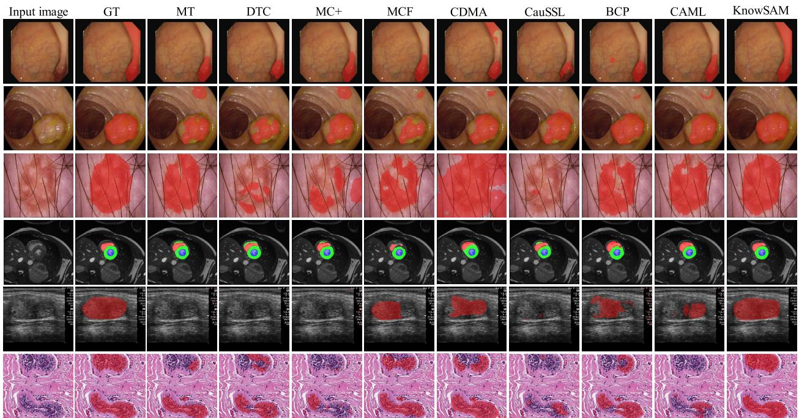  
Fig. 4. Visual results of different methods on five segmentation tasks. The comparison methods include MT and BCP, which utilize teacherstudent architectures, while DTC, MC+, MCF, CDMA, CauSSL, and our method are based on consistency learning architectures. The first two rows correspond to endoscopic images, while the remaining rows represent results on the ISIC-2018, ACDC, ultrasound, and pathological image datasets, respectively.

TABLE II  
QUANTITATIVE RESULTS ON THE ACDC DATASET. BEST AND SECOND-BEST RESULTS ARE HIGHLIGHTED IN RED AND BLUE, RESPECTIVELY
<table><tr><td rowspan="2">Methods</td><td colspan="2">Scans used</td><td colspan="4">Metrics</td></tr><tr><td>Labeled</td><td>Unlabeled</td><td>Dice (%)</td><td>IoU (%)</td><td>HD95</td><td>ASD</td></tr><tr><td>MT [11] UA-MT [12]</td><td rowspan="6">7(10%)</td><td rowspan="10">63(90%)</td><td>81.89 81.65</td><td>71.10 70.64</td><td>12.48 6.88</td><td>3.77 2.03</td></tr><tr><td>DTC [7]</td><td></td><td></td><td></td><td>4.01</td></tr><tr><td></td><td>84.29</td><td>73.92</td><td>12.81 5.50</td><td>1.85</td></tr><tr><td>MC-Net [8]</td><td>86.44</td><td>77.04</td><td>4.84</td><td>1.53</td></tr><tr><td>URPC [9]</td><td>83.10</td><td>72.41</td><td>12.11</td><td>3.27</td></tr><tr><td>MC-Net+ [44]</td><td>85.30</td><td>75.76</td><td>12.79</td><td>3.40</td></tr><tr><td>MCF [10]</td><td>83.23</td><td>72.93</td><td>4.94</td><td></td></tr><tr><td>CDMA [40]</td><td>83.77</td><td>73.00</td><td>5.73</td><td>1.44</td></tr><tr><td>CauSSL [45]</td><td>86.80</td><td>77.48</td><td>17.49</td><td>1.83</td></tr><tr><td>BS-Net [46]</td><td>77.51</td><td>65.38</td><td></td><td>4.84</td></tr><tr><td>BCP [4]</td><td></td><td>88.84</td><td>80.62</td><td>3.98</td><td>1.17</td></tr><tr><td>CAML [5] MC-seg (Ours)</td><td></td><td></td><td>81.90 89.08</td><td>70.60 81.00</td><td>6.46 1.35</td><td>1.52 0.37</td></tr><tr><td>KnowSAM (Ours)</td><td></td><td></td><td>89.56 87.06</td><td>81.66</td><td>1.28</td><td>0.36</td></tr><tr><td>MT [11]</td><td rowspan="9"></td><td rowspan="9"></td><td></td><td>77.94</td><td>11.17</td><td>2.95</td></tr><tr><td>UA-MT [12]</td><td>87.75</td><td>78.98</td><td>4.78</td><td>1.63</td></tr><tr><td>DTC [7]</td><td>85.75</td><td>75.99</td><td>5.08</td><td>1.67</td></tr><tr><td>MC-Net [8]</td><td>88.04</td><td>81.01</td><td>3.54</td><td>1.82</td></tr><tr><td>URPC [9]</td><td>88.36</td><td>79.96</td><td>3.04</td><td>0.77</td></tr><tr><td>MC-Net+ [44]</td><td>88.39</td><td>80.08</td><td>6.38</td><td>1.60</td></tr><tr><td>MCF [10]</td><td>86.22</td><td>76.73</td><td>7.42</td><td>1.99</td></tr><tr><td>21(30%) 49(70%)</td><td>84.68</td><td>74.46</td><td>6.27</td><td>1.93</td></tr><tr><td>CDMA [40] CauSSL [45]</td><td>85.11</td><td>75.00</td><td>9.80</td><td>2.99</td></tr><tr><td>BS-Net [46]</td><td></td><td>89.31</td><td>81.24</td><td>2.10</td><td>0.68</td></tr><tr><td>BCP [4]</td><td></td><td>88.61</td><td>80.12</td><td>4.71</td><td>1.25</td></tr><tr><td>CAML [5]</td><td></td><td>86.85</td><td>77.63</td><td>5.08</td><td>1.55</td></tr><tr><td>MC-seg (Ours)</td><td></td><td>90.22</td><td>82.76</td><td>1.21</td><td>0.30</td></tr><tr><td>KnowSAM (Ours)</td><td></td><td>91.13</td><td>84.11</td><td>1.29</td><td>0.30</td></tr></table>

TABLE III  
QUANTITATIVE RESULTS ON THE BCSS DATASET. BEST AND SECOND-BEST RESULTS ARE HIGHLIGHTED IN RED AND BLUE, RESPECTIVELY
<table><tr><td rowspan="2">Methods</td><td colspan="2">Scans used</td><td colspan="3">Metrics</td></tr><tr><td>Labeled</td><td>Unlabeled</td><td>Dice (%) 63.93</td><td>IoU (%)</td><td>HD95</td></tr><tr><td>MT [11]</td><td rowspan="9">7(10%)</td><td rowspan="9">63(90%)</td><td></td><td>50.75</td><td>9.04 9.28</td></tr><tr><td>UA-MT [12]</td><td>63.05</td><td>49.65</td><td></td></tr><tr><td>DTC [7]</td><td>63.60</td><td>50.19</td><td>9.36</td></tr><tr><td>MC-Net [8]</td><td>63.67</td><td>50.12</td><td>9.21</td></tr><tr><td>URPC [9]</td><td>63.93</td><td>50.15</td><td>9.23 9.15</td></tr><tr><td>MC-Net+ [44]</td><td>62.46</td><td>49.01</td><td>8.98</td></tr><tr><td>MCF [10]</td><td>65.52</td><td>52.14</td><td></td></tr><tr><td>CDMA [40]</td><td>65.58</td><td>52.25</td><td>8.92</td></tr><tr><td>CauSSL [45]</td><td>62.88</td><td>49.35</td><td>9.45</td></tr><tr><td>BS-Net [46]</td><td></td><td>64.47 66.00</td><td>52.37</td><td>8.28</td></tr><tr><td>BCP [4]</td><td></td><td>65.56</td><td>53.11</td><td>8.67</td></tr><tr><td>CAML [5] MC-seg (Ours)</td><td></td><td>68.11</td><td>52.64 55.97</td><td>8.93</td></tr><tr><td>KnowSAM (Ours)</td><td></td><td>72.69</td><td>61.09</td><td>8.32 7.77</td></tr><tr><td>MT [11]</td><td></td><td>68.87</td><td></td><td></td></tr><tr><td>UA-MT [12]</td><td rowspan="9">21(30%)</td><td></td><td></td><td>56.15</td><td>8.53</td></tr><tr><td></td><td></td><td>67.00 69.44</td><td>54.28</td><td>8.81</td></tr><tr><td>DTC [7]</td><td></td><td>57.07</td><td></td><td>8.32</td></tr><tr><td>URPC [9]</td><td></td><td>68.92</td><td>56.11</td><td>8.63</td></tr><tr><td>MC-Net [8]</td><td></td><td>69.55</td><td>57.33</td><td>8.36</td></tr><tr><td>MC-Net+ [44]</td><td></td><td>70.07</td><td>57.29</td><td>8.50</td></tr><tr><td>MCF [10]</td><td>70.49 49(70%)</td><td></td><td>57.91</td><td>8.30</td></tr><tr><td>CDMA [40]</td><td>67.28</td><td></td><td>54.57</td><td>8.65</td></tr><tr><td>CauSSL [45]</td><td></td><td>71.12 71.30</td><td>58.69 58.95</td><td>8.32</td></tr><tr><td>BS-Net [46]</td><td></td><td></td><td></td><td></td><td>8.05</td></tr><tr><td>BCP [4]</td><td></td><td></td><td>70.80</td><td>59.38</td><td>7.98</td></tr><tr><td>CAML [5]</td><td></td><td></td><td>69.04</td><td>56.16</td><td>8.82</td></tr><tr><td>MC-seg (Ours)</td><td></td><td></td><td>72.21</td><td>60.14</td><td>7.95</td></tr><tr><td>KnowSAM (Ours)</td><td></td><td></td><td>73.41</td><td>61.50</td><td>7.85</td></tr></table>

Consequently, this enhancement improves SAM's effectiveness in medical segmentation tasks.

3) Effectiveness of the Uncertainty-Guided Data Augmentation: In this study, we introduce uncertainty information into the traditional data augmentation to guide the copy-paste process between labeled and unlabeled data. To demonstrate the effectiveness of UGDA, we conduct ablation experiments on the polyp segmentation task. As shown in Table VI, the dice coefficient of the UGDA method increases from 80.45% to 84.47%, and HD95 decreases from 5.04 to 4.69 compared to the traditional data augmentation approach, with 10% labeled images on the Kvasir dataset. In UGDA, it is crucial to highlight that the labels for the mixed images are a combination of ground truths from labeled data and pseudo-labels from unlabeled data. This strategy enables the network to capture common semantics between labeled and unlabeled data, thereby boosting the generalization of our model.

TABLE IV  
ABLATIVE RESULTS ON THE EFFECTS OF DIFFERENT MAPS IN THE PROPOSED HAM
<table><tr><td colspan="2">Scans used</td><td colspan="2">Views</td><td colspan="2"></td><td colspan="3">Metrics</td><td colspan="3"></td><td></td><td colspan="3">Metrics</td><td colspan="3"></td></tr><tr><td colspan="2">Labeled Unlabeled</td><td>Pred.</td><td>H M</td><td></td><td>Dice (%)</td><td>IoU (%)</td><td>HD95</td><td></td><td>Dice (%)</td><td>IoU (%)</td><td>HD95</td><td></td><td>Dice (%)</td><td>IoU (%)</td><td>HD95</td><td>Dice (%)</td><td>IoU (%)</td><td>HD95</td></tr><tr><td rowspan="4">10%</td><td rowspan="4">90%</td><td>√</td><td></td><td></td><td>83.01</td><td>75.17</td><td>4.71</td><td></td><td>83.99</td><td>75.42</td><td>5.19</td><td></td><td>76.53</td><td>67.09</td><td>4.86</td><td>88.28</td><td>79.67</td><td>4.35</td></tr><tr><td></td><td>√</td><td></td><td>83.74</td><td>76.67</td><td></td><td>4.58</td><td>84.36</td><td>76.15</td><td>5.03</td><td></td><td>77.29</td><td>68.22</td><td>4.77</td><td></td><td>88.85</td><td>80.54 1.35</td></tr><tr><td></td><td>√</td><td>√</td><td>Kvasır 84.47</td><td></td><td>77.00</td><td>4.69</td><td>84.44</td><td>76.36</td><td>5.09</td><td></td><td>78.57</td><td>69.42</td><td>4.88</td><td></td><td>89.08</td><td>81.00 1.35</td></tr><tr><td>√</td><td></td><td></td><td>86.58</td><td></td><td>79.69</td><td>4.51</td><td>83.94</td><td>75.67</td><td>5.17</td><td>TN3K</td><td>78.68</td><td>69.71</td><td>4.83</td><td>ACDC</td><td>88.63</td><td>80.37</td><td>5.14</td></tr><tr><td rowspan="3">30%</td><td rowspan="3">70%</td><td>L</td><td>√</td><td></td><td>87.08</td><td>80.53</td><td>4.29</td><td>ISIC-018</td><td>84.29</td><td>76.37</td><td>5.12</td><td></td><td>80.12</td><td>71.22</td><td>4.71</td><td></td><td>89.18</td><td>81.16</td></tr><tr><td>√</td><td>√</td><td>√</td><td>87.20</td><td>80.53</td><td></td><td></td><td>86.06</td><td>77.84</td><td>5.04</td><td></td><td>80.18</td><td>71.50</td><td>4.65</td><td></td><td></td><td>4.06</td></tr><tr><td></td><td></td><td></td><td></td><td></td><td>4.47</td><td></td><td></td><td></td><td></td><td></td><td></td><td></td><td></td><td>90.22</td><td>82.76</td><td>1.21</td></tr></table>

TABLE V  
ABLATION STUDY ON THE EFFECTIVENESS OF THE PROPOSED LPS
<table><tr><td colspan="2">Scans used</td><td rowspan="2">Methods</td><td rowspan="2">Strategy</td><td rowspan="2"></td><td colspan="3">Metrics IoU (%) HD95</td><td colspan="3">Metrics</td><td colspan="4">Metrics</td><td colspan="3">Metrics</td></tr><tr><td colspan="2">Labeled Unlabeled</td><td colspan="3">Dice (%)</td><td colspan="4">Dice (%) IoU (%)</td><td colspan="3">Dice (%) IoU (%) HD95</td><td colspan="3">Dice (%) IoU (%)</td></tr><tr><td colspan="2" rowspan="4">10%</td><td rowspan="4">SAM 90%</td><td>Box</td><td></td><td rowspan="4">86.60</td><td>80.24</td><td>4.37</td><td>87.59</td><td>79.61</td><td>HD95</td><td>4.91</td><td>81.84</td><td>72.73</td><td>4.46</td><td></td><td>83.24</td><td>72.19</td><td>HD95 4.93</td></tr><tr><td>LPS</td><td></td><td>87.29</td><td>81.14</td><td>4.24</td><td>87.90</td><td>80.26</td><td>4.83</td><td></td><td>82.63 73.79</td><td>4.43</td><td></td><td>84.34</td><td>73.99</td><td>1.84</td></tr><tr><td></td><td></td><td>86.32</td><td>79.30</td><td>4.49</td><td>86.70</td><td>78.70</td><td>4.94</td><td></td><td>79.72</td><td>70.55</td><td>4.55</td><td>88.42</td><td>80.00</td><td>4.27</td></tr><tr><td>Box KnowSAM LPS</td><td></td><td>85.98</td><td>79.25</td><td>4.41</td><td>86.51</td><td>78.49</td><td>4.86</td><td>TN3K</td><td>81.19</td><td>72.27</td><td>4.52</td><td></td><td>89.56</td><td>81.66 1.28</td></tr><tr><td rowspan="4">30%</td><td rowspan="4">70%</td><td rowspan="2">SAM</td><td>Box</td><td>Kvasir</td><td>86.94</td><td>80.71</td><td>ISIC-018 4.33</td><td>87.54</td><td>79.38</td><td>4.77</td><td></td><td></td><td></td><td>4.42</td><td></td><td></td><td></td></tr><tr><td></td><td></td><td>90.01</td><td>84.78</td><td></td><td>88.08</td><td>80.45</td><td>4.82</td><td></td><td>82.71</td><td>73.74</td><td>ACDC</td><td>84.25 85.82</td><td>73.55</td><td>3.72</td></tr><tr><td></td><td>LPS</td><td>85.22</td><td>78.40</td><td>3.98 4.43</td><td></td><td></td><td></td><td></td><td>82.75 81.11</td><td>73.75</td><td>4.48 4.55</td><td></td><td></td><td>75.79</td><td>1.29</td></tr><tr><td>KnowSAM</td><td>Box LPS</td><td>88.74</td><td>82.93</td><td>4.22</td><td></td><td>87.29 87.22</td><td>79.27 79.72</td><td>4.79 4.81</td><td>81.21</td><td>72.49 72.18</td><td>4.67</td><td></td><td>89.42 91.13</td><td>81.47 84.11</td><td>3.64 1.29</td></tr></table>

TABLE VI  
ABLATION STUDY ON THE EFFECTIVENESS OF THE PROPOSED UGDA STRATEGY
<table><tr><td colspan="2">Scans used Labeled Unlabeled</td><td rowspan="2">Strategy</td><td rowspan="2"></td><td colspan="3">Metrics</td><td colspan="4"></td><td colspan="4">Metrics</td><td colspan="3">Metrics</td></tr><tr><td></td><td></td><td>Dice (%)</td><td>IoU (%)</td><td>HD95</td><td></td><td>Dice (%)</td><td>IoU (%)</td><td>HD95</td><td></td><td>Dice (%)</td><td>IoU (%) HD95</td><td></td><td>Dice (%)</td><td>IoU (%)</td><td>HD95</td></tr><tr><td rowspan="2">10%</td><td rowspan="2">90%</td><td rowspan="2">w/o UGDA</td><td rowspan="2"></td><td>80.45</td><td colspan="2">71.81</td><td></td><td colspan="2">83.47</td><td rowspan="2">5.20</td><td rowspan="2"></td><td rowspan="2">76.94</td><td rowspan="2">67.05</td><td rowspan="2">5.04</td><td rowspan="2">85.26</td><td rowspan="2">75.45</td><td rowspan="2">4.74</td></tr><tr><td></td><td>84.47</td><td></td><td>5.04 1SIC-18</td><td>75.04 76.36</td></tr><tr><td rowspan="2"></td><td rowspan="2"></td><td rowspan="2">w/ UGDA w/o UGDA</td><td rowspan="2">Kvasır</td><td rowspan="2">85.84</td><td rowspan="2">77.00 78.44</td><td rowspan="2">4.69 4.65</td><td rowspan="2"></td><td rowspan="2">84.44</td><td rowspan="2"></td><td rowspan="2">5.09</td><td rowspan="2">TNK</td><td rowspan="2">78.57</td><td rowspan="2">69.42</td><td rowspan="2">4.88</td><td rowspan="2">89.08</td><td rowspan="2">81.00</td><td>1.35 4.13</td></tr><tr><td>81.49</td></tr><tr><td>30%</td><td>70%</td><td>w/ UGDA</td><td></td><td>87.20</td><td>80.53</td><td>4.47</td><td></td><td>84.45 86.06</td><td>75.75 77.84</td><td>5.03 5.04</td><td></td><td>77.95 80.18</td><td>68.59 4.78 71.50</td><td>ACDC 4.65</td><td>89.42 90.22</td><td>82.76</td><td>1.21</td></tr></table>

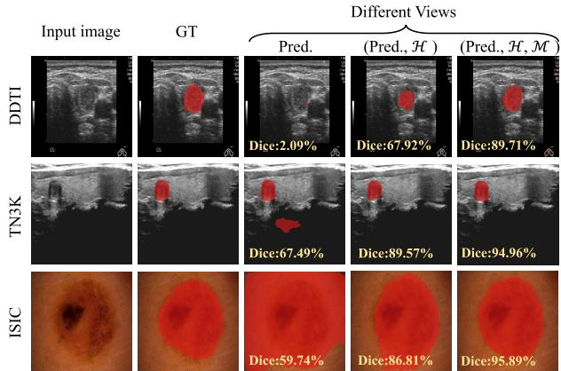  
Fig. 5. Visualization results of progressively adding different view information without SAM distillation using 30% labeled data (“Pred.", H, and M represent the predicted map, uncertainty map, and dissimilarity map, respectively, and “GT” denotes the ground truth image).

4) Effectiveness of Different Loss Functions: The total loss function of our method consists of four components: supervision loss $\mathcal { L } _ { s u p } . $ , entropy loss $\mathcal { L } _ { e n t } .$ mutual consistency loss $\mathcal { L } _ { m u t }$ , and distillation loss $\mathcal { L } _ { k d }$ . The entropy loss function aims to eliminate the inherent uncertainty of the subnets. The consistency loss function is designed to reduce the cognitive differences between subnets for the same input, and it also serves as supervision for the dissimilarity map (M). It is noteworthy that the inclusion of the $\mathcal { L } _ { k d }$ loss function indicates whether SAM is used for distillation. To investigate the contribution of each loss function, we start with the supervision loss as the base and gradually add other loss functions. Table VII presents the ablative results across four distinct medical segmentation tasks. The model exhibits a progressive enhancement in segmentation accuracy with the addition of each component, thereby validating the effectiveness of each key element. Notably, when only $\mathcal { L } _ { s u p }$ and $\mathcal { L } _ { k d }$ are combined, significant performance improvements are achieved across all tasks. This underscores the pivotal role of SAM-based distillation in enhancing model performance, particularly by mitigating cognitive disparities between the two subnets and strengthening segmentation capabilities.

## E. Discussion

1) Model Performance With Different Label Ratios: We further conduct experiments to investigate the impact of different label ratios on model performance. Fig. 6 shows the Dice scores on the Kvasir, ISIC-2018, TN3K, and ACDC datasets. Moreover, we introduce a fully supervised model, such as UNet, as the benchmark for comparison. As depicted in Fig. 6, the performance of our MC-Seg tends to improve with an increasing proportion of labeled data, which is anticipated since a larger number of labeled samples offer more precise guidance during training. Furthermore, our MC-Seg model achieves nearly equivalent performance to the fully supervised UNet, even with a relatively small fraction of labeled data, demonstrating its robustness and effectiveness.

1% 5% 10% 20% 30% 50% 70% 90%  
TABLE VII  
ABLATION STUDY ON THE EFFECTS OF DIFFERENT LOSS FUNCTIONS
<table><tr><td colspan="2">Scans used</td><td colspan="4">Losses</td><td colspan="4">Metrics</td><td colspan="4">Metrics</td><td colspan="4">Metrics</td><td colspan="4">Metrics</td></tr><tr><td colspan="2">Labeled Unlabeled</td><td>Lsup</td><td>Lent Lmut</td><td>Lkd</td><td></td><td>Dice (%)</td><td>IoU (%)</td><td>HD95</td><td></td><td>Dice (%)</td><td>IoU (%)</td><td>HD95</td><td></td><td>Dice (%)</td><td>IoU (%)</td><td>HD95</td><td></td><td>Dice (%)</td><td>IoU (%)</td><td>HD95</td></tr><tr><td rowspan="6">10%</td><td rowspan="6">90%</td><td>√ √</td><td></td><td></td><td></td><td>81.94 83.56</td><td>73.94 75.82</td><td>4.96</td><td></td><td>83.58 84.10</td><td>74.95</td><td>5.15</td><td></td><td>77.76</td><td>68.43</td><td>4.85</td><td></td><td>86.70</td><td>77.34 80.16</td><td>6.58 2.53</td></tr><tr><td></td><td>√</td><td></td><td></td><td></td><td></td><td>4.84</td><td></td><td></td><td>76.07</td><td>5.13</td><td></td><td>76.82</td><td>67.67</td><td>4.84</td><td></td><td>88.61</td><td></td><td></td></tr><tr><td>V</td><td></td><td>√</td><td></td><td>83.40</td><td>76.30</td><td>4.71</td><td></td><td>84.60</td><td>76.54</td><td>5.08</td><td></td><td>77.55</td><td>68.32</td><td>4.81</td><td></td><td>87.96</td><td>79.26</td><td>4.38</td></tr><tr><td>√</td><td></td><td></td><td></td><td>85.86</td><td>79.23</td><td>4.27</td><td></td><td>86.49</td><td>78.70</td><td>4.87</td><td></td><td>79.28</td><td>69.98</td><td>4.59</td><td></td><td>88.39</td><td>79.88</td><td>2.97</td></tr><tr><td>√</td><td>√</td><td>√</td><td></td><td>84.47</td><td>77.00</td><td>4.69</td><td></td><td>84.44</td><td>76.36</td><td>5.09</td><td></td><td>78.57</td><td>69.42</td><td>4.88</td><td></td><td>89.08</td><td>81.00</td><td>1.35</td></tr><tr><td>√</td><td>√</td><td>√</td><td>Kvasır</td><td>85.98</td><td>79.25</td><td>4.41</td><td>ISIC-018</td><td>86.51</td><td>78.49</td><td>4.86</td><td></td><td>81.19</td><td>72.27</td><td>4.52</td><td></td><td>89.56</td><td>81.66</td><td>1.28</td></tr><tr><td rowspan="6">30%</td><td>√</td><td></td><td></td><td></td><td>84.60</td><td>77.66</td><td></td><td>4.75</td><td>86.15</td><td>78.05</td><td>4.95</td><td>TN3K</td><td>80.08</td><td>71.31</td><td>4.66</td><td>ACDC</td><td>89.34</td><td>81.40</td><td>4.18</td></tr><tr><td>√</td><td>√</td><td></td><td></td><td>87.17</td><td>80.42</td><td>4.36</td><td></td><td>86.48</td><td>78.37</td><td>4.95</td><td></td><td>79.59</td><td>70.92</td><td>4.68</td><td></td><td>89.68</td><td>81.98</td><td>4.57</td></tr><tr><td>√</td><td></td><td>√</td><td></td><td>87.38</td><td>81.03</td><td>4.38</td><td></td><td>86.01</td><td>77.95</td><td>5.00</td><td></td><td>79.59</td><td>70.76</td><td>4.71</td><td></td><td>89.62</td><td>81.77</td><td>3.81</td></tr><tr><td>√</td><td></td><td></td><td>√</td><td>88.37</td><td>82.04</td><td>4.23</td><td></td><td>86.41</td><td>78.39</td><td>4.91</td><td></td><td>81.00</td><td>72.29</td><td>4.51</td><td></td><td>90.07</td><td>82.44</td><td>3.39</td></tr><tr><td>√</td><td>√</td><td>V</td><td></td><td>87.20</td><td>80.53</td><td>4.47</td><td></td><td>86.06</td><td>77.84</td><td>5.04</td><td></td><td>80.18</td><td>71.50</td><td>4.65</td><td></td><td>90.22</td><td>82.76</td><td>1.21</td></tr><tr><td>√</td><td>√</td><td>√</td><td></td><td>88.74</td><td>82.93</td><td>4.22</td><td></td><td>87.22</td><td>79.72</td><td>4.81</td><td></td><td>81.21</td><td>72.18</td><td>4.67</td><td></td><td>91.13</td><td>84.11</td><td>1.29</td></tr></table>

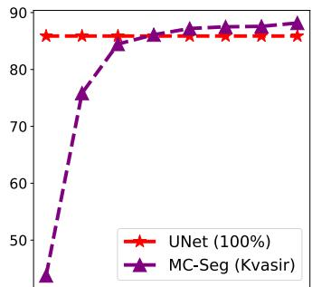  
1% 5% 10% 20% 30% 50% 70% 90%

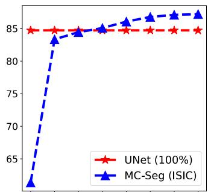  
1% 5% 10% 20% 30% 50% 70% 90%

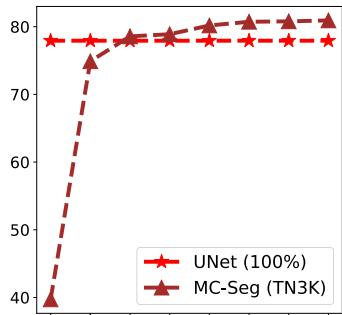

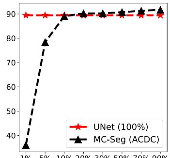  
Fig. 6. Dice performance of our MC-Seg under different label ratios on the four distinct medical segmentation datasets.

TABLE VIII  
QUANTITATIVE RESULTS OF DIFFERENT SAM-BASED SEMI-SUPERVISED METHODS († DENOTES THAT THE OUTPUTS OF SAM ARE TAKEN AS SEGMENTATION RESULTS)
<table><tr><td colspan="2">Scans used</td><td rowspan="2">Methods</td><td colspan="4">Metrics</td><td colspan="4">Metrics</td><td colspan="4">Metrics</td><td colspan="4">Metrics</td></tr><tr><td colspan="2">Labeled Unlabeled</td><td>Dice (%)</td><td>IoU (%)</td><td></td><td>HD95</td><td>Dice (%)</td><td></td><td>IoU (%)</td><td>HD95</td><td>Dice (%)</td><td>IoU (%)</td><td></td><td>HD95</td><td>Dice (%)</td><td></td><td>I0U (%) HD95</td></tr><tr><td rowspan="3">10%</td><td rowspan="3">90%</td><td>SemiSAM [22]</td><td>69.94</td><td>59.84</td><td>5.39</td><td></td><td>79.93</td><td>71.11</td><td>5.27</td><td></td><td>66.58</td><td>56.03</td><td>4.82</td><td></td><td>82.70</td><td>72.17</td><td>2.85</td></tr><tr><td>CPC-SAM† [61]</td><td>82.24</td><td>75.01</td><td>4.43</td><td></td><td>87.96</td><td>80.37</td><td>4.54</td><td></td><td>75.02</td><td>64.87</td><td>4.49</td><td></td><td>85.15</td><td>75.08</td><td>3.97</td></tr><tr><td>KnowSAM (Ours)</td><td>Kvasir 85.98</td><td>79.25</td><td>4.41</td><td></td><td>86.51</td><td></td><td>78.49</td><td>4.86</td><td>81.19</td><td>72.27</td><td>4.52</td><td></td><td>89.56</td><td>81.66</td><td>1.28</td></tr><tr><td rowspan="4">30%</td><td>70%</td><td>SemiSAM [22]</td><td>81.80</td><td>73.70</td><td>4.54</td><td></td><td>82.62</td><td>73.96</td><td>4.85</td><td>TN3K</td><td>72.29</td><td>61.85</td><td>4.64</td><td>ACDC</td><td>86.89</td><td>77.83</td><td>1.98</td></tr><tr><td></td><td>CPC-SAM† [61]</td><td>87.36</td><td>81.05</td><td>4.07</td><td>IC-018</td><td>88.11</td><td>80.33</td><td>4.50</td><td></td><td>77.73</td><td>67.83</td><td>4.39</td><td></td><td>88.61</td><td>80.08</td><td>1.24</td></tr><tr><td></td><td>KnowSAM (Ours)</td><td>88.74</td><td>82.93</td><td>4.22</td><td></td><td>87.22</td><td>79.72</td><td>4.81</td><td></td><td>81.21</td><td>72.18</td><td>4.67</td><td></td><td>91.13</td><td>84.11</td><td>1.29</td></tr></table>

2) Comparison With SAM-Based Semi-Supervised Methods: In this study, we harness the robust segmentation capabilities of the SAM through distillation learning to enhance the performance of semi-supervised medical image segmentation. To assess various SAM-based semi-supervised segmentation approaches, we compare the proposed model with two other SAM-based methods: SemiSAM [22] and CPC-SAM [61]. It is important to highlight that in CPC-SAM, SAM's outputs are treated as the definitive segmentation outcomes, whereas in our approach and SemiSAM, the outputs from the UNet model are regarded as the segmentation maps. Notably, UNet offers a significant reduction in inference cost due to its reduced computational demands compared to SAM. Table VIII shows a quantitative comparison of SAM-based semi-supervised methods with 10% and 30%labeled data. It can be observed that our model consistently outperforms SemiSAM across all datasets, thereby validating its effectiveness. Furthermore, our KnowSAM model delivers promising results on several datasets with a lower inference cost, underscoring its ability to boost segmentation performance.

3) Effects of Our Method Using Different Foundation Models: Recently, the MedSAM [62] has fine-tuned SAM to better adapt it for downstream tasks in the medical imaging field. To further investigate our choice of SAM, we conduct an ablation study. In this experiment, both SAM and MedSAM are trained with their original parameters frozen, with an adapter module incorporated for fine-tuning. As shown in Table IX, our model, which employs SAM, consistently outperformed the one that employs MedSAM across all tasks. We believe that while MedSAM could potentially excel on the specific datasets for which it has been tailored, the fine-tuning process may diminish the robust generalization capabilities that are an integral strength of the original SAM model.

Pred.  
Input image  
TABLE IX  
COMPARISON RESULTS OF OUR METHOD USING DIFFERENT SAM-BASED FOUNDATION MODELS
<table><tr><td colspan="2">Scans used Labeled Unlabeled</td><td rowspan="2">SAM-V</td><td rowspan="2"></td><td colspan="3">Metrics</td><td colspan="3"></td><td colspan="3"></td><td colspan="3">Metrics</td><td colspan="3">Metrics</td></tr><tr><td></td><td></td><td> $\overline { { \mathrm { D i c e } \left( \% \right) } }$ </td><td>I0U (%)</td><td></td><td>HD95</td><td> $\overline { { \mathrm { D i c e } \left( \% \right) } }$ </td><td>I0U (%)</td><td>HD95</td><td></td><td>Dice (%)</td><td>IoU (%)</td><td>HD95</td><td></td><td>Dice (%)</td><td>IoU (%) HD95</td></tr><tr><td rowspan="2">10%</td><td rowspan="2">90%</td><td>MedSAM [62]</td><td></td><td>75.02</td><td>65.79</td><td>5.35</td><td></td><td>83.89</td><td>76.06</td><td>5.07</td><td></td><td>71.60</td><td>61.85</td><td>5.02</td><td></td><td>82.73</td><td>72.35 2.77</td></tr><tr><td>SAM [17]</td><td></td><td>85.98</td><td>79.25</td><td>4.41</td><td></td><td>86.51</td><td>78.49</td><td>4.86</td><td>81.19</td><td></td><td>72.27 4.52</td><td></td><td>89.56</td><td>81.66</td><td>1.28</td></tr><tr><td rowspan="2">30%</td><td>70%</td><td>MedSAM [62]</td><td>Kvasr</td><td>82.89</td><td>75.02</td><td>5.00</td><td>ISIC-08</td><td>85.60</td><td>77.27</td><td>TNK 4.92</td><td>76.73</td><td></td><td>67.32 4.81</td><td>ACDC</td><td>89.58</td><td>81.78</td><td>1.57</td></tr><tr><td></td><td>SAM [17]</td><td></td><td>88.74</td><td>82.93</td><td>4.22</td><td></td><td>87.22</td><td>79.72</td><td>4.81</td><td>81.21</td><td></td><td>72.18 4.67</td><td></td><td>91.13</td><td>84.11</td><td>1.29</td></tr></table>

GT  
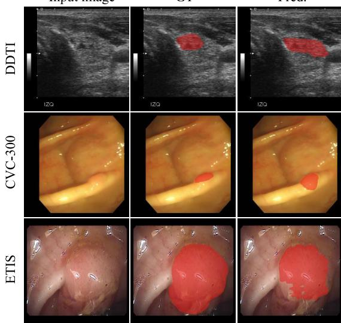  
Fig. 7. Visualizations of some failure cases generated by our model (“GT” and “Pred." represent the ground truth and the corresponding predicted maps, respectively).

4) Analysis of Failure Cases: Qualitative and quantitative evaluations confirm the effectiveness and superiority of our model. However, it faces difficulties in accurately segmenting tumors, particularly in regions with ambiguity and complex backgrounds. Some failure cases generated by our model are depicted in Fig. 7. In the $1 ^ { s t }$ row, it is evident that the tumor area is heavily obscured by the background, with very indistinct boundaries, posing a significant challenge for precise tumor segmentation. It can be seen that under this circumstance, our model struggles to identify and segment the tumor. In the $2 ^ { n d }$ and $3 ^ { r d }$ rows, our model is capable of locating the primary regions of polyps but generates some imprecise fragments in two samples from unseen datasets. The data distribution between the training set and unseen test sets exhibits a significant difference, impeding the model's ability to generalize effectively. Consequently, dealing with ambiguous areas in semi-supervised segmentation tasks is desired to be investigated in future work. Moreover, exploring adaptive methods to enhance segmentation accuracy on unseen datasets is also a focus for future investigation.

## V. CONCLUSION

In this paper, we have proposed a novel KnowSAM framework for semi-supervised medical image segmentation. By employing the multi-view co-training paradigm, our model enables two subnets to learn from SAM through knowledge distillation, enhancing the generalization capabilities of the subnets and mitigating the impact of noise in unlabeled data. Additionally, we present the UGDA strategy to enhance the model's robustness through the interaction between labeled and unlabeled data. This effective strategy also avoids incurring additional costs during inference. Experimental results across various datasets validate the superiority of the proposed KnowSAM. It is worth noting that our method can be easily extended to enhance other semi-supervised segmentation tasks.

## REFERENCES

[1] Y. Zhang, L. Yang, J. Chen, M. Fredericksen, D. Hughes, and D. Z. Chen, "Deep adversarial networks for biomedical image segmentation utilizing unannotated images," in Proc. MICCAI. Cham, Switzerland: Springer, Jan. 2017, pp. 408–416.

[2] T. Zhou, Y. Zhou, G. Li, G. Chen, and J. Shen, "Uncertainty-aware hierarchical aggregation network for medical image segmentation,"IEEE Trans. Circuits Syst. Video Technol., vol. 34, no. 8, pp. 7440–7453, Aug. 2024.

[3] N. Tajbakhsh, L. Jeyaseelan, Q. Li, J. N. Chiang, Z. Wu, and X. Ding, “Embracing imperfect datasets: A review of deep learning solutions for medical image segmentation," Med. Image Anal., vol. 63, Jul. 2020, Art. no. 101693.

[4] Y. Bai, D. Chen, Q. Li, W. Shen, and Y. Wang, "Bidirectional copy-paste for semi-supervised medical image segmentation," in Proc. IEEE/CVF Conf. Comput. Vis. Pattern Recognit. (CVPR), Jun. 2023, pp. 11514–11524.

[5] S. Gao, Z. Zhang, J. Ma, Z. Li, and S. Zhang, "Correlation-aware mutual learning for semi-supervised medical image segmentation," in Proc. MICCAI. Cham, Switzerland: Springer, Jan. 2023, pp. 98–108.

[6] Y. Gu et al., “Dual-scale enhanced and cross-generative consistency learning for semi-supervised medical image segmentation," Pattern Recognit., vol. 158, Feb. 2025, Art. no. 110962.

[7] X. Luo, J. Chen, T. Song, and G. Wang, "Semi-supervised medical image segmentation through dual-task consistency," in Proc. AAAI Conf. Artif. Intell., vol. 35, 2021, pp. 8801–8809.

[8] Y. Wu, M. Xu, Z. Ge, J. Cai, and L. Zhang, "Semi-supervised left atrium segmentation with mutual consistency training," in Proc. Int. Conf. Med. Image Comput. Comput.-Assist. Intervent. (MICCAI), 2021, pp. 297–306.

[9] X. Luo et al., “Semi-supervised medical image segmentation via uncertainty rectified pyramid consistency," Med. Image Anal., vol. 80, Aug. 2022, Art. no. 102517.

[10] Y. Wang, B. Xiao, X. Bi, W. Li, and X. Gao, "MCF: Mutual correction framework for semi-supervised medical image segmentation," in Proc. IEEE/CVF Conf. Comput. Vis. Pattern Recognit. (CVPR), Jun. 2023, pp. 15651–15660.

[11] A. Tarvainen and H. Valpola, "Mean teachers are better role models: Weight-averaged consistency targets improve semi-supervised deep learning results," in Proc. NeurIPS, Jan. 2017, pp. 1–10.

[12] L. Yu, S. Wang, X. Li, C.-W. Fu, and P.-A. Heng, "Uncertainty-aware self-ensembling model for semi-supervised 3D left atrium segmentation," in Proc. Int. Conf. Med. Image Comput. Comput.-Assisted Intervent. Cham, Switzerland: Springer, 2019, pp. 605–613.

[13] K. Wang et al., "Semi-supervised medical image segmentation via a tripled-uncertainty guided mean teacher model with contrastive learning," Med. Image Anal., vol. 79, Jul. 2022, Art. no. 102447.

[14] Z. Shen, P. Cao, H. Yang, X. Liu, J. Yang, and O. R. Zaiane, "Co-training with high-confidence pseudo labels for semi-supervised medical image segmentation," 2023, arXiv:2301.04465.

[15] X. Hu, D. Zeng, X. Xu, and Y. Shi, “Semi-supervised contrastive learning for label-efficient medical image segmentation," in Proc. Int. Conf. Med. Image Comput. Comput.-Assist. Intervent. Cham, Switzerland: Springer, 2021, pp. 481–490.

[16] Y. He et al., "Dense biased networks with deep priori anatomy and hard region adaptation: Semi-supervised learning for fine renal artery segmentation," Med. Image Anal., vol. 63, Jul. 2020, Art. no. 101722.

[17] A. Kirillov et al., "Segment anything," 2023, arXiv:2304.02643.

[18] T. Chen et al., “SAM fails to segment anything?-SAM-adapter: Adapting SAM in underperformed scenes: Camouflage, shadow, medical image segmentation, and more," 2023, arXiv:2304.09148.

[19] J. Wu et al., "Medical SAM adapter: Adapting segment anything model for medical image segmentation," 2023, arXiv:2304.12620.

[20] S. Li, L. Qi, Q. Yu, J. Huo, Y. Shi, and Y. Gao, "Concatenate, finetuning, re-training: A SAM-enabled framework for semi-supervised 3D medical image segmentation," 2024, arXiv:2403.11229.

[21] Q. Xu et al., “ESP-MedSAM: Efficient self-prompting SAM for universal domain-generalized medical image segmentation," 2024, arXiv:2407.14153.

[22] Y. Zhang, J. Yang, Y. Liu, Y. Cheng, and Y. Qi, "SemiSAM: Enhancing semi-supervised medical image segmentation via SAM-assisted consistency regularization," 2023, arXiv:2312.06316.

[23] Y. Zhang, S. Hu, S. Ren, C. Jiang, Y. Cheng, and Y. Qi, "Enhancing the reliability of segment anything model for auto-prompting medical image segmentation with uncertainty rectification," 2023, arXiv:2311.10529.

[24] L.-L. Zeng et al., “SS-TBN: A semi-supervised tri-branch network for COVID-19 screening and lesion segmentation," IEEE Trans. Pattern Anal. Mach. Intell., vol. 45, no. 8, pp. 10427–10442, Aug. 2023.

[25] H. Yao, X. Hu, and X. Li, "Enhancing pseudo label quality for semisupervised domain-generalized medical image segmentation," in Proc. AAAI, Jun. 2022, vol. 36, no. 3, pp. 3099–3107.

[26] R. Jiao et al., "Learning with limited annotations: A survey on deep semi-supervised learning for medical image segmentation," Comput. Biol. Med., vol. 169, Feb. 2024, Art. no. 107840.

[27] X. Wang et al., “SSA-net: Spatial self-attention network for COVID-19 pneumonia infection segmentation with semi-supervised few-shot learning," Med. Image Anal., vol. 79, Jul. 2022, Art. no. 102459.

[28] W. Huang et al., “Semi-supervised neuron segmentation via reinforced consistency learning," IEEE Trans. Med. Imag., vol. 41, no. 11, pp. 3016–3028, Nov. 2022.

[29] K. Zheng, J. Xu, and J. Wei, "Double noise mean teacher selfensembling model for semi-supervised tumor segmentation," in Proc. IEEE Int. Conf. Acoust., Speech Signal Process. (ICASSP), May 2022, pp. 1446–1450.

[30] L. Yang, L. Qi, L. Feng, W. Zhang, and Y. Shi, "Revisiting weak-tostrong consistency in semi-supervised semantic segmentation," in Proc. IEEE/CVF Conf. Comput. Vis. Pattern Recognit. (CVPR), Jun. 2023, pp. 7236–7246.

[31] G. Chen et al., "MTANS: Multi-scale mean teacher combined adversarial network with shape-aware embedding for semi-supervised brain lesion segmentation," NeuroImage, vol. 244, Dec. 2021, Art. no. 118568.

[32] H. Wu, G. Chen, Z. Wen, and J. Qin, "Collaborative and adversarial learning of focused and dispersive representations for semi-supervised polyp segmentation," in Proc. IEEE/CVF Int. Conf. Comput. Vis. (ICCV), Oct. 2021, pp. 3469–3478.

[33] H. Peiris, M. Hayat, Z. Chen, G. Egan, and M. Harandi, "Uncertaintyguided dual-views for semi-supervised volumetric medical image segmentation," Nature Mach. Intell., vol. 5, no. 7, pp. 724–738, Jul. 2023.

[34] Y. Xie, Y. Yin, Q. Li, and Y. Wang, "Deep mutual distillation for semi-supervised medical image segmentation," in Proc. MICCAI. Cham, Switzerland: Springer, Jan. 2023, pp. 540–550.

[35] C. You, Y. Zhou, R. Zhao, L. Staib, and J. S. Duncan, “SimCVD: Simple contrastive voxel-wise representation distillation for semi-supervised medical image segmentation," IEEE Trans. Med. Imag., vol. 41, no. 9, pp. 2228–2237, Sep. 2022.

[36] C. You, W. Dai, Y. Min, L. Staib, and J. S. Duncan, "Bootstrapping semi-supervised medical image segmentation with anatomical-aware contrastive distillation," in Proc. Int. Conf. Inf. Process. Med. Imag. Springer, 2023, pp. 641–653.

[37] Y. Shu, H. Li, B. Xiao, X. Bi, and W. Li, "Cross-mix monitoring for medical image segmentation with limited supervision,"IEEE Trans. Multimedia, vol. 25, pp. 1700–1712, 2022.

[38] A. Wang, M. Xu, Y. Zhang, M. Islam, and H. Ren, "S2ME: Spatial– spectral mutual teaching and ensemble learning for scribble-supervised polyp segmentation," 2023, arXiv:2306.00451.

[39] X. Chen, Y. Yuan, G. Zeng, and J. Wang, "Semi-supervised semantic segmentation with cross pseudo supervision," in Proc. IEEE/CVF Conf. Comput. Vis. Pattern Recognit. (CVPR), Jun. 2021, pp. 2613–2622.

[40] L. Zhong, X. Liao, S. Zhang, and G. Wang, "Semi-supervised pathological image segmentation via cross distillation of multiple attentions," 2023, arXiv:2305.18830.

[41] G. Hinton, O. Vinyals, and J. Dean, "Distilling the knowledge in a neural network," 2015, arXiv:1503.02531.

[42] S. Yun, D. Han, S. Chun, S. J. Oh, Y. Yoo, and J. Choe, "CutMix: Regularization strategy to train strong classifiers with localizable features," in Proc. IEEE/CVF Int. Conf. Comput. Vis. (ICCV), Oct. 2019, pp. 6023–6032.

[43] Q. Ma, J. Zhang, L. Qi, Q. Yu, Y. Shi, and Y. Gao, "Constructing and exploring intermediate domains in mixed domain semi-supervised medical image segmentation," in Proc. IEEE/CVF Conf. Comput. Vis. Pattern Recognit. (CVPR), Jun. 2024, pp. 11642–11651.

[44] Y. Wu et al., "Mutual consistency learning for semi-supervised medical image segmentation," Med. Image Anal., vol. 81, Oct. 2022, Art. no. 102530.

[45] J. Miao, C. Chen, F. Liu, H. Wei, and P.-A. Heng, "CauSSL: Causalityinspired semi-supervised learning for medical image segmentation," in Proc. IEEE/CVF Int. Conf. Comput. Vis. (ICCV), Oct. 2023, pp. 21369–21380.

[46] A. He, T. Li, J. Yan, K. Wang, and H. Fu, “Bilateral supervision network for semi-supervised medical image segmentation," IEEE Trans. Med. Imag., vol. 43, no. 5, pp. 1715–1726, May 2024.

[47] J. Silva, A. Histace, O. Romain, X. Dray, and B. Granado, "Toward embedded detection of polyps in WCE images for early diagnosis of colorectal cancer," Int. J. Comput. Assist. Radiol. Surgery, vol. 9, no. 2, pp. 283–293, Mar. 2014.

[48] J. Bernal, F. J. Sánchez, G. Fernández-Esparrach, D. Gil, C. Rodríguez, and F. Vilariño, "WM-DOVA maps for accurate polyp highlighting in colonoscopy: Validation vs. Saliency maps from physicians," Computerized Med. Imag. Graph., vol. 43, pp. 99–111, Jul. 2015.

[49] N. Tajbakhsh, S. R. Gurudu, and J. Liang, “Automated polyp detection in colonoscopy videos using shape and context information," IEEE Trans. Med. Imag., vol. 35, no. 2, pp. 630–644, Feb. 2016.

[50] D. Vázquez et al., “A benchmark for endoluminal scene segmentation of colonoscopy images," J. Healthcare Eng., vol. 2017, pp. 1–9, Jul. 2017.

[51] D. Jha et al., “Kvasir-SEG: A segmented polyp dataset," in Proc. Int. Conf. Multimedia Model. Cham, Switzerland: Springer, 2020, pp. 451–462.

[52] D.-P. Fan et al., “Pranet: Parallel reverse attention network for polyp segmentation," in Proc. MICCAI. Cham, Switzerland: Springer, 2020, pp. 263–273.

[53] H. Gong, J. Chen, G. Chen, H. Li, G. Li, and F. Chen, "Thyroid region prior guided attention for ultrasound segmentation of thyroid nodules," Comput. Biol. Med., vol. 155, Mar. 2023, Art. no. 106389.

[54] T. Wunderling, B. Golla, P. Poudel, C. Arens, M. Friebe, and C. Hansen, "Comparison of thyroid segmentation techniques for 3D ultrasound," Proc. SPIE, vol. 10133, Feb. 2017, pp. 346–352.

[55] L. Pedraza, C. Vargas, F. Narváez, O. Durán, E. Muñoz, and E. Romero, "An open access thyroid ultrasound image database," Proc. SPIE, vol. 9287, Jan. 2015, pp. 188–193.

[56] N. Codella et al., “Skin lesion analysis toward melanoma detection 2018: A challenge hosted by the international skin imaging collaboration (ISIC)," 2019, arXiv:1902.03368.

[57] O. Bernard et al., "Deep learning techniques for automatic MRI cardiac multi-structures segmentation and diagnosis: Is the problem solved?" IEEE Trans. Med. Imag., vol. 37, no. 11, pp. 2514–2525, Nov. 2018.

[58] M. Amgad et al., “Structured crowdsourcing enables convolutional segmentation of histology images," Bioinformatics, vol. 35, no. 18, pp. 3461–3467, Sep. 2019.

[59] O. Ronneberger, P. Fischer, and T. Brox, "U-Net: Convolutional networks for biomedical image segmentation," in Proc. 18th Int. Conf. Med. Image Comput. Comput.-Assist. Intervent., vol. 9351. Cham, Switzerland: Springer, 2015, pp. 234–241.

[60] F. Milletari, N. Navab, and S. Ahmadi, "V-Net: Fully convolutional neural networks for volumetric medical image segmentation," in Proc. 4th Int. Conf. 3D Vis. (3DV), Oct. 2016, pp. 565–571.

[61] J. Miao, C. Chen, K. Zhang, J. Chuai, Q. Li, and P. Heng, "Cross prompting consistency with segment anything model for semi-supervised medical image segmentation," in Proc. MICCAI. Cham, Switzerland: Springer, Jan. 2024, pp. 167–177.

[62] J. Ma, Y. He, F. Li, L. Han, C. You, and B. Wang, "Segment anything in medical images," Nature Commun., vol. 15, no. 1, p. 654, Jan. 2024.