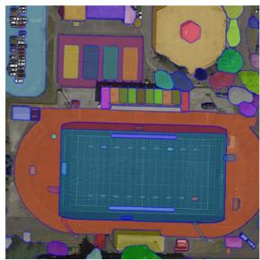
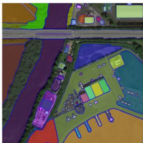
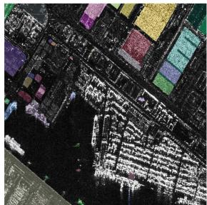
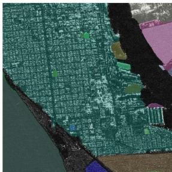
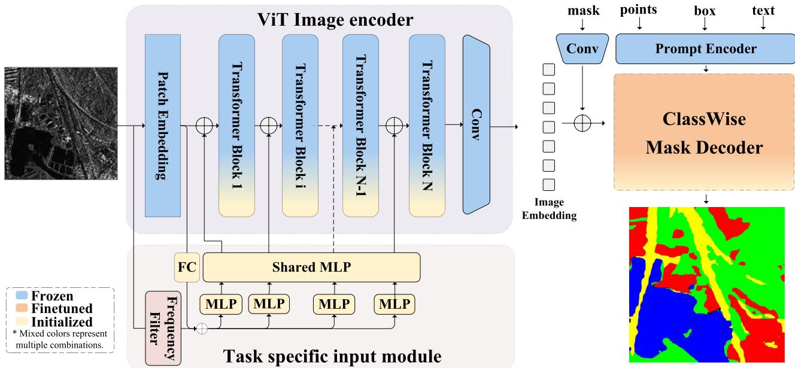
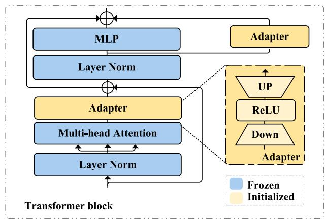
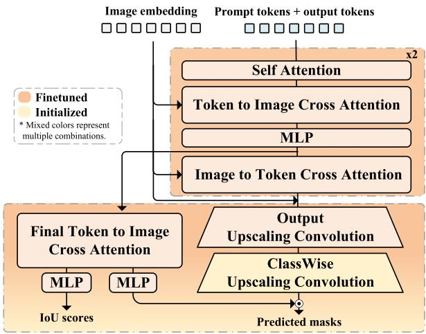
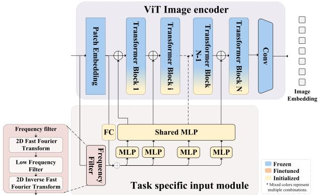
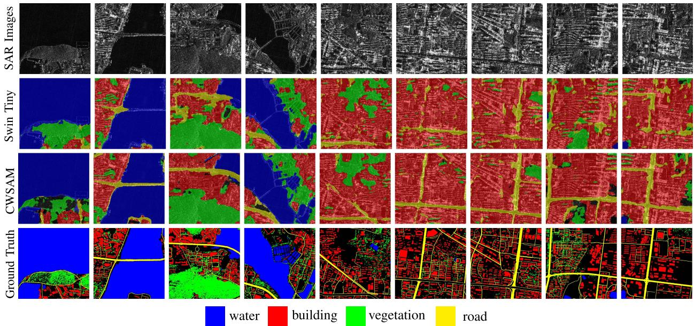
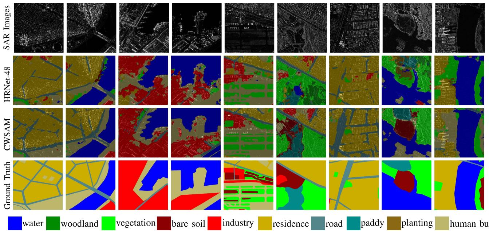

# ClassWise-SAM-Adapter: Parameter-Efficient Fine-Tuning Adapts Segment Anything to SAR Domain for Semantic Segmentation

Xinyang Pu①, Graduate Student Member, IEEE, Hecheng Jia①, Member, IEEE, Linghao Zheng, Graduate Student Member, IEEE, Feng Wang ①, Member, IEEE, and Feng Xu, Senior Member, IEEE

Abstract—In the realm of artificial intelligence, the emergence of foundation models, backed by high computing capabilities and extensive data, has been revolutionary. A segment anything model (SAM), built on the vision transformer (ViT) model with millions of parameters and trained on its corresponding large-scale dataset SA-1B, excels in various segmentation scenarios relying on its significance of semantic information and generalization ability. Such achievement of visual foundation model stimulates continuous researches on specific downstream tasks in computer vision. The classwise-SAM-adapter (CWSAM) is designed to adapt the high-performing SAM for landcover classification on space-borne synthetic aperture radar (SAR) images. The proposed CWSAM freezes most of SAM's parameters and incorporates lightweight adapters for parameter-efficient fine-tuning, and a classwise mask decoder is designed to achieve semantic segmentation task. This adapt-tuning method allows for efficient landcover classification of SAR images, balancing the accuracy with computational demand. In addition, the task-specific input module injects low-frequency information of SAR images by MLP-based layers to improve the model performance. Compared to conventional state-of-theart semantic segmentation algorithms by extensive experiments, CWSAM showcases enhanced performance with fewer computing resources, highlighting the potential of leveraging foundational models such as SAM for specific downstream tasks in the SAR domain.

Index Terms—Adapter tuning, landcover classification, parameter-efficient fine-tuning, segment anything (SA), synthetic aperture radar (SAR), visual foundation model.

## I. INTRODUCTION

opments of universal architectures. These architectures encompass extensive algorithms for various downstream tasks with high uniformity and strong generalization capabilities. Thanks to the release of segment anything model (SAM) [1], the progressions of foundation models in computer vision and the involved researches are booming. This brings available future of uniform large model in computer vision because of its zero-shot ability on natural scene segmentation task. SAM has impressive segmentation performance in extensive application fields benefiting from its elaborate architectures and large-scale training dataset named SA-1B, which contains billions of segmentation annotations.

Although the great generalization and zero-shot ability on most of scenes show prominent advantages of SAM as a visual foundation model, the complicated requirements of downstream tasks and multiple application fields raise more complex requirements and further optimizations of SAM. Especially for synthetic aperture radar (SAR) images [2], [3], the unique imaging mechanism of electromagnetic wave on SAR induces distinctive image characteristics that are inexperienced and indecipherable for SAM. Several recent works based on deep learning aim to improve traditional model performance on SAR image segmentation tasks. FFSSNet [4]is designed to achieve feature fusion from different scales of SAR images. LGMFNet [5] provides a dual encoder-decoder architecture for the SAR building segmentation task. Marine aquaculture zone extraction algorithm on dual-polarimetric SAR Images is explored by MAZ-Net [6] However, such diverse resolutions and different polarization methods of SAR images tend to confuse SAM for pixel-level segmentation because the pretrained data of SA-1B dataset is unable to cover such fine-grained situations on SAR image segmentation tasks. The interference characteristics of SAR images from electromagnetic wave imaging mechanisms and some low signal-to-noise-ratio (SNR) scenarios are distinct from natural scenes and too unique to be considered when training natural vision foundation models. This deteriorates the effectiveness and reliability of SAM on SAR images segmentation task as a consequence [7]. On the other hand, due to the scarce opportunity and high cost of accessing SAR images, it is difficult to construct an SAR foundation model from scratch with limited SAR image data resources. Utilizing SAM for the SAR image interpretation presents a possibility worth exploring. However, it comes with challenges that we summarize to the following two main issues.

  
(a)

  
(b)  
Fig. 1. Output masks of remote sensing images by SAM. (a) Optical aerial images with predicted masks. (b) SAR images with predicted masks

1) SAM is hardly able to segment the SAR images for reasonable accuracy even though it has good generalization capability on natural images including optical aerial images as shown in Fig. 1(a). Considering the electromagnetic wave imaging mechanism of signal echo on SAR, the appearances of SAR images are very different with natural scene images. To be specific, SAR images exhibit coherent speckle noise due to wave physics, side lobes, and the complex scattering characteristics that can introduce false alarms, and layover and shadowing effects in regions with steep terrain or tall structures. Specific situations of SAR images including multiple polarization properties and low SNR imaging circumstances are rarely involved in SAM.

2) The category-agnostic property of SAM hinders its application on diverse visual downstream tasks. For semantic segmentation and landcover classification tasks on SAR images, each pixel needs a predicted category while SAM only generates several binary mask lack of classwise information under the guidance of prompt input. The segment results of SAR images from SAM represent almost no meaningful semantic information as shown in Fig. 1(b) because pixels in the same category are not classified into the same category. In addition, landcover classification task demand the model to output a multiclass predicted mask for each image while the quantity of output masks by SAM is variable.

Therefore, we propose a method named classwise-SAMadapter (CWSAM) to achieve reasonable performance on pixellevel SAR landcover classification task by leveraging foundation model SAM and adding a classwise light-weighted mask decoder. A well-designed adapter fine-tuning mechanism is utilized. Freezing most parameters of the heavy vision transformer (ViT) [8] image encoder of SAM and inserting a small number of trainable parameters by adapters, CWSAM shifts the natural scene domain of SAM to SAR domain, and explores the potential application of large model in SAR downstream tasks such as landcover classification. Since only limited parameters are trainable with gradient in the model weight, CWSAM demands low computing resources and makes training process efficient.

We construct CWSAM as a preliminary attempt of visual foundation model application in SAR images and believe that such effective methods with viable computing cost will bring good future on the development of foundation model to SAR intelligent interpretation. Extensive experiments illustrate that the efficiency and reliability of the proposed method on both segmentation performance and training process. CWSAM outperforms multiple state-of-the-art semantic segmentation algorithms with fewer trainable parameters and less memory consumption. To our best knowledge, it is the first time that SAM is introduced for parameter-efficient fine-tuning on SAR domain to realize semantic segmentation downstream task with category-aware ability.

In summary, the contributions of this article can be summarized as follows.

1) The proposed CWSAM introduces an end-to-end architecture with light-weighted adapters inserted in the image encoder of SAM for efficient parameter fine-tuning on large models. The method transfers the natural scene domain of SAM to the SAR domain. By leveraging the visual foundation model, it achieves a reliable performance on landcover classification tasks using SAR images.

2) A classwise mask decoder of CWSAM is designed to expand classwise attribute to original category-agnostic SAM model for fine-grained semantic segmentation downstream task. For SAR images, the light-weight classwise upscaling convolution layer in the classwise mask decoder is utilized to identify multiple landcover categories on pixel level.

3) The task-specific input module of SAR image lowfrequency information is conducted to provide sufficient semantic information of landcover characteristics through 2-D image fast Fourier transform in the end-to-end architecture automatically for enhancing segmentation performance.

Comprehensive experiments demonstrate that CWSAM surpasses multiple existing semantic segmentation algorithms without the high requirements of computing costs. Even though meeting the characteristic difference between SAR and natural images of SAM, the proposed method achieves to employ the advantages of foundation model to improve the segmentation performance on SAR images.

The rest of this article is organized as follows. Section II presents a comprehensive introduction of related work about CWSAM. Section III illustrates the exhaustive architecture of the proposed CWSAM algorithm. Section IV provides quantitative and qualitative evaluation results and comparisons of multiple experiments as well as ablation study. Section V presents some discussions about the tradeoff between the model performance and training resources of parameter-efficient fine-tuning technologies on foundation models. Finally, Section VI concludes this article.

## II. RELATED WORKS

## A. Segment Anything Model

SAM is released by Meta AI Research in the segment anything (SA) project for image segmentation and shows impressive zero-shot performance and powerful generalization on multiple application scenes [9]. SAM conducts a ViT-based image encoder, a light-weighted mask decoder, and a flexible prompt encoder allowing inputs of points, bounding boxes, masks, and texts. Inspired by the booming large language model (LLM) in NLP, the image encoder of SAM adopts the basic architecture of ViT and has three different sizes of models, including ViT-Base, ViT-Huge, and ViT-Large. MAE [10] method is explored to pretrain the ViT that can process high resolution input images. SAM has powerful zero-shot abilities by prompt engineering that contains two types of prompts: sparse prompt (points, boxes, and text) and dense prompt (mask). Positional encoding [11] is responsible for extracting prompt embeddings of points and boxes, and CLIP [12] is responsible for text prompts. Dense prompts are embedded by the convolution module and summed elementwise to fuse with image embedding. Multiple prompt methods enable the users to concentrate on various scenes and objects, and bring strong application flexibility relying on SAM zero-shot advantages. In addition, the mask decoder provides three output masks of diverse scopes for per image input to address the issue of ambiguous prompt.

## B. Parameter-Efficient Fine-Tuning of SAM

Leveraging the data engine and SA-1B dataset with billions of masks, SAM is regarded as a foundation model of segmentation in computer vision and simulates diverse exploration algorithms on utilizing SAM for downstream tasks on various application fields. The authors in [13], [14], and [15] explore the potential of SAM on medical image analysis, the authors in [16] and [17] focus on camouflaged object detection, and Ahmadi et al. [18] focus on infrastructure detection. Mirror and transparent objects detection task based on SAM is also involved in [19].

Furthermore, for aerial images, several researches [20], [21] robe the generalization of SAM under typical gap between natural scenes of SAM and remote sensing. Wang et al. [22] develop SAM as an efficient annotation system to produce the large-scale remote sensing segmentation dataset called SAMRS. The authors in [23] and [24] conduct prompt engineering to optimize SAM for downstream segmentation task on remote sensing images. RingMo [25]leverages generative self-supervised learning to build a foundation model for remote sensing, and then, it is combined with SAM to achieve a foundation model for multimodal remote-sensing image segmentation called RingMo-SAM [26]. SCD-SAM [27] combines MobileSAM and CNN to extract progressive semantic change features for remote sensing images through adapter-based PEFT technology. Osco [28] explores the potential of SAM for remote sensing applications including zero shot and one shot problems. RSAM-Seg [29] integrates prior knowledge into SAM and utilizes adapter finetuning for remote sensing image semantic segmentation. Road-SAM [30] leverages SAM's powerful generalization for high resolution road extraction in optical remote sensing images.

Considering full fine-tuning a large model is difficult due to the high demand of computing resources and available data, most of these SAM fine-tuning researches follow the mainstream parameter-efficient fine-tuning methods of transformer architecture inspired by LLMs and NLP technologies, including adding additional parameters, selecting a part of parameters to update, and introducing reparametrization. The methods of adding additional parameters can be roughly divided into two types: inserting extra adapter modules [31] and soft prompts fine-tuning [32], [33].

## C. Semantic Segmentation and SAR Landcover Classification

Semantic segmentation plays an essential role on computer vision and has made great achievements on proposing a variety of deep learning-based algorithms. Regarded as an extension task from image classification to pixel-level image segmentation, semantic segmentation starts from a fundamental architecture of fully convolutional networks named FCN [34] and emerges manifold model designs and different structures of mask decoders to improve the segmentation performance. Subsequently, various encoder-decoder architectures [35], [36] are optimized with attention mechanisms [37], [38], proper receptive filed [39], [40], high-resolution feature pyramid [41], [42], dilated convolutions [43], [44], and so on. Transformer-based algorithms [45], [46] conduct great performance on semantic segmentation task.

The requirements of pixel-level semantic segmentation applications on SAR images tend to be urgent with the development of high-resolution SAR technologies [47], [48]. Several modified FCNs network are proposed for wetland semantic segmentation task on SAR images [49] and PolSAR image semantic segmentation task [50] through transfer learning. The authors in [51], [52], and [53] utilize the FCNs networks as baseline and focus on the single category on segmentation tasks of SAR images, such as oil spill, road, and building. The authors in [54] and [55] explored the landcover semantic segmentation tasks containing multiple categories on GF-3 SAR images via an encoder-decoder structure and a transformer architecture. MCANet [56] proposed a multimodal-cross-attention network to achieve land use classification task by fusing the feature map of both optical and SAR images, as well as CFNet [57]. SCNN [58] utilizes the statistical convolutional neural network to encode and analyze the statistical properties of the SAR image for landcover classification on the TerraSAR-X data.

## III. METHODOLOGY

In this section, the proposed CWSAM is introduced by three parts according to its three independent structures. Section III-A presents the adapter fine-tuning algorithm of the ViT image encoder. The classwise mask decoder is introduced in Section III-B to illustrate how to achieve pixel-level classification of semantic segmentation task based on SAM. The task-specific input module of SAR image low-frequency information in Section III-C demonstrates the method of fusing low-frequency semantic information of SAR images into the image encoder to benefit the segmentation performance. Fig. 2 shows the whole architecture of the proposed CWSAM.

  
Fig. 2. Architecture of the proposed CWSAM. The legend shows the trainable state of the model parameters. The prompt encoder is inherited from the SAM module, and no artificial prompt is entered in the proposed method.

## A. Adapted ViT-Based Image Encoder

The image encoder of SAM is pretrained on the SA-1B dataset and containing rich semantic information of extensive natural scenes in the real world, so its well iterated parameters are beneficial for downstream task adaption. Therefore, as shown in the ViT image encoder at the left part of Fig. 2, in order to leverage SAM as a fundamental backbone, we maintain the original architecture of SAM's image encoder unchanged, which is built from the ViT, and freeze all of the original parameters during the training process. Inspired by AdaptMLP in AdaptFormer [31], only several simple and efficient adapters are inserted into individual blocks of the ViT structure. At the beginning of the image encoder, the patch embedding transforms the input images into sequential patches, and then, the extracted patches meet the adapted transformer blocks.

1) Adapters in ViT Blocks: The detailed pipeline of each transformer block and the structure of trainable adapter are visualized in Fig. 3.

Every transformer block composes two subblocks: a multihead self-attention layer [59] and an MLP layer, which are injected by adapter modules with initial parameters for training. In the first multihead attention layer, going through the layer-Norm function, the tokens are extracted by multihead attention mechanism with input of Q, K, and $V ,$ and the self-attention function can be described as

$$
{ \mathrm { A t t e n t i o n } } ( Q , K , V ) = { \mathrm { S o f t m a x } } \left( { \frac { Q K ^ { \mathsf { T } } } { \sqrt { \mathrm { d } _ { \mathrm { h e a d } } } } } \right) V .\tag{1}
$$

  
Fig. 3. Structure of transformer block with trainable adapters in the ViT image encoder.

A light-weighted adapter is following the attention block and meet a feature skip connection before the second MLP subblock. In the second MLP block, another adapter parallels with original SAM MLP layer and generates output feature of the current block. To be specific, all the adapters contain unified structures: a downscale fully connection layer Down, a ReLU activation functions, and an upscale fully connection layer Up, so the function of adapter tuning is formally formulated as follows:

$$
\mathrm { A d a p t e r } ( f _ { \mathrm { i n p u t } } ) = \mathrm { U p } ( \mathrm { R e L U } ( \mathrm { D o w n } ( f _ { \mathrm { i n p u t } } ) ) ) .\tag{2}
$$

Therefore, in the ith transformer block, the feature extraction process is

$$
x _ { i } ^ { \prime } = \mathrm { A d a p t e r } ( \mathrm { A t t e n t i o n } ( \mathrm { L N } ( x _ { i - 1 } ) ) ) + x _ { i - 1 }\tag{3}
$$

$$
x _ { i } = \mathrm { M L P } _ { \mathrm { s a m } } ( \mathrm { L N } ( x _ { i } ^ { \prime } ) ) + \mathrm { A d a p t e r } ( \mathrm { L N } ( x _ { i } ^ { \prime } ) ) + x _ { i } ^ { \prime }\tag{4}
$$

  
Fig. 4. Embedding pipeline of the classwise mask decoder. The output predicted masks contain multicategory landcover classification results.

where $x _ { i }$ and $x _ { i - 1 }$ are the output features of the ith and $i - 1$ th transformer block respectively, and $\boldsymbol { x } _ { i } ^ { \prime }$ is the intermediate feature from the first subblock in the ith transformer block.

With a hand of parameters of these embedded adapters, the proposed method is capable of converting the SAM's perspective from natural scenes to SAR images and provide reasonable features for the subsequent mask decoder.

## B. Classwise Mask Decoder and Loss Function

To represent the multiple categories of every pixels, a classwise mask decoder is built on the original architecture of the mask decoder in SAM [1] and consists of a category prediction head to achieve landcover classification task. In the classwise mask decoder of the proposed CWSAM algorithm, the dynamic mask prediction head is ignored so that only one mask result is obtained and involved for computing the training losses.

1) Architecture: The framework of the classwise mask encoder is explained in Fig. 4. At the beginning, two two-way transformer blocks are explored to extract features of all embeddings, including image embedding and prompt embedding. Multiple attention mechanisms are employed, such as self-attention for prompt embedding and cross-attention between image embedding and prompt embedding with two directions (image-toprompt embedding and prompt-to-image embedding). An upscaling convolution block of the SAM mask decoder prepares the final output binary mask.

However, with binary mask results, the original design of the mask decoder of SAM is unable to figure out classification on pixel level for semantic segmentation task. Therefore, a classwise light-weighted convolution module named classwise upscaling convolution is implemented for multiclasses mask prediction by outputting the channel dimension corresponding to the number of categories to generate classwise segmentation masks. After the upscaling output convolution block of the SAM mask decoder, the classwise upscaling convolution module is added with all randomly initialized parameters trained from scratch to finish final multiclasses mask prediction. The upscale convolution module composes of a deconvolutional layer, a ReLU activation layer, and a convolution block to enlarge semantic feature to generate final mask prediction of N classes channels for separate category.

2) Feature-Enhancement Module: Besides, considering the semantic segmentation task with pixel-level classification requires rich semantic information from feature map, we design a feature-enhancement module in the proposed classwise mask decoder. A skip connection between image embedding and upscaling convolution block is parallel to the two-way transformer block, the output features of the upscaling convolution block from the input of source image embedding and two-way transformer are concatenated together and double the dimension of original scaled feature map. Consequently, the designed final classwise upscaling module extract the concatenated feature and prepare the preprediction mask feature. After the dot product between preprediction mask and tokens from MLP layers, the predicted multiclass mask is generated and each pixel of image is assigned with a specific category.

3) Loss Function: For unbalanced data distribution, the loss function is weighted cross entropy loss, which is formulated as

$$
\begin{array} { r } { \mathrm { L o s s } = \mathrm { ~ - \displaystyle \sum _ { i } ^ { N } w _ { i } \Big ( \cdot ~ } y _ { i } \cdot \log \big ( \sigma \left( \mathrm { l o g i t s } _ { i } \right) \big ) } \\ { \mathrm { ~ + \left( 1 - \it y _ { i } \right) \cdot \log \big ( 1 - \sigma \left( \mathrm { l o g i t s } _ { i } \right) \big ) ~ } \Big ) } \end{array}\tag{5}
$$

where logits refer to the original output by the model, N is the number of categories, $w _ { i }$ is the weighted value of the i class, $y _ { i }$ is the ground truth, and $\sigma ( x )$ is sigmoid function as

$$
\sigma ( x ) = \frac { 1 } { 1 + e ^ { - x } } .\tag{6}
$$

## C. Task-Specific Input of Low-Frequency SAR Characteristics

Although fine-tuning the parameters of adapters in the image encoder transfers SAM to the SAR image domain, the difference between natural sense and microwave signal continuously hinders the model performance. The feature extraction of SAM's ViT image encoder still lacks SAR domain information because some semantic information will be lost through the frozen parameters. Therefore, to extend reasonable semantic information of SAR images for segmentation downstream task, we build an MLP-based architecture paralleled with the VIT image encoder to maintain meaningful low-frequency information of SAR images, such as land surface texture and pixel brightness depending on signal reflectivity. First, the low-frequency characteristics of input images are derived by the processes of 2-D fast Fourier transform in Pytorch, low-pass filter, and inverse fast Fourier transform [60], which is described as

$$
\operatorname { F } ( u , v ) = \sum _ { x = 0 } ^ { \mathrm { M - 1 } \mathrm { N - 1 } } \sum _ { y = 0 } ^ { } f ( x , y ) \cdot e ^ { - j 2 \pi \left( { \frac { u x } { \mathrm { M } } } + { \frac { v y } { \mathrm { N } } } \right) }\tag{7}
$$

where $f ( x , y )$ is the image in the spatial domain, $\operatorname { F } ( u , v )$ is its representation in the frequency domain, and M and N are the width and height of the image, respectively. u and v are the

  
Fig. 5. Structure of the task-specific input module. The details of the frequency filter is shown in the left-bottom part. The output features of the task-specific input module are automatically integrated into the ViT image encoder to conduct an end-to-end whole architecture of the proposed CWSAM.

frequency coordinates. Then, in order to decrease the computing cost as an end-to-end process, a rectangular low-pass filter in the frequency domain is employed as

$$
\mathrm { H } ( u , v ) = \left\{ { \begin{array} { l l } { 1 , } & { \mathrm { i f ~ \frac { M } { 2 } - \frac { W } { 2 } \leq { u } \leq \frac { M } { 2 } + \frac { W } { 2 } } } \\ & { \mathrm { a n d ~ \frac { N } { 2 } - \frac { H } { 2 } \leq { v } \leq \frac { N } { 2 } + \frac { H } { 2 } } } \\ { 0 , } & { \mathrm { o t h e r w i s e } } \end{array} } \right.\tag{8}
$$

where M and N are the number of rows and columns in the image, respectively. W and H are the width and height of the filter in the frequency domain. u and v are the frequency coordinates. The rectangular low-pass filter in the frequency domain preserves 50% of the low frequencies in the entire frequency domain of SAR images through 2-D axes because low-frequency information is essential for multicategory segmentation while high-frequency information contains sharp edge and strong interference of SAR images.

Refer to Fig. 5, the patch embedding feature of input images in the ViT encoder follows dimensional reduction and adds with low-frequency feature. Afterwards multiple MLP blocks extract this feature for every ViT blocks, respectively, and finally, a parameter-shared MLP block inspired by [17] is responsible for realizing each feature fusion between the task-specific input module and the original SAM image encoder. The feature fusion between each transformer block and each output feature of the shared MLP in the task-specific input module is achieved through direct matrix summation so that the matrix dimension is maintained invariably to bring little extra computation consumption and memory cost.

For task-specific inputs, the selection of filters and the setting of the filtering range must be tailored to the characteristics of the downstream task. In the context of multiclass landcover classification tasks for SAR images, low-frequency information not only preserves the imaging characteristics of SAR landcover reflections but also facilitates denoising, such as weakening speckle noise and other strong interferences. This enhances the feature extraction capabilities of SAR images. Conversely, highfrequency information, which retains only the discrete edge details of SAR images, fails to provide effective semantic features for multiclass semantic segmentation tasks. However, it may be beneficial for providing critical edge details in single-class segmentation tasks for optical images.

## IV. EXPERIMENTAL RESULTS AND ANALYSIS

## A. Experimental Dataset and Settings

Two landcover classification datasets of SAR images are utilized for evaluation experiments of the proposed method, FUSAR-Map1.0 [54] and FUSAR-Map2.0 [55]. Both datasets contain multiple categories of landcover annotations, and represent rich semantic information for SAR image interpretation, while FUSAR-Map2.0 raises higher requirements to algorithms by extreme data distribution and detailed label. All input SAR images were copied from a single channel into three threechannel images of the same value to fit the SAM pretrained model structure. The preprocessing of the SAR images has been completed by the publishers of FUSAR-Map1.0 and can be directly accessed through open-source website, including pixel-level quantization and the pixel mean contrast-stretching method [61]. Simple normalization is involved in Pytorch at the initialization of dataset loading and no data augmentation strategies are conducted in the experiments for intuitive comparison of algorithm performance.

1) FUSAR-Map1.0: The FUSAR-Map1.0 dataset comprises 610 GF-3 satellite SAR images of size 1024 × 1024 pixels from 12 scenes of six provinces in China. The annotations contain four landcover categories, building, vegetation, water, and road. One scene of Wuhan city is selected for test dataset and cut into 80 slices. The other eleven senses generate total 530 SAR images of size 1024 × 1024 for training dataset. In addition, parts of pixels in images do not have category labels because of their illegible appearances and are excluded from both training and evaluation processes.

2) FUSAR-Map2.0: The FUSAR-Map2.0 dataset has more fine-grained semantic information of landcover categories, including total ten landcover types, i.e., water, woodland, vegetation, bare soil, industry, residence, road, paddy, planting and human built, and the quantity of each category is extremely unbalance, which brings challenges to segmentation models. Total ten scenes from various countries are included in this dataset, the proportion of training and testing scenes is 8:2. Cropped to the slides of size 1024 × 1024 pixels, the FUSAR-Map2.0 consists of total 738 image samples, and 549 for training and 189 for testing. The annotation distribution of every category between train and test datasets is set to be approximate for reasonable evaluation experiments.

## B. Evaluation Protocol and Metrics

To analyze the effectiveness of the proposed method, diversified standard evaluation metrics of semantic segmentation are employed [62].

1) Mean intersection over union (mIoU): mIoU is widely utilized to evaluate the average segmentation performance of all categories, calculating the intersection over union (IoU)

of predicted mask and ground truth, which is described as

$$
{ \begin{array} { r l } & { { \mathrm { m I o U } } = { \frac { 1 } { \mathrm { k } } } \displaystyle \sum _ { i = 1 } ^ { \mathrm { k } } { \frac { \mathrm { T P } } { \mathrm { F N } + \mathrm { F P } + \mathrm { T P } } } } \\ & { \qquad = { \frac { 1 } { \mathrm { k } } } \displaystyle \sum _ { i = 1 } ^ { \mathrm { k } } { \frac { p _ { i i } } { \sum _ { i = 1 } ^ { \mathrm { k } } p _ { i j } + \sum _ { j = 1 } ^ { \mathrm { k } } \left( p _ { j i } - p _ { i i } \right) } } } \end{array} }\tag{9}
$$

where TP represents the true positives, FN represents the false negatives, FP represents the false positives, $p _ { i i }$ is the number of pixels correctly predicted as class $\mathrm { i } , p _ { i j }$ refers to the number of pixels that are true class i but predicted as class j, and $p _ { j i }$ indicates the number of pixels true class j but predicted as class i. The sum is taken over all classes, indexed from 1 to k. The total number of categories is k.

2) Overall accuracy (OA): OA represents the total percentage of the correctly classified pixels in the whole images as

$$
\mathrm { O A } = \frac { \sum _ { i = 1 } ^ { \mathrm { k } } p _ { i i } } { \sum _ { i = 1 } ^ { \mathrm { k } } T _ { i } }\tag{10}
$$

where $p _ { i i }$ represents the number of correctly classified pixels for the $i _ { \mathrm { t h } }$ class, and $T _ { i }$ represents the total number of pixels for the $i _ { \mathrm { t h } }$ class. The total number of categories is k.

However, OA may be influenced by main category with the highest number of pixels in the dataset. Therefore, other metrics are also considered in the experiments, including recall(accuracy), precision, and m $\mathrm { F _ { 1 } }$ Score.

3) Recall: Recall measures the ratio of correctly predicted pixels to the total number of actual ground-truth pixels as

$$
{ \mathrm { R e c a l l } } = { \frac { \mathrm { T P } } { \mathrm { T P } + { \mathrm { F N } } } } .\tag{11}
$$

4) Precision: Precision is the ratio of correctly predicted positive pixels to all predicted positive pixels and can be referred as accuracy in semantic segmentation task, which is formulated as

$$
\mathrm { A c c u r a c y } = \mathrm { P r e c i s i o n } = { \frac { \mathrm { T P } } { \mathrm { T P } + \mathrm { F P } } } .\tag{12}
$$

5) $\mathrm { F _ { 1 } }$ score: The $\mathrm { F _ { 1 } }$ score quantifies the accuracy of pixel classification across multiple classes, averaging the F1 scores for each class to reflect both the precision and recall in a balanced manner as

$$
\mathrm { F } _ { 1 } = 2 \times { \frac { \mathrm { P r e c i s i o n } \times \mathrm { R e c a l l } } { \mathrm { P r e c i s i o n } + \mathrm { R e c a l l } } } .\tag{13}
$$

In our experiments, we treat mIOU as the main evaluation metric to concentrate on the average performance on all the landcover categories, especially the difficult and ambiguous classes such as road and building. Therefore, the best models in the tables of evaluation results are selected by the highest mIOU score for all the algorithms.

## C. Implementation Details

Our experiments of the proposed method are conducted on the architecture of SAM ViT-Base backbone and compared with multiple the state-of-the-art algorithms in semantic segmentation task under the unified training configuration and settings using Pytorch.

1) Configurations: Two Nvidia RTX 3090 GPUs are employed to train the model for total 120 epochs, and only one for inference process. All the experiments adopt the AdamW optimizer and cosine annealing learning rate strategy with the initial learning rate of 0.0002. All the images have the resolution of 1024× 1024 with the batch size of 1 in the training process to fully make use of computing resources. The processing time of model inference process for the proposed method is 1.22 s per image with size of 1024× 1024.

2) Model architecture: Based on the ViT-Base, which is the smallest model of SAM, the main feature dimensions of the model maintain unchanged, including SAM image encoder, prompt encoder, and most part of the mask decoder. In the ViT-based image encoder, the first module is a patch embedding block with the patch size of 16 and 14× 14 windowed attention. Subsequently, 12 number of transformer blocks with embedding dimension size of 768 extract the image features of the constant dimensions as 64× 64× 768. Four equally spaced global attention blocks are set on layers 2, 5, 8, and 11 on the ViT image encoder, and a final convolution block generates the image embeddings with 256 output channels.

Besides, the feature dimension of all adapters in the image encoder is 768, which is same as embedding dimension of ViT blocks, and the hidden dimension of adapters is one quarter of embedding dimension. For task-specific input, the channel dimension is downscaled to 24 by a fully connected layer for light-weighted computing process, and maintains invariant at individual light-weighted MLP blocks. A shared MLP block increase the channel dimension from 24 to the embedding dimension size of 768 in order to finish the feature fusion through simple matrix summation with ViT blocks.

For the classwise mask decoder with feature enhance module, the transformer dimension is 256 and the SAM output upscaling block dimensions are 256 for input, 64 for hidden layer, and 32 for output features. After feature enhanced concatenation, the classwise upscaling block takes the input feature of 64 channels, and conduct the transposed convolution module of output dimension of 64, kernel size of 2, and stride of 2, to upscale the feature resolution from 64 × 64 to $2 5 6 \times 2 5 6$ . Following a normalize layer and activation layer, a convolution block outputs the classwise upscaled embedding of 32×number of classes channels, which is reshaped to size of (1 ×32×number of classes×256×256) for each ambiguous mask per batch size. Finally, four ambiguity-aware predicted masks are derived from a spatially pointwise product between the upscale classwise image embedding and MLP outputs whose size are 4×(1,32).

3) Weighted losses: When the data distribution in landcover classification dataset of SAR images is unbalanced, some categories that are easy to be recognized or have sufficient samples will dominate the model iteration and convergence during the training process. Therefore, the weighted cross entropy losses are employed in our experiments to pay more attention to these sparse and difficult categories. For five types of landcover in FUSAR-Map1.0 dataset, the weights of building, vegetation, water, road, and background are 1.5, 1, 0.5, 1.9, and 0.1, respectively, and the background is excluded during evaluation. For FUSAR-Map2.0 dataset, the weights of water, bare soil, road, industry, residence, vegetation, paddy field, planting area, human-built, and woodland are 0.4, 1.6, 0.4, 1.6, 1.0, 0.5, 1.5, 1.7, 1.4, and 0.9, respectively. All of these ten landcover categories are evaluated in experiments, and the data distributions of the training and test scenes are relatively similar to each other for reasonable analysis.

## D. Comparison With the State-of-the-Art

In this section, the proposed method is compared with multiple state-of-the-art semantic segmentation algorithms to evaluate its efficiency. Diverse approaches of different backbones and architectures are involved to build a comprehensive investigation including Deeplabv3 [41] series with ResNet [63] convolutionbased modules, HRNet [64] series, SegFormer [45] networks based on the ViT encoder, and Swin transformer [65] with shifted window attention mechanisms.

In our experiments, Deeplabv3, feature enhanced deeplabv3 [54] and deeplabv3+ [42] employ encoder-decoder structures and convolution module for leveraging heavy image features to improve the model performance. HRNet networks maintain high-resolution feature of multiscale semantic information and SegFormer as well as Swin transformer utilizes the powerful transformer backbone for the image encoder and designs a light-weighted decoder to obtain outstanding segmentation performance.

Even though various other algorithms have their own welldesigned architectures to enhance model performance, the proposed method outperforms other state-of-the-art methods on multiple standard evaluation metrics for both FUSAR-Map1.0 and FUSAR-Map2.0 datasets. mIOU is regarded as the main metric in our experiments to evaluate the average segmentation performance of all categories and also to concerned about these difficult categories.

1) Results on FUSAR-Map1.0: The general evaluation metrics are superior to other algorithms including mIoU, OA, accuracy, precision, and mF₁ as shown in Table I. The proposed algorithm achieves the highest scores on all evaluation metrics, indicating its optimal performance from all assessment perspectives. In addition, the most referential evaluation metric, mIOU, surpasses the second highest algorithm swin transformer with Swin-Tiny backbone [65] by 3.54%.

As for separate categories, we mainly consider the mIOU and accuracy metrics for evaluation. In Table II, most categories have the best performance among all these algorithms as illustrated for mIoU. Especially in the challenging category of road, the proposed CWSAM has a significant advantage, outperforming the second highest algorithm by the mIOU of 4.83%. In addition, it has strong robustness on accuracy across all categories. In Table III, even though the proposed algorithm does not achieve the best performance in any single category, its overall accuracy is the highest. This is because it does not have extremely poor performance in any particular category and keep a proper tradeoff on accuracy between all categories.

TABLE I  
COMPARISON RESULTS OF THE PROPOSED METHOD AND THE STATE-OF-THE-ART ALGORITHMS ON FUSAR-MAP1.0 DATASET
<table><tr><td></td><td>mIoU</td><td>OA</td><td>Accuracy</td><td>Precision</td><td>mF1</td></tr><tr><td>Deeplabv3</td><td>51.05</td><td>74.21</td><td>65.37</td><td>69.95</td><td>64.85</td></tr><tr><td>FE-Deeplabv3</td><td>56.79</td><td>76.97</td><td>70.34</td><td>70.2</td><td>69.54</td></tr><tr><td>Deeplabv3plus</td><td>53.68</td><td>77.47</td><td>65.28</td><td>70.96</td><td>66.35</td></tr><tr><td>HRNet-18</td><td>47.51</td><td>64.83</td><td>54.05</td><td>68.48</td><td>60.08</td></tr><tr><td>HRNet-48</td><td>52.7</td><td>72.12</td><td>62.42</td><td>71.04</td><td>66.12</td></tr><tr><td>Segformer-mitb0</td><td>57.81</td><td>80.25</td><td>69.66</td><td>72.1</td><td>69.65</td></tr><tr><td>Segformer-mitb3</td><td>57.25</td><td>80.69</td><td>68.91</td><td>71.68</td><td>68.17</td></tr><tr><td>Swin-Tiny</td><td>57.94</td><td>80.78</td><td>69.35</td><td>72.75</td><td>69.34</td></tr><tr><td>Swin-Small</td><td>56.25</td><td>80.49</td><td>68.12</td><td>73.11</td><td>66.90</td></tr><tr><td>Swin-Base</td><td>55.65</td><td>79.58</td><td>67.56</td><td>69.42</td><td>66.79</td></tr><tr><td>CWSAM</td><td>61.48</td><td>82.14</td><td>73.45</td><td>75.65</td><td>73.68</td></tr></table>

Evaluation by multiple average standard metrics of semantic segmentation. The bold values indicate the best performance metrics (either the highest performance or the fewest parameters).

TABLE II  
EVALUATION RESULTS OF EXPERIMENTS ON MIOU FOR EVERY CATEGORIES ON FUSAR-MAP1.0 DATASET
<table><tr><td></td><td>mIoU</td><td>building</td><td>vegetation</td><td>water</td><td>road</td></tr><tr><td>Deeplabv3</td><td>51.05</td><td>51.01</td><td>43.98</td><td>85.2</td><td>24.02</td></tr><tr><td>FE-Deeplabv3</td><td>56.79</td><td>50.41</td><td>60.52</td><td>90.75</td><td>25.44</td></tr><tr><td>Deeplabv3plus</td><td>53.68</td><td>46.57</td><td>58.64</td><td>89.28</td><td>20.19</td></tr><tr><td>HRNet-18</td><td>47.51</td><td>32.21</td><td>51.36</td><td>89.26</td><td>17.25</td></tr><tr><td>HRNet-48</td><td>52.7</td><td>47.84</td><td>49.73</td><td>88.82</td><td>24.42</td></tr><tr><td>Segformer-mitb0</td><td>57.81</td><td>54.02</td><td>64.53</td><td>92.11</td><td>20.57</td></tr><tr><td>Segformer-mitb3</td><td>57.25</td><td>56.44</td><td>66.92</td><td>91.46</td><td>14.16</td></tr><tr><td>Swin-Tiny</td><td>57.94</td><td>55.35</td><td>65.97</td><td>92.4</td><td>18.03</td></tr><tr><td>Swin-Small</td><td>56.25</td><td>55.0</td><td>66.24</td><td>92.02</td><td>11.80</td></tr><tr><td>Swin-Base</td><td>55.65</td><td>54.26</td><td>65.9</td><td>89.51</td><td>12.92</td></tr><tr><td>CWSAM</td><td>61.48</td><td>57.76</td><td>64.77</td><td>93.11</td><td>30.27</td></tr></table>

The bold values indicate the best performance metrics (either the highest performance or the fewest parameters).

TABLE III  
EVALUATION RESULTS OF EXPERIMENTS ON ACCURACY FOR EVERY CATEGORIES ON FUSAR-MAP1.0 DATASET
<table><tr><td></td><td>Accuarcy</td><td>building</td><td>vegetation</td><td>water</td><td>road</td></tr><tr><td>Deeplabv3</td><td>65.37</td><td>86.28</td><td>47.68</td><td>96.4</td><td>31.11</td></tr><tr><td>FE-Deeplabv3</td><td>70.34</td><td>74.63</td><td>67.26</td><td>91.65</td><td>47.82</td></tr><tr><td>Deeplabv3plus</td><td>65.28</td><td>57.1</td><td>83.52</td><td>95.95</td><td>24.55</td></tr><tr><td>HRÑet-18</td><td>54.05</td><td>39.1</td><td>60.39</td><td>89.95</td><td>26.75</td></tr><tr><td>HRNet-48</td><td>62.42</td><td>62.05</td><td>60.53</td><td>94.48</td><td>32.63</td></tr><tr><td>Segformer-mitb0</td><td>69.66</td><td>80.84</td><td>77.28</td><td>94.49</td><td>26.04</td></tr><tr><td>Segformer-mitb3</td><td>68.91</td><td>86.95</td><td>76.63</td><td>94.92</td><td>17.14</td></tr><tr><td>Swin-Tiny</td><td>69.35</td><td>82.34</td><td>80.45</td><td>94.83</td><td>21.79</td></tr><tr><td>Swin-Small</td><td>68.12</td><td>88.1</td><td>75.98</td><td>95.2</td><td>13.17</td></tr><tr><td>Swin-Base</td><td>67.56</td><td>83.4</td><td>75.92</td><td>94.46</td><td>16.13</td></tr><tr><td>CWSAM</td><td>73.45</td><td>84.99</td><td>74.52</td><td>95.28</td><td>39.01</td></tr></table>

The bold values indicate the best performance metrics (either the highest performance or the fewest parameters).

  
Fig. 6. Qualitative results of landcover classification masks. The compared visualizations between the proposed method and the best state-of-the-art algorithm Swin transformer with tiny backbone on FUSAR-Map1.0 dataset. The predicted masks in the second and third rows are overlapped with the original SAR image for visualization by using a transparency of 0.5.

TABLE IV  
EVALUATION RESULTS OF EXPERIMENTS ON MIOU METRIC FOR EVERY CATEGORIES ON FUSAR-MAP2.0 DATASET
<table><tr><td></td><td>mIoU</td><td>OA</td><td>Accuracy</td><td>Precision</td><td>mF1</td></tr><tr><td>Deeplabv3</td><td>31.43</td><td>64.56</td><td>42.04</td><td>48.3</td><td>43.2</td></tr><tr><td>FE-Deeplabv3</td><td>30.23</td><td>62.67</td><td>42.49</td><td>48.37</td><td>41.32</td></tr><tr><td>Deeplabv3plus</td><td>32.18</td><td>64.93</td><td>44.0</td><td>49.71</td><td>43.8</td></tr><tr><td>HRÑet-18</td><td>32.91</td><td>65.48</td><td>44.55</td><td>50.2</td><td>44.77</td></tr><tr><td>HRNet-48</td><td>35.44</td><td>65.86</td><td>47.72</td><td>52.31</td><td>48.43</td></tr><tr><td>Segformer-mitb0</td><td>32.21</td><td>63.17</td><td>44.27</td><td>46.28</td><td>43.73</td></tr><tr><td>Segformer-mitb3</td><td>30.92</td><td>59.87</td><td>43.19</td><td>47.1</td><td>42.42</td></tr><tr><td>Swin-Tiny</td><td>29.02</td><td>56.98</td><td>42.55</td><td>42.45</td><td>41.17</td></tr><tr><td>Swin-Small</td><td>29.7</td><td>61.90</td><td>40.6</td><td>45.24</td><td>40.6</td></tr><tr><td>Swin-Base</td><td>28.48</td><td>62.05</td><td>38.82</td><td>39.77</td><td>38.8</td></tr><tr><td>CWSAM</td><td>36.03</td><td>67.67</td><td>47.92</td><td>54.5</td><td>48.19</td></tr></table>

The bold values indicate the best performance metrics (either the highest performance or the fewest parameters).

As Fig. 6 presents, we visualize the segmentation results of both CWSAM and the runner-up algorithm on FUSAR-Map1.0 dataset, SegFormer. In the landcover classification task, the proposed method consistently delivers more precise pixel-level predictions. Notably, its masks exhibit superior edge continuity, and it distinctly outperforms in delineating challenging categories, such as road and building.

2) Results on FUSAR-Map2.0: The landcover classification task on FUSAR-Map2.0 becomes more challenging with more landcover categories and more extreme data distribution such as woodland, bare soil, road, and paddy field. The comprehensive comparison results of several standard metrics are illustrated in Table IV. Similar with FUSAR-Map1.0, the general performance of the proposed method surpasses other compared state-of-the-art algorithms. Our experiments confirms that it is hard to achieve the best performance on all categories of FUSAR-Map2.0 dataset, while the proposed method has overall the most outstanding performance. CWSAM outperforms the second highest algorithm by the mIOU of 0.59%, the OA of 1.81%, the precision of 2.19%, except mF1 is slightly lower than HRNet-48 by 0.24%.

As listed in Tables V and VI, the segment performance of FUSAR-Map2.0 varies between all categories. Several individual category is difficult to be recognized, such as bare soil and planting area. The overall performance of the proposed method is optimal based on evaluation metrics because it obtains the best performance in the majority of categories without extreme deficiencies in any specific categories. Specifically, CWSAM's evaluation results of mIOU and accuracy metrics are higher on most categories, while other methods perform well in only one or two categories. Fig. 7 displays the visualization results of the proposed method on FUSAR-Map2.0, demonstrating the superior performance of CWSAM in detailed categories such as roads, buildings, and residential areas.

Therefore, the evaluation results on both datasets demonstrates that our method is efficient on multiple landcover classification datasets of SAR images and has higher model robustness and generalization.

## E. Ablation Study

In this section, comprehensive experiments of ablation study are conducted on two datasets FUSAR-Map1.0 adn FUSAR-Map2.0. The ablation study disentangles the effect of every individual components and investigate the necessity of all designed modules in the proposed method. All the parameter settings keep constant in the ablation study and previous compared experiments with state-of-the-art methods. The proposed method has mainly three independent modules: classwise mask encoder with feature-enhancement module, ViT image encoder adapters, and task-specific input module of SAR image low-frequency information, which can be employed in the experiments sequentially and integrally. According to the evaluation results of ablation study shown in Table VII on FUSAR-Map1.0 and Table VIII on FUSAR-Map2.0, our analyses are as follows.

TABLE V  
EVALUATION RESULTS ON MIOU OF COMPARISON EXPERIMENTS BETWEEN THE PROPOSED METHOD AND OTHER STATE-OF-THE-ART ALGORITHMS ON FUSAR-MAP2.0 DATASET
<table><tr><td></td><td>mIoU</td><td>water</td><td>woodland</td><td>vegetation</td><td>bare soil</td><td>industry</td><td>residence</td><td>road</td><td>paddy</td><td>planting</td><td>human built</td></tr><tr><td>Deeplabv3</td><td>31.43</td><td>87.39</td><td>17.8</td><td>48.47</td><td>1.01</td><td>31.88</td><td>52.87</td><td>30.19</td><td>10.39</td><td>16.25</td><td>18.02</td></tr><tr><td>FE-Deeplabv3</td><td>30.23</td><td>88.8</td><td>28.37</td><td>48.22</td><td>1.36</td><td>24.36</td><td>52.7</td><td>26.39</td><td>8.99</td><td>6.82</td><td>16.24</td></tr><tr><td>Deeplabv3plus</td><td>32.18</td><td>90.27</td><td>24.59</td><td>50.94</td><td>2.8</td><td>31.98</td><td>54.64</td><td>27.89</td><td>14.42</td><td>7.37</td><td>16.94</td></tr><tr><td>HRNet-18</td><td>32.91</td><td>88.24</td><td>28.07</td><td>52.46</td><td>1.97</td><td>26.97</td><td>55.18</td><td>31.88</td><td>6.23</td><td>22.75</td><td>15.38</td></tr><tr><td>HRNet-48</td><td>35.44</td><td>88.73</td><td>25.66</td><td>52.48</td><td>2.57</td><td>32.17</td><td>54.37</td><td>30.77</td><td>20.83</td><td>30.06</td><td>16.75</td></tr><tr><td>Segformer-mitb0</td><td>32.21</td><td>89.41</td><td>32.16</td><td>54.9</td><td>1.01</td><td>30.49</td><td>50.39</td><td>22.66</td><td>21.48</td><td>5.97</td><td>13.64</td></tr><tr><td>Segformer-mitb3</td><td>30.92</td><td>89.11</td><td>34.9</td><td>53.48</td><td>2.29</td><td>22.01</td><td>45.62</td><td>25.11</td><td>14.64</td><td>9.42</td><td>12.63</td></tr><tr><td>Swin-Tiny</td><td>29.02</td><td>74.46</td><td>19.02</td><td>41.38</td><td>6.28</td><td>35.03</td><td>53.22</td><td>23.35</td><td>14.69</td><td>6.01</td><td>15.79</td></tr><tr><td>Swin-Small</td><td>29.70</td><td>88.48</td><td>11.59</td><td>52.3</td><td>1.99</td><td>36.75</td><td>50.45</td><td>21.8</td><td>11.03</td><td>8.73</td><td>13.85</td></tr><tr><td>Swin-Base</td><td>28.48</td><td>75.06</td><td>0.01</td><td>56.78</td><td>5.67</td><td>41.42</td><td>52.9</td><td>20.86</td><td>12.65</td><td>3.6</td><td>15.82</td></tr><tr><td>CWSAM</td><td>36.03</td><td>90.45</td><td>43.45</td><td>57.32</td><td>10.0</td><td>40.9</td><td>54.85</td><td>28.35</td><td>13.99</td><td>6.58</td><td>14.74</td></tr></table>

The bold values indicate the best performance metrics (either the highest performance or the fewest parameters).

TABLE VI  
EVALUATION RESULTS ON ACCUARCY OF COMPARISON EXPERIMENTS BETWEEN THE PROPOSED METHOD AND OTHER STATE-OF-THE-ART ALGORITHMS ON FUSAR-MAP2.0 DATASET
<table><tr><td></td><td>Accuarcy</td><td>water</td><td>woodland</td><td>vegetation</td><td>bare soil</td><td>industry</td><td>residence</td><td>road</td><td>paddy</td><td>planting</td><td>human built</td></tr><tr><td>Deeplabv3</td><td>42.04</td><td>91.04</td><td>31.04</td><td>67.48</td><td>1.15</td><td>36.66</td><td>86.16</td><td>43.51</td><td>12.32</td><td>23.52</td><td>27.52</td></tr><tr><td>FE-Deeplabv3</td><td>42.49</td><td>91.96</td><td>61.95</td><td>69.33</td><td>1.43</td><td>27.86</td><td>74.45</td><td>42.66</td><td>9.8</td><td>8.72</td><td>37.17</td></tr><tr><td>Deeplabv3plus</td><td>44.0</td><td>94.48</td><td>51.98</td><td>71.97</td><td>3.16</td><td>38.05</td><td>74.7</td><td>36.93</td><td>20.75</td><td>8.11</td><td>39.89</td></tr><tr><td>HRNet-18</td><td>44.55</td><td>93.58</td><td>50.95</td><td>72.83</td><td>2.54</td><td>30.56</td><td>78.55</td><td>45.37</td><td>6.82</td><td>31.16</td><td>33.16</td></tr><tr><td>HRNet-48</td><td>47.72</td><td>93.99</td><td>48.07</td><td>71.51</td><td>3.43</td><td>37.6</td><td>74.54</td><td>45.82</td><td>2.52</td><td>39.37</td><td>37.61</td></tr><tr><td>Segformer-mitb0</td><td>44.27</td><td>92.29</td><td>52.0</td><td>74.13</td><td>1.63</td><td>36.19</td><td>65.49</td><td>44.44</td><td>29.4</td><td>7.55</td><td>39.6</td></tr><tr><td>Segformer-mitb3</td><td>43.19</td><td>92.13</td><td>52.43</td><td>69.44</td><td>4.0</td><td>25.88</td><td>57.78</td><td>48.33</td><td>18.54</td><td>11.96</td><td>51.45</td></tr><tr><td>Swin-Tiny</td><td>42.55</td><td>79.19</td><td>46.76</td><td>51.95</td><td>11.81</td><td>42.69</td><td>70.8</td><td>42.79</td><td>22.49</td><td>17.84</td><td>39.17</td></tr><tr><td>Swin-Small</td><td>40.6</td><td>91.97</td><td>21.37</td><td>71.14</td><td>2.74</td><td>45.49</td><td>61.78</td><td>45.46</td><td>12.63</td><td>10.86</td><td>42.53</td></tr><tr><td>Swin-Base</td><td>38.82</td><td>78.08</td><td>0.02</td><td>76.59</td><td>15.32</td><td>61.9</td><td>68.3</td><td>30.05</td><td>18.33</td><td>7.2</td><td>32.38</td></tr><tr><td>CWSAM</td><td>47.92</td><td>92.18</td><td>64.75</td><td>79.77</td><td>14.3</td><td>48.14</td><td>68.13</td><td>52.52</td><td>15.58</td><td>7.46</td><td>36.39</td></tr></table>

The bold values indicate the best performance metrics (either the highest performance or the fewest parameters).

  
Fig. 7. Qualitative results of landcover classification masks. The compared visualizations between the proposed method and the best state-of-the-art algorithm HRNet-48 on FUSAR-Map2.0 dataset. The predicted masks in the second and third rows are overlapped with the original SAR image for visualization by using a transparency of 0.5.

1) Classwise mask encoder with featured-enhancement module: The proposed classwise mask decoder is necessary to implement pixel-level landcover classification as a semantic segmentation task. In order to provide premise feature for improving segmentation performance, we introduce a feature-enhancement structure on the classwise mask decoder by connecting image embedding with the output of the upscaling convolution via a skip connection and feature concatentation to double the feature dimensions. So, the FE-mask decoder can be removed by canceling the skip connection and keep the original channel dimension. The ablation study is conducted on both FUSAR-Map1.0 and FUSAR-Map2.0 datasets to explore the effect of the feature-enhancement module by adding and removing it. The results illustrate that the feature-enhancement module significantly improve the model performance, especially on the harder dataset FUSAR-Map2.0, since more useful semantic information in the feature map is provided to the classification head.

TABLE VII  
ABLATION STUDY OF THREE MODULES ON FUSAR-MAP1.0 DATASET
<table><tr><td>FE-Mask decoder</td><td>ViT adapter</td><td>Task specific input</td><td>mIOU</td><td>OA</td></tr><tr><td>」</td><td></td><td></td><td>38.28</td><td>61.78</td></tr><tr><td rowspan="3"></td><td></td><td></td><td>49.45</td><td>72.98</td></tr><tr><td></td><td>√</td><td>57.42</td><td>79.7</td></tr><tr><td>√</td><td></td><td>61.12</td><td>81.72</td></tr><tr><td>√</td><td></td><td>√</td><td>56.59</td><td>79.80</td></tr><tr><td></td><td>√</td><td>√</td><td>59.95</td><td>81.97</td></tr><tr><td>√</td><td>√</td><td></td><td>60.30</td><td>81.53</td></tr><tr><td>√</td><td>√</td><td>√</td><td>61.48</td><td>82.14</td></tr></table>

"FE-Mask Decoder" is feature-enhanced classwise mask decoder, "ViT Adapters" is ViT image encoder with multiple adapters, and “Task- Specific Input" represents the module of task-specific input with low frequency of on SAR images.  
The bold values indicate the best performance metrics (either the highest performance or the fewest parameters)

TABLE VIII  
ABLATION STUDY OF THREE MODULES ON FUSAR-MAP2.0 DATASET
<table><tr><td>FE-Mask decoder</td><td>ViT adapter</td><td>Task-specific input</td><td>mIOU</td><td>OA</td></tr><tr><td></td><td></td><td></td><td>18.1</td><td>41.52</td></tr><tr><td></td><td></td><td></td><td>19.0</td><td>40.9</td></tr><tr><td></td><td>√</td><td></td><td>25.6</td><td>53.09</td></tr><tr><td>√</td><td></td><td>√</td><td>26.29</td><td>55.93</td></tr><tr><td></td><td>√</td><td></td><td>31.55</td><td>64.37</td></tr><tr><td></td><td>√</td><td>√</td><td>32.43</td><td>63.68</td></tr><tr><td>√</td><td></td><td>√</td><td>33.92</td><td>65.5</td></tr><tr><td>√</td><td>√</td><td>√</td><td>36.03</td><td>67.67</td></tr></table>

"FE-Mask Decoder" is feature-enhanced classwise mask decoder, "ViT Adapters" is ViT image encoder with multiple adapters, and “Task- Specific Input" represents the module of task-specific input with low frequency of on SAR images.  
The bold values indicate the best performance metrics (either the highest performance or the fewest parameters).

2) ViT adapters in transformer blocks of the image encoder: Light-weighted adapters are widely utilized in the transformer fine-tuning task. Considering the characteristic gap between SAR images and natural scene images of SA-1B dataset, exhaustive adapters are inserted to all blocks of the ViT by both series and parallel connection structure. Our experiments verify that the ViT adapters play an extremely essential role on the whole architecture of model and enhance the segmentation performance in the landcover classification task on SAR images.

3) Task-specific input of SAR image low-frequency information: The MLP-based feature fusion module of lowfrequency information provides a rich SAR semantic feature to the image encoder by 2-D fast Fourier transform processing on SAR images. Only conducting this module brings similar effect improvements compared to the ViT adapter module only, while the segmentation performance reaches to the best level on both FUSAR-Map1.0 and FUSAR-Map2.0 datasets in our experiments when employing both two modules.

Through analyzing the ablation study results, we observe that the model achieves its best performance when the three designed modules are used in conjunction. However, the performance of using individual modules varies slightly depending on the dataset. For simpler datasets, the proposed CWSAM can achieve reasonable performance with fewer modules, whereas more complex and challenging tasks require a comprehensive combination of all modules. It is consistent with some empirical experiences of other fine-tuning researches on foundation models: if more initialed random parameters are introduced in the model, more training samples are needed to improve the model performance on complex tasks.

Furthermore, when analyzing the individual and combined effects of various modules, the adapter structure in the ViT image encoder is designed to adapt SAM pretraining to the SAR image domain. The FE mask decoder provides effective multiclass classification mask predictions. Concurrently, the task-specific input module serves as a feature fusion module enhancing lowfrequency SAR image information, operating in parallel to the image encoder. The trainable parameters of the task-specific input module are randomly initialized, and subsequently, trained, while the ViT image encoder and FE mask decoder utilize and fine-tune the original parameters from the SAM model. Both the ViT image encoder and the task-specific input module function as parallel feature extraction modules that effectively extract features from the input SAR images, albeit with different training approaches and initialization sources. Using either module independently yields substantial performance improvements over the baseline. When both modules are used together, they are seen as a feature-enhancement strategy, achieving further performance gains in the ablation study, although these are less pronounced compared to enhancements from single module implementation. This is because the use of a single module primarily adapts SAM's natural image domain to the SAR image domain, with the task-specific input module further amplifying low-frequency SAR information as a feature-enhancement tool.

## V. DISCUSSIONS

For parameter-efficient fine-tuning task, there is a tradeoff between the quantity of learnable parameters and model performance. Some uncertainty influences still exist depending on specific tasks and datasets. For relatively easy tasks or with a small number of training samples, a small number of learnable parameters can ensure reliable performance. Increasing the number of tuning parameters does not enhance accuracy and can lead to overfitting, where the model excels on training data but fails on new or test data. Overfitting indicates that the model may be memorizing the training data rather than generalizing from it.

On the other hand, increasing the number of parameters can improve the model's capacity to fit complex data. It can help the model capture intricate patterns and relationships. For some difficult tasks such as FUSAR-Map2.0 dataset, increasing the quantity of learnable parameters significantly improves the model performance while requires more computing resources.

TABLE IX  
COMPARISON OF THE TOTAL MODEL PARAMETERS, FINE-TUNING PARAMETERS, AND RESOURCE USAGE OF THE PROPOSED METHOD AND OTHER STATE-OF-THE-ART ALGORITHMS
<table><tr><td>Pretrained</td><td>Backbone</td><td>Total params(M)</td><td>Learnable params (M)</td><td>Training memory(G)</td><td>Flops (GFLOPs)</td></tr><tr><td>Deeplabv3</td><td>ResNet50</td><td>68.1</td><td>68.1</td><td>17</td><td>1078.6</td></tr><tr><td>FE-Deeplabv3</td><td>ResNet50</td><td>77.54</td><td>77.54</td><td>20</td><td>1233.22</td></tr><tr><td>Deeplabv3plus</td><td>ResNet50</td><td>43.58</td><td>43.58</td><td>18</td><td>704.96</td></tr><tr><td>HRNet-18</td><td>HRNet-18</td><td>9.64</td><td>9.64</td><td>12</td><td>73.75</td></tr><tr><td>HRNet-48</td><td>HRNet-48</td><td>65.85</td><td>65.85</td><td>14</td><td>373.68</td></tr><tr><td>segformer</td><td>MIT-B0</td><td>3.72</td><td>3.72</td><td>10</td><td>25.51</td></tr><tr><td>segformer</td><td>MIT-B3</td><td>44.6</td><td>44.6</td><td>24</td><td>117.85</td></tr><tr><td>Swin-Tiny</td><td>Swin-Tiny</td><td>59.83</td><td>59.83</td><td>19</td><td>936.03</td></tr><tr><td>Swin-Small</td><td>Swin-Small</td><td>81.15</td><td>81.15</td><td>20</td><td>1028.76</td></tr><tr><td>Swin-Base*</td><td>Swin-Base</td><td>121.17</td><td>121.17</td><td>15</td><td>1177.92</td></tr><tr><td>CWSAM*</td><td>SAM-BASE</td><td>104.96</td><td>15.29</td><td>10</td><td>442.75</td></tr></table>

\* means the training memory consumption is calculated with batch size equals to 1 for the device limitation. Flops for model inference process.  
The bold values indicate the best performance metrics (either the highest performance or the fewest parameters).

Besides, refer to Table IX, compared with traditional segmentation networks, the proposed method requires fewer computing memories with fewer learnable parameters and performs better generalization and stability, as it can achieve best segmentation performance on both FUSAR-Map1.0 and FUSAR-Map2.0 datasets, while other state-of-the-art algorithms scarcely have satisfactory performance on all data distributions.

In addition, the computational complexity and resource consumption of multiple algorithms are listed in Table IX; the PEFT technology of the proposed method significantly enhances its deployability on standard computing devices and features affordable training costs, and the computational complexity, assessed through the Flops metric, confirms that the proposed algorithmic structure achieves superior performance with a reduced computational complexity. Some CNN-based and transformer-based algorithms in the experiments have higher computational complexity because of introducing feature-enhancement or global attention modules but fail to achieve ideal performance compared with the proposed method.

## VI. CONCLUSION

In this article, a parameter-efficient fine-tuning method named CWSAM of visual foundation model is proposed to achieve semantic segmentation and landcover classification in SAR image domain. A light-weighted classwise mask decoder is designed to convert the category agnostic of SAM to distinguishable pixellevel classification module. Adapters are explored in the ViT image encoder to shrink the domain gap between SA-1B natural scenes and SAR images, and the task-specific input module of low-frequency information injects SAR image features into the image encoder for improving the segmentation performance. The comprehensive experiments on multiple SAR image landcover classification datasets demonstrate the effectiveness of the proposed method. Our algorithm outperforms other state-of-theart semantic segmentation methods and utilizes bits of computing resources for fine-tuning the visual foundation model.

Besides, to our best knowledge, the proposed method is the first trial of leveraging SAM to achieve semantic segmentation and landcover classification downstream tasks in SAR images by adapter tuning. It proves the potentiality of foundation models in SAR image interpretation and applications.

## REFERENCES

[1] A. Kirillov et al., "Segment anything," in Proc. IEEE/CVF Int. Conf. Comput. Vis., 2023, pp. 3992–4003.

[2] F. Xu, H. Wang, and Y. Jin, "Deep learning as applied in SAR target recognition and terrain classification,"J. Radars, vol. 6, no. 2, pp. 136–148, 2017.

[3] X. X. Zhu et al., "Deep learning meets SAR: Concepts, models, pitfalls, and perspectives," IEEE Geosci. Remote Sens. Mag., vol. 9, no. 4, pp. 143–172, Dec. 2021.

[4] W. Zhang et al., “"FFSSNet: Fast fine semantic segmentation network for GF-3 SAR images in building areas," IEEE J. Sel. Topics Appl. Earth Observ. Remote Sens., vol. 17, pp. 11260–11273, 2024.

[5] X. Zhou, L. Zhou, H. Zhang, W. Ji, and B. Zhou, "Local-global multiscale fusion network for semantic segmentation of buildings in SAR imagery," IEEE J. Sel. Topics Appl. Earth Observ. Remote Sens., vol. 17, pp. 7410–7421, 2024.

[6] W. Chen and X. Li, "Deep-learning-based marine aquaculture zone extractions from dual-polarimetric SAR imagery," IEEE J. Sel. Topics Appl. Earth Observ. Remote Sens., vol. 17, pp. 8043–8057, 2024.

[7] L. Zheng, X. Pu, S. Zhang, and F. Xu, "Tuning a SAM-based model with multicognitive visual adapter to remote sensing instance segmentation," IEEE J. Sel. Topics Appl. Earth Observ. Remote Sens., vol. 18, pp. 2737–2748, 2025.

[8] A. Dosovitskiy et al., "An image is worth 16x16 words: Transformers for image recognition at scale," 2020, arXiv:2010.11929.

[9] C. Zhang et al., “A comprehensive survey on segment anything model for vision and beyond," 2023, arXiv:2305.08196.

[10] K. He, X. Chen, S. Xie, Y. Li, P. Dollár, and R. B. Girshick, "Masked autoencoders are scalable vision learners," in Proc. IEEE/CVF Conf. Comput. Vis. Pattern Recognit., 2022, pp. 15979–15988.

[11] M. Tancik et al., "Fourier features let networks learn high frequency functions in low dimensional domains," in Proc. Annu. Conf. Neural Inf Process. Syst., 2020, pp. 7537–7547.

[12] A. Radford et al., "Learning transferable visual models from natural language supervision," in Proc. 38th Int. Conf. Mach. Learn., Jul. 2021, vol. 139, pp. 8748–8763.

[13] J. Ma, Y. He, F. Li, L. Han, C. You, and B. Wang, "Segment anything in medical images," Nature Commun., vol. 15, no. 1, 2024, Art. no. 654.

[14] J. Wu et al., "Medical SAM adapter: Adapting segment anything model for medical image segmentation," 2023, arXiv:2304.12620.

[15] M. A. Mazurowski, H. Dong, H. Gu, J. Yang, N. Konz, and Y. Zhang, "Segment anything model for medical image analysis: An experimental study," Med. Image Anal., vol. 89, 2023, Art. no. 102918.

[16] L. Tang, H. Xiao, and B. Li, "Can SAM segment anything? When SAM meets camouflaged object detection,"2023, arXiv:2304.04709.

[17] T. Chen et al., "SAM-Adapter: Adapting segment anything in underperformed scenes," in Proc. IEEE/CVF Conf. Comput. Vis. Workshops, Paris, France, 2023, pp. 3359–3367, doi: 10.1109/ICCVW60793.2023.00361.

[18] M. Ahmadi, A. G. Lonbar, A. Sharifi, A. T. Beris, M. Nouri, and A. S. Javidi, “"Application of segment anything model for civil infrastructure defect assessment," 2023, arXiv:2304.12600.

[19] D. Han et al., "Segment anything model (SAM) meets glass: Mirror and transparent objects cannot be easily detected," 2023, arXiv:2305.00278.

[20] S. Ren et al., "Segment anything, from space?," in Proc. IEEE/CVF Winter Conf. Appl. Comput. Vis., Jan. 2024, pp. 8340–8350.

[21] S. Julka and M. Granitzer, "Knowledge distillation with segment anything (SAM) model for planetary geological mapping," in Proc. Int. Conf. Mach. Learn., Optim., Data Sci., 2023, pp. 68–77.

[22] D. Wang et al., "SAMRS: Scaling-up remote sensing segmentation dataset with segment anything model," in Proc. Adv. Neural Inf. Process. Syst., 2024, vol. 36, pp. 8815–8827.

[23] J. Zhang, Z. Zhou, G. Mai, L. Mu, M. Hu, and S. Li, "Text2Seg: Remote sensing image semantic segmentation via text-guided visual foundation models," 2023, arXiv:2304.10597.

[24] K. Chen et al., “RSPrompter: Learning to prompt for remote sensing instance segmentation based on visual foundation model,"IEEE Trans. Geosci. Remote Sens., vol. 62, 2024, Art. no. 4701117.

[25] X. Sun et al., "RingMo: A remote sensing foundation model with masked image modeling," IEEE Trans. Geosci. Remote Sens., vol. 61, 2023, Art. no. 5612822.

[26] Z. Yan et al., "RingMo-SAM: A foundation model for segment anything in multimodal remote-sensing images," IEEE Trans. Geosci. Remote Sens., vol. 61, 2023, Art. no. 5625716.

[27] L. Mei et al., “SCD-SAM: Adapting segment anything model for semantic change detection in remote sensing imagery,"IEEE Trans. Geosci. Remote Sens., vol. 62, 2024, Art. no. 5626713.

[28] L. P. Osco et al., "The segment anything model (SAM) for remote sensing applications: From zero to one shot," Int. J. Appl. Earth Observ. Geoinf., vol. 124, 2023, Art. no. 103540.

[29] J. Zhang, X. Yang, R. Jiang, W. Shao, and L. Zhang, "RSAM-Seg: A SAM-based approach with prior knowledge integration for remote sensing image semantic segmentation," 2024, arXiv:2402.19004.

[30]W. Feng, F. Guan, C. Sun, and W. Xu, "Road-SAM: Adapting the segment anything model to road extraction from large very-high-resolution optical remote sensing images," IEEE Geosci. Remote Sens. Lett., vol. 21, 2024, Art. no. 6012605.

[31] S. Chen et al., “AdaptFormer: Adapting vision transformers for scalable visual recognition," in Proc. Adv. Neural Inf. Process. Syst., 2022, vol. 35, pp. 16664–16678.

[32] X. L. Li and P. Liang, "Prefix-tuning: Optimizing continuous prompts for generation," in Proc. 59th Annu. Meeting Assoc. Comput. Linguistics 11th Int. Joint Conf. Natural Lang. Process., 2021, pp. 4582–4597.

[33] B. Lester, R. Al-Rfou, and N. Constant, "The power of scale for parameterefficient prompt tuning," in Proc. Conf. Empirical Methods Natural Lang. Process., 2021, pp. 3045–3059.

[34] J. Long, E. Shelhamer, and T. Darrell, "Fully convolutional networks for semantic segmentation," in Proc. IEEE Conf. Comput. Vis. Pattern Recognit., 2015, pp. 3431–3440.

[35] O. Ronneberger, P. Fischer, and T. Brox, "U-Net: Convolutional networks for biomedical image segmentation," in Proc. 18th Int. Conf. Med. Image Comput. Comput.-Assist. Interv., 2015, vol. 9351, pp. 234–241.

[36] C. Yu, J. Wang, C. Peng, C. Gao, G. Yu, and N. Sang, "BiSeNet: Bilateral segmentation network for real-time semantic segmentation," in Proc. 15th Eur. Conf. Comput. Vis., 2018, vol. 11217, pp. 334–349.

[37] F. Zhang et al., “ACFNet: Attentional class feature network for semantic segmentation," in Proc. IEEE/CVF Int. Conf. Comput. Vis., 2019, pp. 6797–6806.

[38] J. Fu et al., "Dual attention network for scene segmentation," in Proc. IEEE Conf. Comput. Vis. Pattern Recognit., 2019, pp. 3141–3149.

[39] H. Zhao, J. Shi, X. Qi, X. Wang, and J. Jia, "Pyramid scene parsing network," in Proc. IEEE Conf. Comput. Vis. Pattern Recognit., 2017, pp. 6230–6239.

[40] M. Yang, K. Yu, C. Zhang, Z. Li, and K. Yang, "DenseASPP for semantic segmentation in street scenes," in Proc. IEEE Conf. Comput. Vis. Pattern Recognit., 2018, pp. 3684–3692.

[41] L. Chen, G. Papandreou, F. Schroff, and H. Adam, "Rethinking atrous convolution for semantic image segmentation," 2017, arXiv:1706.05587.

[42] L. Chen, Y. Zhu, G. Papandreou, F. Schroff, and H. Adam, "Encoderdecoder with atrous separable convolution for semantic image segmentation," in Proc. 15th Eur. Conf. Comput. Vis., 2018, vol. 11211, pp. 833–851.

[43] L. Chen, G. Papandreou, I. Kokkinos, K. Murphy, and A. L. Yuille, "Semantic image segmentation with deep convolutional nets and fully connected CRFs," in Proc. 3rd Int. Conf. Learn. Representations, San Diego, CA, USA, 2015.

[44] L. C. Chen, G. Papandreou, I. Kokkinos, K. Murphy, and A. L. Yuille, "DeepLab: Semantic image segmentation with deep convolutional nets, atrous convolution, and fully connected CRFs," IEEE Trans. Pattern Anal. Mach. Intell., vol. 40, no. 4, pp. 834–848, Apr. 2018.

[45] E. Xie, W. Wang, Z. Yu, A. Anandkumar, J. M. Álvarez, and P. Luo, “SegFormer: Simple and efficient design for semantic segmentation with transformers," in Proc. Annu. Conf. Neural Inf. Process. Syst., 2021, pp. 12077–12090.

[46] R. Strudel, R. G. Pinel, I. Laptev, and C. Schmid, "Segmenter: Transformer for semantic segmentation," in Proc. IEEE/CVF Int. Conf. Comput. Vis., 2021, pp. 7242–7252.

[47] Y. Li et al., "MFVNet: A deep adaptive fusion network with multiple fieldof-views for remote sensing image semantic segmentation," Sci. China Inf. Sci., vol. 66, no. 4, 2023, Art. no. 140305.

[48] F. Xu and Y.-Q. Jin, "Deorientation theory of polarimetric scattering targets and application to terrain surface classification," IEEE Trans. Geosci. Remote Sens., vol. 43, no. 10, pp. 2351–2364, Oct. 2005.

[49] F. Mohammadimanesh, B. Salehi, M. Mahdianpari, E. Gill, and M. Molinier, “A new fully convolutional neural network for semantic segmentation of polarimetric SAR imagery in complex land cover ecosystem," ISPRS J. Photogrammetry Remote Sens., vol. 151, pp. 223–236, 2019.

[50] W. Wu, H. Li, X. Li, H. Guo, and L. Zhang, "PolSar image semantic segmentation based on deep transfer learning - realizing smooth classification with small training sets," IEEE Geosci. Remote Sens. Lett., vol. 16, no. 6, pp. 977–981, Jun. 2019.

[51] D. Cantorna, C. Dafonte, A. Iglesias, and B. A. Varela, "Oil spill segmentation in SAR images using convolutional neural networks. A comparative analysis with clustering and logistic regression algorithms," Appl. Soft Comput., vol. 84, 2019, Art. no. 105716.

[52] M. Shahzad, M. Maurer, F. Fraundorfer, Y. Wang, and X. X. Zhu, "Buildings detection in VHR SAR images using fully convolution neural networks," IEEE Trans. Geosci. Remote Sens., vol. 57, no. 2, pp. 1100–1116, Feb. 2019.

[53] C. Henry, S. M. Azimi, and N. Merkle, "Road segmentation in SAR satellite images with deep fully convolutional neural networks," IEEE Geosci. Remote Sens. Lett., vol. 15, no. 12, pp. 1867–1871, Dec. 2018.

[54] X. Shi, S. Fu, J. Chen, F. Wang, and F. Xu, "Object-level semantic segmentation on the high-resolution Gaofen-3 FUSAR-Map dataset,"IEEE J. Sel. Topics Appl. Earth Observ. Remote Sens., vol. 14, pp. 3107–3119, 2021.

[55] N. Zheng, Z.-A. Yang, X. Shi, R.-Y. Zhou, and F. Wang, "Land cover classification of synthetic aperture radar images based on encoder-decoder network with an attention mechanism," J. Appl. Remote Sens., vol. 16, 2022, Art. no. 014520.

[56] X. Li et al., "MCANet: A joint semantic segmentation framework of optical and SAR images for land use classification," Int. J. Appl. Earth Observ. Geoinf., vol. 106, 2022, Art. no. 102638.

[57] W. Kang, Y. Xiang, F. Wang, and H. You, "CFNet: A cross fusion network for joint land cover classification using optical and SAR images,"IEEE J. Sel. Topics Appl. Earth Observ. Remote Sens., vol. 15, pp. 1562–1574, 2022.

[58] X. Liu, C. He, Q. Zhang, and M. Liao, "Statistical convolutional neural network for land-cover classification from SAR images," IEEE Geosci. Remote Sens. Lett., vol. 17, no. 9, pp. 1548–1552, Sep. 2020.

[59] A. Vaswani et al., "Attention is all you need," in Proc. Adv. Neural Inf. Process. Syst., 2017, vol. 30, pp. 6000–6010.

[60] M. Heideman, D. Johnson, and C. Burrus, "Gauss and the history of the fast Fourier transform," IEEE ASSP Mag., vol. 1, no. 4, pp. 14–21, Oct. 1984.

[61] H. Jia, X. Pu, Q. Liu, H. Wang, and F. Xu, “A fast progressive ship detection method for very large full-scene SAR images," IEEE Trans. Geosci. Remote Sens., vol. 62, 2024, Art. no. 5206615.

[62] A. Garcia-Garcia, S. Orts-Escolano, S. Oprea, V. Villena-Martinez, and J. G. Rodríguez, “A review on deep learning techniques applied to semantic segmentation," 2017, arXiv:1704.06857.

[63] K. He, X. Zhang, S. Ren, and J. Sun, "Deep residual learning for image recognition," in Proc. IEEE Conf. Comput. Vis. Pattern Recognit., 2016, pp. 770–778.

[64] J. Wang et al., "Deep high-resolution representation learning for visual recognition," IEEE Trans. Pattern Anal. Mach. Intell., vol. 43, no. 10, pp. 3349–3364, Oct. 2021.

[65] Z. Liu et al., "Swin transformer: Hierarchical vision transformer using shifted windows," in Proc. IEEE/CVF Int. Conf. Comput. Vis., 2021, pp. 9992–10002.

  
Xinyang Pu (Graduate Student Member, IEEE) received the B.E. degree in telecommunication engineering from Sun Yat-Sen University, Guangzhou, China, in 2020. She is currently working toward the Ph.D. degree in electronic science and technology with the Key Laboratory of Information Science of Electromagnetic Waves, Fudan University, Shanghai, China.

Her research interests include deep learning in remote sensing applications, intelligent interpretation of SAR images, and vision foundation model.

Hecheng Jia (Member, IEEE) received the B.E. degree in computer science and technology from the School of Computer Science and Technology, Zhejiang University of Science and Technology, Hangzhou, China, in 2012, the M.S. degree in software engineering from the University of Science and Technology of China, Hefei, China, in 2015, and the Ph.D. degree in electronic and information from the Key Laboratory of Information Science of Electromagnetic Waves (MoE), Fudan University, Shanghai, China, in 2024.

His research interests include deep learning in remote sensing applications and human-in-the-loop (HitL) machine learning.

  
model.

Linghao Zheng (Graduate Student Member, IEEE) received the B.E. degree in electronic information engineering from the School of Information and Communication Engineering, Communication University of China, Beijing, China, in 2022. He is currently working toward the M.Eng. degree in electronic science and technology with the Key Laboratory of Information Science of Electromagnetic Waves, Fudan University, Shanghai, China.

His research interests include deep learning in remote sensing applications and vision foundation

Feng Wang (Member, IEEE) received the B.S. and M.S. degrees in remote sensing from Information Engineering University, Zhengzhou, China, in 2006 and 2010, respectively, and the Ph.D. degree from in electronic engineering Fudan University, Shanghai, China, in 2017.

He was a Visiting Scholar with the Technical University of Munich, Munich, Germany, in 2013, and a Postdoctoral Research Fellow with the State Key Laboratory of Lunar and Planetary Sciences, Macau University of Science and Technology, Macau, China,

from 2017 to 2018. He was with the Shanghai Institute of Technical Physics, Chinese Academy of Sciences, Shanghai, as an Assistant Research Fellow. He is currently an Associate Professor with the Key Laboratory for Information Science of Electromagnetic Waves (Ministry of Education), School of Information Science and Technology, Fudan University. His research interests include SAR/ISAR Imaging, target recognition, and UAV borne remote sensing.

Feng Xu (Senior Member, IEEE) received the B.E. degree (Hons.) in information engineering from Southeast University, Nanjing, China, in 2003, and the Ph.D. degree (Hons.) in electronic engineering from Fudan University, Shanghai, China, in 2008.

From 2008 to 2010, he was a Postdoctoral Fellow with the National Oceanic and Atmospheric Administration (NOAA) Center for Satellite Applications and Research, Camp Springs, MD, USA. From 2010 to 2013, he worked with Intelligent Automation Inc., Rockville, MD, USA, and NASA Goddard Space

Flight Center, Greenbelt, MD, USA, as a Research Scientist. In 2012, he was selected for China's Global Experts Recruitment Program, and subsequently, returned to Fudan University, in 2013, where he is currently a Professor and the Vice Dean with the School of Information Science and Technology and the Vice Director with the Key Laboratory for Information Science of Electromagnetic Waves (MoE). His research interests include electromagnetic scattering modeling, SAR information retrieval, and radar system development.

Dr. Xu was the recipient of the second-class National Nature Science Award of China in 2011, the 2014 Early Career Award of the IEEE Geoscience and Remote Sensing Society (GRSS), and the 2007 SUMMA Graduate Fellowship in the advanced electromagnetics area. He is a Topic Associate Editor for IEEE TRANSACTIONS ON GEOSCIENCE AND REMOTE SENSING and was an AsSOciate Editor of IEEE GEOSCIENCE AND REMOTE SENSING LETTERS (2014–2021). He is the Founding Chair of the IEEE GRSS Shanghai Chapter and an IEEE GRSS AdCom Member.