Oriented Curviline Detecting

# CaPro: Curvilinear-aware Prompt Learning with Single Unlabeled Image for Cost-effective Curvilinear Structure Segmentation

Zhuangzhuang Chen 1\*, Qiangyu Chen 2\*, Chubin Ou3, Xiaomeng Li1†

1 Department of Electronic and Computer Engineering, The Hong Kong University of Science and Technology

2 College of Computer Science and Software Engineering, Shenzhen University

3Department of Radiology, Guangdong Provincial People's Hospital, Southern Medical University eezzchen@ust.hk, 2021152010@email.szu.edu.cn, cou@connect.ust.hk, eexmli@ust.hk

## Abstract

Curvilinear structure segmentation (CSS) plays a vital role in industrial applications, including medical imaging and structural health monitoring. Recently, the strong capacity of the Segment Anything Model (SAM) has inspired its downstream application in CSS tasks. To adapt SAM to CSS tasks, previous methods heavily rely on a certain number of samples and costly pixel-level annotation, which are hard to access for a new scenario. Considering this, the goal of our work is to adapt SAM in a very cost-effective setting where only a single unlabeled image is given. This is far more challenging than the typical supervised, unsupervised, or self-supervised learning manner that needs a large number of training samples. To tackle this problem, we propose a finetuning-free SAM for curvilinear structure segmentation, called curvilinear-aware prompt learning (CaPro), which aims to automatically learn visual prompts via a single unlabeled image. In the first stage, we generate extensive curvilinear structures and oriented subcurvilinear box annotations. To increase the realness of generated curvilinear structures, we adapt these structures into real image domains via the Fourier Transform using a single realworld unlabeled image. Now, these adapted images can be used to train our oriented sub-curvilinear detector. In the second stage, we propose the curvilinear-aware discrete representation matching to filter those unreliable detection results. Afterward, these reliable detection results can be converted into informative prompts, contributing to the cost-effective SAM adaptation to CSS tasks. Experiments demonstrate the effectiveness of CaPro on medical image and crack segmentation tasks.

Code — https://github.com/xmed-lab/CaPro

## Introduction

Curvilinear Structure Segmentation (CSS) shows its great importance in various real-world applications including industrial crack segmentation (Chen et al. 2024a) and medical blood vessel segmentation (Chen et al. 2024b). It aims to segment binary masks of those curvilinear objects, which can advance structural health monitoring in industrial scenarios (Liu et al. 2021) or assist doctors with lesion diagnosis in the medical domain (Li et al. 2018, 2020; Yao, Hu, and

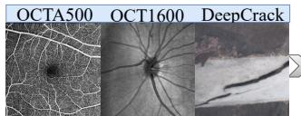

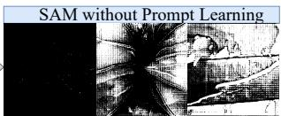

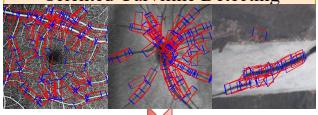

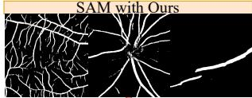

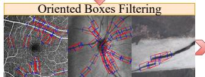  
(b) SAM with Ours >> High Performance and No Labeling Costs

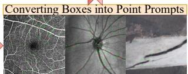  
Figure 1: Visualization results of SAM on curvilinear structures. (a) Vanilla SAM without prompts involves limited performance. (b) SAM combined with our curvilinear-aware prompt learning enjoys high performance and is free of human costs with two key innovations: (1) We are the first ones to detect curvilinear structures in a self-supervised oriented detection manner. (2) We propose curvilinear-aware discrete representation matching to filter those unreliable detection results, thus enabling the provision of informative prompts.

Li 2022; Wang et al. 2024b; Chen et al. 2025b). The substantial progress in the CSS tasks lies in the rise of deep learning (DL) (Zhang et al. 2024; Li et al. 2024a). First, DeepCrack (Zou et al. 2018) and JTFN (Cheng et al. 2021) successfully leverage Convolutional neural networks (CNNs) to segment cracks in an end-to-end manner. Later, with the witness of the success of Vision Transformer (ViT) in natural images (Li et al. 2024a; Li, Xiong, and Fan 2024), CrackFormer (Liu et al. 2021) shows the effectiveness of ViT in capturing long-range interactions (Wang et al. 2024a). However, these approaches require substantial annotated data.

Considering the remarkable capabilities of the Segment Anything Model (SAM) (Kirillov et al. 2023), previous works (Ge et al. 2024; Xu et al. 2024) argue that SAM can be an ideal solution to overcome the limited availability of labeled samples in CSS tasks. However, directly applying SAM to CSS tasks in zero-shot settings results in very limited performance (See Fig. 1 (a) and Table 1), e.g., SAM achieves only 24.67% with the mIoU metric on the Deep-Crack dataset. Although existing prompt-free (Chen et al. 2023a; Cheng et al. 2024) and prompt-based (Feng, Zhu, and Yu 2023; Leng et al. 2024) SAM adaptation methods can greatly improve SAM performance on CSS tasks, these methods still rely on pixel-level annotations. Notably, it is labor-intensive to collect enough training samples form a new scenario (Lei, Zhong, and Dai 2024). Moreover, due to the complex curvilinear structures with ambiguous boundaries, such pixel-level labeling is time-consuming and relies on experienced experts. To this end, one remaining unexplored challenge arises: How can we adapt SAM to CSS tasks in a far more challenging and realistic scenario, where only a single unlabeled training image is provided?

Inspired by FreeCOS (Shi et al. 2023), a naive solution is to leverage synthetic data to train the horizontal object detector in a self-supervised manner. Afterward, such a detector can provide prompts for SAM without any labeling costs. However, Table 1 shows that this simple approach yields suboptimal performance for two reasons: (i) The horizontal object detectors can not adapt to curvilinear structures that involve varying orientations. (ii) The prompts from those unreliable detection results would devastate SAM performance. To address these problems, here are two insights:

• Curvilinear structures can be viewed as line objects with a certain orientation from local perspectives.

• As shown in Fig. 4 (b), handwritten digits and curvilinear structure masks share topological isomorphism.

Therefore, we propose curvilinear-aware prompt learning (CaPro), a two-stage framework for adapting SAM to CSS tasks without the SAM fine-tuning process. Our key idea is that the self-supervised oriented curvilinear object detector can be realized via curvilinear structures synthesis with a single unlabeled image, and then it can provide more informative prompts by filtering those unreliable ones. Specifically, in the first stage, motivated by the first insight, this is the first-of-its-kind work that detects curvilinear structures in a self-supervised oriented detection manner. To achieve this, we synthesize curvilinear structures using parametric fractal L-Systems (Zamir 2001) and generate the corresponding oriented bounding boxes. These structures are then adapted to real image domains via the Fourier Transform using a single unlabeled image. In return, many realistic synthetic samples with oriented bounding box annotations can be obtained. Afterward, our proposed customized oriented detector can be trained in a self-supervised manner with the help of the above synthetic data. Then, it enables automatic detection of curvilinear structures, and generates prompts for the SAM. In the second stage, motivated by the second insight, we propose curvilinear-aware discrete representation matching that leverages shared patterns between curvilinear structure and handwritten digits, to filter those unreliable detection results. In this way, SAM performance can be greatly enhanced by providing more reliable prompts. Our contributions are summarized as:

• To the best of our knowledge, we are the first ones to adapt SAM to CSS tasks via self-supervised prompt generation without the costly SAM fine-tuning process.

For this cause, this paper proposes the curvilinear-aware prompt learning (CaPro) that can serve as a plug-andplay module for the existing prompted-based SAM.

• Propose the image-label pair curvilinear structures synthesis that enables our oriented detector to act as prompt generation module in an self-supervised manner.

• Propose the curvilinear-aware discrete representation matching that acts in an self-supervised manner, to filter out unreliable prompts from inaccurate detection.

• A labeled vessel segmentation dataset has been constructed, namely, OCT1600, which contains challenging samples with complex curvilinear structures, to facilitate the research on CSS tasks.

## Related Work

Curvilinear Structure Segmentation: Curvilinear Structure Segmentation receives extensive attention from various applications, e.g., crack detection (Liu et al. 2021; Lei et al. 2025), and biomedical image segmentation (Lei et al. 2024; Wang et al. 2019). Crackformer (Liu et al. 2021) achieves great success by embedding a novel Transformer encoder module. Despite these models’ great success, these models rely on extensive labeled crack samples for a new scenario and suffer from insufficient generalizability when faced with limited labeled training samples. To alleviate the annotation costs, (Lin et al. 2023) proposes a sparsely annotated segmentation framework. Meanwhile, (Carneiro-Esteves, Vacavant, and Merveille 2024) leverage real-world masks for obtaining pairs of connected/disconnected curvilinear structures. FreeCOS (Shi et al. 2023) generates curvilinear structures for training segmentation models.

Herein, ours is distinct from these works in two-fold: (1) We perform CSS by adapting SAM via our self-supervised prompt generator without any annotation costs, SAM finetuning process, and training segmentation models. (2) Unlike the FreeCOS (Shi et al. 2023) generates curvilinear-like structures to enlarge segmentation training sets, we focus on image-label pair curvilinear synthesis for oriented curvilinear object detection. Then, we greatly boost the SAM performance on CSS tasks via our curvilinear-aware discrete representation matching to filter out those unreliable prompts.

Vision Foundation Models for CSS Tasks: Since this paper focuses on leveraging large-scale foundation models for CSS tasks, we briefly review related research on this scope. Foundation models can serve as a new general paradigm of Artificial Intelligence (AI), showing its stronger intelligence than traditional models (Ge et al. 2024). Generally speaking, foundation models are pre-trained, large-scale models that allow for fast customization through fine-tuning (Wang and Li 2023a,b; Ye et al. 2024). Despite this great progress, it is not feasible to directly apply SAM for CSS tasks. The reason is that SAM does not encounter semantics related to curvilinear structures, such as cracks (Ye et al. 2024). Then, a few works attempt to fine-tune SAM to learn the specific semantics of curvilinear structures (Ge et al. 2024; Ye et al. 2024; Rakshitha et al. 2024). Ye et al. (Ye et al. 2024) and Ge et al. (Ge et al. 2024) utilize low-rank adaptation (LoRA)

Stage I: Self-supervised Prompt Generation  
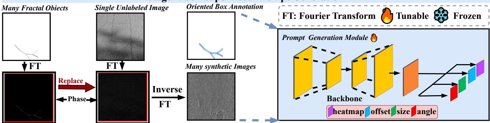

Stage II: Self-supervised Prompt Filtering  
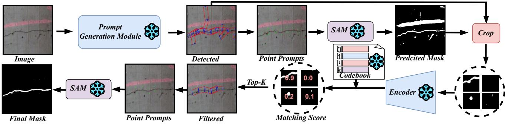  
Figure 2: CaPro consists of two stages to facilitate SAM to CSS tasks without the SAM fine-tuning process with a single unlabeled image. In the first stage, we synthesize extensive Fractal-based curvilinear structures with the corresponding automatically generated oriented box annotations. Then, we leverage the above single unlabeled image and transform these synthesized curvilinear structures into the real-world domain via the Fourier Transform, to enable the training of our proposed oriented detector in a self-supervised manner. In the second stage, we propose curvilinear-aware discrete representation matching to filter those unreliable prompts by starting from a perspective, i.e., handwritten digits have similar patterns with curvilinear structures.

(Hu et al. 2021) to apply SAM for crack segmentation. Rakshitha et al. (Rakshitha et al. 2024) combine crack detector and SAM to enhance the segment capacity. Meanwhile, UCS (Li et al. 2025) further improves the SAM's generalization capability with the proposed sparse adapter. However, UCS still requires a certain of labeled samples from different datasets.

Unlike previous works that simply fine-tune SAM with extensive labeled samples, we leverage curvilinear structure characteristics and perform self-supervised oriented object detection by using a single unlabeled image. Meanwhile, our filter ensures the quality of generated prompts from the detector, contributing to adapting SAM to CSS without any fine-tuning process and eliminating annotation costs.

Object Detector as Prompt Generator for SAM: Generally speaking, this paper mainly focuses on leveraging an oriented object detector as a prompt generator to adapt largescale foundation models to CSS. To this end, we present the related research in this area. Previous object detection methods for CSS tasks exploit horizontal bounding boxes to describe the location and the coarse size of curvilinear objects. Considering this, most existing detectors utilize the commonly used detectors in general computer vision tasks, e.g., Faster R-CNN (Ren et al. 2016), RetinaNet (Lin et al. 2017), Yolo (Redmon et al. 2016), CenterNet (Zhou, Wang, and

Krähenbüh1 2019), and SSD (Liu et al. 2016). Rakshitha et al. (Rakshitha et al. 2024) integrates Detectron2 with SAM and train the object detection model using images and masks to generate approximate boundary boxes. However, previous horizontal object detection methods suffer from scale and intra-class variation, due to the various types of curvilinear structures. To this end, Chen et al. (Chen et al. 2023b) model cracks as a series of sub-cracks with the corresponding orientation. Despite the fact that it can eliminate the scale variation of cracks, it still involves a higher labeling cost than horizontal bounding boxes, while it is still limited in the full exploration for segmentation tasks.

In contrast, our work focuses on training an oriented object detector as the prompt generator in a self-supervised manner, eliminating human labeling costs. We then introduce curvilinear-aware discrete representation matching to filter out unreliable prompts, allowing SAM to adapt to CSS tasks without additional fine-tuning processes.

## Method

Overview: In this paper, we propose a novel framework, called Curvilinear-aware Prompt Learning (CaPro) for adapting SAM to CSS tasks without fine-tuning SAM. As illustrated in Fig. 2, our CaPro consists of two stages. In the first stage, we aim to train an oriented detector as the prompt generator in an self-supervised manner by leveraging Fractal-based curvilinear structure synthesis. Then, in the second stage, we filter those unreliable prompts $( \mathrm { i . e . }$ converted from oriented bounding box) by leveraging the similar characteristics between curvilinear structure mask and handwritten digits. In the following, we will discuss more details of $C a P r o$

## Stage I: Self-supervised Prompt Generation

Motivation: While the existing methods based on parametric Fractal L-Systems for curvilinear structure synthesis exist, they concentrate on synthesizing curvilinear structure images for directly training segmentation models. In contrast, we argue that those synthesized curvilinear structures enjoy high consistency with real-world images at the box level compared to the pixel level. To this end, as shown in Fig 3, we aim to synthesize curvilinear structure images and the corresponding oriented box annotations. Then, we leverage a single unlabeled image to transform these synthetic samples into the real-world domain. Afterward, these more realistic transformed samples can enable the training of our oriented sub-curvilinear structure detector in a selfsupervised manner. Afterward, this detector can serve as the prompt generation module to help SAM adapt to CSS tasks by providing informative prompts, which can be converted from the detected oriented boxes.

Prompt-oriented Training Data Synthesis. Fractals show similar patterns with curvilinear structures and can be rendered by mathematical formulas. Inspired by the existing work parametric Fractal L-systems (Zamir 2001), we generate fractal tree structures by following the physiological rules of curvilinear objects with repeated bifurcations based on Fractal L-systems. See more details in Appendix A. Notably, for each generated sub-curvilinear object, it is straightforward to obtain its height, width, location, and angles. Thus, we are easy to define its oriented ground-truth box denoted as $( c x _ { b } , c y _ { b } , w _ { b } , h _ { b } , \theta _ { b } )$ , where $( c x _ { b } , c y _ { b } )$ indicate the center point, $( w _ { b } , h _ { b } , \theta _ { b } )$ denotes width, height, and angle, respectively. Notably, the box width is enlarged over two pixels compared with the width of the curvilinear object.

Now, these synthetic curvilinear objects can be adapted to the real-world domain via the Fourier Transformation by using a single unlabeled image. Given a single image $I _ { c } \in$ $\mathbb { R } ^ { H \times W }$ , we can derive its Fourier Transformation $\bar { \mathcal { F } ( \cdot ) }$ as:

$$
\begin{array} { r } { \mathcal { F } ( I _ { c } ) = \mathcal { A } ( I _ { c } ) e ^ { j \mathcal { P } ( I _ { c } ) } , } \end{array}\tag{1}
$$

where $\mathbb { A } ( I _ { c } ) = | \mathcal { F } ( I _ { c } ) |$ and $\mathcal { P } ( I _ { c } ) = \arg ( \mathcal { F } ( I _ { c } ) )$ denote the amplitude and phase. arg(·) indicates the function of calculating the angle of a complex vector. Note that, it is easy to extend to the RGB channel by independently performing the Fourier transformation for each channel. Next, our goal can be achieved by combining the amplitude $\mathbb { A } ( I _ { c } )$ of the single unlabeled image $I _ { c }$ and the phase $\mathcal { P } ( I _ { \mathrm { f r a c } } )$ of fractal curvilinear object $I _ { \mathrm { f r a c } }$ . Then, Inverse Fourier Transformation is applied to synthesize realistic curvilinear structure samples:

$$
\hat { I } _ { c } = \mathcal { F } ^ { - 1 } \left[ \mathbb { A } ( I _ { c } ) e ^ { j \mathcal { P } ( I _ { \mathrm { f r a c } } ) } \right] .\tag{2}
$$

Herein, both the Fourier Transformation $\mathcal F ( \cdot )$ and its Inverse Fourier Transformation $\mathcal { F } ^ { - 1 } ( \cdot )$ can be easily implemented by the FFT algorithm. After that, these synthesized crack samples with generated oriented box annotations allows us to train oriented detector in a self-supervised manner.

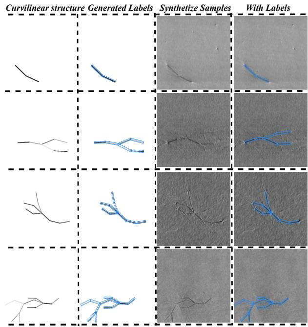  
Figure 3: The generated curvilinear structures from Fractal L-system with the generated oriented box annotations.

Prompt Generation Module. Thanks to synthesized samples with generated oriented box annotations, we now can train the oriented detector as prompt generation module without any extra human annotations. Specially, we adopt CenterNet (Zhou, Wang, and Krähenbühl 2019) as our baseline, which models an object as a single point (i.e., the center point of the bounding box) and regresses the object size and offset. To predict oriented boxes for sub-cracks, we add a branch to regress the orientations of the bounding boxes, shown in Fig. 2. Following CenterNet for regression tasks, we adopt L1 loss for the supervision of rotation angles:

$$
\mathcal { L } _ { \mathrm { a n g l e } } = \frac { 1 } { N } \sum _ { k = 1 } ^ { N } | \theta _ { b } - \hat { \theta _ { b } } |\tag{3}
$$

where $\theta _ { b }$ and $\hat { \theta _ { b } }$ are the target and predicted rotation angles, respectively; and N is the number of positive sub-cracks. Finally, the overall training objective of our oriented detector is formulated as follows:

$$
{ \mathcal { L } } _ { \mathrm { { D e t } } } = { \mathcal { L } } _ { k } + \lambda _ { \mathrm { { s i z e } } } { \mathcal { L } } _ { \mathrm { { s i z e } } } + \lambda _ { \mathrm { { o f f } } } { \mathcal { L } } _ { \mathrm { { o f f } } } + \lambda _ { \mathrm { { a n g l e } } } { \mathcal { L } } _ { \mathrm { { a n g l e } } } .\tag{4}
$$

In Eq. 4, $\mathcal { L } _ { k } , \mathcal { L } _ { \mathrm { s i z e } }$ , and $\mathcal { L } _ { \mathrm { o f f } }$ denotes the losses of center point recognition, scale regression, and offset regression, which are the same as CenterNet. Meanwhile, $\bar { \lambda } _ { \mathrm { s i z e } } , \lambda _ { \mathrm { o f f } }$ $\lambda _ { \mathrm { a n g l e } }$ are used to balance these loss functions and are all set to 0.1 in our experiments.

Converting Oriented Boxes into Prompts. Herein, considering a test image, we are allowed to obtain the detected oriented boxes $( \hat { c x } _ { b } , \hat { c y } _ { b } , \hat { w } _ { b } , \hat { h } _ { b } , \hat { \theta } _ { b } )$ , where its predicted confidence score large than 0.1. Motivated by the fact that curvilinear structures are supposed to be inside the predicted oriented box, the four corner points should be the background prompt $P _ { \mathrm { n e g } } .$ Meanwhile, as the center point of detected oriented boxes is supposed to be the center of the detected curvilinear object, the center point can be used as the foreground prompt $P _ { \mathrm { p o s } } \mathrm { . }$

$$
\begin{array} { r l } & { P _ { \mathrm { n e g } } = P _ { l t } = M _ { r } [ - \hat { h } _ { b } / 2 , - \hat { w } _ { b } / 2 ] ^ { T } + \left[ \hat { c } x _ { b } , \hat { c } y _ { b } \right] ^ { T } } \\ & { P _ { \mathrm { n e g } } = P _ { r t } = M _ { r } [ + \hat { h } _ { b } / 2 , - \hat { w } _ { b } / 2 ] ^ { T } + \left[ \hat { c } x _ { b } , \hat { c } y _ { b } \right] ^ { T } } \\ & { P _ { \mathrm { n e g } } = P _ { l b } = M _ { r } [ - \hat { h } _ { b } / 2 , + \hat { w } _ { b } / 2 ] ^ { T } + \left[ \hat { c } x _ { b } , \hat { c } y _ { b } \right] ^ { T } } \\ & { P _ { \mathrm { n e g } } = P _ { r b } = M _ { r } [ + \hat { h } _ { b } / 2 , + \hat { w } _ { b } / 2 ] ^ { T } + \left[ \hat { c } x _ { b } , \hat { c } y _ { b } \right] ^ { T } } \\ & { P _ { \mathrm { p o s } } = \left[ \hat { c } x _ { b } , \hat { c } y _ { b } \right] ^ { T } } \end{array}\tag{5}
$$

where $( \hat { c x } _ { b } , \hat { c y } _ { b } )$ denotes the center point prediction; $( \hat { w } _ { b } , \hat { h } _ { b } )$ is the size prediction; $M _ { r }$ is the rotation matrix according to the angle prediction $\hat { \theta } _ { b }$

## Stage II: Self-supervised Prompt Filtering

Motivation: With the help of the previous stage, we are allowed to obtain the detected oriented box for any real-world images. However, due to those predicted boxes may fail to localize curvilinear structures. Thus, as shown in Fig. 6, suboptimal segmentation outcomes will be produced when directly using the prompts from all detected boxes. Intuitively, an informative box is supposed to contain curvilinear structures and can help SAM to segment these structures well.

Meanwhile, as shown in Fig 4, it can be observed that handwritten digits in the MNIST dataset and curvilinear structure masks share topological isomorphism (i.e., shapes). Motivated by this, our curvilinear-aware discrete representation matching first enforces the codebooks to capture curvilinear structure features by training the vectorquantized variational auto-encoder (VQVAE) on the MNIST dataset. Afterward, these codebooks can be used to estimate whether the detected box region contains curvilinear structures via discrete representation matching.

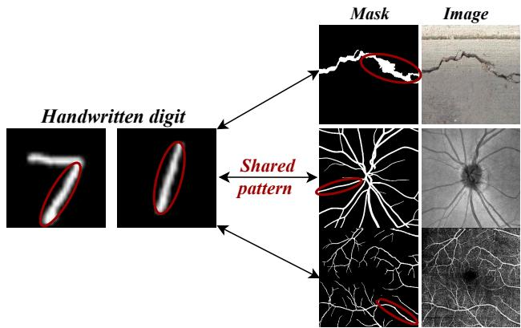  
Figure 4: Handwritten digits in MNIST dataset and curvilinear structures masks share common patterns (i.e., shapes).

Codebook Learning: Given the handwritten digit image X from the MNIST dataset, the convolutional encoder E maps the input image X with the size $6 4 \times 6 4$ to the latent feature vector $\mathbf { z _ { e } }$ as following :

$$
\mathbf { z _ { e } } = \mathbb { E } ( X ) , ~ \mathrm { a n d } ~ \mathbf { z _ { e } } \in \mathbb { R } ^ { W \times H \times C } ,\tag{6}
$$

where W, H, and C indicate the feature's width, height, and the number of channels, respectively. Next, we built codebook $\mathbb { C } ~ \in ~ \mathbb { R } ^ { N \times c }$ that contains N discrete latent vectors to model the distributions of the original MNIST dataset, where N is the number of entries in the codebook. And, c is the dimension of each entry, which is equal to C. Then, we can discretize the distribution of latent feature vector to get the quantized features $\hat { \mathbf { z } } _ { \mathbf { e } }$ by the following vector quantization $\mathrm { v Q } _ { \mathbb { C } } ( \cdot )$

$$
\begin{array} { r } { \mathrm { V Q } _ { \mathbb { C } } ( \mathbf { z } ) : = \mathrm { a r g m i n } _ { \mathbf { z } _ { k } \in \mathbb { T } } \left\| \mathbf { z } - \mathbf { z } _ { k } \right\| _ { 2 } , } \end{array}\tag{7}
$$

where $\mathbf { z } _ { k }$ is the k-th entry in the codebook C. Then, each vector in $\mathbf { z _ { e } }$ is replaced with its nearest neighbor entry in the codebook C via $\mathrm { V Q } _ { \mathbb { C } } ( \cdot )$ , resulting in the corresponding quantized feature vector $\hat { \mathbf { z } } _ { \mathbf { e } } \in \mathbb { R } ^ { W \times H \times c } \mathrm { : }$

$$
\begin{array} { r } { \hat { \mathbf { z } } _ { \mathbf { e } } = \mathrm { V Q } _ { \mathbb { C } } ( \mathbf { z } _ { \mathbf { e } } ) , \ \mathrm { a n d } \ \hat { \mathbf { z } } _ { \mathbf { e } } \in \mathbb { R } ^ { W \times H \times c } . } \end{array}\tag{8}
$$

The convolutional decoder D reconstructs the quantized vector $\hat { \mathbf { z } } _ { \mathbf { e } }$ back into the image $\hat { X } _ { \mathrm { r e c o n } }$ by the Eq. 9.

$$
\hat { X } _ { \mathrm { r e c o n } } = \mathbb { D } ( \hat { \mathbf { z } } _ { \mathbf { e } } ) .\tag{9}
$$

Finally, codebook C, encoder $\mathbb { M } _ { e } ^ { t }$ and decoder $\mathbb { M } _ { d } ^ { t }$ are jointly optimized with the following reconstruction loss:

$$
\begin{array} { r l } & { \mathcal { L } _ { \mathrm { V Q V A E } } ( \mathbb { C } , \mathbb { E } , \mathbb { D } ) = \Big \| X - \hat { X } _ { \mathrm { r e c o n } } \Big \| _ { 2 } + } \\ & { \qquad \| \mathbf { s g } [ \mathbf { z } _ { \mathrm { e } } ] - \hat { \mathbf { z } } _ { \mathrm { e } } \| _ { 2 } + \| \mathbf { s g } [ \hat { \mathbf { z } } _ { \mathrm { e } } ] - \mathbf { z } _ { \mathrm { e } } \| _ { 2 } , } \end{array}\tag{10}
$$

where $\mathbf { s g } [ \cdot ]$ indicates the stop gradient operator. The first item in Eq. 10 optimizes encoder and decoder to enforce the reconstructed image close to the original handwritten digit image. The second item in Eq. 10 provides gradients to the codebook C. To incentivize the encoder E to commit to the codebook, a third term is added to update the encoder parameters. In other words, it enforces the latent feature $\mathbf { z _ { e } }$ to be close to the nearest neighbor entry in C.

Top-K Selection: As shown in Fig 2, for a given image, we first obtain detected boxes via prompt generation module. Then, we convert these boxes into point prompts via Eq. 5, and then input SAM to get the initial predicted mask. For each predicted box, we crop the corresponding box region from the initial predicted mask, and then perform zero-padding into the patch image with size 64 × 64 (when the cropped region less than $6 4 \times 6 4 )$ , denoted as $P ^ { i } , i \in \{ 1 , \cdots , N \}$ , where N denotes the number of boxes.

Suppose that cropped patch image Pi does not contain any curvilinear structures, the extracted feature $\mathbb { E } ( P _ { i } )$ will have a large distance with its nearest neighbor entry in the codebook C via $\mathrm { v Q } _ { \mathbb { C } } ( \cdot )$ . For this purpose, our curvilinearaware discrete representation matching can be achieved via vector quantization in Eq. 7 with the pre-trained codebook:

Scor $\mathbf { \dot { e } } ^ { i } = 1 - \operatorname { S i g m o i d } ( \| \mathbb { E } ( P _ { i } ) - \mathbf { V } \mathbf { Q } _ { \mathbb { C } } \left( \mathbb { E } \left( P _ { i } \right) \right) \| _ { 2 } )$ (11) where Sigmoid $\begin{array} { r } { ( x ) = \frac { 1 } { 1 + \exp ^ { - x } } } \end{array}$ denotes sigmoid function.

Then, we can select Top-K boxes according to the discrete representation matching score in Eq. 11, and then transform the selected boxes into point prompts by using Eq. 5. Finally, the final mask can be obtained by leveraging these reliable prompts as the input to SAM (ViT-B as the backbone).

## Experiments

Experimental Setup. As this paper focuses on curvilinear structure segmentation tasks, we adopt the following related datasets for evaluation. Our OCT1600 dataset contains 1600 OCT projection images of the size 448 × 448 which are collected from real-world applications with fixed fields of view. The OCTA500 dataset has two different field of view types named OCTA-500\_3M, and OCTA-500\_6M. Compared to the 3M images, the vessels in the 6M images are more complicated, and the foveal avascular zone is smaller. Therefore, the segmentation tasks of 6M are more challenging compared to 3M. For this reason, we follow the existing work (Chen et al. 2025a) and use the 2-D projection image of the size 400 × 400 from OCTA-500\_6M. The DeepCrack dataset (Liu et al. 2019) contains curvilinear structures of cracks and consists of 537 images with manually annotated crack masks. All of the images involve a fixed size of 544 × 384. Each dataset is divided into training, validation, and testing sets at a ratio of 7:1:2. The Drive dataset (Staal et al. 2004) consists of 20 training and test retinal images of size 565 × 584. We randomly select a single image in the training set as our training image. The MNIST dataset (LeCun et al. 1998) is used to learn informative codebooks for storing curvilinear structure features. It contains 70000 greyscale images of handwritten digits, where 60000 labeled images are used for training our model, and the remaining 10000 are for testing to select the best model by the reconstruction error between the original and output image.

Implementation Details. Our CaPro is implemented based on the PyTorch. The training of oriented object detector: the size of synthetic training samples is 1000, the total training epoch is 60, the backbone of the detector is ResNet50 (He et al. 2016) and the remaining is the same as the original CenterNet (Zhou, Wang, and Krähenbühl 2019). The training of codebooks: the encoder/decoder of VQVAE consists of four blocks, where each block contains two ResBlocks (He et al. 2016) and a downsampling/upsampling layer. Note that, digits are resized to 64 × 64 pixels for training. The codebook has N = 1024 entries and an entry dimension of $c = 2 5 6$ . For both two training stages, we use an Adam optimizer (Diederik 2014) with a batch size of 64, a learning rate of $1 . 0 \times 1 0 ^ { - 3 }$ , and the training epoch 20. There is one hyper-parameter K, which is used to filter out those unreliable detected boxes. Fig. 5 shows that both a small K and a large K involve with limited performance. The reason behind this effect is that a small Kwill filter those informative boxes, and a large K will introduce those unreliable boxes. For this reason, we set $K = 2 0$ in our experiments.

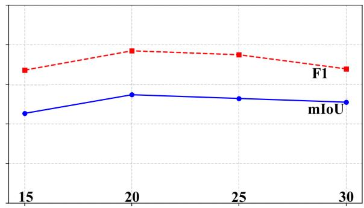  
Figure 5: Hyper-parameter study of K on OCTA500 dataset.

<table><tr><td rowspan="2">Method</td><td colspan="2">OCT1600</td><td colspan="2">OCTA500</td></tr><tr><td>mIoU(%) ↑</td><td>F1(%)↑</td><td>mIoU(%) ↑</td><td>F1(%)↑</td></tr><tr><td>FreeCOS</td><td>52.43</td><td>58.11</td><td>44.22</td><td>48.93</td></tr><tr><td>UPCrack</td><td>21.33</td><td>10.17</td><td>19.11</td><td>1.23</td></tr><tr><td>MuSc</td><td>23.11</td><td>5.34</td><td>25.02</td><td>4.27</td></tr><tr><td>SAM</td><td>15.60</td><td>11.12</td><td>24.03</td><td>3.300</td></tr><tr><td>+CaPro</td><td>64.33</td><td>70.49</td><td>58.68</td><td>64.23</td></tr><tr><td>SAM2</td><td>24.66</td><td>7.57</td><td>22.98</td><td>0.94</td></tr><tr><td>+CaPro</td><td>52.93</td><td>54.88</td><td>32.11</td><td>23.15</td></tr></table>

Table 1: Results on the OCT1600 and OCTA500 datasets.

Evaluation Metrics. For pixel-wise evaluation, we choose Precision, Recall, and F1 that have widely been used in existing semantic segmentation methods (Cheng et al. 2021). For each image, the performance metrics of Precision are calculated by comparing the correctly predicted pixels to all predicted pixels; Recall is calculated as the ratio that the model correctly predicted pixels of all pixels with respect to the ground-truth mask; Then, F1 can be obtained by a harmonic mean of the Precision and Recall: F1 = 2×Precision×Recall . The final F1 is calculated based on the av-Precision+Recall erage of all test images. Meanwhile, we also adopt mean Intersection over Union (mIoU) as our metrics by following the existing works (Lei, Zhong, and Wang 2024).

Quantitative Results. We compare CaPro with some stateof-the-art curvilinear structure segmentation methods that do not need the label of training samples including FreeCOS (Shi et al. 2023), UPCrack (Ma, Fan, and Xie 2024), MuSc(Li et al. 2024b), SAM (Kirillov et al. 2023), SAM2 (Ravi et al. 2024) on OCT1600, OCTA500, DeepCrack and Drive datasets. Table 1 shows that our CaPro achieves 48.73% improvement on mIoU, and 59.37% improvement on F1 than original SAM with OCT1600 dataset. These results show that the performances of SAM-based methods are still far from satisfactory when directly applied to curvilinear structure segmentation tasks in real-world industrial scenarios. This phenomenon is attributed to the domain gap between natural images and curvilinear structure images. Nonetheless, our CaPro can provide informative prompts, thus enabling SAM to adapt to curvilinear structure segmentation tasks without fine-tuning SAM. Moreover, to further validate the superiority of our method, we also compare with FreeCOS on Drive dataset. Table 3 also shows that our method still enjoys a high-performance gain over FreeCOS. For example, on the DeepCrack dataset, our method has more than 14.77% improvement on mIoU, and 18.33% improvement on F1 than training with synthesized images from FreeCOS (Shi et al. 2023). These results demonstrate the effectiveness of our oriented object detection perspective and curvilinear-aware discrete representation matching can filter those unreliable prompts from inaccurate detection. This can be attributed to the great potential of SAM-based methods

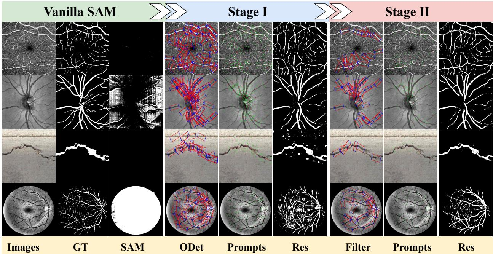

Figure 6: Visualization results of CaPro at different stages. “GT" denotes the ground truth mask. “SAM" denotes the results from SAM (Kirillov et al. 2023).“ODet" denotes the detected results from our self-supervised oriented object detector. “Prompts"denote the convert point prompts from the detected boxes. “Res" denotes the segmentation results of SAM with point prompts. “Filter" denotes the selected boxes via our curvilinear-aware discrete representation matching.
<table><tr><td rowspan="2">Method</td><td colspan="2">OCT1600</td><td colspan="2">OCTA500</td><td colspan="2">DeepCrack</td><td colspan="2">Drive</td></tr><tr><td>mIoU(%) ↑</td><td>F1(%)↑</td><td>mIoU(%) ↑</td><td>F1(%) ↑</td><td>mIoU(%)↑</td><td>F1(%)↑</td><td>mIoU(%) ↑</td><td>F1(%)↑</td></tr><tr><td>SAM</td><td>15.60</td><td>11.12</td><td>24.03</td><td>3.300</td><td>24.67</td><td>6.710</td><td>18.91</td><td>22.93</td></tr><tr><td>+ CaPro (Stage I)</td><td>60.13</td><td>66.72</td><td>48.51</td><td>51.33</td><td>39.30</td><td>32.30</td><td>48.36</td><td>51.76</td></tr><tr><td>+ CaPro (Stage II)</td><td>64.33</td><td>70.49</td><td>58.68</td><td>64.23</td><td>50.20</td><td>46.25</td><td>51.93</td><td>56.05</td></tr></table>

Table 2: Ablation studies on various curvilinear structure datasets.

<table><tr><td rowspan="2">Method</td><td colspan="2">DeepCrack</td><td colspan="2">Drive</td></tr><tr><td>mIoU(%) ↑</td><td>F1(%)↑</td><td>mIoU(%) ↑</td><td>F1(%)↑</td></tr><tr><td>FreeCOS</td><td>35.43</td><td>27.92</td><td>44.75</td><td>46.63</td></tr><tr><td>UPCrack</td><td>42.00</td><td>40.33</td><td>23.91</td><td>3.121</td></tr><tr><td>MuSc</td><td>28.13</td><td>11.53</td><td>27.36</td><td>11.97</td></tr><tr><td>SAM</td><td>24.67</td><td>6.710</td><td>18.91</td><td>22.93</td></tr><tr><td>+CaPro</td><td>50.20</td><td>46.25</td><td>51.93</td><td>56.05</td></tr></table>

Table 3: Results on the DeepCrack and Drive datasets.

on segmentation tasks when providing informative prompts.   
Qualitative results are available in Appendix B.

Ablation Study. To verify each stage in CaPro, we provide a series of ablation studies in Table 2. Stage II refreshes the performance achieved by Stage I. The reason behind this effect is two-fold: (1) Due to the domain gap between the synthesized images and real-world images, as shown in Fig. 6, those predicted boxes from stage I may fail to localize curvilinear structures. Thus, Stage I involves unsatisfied results that directly use the prompts from all detected boxes. (2) Our Stage II can filter those unreliable predicted boxes via the pre-trained codebook within the MNIST. Fig. 6 shows that the selected boxes in Stage II can well locate curvilinear structures, thus providing reliable prompts.

## Conclusion

We propose Curvilinear-aware Prompt Learning for adapting SAM to CSS tasks without requiring the SAM finetuning process and human annotation. Inspired by the fact that informative point prompts can help SAM to easily segment those curvilinear structures, this paper aims to automatically learn visual prompts with a single unlabeled image. To this end, we first propose the prompt-oriented training data synthesis that enables our customized oriented detector to act as a prompt generation module in a selfsupervised manner. Then, we explore the fact i.e., handwritten digits and curvilinear structure masks share common patterns, and then learn codebooks to store those curvilinear representations, which allows us to filter those unreliable prompts via curvilinear-aware representation matching.

## Acknowledgments

This work was partially supported by research grants from the Research Grants Council (RGC) of the Hong Kong Special Administrative Region, China (Project No. R6005-24); the Hong Kong Joint Research Scheme (JRS) of the National Natural Science Foundation of China (NSFC)/RGC (Project No. N\_HKUST654/24); and the National Natural Science Foundation of China (NSFC) (Grant No. 62306254).

## References

Carneiro-Esteves, S.; Vacavant, A.; and Merveille, O. 2024. A plug-and-play framework for curvilinear structure segmentation based on a learned reconnecting regularization. Neurocomputing, 599: 128055.

Chen, J.; Zhu, G.; Zhang, Y.; Chen, Z.; Huang, Q.; and Li, J. 2024a. UCAN: U-shaped context aggregation network for thin crack segmentation under topological constraints. Robotic Intelligence and Automation, 44(5): 637–647.

Chen, T.; Zhu, L.; Deng, C.; Cao, R.; Wang, Y.; Zhang, S.; Li, Z.; Sun, L.; Zang, Y.; and Mao, P. 2023a. Sam-adapter: Adapting segment anything in underperformed scenes. In Int. Conf. Comput. Vis., 3367–3375.

Chen, X.; Wang, C.; Ning, H.; Li, S.; and Shen, M. 2025a. Sam-octa: Prompting segment-anything for octa image segmentation. Biomedical Signal Processing and Control, 106: 107698.

Chen, Z.; Lai, Z.; Chen, J.; and Li, J. 2024b. Mind Marginal Non-Crack Regions: Clustering-Inspired Representation Learning for Crack Segmentation. In IEEE Conf. Comput. Vis. Pattern Recog., 12698–12708.

Chen, Z.; Wang, H.; Ou, C.; and Li, X. 2025b. MuTri: Multiview Tri-alignment for OCT to OCTA 3D Image Translation. In IEEE Conf. Comput. Vis. Pattern Recog., 20885– 20894.

Chen, Z.; Zhang, J.; Lai, Z.; Zhu, G.; Liu, Z.; Chen, J.; and Li, J. 2023b. The devil is in the crack orientation: A new perspective for crack detection. In Int. Conf. Comput. Vis., 6653-6663.

Cheng, M.; Zhao, K.; Guo, X.; Xu, Y.; and Guo, J. 2021. Joint topology-preserving and feature-refinement network for curvilinear structure segmentation. In Int. Conf. Comput. Vis., 7147–7156.

Cheng, Z.; Wei, Q.; Zhu, H.; Wang, Y.; Qu, L.; Shao, W.; and Zhou, Y. 2024. Unleashing the potential of SAM for medical adaptation via hierarchical decoding. In IEEE Conf. Comput. Vis. Pattern Recog., 3511–3522.

Diederik, P. K. 2014. Adam: A method for stochastic optimization. (No Title).

Feng, W.; Zhu, L.; and Yu, L. 2023. Cheap lunch for medical image segmentation by fine-tuning sam on few exemplars. In International MICCAI Brainlesion Workshop, 13–22.

Ge, K.; Wang, C.; Guo, Y.; Tang, Y.; Hu, Z.; and Chen, H. 2024. Fine-tuning vision foundation model for crack segmentation in civil infrastructures. Construction and Building Materials, 431: 136573.

He, K.; Zhang, X.; Ren, S.; and Sun, J. 2016. Deep residual learning for image recognition. In IEEE Conf. Comput. Vis. Pattern Recog., 770–778.

Hu, E. J.; Shen, Y.; Wallis, P.; Allen-Zhu, Z.; Li, Y.; Wang, S.; Wang, L.; and Chen, W. 2021. Lora: Low-rank adaptation of large language models. arXiv preprint arXiv:2106.09685.

Kirillov, A.; Mintun, E.; Ravi, N.; Mao, H.; Rolland, C.; Gustafson, L.; Xiao, T.; Whitehead, S.; Berg, A. C.; Lo, W.- Y.; et al. 2023. Segment anything. In Int. Conf. Comput. Vis., 4015–4026.

LeCun, Y.; Bottou, L.; Bengio, Y.; and Haffner, P. 1998. Gradient-based learning applied to document recognition. Proceedings of the IEEE, 86(11): 2278–2324.

Lei, Q.; Zhong, J.; and Dai, Q. 2024. Enriching Information and Preserving Semantic Consistency in Expanding Curvilinear Object Segmentation Datasets. In European Conference on Computer Vision, 233–250. Springer.

Lei, Q.; Zhong, J.; Dong, M.; and Ota, K. 2025. Faithful crack image synthesis from evolutionary pixel-level annotations via latent semantic diffusion model. Expert Systems with Applications, 126986.

Lei, Q.; Zhong, J.; and Wang, C. 2024. Joint optimization of crack segmentation with an adaptive dynamic threshold module. IEEE Transactions on Intelligent Transportation Systems, 25(7): 6902–6916.

Lei, Q.; Zhong, J.; Wang, C.; and Li, X. 2024. Integrating Crack Causal Augmentation Framework and Dynamic Binary Threshold for imbalanced crack instance segmentation. Expert Systems with Applications, 240: 122552.

Leng, T.; Zhang, Y.; Han, K.; and Xie, X. 2024. Selfsampling meta SAM: enhancing few-shot medical image segmentation with meta-learning. In IEEE Winter Conf Appl Comput Vis., 7925–7935.

Li, D.; Chen, L.; Cao, Y.; Zhu, K.; and Cheng, J. 2025. UCS: A Universal Model for Curvilinear Structure Segmentation. arXiv preprint arXiv:2504.04034.

Li, W.; Wang, P.; Xiong, R.; and Fan, X. 2024a. Spiking tucker fusion transformer for audio-visual zero-shot learning. IEEE Transactions on Image Processing.

Li, W.; Xiong, R.; and Fan, X. 2024. Multi-layer probabilistic association reasoning network for image-text retrieval. IEEE transactions on circuits and systems for video technology, 34(10): 9706–9717.

Li, X.; Chen, H.; Qi, X.; Dou, Q.; Fu, C.-W.; and Heng, P.- A. 2018. H-DenseUNet: hybrid densely connected UNet for liver and tumor segmentation from CT volumes. IEEE transactions on medical imaging, 37(12): 2663–2674.

Li, X.; Huang, Z.; Xue, F.; and Zhou, Y. 2024b. MuSc: Zero-Shot Industrial Anomaly Classification and Segmentation with Mutual Scoring of the Unlabeled Images. In International Conference on Learning Representations.

Li, X.; Yu, L.; Chen, H.; Fu, C.-W.; Xing, L.; and Heng, P.- A. 2020. Transformation-consistent self-ensembling model for semisupervised medical image segmentation. IEEE transactions on neural networks and learning systems, 32(2): 523–534.

Lin, L.; Peng, L.; He, H.; Cheng, P.; Wu, J.; Wong, K. K.; and Tang, X. 2023. YoloCurvSeg: You only label one noisy skeleton for vessel-style curvilinear structure segmentation. Medical image analysis, 90: 102937.

Lin, T.-Y.; Goyal, P.; Girshick, R.; He, K.; and Dollár, P. 2017. Focal loss for dense object detection. In Int. Conf. Comput. Vis., 2980–2988.

Liu, H.; Miao, X.; Mertz, C.; Xu, C.; and Kong, H. 2021. Crackformer: Transformer network for fine-grained crack detection. In Int. Conf. Comput. Vis., 3783–3792.

Liu, W.; Anguelov, D.; Erhan, D.; Szegedy, C.; Reed, S.; Fu, C.-Y.; and Berg, A. C. 2016. Ssd: Single shot multibox detector. In Eur. Conf. Comput. Vis., 21–37.

Liu, Y.; Yao, J.; Lu, X.; Xie, R.; and Li, L. 2019. DeepCrack: A deep hierarchical feature learning architecture for crack segmentation. Neurocomputing, 338: 139–153.

Ma, N.; Fan, R.; and Xie, L. 2024. UP-CrackNet: Unsupervised Pixel-Wise Road Crack Detection via Adversarial Image Restoration. IEEE Transactions on Intelligent Transportation Systems.

Rakshitha, R.; Srinath, S.; Kumar, N. V.; Rashmi, S.; and Poornima, B. 2024. Crack-SAM: Crack Segmentation Using a Foundation Model.

Ravi, N.; Gabeur, V.; Hu, Y.-T.; Hu, R.; Ryali, C.; Ma, T.; Khedr, H.; Rädle, R.; Rolland, C.; Gustafson, L.; et al. 2024. Sam 2: Segment anything in images and videos. arXiv preprint arXiv:2408.00714.

Redmon, J.; Divvala, S.; Girshick, R.; and Farhadi, A. 2016. You only look once: Unified, real-time object detection. In IEEE Conf. Comput. Vis. Pattern Recog., 779–788.

Ren, S.; He, K.; Girshick, R.; and Sun, J. 2016. Faster R-CNN: Towards real-time object detection with region proposal networks. IEEE Trans. Pattern Anal. Mach. Intell., 39(6): 1137–1149.

Shi, T.; Ding, X.; Zhang, L.; and Yang, X. 2023. FreeCOS: self-supervised learning from fractals and unlabeled images for curvilinear object segmentation. In Int. Conf. Comput. Vis., 876–886.

Staal, J.; Abràmoff, M. D.; Niemeijer, M.; Viergever, M. A.; and Van Ginneken, B. 2004. Ridge-based vessel segmentation in color images of the retina. IEEE transactions on medical imaging, 23(4): 501–509.

Wang, F.; Gu, Y.; Liu, W.; Yu, Y.; He, S.; and Pan, J. 2019. Context-aware spatio-recurrent curvilinear structure segmentation. In IEEE Conf. Comput. Vis. Pattern Recog., 12648-12657.

Wang, H.; and Li, X. 2023a. Dhc: Dual-debiased heterogeneous co-training framework for class-imbalanced semisupervised medical image segmentation. In International conference on medical image computing and computerassisted intervention, 582–591.

Wang, H.; and Li, X. 2023b. Towards generic semisupervised framework for volumetric medical image segmentation. Advances in Neural Information Processing Systems, 36: 1833–1848.

Wang, H.; Zhang, Q.; Li, Y.; and Li, X. 2024a. Allspark: Reborn labeled features from unlabeled in transformer for semi-supervised semantic segmentation. In IEEE Conf. Comput. Vis. Pattern Recog., 3627–3636.

Wang, L.; Qi, C.; Ou, C.; An, L.; Jin, M.; Kong, X.; and Li, X. 2024b. MultiEYE: Dataset and Benchmark for OCT-Enhanced Retinal Disease Recognition from Fundus Images. IEEE Transactions on Medical Imaging.

Xu, H.; Li, C.; Jiang, X.; Zhang, S.; Wang, S.; and Zhang, H. 2024. CrackSAM: Study on Few-Shot Segmentation of Mural Crack Images Using SAM. In 2024 IEEE 16th International Conference on Advanced Infocomm Technology (ICAIT), 188–193. IEEE.

Yao, H.; Hu, X.; and Li, X. 2022. Enhancing pseudo label quality for semi-supervised domain-generalized medical image segmentation. In Proceedings of the AAAI conference on artificial intelligence, volume 36, 3099–3107.

Ye, Z.; Lovell, L.; Faramarzi, A.; and Ninić, J. 2024. Sambased instance segmentation models for the automation of structural damage detection. Advanced Engineering Informatics, 62: 102826.

Zamir, M. 2001. Arterial branching within the confines of fractal L-system formalism. The Journal of general physiology, 118(3): 267–276.

Zhang, H.; Zhu, H.; Jing, J.; Li, P.; and Pan, Q. 2024. Curve-Like Structure Detection Using Multi-Sale and Boundary Assisted Segmentation Network. IEEE Transactions on Instrumentation and Measurement.

Zhou, X.; Wang, D.; and Krähenbühl, P. 2019. Objects as points. arXiv preprint arXiv:1904.07850.

Zou, Q.; Zhang, Z.; Li, Q.; Qi, X.; Wang, Q.; and Wang, S. 2018. Deepcrack: Learning hierarchical convolutional features for crack detection. IEEE transactions on image processing, 28(3): 1498–1512.