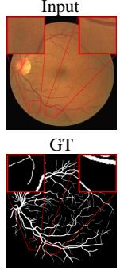
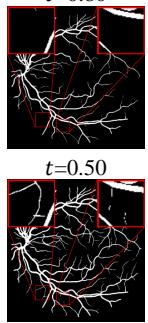
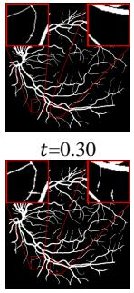
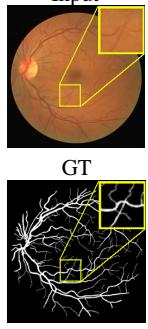
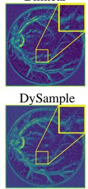
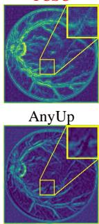
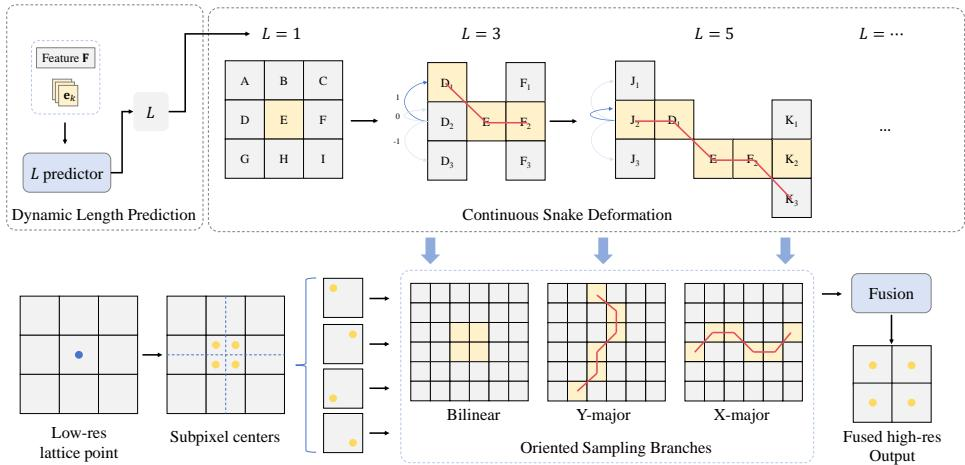
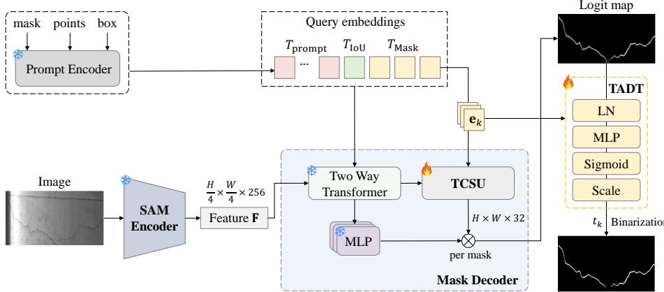
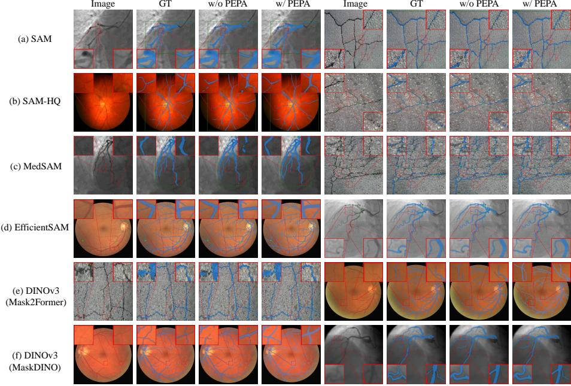

# From Reconstruction to Decision: A Post-Encoder Plug-in Adapter for Curvilinear Segmentation

Qin Lei1,20, Jiang Zhong4, Xin Xiao4, Yuming Yang4, and Hao Wu1,2,30\*

1 Center for Big Data and Intelligent Medicine, The First Affiliated Hospital of Chongqing Medical University, Chongqing, China

2 Key Laboratory of Digital Health and Intelligent Medicine, Chongqing Municipal Health Commission, Chongqing, China

3 Chongqing Translational Medicine Center, Chongqing, China College of Computer Science, Chongqing University, Chongqing, China qinlei@hospital.cqmu.edu.cn;zhongjiang@cqu.edu.cn; 20241401023@stu.cqu.edu.cn;ymyang@cqu.edu.cn;wuhao@cqmu.edu.cn;

Abstract. Curvilinear object segmentation, including vessels and cracks, is challenging due to extreme spatial sparsity and topological fragility, where small local errors can cause severe structural disconnections. Meanwhile, modern segmentation pipelines increasingly rely on strong but hard-to-modify foundation encoders whose heavy downsampling limits fine structural recovery. Motivated by this, we focus on the post-encoder stage and study two recurring and actionable failure modes: a reconstruction bottleneck in high-resolution feature restoration and a decision bottleneck in binarization. We present PEPA, a lightweight Post-Encoder Plug-in Adapter for 2D curvilinear segmentation pipelines with accessible decoder/head features and target, query, or class descriptors. PEPA couples (i) Target-Conditioned Snake Upsampling (TCSU), which uses target-conditioned continuous snake-like sampling to better recover thin and tortuous structures during upsampling, and (ii) Target-Adaptive Differentiable Thresholding (TADT), which predicts target-specific thresholds and optimizes a soft-threshold surrogate with explicit safeguards against trivial bias shifting. Under this post-encoder interface, PEPA can be attached to both prompt-based decoders and conventional dense predictors. Experiments on five medical and industrial benchmarks show that adding PEPA to frozen-encoder baselines yields consistent improvements, with gains in topological connectivity (clDice) typically exceeding those in region overlap (IoU), indicating improved structural continuity. With only \~0.26M additional parameters, PEPA offers a practical postencoder enhancement for structure-centric segmentation.

Keywords: Curvilinear segmentation · Vision foundation models · Postencoder adapter · Topology preservation

## 1 Introduction

Segmenting curvilinear objects, such as vessels [10,32], neuronal branches [27,37], and cracks [4, 5, 21, 29], is a core challenge in computer vision. Unlike compact macro-objects, curvilinear structures exhibit extreme spatial sparsity and topological fragility [3, 16, 37]. Their thin profiles and drastic local contrast decay make their topological integrity highly sensitive to high-frequency detail reconstruction and the final binarization boundary [19, 20, 22]. Consequently, even minor pixel-level errors can cause severe structural disconnections and undermine downstream analyses [17, 18, 37].

Vision Foundation Models (VFMs), such as the SAM series [15,35] and DINO series [33, 39], have recently provided strong visual representations for dense prediction. However, applying them to curvilinear structures exposes a semanticspatial paradox: foundation encoders obtain semantic abstraction through heavy downsampling (e.g., 16×), but this process also removes the fine spatial granularity required to delineate delicate topologies. Since full fine-tuning of massive encoders is computationally expensive and may compromise their general representations, structure preservation is often delegated to the post-encoder stage. This raises a practical question: How can we design a lightweight post-encoder plug-in that improves the reconstruction and final decision of fragile curvilinear structures without modifying the foundation encoder?

Input  

t=0.80  
  
(a)

t=0.62  

Input  

Bilinear  
  
(b)

TCSU  
  
Fig. 1: Motivation for our proposed PEPA. (a) Decision Bottleneck (TADT): Applying a static global threshold $( t = 0 . 8 0 , 0 . 5 0 , 0 . 3 0 )$ either breaks faint branches or introduces severe noise. A target-adaptive threshold (t = 0.62, red) balances connectivity and noise suppression. (b) Reconstruction Bottleneck (TCSU): Traditional bilinear interpolation and recent advanced upsamplers, such as DySample [28] and AnyUp [44], produce blurred or disconnected features for thin vessels. Our Target-Conditioned Snake Upsampling (TCSU) synthesizes sharper and more continuous structural responses.

We focus on two recurring and actionable post-encoder bottlenecks for curvilinear segmentation: the Reconstruction Bottleneck of high-resolution feature restoration and the Decision Bottleneck of probability discretization. These bottlenecks are not intended to exhaust all possible failure modes; rather, they characterize two common stages where fragile structures are frequently broken after low-resolution semantic embeddings have been produced by the encoder.

In the reconstruction phase, decoders typically rely on isotropic, target-agnostic operations such as bilinear upsampling. As shown in Fig. 1(b), passive interpolation can blur thin responses and cause topology breakage. Even recent advanced upsamplers, such as AnyUp [44] and DySample [28], are not explicitly constrained by curvilinear morphology, so strong gradients from thick structures may dominate the reconstruction process while faint branches remain fragmented. For topology-sensitive targets, upsampling should therefore move beyond passive interpolation toward active, morphology-conditioned geometric reconstruction.

In the decision phase, converting continuous probabilities into binary masks is sensitive to the threshold choice. As shown in Fig. 1(a), a high global threshold can suppress faint terminal branches, whereas a low threshold can introduce noisy false positives. Although differentiable binarization has been effective in scene-level tasks such as text detection [25], naïvely applying learnable thresholds to dense, multi-target curvilinear segmentation can lead to trivial bias compensation: the network may jointly shift logits and thresholds to bypass true boundary improvement rather than learning a more topology-preserving decision boundary.

To address these two post-encoder bottlenecks, we propose PEPA (Post-Encoder Plug-in Adapter), a modular and lightweight adapter for 2D curvilinear segmentation pipelines with accessible decoder/head features and target, query, or class descriptors. PEPA shifts the post-encoder stage from rigid reconstruction and fixed discretization to target-adaptive reconstruction and decision calibration through two core modules:

Target-Conditioned Snake Upsampling (TCSU): TCSU generates subpixel sampling points along continuous and dynamically sized snake-like neighborhoods. By modulating chain length and deformation direction with a target descriptor, TCSU encourages high-resolution reconstruction to follow the queried structure while reducing interference from distractor gradients.

\- Target-Adaptive Differentiable Thresholding (TADT): TADT predicts target-specific binarization thresholds and constructs an end-to-end optimizable soft-threshold surrogate. To mitigate threshold-learning degeneration, TADT uses logit centering, topology-aware supervision on the surrogate, and local threshold-perturbation consistency.

In summary, our main contributions are three-fold:

\- We identify reconstruction and decision calibration as two recurring postencoder bottlenecks for curvilinear segmentation, and propose TCSU, a target-conditioned upsampling operator that uses continuous snake-like sampling chains to synthesize structure-preserving high-resolution features.

— We design TADT, a target-adaptive differentiable thresholding framework that optimizes the soft binarization surrogate with topology-aware objectives and explicit anti-degeneration safeguards.

\- We integrate TCSU and TADT into PEPA, a lightweight post-encoder plug-in for 2D curvilinear segmentation pipelines. Extensive experiments across five medical and industrial benchmarks demonstrate that equipping frozen Vision Foundation Models with PEPA yields consistent improvements, achieving average absolute gains of +2.6% in IoU and +2.8% in clDice without fine-tuning the massive backbone encoders.

## 2 Related Work

## 2.1 Feature Upsampling

In some visual tasks, feature upsampling is essential for restoring high-resolution spatial details from low-resolution semantic embeddings. Traditional methods typically rely on task-agnostic operations, such as bilinear interpolation or standard transposed convolutions, which process all spatial dimensions isotropically and often cause topological drift or edge blurring in thin structures |28]. To address this, learnable upsamplers like CARAFE [41] and DySample [28] introduce dynamic, content-aware sampling strategies. Recently, with the rise of Vision Foundation Models (VFMs), arbitrary-resolution and feature-agnostic upsamplers have emerged, including FeatUp [9], LoftUp [12], JAFAR [7], and AnyUp |44]. While these methods achieve state-of-the-art performance in general semantic segmentation, they apply globally-attended reconstruction without explicit morphological constraints. Consequently, the attention mechanisms are often hijacked by the gradients of thick background structures, leading to disconnected features for faint curvilinear targets. In contrast, our Target-Conditioned Snake Upsampling (TCSU) transitions from passive interpolation to active, morphologyconditioned geometric deformation, explicitly tracking the queried object's topology.

## 2.2 Differentiable Binarization and Adaptive Thresholding

Converting continuous probability maps into discrete binary masks typically relies on rigid global thresholds, which struggle to balance noise suppression and connectivity preservation due to the high intra-class variance of curvilinear structures [19]. To enable end-to-end optimization of the binarization process, DBNet [24, 25 proposed a differentiable approximate step function, achieving great success in scene text detection. Recently, this concept has been broadly extended to various vision domains; for instance, BAA [38] incorporates binarization behavior into gradient-based optimization for edge detection, while BI-DiffSR [2] and BiMaCoSR [26] utilize customized binarization architectures to compress diffusion models for image super-resolution. In the domain of crack and curvilinear segmentation, Lei et al. [19, 21, 22] advanced this paradigm by reformulating the task as a multi-objective problem, jointly optimizing dynamic pixel-level thresholds and utilizing causal augmentation to mitigate extreme class imbalance. Despite these advancements, directly applying differentiable binarization to dense, multi-target curvilinear segmentation often triggers trivial bias compensation, where the network jointly shifts logits and thresholds rather than sharpening actual decision boundaries. Our Target-Adaptive Differentiable Thresholding (TADT) module evades this degradation via logit centering and direct calibration with connectivity-aware losses.

## 3 Method

Curvilinear targets exhibit extreme spatial sparsity and structural fragility, making their topological integrity highly sensitive to high-resolution reconstruction and the final binary decision. Since modern segmentation increasingly relies on frozen foundation encoders, improvements must be plug-and-play across architectures. We propose PEPA (Post-Encoder Plug-in Adapter), coupling Target-Conditioned Snake Upsampling (TCSU) for structure-preserving reconstruction with Target-Adaptive Differentiable Thresholding (TADT) for decision calibration.

Notation. Given encoder features $\mathbf { F } ~ \in ~ \mathbb { R } ^ { B \times C \times H \times W }$ and a target descriptor $\mathbf { e } _ { k } \in \mathbb { R } ^ { B \times d }$ (e.g., a prompted object or class embedding), TCSU upsamples F to a high-resolution substrate $\mathbf { U } _ { k } \in \mathbb { R } ^ { B \times C ^ { \prime } \times s H \times s W }$ (scale s). The mask head then outputs logits $\mathbf { z } _ { k }$ . Concurrently, TADT predicts a target-adaptive threshold $t _ { k }$ from $\mathbf { e } _ { k } .$ , enabling differentiable binarization during training and hard thresholding at inference.

## 3.1 Target-Conditioned Snake Upsampling (TCSU)

TCSU synthesizes high-resolution features by sampling along snake-shaped neighborhoods. Unlike standard interpolation, TCSU employs adaptive range and continuity-constrained deformation, both modulated by the target descriptor $\mathbf { e } _ { k }$ to track specific curvilinear topologies while avoiding clutter.

Taking $2 \times$ upsampling (s=2) as an example, each low-resolution lattice $( x , y )$ introduces four subpixel centers $\mathbf { p } _ { m } ^ { 0 } ( x , y ) = ( x , y ) + \boldsymbol { \pi } _ { m }$ . Alongside a stable bilinear shortcut $\mathbf { U } _ { k } ^ { \mathrm { b i } } = \mathrm { B i l i n e a r U p } ( \mathbf { F } ; s )$ , TCSU branches reconstruct features via three sequential operations:

1) Dynamic Length Prediction. We predict an effective chain length $L _ { k }$ to control the snake's extent. We modulate a base length $L _ { \mathrm { b a s e } }$ using feature evidence Summ(F) and the target $\mathbf { e } _ { k }$ , applying a straight-through estimator to enforce a symmetric odd length:

$$
L _ { k } = \mathrm { O d d R o u n d } \Big ( L _ { \mathrm { b a s e } } \cdot \big ( 1 + g ( \mathrm { S u m m } ( \mathbf { F } ) , \mathbf { e } _ { k } ) \big ) \Big ) \in \{ 1 , 3 , 5 , \ldots \} .\tag{1}
$$

  
Fig. 2: TCSU architecture. The module predicts a dynamic sampling length L and accumulates continuous snake deformations. The features are sampled via X-major and Y-major branches, and then fused with a bilinear shortcut to construct the final high-resolution output.

2) Conditioned Deformation & Sampling. We instantiate an X-major snake (bending in y) and a Y-major snake (bending in x). For subpixel $m _ { ; }$ incremental offsets are predicted via a shared-plus-refinement network: $f _ { \star } ( { \bf F } , { \bf e } _ { k } ; m ) =$ $f _ { \star , \mathrm { s h } } ( \mathbf { F } ; m ) + \eta _ { k } f _ { \star , \mathrm { t g } } ( \mathbf { F } , \mathbf { e } _ { k } ; m )$ , where $\eta _ { k } = \sigma ( \mathrm { M L P } ( \mathbf { e } _ { k } ) ,$ ). A smooth length-aware mask $\omega ( i ; L _ { k } )$ truncates the increments to keep the dynamic length coupling differentiable: $\varDelta y _ { k , m , i } ^ { x } \gets \varDelta y _ { k , m , i } ^ { x } \cdot \omega ( i ; L _ { k } )$

To preserve the structural adjacency prior of curvilinear objects, we iteratively accumulate these increments from the center outward. For the X-major snake, which extends along the x-axis while bending in y, the accumulated vertical offsets are defined as:

$$
\tilde { \Delta } \boldsymbol y _ { k , m } ^ { x } ( 0 ) = 0 , \qquad \tilde { \Delta } \boldsymbol y _ { k , m } ^ { x } ( \pm i ) = \tilde { \Delta } \boldsymbol y _ { k , m } ^ { x } ( \pm ( i - 1 ) ) + \Delta \boldsymbol y _ { k , m , \pm i } ^ { x } , \quad i = 1 , \dots , c ,\tag{2}
$$

where $c = \lfloor ( K - 1 ) / 2 \rfloor$ and K is the maximal chain length. Features are then differentiably sampled at these continuous coordinates:

$$
\mathbf { V } _ { k , m } ^ { x } = S \Big ( \mathbf { F } , \{ \left( x + \varDelta x _ { m } ^ { 0 } + i , y + \varDelta y _ { m } ^ { 0 } + \tilde { \varDelta } y _ { k , m } ^ { x } ( i ) \right) \} _ { i = - c } ^ { c } \Big ) ,\tag{3}
$$

with an analogous operation for $\mathbf { V } _ { k , m } ^ { y }$

3) Aggregation & Fusion. The sampled tensors are aggregated using 1D depthwise convolutions $A _ { \star }$ modulated by $L _ { k }$ . The subpixel responses $\mathbf { u } _ { k , m } ^ { x }$ and $\mathbf { u } _ { k , m } ^ { y }$ are rearranged onto the high-resolution grid and concatenated with the bilinear shortcut to yield the final $\mathbf { U } _ { k }$

Relation to Snake Convolution. Unlike standard snake convolutions [34] which act as target-agnostic feature extractors, TCSU is a reconstruction operator that explicitly conditions both its dynamic length and deformation on the target $\mathbf { e } _ { k }$ , enabling distinct structural recovery behaviors for different queries.

## 3.2 Target-Adaptive Differentiable Thresholding (TADT)

A global threshold (e.g., 0.5) often forces a sub-optimal trade-off between breaking faint branches and introducing noise. TADT overcomes this by calibrating target-specific decision boundaries, predicting a bounded threshold $t _ { k } ~ \in$ $[ t _ { \mathrm { m i n } } , t _ { \mathrm { m a x } } ]$ in the logit domain:

$$
t _ { k } = t _ { \mathrm { m i n } } + \big ( t _ { \mathrm { m a x } } - t _ { \mathrm { m i n } } \big ) \cdot \sigma \big ( \tilde { h } _ { t } ( \mathbf { e } _ { k } , \mathrm { S u m m } ( \mathbf { F } ) ) \big ) .\tag{4}
$$

To enable end-to-end optimization, we replace the non-differentiable step function with a smooth surrogate $\mathbf { b } _ { k } = \sigma ( \alpha ( \widetilde { \mathbf { z } } _ { k } - t _ { k } ) )$ , where the scalar α controls the sharpness of the transition. In our implementation, α is empirically set to a constant value $( \mathrm { e . g . } , \alpha { = } 1 . 0 )$ to maintain gradient stability without requiring complex annealing schedules.

Crucially, jointly learning thresholds and logits often degenerates into trivial bias shifting. TADT prevents this via three mechanisms: (i) Logit Centering: We remove the spatial mean $\tilde { \mathbf { z } } _ { k } = \mathbf { z } _ { k } - \mu ( \mathbf { z } _ { k } )$ to isolate relative confidence. (ii) Threshold-Aware Objectives: Losses (e.g., clDice [37]) are computed directly on the surrogate $\mathbf { b } _ { k }$ , forcing $t _ { k }$ to optimize topological connectivity. (iii) Local Stability: To prevent the decision boundary from becoming overly sensitive to localized noise, we compute two perturbed surrogates by shifting the threshold by a margin $\varDelta$ (set to 0.5 in the logit domain):

$$
\mathbf { b } _ { k } ^ { \pm } = \sigma \big ( \alpha \big ( \tilde { \mathbf { z } } _ { k } - ( t _ { k } \pm \varDelta ) \big ) \big ) .\tag{5}
$$

We then enforce consistency between these perturbed states using a soft Dice agreement loss, explicitly formulated as:

$$
\mathcal { L } _ { \mathrm { c o n s i s t } } ( \mathbf { b } _ { k } ^ { + } , \mathbf { b } _ { k } ^ { - } ) = 1 - \frac { 2 \sum \mathbf { b } _ { k } ^ { + } \cdot \mathbf { b } _ { k } ^ { - } + \epsilon } { \sum \mathbf { b } _ { k } ^ { + } + \sum \mathbf { b } _ { k } ^ { - } + \epsilon } ,\tag{6}
$$

which firmly anchors the dynamic boundary and discourages noise-driven fluctuations.

## 3.3 Instantiations and Optimization

PEPA is designed as a lightweight post-encoder plug-in for 2D curvilinear segmentation pipelines with accessible decoder/head features and target, query, or class descriptors. In prompt-based models (e.g., SAM, as shown in Fig. 3), $\mathbf { e } _ { k }$ is the output mask token, and TCSU replaces the decoder's standard upscaling. In semantic models $( \mathrm { e . g . , U - N e t } ) , \mathbf { e } _ { k }$ is a learnable class embedding, and TCSU modules replace all hierarchical upsampling layers. During training, we optimize a composite loss evaluated on the binarization surrogate; when multiple mask hypotheses are produced, we choose $k ^ { \star }$ by minimizing this loss, otherwise no hypothesis selection is used.

$$
\mathcal { L } _ { \mathrm { t o t a l } } = \lambda _ { \mathrm { b c e } } \mathcal { L } _ { \mathrm { b c e } } + \lambda _ { \mathrm { d i c e } } \mathcal { L } _ { \mathrm { d i c e } } + \lambda _ { \mathrm { c l } } \big ( 1 - \mathrm { c l } { \mathrm { D i c e } } \big ) + \lambda _ { \mathrm { c o n s i s t } } \mathcal { L } _ { \mathrm { c o n s i s t } } .\tag{7}
$$

Detailed mathematical formulations of the subpixel initialization and network hyper-parameters are provided in the Supplementary Material.

  
Fig. 3: PEPA SAM instantiation. TCSU replaces the standard upsampling substrate, generating target-conditioned high-resolution features from query embeddings Concurrently, TADT predicts a specific binarization threshold for the target.

## 4 Experiments

## 4.1 Experimental Settings

To evaluate the generalization of PEPA across diverse scenarios, we conduct experiments on five curvilinear segmentation benchmarks spanning medical vasculature and industrial scenes: DRIVE [40], CHASEDB1 [8], CHUAC [1], XCAD [31], and Crack500 [46]. For quantitative evaluation, we employ Intersection over Union (IoU) to assess region-level classification accuracy and centerline Dice (clDice) [37] to measure topological connectivity and structural integrity.

Implementation Details. For the Vision Foundation Model experiments, we utilized the ViT-B backbone for all SAM variants (SAM, SAM-HQ, Med-SAM) and the EfficientSAM-S backbone for EfficientSAM. During training, the massive foundation encoders were kept strictly frozen, and only the original mask decoders along with the PEPA modules were updated. Optimization was performed using the AdamW optimizer with an initial learning rate of $1 \times 1 0 ^ { - 4 }$ , a weight decay of $1 \times 1 0 ^ { - 4 }$ , and a cosine annealing scheduler for 100 epochs on a single NVIDIA H200 GPU. The batch size was set to 8 for all datasets.

Prompt Protocol. For prompt-based models, we follow the same prompt simulation strategy as SAM-HQ [14] during training. Given the ground-truth (GT) mask, we construct three candidate prompts: (i) a tight bounding box computed from the GT mask; (ii) k=10 positive point prompts uniformly sampled from foreground pixels; and (iii) a noisy mask prompt obtained by downsampling the GT mask to 256×256 and injecting random perturbations, which is fed to SAM as mask\_inputs. For each training sample, we randomly select one prompt type from {box, point, mask\_inputs}. If the foreground region contains fewer than k pixels (so that point sampling is ill-defined), we disable point prompts and sample from {box, mask\_inputs} only. Following SAM-HQ, we use the single-mask output mode (i.e., multimask\_output=False), hence no oracle selection among multiple mask hypotheses (k\*) is involved.

At test time, we adopt a strict box-prompt protocol: all quantitative results are produced using only the GT-derived bounding box, without any additional prompts. For qualitative visualization in Fig. 4, we additionally show results under manually chosen point and box prompts to better reflect interactive use cases.

Table 1: Decoder fine-tuning with frozen VFM encoders. For all baseline models (w/o PEPA), their original segmentation decoders were fully fine-tuned. We compare these optimized baselines against the integration of PEPA (+PEPA) under the identical training protocol.
<table><tr><td rowspan="2">Method</td><td colspan="2">XCAD</td><td colspan="2">CHUAC</td><td colspan="2">DRIVE</td><td colspan="2">CHASEDB1</td><td colspan="2">Crack500</td><td colspan="2">Avg.</td></tr><tr><td>IoU</td><td>clDice</td><td>IoU</td><td>clDice</td><td>IoU</td><td>clDice</td><td>IoU</td><td>clDice</td><td>IoU</td><td>clDice</td><td></td><td>IoU clDice</td></tr><tr><td>SAM [15]</td><td>68.4</td><td>81.5</td><td>65.8</td><td>79.9</td><td>70.2</td><td>81.0</td><td>66.8</td><td>79.9</td><td>63.4</td><td>77.2</td><td>66.9</td><td>79.9</td></tr><tr><td>+ PEPA</td><td>73.1</td><td>85.3</td><td>67.8</td><td>81.1</td><td>72.8</td><td>84.2</td><td>70.8</td><td>85.5</td><td>64.8</td><td>79.6</td><td>69.9</td><td>83.1</td></tr><tr><td>Δ↑</td><td>+4.7</td><td>+3.8</td><td>+2.0</td><td>+1.2</td><td>+2.6</td><td>+3.2</td><td>+4.0</td><td>+5.6</td><td>+1.4</td><td>+2.4</td><td>+2.9</td><td>+3.2</td></tr><tr><td>SAM-HQ [14] + PEPA</td><td>68.7</td><td>81.8</td><td>66.2</td><td>79.2</td><td>70.0</td><td>80.8</td><td>66.3</td><td>79.4</td><td>63.8</td><td>77.6</td><td>67.0</td><td>79.8</td></tr><tr><td>∆↑</td><td>73.3 +4.6</td><td>85.5</td><td>68.0</td><td>81.5</td><td>71.9</td><td>83.8</td><td>70.5</td><td>85.1</td><td>65.0</td><td>79.8</td><td>69.7</td><td>83.1</td></tr><tr><td></td><td></td><td>+3.7</td><td>+1.8</td><td>+2.3</td><td>+1.9</td><td>+3.0</td><td>+4.2</td><td>+5.7</td><td>+1.2</td><td>+2.2</td><td>+2.7</td><td>+3.4</td></tr><tr><td>MedSAM [30] + PEPA</td><td>68.6</td><td>81.7</td><td>65.4</td><td>79.5</td><td>70.5</td><td>81.3</td><td>66.4</td><td>79.6</td><td>63.5</td><td>77.8</td><td>66.9</td><td>80.0</td></tr><tr><td>∆↑</td><td>73.1</td><td>85.4</td><td>67.6</td><td>81.0</td><td>72.6</td><td>83.6</td><td>70.8</td><td>85.6</td><td>64.9</td><td>79.6</td><td>69.8</td><td>83.0</td></tr><tr><td></td><td>+4.5</td><td>+3.7</td><td>+2.2</td><td>+1.5</td><td>+2.1</td><td>+2.3</td><td>+4.4</td><td>+6.0</td><td>+1.4</td><td>+1.8</td><td>+2.9</td><td>+3.1</td></tr><tr><td>EfficientSAM [45] + PEPA</td><td>65.7</td><td>79.2</td><td>63.1</td><td>77.4</td><td>68.6</td><td>77.6</td><td>63.6</td><td>77.3</td><td>59.9</td><td>72.4</td><td>64.2</td><td>76.8</td></tr><tr><td>Δ↑</td><td>69.2</td><td>81.7</td><td>65.3</td><td>79.2</td><td>70.3</td><td>81.5</td><td>68.4</td><td>81.4</td><td>62.6</td><td>77.4</td><td>67.2</td><td>80.2</td></tr><tr><td></td><td>+3.5</td><td>+2.5</td><td>+2.2</td><td>+1.8</td><td>+1.7</td><td>+3.9</td><td>+4.8</td><td>+4.1</td><td>+2.7</td><td>+5.0</td><td>+3.0</td><td>+3.5</td></tr><tr><td>DINOv3(Mask2Former) [6]</td><td>67.0</td><td>80.2</td><td>63.8</td><td>77.9</td><td>67.9</td><td>80.9</td><td>67.9</td><td>80.9</td><td>61.7</td><td>76.3</td><td>65.7</td><td>79.2</td></tr><tr><td>+ PEPA</td><td>69.1</td><td>82.1</td><td>65.8</td><td>79.8</td><td>69.7</td><td>82.5</td><td>70.0</td><td>82.8</td><td>63.6</td><td>78.2</td><td>67.6</td><td>81.1</td></tr><tr><td>Δ↑</td><td>+2.1</td><td>+1.9</td><td>+2.0</td><td>+1.9</td><td>+1.8</td><td>+1.6</td><td>+2.1</td><td>+1.9</td><td>+1.9</td><td>+1.9</td><td>+2.0</td><td>+1.8</td></tr><tr><td>DINOv3(MaskDINO) [23]</td><td>68.1</td><td>80.9</td><td>65.0</td><td>78.7</td><td>69.5</td><td>81.9</td><td>67.8</td><td>80.7</td><td>62.0</td><td>76.4</td><td>66.5</td><td>79.7</td></tr><tr><td>+ PEPA</td><td>70.5</td><td>83.0</td><td>67.1</td><td>80.6</td><td>71.4</td><td>83.6</td><td>70.1</td><td>82.7</td><td>63.9</td><td>78.3</td><td>68.6</td><td>81.6</td></tr><tr><td>Δ↑</td><td>+2.4</td><td>+2.1</td><td>+2.1</td><td>+1.9</td><td>+1.9</td><td>+1.7</td><td>+2.3</td><td>+2.0</td><td>+1.9</td><td>+1.9</td><td>+2.1</td><td>+1.9</td></tr><tr><td>Avg. ∆↑</td><td>+3.7 +3.0</td><td></td><td>+2.1</td><td>+1.8</td><td>+2.0</td><td>+2.6</td><td>+3.6</td><td>+4.2</td><td>+1.8</td><td>+2.5</td><td>+2.6</td><td>+2.8</td></tr></table>

## 4.2 Experimental Results

Enhancing Vision Foundation Models To demonstrate PEPA's plug-andplay capability, we integrate it into six Vision Foundation Models (VFMs), encompassing prompt-based architectures (e.g., SAM variants [14, 15, 30, 45]) and conventional segmentation heads (e.g., DINOv3 [39] with Mask2Former [6] and MaskDINO [23]). Crucially, to ensure a fair comparison, the original decoders of all baseline models (w/o PEPA) were fully fine-tuned on the respective datasets.

As shown in Table 1, the consistent improvements yielded by PEPA demonstrate architectural gains strictly on top of already optimized baselines. Specifically, PEPA achieves average absolute increases of +2.6% in IoU and +2.8% in clDice. A critical observation from these results is the metric asymmetry: the improvements in clDice are consistently more pronounced than those in IoU. This empirical evidence validates our core hypothesis that PEPA effectively addresses topological fragility rather than merely inflating pixel-wise overlap. No-

Image  
GT  
w/o PEPA  
w/PEPA  
Image  
GT  
w/o PEPA  
w/ PEPA  
  
Fig. 4: Qualitative comparison of VFMs with and without PEPA. Green markers (points and bounding boxes) indicate the spatial prompts provided to interactive models. Red boxes highlight zoomed-in local regions placed at the corners, demonstrating PEPA's superior ability to restore fragile branches and preserve continuous curvilinear structures.

tably, prompt-based models experience massive topological gains on datasets characterized by extremely thin structures and low contrast. For instance, on the CHASEDB1 dataset, adding PEPA to SAM and MedSAM yields clDice gains of +5.6% and +6.0%, respectively. Qualitatively, while the fine-tuned baseline decoders still suffer from severe disconnections and noise at terminal vessel branches, PEPA-equipped models successfully bridge structural gaps and cleanly delineate faint networks (Fig. 4).

Comparison with Recent Domain-Specific Models We further evaluate our best-performing variant, PEPA SAM, against recent domain-specific networks. These include models specialized for crack detection (CrossDiff |36], DBC-

Net [47]), coronary angiography (TVS-Net [11], Mid-Net [48]), and retinal vessels (HM-Mamba |42], GCC-UNet |43]), alongside the strong fully-convolutional nnU-Net [13] and the prompt-based FPBE SAM [16] baselines.

Despite keeping the massive image encoder entirely frozen, PEPA SAM consistently outperforms full-parameter fine-tuned domain experts and advanced prompt-based adapters across all datasets (Table 2). For instance, on the challenging XCAD dataset, PEPA SAM surpasses the highly competitive TVS-Net and Mid-Net, achieving an outstanding clDice of 85.3%. Crucially, when compared directly to FPBE SAM—a recent state-of-the-art adapter specifically designed to enhance SAM for curvilinear structures—PEPA SAM demonstrates a distinct superiority in preserving structural continuity. While FPBE SAM achieves highly competitive region-level overlap (often securing the second-best IoU), PEPA SAM consistently outperforms it in topological metrics, yielding absolute clDice improvements of +2.2% on XCAD and +2.3% on CHASEDB1.

Similarly, on retinal datasets, PEPA SAM outperforms HM-Mamba, a recent architecture utilizing State-Space Models (SSMs) for long-range dependency modeling. While SSMs excel at capturing global context, they still succumb to the continuous-to-discrete decision bottleneck during final binarization. PEPA circumvents this by calibrating thresholds adaptively, underscoring that overcoming the reconstruction-decision bottleneck at the decoding stage is a highly effective strategy for structure-preserving segmentation across diverse application domains.

Table 2: Quantitative comparison against recent domain-specific segmentation models. Metrics are IoU and clDice. The best results are highlighted in bold, and the second best are underlined
<table><tr><td rowspan="2">Method</td><td colspan="2">XCAD</td><td colspan="2">CHUAC</td><td colspan="2">DRIVE</td><td colspan="2">CHASEDB1</td><td colspan="2">Crack500</td></tr><tr><td>IoU</td><td>clDice</td><td>IoU</td><td>clDice</td><td>IoU</td><td>clDice</td><td>IoU</td><td>clDice</td><td>IoU clDice</td><td></td></tr><tr><td>nnU-Net [13]</td><td>70.6</td><td>81.8</td><td>66.5</td><td>78.6</td><td>70.4</td><td>81.2</td><td>67.6</td><td>78.7</td><td>63.1</td><td>76.2</td></tr><tr><td>CrossDiff [36]</td><td>65.0</td><td>77.2</td><td>62.5</td><td>74.3</td><td>66.0</td><td>78.0</td><td>63.4</td><td>76.0</td><td>64.0</td><td>78.5</td></tr><tr><td>DBCNet [47]</td><td>65.7</td><td>78.0</td><td>63.2</td><td>75.0</td><td>66.6</td><td>78.4</td><td>64.2</td><td>75.8</td><td>64.7</td><td>78.8</td></tr><tr><td>TVS-Net [11]</td><td>71.4</td><td>83.2</td><td>66.8</td><td>78.1</td><td>69.2</td><td>81.1</td><td>66.5</td><td>78.0</td><td>61.0</td><td>72.0</td></tr><tr><td>Mid-Net [48]</td><td>70.5</td><td>82.3</td><td>66.2</td><td>79.4</td><td>68.4</td><td>80.3</td><td>66.1</td><td>78.8</td><td>60.7</td><td>74.8</td></tr><tr><td>HM-Mamba [42]</td><td>66.8</td><td>78.5</td><td>64.3</td><td>76.0</td><td>71.8</td><td>83.2</td><td>68.9</td><td>81.5</td><td>60.4</td><td>72.0</td></tr><tr><td>GCC-UNet [43]</td><td>64.5</td><td>82.0</td><td>62.8</td><td>76.2</td><td>71.4</td><td>82.5</td><td>68.3</td><td>80.5</td><td>58.8</td><td>73.5</td></tr><tr><td>FPBE SAM [16]</td><td>72.2</td><td>83.1</td><td>67.3</td><td>79.2</td><td>72.1</td><td>83.1</td><td>70.3</td><td>83.2</td><td>64.1</td><td>78.6</td></tr><tr><td>PEPA SAM</td><td>73.1</td><td>85.3</td><td>67.8</td><td>81.1</td><td>72.8</td><td>84.2</td><td>70.8</td><td>85.5</td><td>64.8</td><td>79.6</td></tr></table>

Ablation Studies To validate the individual contributions and synergy of our proposed modules, we conduct extensive ablations on both medical and industrial benchmarks.

Core Components. As analyzed in Table 3, integrating either TCSU or TADT independently into conventional (nnU-Net) or prompt-based (SAM) baselines yields consistent gains. Interestingly, TADT provides a more significant clDice boost for SAM compared to nnU-Net. This is because SAM's default global thresholding was initially pre-trained on natural macro-objects, rendering it highly miscalibrated for fragile micro-structures. TCSU effectively mitigates the reconstruction bottleneck by actively tracking spatial morphologies, while TADT calibrates these decision boundaries to rescue faint responses. Crucially, their integration is strictly complementary, achieving peak performance and confirming that these dual bottlenecks must be decoupled and resolved jointly.

Table 3: Core module ablation on conventional (nnU-Net) and promptbased (SAM) architectures. The combination of TCSU and TADT demonstrates strictly complementary improvements.
<table><tr><td rowspan="2">Baseline TCSU TADT</td><td rowspan="2"></td><td>XCAD</td><td colspan="2">Crack500</td></tr><tr><td>IoU ↑ clDice ↑ IoU ↑ clDice ↑</td><td></td><td></td></tr><tr><td rowspan="2">nnU-Net nnU-Net nnU-Net</td><td rowspan="2">√ √</td><td>70.6</td><td>81.8</td><td>63.1</td><td rowspan="2">76.2 76.9 77.2</td></tr><tr><td>71.2 71.1</td><td>82.6 82.7</td><td>63.8 63.4</td></tr><tr><td rowspan="3">nnU-Net SAM</td><td rowspan="3">√</td><td>√ 72.4</td><td>83.8</td><td>64.7</td><td rowspan="3">78.1</td></tr><tr><td></td><td></td><td></td></tr><tr><td>68.4</td><td>81.5</td><td>63.4 77.2</td></tr><tr><td>SAM SAM</td><td rowspan="2">√</td><td>71.0</td><td>83.5</td><td>64.2</td><td>78.5</td></tr><tr><td>√</td><td>70.2</td><td>84.0</td><td>63.9</td><td>78.7</td></tr><tr><td>SAM</td><td>√</td><td>√ 73.1</td><td>85.3</td><td>64.8</td><td>79.6</td></tr></table>

Degeneration Avoidance in TADT. A naïve learnable threshold often collapses into trivial bias shifting, where the network simply offsets both the logits and the threshold without refining the actual decision boundary. Table 4 verifies our explicit countermeasures against this degradation by detailing each removed component. The naive learnable threshold predicts a scalar threshold optimized only by standard pixel-wise loss, without any topology-aware surrogate, and thus yields the worst overall performance across datasets and metrics. Notably, it may show a slightly higher clDice on XCAD compared to w/o clDice-on-surrogate; this does not indicate better segmentation, but rather reflects a degenerate behavior where an overly permissive (lower) threshold produces thicker or overconnected predictions that appear more continuous, while simultaneously introducing more false positives and degrading IoU. The w/o clDice-on-surrogate variant introduces the differentiable soft-threshold but applies the clDice loss only on fixed 0.5-thresholded logits rather than the surrogate $b _ { k }$ , demonstrating that the threshold itself must be explicitly guided by structural connectivity. The w/o consistency loss variant removes the local perturbation stability constraint $\mathcal { L } _ { c o n s i s t }$ , making the dynamic decision boundary more vulnerable to localized background noise. Finally, the w/o logit centering variant predicts the threshold directly from raw logits without subtracting the spatial mean $\mu ( z _ { k } )$ , allowing the network to cheat by shifting the global feature distribution. Integrating all these constraints (Full TADT) effectively steers optimization towards a robust, topology-preserving cutting plane.

Table 4: Degeneration-avoidance ablation of TADT (instantiated in PEPA SAM). Removing any countermeasure causes a regression towards the naïve learnable threshold.
<table><tr><td rowspan="2">Variant</td><td colspan="3">XCAD Crack500</td></tr><tr><td>IoU ↑ clDice ↑ IoU ↑ clDice ↑</td><td></td><td></td></tr><tr><td>Full TADT</td><td>73.1</td><td>85.3 64.8</td><td>79.6</td></tr><tr><td>w/o logit centering</td><td>72.8</td><td>84.9 64.6</td><td>79.5</td></tr><tr><td>w/o consistency loss</td><td>72.7</td><td>84.8 64.6</td><td>79.3</td></tr><tr><td>w/o clDice-on-surrogate</td><td>71.2</td><td>82.8 64.5</td><td>78.9</td></tr><tr><td>naïve learnable threshold</td><td>70.9</td><td>83.4 64.2</td><td>78.5</td></tr></table>

Complexity and Efficiency Analysis A practical post-encoder adapter must avoid introducing prohibitive computational overhead to the foundation model. Table 5 compares our approach against recent advanced upsampling operators. While attention-based methods like AnyUp [44] achieve strong metrics, they incur substantial parameter and latency penalties due to exhaustive patch-wise attention computations. In contrast, TCSU delivers superior topological accuracy with highly efficient feature aggregation by sampling strictly along 1D continuous chains.

When fully equipped with PEPA (TCSU + TADT), the adapter adds merely 0.26M parameters and 0.22G FLOPs. We evaluated the end-to-end inference latency on a single NVIDIA H200 GPU with an input resolution of 1024×1024 (batch size = 1). Because the frozen foundation encoder dominates the overall runtime, PEPA introduces only a marginal end-to-end overhead (increasing latency from 99.0 ms to 103.0 ms, corresponding to a slight drop from 10.1 to 9.7 FPS). This confirms that PEPA remains a lightweight and deployment-friendly enhancement for structure-preserving segmentation.

Comparison with Encoder-side PEFT (LoRA) To further verify that PEPA's gains are not merely due to adding trainable parameters, we include an encoder-side PEFT baseline using Low-Rank Adaptation (LoRA) on the frozen ViT-B image encoder. Following common practice, we attach rank-4 LoRA modules to the attention projections (QKV in all transformer blocks and the output projection in the last six blocks), resulting in \~0.26M additional trainable parameters—matched to the parameter overhead of PEPA. All other settings are kept identical to our PEPA SAM experiments, including the SAM-HQ training protocol and the strict GT-box evaluation at test time. As summarized in Table 5, under the same parameter budget, PEPA yields consistently larger gains on topology (clDice) while maintaining comparable end-to-end efficiency, supporting our choice of a post-encoder plug-in for curvilinear structure preservation.

Table 5: Accuracy-efficiency trade-off averaged across XCAD and Crack500 datasets. Extra Params/FLOPs denote the incremental model cost introduced by each method (decoder-side for CARAFE/DySample/AnyUp/TCSU/PEPA; encoder-side for LoRA). End-to-end inference Time and FPS are measured on a single NVIDIA H200 GPU with a 1024×1024 input (batch size = 1).
<table><tr><td>Method</td><td>Avg IoU ↑ Avg clDice ↑ Extra Params (M)↓ Extra FLOPs (G)↓ Time (ms)↓ FPS↑</td><td></td><td></td><td></td><td></td><td></td></tr><tr><td>SAM (ViT-B)</td><td>65.9</td><td>79.4</td><td>+0.00</td><td>+0.00</td><td>99.0</td><td>10.1</td></tr><tr><td>SAM + LoRA@Encoder</td><td>67.2</td><td>80.9</td><td>+0.26</td><td>+0.05</td><td>101.0</td><td>9.9</td></tr><tr><td>CARAFE [41]</td><td>66.3</td><td>80.1</td><td>+0.08</td><td>+0.32</td><td>106.0</td><td>9.4</td></tr><tr><td>DySample [28]</td><td>66.2</td><td>80.3</td><td>-0.03</td><td>+0.06</td><td>100.0</td><td>10.0</td></tr><tr><td>AnyUp [44]</td><td>66.5</td><td>80.6</td><td>+0.73</td><td>+0.58</td><td>112.0</td><td>8.9</td></tr><tr><td>TCSU (Ours)</td><td>67.6</td><td>81.6</td><td>+0.21</td><td>+0.18</td><td>102.0</td><td>9.8</td></tr><tr><td>PEPA (TCSU+TADT)</td><td>68.9</td><td>82.5</td><td>+0.26</td><td>+0.22</td><td>103.0</td><td>9.7</td></tr></table>

## 5 Conclusion

We presented PEPA, a lightweight post-encoder plug-in for 2D curvilinear segmentation pipelines with accessible decoder/head features and target, query, or class descriptors. PEPA combines TCSU for structure-aware reconstruction and TADT for adaptive differentiable binarization, improving fragile topology without modifying frozen encoders. Experiments on five medical and industrial benchmarks show consistent gains, especially in clDice, with only \~0.26M additional parameters.

## Acknowledgements

The authors gratefully acknowledge the financial support from the Chongqing Science and Technology Bureau under the 2024 Key Project of Technology Innovation and Application Development, Research and Application of Precision Interactive Integrated Medical Service Technology (Grant No. CSTB2024TIAD-KPX0046), and the Major Project of Technology Innovation and Application Development, Key Technologies and Platform Development of Adaptive Multi-Task Large Medical Models for Intelligent Diagnosis and Treatment (Grant No. CSTB2025TIAD-STX0029).

## References

1. Cervantes-Sanchez, F., Cruz-Aceves, I., Hernandez-Aguirre, A., Hernandez-Gonzalez, M.A., Solorio-Meza, S.E.: Automatic segmentation of coronary arteries in x-ray angiograms using multiscale analysis and artificial neural networks. Applied Sciences 9(24), 5507 (2019)

2. Chen, Z., Qin, H., Guo, Y., Su, X., Yuan, X., Kong, L., Zhang, Y.: Binarized diffusion model for image super-resolution. Advances in Neural Information Processing Systems 37, 30651–30669 (2024)

3. Chen, Z., Hu, T., Xu, C., Chen, J., Song, H.H., Wang, L., Li, J.: Self-adaptive fourier augmentation framework for crack segmentation in industrial scenarios. IEEE Transactions on Industrial Informatics (2025)

4. Chen, Z., Lai, Z., Chen, J., Li, J.: Mind marginal non-crack regions: Clusteringinspired representation learning for crack segmentation. In: Proceedings of the IEEE/CVF Conference on Computer Vision and Pattern Recognition. pp. 12698– 12708 (2024)

5. Chen, Z., Zhang, J., Lai, Z., Zhu, G., Liu, Z., Chen, J., Li, J.: The devil is in the crack orientation: A new perspective for crack detection. In: Proceedings of the IEEE/CVF international conference on computer vision. pp. 6653–6663 (2023)

6. Cheng, B., Misra, I., Schwing, A.G., Kirillov, A., Girdhar, R.: Masked-attention mask transformer for universal image segmentation. In: Proceedings of the IEEE/CVF conference on computer vision and pattern recognition. pp. 1290–1299 (2022)

7. Couairon, P., Chambon, L., Serrano, L., Haugeard, J.E., Cord, M., Thome, N.: Jafar: Jack up any feature at any resolution. arXiv preprint arXiv:2506.11136 (2025)

8. Fraz, M.M., Remagnino, P., Hoppe, A., Uyyanonvara, B., Rudnicka, A.R., Owen, C.G., Barman, S.A.: An ensemble classification-based approach applied to retinal blood vessel segmentation. IEEE transactions on biomedical engineering 59(9), 2538–2548 (2012)

9. Fu, S., Hamilton, M., Brandt, L., Feldman, A., Zhang, Z., Freeman, W.T.: Featup: A model-agnostic framework for features at any resolution. arXiv preprint arXiv:2403.10516 (2024)

10. Haft-Javaherian, M., Fang, L., Muse, V., Schaffer, C.B., Nishimura, N., Sabuncu, M.R.: Deep convolutional neural networks for segmenting 3d in vivo multiphoton images of vasculature in alzheimer disease mouse models. PloS one 14(3), e0213539 (2019)

11. He, H., Banerjee, A., Choudhury, R.P., Grau, V.: Deep learning based coronary vessels segmentation in x-ray angiography using temporal information. Medical Image Analysis 102, 103496 (2025)

12. Huang, H., Chen, A., Havrylov, V., Geiger, A., Zhang, D.: Loftup: Learning a coordinate-based feature upsampler for vision foundation models. In: Proceedings of the IEEE/CVF International Conference on Computer Vision. pp. 9913–9923 (2025)

13. Isensee, F., Jaeger, P.F., Kohl, S.A., Petersen, J., Maier-Hein, K.H.: nnu-net: a self-configuring method for deep learning-based biomedical image segmentation. Nature methods 18(2), 203–211 (2021)

14. Ke, L., Ye, M., Danelljan, M., Tai, Y.W., Tang, C.K., Yu, F., et al.: Segment anything in high quality. Advances in Neural Information Processing Systems 36, 29914–29934 (2023)

15. Kirillov, A., Mintun, E., Ravi, N., Mao, H., Rolland, C., Gustafson, L., Xiao, T., Whitehead, S., Berg, A.C., Lo, W.Y., et al.: Segment anything. In: Proceedings of the IEEE/CVF international conference on computer vision. pp. 4015–4026 (2023)

16. Lei, Q., Wu, H., Zhong, J., Xiao, X., Wei, K., Sun, X., Bi, H., Mahmud, M.S.: Enhancing query-based segmentation models with full-pixel integration for curvilinear object segmentation. Information Fusion p. 103793 (2025)

17. Lei, Q., Yang, R., Zhong, J., Li, R., He, M., Dong, M., Ota, K.: Expanding crack segmentation dataset with crack growth simulation and feature space diversity. In: 2024 IEEE International Conference on Multimedia and Expo (ICME). pp. 1–6. IEEE (2024)

18. Lei, Q., Zhong, J., Dai, Q.: Enriching information and preserving semantic consistency in expanding curvilinear object segmentation datasets. In: European conference on computer vision. pp. 233–250. Springer (2024)

19. Lei, Q., Zhong, J., Wang, C.: Joint optimization of crack segmentation with an adaptive dynamic threshold module. IEEE Transactions on Intelligent Transportation Systems 25(7), 6902–6916 (2024)

20. Lei, Q., Zhong, J., Wang, C., Dai, Q., Li, R.: Adaptive thresholding based on multi-task learning for refining binary medical image segmentation. In: 2023 IEEE International Conference on Bioinformatics and Biomedicine (BIBM). pp. 3059— 3066. IEEE (2023)

21. Lei, Q., Zhong, J., Wang, C., Li, X.: Integrating crack causal augmentation framework and dynamic binary threshold for imbalanced crack instance segmentation. Expert Systems with Applications 240, 122552 (2024)

22. Lei, Q., Zhong, J., Wang, C., Xia, Y., Zhou, Y.: Dynamic thresholding for accurate crack segmentation using multi-objective optimization. In: Joint European conference on machine learning and knowledge discovery in databases. pp. 389–404. Springer (2023)

23. Li, F., Zhang, H., Xu, H., Liu, S., Zhang, L., Ni, L.M., Shum, H.Y.: Mask dino: Towards a unified transformer-based framework for object detection and segmentation. In: Proceedings of the IEEE/CVF conference on computer vision and pattern recognition. pp. 3041–3050 (2023)

24. Liao, M., Wan, Z., Yao, C., Chen, K., Bai, X.: Real-time scene text detection with differentiable binarization. In: Proceedings of the AAAI conference on artificial intelligence. vol. 34, pp. 11474–11481 (2020)

25. Liao, M., Zou, Z., Wan, Z., Yao, C., Bai, X.: Real-time scene text detection with differentiable binarization and adaptive scale fusion. IEEE transactions on pattern analysis and machine intelligence 45(1), 919–931 (2022)

26. Liu, K., Yang, K., Chen, Z., Li, Z., Guo, Y., Li, W., Kong, L., Zhang, Y.: Bimacosr: Binary one-step diffusion model leveraging flexible matrix compression for real super-resolution. arXiv preprint arXiv:2502.00333 (2025)

27. Liu, M., Lin, Z., Chen, W., Meijering, E., Wang, Y.: Dneuromat: A deep-learningbased neuron morphology analysis toolbox. In: Neuronal Morphogenesis: Methods and Protocols, pp. 179–197. Springer (2024)

28. Liu, W., Lu, H., Fu, H., Cao, Z.: Learning to upsample by learning to sample. In: Proceedings of the IEEE/CVF international conference on computer vision. pp. 6027–6037 (2023)

29. Liu, Y., Yao, J., Lu, X., Xie, R., Li, L.: Deepcrack: A deep hierarchical feature learning architecture for crack segmentation. Neurocomputing 338, 139–153 (2019)

30. Ma, J., He, Y., Li, F., Han, L., You, C., Wang, B.: Segment anything in medical images. Nature communications 15(1), 654 (2024)

31. Ma, Y., Hua, Y., Deng, H., Song, T., Wang, H., Xue, Z., Cao, H., Ma, R., Guan, H.: Self-supervised vessel segmentation via adversarial learning. In: proceedings of the IEEE/CVF international conference on computer vision. pp. 7536–7545 (2021)

32. Mou, L., Zhao, Y., Fu, H., Liu, Y., Cheng, J., Zheng, Y., Su, P., Yang, J., Chen, L., Frangi, A.F., et al.: Cs2-net: Deep learning segmentation of curvilinear structures in medical imaging. Medical image analysis 67, 101874 (2021)

33. Oquab, M., Darcet, T., Moutakanni, T., Vo, H., Szafraniec, M., Khalidov, V., Fernandez, P., Haziza, D., Massa, F., El-Nouby, A., et al.: Dinov2: Learning robust visual features without supervision. arXiv preprint arXiv:2304.07193 (2023)

34. Qi, Y., He, Y., Qi, X., Zhang, Y., Yang, G.: Dynamic snake convolution based on topological geometric constraints for tubular structure segmentation. In: Proceedings of the IEEE/CVF international conference on computer vision. pp. 6070–6079 (2023)

35. Ravi, N., Gabeur, V., Hu, Y.T., Hu, R., Ryali, C., Ma, T., Khedr, H., Rädle, R., Rolland, C., Gustafson, L., et al.: Sam 2: Segment anything in images and videos. arXiv preprint arXiv:2408.00714 (2024)

36. Shi, X., Jiang, Y., Jiang, X., Xu, M., Liu, Y.: Crossdiff: Diffusion probabilistic model with cross-conditional encoder-decoder for crack segmentation. arXiv preprint arXiv:2501.12860 (2025)

37. Shit, S., Paetzold, J.C., Sekuboyina, A., Ezhov, I., Unger, A., Zhylka, A., Pluim, J.P., Bauer, U., Menze, B.H.: cldice-a novel topology-preserving loss function for tubular structure segmentation. In: Proceedings of the IEEE/CVF conference on computer vision and pattern recognition. pp. 16560–16569 (2021)

38. Shu, H.: Binarization-aware adjuster for discrete decision learning with an application to edge detection. arXiv preprint arXiv:2506.12460 (2025)

39. Siméoni, O., Vo, H.V., Seitzer, M., Baldassarre, F., Oquab, M., Jose, C., Khalidov, V., Szafraniec, M., Yi, S., Ramamonjisoa, M., et al.: Dinov3. arXiv preprint arXiv:2508.10104 (2025)

40. Staal, J., Abràmoff, M.D., Niemeijer, M., Viergever, M.A., Van Ginneken, B.: Ridge-based vessel segmentation in color images of the retina. IEEE transactions on medical imaging 23(4), 501–509 (2004)

41. Wang, J., Chen, K., Xu, R., Liu, Z., Loy, C.C., Lin, D.: Carafe: Content-aware reassembly of features. In: Proceedings of the IEEE/CVF international conference on computer vision. pp. 3007–3016 (2019)

42. Wang, T., Tian, D., Zhao, H., Liu, J., Wang, W., Li, C., Liu, G.: Hierarchical multi-scale mamba with tubular structure-aware convolution for retinal vessel segmentation. Entropy 27(8), 862 (2025)

43. Wei, X., Lin, X., Liu, H., Zhao, S., Li, Y.: Retinal vessel segmentation with deep graph and capsule reasoning. arXiv preprint arXiv:2409.11508 (2024)

44. Wimmer, T., Truong, P., Rakotosaona, M.J., Oechsle, M., Tombari, F., Schiele, B., Lenssen, J.E.: Anyup: Universal feature upsampling. arXiv preprint arXiv:2510.12764 (2025)

45. Xiong, Y., Varadarajan, B., Wu, L., Xiang, X., Xiao, F., Zhu, C., Dai, X., Wang, D., Sun, F., Iandola, F., et al.: Efficientsam: Leveraged masked image pretraining for efficient segment anything. In: Proceedings of the IEEE/CVF conference on computer vision and pattern recognition. pp. 16111–16121 (2024)

46. Yang, F., Zhang, L., Yu, S., Prokhorov, D., Mei, X., Ling, H.: Feature pyramid and hierarchical boosting network for pavement crack detection. IEEE transactions on intelligent transportation systems 21(4), 1525–1535 (2019)

47. Zhang, J., Li, D., Zeng, Z., Zhang, R., Wang, J.: Dual-branch crack segmentation network with multi-shape kernel based on convolutional neural network and mamba. Engineering Applications of Artificial Intelligence 150, 110536 (2025)

48. Zhao, D., Liu, J., Geng, P., Yang, J., Zhang, Z., Zhang, Y.: Mid-net: Rethinking efficient network architectures for small-sample vascular segmentation. Information Fusion 115, 102777 (2025)